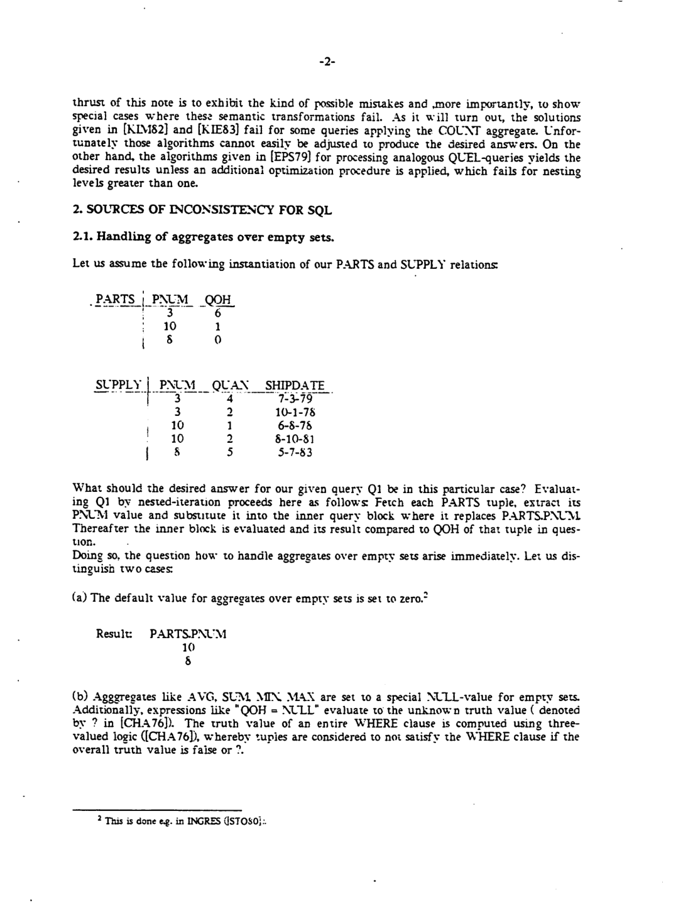
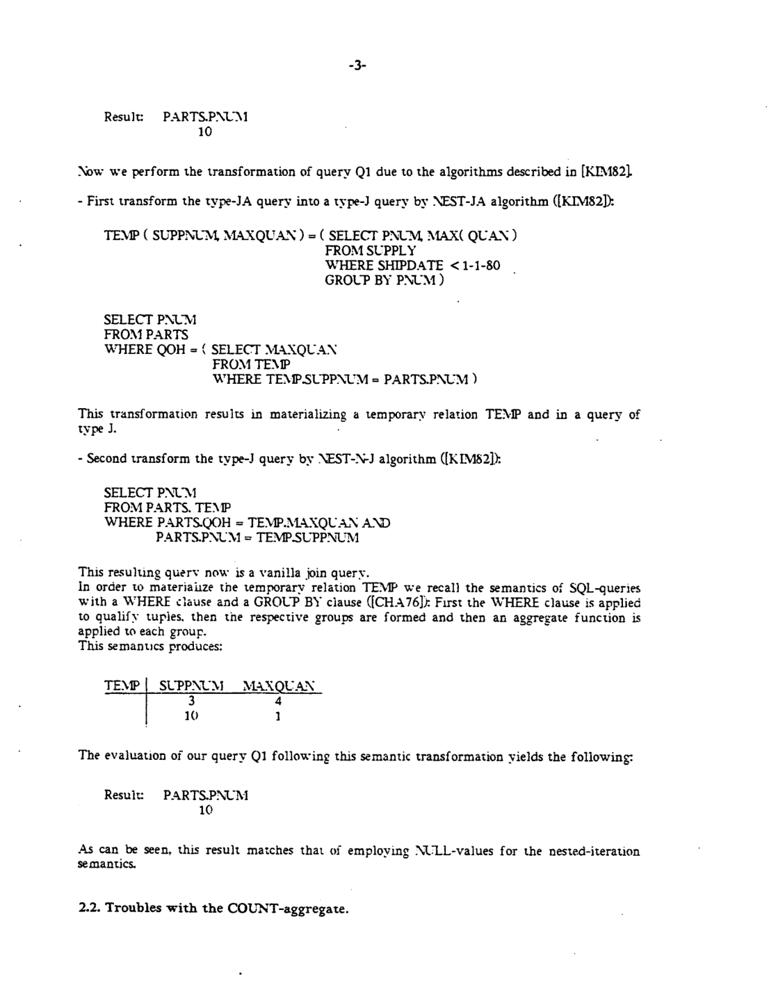

> 本组第 17 篇 · 嵌套查询与去相关 · [全部论文]() · [上一篇]() · [下一篇]()

本文复审 Kim 等针对 type-JA SQL 的相关聚合转换，以及 Epstein/Ingres 的 QUEL 聚合求值。核心区别是：标量 COUNT 在空输入上返回 0，但只在过滤后的内表上 GROUP BY 不会生成缺失键的零计数组，后续内连接因而可能漏答。Q2 正确结果为 {10,8}，被审查的转换仅得 {10}。QUEL 先保留外层 BY-list 域并初始化聚合，避免这个问题，但需修正外层键重复导致的输入放大，并限制多层 BY-list 变量替换。Q3 的正确结果为 {10,8,5,15}，错误 BY-list 优化额外返回 12。作者的最外层补零结果原述另有与读者复算不一致之处，正文明确区分。本文没有证明 SQL 不能表达零计数组，也没有证明所有去相关方案不可能正确；性能判断主要为定性陈述。

本文保留论文陈述、读者推断与待验证方案的区别；实验数字只适用于原文条件。原文和翻译来自已有 AI 辅助精读报告，已做来源匹配与编辑复核，不等于人工逐项核验或独立实验复现。所有页码均为 PDF 物理页。

## 论文与阅读范围

Werner Kiessling. SQL-Like and Quel-Like Correlation Queries with Aggregates Revisited. Memorandum No. UCB/ERL 84/75, Electronics Research Laboratory, University of California, Berkeley, 17 September 1984. 封面与署名见 PDF 物理页 2–3（SRC02、SRC03）；这是技术报告，不臆造期刊卷期。

[论文集中的原始 PDF](https://github.com/lonng/db-papers/blob/4ff1331069c7cf52ac97dd769e5f484c1c35c200/papers/nested-query/sql-like-and-quel-like-correlation-queries-with-aggregates-revisited.pdf) · 本地来源：`nested-query/sql-like-and-quel-like-correlation-queries-with-aggregates-revisited.pdf`，共 17 页。

本篇保留 10 组原文精读和 23 条证据。截图为原始 PDF 的局部页选，不是重新生成的图表；未将整份 PDF 复制到博客。

## 研究问题与适用边界

研究对象是 type-JA：内层 SELECT 含聚合，内层 WHERE 含引用外层关系的相关连接谓词。SQL 基线是对每个外层元组代入其相关值执行内层块，再比较聚合结果；这是语义定义，不要求物理执行器一定采用逐行循环。作者说该方法在许多查询和数据条件下性能很差，不能改写为所有输入都必然性能不可接受。

本文检验的是特定历史转换是否保持这一定义。COUNT 的问题不是把 NULL 算错，而是内表先过滤、分组后，没有匹配输入的相关键根本不生成行。标量 COUNT(empty)=0 与“分组结果没有这一行”是两个不同状态；后续内连接只实现后者。

QUEL 不可只按表面相似语法翻译：没有 BY-list 的 scalar aggregate 中，P.PNUM 是聚合内的局部变量，不隐式绑定外层 P.QOH。Q2 的相应写法须 COUNT(... BY P.PNUM WHERE ...)。作者仅为 type-JA SQL 经正确 BY-list 翻译得到的 QUEL 子类建立事后的 nested-iteration 对应，附带重复值和 BY-list 优化限制，不覆盖任意 QUEL 聚合。

依据：论文陈述；PDF 物理页 4, 7, 8, 10, 12。证据：[C001N01](#evidence-c001n01), [SRC07](#evidence-src07), [SRC08](#evidence-src08), [SRC10B](#evidence-src10b), [SRC12](#evidence-src12)。

## 系统架构与优化器上下文

论文不是新系统架构设计，而是查询转换与聚合求值程序的语义复审。Kim 路径先以 NEST-JA 将相关聚合转成按内层键分组的临时关系，再以 NEST-N-J 消除嵌套，得到普通连接。其关键状态是 TEMP(key,aggregate)，以及哪些相关键在其中有行。

Epstein 路径采用不同的相关域：先投影外层 BY-list 键到 TEMP1，COUNT 初始化为 0；计算 TEMP2a、TEMP2b 中实际存在的聚合，并更新 TEMP1；最后保留原外层元组与 TEMP1 的键链接。NULL 支持、输入重复保留和去重外层域分别承担不同职责。论文脚注称该算法用于 University Ingres 和商业 RTI-Ingres；本审核未检查其源码或版本。

BY-list optimization 随后尝试用临时表的投影列替换 range variable，并删除成为自等式的谓词。该例表明局部投影等价不够：替换后的外层相关链接也须保持。论文没有给出所谓 Query Modifier 所属模块、完整编译流水线、Memo、Volcano 或向量化执行器设计，不能将这些现代或假定架构当作者结论。

依据：论文陈述；PDF 物理页 6, 11, 12, 15。证据：[SRC06](#evidence-src06), [SRC11](#evidence-src11), [SRC12](#evidence-src12), [C002N01](#evidence-c002n01), [C002N02](#evidence-c002n02)。

*原论文 PDF 物理页 5，版权归原作者或出版方。点击图片可查看原尺寸。这是页面定位信息，不表示本次已复核图内所有数据。*

## 去相关化算法及其缺陷分析

以下先还原论文算法，再明确标记读者复算。

Q1/Q2 原始数据（PDF 页 5 表格已看原图）：PARTS(PNUM,QOH)={(3,6),(10,1),(8,0)}。SUPPLY(PNUM,QUAN,SHIPDATE)={(3,4,1979-07-03),(3,2,1978-10-01),(10,1,1978-06-08),(10,2,1981-08-10),(8,5,1983-05-07)}。原日期按月-日-年阅读；本例只需其年份相对 1980 的顺序。

过滤 SHIPDATE<1980-01-01 后，Q1 的 MAX 分别为 4、1，键 8 的输入为空。若空 MAX 取 0，则满足 QOH 的键为 10、8；若取 NULL 且 WHERE 拒绝 UNKNOWN，则只得 10。Kim 路径的 TEMP={(3,4),(10,1)}，内连接仅得 10，与后一约定在本例一致。不要把这一例扩展为所有含非 COUNT 聚合的任意表达式都安全。

Q2 把 MAX 换为 COUNT(SHIPDATE)，相关计数为 2、1、0。QOH 比较保留 10 和 8。预分组 TEMP' 只有 (3,2),(10,1)，连接漏掉 8。8 并非完全不存在于 SUPPLY，而是只有 1983 年记录，被内层过滤排除。原报告所谓“PNUM=10、QOH 及完整数据未知”不成立。

Q3 两层 COUNT 中最内层直接引用 Ri.Cr，跳过 Rj 层。对 Cr=3,10,8,5,15,12，原图和读者逐组计算的内层值为 1,1,2,0,3,0，外层值为 1,1,0,1,0,1，和 Ri.Ch 比较得到 {10,8,5,15}。原转换 Rt1 仅有 (8,2),(3,1),(10,1)，Rt2 仅有 (3,1),(10,1)，最终只得 {10}。Cr=5 的内层空组本应得到 0，继而命中 Rj 的 (74,0) 得到外层 COUNT=1；该信息在内层消失后，仅补最终零组无法恢复 5。

原文页 10 称最外层补零得到 {10,8,15}，但印刷查询本身含列名/SELECT-FROM 笔误，不是可直接执行脚本。读者在内存 SQLite 中按“已有 Rt2 正确匹配，或 Ch=0 且 Cr 不在 Rt2 键域”的文字意图重建，得到 {10,8,15,12}：12 也被误补零，而其正确外层 COUNT=1。保留作者原述与此复算差异，不暗改原引文，也不据此宣称作者已报告这个额外假阳性。

Epstein 修复 COUNT 空域的步骤是先保留外层域、初始化，再覆盖非空聚合。外层键重复时，TEMP2a 应从去重域 TEMP1 而非原 P 连接内表；与此同时 TEMP2a 的真实聚合输入重复不能删除。这是两个不同层次的 multiplicity 要求。

依据：读者推断；PDF 物理页 5, 6, 7, 8, 9, 10, 11, 12, 14。证据：[SRC05](#evidence-src05), [SRC05N](#evidence-src05n), [SRC06](#evidence-src06), [SRC07](#evidence-src07), [SRC08](#evidence-src08), [SRC09](#evidence-src09), [SRC10](#evidence-src10), [SRC11](#evidence-src11), [SRC12](#evidence-src12), [SRC14](#evidence-src14)。

## 正确性论证与语义缺陷

论文的可核对结论：被审查的 SQL 内键分组转换在 COUNT 空输入上有反例；该最外层补零方案不足以处理 Q3 的深层相关。失败的是这些转换，不是通用去相关不可能定理。外层键在原内表出现也不够，须考察实际相关谓词和内层过滤后是否存在输入，Q2 的键 8 就说明这一点。

SQL 与 QUEL 的相关绑定不同。正确 BY-list 建立绑定并保留外层域，不能仅因聚合能写在 WHERE 就断言 QUEL 正确。页 12 对 nested-iteration 对应还要求修正重复外层键问题，并受第 3.2 节限制。读者构造的假设示例：外层键 k 重复两次、内表有两条 k 记录，直接连接原外层会送入四条聚合输入，COUNT=4；先取单个 k 的域再连接，COUNT=2，再接回原外层可分别保留两行。反之对真实内表重复去重也会错误改变 COUNT。

Q3' 不开 BY-list optimization 时得到 {10,8,5,15}。错误替换把 I.Cr 换成 T1.Cr，令 I.Cr=T1.Cr 变成自等式并被删除；TEMP3 的计数未变，但 phase D 不再按 I.Cr 关联 TEMP3，作者报告多出 12。原逐段精读把 5、15 也说成错误额外结果，现已修正。作者给出的局部修复条件是：被替换变量不得出现在外层 BY-list。它保护跨层依赖，不是对任意 QUEL 查询及其他重写的完整证明。

NULL 的边界：作者对 MAX/MIN/SUM/AVG 的肯定依赖恰当 NULL 约定，并处于所讨论查询形态；页 5 明确等值比较遇 NULL 为 UNKNOWN 且 WHERE 不保留。文中 COUNT 反例不依赖源数据 NULL；不能从 COUNT(empty)=0 推出 COUNT(expr) 与 COUNT(*) 在可空列上等价，也不能认为任意 NULL 相关键都可用普通等值连接安全修复。后两项是读者需单独检验的工程边界。

员工例子说明 WHERE JOB='CLERK' 后 GROUP BY 的特定 SQL 写法不包含零 clerk 部门，而不是 SQL 无法表达其意图。作者用 inherent semantical deficiencies 批评当时的表述方式，未给出 SQL 或扩展关系代数的表达能力不可能性证明。QUEL 也只保留 EMP 中有代表的 DNO，不能凭空返回 EMP 完全没有行的部门。

依据：读者推断；PDF 物理页 5, 8, 9, 10, 12, 14, 15, 16。证据：[SRC05N](#evidence-src05n), [SRC08](#evidence-src08), [SRC09](#evidence-src09), [SRC10B](#evidence-src10b), [SRC12](#evidence-src12), [SRC14](#evidence-src14), [C002N01](#evidence-c002n01), [C002N02](#evidence-c002n02), [C002N03](#evidence-c002n03), [C002N05](#evidence-c002n05), [C002N06](#evidence-c002n06), [C002N07](#evidence-c002n07)。

## 实验验证与反例构造

论文提供手工实例、临时表推演和反例，而不是性能 benchmark。SQL nested-iteration 是本文 type-JA 的语义基线，不是现代执行器物理计划的承诺。Q1 说明空集默认值差异；Q2 结果 {10,8} 对照转换 {10}；Q3 正确 {10,8,5,15} 对照原转换 {10}。Q3' 未优化得到正确结果，错误 BY-list 优化被作者报告为 {10,8,5,15,12}。

本审核的已执行核对：按物理页 9 原图转录 Ri/Rj/Rk 的全部元组，在 Python sqlite3 的内存数据库执行相关双 COUNT、手写内键分组转换、以及按原文意图重建的最外层补零。最终断言分别通过 {10,8,5,15}、{10}、{10,8,15,12}；最后一项不同于作者原述 {10,8,15}，已保留差异。此处是读者离线复算，不是重新运行 1984 年 Ingres、验证 QUEL 实现，亦不是作者实验。

没有提供可据以报告的硬件配置、Ingres 精确版本、代码补丁、耗时、内存曲线或统计误差。页 12 的非 COUNT 情况较慢是作者定性判断，不能编造速度比例，也不能把几个反例说成所有嵌套查询都错或所有 nested-iteration 都慢。

依据：读者推断；PDF 物理页 5, 6, 7, 8, 9, 10, 12, 14, 15。证据：[SRC05](#evidence-src05), [SRC06](#evidence-src06), [SRC07](#evidence-src07), [SRC08](#evidence-src08), [SRC09](#evidence-src09), [SRC10](#evidence-src10), [SRC12](#evidence-src12), [SRC14](#evidence-src14), [C002N02](#evidence-c002n02)。

*原论文 PDF 物理页 6，版权归原作者或出版方。点击图片可查看原尺寸。这是页面定位信息，不表示本次已复核图内所有数据。*

## 权衡与工程取舍

论文给出的定性取舍是：Epstein 的外层域求值可处理更广的相关聚合形态，非 COUNT 的 type-JA 情况作者认为较 Kim 慢；没有定量证据。不能把改用 TEMP1 处理重复键说成必然增加计算和内存开销：去除连接输入中的外层重复也可能减少中间乘积，其净代价需另测。

读者工程推断：优化前应明确相关键域、聚合默认值、输入多重集、变量绑定及空组是否仍有一行。外层域去重仅用于避免放大聚合，不能顺便删除聚合输入重复或改变最终外层结果多重性。保持语义不是可以用性能换取的选项；不满足证明条件时应禁用该规则或采用另一种等价执行方式。

读者工程推断：BY-list 替换需要跨层依赖信息，局部“投影列含相同值”不够。该检查可能改变可用计划，但论文没有测得修复后的性能损失。对 NULL、非等值相关和多聚合组合也应分别定义合同，而不是从此文局部修复得出全局保证。

员工查询与意图不符时，需更改查询的外层域或计数表述；优化器不能在不改变既定 SQL 含义的条件下替用户凭空添加原查询不存在的组。这是查询改写目标和执行正确性两个不同问题，不要求改写整个执行引擎语义。

依据：读者推断；PDF 物理页 8, 11, 12, 15, 16。证据：[SRC08](#evidence-src08), [SRC11](#evidence-src11), [SRC12](#evidence-src12), [C002N01](#evidence-c002n01), [C002N03](#evidence-c002n03), [C002N06](#evidence-c002n06)。

## 与相关工作的比较

论文内部比较：Kim 路径从内层过滤后的键构造聚合临时关系，COUNT 的空域会丢失；Epstein 路径先从外层 BY-list 域保留键并初始化，避免该丢失，但要修正外层键重复和 BY-list 优化问题。SQL type-JA 的隐式相关与 QUEL 显式 BY-list 绑定是语义差别，不是简单的 SELECT/HAVING 与 WHERE 语法位置之争。

作者还给出内层涉及 S、T 并与外层 R 关联的例子，指出 Epstein 能处理比 type-JA 更大的类，Kim 方法不能直接应用；脚注说 Kiessling 1983 方法也可处理该例。因此也不应把所有非 type-JA 能力只归于 Epstein。

文献比较限于论文实际陈述，参考文献表不等于已核读这些被引原作。本报告没有检查现代 StarRocks、Calcite、DuckDB 等源码或行为，也没有证据宣称当前引擎使用哪条修复路径。现代系统、代数扩展和标准演进仅可作为后续调查，不用于扩大这篇 1984 年技术报告的结论。

依据：读者推断；PDF 物理页 10, 11, 12, 16, 17。证据：[SRC10B](#evidence-src10b), [SRC11](#evidence-src11), [SRC12](#evidence-src12), [C002N10](#evidence-c002n10)。

## 复现指南与验证建议

以下为读者建议，除 experiments 节列明的 Q3 内存复算外均未宣称已完成。先按物理页 5、9 原图复建完整数据并固定预期结果，不再使用原报告 (10,5)、'D1' 等脱离论文日期条件的替代数据。Q2 应对同一数据比较原相关 COUNT 与手写内键分组内连接，分别得到 {10,8} 与 {10}。

Q3 要逐层检查计数域，不能只核对最终结果。正确内层域值按 Cr=3,10,8,5,15,12 是 1,1,2,0,3,0；外层是 1,1,0,1,0,1。把论文最外层补零原述和读者重建差异作为回归案例保存，禁止把有印刷笔误的页 10 SQL 直接作为执行脚本。要验证 Ingres BY-list 行为，还需独立获取相应实现、版本和开关，本文没有执行这一步。

读者构造的假设示例与候选重写：对于仅有非 NULL 等值相关键的单层 COUNT，可先把内表正确过滤后按键计算 COUNT(expr)，再由原外表 LEFT JOIN 唯一计数行，对缺失的计数值补 0。若改为先 LEFT JOIN 再 COUNT(*)，无匹配时的补位行会计为 1；不要把这两种方案混同。空 MAX/MIN/SUM/AVG 不应无条件 COALESCE 为 0。可空相关键、NOT IN 的 UNKNOWN、COUNT(expr) 忽略 NULL、真实输入重复、重复外层键及最终结果多重性都须单独测试，这些是读者的工程测试要求而非论文给出的通用证明。

对 EMP 例子，先定义“部门集合”取 EMP 中出现的 DNO 还是独立部门表；再构造有员工但零 clerk 的部门，以及完全无员工的部门，验证查询是否按预期域保留。仅改 HAVING 阈值不能恢复 WHERE 过滤掉的组。

正确性验收应比较结果多重集及 NULL/UNKNOWN 行为，而不是只比较去重集合。逻辑反例并不因此成为 O(1) 渐近复杂度结论；原文没有提供复杂度推导。写相关标量子查询也不能强制现代数据库采用 nested-loop 物理计划，执行方式需另查计划。

依据：待验证的工程设想；PDF 物理页 5, 9, 10, 12, 14, 16。证据：[SRC05](#evidence-src05), [SRC05N](#evidence-src05n), [SRC09](#evidence-src09), [SRC10](#evidence-src10), [SRC12](#evidence-src12), [SRC14](#evidence-src14), [C002N06](#evidence-c002n06)。

## 结论与工程启示

原文的贡献是以具体反例检验历史相关聚合转换的等价性。SQL 侧必须区分 COUNT(empty)=0 与内键分组没有行，不能借 NULL 默认值掩盖 COUNT 漏答；深层相关不能仅靠最终补零恢复。QUEL 侧应保留外层域并显式建立 BY-list 绑定，同时处理重复外层键和跨层变量替换。

本审核补充了原报告漏读的署名、完整 Q1/Q2 数据、两层 Q3 计数链及 TEMP2a 的重复保留要求，修正把 5、15 当成额外错误结果的逐段精读。作者页 10 补零结果与读者重建的差异明确保留，转写错位和印刷笔误均不作为作者的算法语义依据。

范围上，本文不是 SQL 无法表达零计数组、所有去相关算法不可能正确、或当前数据库实现不可靠的证明。作者关于非 COUNT 转换的肯定依赖所讨论形态与恰当 NULL 处理；正确 BY-list 翻译得到的 QUEL 子类在所述修正下对应 nested-iteration，不能扩展到任意 QUEL 查询。可复用的工程结论是：让相关域、空集值、多重性和跨层绑定成为重写验证的一部分，性能评价另需实测。

依据：读者推断；PDF 物理页 2, 5, 7, 8, 9, 10, 11, 12, 14, 15。证据：[SRC02](#evidence-src02), [SRC05](#evidence-src05), [SRC07](#evidence-src07), [SRC08](#evidence-src08), [SRC09](#evidence-src09), [SRC10](#evidence-src10), [SRC10B](#evidence-src10b), [SRC11](#evidence-src11), [SRC12](#evidence-src12), [SRC14](#evidence-src14), [C002N02](#evidence-c002n02), [C002N03](#evidence-c002n03), [C002N05](#evidence-c002n05)。

## 原文精读：从句子回到机制

以下保留原文、忠实翻译、含义与边界；假设示例不作为论文实验结果。

### P001 · PDF 物理页 4

**原文**

<blockquote class="paper-source-quote"><pre><code>Similar classifications of nested SQL-like queries can also be found in [MAK81] and&#10;[KIES3J.&#10;The standard method for evaluating correlation queries with aggregates is by nested-iteration ,&#10;evaluating the inner query block once for each substituted correlation value (PARTS.PNUM-&#10;value in our case).1 By this nested-iteration procedure also the semantics of a type-JA SQL-&#10;query is defined in a convenient way.</code></pre></blockquote>

**忠实翻译**

> 在 [MAK81] 和 [KIES3J] 中也可以找到对嵌套类 SQL 查询的类似分类。评估带有聚合的相关查询的标准方法是嵌套迭代（nested-iteration），即对每个被替换的相关值（在我们的例子中是 PARTS.PNUM 值）评估一次内层查询块。通过这种嵌套迭代过程，type-JA SQL 查询的语义也以一种便利的方式被定义。

**技术含义与边界**

> 作者以 nested-iteration 定义 type-JA SQL 的参考语义：每个外层元组的相关值代入内层。这里不承诺物理执行必须逐行，也没有性能最优性结论。被引分类文献仅作本文的来源引用，本审核没有核读这些原作。

**常见误读**

> 容易误认为嵌套迭代是唯一或最优的执行策略，但原文仅称其为“标准方法”并用于定义语义，并未声称其在性能上优于其他变换算法。也不应将 type-JA 的定义方式泛化到所有嵌套查询类型。

**读者构造的假设示例**

> 读者构造的假设示例：假设 PARTS 表有 PNUM 值为 10 和 8 的两行，嵌套迭代会分别用 10 和 8 代入内层查询各执行一次，从而得到对应结果。

### P002 · PDF 物理页 16

**原文**

<blockquote class="paper-source-quote"><pre><code>However, consider the slightly changed query where we ask for department that emplov less&#10;than ten clerks. Now the current W7HERE - GROUP BY evaluation order fails to report&#10;departments that employ no clerks.</code></pre></blockquote>

**忠实翻译**

> 然而，考虑略作改变的查询：询问雇用少于十名 clerk 的部门。此时，当前 WHERE-GROUP BY 求值顺序无法报告没有雇用任何 clerk 的部门。

**技术含义与边界**

> 针对文中先过滤 JOB='CLERK' 再按 DNO 分组的查询，零 clerk 部门没有剩余输入行，因此不会形成组。这是该写法与包含零计数的意图不符，不是 SQL 无法表达意图或执行器不遵守 SQL。

**常见误读**

> 不能把特定查询的组域丢失推广为 SQL 表达能力不完备。QUEL 对应式也只能保留其外层 EMP 域已有的部门。

**读者构造的假设示例**

> 读者构造的假设示例：A 有五名 clerk；B 只有非 clerk 员工。先过滤 clerk 再分组只得到 A。若明确以 EMP 的部门域驱动每部门计数，B 才能以 0 参与 <10 判断。

### P003 · PDF 物理页 12

**原文**

<blockquote class="paper-source-quote"><pre><code>TEMP2b&#10;' PNUM&#10;CT&#10;TEMPI&#10;PNUM&#10;CT&#10;3&#10;2&#10;3&#10;2&#10;10&#10;1&#10;10&#10;1&#10;1&#10;SO&#10;Result: 10, 8.&#10;Remarks:&#10;(1) If we assume that there are no duplicate values for the outer correlation column&#10;PARTS.PNUM, then the correctness of this algorithm should be clear after all preceeding dis&#10;cussions (this proposition has to be taken modulus the remarks stated subsequently in section&#10;3.2).</code></pre></blockquote>

**忠实翻译**

> 表格转写错位，保留英文原块不作逐行数字翻译；已对照页 12 原图：TEMP2b 为 (3,2),(10,1)，更新后的 TEMP1 为 (3,2),(10,1),(8,0)，结果为 10、8。备注 (1)：假设外层相关列 PARTS.PNUM 无重复值，那么结合前文讨论算法正确性应当清楚；此命题还须考虑第 3.2 节的限制。

**技术含义与边界**

> 这是尚未修正步骤 2a 的条件，不能读成外层键重复无解。紧接着作者要求以去重 TEMP1 代替原外层 P 连接 SUPPLY，避免放大输入；TEMP2a 本身仍必须保留真实重复。第 3.2 节进一步讨论跨层 BY-list 替换。

**常见误读**

> 原精读误把 nested-iteration 自身也说成会重复误算。按每个外层元组独立代入的基线不会因另一个相同键元组而把其内层计数翻倍。

**读者构造的假设示例**

> 读者构造的假设示例：P 中 k 出现两次，S 中有两条 k 记录。直接 P join S 后按 k COUNT 得 4，去重键域 join S 得 2；把 2 接回两条原 P 行，才能保留基线结果多重性。

### P004 · PDF 物理页 15

**原文**

<blockquote class="paper-source-quote"><pre><code>To repeat, this query is&#10;RETRIEVE I.Ck&#10;WHERE I.Ch » COUNTt J.Cm BY LCr&#10;WHERE J.Cn = Tl.CT .AND J.Cm &lt; 80&#10;AND&#10;l.Cr = Tl.Cr)&#10;At this point Ingres would attempt to eliminate some logically superfluous range variables&#10;from the subquery inside the COUNT according to the following reasoning: Knowing that&#10;Tl.Cr is a complete projection of LCr (with duplicates removed), LCr is replaced by Tl.Cr&#10;unless this would yield semantically incorrect transformations, with respect to the considered&#10;subquery inside the COUNT.</code></pre></blockquote>

**忠实翻译**

> 段首为 phase B 后的查询，提取文本的 I/l、T1/Tl 及符号有混淆，查询原块保留。在此，Ingres 尝试消除 COUNT 子查询中逻辑上多余的范围变量：已知 T1.Cr 是 I.Cr 的完整去重投影，于是在不使所考察的 COUNT 内子查询语义不正确的前提下，用 T1.Cr 替换 I.Cr。

**技术含义与边界**

> 作者描述优化器的局部推理，不代表该局部条件足以保护整个外层查询。后文显示聚合值保持不变，但最终外层相关链接丢失。I.Cr 是带范围变量限定的列，不是名叫 LCr 的独立范围变量。

**常见误读**

> 容易误认为 Ingres 总是无条件执行此替换优化。原文使用了“unless this would yield semantically incorrect transformations”作为限制条件，说明优化器试图避免语义错误，但后文（P007）表明在某些情况下仍会产生不一致结果。

**读者构造的假设示例**

> 读者构造的假设示例：I.Cr=12 必须只接其对应的计数行。若 I.Cr 被替换、绑定谓词被删，即使 T1.Cr 与原域含同样键值，也可能把其他键的计数接给 I 的这一行；这不是本例中的重复计数故障。

### P005 · PDF 物理页 7

**原文**

<blockquote class="paper-source-quote"><pre><code>EvaluatingQ2 due to nested-iteration semantics yields:&#10;Result:&#10;PARTS.PNUM&#10;10&#10;8&#10;The transformation ofQ2 using Rim's algorithms gives the following outcome:&#10;TEMP' ( SUPPNUM CT ) = ( SELECT PNUM COUNT( SHIPDATE )&#10;FROM SUPPLY&#10;WHERE SHIPDATE &lt; 1-1-80&#10;GROUP BY PNUM )&#10;SELECT PNUM&#10;FROM PARTS.</code></pre></blockquote>

**忠实翻译**

> 按 nested-iteration 语义求 Q2，结果 PARTS.PNUM 为 10、8。接下来展示 Kim 算法的转换（提取文本将姓名显示为 Rim）：临时表 TEMP' 按 SUPPLY.PNUM 分组，对 SHIPDATE<1-1-80 的记录计算 COUNT(SHIPDATE)，随后处理外层 PARTS 查询。该原块止于尚未完整的 FROM PARTS。

**技术含义与边界**

> 结合页 5–8 全文，QOH 为 6、1、0，过滤后的计数为 2、1、0；键 8 只有 1983 年供货。TEMP' 仅包含键 3、10，故内连接最后丢失正确的 8。这里不是 PNUM=10 的数据缺失。

**常见误读**

> 不要把提取文字 Rim 当作者姓名的拼写变体，也不要把截断片段当完整 SQL。不得构造 TEMP' 含键 8 的例子解释本反例，恰恰是其不含 8 才漏答。

**读者构造的假设示例**

> 读者构造的假设示例：k 的 QOH=0，供货仅在 1983 年；过滤日期早于 1980 年后标量 COUNT=0，但分组表没有 k 行，内连接就会删除 k。

### P006 · PDF 物理页 16

**原文**

<blockquote class="paper-source-quote"><pre><code>Kiessling:&#10;Tuneable Dynamic Filter Algorithms for High Performance Database Systems, Proc.&#10;Intern. Workshop on High Level Computer Architecture, Los Angeles, Mav 21-25&#10;,1984, pp. 6.10-6.20.&#10;[KIMS2] W. Kim:&#10;On Optimizing an SQL-like Nested Query. ACM TODS, Vol. 7. No. 3, Sept. 1982, pp.&#10;443-469.&#10;[MAK81]&#10;A. Makinouchi. et a I--&#10;The Optimization Strategy for Querv Evaluation in RDB/Yl, Proc VLDB Cannes&#10;1981, pp. 518-529.</code></pre></blockquote>

**忠实翻译**

> 参考文献片段列出 Kiessling 的 Tuneable Dynamic Filter Algorithms for High Performance Database Systems（洛杉矶会议，1984，页 6.10–6.20）；W. Kim 的 On Optimizing an SQL-like Nested Query（ACM TODS 7(3)，1982 年 9 月，443–469）；以及 Makinouchi 等人的 RDB/V1 查询求值优化策略论文（VLDB Cannes 1981，518–529）。标题及姓名原始转写保留在英文块中。

**技术含义与边界**

> 原文提供了参考文献列表，包括 Kiessling 关于动态过滤算法的会议论文、W. Kim 关于类 SQL 嵌套查询优化的 TODS 期刊论文，以及 Makinouchi 等人关于 RDB/V1 查询评估优化策略的 VLDB 论文。这些是本文引用的背景文献。

**常见误读**

> 这是本文参考文献的书目材料，不代表审核已读过被引论文，也不能仅凭题名推断其机制或实验。转写中的 Mav、Querv 等异常需对照原图；不应把系统提示语混入技术解释。

**读者构造的假设示例**

> 读者构造的假设示例：若研究者想深入了解嵌套查询优化历史，可能会查阅 [KIMS2] 这篇 1982 年的 TODS 论文，但当前上下文中仅知其标题和页码，无法得知其具体算法内容。

### P007 · PDF 物理页 15

**原文**

<blockquote class="paper-source-quote"><pre><code>However the modified query for&#10;phase D now would become:&#10;RETRIEVE l.Ck&#10;WHERE l.Ch = T3.CT2 .AND JT1.C-- = T3.Cr&#10;In this way one crucial link between Ri and TEMP3 would get lost with the undesired effect&#10;that Ingres actually delivers as result: 10, 8, 5, 15 and 12.&#10;Consequently, the application of the Ingres BY-hst optimization produces inconsistent results&#10;for correlation levels greater than one. Fixing this bug can be easily done, because for nested&#10;aggregates a range variable replacement in the BY-list optimization must only make sure that&#10;the variable in question does not appear in an outer BY-list.</code></pre></blockquote>

**忠实翻译**

> phase D 的修改查询如原块所示（公式转写有损，应对照页 15 原图）。这样丢失了 Ri 与 TEMP3 之间的关键链接，导致 Ingres 实际给出 10、8、5、15、12。因此，对于相关层级大于一的嵌套聚合，这种 BY-list 优化会产生不一致结果。作者提出的修复是保证被替换变量不出现在外层 BY-list 中。

**技术含义与边界**

> 正确 Q3' 结果为 10、8、5、15，所以错误结果额外多出的是 12，5 和 15 并非错误行。页 15 还说明 TEMP3 的聚合结果并未改变，故问题在外层相关绑定而不是聚合运算。

**常见误读**

> 容易将此 bug 泛化为所有相关查询的问题，但原文明确限定了触发条件为“correlation levels greater than one”（相关级别大于一）。此外，修复建议仅针对“嵌套聚合”中的 BY-list 优化，不应推断为适用于所有类型的优化。

**读者构造的假设示例**

> 读者构造的假设示例：某外层键 x 的 Ch=0，但其正确外层聚合为 1；失去按 x 的连接后若借用了另一键的计数 0，就会错误保留该行。这类似文中额外返回 12 的绑定问题。

### P008 · PDF 物理页 15

**原文**

<blockquote class="paper-source-quote"><pre><code>Consequently, the application of the Ingres BY-hst optimization produces inconsistent results&#10;for correlation levels greater than one. Fixing this bug can be easily done, because for nested&#10;aggregates a range variable replacement in the BY-list optimization must only make sure that&#10;the variable in question does not appear in an outer BY-list.&#10;4. CONCLUSION&#10;In this note we showed that for SQL-like correlation queries involving the COUNT&#10;aggregate the transformation algorithms described in the literature fail to yield consistent&#10;results for some cases.</code></pre></blockquote>

**忠实翻译**

> 因此，Ingres BY-list 优化的应用对于大于一的相关级别会产生不一致的结果。修复这个 bug 很容易做到，因为对于嵌套聚合，BY-list 优化中的范围变量替换只需确保所讨论的变量不出现在外层的 BY-list 中即可。
> 4. CONCLUSION
> 在这篇笔记中，我们展示了对于涉及 COUNT 聚合的类 SQL 相关查询，文献中描述的变换算法在某些情况下无法产生一致的结果。

**技术含义与边界**

> 原文的修复针对嵌套聚合 BY-list 变量替换的外层依赖；结论针对所复审的历史 SQL COUNT 转换的某些情况。不能将该局部检查升级为完整 QUEL 语言或所有优化的正确性证明。

**常见误读**

> 结论中的“fail to yield consistent results for some cases”有严格限定：一是仅限于“涉及 COUNT 聚合的类 SQL 相关查询”，二是仅在“某些情况下”。不能将其解读为所有聚合函数、所有查询语言或所有情况下的变换算法都是错误的。

**读者构造的假设示例**

> 读者构造的假设示例：即使当前 COUNT 子查询替换前后聚合值相同，若被替换变量仍出现在外层聚合的 BY-list，仍须阻止替换以保留绑定；无需假设所有多层查询都会触发错误。

### P009 · PDF 物理页 16

**原文**

<blockquote class="paper-source-quote"><pre><code>Now the current W7HERE - GROUP BY evaluation order fails to report&#10;departments that employ no clerks.&#10;In turn, QUEL allows a consistent formulation (OP&#10;stands for &lt; or &gt;):&#10;RANGE OF E IS EMP&#10;RETRIEVE ( EDNO )&#10;WHERE COUNT( ENAME BY EDNO WHERE EJOB = 'CLERK* ) OP 10&#10;In [KIM82] it is stated that the reason of the less-than-satisfactory performance of nested&#10;queries in existing relational database systems is that most types of nesting are not well&#10;understood.</code></pre></blockquote>

**忠实翻译**

> 现在当前的 WHERE - GROUP BY 评估顺序无法报告那些没有雇用任何 clerk 的部门。
> 反过来，QUEL 允许一致的表述（OP 代表 < 或 >）：
> RANGE OF E IS EMP
> RETRIEVE ( EDNO )
> WHERE COUNT( ENAME BY EDNO WHERE EJOB = 'CLERK* ) OP 10
> 在 [KIM82] 中指出，现有关系数据库系统中嵌套查询性能不理想的原因是大多数类型的嵌套没有被很好地理解。

**技术含义与边界**

> 关键是 BY E.DNO 先确定外层部门域，再在聚合内部按 clerk 条件计数，而非 COUNT 写在 WHERE 本身。对于 EMP 中有员工但没有 clerk 的部门，可以保留零计数；EMP 没有任何行的部门不在这个域内。作者引用 Kim 的性能看法，不等于本审核独立验证其原作或性能因果。

**常见误读**

> 不得据此断言 QUEL 总优于 SQL，或 SQL 无法表达零计数意图。比较的是所示查询的域与绑定方式，SQL 可另行以明确外层域表达；此类改写需保持其实际目标语义。

**读者构造的假设示例**

> 读者构造的假设示例：DNO=B 在 EMP 中只有非 clerk 员工，COUNT(... BY E.DNO WHERE E.JOB='CLERK') 对 B 可得 0。若部门 C 完全没有 EMP 行，这个查询的域本身没有 C，不能凭空返回 C。

### P010 · PDF 物理页 15

**原文**

<blockquote class="paper-source-quote"><pre><code>On the other hand, the algorithms used to process analogous QL'EL-like queries are&#10;reported to give the desired answers at any time, up to a minor repairable bug. Whether the&#10;SQL transformations can be adjusted in an elegant way relying on the current semantics of&#10;WHERE _. GROUP BY clauses is however questionable due to some inherent semantical&#10;deficiencies.</code></pre></blockquote>

**忠实翻译**

> 另一方面，据报告，用于处理类似 QUEL 查询的算法除了一个可修复的小缺陷外，可以给出期望结果。作者认为，由于一些内在语义问题，能否依靠当前 WHERE-GROUP BY 子句语义优雅地调整这些 SQL 转换，仍值得怀疑。提取文字 QL'EL 是名称转写异常，英文原块保留。

**技术含义与边界**

> 这是作者对所审查方法和类似查询的历史总结，须与页 12 的重复键修复及页 15 的 BY-list 限制一起阅读。questionable 表示质疑，不是 SQL 表达能力或所有变换算法的不可能性证明。

**常见误读**

> 不应将“QL'EL 算法总能给出期望答案”理解为绝对无误，原文明确保留了“up to a minor repairable bug”的限定。同时，作者对 SQL 转换的质疑（questionable）是一种学术观点或推断，而非已被证明的不可能定理。

**读者构造的假设示例**

> 读者构造的假设示例：将满足条件的内表先分组会丢失零计数组；以明确的外层键域保留组并定义空输入值是一种需要验证的另一方案，不必改变 WHERE 的既定 SQL 含义，更不能据此要求重写整个执行引擎。

## 尚未解决的问题

1. 页 10 印刷补零查询含列名和 SELECT/FROM 笔误；作者原述 {10,8,15} 与按其文字意图恢复缺失组的 {10,8,15,12} 应如何由更完整的历史实现或勘误解释？
2. 针对可空相关键、NOT IN、不同聚合及复杂谓词，候选去相关规则的精确前提和结果多重集合同是什么？本篇未给出统一证明。
3. 如何在具体实现中保留跨层变量依赖，既满足 BY-list 替换的作用域条件，又验证其他后续重写不会重新破坏绑定？
4. 如何实测外层域去重、临时表维护和聚合输入规模的净代价？本文没有定量性能证据。
5. 现代数据库的相应规则、计划和回归用例需要另行检查；不能从本文推断其当前实现方式或正确性。

## 证据索引

证据编号沿用原报告，便于将上文判断追溯到原句。引文匹配只验证位置，不证明解读正确。

**C001N01 · PDF 物理页 4**

本文以对每个外层元组代入相关值的 nested-iteration 定义 type-JA SQL 语义，讨论使内层计算可复用的历史转换；作者说大类查询和数据条件下性能很差，并未测得所有输入都慢。

<blockquote class="paper-source-quote"><pre><code>The standard method for evaluating correlation queries with aggregates is by nested-iteration , evaluating the inner query block once for each substituted correlation value</code></pre></blockquote>

**C001N08 · PDF 物理页 12**

原步骤 2a 直接连接原外层关系，在外层相关键重复时可能放大聚合输入。作者改用去重域 TEMP1 连接 SUPPLY；这与 TEMP2a 不消除输入重复是两个不同要求，且还要遵守第 3.2 节限制。非 COUNT 情况较 Kim 慢是作者定性判断，无开销测量，不能断言该修复必然更费内存或更慢。

<blockquote class="paper-source-quote"><pre><code>If we assume that there are no duplicate values for the outer correlation column PARTS.PNUM, then the correctness of this algorithm should be clear</code></pre></blockquote>

**C001N09 · PDF 物理页 7**

文中使用了具体的实例数据来验证算法行为。关系PARTS包含PNUM和QOH（如PNUM=8, QOH=0），SUPPLY包含PNUM、QUAN和SHIPDATE。查询Q1使用MAX，Q2使用COUNT。在Q2的nested-iteration求值中，PNUM=8因为SUPPLY中没有符合条件的记录，COUNT(SHIPDATE)=0，且QOH=0，所以8应出现在结果中。但Kim的转换生成的TEMP'不包含PNUM=8，导致结果丢失8。Q3是一个两层嵌套的COUNT查询，涉及Ri, Rj, Rk三个关系，用于证明单层修补在多层嵌套下的失败。

<blockquote class="paper-source-quote"><pre><code>EvaluatingQ2 due to nested-iteration semantics yields: Result: PARTS.PNUM 10 8</code></pre></blockquote>

**C002N01 · PDF 物理页 15**

Ingres 的 BY-list optimization 试图消除 COUNT 子查询中逻辑上多余的 range variable。其推理是：若 Tl.Cr 是 LCr 去重后的完全投影，则将子查询中的 LCr 替换为 Tl.Cr，随后扫描并丢弃如 Tl.Cr = Tl.Cr 这样的平凡谓词。这是一种基于等价替换的启发式优化，但文中证明其在特定条件下破坏正确性。

<blockquote class="paper-source-quote"><pre><code>Knowing that Tl.Cr is a complete projection of LCr (with duplicates removed), LCr is replaced by Tl.Cr unless this would yield semantically incorrect transformations</code></pre></blockquote>

**C002N02 · PDF 物理页 15**

BY-list optimization 在相关层级大于 1（correlation levels greater than one）时会导致错误结果。优化后 Ri 与 TEMP3 之间的关键连接丢失，使得 phase D 的查询无法正确关联外层表，最终 Ingres 实际返回了错误的结果集：10, 8, 5, 15 和 12。这属于正确性（correctness）缺陷而非单纯的启发式排序问题。

<blockquote class="paper-source-quote"><pre><code>the application of the Ingres BY-hst optimization produces inconsistent results for correlation levels greater than one</code></pre></blockquote>

**C002N03 · PDF 物理页 15**

针对本文嵌套聚合的 BY-list 替换缺陷，作者要求被替换变量不能出现在外层 BY-list 中，以保留相关链接。这是上下文相关的局部正确性条件，不是所有 QUEL 优化的普遍完备性证明。

<blockquote class="paper-source-quote"><pre><code>a range variable replacement in the BY-list optimization must only make sure that the variable in question does not appear in an outer BY-list</code></pre></blockquote>

**C002N05 · PDF 物理页 15**

作者质疑能否沿用当时 WHERE-GROUP BY 方式优雅修补所审查的 SQL 转换，并以 inherent semantical deficiencies 表述其看法；这不是 SQL 表达能力不足或所有去相关算法不可能正确的定理。

<blockquote class="paper-source-quote"><pre><code>Whether the SQL transformations can be adjusted in an elegant way relying on the current semantics of WHERE _. GROUP BY clauses is however questionable due to some inherent semantical deficiencies</code></pre></blockquote>

**C002N06 · PDF 物理页 16**

把所示 EMP 查询的 HAVING >10 改为 <10，WHERE JOB='CLERK' 已删除零 clerk 部门的所有输入，因而该写法不满足包含零计数组的意图。这是查询与意图的差异，不表示 SQL 执行其定义有错，也不表示 SQL 无法改写表达该需求。

<blockquote class="paper-source-quote"><pre><code>the current W7HERE - GROUP BY evaluation order fails to report departments that employ no clerks</code></pre></blockquote>

**C002N07 · PDF 物理页 16**

QUEL 例子以 E.DNO 的外层 BY-list 域承载组，再在聚合内部过滤 clerk，可保留 EMP 中存在但无 clerk 的部门。关键是域和显式绑定，而不只是把 COUNT 写在 WHERE；EMP 完全没有代表的部门也不会凭空产生。

<blockquote class="paper-source-quote"><pre><code>QUEL allows a consistent formulation (OP stands for &lt; or &gt;): RANGE OF E IS EMP RETRIEVE ( EDNO ) WHERE COUNT( ENAME BY EDNO WHERE EJOB = 'CLERK* ) OP 10</code></pre></blockquote>

**C002N10 · PDF 物理页 16**

参考文献列表包含多篇数据库内核领域的关键文献：[CHA76] SEQUEL2 的定义；[EPS79] Epstein 关于关系数据库中聚合处理技术的 Berkeley 备忘录；[GRA81] Gray 关于关系代数中 Group-By 操作的论述；[KIE83] Kiessling 的博士论文；[KIE84] 关于高性能数据库系统的可调动态过滤算法；[KIM82] Kim 关于优化类 SQL 嵌套查询的 TODS 论文；[MAK81] RDB/V1 的优化策略；[STO80] Stonebraker 关于 INGRES 的回顾。

<blockquote class="paper-source-quote"><pre><code>[KIMS2] W. Kim: On Optimizing an SQL-like Nested Query. ACM TODS, Vol. 7. No. 3, Sept. 1982, pp. 443-469.</code></pre></blockquote>

**SRC02 · PDF 物理页 2**

封面明确署名 Werner Kiessling，报告 UCB/ERL 84/75，1984-09-17，Electronics Research Laboratory。

<blockquote class="paper-source-quote"><pre><code>SQL-Like and Quel-Like&#10;Correlation Queries with Aggregates&#10;Revisited&#10;by&#10;Werner Kiessling&#10;Memorandum No.&#10;UCB/ERL 84/75&#10;17 September 1984&#10;Electronics Research Laboratory</code></pre></blockquote>

**SRC03 · PDF 物理页 3**

作者单位为加州大学伯克利分校电气工程与计算机科学系；不能把 PDF 元数据的 Windows 当作者。

<blockquote class="paper-source-quote"><pre><code>by&#10;Werner Kiessling&#10;Department of Electrical Engineering and Computer Science&#10;University of California&#10;Berkeley, CA.</code></pre></blockquote>

**SRC05 · PDF 物理页 5**

原图核对 PARTS=(3,6),(10,1),(8,0)；SUPPLY 的 8 有 1983 年记录，但没有日期过滤前于 1980 年的记录。转写表格错位须对照原图。

<blockquote class="paper-source-quote"><pre><code>Let us assume the following instantiation of our PARTS and SUPPLY relations:&#10;PARTS j PNUM&#10;QOH&#10;* "'"'3&#10;6&#10;10&#10;1&#10;!&#10;S&#10;0&#10;supply;|&#10;PNUM _QL'AN__SHIPDATE_&#10;3&#10;"&#10;" "4""""&#10;7-3^79&#10;3&#10;2&#10;10-1-78&#10;.10&#10;1&#10;6-8-78&#10;10&#10;2&#10;8-10-81&#10;|&#10;S&#10;5&#10;5-7-83</code></pre></blockquote>

**SRC05N · PDF 物理页 5**

原文比较空集聚合取 0 与 AVG/SUM/MIN/MAX 取 NULL；后一情况等值比较得 UNKNOWN，WHERE 不保留该行。

<blockquote class="paper-source-quote"><pre><code>(a) The default value for aggregates overempty sets isset to zero.2&#10;Result:&#10;PARTS.PNUM&#10;10&#10;8&#10;(b) Agggregates like AVG, SUM MIN. MAX are set to a special NULL-value for empty sets.&#10;Additionally, expressions like "QOH = NULL" evaluate to the unknown truth value ( denoted&#10;by ? in [CHA76]). The truth value of an entire WHERE clause is computed using three-&#10;valued logic ([CHA76]), whereby tuples are considered to not satisfy the WHERE clause if the&#10;overall truth value is false or ?.&#10;This is done e^. in INGRES GSTOSOj:.</code></pre></blockquote>

**SRC06 · PDF 物理页 6**

SQL 先 WHERE 后 GROUP BY；Q1 的 TEMP 仅有 (3,4),(10,1)，连接结果为 10，与本例 NULL 约定一致。

<blockquote class="paper-source-quote"><pre><code>In order to materialize the temporary relation TEMP we recall the semantics of SQL-queries&#10;with a WHERE clause and a GROUP BY clause ([CHA76]): First the WHERE clause is applied&#10;to qualify tuples, then the respective groups are formed and then an aggregate function is&#10;applied to each group.&#10;This semantics produces:&#10;TEMP&#10;SUPPNUM&#10;MAXQUAN&#10;3&#10;4&#10;10&#10;1&#10;The evaluation of our query Ql following this semantic transformation yields the following:&#10;Result:&#10;PARTS.PNUM&#10;10&#10;.As can be seen, this result matches thai of employing MT.L-values for the nested-iteration&#10;semantics.</code></pre></blockquote>

**SRC07 · PDF 物理页 7**

COUNT 是全定义函数，空集上为 0；这个空集反例不靠输入 NULL，也不能通过换用 NULL 默认值消除。

<blockquote class="paper-source-quote"><pre><code>The reason for choosing&#10;COUNT instead of MAX is that COUNT is a totally defined function, i.e, COUNT over the&#10;empty set is defined as zero. (This implies also that for this new example the existence/non&#10;existence of NULL-values is irrelevant.)</code></pre></blockquote>

**SRC08 · PDF 物理页 8**

WHERE-GROUP BY 消除过滤后不存在的相关键，导致没有可供连接的 CT=0 行。

<blockquote class="paper-source-quote"><pre><code>Again the results differ. But unfortunately we now have no resort to establish a match&#10;because COUNT is a totally defined function. The very reason, why this transformation fails&#10;in this particular case is as follows due to the WHERE-.GROUP BY semantics, materializing&#10;TEMP eliminates non-present SUPPLY.PNUM values; thus these empty sets are not counted&#10;and evaluated to CT = 0. On the other hand, the nested-iteration method accounts for counting&#10;empty sets.&#10;As a matter of fact, similar deficiencies will show up for the case where the&#10;outer correlation column (PARTS^NUM) is not a subset of the inner correlation column&#10;(SUPPL.PNUM), as in our example.</code></pre></blockquote>

**SRC09 · PDF 物理页 9**

Q3 的三张输入表、跨层 Ri.Cr 相关谓词和作者预期结果 10,8,5,15；表格及公式已对照原图。

<blockquote class="paper-source-quote"><pre><code>Relations:&#10;Ri&#10;' Ck&#10;Ch&#10;Cr&#10;3&#10;6&#10;3&#10;10&#10;1&#10;10&#10;8&#10;0&#10;8&#10;5&#10;1&#10;5&#10;15&#10;0&#10;15&#10;12&#10;0&#10;12&#10;-6-&#10;Rj&#10;I Cm&#10;Cn&#10;Rk&#10;79&#10;4&#10;84&#10;2&#10;78&#10;1&#10;81&#10;1&#10;77&#10;5&#10;82&#10;6&#10;74&#10;0&#10;83&#10;12&#10;Cp&#10;Cq&#10;1&#10;8&#10;2&#10;8&#10;3&#10;8&#10;3&#10;5&#10;4&#10;3&#10;5&#10;10&#10;1&#10;15&#10;2&#10;15&#10;4&#10;15&#10;Query Q3:&#10;SELECT Ri.Ck&#10;FROM&#10;Ri&#10;WHERE Ri.Ch = ( SELECT COUNT. Rj.Cm )&#10;FROMRj&#10;WHERE RiCn = ( SELECTCOUNT( Rk.Cp )&#10;FROM Rk&#10;WHERE Rk.Cq = Ri.Cr&#10;AND&#10;Rk.Cp != 3 )&#10;.AND&#10;Rj.Cm &lt; 80 )&#10;Expected result due to nested-iteration semantics '10. 8. 5. 15 I</code></pre></blockquote>

**SRC10 · PDF 物理页 10**

作者称最外层补零恢复 8 和 15 仍无法恢复 5，并建议从外层相关域开始。读者复算还会误收 12；须分别列出作者原述和重建结果。

<blockquote class="paper-source-quote"><pre><code>produces as result 10, 8, 15, thus recovering 8 and 15 lost by the outer COUNT. But unfor&#10;tunately there seems to be no general wTay to recover values lost by COUNTs on a correlation&#10;level greater than 1. In this example recovering 5 cannot be done using the same approach as&#10;for the outer COUNT.&#10;Consequently in order to devise a transformation which will produce consistent results for&#10;any type-JA query, different algorithms must be considered. As a preparation for the QUEL&#10;approach let us review the reason that the considered solution fails in some cases.&#10;The transformation algorithm projects the inner correlating column (SUPPLY.PNUM for Q2)&#10;into a temporary (TEMP) for a subsequent GROUP BY computation. This is correct as long as&#10;the outer correlation column's values (PARTS.PNUM) are a subset of the inner ones. Other&#10;wise some outer correlating values may not be accounted for in the final join.&#10;Therefore a consistent algorithm should start by projecting the outer correlation column into a&#10;temporary relation, which is done by QL'EL.</code></pre></blockquote>

**SRC10B · PDF 物理页 10**

无 BY-list 的 QUEL 标量聚合内部 P.PNUM 是局部变量，与外层 P.QOH 不绑定；对应 SQL Q2 必须显式 BY P.PNUM。原文一处 P.PARTS 为列名笔误，不作为语义依据。

<blockquote class="paper-source-quote"><pre><code>However, in this query P.PNUM is completely local to the aggregate COUNT, U. there is no&#10;linking between the outer P.QOH and the inner P.PNUM This usage of an aggregate is termed&#10;a scalar aggregate, and it evaluates to a single value which is substituted to compute the outer&#10;query. If we want to write the QL'EL equivalent to Q2, then we must explicitly establish&#10;this desired link by using a BY-list containing the outer correlation column P.PARTS for the&#10;COUNT aggregate, which is done below:</code></pre></blockquote>

**SRC11 · PDF 物理页 11**

Epstein 先投影外层 BY-list 域并初始化 COUNT 为 0，再计算真实非空聚合；TEMP2a 必须保留聚合输入重复。

<blockquote class="paper-source-quote"><pre><code>/*(1) Project outer correlation column (being exactly the BY-list) and initialize aggregates */&#10;RETRIED INTO TEMPI ( P.PNUM, CT •= 0 )&#10;/*(2)Evaluate partial query with aggregate function locally, maintaining&#10;the connection between the inner correlation column values and their&#10;respective aggregate value. *.&#10;;* Be carefully not to remove duplicates for TEMP2a. *&#10;RETRIEVE INTO TE\P2a ( P.PNUM. SSHIPDATE )&#10;WHERE S.PNUM = P.PNUM AND S.SHIPDATE &lt; 1-1-80&#10;RANGE OF T2a IS TEMP2a&#10;RETRIED INTO TEMP2b ( T2a.PNUM, CT = COUNT( T2a-SHIPDATE BY T2a.PNUM)</code></pre></blockquote>

**SRC12 · PDF 物理页 12**

外层相关键重复时原步骤 2a 会放大聚合输入，应使用去重外层域 TEMP1 替代原 P；一般不能删除连接谓词，且仍需处理第 3.2 节优化问题。

<blockquote class="paper-source-quote"><pre><code>Remarks:&#10;(1) If we assume that there are no duplicate values for the outer correlation column&#10;PARTS.PNUM, then the correctness of this algorithm should be clear after all preceeding dis&#10;cussions (this proposition has to be taken modulus the remarks stated subsequently in section&#10;3.2). In particular the reader should convince himself that this algorithm is not sensitive to a&#10;specific choice of the defaults for aggregates over empty sets. (Nevertheless, NULL values&#10;should be supported.) Note also that in general the join clause in step2 must not be dropped. If&#10;however for whatever reasons there are duplicate values in the outer correlation column then&#10;this algorithm fails to be equivalent to nested iteration. (In the contrary, this issue does not&#10;arise for KIM'S algorithm.) In order to establish an equivalence to nested-iteration in every&#10;conceivable case the computation of TEMP2a would have to bechanged as follows:&#10;RANGE OF Tl IS TEMPI&#10;RETR1E\T INTO TEMP2a ( Tl.PNUM S3HIPDATE )&#10;WHERE S.PNUM = Tl.PNUM AND SSHIPDATE &lt; 1-1-80</code></pre></blockquote>

**SRC14 · PDF 物理页 14**

不开 BY-list optimization 的 Q3' 返回 10,8,5,15；原图 TEMP1 内层计数为 1,1,2,0,3,0，TEMP3 外层计数为 1,1,0,1,0,1，键顺序 3,10,8,5,15,12。

<blockquote class="paper-source-quote"><pre><code>The computed result in step 4 finally becomes: 10, 8. 5. and 15, which is the desired one.</code></pre></blockquote>

## 版本与使用边界

- 原 PDF SHA256：`f1273132ffcd28bb2c700fa70e2428c998b2e4ff130fa97572b24b997340ff22`。
- 报告来源：`qwen3.8-max`；此处按已完成报告整理，没有重新请求模型。
- OCR 记录页：[]；低文本页：[]。
- 本次新增页面截图，未据此自动重写原报告的数值、公式或实验结论；原有“未进行图像识别”限制仍适用于分析生成过程。
- 截图与短引仅服务于论文评论，版权归原作者或出版方；正式发布前复查转载范围和授权。
- 本文保留未核实的书目信息及研究问题，不用现代产品行为替代历史论文的证据。
