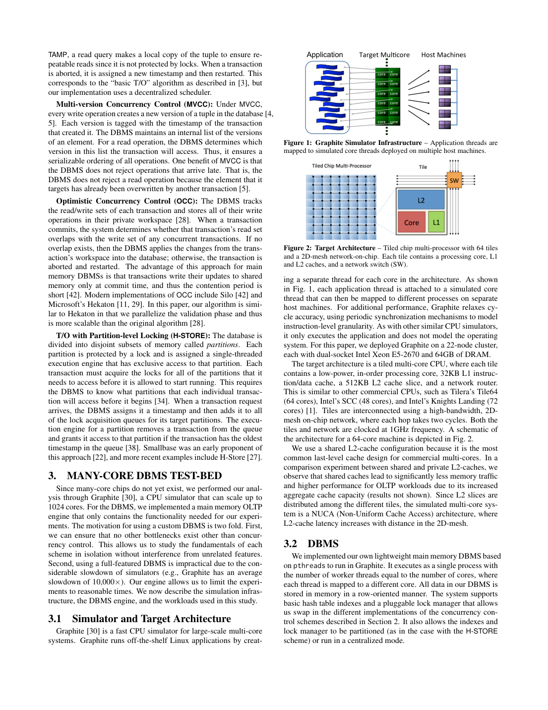
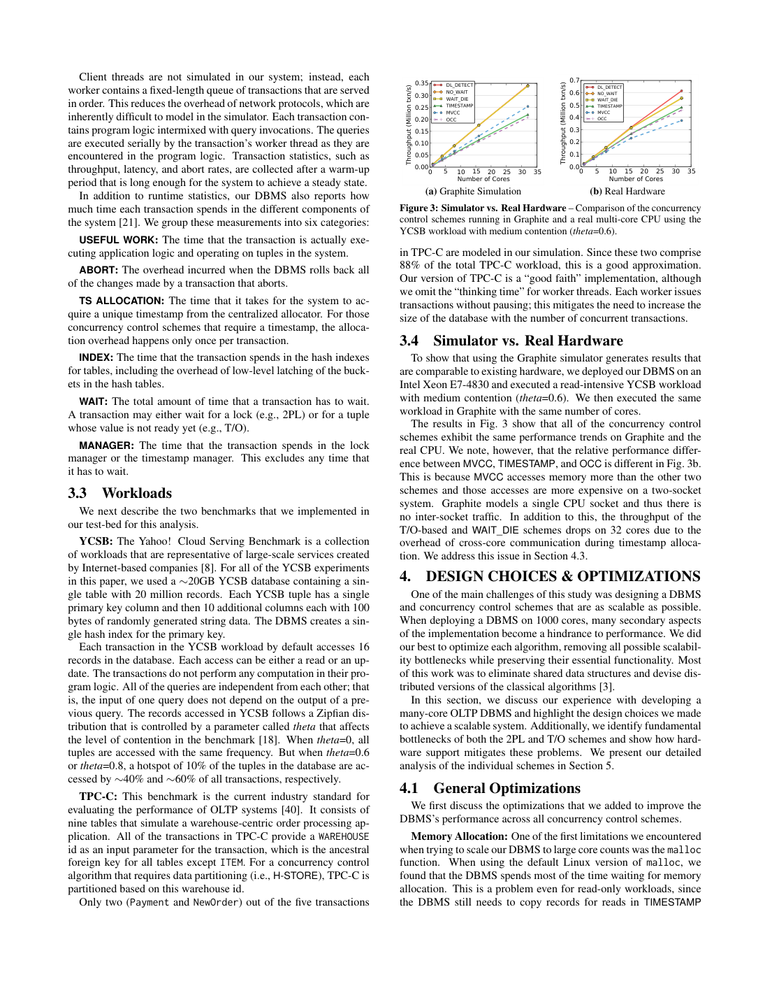

> 本组第 67 篇 · 事务与并发控制 · [全部论文]() · [上一篇]()

作者在同一轻量内存DBMS中实现七种并发控制，在Graphite中模拟最多1024核，分析锁抖动、提前中止、死锁、全局时间戳和内存复制。最值得复用的是实验方法：先去掉中央分配器/锁表等实现瓶颈，再改变偏斜、读写混合、事务长度与分区形态，依据运行时间分解解释瓶颈转移。

结论不是所有算法在所有负载都无法扩展：低竞争、只读或可分区情况下部分方案仍扩展良好；高竞争又呈不同排序。主要千核数字是模拟结果，不是1024核物理芯片实测；CPU硬件计数器是模拟提案。TPC-C只含NewOrder和Payment、无think time，且分区图14的图注与正文工作负载描述存在不一致，不能伪装成完整官方TPC-C或消除来源歧义。

本文保留论文陈述、读者推断与待验证方案的区别；实验数字只适用于原文条件。原文和翻译来自已有 AI 辅助精读报告，已做来源匹配与编辑复核，不等于人工逐项核验或独立实验复现。所有页码均为 PDF 物理页。

## 论文与阅读范围

Xiangyao Yu、George Bezerra、Andrew Pavlo、Srinivas Devadas、Michael Stonebraker，Staring into the Abyss: An Evaluation of Concurrency Control with One Thousand Cores，PVLDB 8(3)，2014，209-220。MIT开放存档副本含1页封面，总13物理页；正文PDF物理2-13页。不要把2015会议展示年与2014卷期混同。

[论文集中的原始 PDF](https://github.com/lonng/db-papers/blob/4ff1331069c7cf52ac97dd769e5f484c1c35c200/papers/transaction/staring-into-the-abyss%3A-an-evaluation-of-concurrency-control-with-one-thousand-cores.pdf) · 本地来源：`transaction/staring-into-the-abyss_-an-evaluation-of-concurrency-control-with-one-thousand-cores.pdf`，共 13 页。

本篇保留 34 组原文精读和 58 条证据。截图为原始 PDF 的局部页选，不是重新生成的图表；未将整份 PDF 复制到博客。

## 研究问题与适用边界

**研究对象是共享内存多核的协调成本**
当核数增加，冲突数据访问、时间戳分配和元数据一致性流量可能吞掉并行收益。作者把问题聚焦并发控制，用同一轻量引擎比较七种算法，尽量避免完整DBMS遗留模块干扰。

**不是生产系统总排名**
七种方案包括三种2PL、基本T/O、MVCC、OCC和共享内存改写H-STORE。它们不是同名商业产品的源码测试，也不是穷举所有实现。主要千核数据来自Graphite模拟，只有小核数另有实机趋势对照。

**准确的结论范围**
没有方案在所有场景都能千核理想扩展，不等于每个方案在每个负载都失败。只读/低竞争、热点写、短事务/长事务、单分区/跨分区呈现不同瓶颈。这种“解释何时失败”的方法比记住一张赢家表更重要。

依据：论文陈述；PDF 物理页 2, 4, 5, 6, 7, 8, 11, 13。证据：[AB-SRC-01](#evidence-ab-src-01), [AB-SRC-02](#evidence-ab-src-02), [AB-SRC-03](#evidence-ab-src-03), [AB-SRC-04](#evidence-ab-src-04), [AB-SRC-07](#evidence-ab-src-07), [AB-SRC-08](#evidence-ab-src-08), [AB-SRC-16](#evidence-ab-src-16), [AB-SRC-17](#evidence-ab-src-17), [AB-SRC-18](#evidence-ab-src-18), [AB-SRC-23](#evidence-ab-src-23), [AB-SRC-24](#evidence-ab-src-24)。

## 系统架构与统一基线实现

**三种机器概念**
Graphite宿主是22台双路Xeon E5-2670；目标是1GHz tile式顺序核、2D mesh和分布L2切片的单socket；实机校准是Xeon E7-4830。目标不模拟操作系统，也没有真实客户端网络。不得把这些配置合写成“1024核实机”。

**轻量引擎**
单进程pthread，worker数等于核心数；内存行存、hash索引、可插拔per-tuple锁/时间戳结构。统计useful、abort、timestamp、index、wait、manager六类时间。自适应线程池式allocator、分散锁结构和无锁死锁检测是实验前的基础优化，不是完全未优化的教科书实现。

**改写的方案实例**
OCC用per-tuple分散验证且只支持单版本；H-STORE跨分区可直接访问共享内存，不使用原消息路径。默认时间戳是不批量atomic addition，clock/硬件counter是专项候选而非所有图的默认。

依据：论文陈述；PDF 物理页 4, 5, 6, 7。证据：[AB-SRC-02](#evidence-ab-src-02), [AB-SRC-03](#evidence-ab-src-03), [AB-SRC-04](#evidence-ab-src-04), [AB-SRC-07](#evidence-ab-src-07), [AB-SRC-08](#evidence-ab-src-08), [AB-SRC-09](#evidence-ab-src-09), [AB-SRC-12](#evidence-ab-src-12), [AB-SRC-14](#evidence-ab-src-14), [AB-SRC-15](#evidence-ab-src-15), [AB-SRC-16](#evidence-ab-src-16)。

*原论文 PDF 物理页 4，版权归原作者或出版方。点击图片可查看原尺寸。页面文本中定位到：Figure 1: Graphite Simulator Infrastructure – Application threads are；Figure 2: Target Architecture – Tiled chip multi-processor with 64 tiles。这是页面定位信息，不表示本次已复核图内所有数据。*

## 并发控制算法机制详解

**等待与中止**
DL_DETECT维护等待图并发现环后中止；NO_WAIT请求锁失败立即中止；WAIT_DIE按年龄允许老事务等待年轻持锁者，年轻请求者中止。即便无死锁，持锁等待拉长也可导致thrashing。图4通过统一主键顺序去掉死锁检测，隔离这一现象；它不是默认算法。

**时间戳服务点**
全局mutex或atomic fetch-add都需要协调，后者仍受共享缓存行迁移影响。batch减请求，但基本T/O重试可能连续消耗过时批次；clock需要同步，硬件counter则假设支持片上远程原子服务。正文主实验仍选非批量atomic，不应拿理想候选替它解释曲线。

**局部化验证与分区**
OCC拆中央验证为per-tuple操作，减少单临界区但仍有latch与复制。H-STORE粗粒度分区锁减少tuple开销，代价是预知访问分区与跨分区并行度下降。分区粒度和事务访问范围缺一不可。

**量纲例子**
已运行读者算术：1GHz/100周期≈10M次取号/秒；OCC每事务两次请求仅就此瓶颈约5M事务/秒。它解释上界数量级，不是CPU实测或对所有算法的定理。

依据：论文陈述；PDF 物理页 6, 7, 9。证据：[AB-SRC-08](#evidence-ab-src-08), [AB-SRC-09](#evidence-ab-src-09), [AB-SRC-10](#evidence-ab-src-10), [AB-SRC-11](#evidence-ab-src-11), [AB-SRC-12](#evidence-ab-src-12), [AB-SRC-13](#evidence-ab-src-13), [AB-SRC-14](#evidence-ab-src-14), [AB-SRC-15](#evidence-ab-src-15), [AB-SRC-16](#evidence-ab-src-16), [AB-SRC-19](#evidence-ab-src-19)。

## 正确性前提与完备性边界

**本篇重点是性能，不是七套完整正确性证明**
2PL需遵守获取/释放阶段规则；timestamp/MVCC/OCC依赖各自冲突及版本约束。不能由方案名直接推出任意实现可串行化，更不能把本文MVCC实例与Percolator SI等同。等待图用于死锁，提交序列化图用于隔离，两者不是同一张图。

**优化需要保留语义前提**
WAIT_DIE的年龄规则、时间戳唯一与顺序、OCC分散验证和共享内存分区锁均需单独验证。硬件同步时钟假设不应被本机普通时钟替代；batch序号算例只说明重试成本，未证明所有batch策略不正确。

**不可变数据特殊化**
只读ITEM表仍被维护读元数据，作者说这部分工作理论上不必要。可以据此提出优化方向，但若表后来可写，跳过相应验证的正确性边界须重建。

**未覆盖性质**
日志、完整并发索引、OS、客户端及多socket是省略或未来工作；不能从这个实验宣布生产持久数据库所有ACID和故障性质都已经验证。

依据：读者推断；PDF 物理页 4, 5, 6, 7, 10, 11, 13。证据：[AB-SRC-02](#evidence-ab-src-02), [AB-SRC-04](#evidence-ab-src-04), [AB-SRC-08](#evidence-ab-src-08), [AB-SRC-09](#evidence-ab-src-09), [AB-SRC-10](#evidence-ab-src-10), [AB-SRC-12](#evidence-ab-src-12), [AB-SRC-14](#evidence-ab-src-14), [AB-SRC-15](#evidence-ab-src-15), [AB-SRC-16](#evidence-ab-src-16), [AB-SRC-21](#evidence-ab-src-21), [AB-SRC-22](#evidence-ab-src-22), [AB-SRC-24](#evidence-ab-src-24)。

## 实验设计、结果与局限性

**基础配置**
YCSB约20GB、20M行、每行10×100B属性、默认16次独立访问；读写写密集为50/50，Zipf theta0/0.6/0.8区分倾斜。TPC-C只实现Payment/NewOrder，无think time，各占50%；4仓库0.4GB与1024仓库约26GB，后者缩小每仓库数据以适应模拟内存。不是官方完整TPC-C。

**校准不等于全尺度验证**
图3在小核数实机与模拟显示类似趋势，但MVCC等相对性能不同，作者解释为实机跨socket流量而目标单socket。不能以此推断1024核绝对延迟或排序已实机验证。

**看清图的条件**
图8只读均匀，timestamp及复制开销显著；图9中竞争时NO_WAIT较好，但高abort回滚在此较便宜；图10高竞争时OCC在1024核相对最好，吞吐仍差。图12纵轴是tuple/s而非txn/s。图6是时间戳微基准，图7是带该策略的TIMESTAMP事务，不同量纲。

**来源内不一致**
图14图注写read-only，同页5.5正文却说分区测试write-intensive；本报告视觉确认而未擅自消解。图13图注描述read-only transactions，正文说改变每事务read query比例，也保留这一区别。图5红轴Abort Rate可超过1，来源未在此给清晰归一化，不能强译为0-100%中止概率。

**TPC-C诊断**
4仓库热点W_YTD限制Payment；1024仓库后热点缓解，NewOrder锁/latch/历史记录及时间戳成本浮现。图16最多256核、图17才到1024。它们显示瓶颈转移，不是“仓库数一增总能线性扩展”。

依据：论文陈述；PDF 物理页 2, 4, 5, 6, 7, 8, 9, 10, 11, 13。证据：[AB-SRC-01](#evidence-ab-src-01), [AB-SRC-02](#evidence-ab-src-02), [AB-SRC-03](#evidence-ab-src-03), [AB-SRC-04](#evidence-ab-src-04), [AB-SRC-06](#evidence-ab-src-06), [AB-SRC-07](#evidence-ab-src-07), [AB-SRC-11](#evidence-ab-src-11), [AB-SRC-13](#evidence-ab-src-13), [AB-SRC-15](#evidence-ab-src-15), [AB-SRC-17](#evidence-ab-src-17), [AB-SRC-18](#evidence-ab-src-18), [AB-SRC-19](#evidence-ab-src-19), [AB-SRC-20](#evidence-ab-src-20), [AB-SRC-21](#evidence-ab-src-21), [AB-SRC-22](#evidence-ab-src-22), [AB-SRC-23](#evidence-ab-src-23), [AB-SRC-24](#evidence-ab-src-24)。

*原论文 PDF 物理页 5，版权归原作者或出版方。点击图片可查看原尺寸。页面文本中定位到：Figure 3: Simulator vs. Real Hardware – Comparison of the concurrency。这是页面定位信息，不表示本次已复核图内所有数据。*

## 工程权衡与设计取舍

**排队与重复工作**
超时短可减少锁队列但增加abort与重做；长超时少中止却可能抖动。100us是此实验选择，不能复制为通用最佳。现实回滚多索引/视图比原型贵，赢家可能改变。

**分散结构与访存**
per-tuple结构消除中央锁表，却增加每记录元数据和缓存流量；MVCC减少某类阻塞，但版本/历史维护有代价。OCC缩短共享写区间，也可能把失败计算推到更晚。

**batch与全局序**
batch减少协调请求但在重试和时间序约束下可能放大延迟。独立clock看似线性仍需硬件同步；模拟counter服务率高也不等于端到端零网络延迟。

**分区锁与访问范围**
单分区可显著减少每tuple锁负担，少数访问很多分区的事务也能破坏并行度。H-STORE高性能条件是负载形态，不是一个“永远最好”的算法标签。

依据：读者推断；PDF 物理页 6, 7, 8, 9, 10, 11。证据：[AB-SRC-08](#evidence-ab-src-08), [AB-SRC-10](#evidence-ab-src-10), [AB-SRC-11](#evidence-ab-src-11), [AB-SRC-12](#evidence-ab-src-12), [AB-SRC-13](#evidence-ab-src-13), [AB-SRC-14](#evidence-ab-src-14), [AB-SRC-15](#evidence-ab-src-15), [AB-SRC-16](#evidence-ab-src-16), [AB-SRC-17](#evidence-ab-src-17), [AB-SRC-19](#evidence-ab-src-19), [AB-SRC-20](#evidence-ab-src-20), [AB-SRC-22](#evidence-ab-src-22), [AB-SRC-23](#evidence-ab-src-23)。

## 与现有系统及文献的比较

**按条件比较，而非按名字排位**
低竞争短事务的2PL开销低；长事务可摊薄取号开销；读多时MVCC某些非阻塞优势更明显；极高竞争各方案都可能浪费大量工作。摘要的统一失败结论应与这些分条件结果一起阅读。

**实例不等于产品**
本文OCC与Hekaton思路相似但单版本，不能当原Hekaton实验；H-STORE改写为共享内存直接访问；相关工作对Silo等的推论不是运行那些完整系统得到的分数。当前版本能力未核查。

**多核与多节点**
片上缓存一致性/原子服务和跨机网络/原子提交有不同代价。本文提出节点间shared-nothing、节点内shared-memory层次是研究方向，不是已实现并实测的通用架构。

**硬件提案的证据等级**
clock与中央counter对比是在目标模型中展示潜力，不是证明软件方法全部不可能，也没有给商业芯片实现成本、功耗、容错和编程接口的完整测量。

依据：读者推断；PDF 物理页 2, 4, 5, 7, 8, 11, 13。证据：[AB-SRC-01](#evidence-ab-src-01), [AB-SRC-02](#evidence-ab-src-02), [AB-SRC-03](#evidence-ab-src-03), [AB-SRC-07](#evidence-ab-src-07), [AB-SRC-12](#evidence-ab-src-12), [AB-SRC-13](#evidence-ab-src-13), [AB-SRC-14](#evidence-ab-src-14), [AB-SRC-15](#evidence-ab-src-15), [AB-SRC-16](#evidence-ab-src-16), [AB-SRC-17](#evidence-ab-src-17), [AB-SRC-18](#evidence-ab-src-18), [AB-SRC-22](#evidence-ab-src-22), [AB-SRC-23](#evidence-ab-src-23), [AB-SRC-24](#evidence-ab-src-24)。

## 复现指南与待验证问题

**已完成**
实读含封面13页，视觉核对物理3-12页，含全部17幅实验/架构图及两张表。运行1GHz/100周期取号和旧batch序号有限算例；它们没有运行Graphite、原DBMS或当前硬件，并未复现论文吞吐。

**未执行的复现计划**
1. 固定原实现、Graphite配置和host/target分离说明，记录allocator、锁结构、默认非batch取号及DL_DETECT100us。先验证事务语义再计吞吐。
2. 小核实机校准绝对与相对差异，分别记录NUMA/socket、缓存拓扑和OS，不只展示相似折线。
3. 扫描theta、读query比例、事务长度、热点占比和跨分区范围；同时输出txn/s与tuple/s、重试、等待及请求级P99，标明计数口径。
4. 图14分只读和50/50写密集重跑以调查来源标签张力；图13明确是事务类别混合还是事务内部查询比例。不能先假定原文已无歧义。
5. TPC-C增补完整混合、动态索引、WAL和真实客户端后再看瓶颈转移，仍不自动等同官方认证。

不要以本机CPU核心数简单乘倍外推1024核，也不要用GPU去代替缓存一致性目标模拟而仍称同一实验。

依据：待验证的工程设想；PDF 物理页 2, 4, 5, 6, 7, 8, 9, 10, 11, 13。证据：[AB-SRC-01](#evidence-ab-src-01), [AB-SRC-02](#evidence-ab-src-02), [AB-SRC-03](#evidence-ab-src-03), [AB-SRC-04](#evidence-ab-src-04), [AB-SRC-06](#evidence-ab-src-06), [AB-SRC-07](#evidence-ab-src-07), [AB-SRC-08](#evidence-ab-src-08), [AB-SRC-10](#evidence-ab-src-10), [AB-SRC-11](#evidence-ab-src-11), [AB-SRC-12](#evidence-ab-src-12), [AB-SRC-13](#evidence-ab-src-13), [AB-SRC-14](#evidence-ab-src-14), [AB-SRC-15](#evidence-ab-src-15), [AB-SRC-16](#evidence-ab-src-16), [AB-SRC-17](#evidence-ab-src-17), [AB-SRC-19](#evidence-ab-src-19), [AB-SRC-20](#evidence-ab-src-20), [AB-SRC-21](#evidence-ab-src-21), [AB-SRC-22](#evidence-ab-src-22), [AB-SRC-24](#evidence-ab-src-24)。

## 总结与内核工程启示

论文真正的贡献是把“加核不加速”拆为可观测机制：等待导致抖动，抢先中止导致重做，全局取号导致缓存行迁移，读复制与元数据导致访存开销，跨分区减少并行度。优化一个瓶颈后另一个会浮现。

结果必须带上负载和实现范围：1024核为模拟，硬件counter为提案，TPC-C为裁剪，图14/图13标签存在来源张力，没有方案全场景最好。它不能证明未来任何软件都无解，也不能替代当前产品的实测。

新增来源精读和有限算例是AI复核证据，不是独立系统benchmark、完整正确性证明或当前硬件选型依据。API provenance和原引文保留，最终仍需人工研究复核。

依据：读者推断；PDF 物理页 2, 4, 5, 6, 7, 8, 9, 10, 11, 13。证据：[AB-SRC-01](#evidence-ab-src-01), [AB-SRC-02](#evidence-ab-src-02), [AB-SRC-03](#evidence-ab-src-03), [AB-SRC-06](#evidence-ab-src-06), [AB-SRC-07](#evidence-ab-src-07), [AB-SRC-08](#evidence-ab-src-08), [AB-SRC-10](#evidence-ab-src-10), [AB-SRC-11](#evidence-ab-src-11), [AB-SRC-12](#evidence-ab-src-12), [AB-SRC-13](#evidence-ab-src-13), [AB-SRC-14](#evidence-ab-src-14), [AB-SRC-15](#evidence-ab-src-15), [AB-SRC-17](#evidence-ab-src-17), [AB-SRC-18](#evidence-ab-src-18), [AB-SRC-19](#evidence-ab-src-19), [AB-SRC-20](#evidence-ab-src-20), [AB-SRC-21](#evidence-ab-src-21), [AB-SRC-22](#evidence-ab-src-22), [AB-SRC-23](#evidence-ab-src-23), [AB-SRC-24](#evidence-ab-src-24)。

## 原文精读：从句子回到机制

以下保留原文、忠实翻译、含义与边界；假设示例不作为论文实验结果。

### P001 · PDF 物理页 2

**原文**

<blockquote class="paper-source-quote"><pre><code>In this paper, we take a peek at this dire future and examine what&#10;happens with transaction processing at one thousand cores. Rather&#10;than looking at all possible scalability challenges, we limit our&#10;scope to concurrency control. With hundreds of threads running in&#10;parallel, the complexity of coordinating competing accesses to data&#10;will become a major bottleneck to scalability, and will likely dwin-&#10;dle the gains from increased core counts.</code></pre></blockquote>

**忠实翻译**

> 本文考察千核事务处理，但只聚焦并发控制，而非所有扩展性问题。数百线程竞争数据时，协调开销可能成为主要瓶颈并削弱加核收益。

**技术含义与边界**

> 研究是面向特定目标架构的隔离实验，不是完整生产DBMS或一千核物理芯片测量。作者也实际优化了malloc等外围实现以减少干扰，因此不能说所有内存分配因素都完全没考虑；日志、完整索引和OS仍不在完整评测范围。

**常见误读**

> 不能把因某类协调点导致的扩展失败推广为数据库任何部件均已分析，或声称所有软件都永远无解。

**读者构造的假设示例**

> 读者诊断先分清吞吐停滞是global timestamp、锁等待还是缓存/复制；仅知道从64核加到1024核没有收益，不能推导同一个根因。

### P002 · PDF 物理页 13

**原文**

<blockquote class="paper-source-quote"><pre><code>We ran our DBMS in a dis-&#10;tributed CPU simulator that provides a virtual environment of 1000&#10;cores. Our results show that none of the algorithms are able to get&#10;good performance at such a high core count in all situations. For&#10;lower core configurations, we found that 2PL-based schemes are&#10;good at handling short transactions with low contention that are&#10;common in key-value workloads.</code></pre></blockquote>

**忠实翻译**

> DBMS运行在提供约千核虚拟环境的分布式CPU模拟器中。结果是：没有一种算法能在如此高核数的所有场景都表现良好。较低核数时，2PL适合键值负载中低竞争的短事务。

**技术含义与边界**

> 量词很重要：“不存在全场景皆好的单一方案”不等于“每种方案在每个场景都坏”。图8部分锁方案在均匀只读下仍有明显扩展；高竞争、长事务与分区负载又改变排序。

**常见误读**

> 模拟器由多台宿主分布执行，不是把这些宿主当共享内存目标实机。本文主要度量吞吐和时间分解，不能把定性适合改写成已测每种负载延迟最低。

**读者构造的假设示例**

> 在低竞争短点查中锁开销可能较低；换成高偏斜写负载会出现等待或重试。选择时应记录访问分布与事务工作量，不只比较算法名称。

### P003 · PDF 物理页 7

**原文**

<blockquote class="paper-source-quote"><pre><code>This is because when a transaction is restarted due&#10;to a conflict, it gets restarted in the same worker thread and is as-&#10;signed the next timestamp in the last batch. But this new timestamp&#10;will also be less than the one for the other transaction that caused&#10;the abort, and thus it will continually restart until the thread fetches&#10;a new batch. The non-batched atomic addition method performs as&#10;well as the clock and hardware counter approaches.</code></pre></blockquote>

**忠实翻译**

> 冲突事务在同一worker重启，继续取旧批次的下一个时间戳，可能仍小于造成中止的事务，于是反复重启直至新批次。该处中竞争测试里，非batch atomic与clock/hardware counter表现相近。

**技术含义与边界**

> 这是有限批次中时间戳落后的重复工作，不应无条件称为永不进展的形式化活锁。图7a无竞争时各策略差异明显，不能把图7b的相近结果推广成所有核数/负载都一样快。

**常见误读**

> 不能断言所有批量时间戳算法有同一缺陷，也不能把本文的简化批次实验说成已运行Silo原实现。

**读者构造的假设示例**

> 读者已运行序号算例：worker持1..8，冲突另一方为20，则整批剩余时间戳仍旧；它解释为什么需要新范围，不是完整T/O协议或性能模拟。

### P004 · PDF 物理页 4

**原文**

<blockquote class="paper-source-quote"><pre><code>For a read operation, the DBMS determines which&#10;version in this list the transaction will access. Thus, it ensures a&#10;serializable ordering of all operations. One benefit of MVCC is that&#10;the DBMS does not reject operations that arrive late. That is, the&#10;DBMS does not reject a read operation because the element that it&#10;targets has already been overwritten by another transaction [5].</code></pre></blockquote>

**忠实翻译**

> 读时按事务规则从版本列表选相应版本，以提供该MVTO方案的可串行顺序；读请求不会仅因为目标已被后来的写覆盖而拒绝。

**技术含义与边界**

> 本篇MVCC是被评测的多版本T/O实例，不是所有多版本系统的万能保证。多个版本能让旧时间戳读者找到合法旧值；仍需正确版本规则、同步与元数据。未独立阅读引用[5]，不等于有根据宣称它不可信。

**常见误读**

> 不因“覆盖”拒绝某类迟到读，不等于任意读完全不等待、不会失败；SI也属于多版本家族却不自动可串行化。

**读者构造的假设示例**

> 若读者所需时间点在旧版本90与新版本110之间，保留90可避免因110已覆盖而拒绝。不能像原解释把读者100无条件安排去读90之前版本；应按实际可见性规则选合法版本。

### P005 · PDF 物理页 8

**原文**

<blockquote class="paper-source-quote"><pre><code>But even if we intro-&#10;duce writes in the workload, the large size of the dataset means that&#10;the probability that any two transactions access the same tuples at&#10;the same time is small. In reality, the access distribution of an OLTP&#10;application is rarely uniform. Instead, it tends to follow a Zipfian&#10;skew, where certain tuples are more likely to be accessed than oth-&#10;ers. This can be from either skew in the popularity of elements in&#10;the database or skew based on temporal locality (i.e., newer tuples&#10;are accessed more frequently).</code></pre></blockquote>

**忠实翻译**

> 大数据集在近均匀访问时，同一时刻碰同一元组概率较小；但现实OLTP常有热度或时间局部性形成的偏斜，某些元组被更频繁访问。

**技术含义与边界**

> 引入theta是为控制热点和竞争，而不是证明所有应用都精确服从某一Zipf分布。平均容量大不能排除热点对象冲突；时间变化的热集也未必等价于静态Zipf采样。

**常见误读**

> 不要把“热度或新近数据”直接断言为严格Zipf统计模型，也不要用全库均值忽略少数键的争用。

**读者构造的假设示例**

> 读者可分别生成均匀、固定热键和随时间迁移热键三类轨迹；即使记录数相同，排队、重试和缓存流量都可能不同。此为下一步计划，未运行原DBMS。

### P006 · PDF 物理页 10

**原文**

<blockquote class="paper-source-quote"><pre><code>15b exhibits&#10;the same degradation due to timestamp allocation as H-STORE in&#10;Fig. 14. This is also why the throughputs for the one- and two-&#10;partition workloads converge at 1000 cores. The DBMS does not&#10;scale with transactions accessing four or more partitions because of&#10;the reduced parallelism and increased cross-core communication.&#10;5.6&#10;TPC-C&#10;Finally, we analyze the performance of all the concurrency con-&#10;trol algorithms when running the TPC-C benchmark.</code></pre></blockquote>

**忠实翻译**

> 图15b在高核数发生与图14类似的时间戳分配退化，因此一分区、二分区的曲线约千核趋同；涉及四个及更多分区时，并行减少与跨核通信使扩展变差。之后转入TPC-C节。

**技术含义与边界**

> 视觉核对物理10页图15：本实验将多分区事务比例固定10%并改变访问分区数；不是所有事务都访问四个分区。改写H-STORE在共享内存内直接访问远端数据，其代价不是跨机器2PC。

**常见误读**

> 不能把四分区视作普遍硬上限，也不能用mutex发号的1M值解释默认非batch atomic曲线。图14本身还有图注只读与正文写密集不一致，未被本报告静默消解。

**读者构造的假设示例**

> 读者诊断：若一、二分区曲线都被同一取号资源卡住，先改善取号，再看跨分区锁范围是否成为新瓶颈；曲线趋同不说明分区完全无用。

### P007 · PDF 物理页 3

**原文**

<blockquote class="paper-source-quote"><pre><code>T/O&#10;TIMESTAMP Basic T/O algorithm.&#10;MVCC&#10;Multi-version T/O.&#10;OCC&#10;Optimistic concurrency control.&#10;H-STORE&#10;T/O with partition-level locking.&#10;Table 1: The concurrency control schemes evaluated in this paper&#10;avoid this problem. If a transaction is unable to acquire a lock for an&#10;element, then it is forced to wait until the lock becomes available.</code></pre></blockquote>

**忠实翻译**

> 表1这段列出T/O四个实例：TIMESTAMP、MVCC、OCC、分区锁H-STORE。之后文本层接回2PL段落的锁未获取则等待的描述。

**技术含义与边界**

> 视觉核对物理3页可见完整表还有DL_DETECT、NO_WAIT、WAIT_DIE三种2PL，总共七种；短引只截了下半表。拼接正文不是对四个T/O实例统一下定义。即使2PL内部，NO_WAIT也失败即中止而不是必须等待。

**常见误读**

> 不能把抽取顺序当连续论述，也不能把所有T/O等同绝不等待。逻辑锁、内部latch、版本就绪等待和死锁预防分别分析。

**读者构造的假设示例**

> 同样遇到排他锁冲突，允许等待的2PL变体可排队；NO_WAIT立即中止；WAIT_DIE还看年龄。它们不能用“锁失败必等待”一概而论。

### P008 · PDF 物理页 6

**原文**

<blockquote class="paper-source-quote"><pre><code>With medium contention (theta=0.6), the throughput peaks&#10;at several hundred cores and then decreases due to thrashing. At&#10;the highest contention level (theta=0.8), the DBMS’s throughput&#10;peaks at 16 cores and cannot scale beyond that. Simulation re-&#10;sults show that almost all the execution time is spent on waiting&#10;for locks.</code></pre></blockquote>

**忠实翻译**

> 在图4所设条件下，theta0.6时吞吐几百核见顶后下降，theta0.8时约16核见顶，模拟运行时间几乎都耗于锁等待。

**技术含义与边界**

> 这里使用按主键顺序获取锁、禁用死锁检测的DL_DETECT变体，目的就是隔离lock thrashing。所以不能把下降原因归为检测mutex，也不能说原文完全没有解释等待机制。

**常见误读**

> 16核不是数据库通用上限；Graphite不模拟OS，不能把这幅图的因果解释写成已观察大量操作系统上下文切换。它展示持锁等待放大和并行有效工作减少。

**读者构造的假设示例**

> 即使锁获取顺序保证无死锁，长链等待仍可使持锁时间拉长、让更多事务等待。读者可另做实际OS实验，但本报告没有把它伪装成图4数据。

### P009 · PDF 物理页 9

**原文**

<blockquote class="paper-source-quote"><pre><code>For the T/O algorithms and WAIT_DIE,&#10;the throughput is low when the transactions are short because the&#10;DBMS spends a majority of its time allocating timestamps. But&#10;as the transactions become longer, the timestamp allocation cost is&#10;amortized. OCC performs the worst because it allocates double the&#10;number of timestamps as the other schemes for each transaction.&#10;Fig.</code></pre></blockquote>

**忠实翻译**

> T/O与WAIT_DIE的短事务易被时间戳分配主导；事务变长可摊薄该成本。本实验OCC每事务取两次时间戳，因此该场景更差。末尾Fig为截断标记。

**技术含义与边界**

> 上下文图12改变工作集并以tuple/s计工作量，而不是把长事务更低txn/s当退化。两次取号是此OCC实例的选择，不能外推所有OCC。它也不是唯一成本，复制、验证和中止仍在。

**常见误读**

> 摊薄不意味着绝对开销消失，也不保证长事务一定更快；长持锁与冲突窗口可能增加另一瓶颈。不要用tuple/s曲线写成txn/s。

**读者构造的假设示例**

> 读者已检查：4行×10M事务/秒=40M tuple/s，而16行×3M=48M tuple/s。后者txn/s更低但访问工作量更大，展示为何图12换量纲。

### P010 · PDF 物理页 12

**原文**

<blockquote class="paper-source-quote"><pre><code>In contrast, communication between threads in a shared-memory&#10;environment is much faster. This means that a single many-core&#10;node with a large amount of DRAM might outperform a distributed&#10;DBMS for all but the largest OLTP applications [42].&#10;It may be that for multi-node DBMSs two levels of abstraction&#10;are required: a shared-nothing implementation between nodes and&#10;a multi-threaded shared-memory DBMS within a single chip.</code></pre></blockquote>

**忠实翻译**

> 作者认为共享内存线程通信较快，因此大内存多核单节点可能在除最大规模外的OLTP场景胜过分布式；并提出节点间shared-nothing、芯片内多线程shared-memory两层抽象的可能性。

**技术含义与边界**

> might与may标明架构推断，不是已经部署这种混合系统并做等语义横评。引用[42]未独立阅读，应标未核查，而非无根据判不可信。容量、故障域和持久化目标亦影响比较。

**常见误读**

> 不能补造本机RDMA或共享内存纳秒数字，也不能只因数据放得下就断言单机吞吐必更高。本文还没完整评多socket、WAL和索引。

**读者构造的假设示例**

> 读者比较应固定数据集、可用性目标、持久确认语义和并发量，再分别测片内协调与跨节点提交。两层抽象是候选方案，不是本报告已验证的最终架构。

### AB-READ-01 · PDF 物理页 2

**原文**

<blockquote class="paper-source-quote"><pre><code>using computer simula-&#10;tions scaled our system to 1024 cores.</code></pre></blockquote>

**忠实翻译**

> 使用计算机模拟将系统扩展至1024核。

**技术含义与边界**

> 论文主要千核结果是模拟目标系统，不是宿主集群组成的真实共享内存千核芯片。

**常见误读**

> 不能把22台宿主当成目标1024核硬件。

**读者构造的假设示例**

> 实验表中同时列host、target与实机校准平台，避免把三者混成一个配置。

### AB-READ-02 · PDF 物理页 4

**原文**

<blockquote class="paper-source-quote"><pre><code>As with other similar CPU simulators,&#10;it only executes the application and does not model the operating&#10;system. For this paper, we deployed Graphite on a 22-node cluster,&#10;each with dual-socket Intel Xeon E5-2670 and 64GB of DRAM.</code></pre></blockquote>

**忠实翻译**

> Graphite只执行应用，不模拟操作系统；宿主为22节点，每节点双路E5-2670及64GB。

**技术含义与边界**

> 系统调用、调度及内核争用不在目标模型内。

**常见误读**

> 不能据此证明整套DBMS在真实OS下也同样扩展。

**读者构造的假设示例**

> 模拟器上的mutex成本与实际调度等待应分别测量。

### AB-READ-03 · PDF 物理页 4

**原文**

<blockquote class="paper-source-quote"><pre><code>The target architecture is a tiled multi-core CPU, where each tile&#10;contains a low-power, in-order processing core, 32KB L1 instruc-&#10;tion/data cache, a 512KB L2 cache slice, and a network router.&#10;This is similar to other commercial CPUs, such as Tilera’s Tile64&#10;(64 cores), Intel’s SCC (48 cores), and Intel’s Knights Landing (72&#10;cores) [1]. Tiles are interconnected using a high-bandwidth, 2D-&#10;mesh on-chip network, where each hop takes two cycles. Both the&#10;tiles and network are clocked at 1GHz frequency.</code></pre></blockquote>

**忠实翻译**

> 目标为tile式低功耗顺序核、32KB L1与512KB L2切片、2D mesh每跳2周期，核和网络1GHz。

**技术含义与边界**

> 缓存一致性与跨片通信成本依赖具体目标模型。

**常见误读**

> 不能把这些时延当当前CPU的默认硬件参数。

**读者构造的假设示例**

> 把100周期远程原子开销换成另一拓扑后，时间戳瓶颈阈值需重算。

### AB-READ-04 · PDF 物理页 5

**原文**

<blockquote class="paper-source-quote"><pre><code>Client threads are not simulated in our system; instead, each&#10;worker contains a fixed-length queue of transactions that are served&#10;in order. This reduces the overhead of network protocols, which are&#10;inherently difficult to model in the simulator.</code></pre></blockquote>

**忠实翻译**

> 不模拟客户端线程，worker内置固定长度事务队列，以减少难模拟的网络开销。

**技术含义与边界**

> 测量隔离了并发控制，而非完整客户端端到端服务。

**常见误读**

> 图中的txn/s不包含真实客户端网络与think time。

**读者构造的假设示例**

> 生产P99需要额外测入队、网络和调度，不能从内核吞吐推导。

### AB-READ-05 · PDF 物理页 5

**原文**

<blockquote class="paper-source-quote"><pre><code>Each transaction in the YCSB workload by default accesses 16&#10;records in the database. Each access can be either a read or an up-&#10;date. The transactions do not perform any computation in their pro-&#10;gram logic. All of the queries are independent from each other; that&#10;is, the input of one query does not depend on the output of a pre-&#10;vious query.</code></pre></blockquote>

**忠实翻译**

> 每事务访问16条记录、无程序逻辑计算，工作负载用Zipf参数控制倾斜。

**技术含义与边界**

> 这一项通过精确短引另行选取，见源页YCSB配置。

**常见误读**

> 不可把YCSB参数和TPC-C混为一套。

**读者构造的假设示例**

> 16次独立查找与后一个查询依赖前一个结果，临界路径不同。

### AB-READ-06 · PDF 物理页 5

**原文**

<blockquote class="paper-source-quote"><pre><code>in TPC-C are modeled in our simulation. Since these two comprise&#10;88% of the total TPC-C workload, this is a good approximation.&#10;Our version of TPC-C is a “good faith” implementation, although&#10;we omit the “thinking time” for worker threads. Each worker issues&#10;transactions without pausing; this mitigates the need to increase the&#10;size of the database with the number of concurrent transactions.</code></pre></blockquote>

**忠实翻译**

> 仅模拟TPC-C五类中的Payment与NewOrder，省略think time。

**技术含义与边界**

> 评测是裁剪的TPC-C-like内核负载，不是官方认证完整混合。

**常见误读**

> 88%原始占比不等于保留后仍使用原标准比例；第10页另设各50%。

**读者构造的假设示例**

> 报告分别写出原交易覆盖率与本实验50/50配比。

### AB-READ-07 · PDF 物理页 5

**原文**

<blockquote class="paper-source-quote"><pre><code>Graphite models a single CPU socket and thus there is&#10;no inter-socket traffic.</code></pre></blockquote>

**忠实翻译**

> Graphite建模单socket，没有跨socket流量。

**技术含义与边界**

> 实机校准趋势相似但MVCC等相对差异仍存在。

**常见误读**

> 不能把32核校准当1024核所有行为已验证。

**读者构造的假设示例**

> 两路机器MVCC更多访存代价，会与单socket模拟的相对名次不同。

### AB-READ-08 · PDF 物理页 6

**原文**

<blockquote class="paper-source-quote"><pre><code>Instead of having&#10;a centralized lock table or timestamp manager, we implemented&#10;these data structures in a per-tuple fashion where each transaction&#10;only latches the tuples that it needs.</code></pre></blockquote>

**忠实翻译**

> 不使用中央锁表/时间戳管理器，而以per-tuple结构只latch所需元组。

**技术含义与边界**

> “基本算法”已经做了实现层分散优化。

**常见误读**

> 不能说实验直接比较七个教科书原始实现或各生产产品。

**读者构造的假设示例**

> 重跑先记录数据结构布局，避免中央锁表把算法差异盖住。

### AB-READ-09 · PDF 物理页 6

**原文**

<blockquote class="paper-source-quote"><pre><code>We solved this by partitioning the data structure across cores and&#10;making the deadlock detector completely lock-free.</code></pre></blockquote>

**忠实翻译**

> 将waits-for数据结构跨核分区并使死锁检测无锁。

**技术含义与边界**

> 消除中央检测mutex后，锁等待抖动仍可成为主因。

**常见误读**

> 别把“锁抖动”与“死锁检测线程争用”当同一现象。

**读者构造的假设示例**

> 图4还按主键顺序取锁去除死锁，以隔离等待造成的吞吐下降。

### AB-READ-10 · PDF 物理页 6

**原文**

<blockquote class="paper-source-quote"><pre><code>this approach is not practical for all work-&#10;loads, it removes the need for deadlock detection and allows us to&#10;better observe the effects of thrashing.</code></pre></blockquote>

**忠实翻译**

> 按主键顺序取锁并非对所有负载实用，但移除检测需求以观察抖动。

**技术含义与边界**

> 这是实验控制变量，不是本文部署万能解法。

**常见误读**

> 不要把图4当默认DL_DETECT运行结果或无死锁就必扩展。

**读者构造的假设示例**

> 即使无环等待，持锁时间拉长仍可放大排队。

### AB-READ-11 · PDF 物理页 6

**原文**

<blockquote class="paper-source-quote"><pre><code>we evaluate DL_DETECT&#10;with its timeout threshold set to 100µs. In practice, the threshold&#10;should be based on an application’s workload characteristics.</code></pre></blockquote>

**忠实翻译**

> 本实验将DL_DETECT超时设100微秒，实践需按负载特征选择。

**技术含义与边界**

> 等待与中止存在吞吐和重试代价折中。

**常见误读**

> 不能把100us写成数据库通用最优参数。

**读者构造的假设示例**

> 一次回滚涉及多表和索引时，短超时重试可能比本原型更贵。

### AB-READ-12 · PDF 物理页 7

**原文**

<blockquote class="paper-source-quote"><pre><code>No exist-&#10;ing CPU currently supports this. Thus, we implemented a counter&#10;in Graphite where a timestamp request is sent through the on-chip&#10;network to increment it atomically in a single cycle.</code></pre></blockquote>

**忠实翻译**

> 当时没有CPU支持所设中央硬件计数器，因此在Graphite中实现经片上网请求、单周期原子递增。

**技术含义与边界**

> 这是模拟硬件扩展的假设，不是测到现成硬件。

**常见误读**

> 1周期是计数器动作，不代表发号者端到端1周期。

**读者构造的假设示例**

> 网络去回时间与计数器服务率分开建模。

### AB-READ-13 · PDF 物理页 7

**原文**

<blockquote class="paper-source-quote"><pre><code>This takes one round&#10;trip of communication across the chip or ∼100 cycles for a 1024-&#10;core CPU, which translates to a maximum throughput of 10 million&#10;ts/s at 1GHz frequency.</code></pre></blockquote>

**忠实翻译**

> 跨芯片一轮约100周期，在1GHz下对应约每秒一千万次时间戳。

**技术含义与边界**

> 全局缓存行所有权迁移形成服务率上界估算。

**常见误读**

> 这是该模型的数量级估算，不能据此断言所有原子操作均10M上限。

**读者构造的假设示例**

> 读者算术1e9/100=1e7；OCC每事务两次取号时仅从该资源看约5M事务/秒。

### AB-READ-14 · PDF 物理页 7

**原文**

<blockquote class="paper-source-quote"><pre><code>But this new timestamp&#10;will also be less than the one for the other transaction that caused&#10;the abort, and thus it will continually restart until the thread fetches&#10;a new batch.</code></pre></blockquote>

**忠实翻译**

> 同worker重启取旧批次下一个时间戳，仍可能小于导致中止的另一事务，从而反复重启直到新批次。

**技术含义与边界**

> 批量减少中央请求可能增加时间顺序算法下重试窗口。

**常见误读**

> 不能概括为所有batch timestamp算法必错，或Silo原实现已在此跑过。

**读者构造的假设示例**

> 旧批次1..8遇冲突时间20，取2..8仍旧；只是读者序号算例，不是完整协议。

### AB-READ-15 · PDF 物理页 7

**原文**

<blockquote class="paper-source-quote"><pre><code>for this&#10;paper the DBMS uses atomic addition without batching to allocate&#10;timestamps because the other approaches require specialized hard-&#10;ware support that is currently not available on all CPUs.</code></pre></blockquote>

**忠实翻译**

> 主要实验用不批量的atomic addition，因为替代方案依赖并非普遍可用的专用硬件。

**技术含义与边界**

> 必须区分专项对比图6/7与其余实验默认配置。

**常见误读**

> 不能用理想clock的结果解释所有后续曲线。

**读者构造的假设示例**

> 复现表给出timestamp_allocator字段，不让微基准候选偷偷变成默认。

### AB-READ-16 · PDF 物理页 7

**原文**

<blockquote class="paper-source-quote"><pre><code>we allow multi-partition&#10;transactions to access tuples at remote partitions directly instead of&#10;sending query requests that are executed by the remote partitions’&#10;worker threads.</code></pre></blockquote>

**忠实翻译**

> 共享进程中的跨分区事务直接访问远端分区元组，而非发请求给其worker执行。

**技术含义与边界**

> H-STORE是针对共享内存的改写，不是原分布式产品原封不动运行。

**常见误读**

> 不能把其跨分区代价等同网络2PC或消息式实现。

**读者构造的假设示例**

> 对照时同时记录锁粒度与数据访问方式。

### AB-READ-17 · PDF 物理页 8

**原文**

<blockquote class="paper-source-quote"><pre><code>This is not an&#10;issue in our experiments because restarting an aborted transaction&#10;has low overhead; the time it takes to undo a transaction is slightly&#10;less than the time it takes to re-execute the transactions queries. But&#10;in reality, the overhead may be larger for workloads where trans-&#10;actions have to rollback changes to multiple tables, indexes, and&#10;materialized views.</code></pre></blockquote>

**忠实翻译**

> 本实验回滚代价低，但现实多表、索引和物化视图回滚可能更贵。

**技术含义与边界**

> NO_WAIT高abort在原型中的代价条件需要随结论带走。

**常见误读**

> 不能只看成功吞吐就宣称高abort总是无害。

**读者构造的假设示例**

> 增加每事务不可复用计算量后，再测重试总CPU及响应尾部。

### AB-READ-18 · PDF 物理页 8

**原文**

<blockquote class="paper-source-quote"><pre><code>Surprisingly, OCC performs the&#10;best on 1024 cores. This is because although a large number of&#10;transactions conflict and have to abort during the validation phase,&#10;one transaction is always allowed to commit.</code></pre></blockquote>

**忠实翻译**

> 高竞争1024核时OCC最好，虽大量验证失败，仍总有一个事务可提交。

**技术含义与边界**

> 这是特定高竞争曲线的相对第一，不是OCC具有理想扩展。

**常见误读**

> 不能把相对胜者改写成所有负载绝对最优。

**读者构造的假设示例**

> 低吞吐平线也可能是几种方案里最高，但加核收益仍近零。

### AB-READ-19 · PDF 物理页 9

**原文**

<blockquote class="paper-source-quote"><pre><code>we measure the number of tuples ac-&#10;cessed per second, rather than transactions completed.</code></pre></blockquote>

**忠实翻译**

> 改变事务工作集时使用tuple/s而不是txn/s。

**技术含义与边界**

> 事务变长时一次事务完成更多工作，直接比较txn/s会混淆。

**常见误读**

> 不能把图12纵轴抄成百万事务/秒。

**读者构造的假设示例**

> 4条/事务×10M事务/秒=40M tuple/s，与16条×3M=48M可得到相反工作量排序。

### AB-READ-20 · PDF 物理页 10

**原文**

<blockquote class="paper-source-quote"><pre><code>These tests use a write-&#10;intensive workload where each transaction executes 16 queries that&#10;all use index look-ups without any skew (theta=0.0). We also as-&#10;sume that the DBMS knows what partition to assign each transac-&#10;tion to at runtime before it starts [34].</code></pre></blockquote>

**忠实翻译**

> 正文说分区测试是写密集、16查询、无偏斜，并预知目标分区。

**技术含义与边界**

> 同页图14图注却写read-only，来源内部标签不一致，需要保留。

**常见误读**

> 不能悄悄选一处当已消解的真实配置。

**读者构造的假设示例**

> 把重跑分成只读和50/50读写两组，再判断哪条更贴近图14，但本报告未做。

### AB-READ-21 · PDF 物理页 10

**原文**

<blockquote class="paper-source-quote"><pre><code>The workload in each trial comprises 50% NewOrder and 50%&#10;Payment transactions. These two make up 88% of the default TPC-&#10;C mix and are the most interesting in terms of complexity. Support-&#10;ing the other transactions would require additional DBMS features,</code></pre></blockquote>

**忠实翻译**

> 实验各50% NewOrder和Payment，未实现其余交易所需功能。

**技术含义与边界**

> TPCC-like范围明确排除了更全面索引并发等成本。

**常见误读**

> 不应称完整TPC-C或给当前DBMS作官方成绩比较。

**读者构造的假设示例**

> 扩充OrderStatus等交易前，先补数据结构及并发索引测量。

### AB-READ-22 · PDF 物理页 11

**原文**

<blockquote class="paper-source-quote"><pre><code>each read&#10;request generates a new history record, which increases memory&#10;traffic. We note, however, that all of this is technically unnecessary&#10;work because the ITEM table is never modified.</code></pre></blockquote>

**忠实翻译**

> 测试MVCC每次读生成历史记录增加访存，但只读ITEM表上的这些工作事实上不必做。

**技术含义与边界**

> 读元数据是这个实现/算法实例的瓶颈，不是所有MVCC不可避免同样写元数据。

**常见误读**

> 不能从表2的MVCC标签推广任意MVCC实现。

**读者构造的假设示例**

> 已知不可变表可专门路径消除历史记录，但须证明不会与后来更新配置冲突。

### AB-READ-23 · PDF 物理页 11

**原文**

<blockquote class="paper-source-quote"><pre><code>no single concurrency control scheme performed the&#10;best for all workloads, one may outperform the others under cer-&#10;tain conditions.</code></pre></blockquote>

**忠实翻译**

> 没有单一方案在所有负载都最好，但各有适用条件。

**技术含义与边界**

> 需要按事务长度、倾斜、只读比例及分区形态解释名次。

**常见误读**

> 不要把摘要“all fail”讲成每个负载都完全不扩展。

**读者构造的假设示例**

> 图8低竞争锁方案仍较线性；高竞争时名次与瓶颈改变。

### AB-READ-24 · PDF 物理页 13

**原文**

<blockquote class="paper-source-quote"><pre><code>other com-&#10;ponents also need to be studied. We plan to investigate logging and&#10;index implementations, and then analyze possible optimizations for&#10;these components. We will also expand our work to include multi-&#10;socket systems with more than one many-core CPU.</code></pre></blockquote>

**忠实翻译**

> 其他DBMS组件、日志、索引以及多socket仍待研究。

**技术含义与边界**

> 结论针对并发控制隔离实验，不覆盖完整持久化系统。

**常见误读**

> 不能宣称已经证明任何软件方法都永远无法扩展千核。

**读者构造的假设示例**

> 加入持久WAL或动态B-tree后，先前并发控制瓶颈可能不再是第一瓶颈。

## 尚未解决的问题

1. 图14的read-only图注与正文write-intensive描述，应以作者实验配置或原始脚本中的哪一项消解？目前保留来源不一致。
2. 图13改变的是每事务read query比例还是只读事务比例？两种生成方式可能产生不同冲突结构。
3. 图5的Abort Rate纵轴具体按时间、提交数还是其他口径归一化？不能把超过1的数直接译成概率。
4. 若给高abort方案加入真实多表索引/视图回滚、WAL和客户端，方案排序及瓶颈会怎样变化？
5. 单socket目标与多socket实机的缓存/NUMA差异，如何在更大核数上做独立校准？
6. 硬件counter的端到端网络排队、面积/功耗和故障边界未完整评估；模拟服务周期优势能否转化为系统收益？

## 证据索引

证据编号沿用原报告，便于将上文判断追溯到原句。引文匹配只验证位置，不证明解读正确。

**C001N01 · PDF 物理页 2**

本文的研究问题是：在单芯片多核（many-core）时代，现有DBMS的并发控制机制能否扩展到上千个核心。作者将范围严格限制在并发控制（concurrency control），而非所有可扩展性挑战。适用边界为OLTP工作负载和主存数据库系统。作者认为协调竞争访问的复杂性会抵消增加核心数带来的收益。

<blockquote class="paper-source-quote"><pre><code>Rather than looking at all possible scalability challenges, we limit our scope to concurrency control.</code></pre></blockquote>

**C001N02 · PDF 物理页 3**

作者在单一主存DBMS中实现了七种并发控制算法：DL_DETECT（带死锁检测的2PL）、NO_WAIT（非等待死锁预防的2PL）、WAIT_DIE（等待-死亡死锁预防的2PL）、TIMESTAMP（基本时间戳排序）、MVCC（多版本并发控制）、OCC（乐观并发控制）和H-STORE（分区级锁定的时间戳排序）。这构成了后续对比实验的统一基线。

<blockquote class="paper-source-quote"><pre><code>Table 1: The concurrency control schemes evaluated in this paper</code></pre></blockquote>

**C001N04 · PDF 物理页 3**

NO_WAIT是一种死锁预防策略：当锁请求被拒绝时，调度器立即中止请求事务，不允许其等待。WAIT_DIE是其非抢占式变体，仅当请求事务比持有锁的事务更老时才允许等待，否则中止（die）并重启。每个事务执行前需获取时间戳，时间戳排序保证了不会发生死锁（完备性前提）。

<blockquote class="paper-source-quote"><pre><code>If the requesting transaction is younger, then it is aborted (hence the term “dies”) and is forced to restart</code></pre></blockquote>

**C001N05 · PDF 物理页 3**

TIMESTAMP（基本T/O）算法要求每次读写元组时，比较事务时间戳与该元组上次读/写的时间戳。若事务时间戳小于该元组上次写的时间戳，则拒绝读或写；若小于上次读的时间戳，则拒绝写。为保证可重复读，读查询会制作元组的本地副本。中止后分配新时间戳并重启。本文实现使用了去中心化调度器。

<blockquote class="paper-source-quote"><pre><code>the DBMS rejects the request if the transaction’s timestamp is less than the timestamp of the last write to that tuple.</code></pre></blockquote>

**C001N06 · PDF 物理页 4**

MVCC机制下，每次写操作创建元组的新版本并标记创建它的事务时间戳。DBMS维护元素版本列表，读操作由DBMS决定访问哪个版本以保证可串行化。其优势在于不会拒绝迟到的操作（即目标元素已被其他事务覆盖时仍可读取旧版本）。数据结构为带有时间戳标签的版本链表。

<blockquote class="paper-source-quote"><pre><code>One benefit of MVCC is that the DBMS does not reject operations that arrive late.</code></pre></blockquote>

**C001N09 · PDF 物理页 4**

由于千核芯片尚不存在，实验使用Graphite CPU模拟器扩展至1024核。Graphite部署在22节点集群上，每节点配备双路Intel Xeon E5-2670和64GB DRAM。目标架构为平铺式多核CPU（tiled multi-core），每个tile包含低功耗乱序（in-order）处理核心、32KB L1指令/数据缓存、512KB L2缓存切片和网络路由器。Tile间通过2D-mesh片上网络互连，每跳耗时2周期，时钟频率1GHz。

<blockquote class="paper-source-quote"><pre><code>we deployed Graphite on a 22-node cluster, each with dual-socket Intel Xeon E5-2670 and 64GB of DRAM.</code></pre></blockquote>

**C001N10 · PDF 物理页 4**

实验采用共享L2缓存配置，因为这是商用多核最常见的末级缓存设计。作者在对比实验中观察到，由于聚合缓存容量增加，共享缓存在OLTP工作负载下导致显著更少的内存流量和更高性能（但该结果未在本文中展示）。由于L2切片分布在不同tile中，模拟的多核系统是NUCA（非统一缓存访问）架构，L2缓存延迟随2D-mesh中的距离增加而增加。

<blockquote class="paper-source-quote"><pre><code>In a comparison experiment between shared and private L2-caches, we observe that shared caches lead to significantly less memory traffic</code></pre></blockquote>

**C002N01 · PDF 物理页 5**

系统不模拟客户端线程，每个worker包含固定长度事务队列并按序服务，以降低网络协议建模开销。事务统计（吞吐、延迟、中止率）在足够长的预热期后收集。系统将事务执行时间分为六类：USEFUL WORK、ABORT、TS ALLOCATION、INDEX、WAIT、MANAGER。其中TS ALLOCATION每事务仅发生一次；WAIT包括等锁或等未就绪元组的时间；MANAGER排除等待时间。

<blockquote class="paper-source-quote"><pre><code>Client threads are not simulated in our system; instead, each worker contains a fixed-length queue of transactions that are served in order.</code></pre></blockquote>

**C002N05 · PDF 物理页 6**

通用优化包括自定义malloc：默认Linux malloc及TCMalloc、jemalloc均表现不佳，即使只读负载下TIMESTAMP也需复制记录和创建元数据句柄。自定义分配器为每线程分配内存池并根据负载自动调整大小以摊销分配开销。锁表改为per-tuple实现，事务仅latch所需元组，避免集中式锁表争用，代价是额外元数据内存开销（对大元组可忽略）。

<blockquote class="paper-source-quote"><pre><code>We overcame this by writing a custom malloc implementation. Similar to TCMalloc and jemalloc, each thread is assigned its own memory pool.</code></pre></blockquote>

**C002N06 · PDF 物理页 6**

DL_DETECT的死锁检测优化：将waits-for图按核分区，使检测器完全lock-free。事务更新自身等待队列时无锁且为本地操作。检测时线程通过读取相关线程队列构建部分waits-for图搜索环，不加锁。此方法可能不会立即发现死锁，但保证后续遍历能发现。

<blockquote class="paper-source-quote"><pre><code>a thread searches for cycles in a partial waits-for graph constructed by only reading the queues of related threads without locking the queues.</code></pre></blockquote>

**C002N07 · PDF 物理页 6**

Lock thrashing是所有2PL方案的主要瓶颈：事务持有锁直到提交，阻塞其他并发事务。图4实验使用写密集YCSB（50/50读写），事务按主键顺序获锁以消除死锁检测干扰。theta=0时吞吐近线性扩展；theta=0.6时在数百核达到峰值后下降；theta=0.8时在16核达峰值无法继续扩展，几乎所有执行时间花在等锁上。

<blockquote class="paper-source-quote"><pre><code>At the highest contention level (theta=0.8), the DBMS’s throughput peaks at 16 cores and cannot scale beyond that.</code></pre></blockquote>

**C002N08 · PDF 物理页 6**

为解决thrashing引入超时阈值：等待超过阈值的事务被中止重启。timeout=0等价于NO_WAIT。图5在64核高争用YCSB上扫描0-100ms超时，显示短超时导致高中止率但减少活跃事务缓解thrashing，长超时降低中止率但加剧thrashing。本文评估中DL_DETECT超时设为100µs。

<blockquote class="paper-source-quote"><pre><code>We added a timeout threshold in the DBMS that causes the system to abort and restart any transaction that has been waiting for a lock</code></pre></blockquote>

**C002N10 · PDF 物理页 7**

图6微基准测试持续获取时间戳的吞吐：mutex在1024核仅约1M ts/s；原子加法在小核数达30M ts/s但随核数降至8M ts/s（因缓存一致性流量，1024核1GHz下理论上限约10M ts/s）；批量有帮助但在争用时有问题；硬件计数器达1B ts/s（单周期远程执行消除一致性流量）；时钟方案呈理想线性扩展（完全去中心化）。

<blockquote class="paper-source-quote"><pre><code>The atomic addition method reaches a maximum of 30 million ts/s with a small number of cores, but throughput decreases with the number of cores down to 8 million ts/s.</code></pre></blockquote>

**C002N11 · PDF 物理页 7**

批量原子加法在高争用YCSB下性能严重退化：事务因冲突重启后在同一worker线程获得同一批次中的下一个时间戳，该时间戳仍小于导致abort的事务时间戳，导致持续重启直到获取新批次。因此本文最终采用无批量的原子加法分配时间戳，因为时钟和硬件计数器方案需要并非所有CPU都具备的专用硬件支持。

<blockquote class="paper-source-quote"><pre><code>this new timestamp will also be less than the one for the other transaction that caused the abort, and thus it will continually restart until the thread fetches a new batch.</code></pre></blockquote>

**C002N12 · PDF 物理页 7**

OCC的分布式验证：原始OCC在读阶段末尾有临界区比较读集与先前事务写集，任何mutex保护的临界区都会损害扩展性。本文采用per-tuple验证将检查拆分为更小操作，类似Hekaton但更简单，因为仅支持每元组单版本。H-STORE优化利用共享内存允许多分区事务直接访问远程分区元组而非发送查询请求，只读表无需复制即可被所有线程访问。

<blockquote class="paper-source-quote"><pre><code>We solve this problem by using per-tuple validation that breaks up this check into smaller operations. This is similar to the approach used in Hekaton</code></pre></blockquote>

**C003N01 · PDF 物理页 8**

只读YCSB实验（均匀分布，每事务16次读）显示T/O类算法（TIMESTAMP、MVCC、OCC）无法随核数线性扩展。图8b的时间分解表明，在大核数下timestamp分配成为瓶颈。OCC比TIMESTAMP更早遇到瓶颈，因为每个事务需要分配两次时间戳（事务开始时和验证阶段前）。此外，OCC和TIMESTAMP性能显著差于其他算法，因为它们为执行读操作而复制元组，而其他算法就地读取。

<blockquote class="paper-source-quote"><pre><code>OCC hits the bottleneck even earlier since it needs to allocate timestamps twice per transaction</code></pre></blockquote>

**C003N02 · PDF 物理页 8**

论文指出只读负载代表一种乐观且不现实的场景，因为它不产生数据竞争。现实OLTP应用的访问分布很少是均匀的，通常遵循Zipfian偏斜，某些元组被访问的概率更高（源于元素流行度偏斜或时间局部性偏斜），这会增加事务间的数据竞争。这一前提假设用于解释为何后续引入写密集和偏斜参数theta的实验更具现实意义。

<blockquote class="paper-source-quote"><pre><code>In reality, the access distribution of an OLTP application is rarely uniform. Instead, it tends to follow a Zipfian skew</code></pre></blockquote>

**C003N03 · PDF 物理页 8**

中等竞争写密集YCSB实验（theta=0.6，每事务16次访问，50%概率修改）显示，NO_WAIT和WAIT_DIE是唯一能扩展到512核以上的2PL方案，且NO_WAIT扩展性更好。图9b表明DL_DETECT在256核时因lock thrashing受阻。NO_WAIT通过消除等待获得最佳扩展性。两者abort率都很高，但在本实验中重启开销低（undo时间略小于重执行时间）。作者明确指出，在需要回滚多表、索引和物化视图的真实负载中，该开销可能更大。

<blockquote class="paper-source-quote"><pre><code>NO_WAIT and WAIT_DIE are the only 2PL schemes that scales past 512 cores. NO_WAIT scales better than WAIT_DIE.</code></pre></blockquote>

**C003N04 · PDF 物理页 8**

在中等竞争下，T/O算法整体表现良好。TIMESTAMP和MVCC能够重叠操作并减少等待时间。MVCC略优于TIMESTAMP，因为它保留元组的多个版本，即使读请求带有较旧时间戳也能提供服务。OCC表现较差，因为它花费大量时间中止事务，且由于每个事务必须执行完毕才能解决冲突，其开销更严重。这是MVCC多版本机制相对于单版本TIMESTAMP的具体优势证据。

<blockquote class="paper-source-quote"><pre><code>MVCC performs slightly better since it keeps multiple versions of a tuple and thus can serve read requests</code></pre></blockquote>

**C003N05 · PDF 物理页 8**

高竞争写密集YCSB实验（theta=0.8）显示几乎所有方案都无法扩展到超过64核，此后吞吐量停止增长。NO_WAIT初始领先但最终也陷入lock thrashing。令人惊讶的是，OCC在1024核时表现最好。原因是尽管大量事务在验证阶段冲突并中止，但总有一个事务被允许提交。图10b显示所有方案在中止事务上花费了更多时间。

<blockquote class="paper-source-quote"><pre><code>Surprisingly, OCC performs the best on 1024 cores. This is because although a large number of transactions conflict</code></pre></blockquote>

**C003N07 · PDF 物理页 9**

工作集大小实验（theta=0.6，512核，测量每秒访问元组数而非事务数）显示：当事务较短时，锁竞争低，DL_DETECT和NO_WAIT性能最好（死锁和中止少）。随着工作集增大，DL_DETECT因thrashing开销而退化。对于T/O算法和WAIT_DIE，短事务时吞吐量低是因为大部分时间花在分配时间戳上；随着事务变长，时间戳分配成本被摊还。OCC表现最差，因为每个事务分配双倍数量的时间戳。

<blockquote class="paper-source-quote"><pre><code>as the transactions become longer, the timestamp allocation cost is amortized. OCC performs the worst because it allocates double</code></pre></blockquote>

**C003N08 · PDF 物理页 9**

读写混合实验（64核，theta=0.8，每事务16次查询，变化读请求百分比）显示所有算法在读事务更多时吞吐量更高。100%读时结果与只读实验匹配。TIMESTAMP和OCC表现不佳，因为它们为读操作复制元组。MVCC在写事务较少时表现最好，这是多版本支持非阻塞读最有效的场景：读查询基于时间戳访问正确版本，无需等待写事务。这与TIMESTAMP形成关键对比，后者会拒绝晚到的查询并中止其事务。

<blockquote class="paper-source-quote"><pre><code>MVCC stand out as having the best performance when there are small number of write transactions.</code></pre></blockquote>

**C003N10 · PDF 物理页 10**

H-STORE在多分区事务下的局限性：图15a显示，无论负载是否包含修改数据库的事务，H-STORE性能无差异（由其锁机制决定）；随着多分区事务比例增加，吞吐量下降，因为它们减少了系统并行度。图15b显示，在10%多分区事务下，当跨分区数达到4个或更多时，由于并行度降低和跨核通信增加，DBMS无法扩展。单分区和双分区负载在1000核时吞吐量收敛，均受限于时间戳分配瓶颈。

<blockquote class="paper-source-quote"><pre><code>the DBMS does not scale with transactions accessing four or more partitions because of the reduced parallelism</code></pre></blockquote>

**C003N12 · PDF 物理页 11**

在1024个warehouse（共26GB，因Graphite模拟器内存限制缩小，但不影响测量因为每事务访问元组数与数据库大小无关）的TPC-C实验中，瓶颈转移到NewOrder事务。几乎所有方案的主要瓶颈是维护锁和latch的开销（即使无竞争也存在）。例如NewOrder读取只读的ITEM表，2PL方案会为每次访问创建共享锁条目，并发量大时锁元数据变大导致更新变慢。OCC在验证阶段为每个访问的元组使用latch，大足迹事务获取latch成为问题。MVCC每次读请求生成新历史记录增加内存流量。作者指出这些在技术上是unnecessary work，因为ITEM表从未被修改。

<blockquote class="paper-source-quote"><pre><code>all of this is technically unnecessary work because the ITEM table is never modified.</code></pre></blockquote>

**C004N01 · PDF 物理页 12**

Table 2 总结了七种并发控制方案的瓶颈。2PL+DL_DETECT 在低竞争下可扩展但存在锁抖动（lock thrashing）；NO_WAIT 无集中式竞争点且高度可扩展，但 abort 率极高；WAIT_DIE 同时受锁抖动和 timestamp 瓶颈影响；TIMESTAMP 因本地数据拷贝产生高开销，写操作非阻塞但受 timestamp 瓶颈限制；MVCC 在读密集负载表现好，读写均非阻塞但受 timestamp 瓶颈限制；OCC 本地拷贝开销高、abort 代价高且受 timestamp 瓶颈限制；H-STORE 对可分区负载最优，但跨分区事务和 timestamp 瓶颈是弱点。

<blockquote class="paper-source-quote"><pre><code>A summary of the bottlenecks for each concurrency control scheme evaluated in Section 5.</code></pre></blockquote>

**C004N02 · PDF 物理页 12**

作者提出两种硬件级改进方向以缓解内存问题：一是在 CPU 上增加硬件加速器在后台执行内存拷贝，从而避免所有数据都经过 CPU pipeline 加载；二是采用去中心化或层次化内存控制器来加速内存分配。文中提到第4.1节已展示 malloc 是瓶颈，并通过支持动态池缩放的自定义实现克服了它，但在大量核心下这些池在全局内存控制器中变得难以管理。

<blockquote class="paper-source-quote"><pre><code>add a hardware accelerator on the CPU to do memory copying in the background</code></pre></blockquote>

**C004N03 · PDF 物理页 12**

作者推断单节点多核共享内存 DBMS 可能在除最大规模 OLTP 应用之外的场景下优于分布式 DBMS。理由是分布式系统需要两阶段提交等原子提交协议处理跨节点事务，网络通信的协调开销抑制了可扩展性，而共享内存环境中线程间通信快得多。这属于基于通信延迟差异的推断，未给出具体实验数据支撑该论断。

<blockquote class="paper-source-quote"><pre><code>a single many-core node with a large amount of DRAM might outperform a distributed DBMS</code></pre></blockquote>

**C004N04 · PDF 物理页 12**

针对多节点 DBMS，作者建议采用两层抽象架构：节点间使用 shared-nothing 实现，单芯片内使用多线程共享内存 DBMS。这种层次结构在高性能计算中常见，但作者明确指出需要更多工作来研究这种层次化并发控制在 OLTP DBMS 中的可行性和挑战。

<blockquote class="paper-source-quote"><pre><code>two levels of abstraction are required: a shared-nothing implementation between nodes and a multi-threaded shared-memory DBMS within a single chip</code></pre></blockquote>

**C004N06 · PDF 物理页 12**

Silo 观察到 OCC 中全局临界区是主要瓶颈，因此使用基于批量原子加法时间戳的去中心化验证阶段。但作者在本文第4.3节表明，当部署在大量核心上时，DBMS 必须使用大批量来分摊集中式分配的开销，而这种批处理反过来增加了系统在竞争下的延迟。这是对 Silo 批处理策略在高核心数下局限性的直接批评。

<blockquote class="paper-source-quote"><pre><code>the DBMS must use large batches when deployed on a large number of cores to amortize the cost</code></pre></blockquote>

**C004N07 · PDF 物理页 12**

Hekaton 是 SQL Server 的主存表扩展，使用带无锁数据结构的 MVCC 变体。管理员指定某些表为内存表并与磁盘驻留表一起访问。其主要局限在于时间戳分配遭受与本文评估的其他基于 T/O 算法相同的瓶颈。VLL 集中式锁管理器使用 per-tuple 2PL 消除竞争瓶颈，是 DL_DETECT 的优化版本，通过数据库分区实现，但仅在负载可分区时有效，且每个分区的临界区在高竞争下限制可扩展性。

<blockquote class="paper-source-quote"><pre><code>Hekaton is that timestamp allocation suffers from the same bottleneck as the other T/O-based algorithms</code></pre></blockquote>

**C004N08 · PDF 物理页 12**

文献 [26] 识别出 latch 竞争是 MySQL 的主要可扩展性瓶颈，通过将 atomic-write-after-read 同步模式替换为 read-after-write 方案来消除竞争，并提出批量预分配和释放锁。但该系统仍基于集中式死锁检测，在数据库有竞争时性能差，且其实现需要使用全局屏障（global barriers），在更高核心数下会有问题。

<blockquote class="paper-source-quote"><pre><code>their implementation requires the usage of global barriers that will be problematic at higher core counts</code></pre></blockquote>

**C004N09 · PDF 物理页 13**

实验环境使用了提供1000个核心虚拟环境的分布式 CPU 模拟器。结果表明没有任何算法能在如此高的核心数下在所有情况中获得良好性能。对于较低核心配置，基于 2PL 的方案擅长处理键值负载中常见的短事务低竞争场景；而基于 T/O 的算法擅长处理复杂 OLTP 负载中更常见的高竞争长事务场景。这是全文的核心实验结论。

<blockquote class="paper-source-quote"><pre><code>Our results show that none of the algorithms are able to get good performance at such a high core count</code></pre></blockquote>

**C004N10 · PDF 物理页 13**

作者在 Future Work 中提出了一个强假设：由于发现的并发控制算法瓶颈是固有的，软件层面可能不存在任何变通方案（no workaround exists in software）。在这种情况下，软硬件协同设计是解决这些问题的唯一途径。这是一个未经证明的推断，排除了未来纯软件创新的可能性。

<blockquote class="paper-source-quote"><pre><code>it is possible that no workaround exists in software. In this case, software-hardware co-design is the only solution</code></pre></blockquote>

**C004N11 · PDF 物理页 13**

作者指出并发控制只是影响 DBMS 可扩展性的几个方面之一。为了构建真正可扩展的 DBMS，还需要研究其他组件。计划调查日志记录和索引实现，并分析这些组件的可能优化。此外，计划将工作扩展到包含多个众核 CPU 的多插槽（multi-socket）系统。这表明当前研究的边界仅限于单节点内的并发控制机制。

<blockquote class="paper-source-quote"><pre><code>We plan to investigate logging and index implementations, and then analyze possible optimizations for these components</code></pre></blockquote>

**AB-SRC-01 · PDF 物理页 2**

论文主要千核结果是模拟目标系统，不是宿主集群组成的真实共享内存千核芯片。

<blockquote class="paper-source-quote"><pre><code>using computer simula-&#10;tions scaled our system to 1024 cores.</code></pre></blockquote>

**AB-SRC-02 · PDF 物理页 4**

系统调用、调度及内核争用不在目标模型内。

<blockquote class="paper-source-quote"><pre><code>As with other similar CPU simulators,&#10;it only executes the application and does not model the operating&#10;system. For this paper, we deployed Graphite on a 22-node cluster,&#10;each with dual-socket Intel Xeon E5-2670 and 64GB of DRAM.</code></pre></blockquote>

**AB-SRC-03 · PDF 物理页 4**

缓存一致性与跨片通信成本依赖具体目标模型。

<blockquote class="paper-source-quote"><pre><code>The target architecture is a tiled multi-core CPU, where each tile&#10;contains a low-power, in-order processing core, 32KB L1 instruc-&#10;tion/data cache, a 512KB L2 cache slice, and a network router.&#10;This is similar to other commercial CPUs, such as Tilera’s Tile64&#10;(64 cores), Intel’s SCC (48 cores), and Intel’s Knights Landing (72&#10;cores) [1]. Tiles are interconnected using a high-bandwidth, 2D-&#10;mesh on-chip network, where each hop takes two cycles. Both the&#10;tiles and network are clocked at 1GHz frequency.</code></pre></blockquote>

**AB-SRC-04 · PDF 物理页 5**

测量隔离了并发控制，而非完整客户端端到端服务。

<blockquote class="paper-source-quote"><pre><code>Client threads are not simulated in our system; instead, each&#10;worker contains a fixed-length queue of transactions that are served&#10;in order. This reduces the overhead of network protocols, which are&#10;inherently difficult to model in the simulator.</code></pre></blockquote>

**AB-SRC-05 · PDF 物理页 5**

这一项通过精确短引另行选取，见源页YCSB配置。

<blockquote class="paper-source-quote"><pre><code>Each transaction in the YCSB workload by default accesses 16&#10;records in the database. Each access can be either a read or an up-&#10;date. The transactions do not perform any computation in their pro-&#10;gram logic. All of the queries are independent from each other; that&#10;is, the input of one query does not depend on the output of a pre-&#10;vious query.</code></pre></blockquote>

**AB-SRC-06 · PDF 物理页 5**

评测是裁剪的TPC-C-like内核负载，不是官方认证完整混合。

<blockquote class="paper-source-quote"><pre><code>in TPC-C are modeled in our simulation. Since these two comprise&#10;88% of the total TPC-C workload, this is a good approximation.&#10;Our version of TPC-C is a “good faith” implementation, although&#10;we omit the “thinking time” for worker threads. Each worker issues&#10;transactions without pausing; this mitigates the need to increase the&#10;size of the database with the number of concurrent transactions.</code></pre></blockquote>

**AB-SRC-07 · PDF 物理页 5**

实机校准趋势相似但MVCC等相对差异仍存在。

<blockquote class="paper-source-quote"><pre><code>Graphite models a single CPU socket and thus there is&#10;no inter-socket traffic.</code></pre></blockquote>

**AB-SRC-08 · PDF 物理页 6**

“基本算法”已经做了实现层分散优化。

<blockquote class="paper-source-quote"><pre><code>Instead of having&#10;a centralized lock table or timestamp manager, we implemented&#10;these data structures in a per-tuple fashion where each transaction&#10;only latches the tuples that it needs.</code></pre></blockquote>

**AB-SRC-09 · PDF 物理页 6**

消除中央检测mutex后，锁等待抖动仍可成为主因。

<blockquote class="paper-source-quote"><pre><code>We solved this by partitioning the data structure across cores and&#10;making the deadlock detector completely lock-free.</code></pre></blockquote>

**AB-SRC-10 · PDF 物理页 6**

这是实验控制变量，不是本文部署万能解法。

<blockquote class="paper-source-quote"><pre><code>this approach is not practical for all work-&#10;loads, it removes the need for deadlock detection and allows us to&#10;better observe the effects of thrashing.</code></pre></blockquote>

**AB-SRC-11 · PDF 物理页 6**

等待与中止存在吞吐和重试代价折中。

<blockquote class="paper-source-quote"><pre><code>we evaluate DL_DETECT&#10;with its timeout threshold set to 100µs. In practice, the threshold&#10;should be based on an application’s workload characteristics.</code></pre></blockquote>

**AB-SRC-12 · PDF 物理页 7**

这是模拟硬件扩展的假设，不是测到现成硬件。

<blockquote class="paper-source-quote"><pre><code>No exist-&#10;ing CPU currently supports this. Thus, we implemented a counter&#10;in Graphite where a timestamp request is sent through the on-chip&#10;network to increment it atomically in a single cycle.</code></pre></blockquote>

**AB-SRC-13 · PDF 物理页 7**

全局缓存行所有权迁移形成服务率上界估算。

<blockquote class="paper-source-quote"><pre><code>This takes one round&#10;trip of communication across the chip or ∼100 cycles for a 1024-&#10;core CPU, which translates to a maximum throughput of 10 million&#10;ts/s at 1GHz frequency.</code></pre></blockquote>

**AB-SRC-14 · PDF 物理页 7**

批量减少中央请求可能增加时间顺序算法下重试窗口。

<blockquote class="paper-source-quote"><pre><code>But this new timestamp&#10;will also be less than the one for the other transaction that caused&#10;the abort, and thus it will continually restart until the thread fetches&#10;a new batch.</code></pre></blockquote>

**AB-SRC-15 · PDF 物理页 7**

必须区分专项对比图6/7与其余实验默认配置。

<blockquote class="paper-source-quote"><pre><code>for this&#10;paper the DBMS uses atomic addition without batching to allocate&#10;timestamps because the other approaches require specialized hard-&#10;ware support that is currently not available on all CPUs.</code></pre></blockquote>

**AB-SRC-16 · PDF 物理页 7**

H-STORE是针对共享内存的改写，不是原分布式产品原封不动运行。

<blockquote class="paper-source-quote"><pre><code>we allow multi-partition&#10;transactions to access tuples at remote partitions directly instead of&#10;sending query requests that are executed by the remote partitions’&#10;worker threads.</code></pre></blockquote>

**AB-SRC-17 · PDF 物理页 8**

NO_WAIT高abort在原型中的代价条件需要随结论带走。

<blockquote class="paper-source-quote"><pre><code>This is not an&#10;issue in our experiments because restarting an aborted transaction&#10;has low overhead; the time it takes to undo a transaction is slightly&#10;less than the time it takes to re-execute the transactions queries. But&#10;in reality, the overhead may be larger for workloads where trans-&#10;actions have to rollback changes to multiple tables, indexes, and&#10;materialized views.</code></pre></blockquote>

**AB-SRC-18 · PDF 物理页 8**

这是特定高竞争曲线的相对第一，不是OCC具有理想扩展。

<blockquote class="paper-source-quote"><pre><code>Surprisingly, OCC performs the&#10;best on 1024 cores. This is because although a large number of&#10;transactions conflict and have to abort during the validation phase,&#10;one transaction is always allowed to commit.</code></pre></blockquote>

**AB-SRC-19 · PDF 物理页 9**

事务变长时一次事务完成更多工作，直接比较txn/s会混淆。

<blockquote class="paper-source-quote"><pre><code>we measure the number of tuples ac-&#10;cessed per second, rather than transactions completed.</code></pre></blockquote>

**AB-SRC-20 · PDF 物理页 10**

同页图14图注却写read-only，来源内部标签不一致，需要保留。

<blockquote class="paper-source-quote"><pre><code>These tests use a write-&#10;intensive workload where each transaction executes 16 queries that&#10;all use index look-ups without any skew (theta=0.0). We also as-&#10;sume that the DBMS knows what partition to assign each transac-&#10;tion to at runtime before it starts [34].</code></pre></blockquote>

**AB-SRC-21 · PDF 物理页 10**

TPCC-like范围明确排除了更全面索引并发等成本。

<blockquote class="paper-source-quote"><pre><code>The workload in each trial comprises 50% NewOrder and 50%&#10;Payment transactions. These two make up 88% of the default TPC-&#10;C mix and are the most interesting in terms of complexity. Support-&#10;ing the other transactions would require additional DBMS features,</code></pre></blockquote>

**AB-SRC-22 · PDF 物理页 11**

读元数据是这个实现/算法实例的瓶颈，不是所有MVCC不可避免同样写元数据。

<blockquote class="paper-source-quote"><pre><code>each read&#10;request generates a new history record, which increases memory&#10;traffic. We note, however, that all of this is technically unnecessary&#10;work because the ITEM table is never modified.</code></pre></blockquote>

**AB-SRC-23 · PDF 物理页 11**

需要按事务长度、倾斜、只读比例及分区形态解释名次。

<blockquote class="paper-source-quote"><pre><code>no single concurrency control scheme performed the&#10;best for all workloads, one may outperform the others under cer-&#10;tain conditions.</code></pre></blockquote>

**AB-SRC-24 · PDF 物理页 13**

结论针对并发控制隔离实验，不覆盖完整持久化系统。

<blockquote class="paper-source-quote"><pre><code>other com-&#10;ponents also need to be studied. We plan to investigate logging and&#10;index implementations, and then analyze possible optimizations for&#10;these components. We will also expand our work to include multi-&#10;socket systems with more than one many-core CPU.</code></pre></blockquote>

## 版本与使用边界

- 原 PDF SHA256：`e12a79de069e73aaac0260a401fb1539e43ef9c8efe2545aea58221039e928fe`。
- 报告来源：`qwen3.8-max`；此处按已完成报告整理，没有重新请求模型。
- OCR 记录页：[]；低文本页：[]。
- 本次新增页面截图，未据此自动重写原报告的数值、公式或实验结论；原有“未进行图像识别”限制仍适用于分析生成过程。
- 截图与短引仅服务于论文评论，版权归原作者或出版方；正式发布前复查转载范围和授权。
- 本文保留未核实的书目信息及研究问题，不用现代产品行为替代历史论文的证据。

前序报告保留的书目与阅读过程记录

Xiangyao Yu、George Bezerra、Andrew Pavlo、Srinivas Devadas、Michael Stonebraker，Staring into the Abyss: An Evaluation of Concurrency Control with One Thousand Cores，PVLDB 8(3)，2014，209-220。MIT开放存档副本含1页封面，总13物理页；正文PDF物理2-13页。不要把2015会议展示年与2014卷期混同。

Codex当前会话实读本地PDF物理1-13页全部文本；视觉核对物理[3, 4, 5, 6, 7, 8, 9, 10, 11, 12]页。新增引文逐字截取本地文本层并校验物理页；关键公式/表格另经原页图像核对。未查被引论文、原始软件源码或当前产品，无API调用；读者例子不是原软件复现或作者基准。API模型、usage及critique原样保留，当前Codex编辑用量未测量。这是AI来源复核稿，不是独立人工认证。

