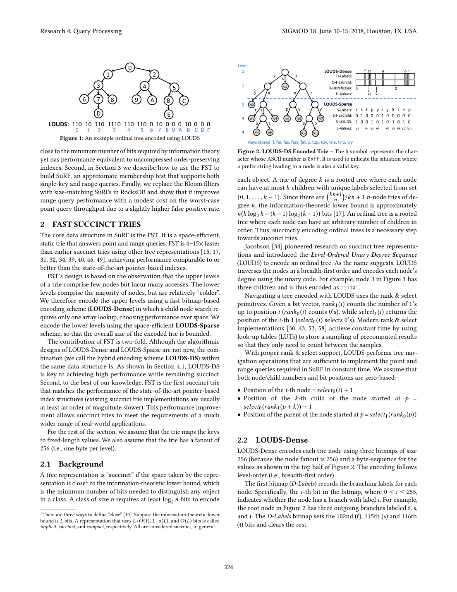
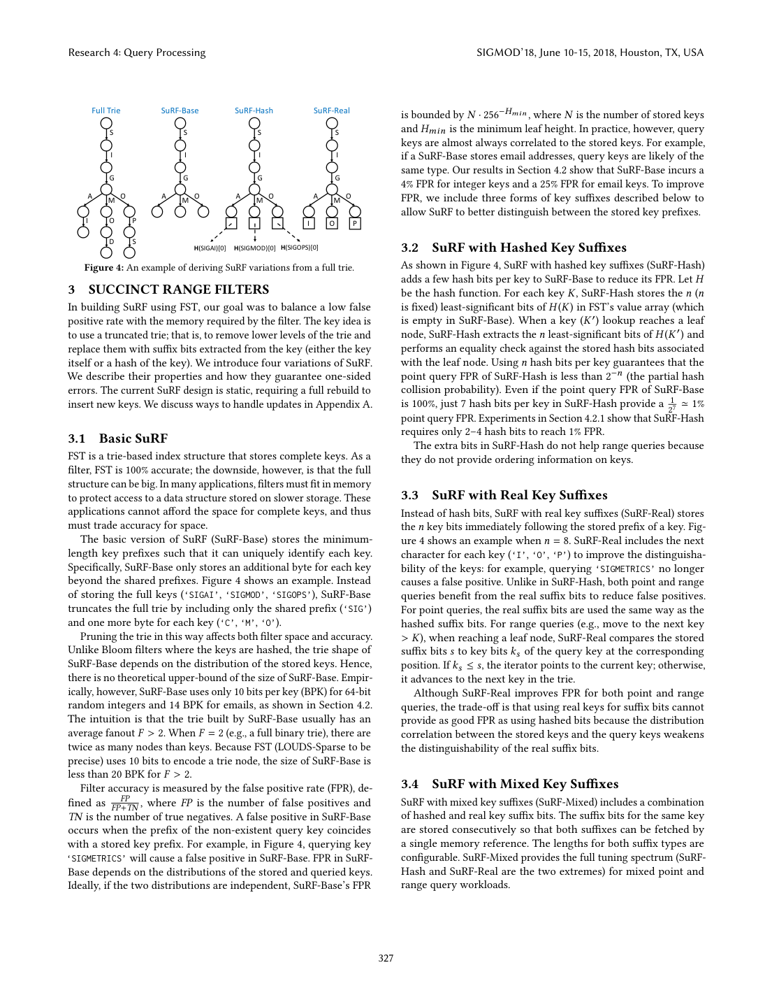

> 本组第 62 篇 · 存储结构与索引 · [全部论文]() · [上一篇]() · [下一篇]()

SuRF把静态trie截成可区分前缀，再保留少量哈希/真实后缀，实现点与范围存在性的一侧误差过滤。底层FST把热而少的上层dense编码、多而冷的下层sparse编码，空间紧凑但不应把10bits/node误写成任意数据固定10bits/key总空间。

它的价值是减少不必要的候选页读取，不是免除真实键核验、事务版本协调或动态计数。论文100GB传感器模型的短范围收益有明确空结果率、缓存与预算条件，纯负点查同预算反而可慢；报告补充24段原文精读并保留这些限制。

本文保留论文陈述、读者推断与待验证方案的区别；实验数字只适用于原文条件。原文和翻译来自已有 AI 辅助精读报告，已做来源匹配与编辑复核，不等于人工逐项核验或独立实验复现。所有页码均为 PDF 物理页。

## 论文与阅读范围

Huanchen Zhang, Hyeontaek Lim, Viktor Leis, David G. Andersen, Michael Kaminsky, Kimberly Keeton, Andrew Pavlo. SuRF: Practical Range Query Filtering with Fast Succinct Tries. SIGMOD2018,323–336. DOI10.1145/3183713.3196931。物理页1对应印刷323。

[论文集中的原始 PDF](https://github.com/lonng/db-papers/blob/4ff1331069c7cf52ac97dd769e5f484c1c35c200/papers/storage-structure/surf-practical-range-query-filtering-with-fast-succinct-tries.pdf) · 本地来源：`storage-structure/surf-practical-range-query-filtering-with-fast-succinct-tries.pdf`，共 14 页。

本篇保留 34 组原文精读和 66 条证据。截图为原始 PDF 的局部页选，不是重新生成的图表；未将整份 PDF 复制到博客。

## 研究问题与适用边界

**范围过滤而非完整索引替代**
LSM点查询可用Bloom跳过不含键的文件，但哈希破坏顺序，无法直接回答任意范围是否为空。固定prefix Bloom可以回答特定前缀，却不能自由覆盖所有整数边界。SuRF针对不必要的候选SSTable读取，以true表示可能存在，false才表示可以安全跳过。

这不是为所有点查取代Bloom。作者总结明确：只做点查且误报要求中等时，Bloom通常更好。范围Seek的I/O节省、底层FST有序索引性能和过滤器内存三件事应分别评价；返回真实记录仍由数据库完成。

静态设计适配不可变文件构建，而实时增量更新留给附录建议。按题目把它当一个同时实现事务、动态更新和精确COUNT的万能引擎，会超出论文。

依据：读者推断；PDF 物理页 2, 5, 6, 9, 14。证据：[SF01](#evidence-sf01), [SF06](#evidence-sf06), [SF09](#evidence-sf09), [SF11](#evidence-sf11), [SF16](#evidence-sf16), [SF24](#evidence-sf24)。

## 系统架构与核心组件

**LOUDS-Dense + LOUDS-Sparse**
FST按字节扩展，fanout256。上层少而热，用标签/孩子位图直接检查；下层多数而冷，用标签序列S-Labels、孩子位S-HasChild和节点起点S-LOUDS紧凑存储，配合rank/select定位。前缀本身也是键时还要记录终止信息；D-IsPrefixKey细节每节点1bit，第2页概括三张256位图不能无视第3页的细分。

按R决定dense/sparse切分，默认R64。Dense不是必比Sparse占空间：高fanout节点也可有空间收益。迭代器存各层cursor以减少反复parent/child跳转。rank采样、select采样、SIMD标签查找与预取围绕缓存和指令开销优化。

Sparse主体8+1+1=10bits/node，另有辅助采样、dense部分、序列元信息及值空间。论文还明确严格分类属于compact而非Z+o(Z)意义succinct；“10bits”不应成为任意输入、完整数据总空间的承诺。

依据：读者推断；PDF 物理页 2, 3, 4, 6。证据：[SF01](#evidence-sf01), [SF02](#evidence-sf02), [SF03](#evidence-sf03), [SF04](#evidence-sf04), [SF05](#evidence-sf05), [SF14](#evidence-sf14)。

*原论文 PDF 物理页 2，版权归原作者或出版方。点击图片可查看原尺寸。页面文本中定位到：Figure 1: An example ordinal tree encoded using LOUDS；Figure 2: LOUDS-DS Encoded Trie – The $ symbol represents the char-。这是页面定位信息，不表示本次已复核图内所有数据。*

## 算法机制与执行步骤

**截断前缀与两种后缀的不同能力**
Base保留能区分存储键的最短前缀：SIGAI/SIGMOD/SIGOPS可留SIGA/SIGM/SIGO；查询SIGMETRICS撞SIGM。第5页文字列“C,M,O”，图4与SIGAI则是A，已视觉确认，保留为源文疑点，不把C抄成正确前缀。

Hash存键哈希的低n位，帮助点相等测试；2^-n碰撞说明需合适哈希模型，不意味着对对抗输入绝对保证。它不保序，不能用后缀hash数值比较区间大小。Real存前缀后的真实位，可排序并收紧范围边界，但受查询/键分布相关性影响，尤其长相似Email。Mixed在同一预算中分配两类位，可从Real开始逐步交换。

lookup在前缀/后缀不匹配时否定。moveToNext在trie上做LowerBound，但返回的前缀带不确定flag；真实后缀可判断小于、等于或大于查询后缀，仍无法总是重建原键。count沿叶迭代并标注两端可能多算，非O(1)解析统计。

依据：读者推断；PDF 物理页 5, 6。证据：[SF06](#evidence-sf06), [SF07](#evidence-sf07), [SF08](#evidence-sf08), [SF09](#evidence-sf09), [SF10](#evidence-sf10), [SF11](#evidence-sf11), [SF12](#evidence-sf12)。

## 正确性保证与理论边界

**过滤安全依赖一侧误差与边界回查**
保留下来的前缀覆盖原键位置，所以允许假阳性而不应有假阴性。当前会话只验证简化8bit区间前缀模型：存40/55/200，对所有32896个闭区间枚举，未出现假阴性；[51,53]可落入55的粗前缀区间而误报。它不是原FST/SuRF代码或理论随机误差实验证明。

RocksDB Seek需要处理下界不确定、候选前缀与上界重叠、多个文件最小前缀相同三种回查。不能直接把候选前缀当完整最小键。第9页“If not set”在紧接K>=lk检查处指代不清；图11的<hk与正文闭区间<=hk也有表述差异。本报告不擅自认定代码错误或静默修复，实际实现应单测开闭边界与相等。

Count的边界核验可使静态集合计数准确，但动态SSTable包含旧值、删除和修改条目，不能只加各文件计数得到事务可见唯一键数。本文小例两版本物理2条、唯一键1，只说明语义区别。并发读只读SuRF的扩展性，也不证明并发更新或整个LSM具备特定隔离级别。

依据：读者推断；PDF 物理页 6, 9, 10, 11, 14。证据：[SF11](#evidence-sf11), [SF12](#evidence-sf12), [SF17](#evidence-sf17), [SF18](#evidence-sf18), [SF19](#evidence-sf19), [SF23](#evidence-sf23), [SF24](#evidence-sf24)。

## 实验评估与工作负载分析

**论文测量的两个层次**
微基准在双Xeon E5-2680v2、128GB机器单线程运行，三次均值；固定整数与Email工作负载，部分索引比较存唯一前缀、另组完整键，内存排除值指针。50M整数/25M Email等配置不能混进同一分母。Bloom在大数据微基准把32bit Murmur改64bit，属于公平性需记录的基线细节。

系统实验是i7-6770HQ、32GB、Intel540s SSD，约100GB原始数据压成52GB四层RocksDB，Snappy，block cache1GB、OS cache<=3GB，预热1M已存键点查后执行50K查询。Bloom14BPK与SuRF4bit后缀按内存匹配。

视觉图12：Open-Seek吞吐Bloom1.97、Real3.10Kops/s，读者算术约1.57倍；纯负点查Bloom32.9、Hash19.8、Real16.4，分别约40%和50%降幅。摘要“up to40%”不能作为所有变体图值的完整上限。图13至多5倍是在99%空Closed-Seek端点，不是所有范围普遍5倍。

本文没有重跑上述原程序，只执行qa/surf-reader-tests.json的前缀区间、版本计数与图数算术。

依据：读者推断；PDF 物理页 6, 7, 9, 10, 11。证据：[SF13](#evidence-sf13), [SF14](#evidence-sf14), [SF15](#evidence-sf15), [SF17](#evidence-sf17), [SF20](#evidence-sf20), [SF21](#evidence-sf21)。

*原论文 PDF 物理页 5，版权归原作者或出版方。点击图片可查看原尺寸。页面文本中定位到：Figure 4: An example of deriving SuRF variations from a full trie.。这是页面定位信息，不表示本次已复核图内所有数据。*

## 工程权衡与设计取舍

**过滤器CPU、误报与后端I/O要合在一起**
Base大小和FPR随存储/查询分布改变，实验10BPK整数、14BPK Email不是统一上界。Hash每位有利点查却不改善范围；Real有序位对两种查询均有益但共享前缀可能削弱效果。多存一些位减少磁盘误读是否值得，要和缓存命中率、键长与查询混合比一起看。

Closed-Seek能跳过空区间；Open-Seek一般仍须读含真实结果的块。Next已在相关块缓存后未观测额外提升，长扫描把起始过滤收益摊薄。成功读取应有的结果不可能凭过滤器消失。

静态count遍历压缩filter可少读磁盘，但消耗叶遍历CPU和每层边界回查。动态版本去重/墓碑不能由此免费解决。实时更新层、tombstone位图及GC有额外成本，附录把它们留作未来工作。

依据：读者推断；PDF 物理页 5, 6, 9, 10, 11, 14。证据：[SF07](#evidence-sf07), [SF08](#evidence-sf08), [SF09](#evidence-sf09), [SF10](#evidence-sf10), [SF12](#evidence-sf12), [SF17](#evidence-sf17), [SF19](#evidence-sf19), [SF21](#evidence-sf21), [SF22](#evidence-sf22), [SF24](#evidence-sf24)。

## 与现有技术的对比分析

**对比必须匹配用途与训练条件**
Bloom点查是强基线；FST与ART/B+-tree比的是有序索引速度/空间，SuRF与Bloom比的是近似过滤，不应把两个层次的胜负互相代替。图7证明所测配置下混合布局贡献很大，不意味着所有架构上单纯SIMD一定足够。

ARF附录缩小数据10倍、5M存储键、20%查询训练、同14BPK，报告20倍查询与12倍准确率提升。它体现该实现/训练工作负载，不代表一切自适应过滤器或变化负载的普遍排名；训练/构建峰值内存与最终filter内存也须分开。

第11页实际近似Count性能来自简单LevelDB原型，RocksDB原生近似API集成仍列未来。引用产品与硬件属于2018实验，不是本次核查最新RocksDB插件的安装建议。

依据：读者推断；PDF 物理页 2, 4, 6, 7, 9, 11, 14。证据：[SF02](#evidence-sf02), [SF05](#evidence-sf05), [SF14](#evidence-sf14), [SF15](#evidence-sf15), [SF16](#evidence-sf16), [SF23](#evidence-sf23), [SF24](#evidence-sf24)。

## 复现指南与待验证问题

**先做边界与版本语义回归**
固定字节序、整数排序映射、二进制0xFF标签与前缀键终止规则，测试完整FST的ExactSearch/LowerBound/Next。先用全键对照，再逐步截断并加后缀，枚举下界等于存储键、上下界同前缀、多个文件候选打平、无后继及空范围，确保无假阴性。

对Count分别定义静态key集合计数和动态可见记录计数，测试旧版本、墓碑、边界包含关系；不能用只读filter的正确性替代LSM事务协调。若要插入/删除，附录只是设计方向，需另实现增量层、批量合并、引用回收和故障恢复。

性能复现记录源码版本、编译/指令集、数据分布、哈希位数、缓存、冷热命中、等内存与构建峰值；分开点负查、点正查、空短范围、长扫描和过滤器驻内存/换出状态。除了本文已运行有限模型与算术，以上原代码、磁盘和并发实验均未执行。

依据：待验证的工程设想；PDF 物理页 3, 5, 6, 7, 9, 10, 14。证据：[SF03](#evidence-sf03), [SF06](#evidence-sf06), [SF11](#evidence-sf11), [SF12](#evidence-sf12), [SF13](#evidence-sf13), [SF14](#evidence-sf14), [SF15](#evidence-sf15), [SF18](#evidence-sf18), [SF19](#evidence-sf19), [SF20](#evidence-sf20), [SF24](#evidence-sf24)。

## 总结与内核工程启示

SuRF把范围顺序信息保留在紧凑前缀trie里，并以Hash/Real后缀调整点与范围误报。最重要的工程约束是：否定可跳过，肯定仍是候选；前缀边界、文件版本与真实记录语义必须继续验证。

这份报告新增24段原文解释，区分10bits/node与总BPK、静态计数与动态可见键、短范围Seek与长扫描，并保留图12和正文摘要之间的点查降幅差异。它是来源核对后的AI研究稿，不是本机原系统复现或生产正确性认证。

依据：读者推断；PDF 物理页 4, 5, 6, 9, 11, 14。证据：[SF04](#evidence-sf04), [SF06](#evidence-sf06), [SF11](#evidence-sf11), [SF17](#evidence-sf17), [SF18](#evidence-sf18), [SF21](#evidence-sf21), [SF22](#evidence-sf22), [SF23](#evidence-sf23), [SF24](#evidence-sf24)。

## 原文精读：从句子回到机制

以下保留原文、忠实翻译、含义与边界；假设示例不作为论文实验结果。

### P001 · PDF 物理页 1

**原文**

<blockquote class="paper-source-quote"><pre><code>ACM ISBN 978-1-4503-4703-7/18/06...$15.00&#10;https://doi.org/10.1145/3183713.3196931&#10;returns true; if the key is absent, then the filter will likely return&#10;false, but might incur a false positive.&#10;Although Bloom filters are useful for single-key lookups (“Is key&#10;42 in the SSTable?”), they cannot handle range queries (“Are there&#10;keys between 42 and 1000 in the SSTable?”). With only Bloom filters,&#10;an LSM tree-based storage engine must read additional table blocks&#10;from disk for range queries.</code></pre></blockquote>

**忠实翻译**

> ACM ISBN 978-1-4503-4703-7/18/06...$15.00
> https://doi.org/10.1145/3183713.3196931
> 返回 true；如果键不存在，那么过滤器很可能返回 false，但可能会产生假阳性（false positive）。
> 尽管 Bloom filters 对单键查找（“键 42 是否在 SSTable 中？”）很有用，但它们无法处理范围查询（“SSTable 中是否存在介于 42 和 1000 之间的键？”）。仅使用 Bloom filters 时，基于 LSM tree 的存储引擎必须为范围查询从磁盘读取额外的表块（table blocks）。

**技术含义与边界**

> 原文陈述了 Bloom filter 的两个特性：支持单键近似成员测试（存在假阳性），但不支持范围查询。在 LSM tree 架构下，若仅依赖 Bloom filter，执行范围查询时必须回退到磁盘 I/O 读取更多 table blocks。适用边界是仅讨论 Bloom filter 作为过滤器的场景，不涉及其他索引结构。

**常见误读**

> 容易错误推断 Bloom filter 完全不能用于任何与范围相关的操作，或者认为 LSM tree 在范围查询时一定会读取所有 block。原文仅说明 Bloom filter 本身不能回答范围问题，且需要读取‘额外的’（additional）table blocks，并未量化具体数量或声称读取全部块。

**读者构造的假设示例**

> 读者例：文件只有键75，查询区间[50,100]。Bloom对键50返回否定并不能排除区间内部的75；范围元数据和有序结构仍须参与。不能用只测试两个端点都不存在来安全否定整个区间。

### P002 · PDF 物理页 14

**原文**

<blockquote class="paper-source-quote"><pre><code>APPENDIX&#10;A&#10;EXTENDING SURF TO SUPPORT UPDATES&#10;The current version of SuRF, as described in this paper, targets&#10;static use cases such as in a log-structured merge tree, as described&#10;in Section 5. For applications that require dynamic use of range&#10;filters, one can extend SuRF to support updates.</code></pre></blockquote>

**忠实翻译**

> 附录 A 扩展 SURF 以支持更新
> 本文描述的当前版本 SuRF 针对静态用例，例如第 5 节中描述的 log-structured merge tree 中的用例。对于需要动态使用 range filters 的应用程序，可以扩展 SuRF 以支持更新。

**技术含义与边界**

> 原文明确指出论文中提出的 SuRF 版本是为静态场景设计的（如 LSM tree 中的不可变 SSTable 过滤）。作者陈述了一种可能性，即可以通过扩展使其支持动态更新，但并未在本论文中提供该扩展的具体实现或评估。

**常见误读**

> 容易误认为本文已经实现了支持更新的 SuRF，或者认为 SuRF 可以直接用于频繁更新的内存数据结构。原文使用了‘one can extend’（可以扩展），表明这属于未来工作或理论上的可行性，而非本文已完成的贡献。

**读者构造的假设示例**

> 读者构造的假设示例：在一个纯内存的动态跳表中，键会频繁插入和删除。直接使用本文的 SuRF 是不合适的，因为它针对静态数据构建；若要在此场景使用，需要按照作者提示去设计支持动态插入和删除的 SuRF 变体，但这超出了本文范围。

### P003 · PDF 物理页 7

**原文**

<blockquote class="paper-source-quote"><pre><code>We evaluate the point query performance and memory for both&#10;integer and email key workloads. All three tries store the complete&#10;keys (i.e., including the unique suffixes). Figure 6 shows that FST is&#10;6–15× faster than tx-trie, 4–8× faster than PDT, and is also smaller&#10;than both. Although tx-trie shares the LOUDS-Sparse design with&#10;FST, it is slower without the performance boost from LOUDS-Dense&#10;and other optimizations.</code></pre></blockquote>

**忠实翻译**

> 我们评估了整数和电子邮件键工作负载的点查询（point query）性能和内存。这三种 trie 都存储完整的键（即包括唯一的后缀）。图 6 显示 FST 比 tx-trie 快 6–15 倍，比 PDT 快 4–8 倍，并且也比两者都小。尽管 tx-trie 与 FST 共享 LOUDS-Sparse 设计，但由于缺乏来自 LOUDS-Dense 和其他优化的性能提升，它更慢。

**技术含义与边界**

> 原文陈述了在点查询场景下，FST 在速度和空间上均优于 tx-trie 和 PDT。前提条件是三种 trie 都存储完整键（含唯一后缀），且测试了整数和 email 两种工作负载。tx-trie 较慢的原因被归结为缺少 LOUDS-Dense 及其他优化，尽管它们底层都使用了 LOUDS-Sparse。

**常见误读**

> 容易将 FST 的性能优势泛化到所有类型的查询（如范围查询）或所有类型的数据分布。原文仅明确声明这是‘点查询性能’（point query performance）的评估结果。此外，不应忽略‘存储完整键’这一前提，如果去掉后缀存储，比较结果可能不同。

**读者构造的假设示例**

> 原图6整数点查显示tx-trie2941ns、PDT1515ns、FST200ns；Email显示5000/3030/862ns，是该完整键、单线程配置的论文测量，不是本次运行，也不推断任意百万键场景必快十倍。

### P004 · PDF 物理页 4

**原文**

<blockquote class="paper-source-quote"><pre><code>Rank LUT&#10;Bit-vector&#10;Bit-vector&#10;Select Samples&#10;Basic blocks of size B&#10;(every S 1’s)&#10;Bit-vector 11010 11011 10110 11001 00001 0000&#10;Rank LUT 0          3          7         10       13        14&#10;Bit-vector 11010 11011 10110 11001 00001 0000&#10;Select Samples 0    3          8&#10;12     16        &#10;B = 5&#10;S = 3&#10;Figure 3: Rank and select structures in FST&#10;each level-cursor only moves sequentially without skipping items.&#10;With this property, range queries in LOUDS-DS are implemented&#10;efficiently. Each level-cursor is initialized once through a “move-&#10;to-child” call from its upper-level cursor.</code></pre></blockquote>

**忠实翻译**

> Rank LUT
> Bit-vector
> Bit-vector
> Select Samples
> 大小为 B 的基本块（basic blocks）
> （每 S 个 1）
> Bit-vector 11010 11011 10110 11001 00001 0000
> Rank LUT 0          3          7         10       13        14
> Bit-vector 11010 11011 10110 11001 00001 0000
> Select Samples 0    3          8
> 12     16        
> B = 5
> S = 3
> 图 3：FST 中的 Rank 和 select 结构
> 每个层级游标（level-cursor）仅顺序移动而不跳过项目。
> 凭借这一属性，LOUDS-DS 中的范围查询得以高效实现。每个层级游标通过来自其上层游标的“移动到子节点”（move-to-child）调用被初始化一次。

**技术含义与边界**

> 图3的B5/S3只是解释rank/select采样；正文实际rank block在Dense用64、Sparse用512，select默认采样64。随后文字讲一次范围迭代中的每层cursor复用，不是所有查询共享已初始化cursor。

**常见误读**

> 新的LowerBound仍须定位起点；初始化一次指该次扫描的层级游标，不能说以后任何查询都无需从根搜索。图中B/S也不是实际默认配置。

**读者构造的假设示例**

> 读者例：同一次扫描从当前key推进，可复用记录的各层路径；另一个不相关起点查询需自己的LowerBound。固定图示位串的查表数不能当所有层的通用rank公式参数。

### P005 · PDF 物理页 12

**原文**

<blockquote class="paper-source-quote"><pre><code>SIGMOD’18, June 10–15, 2018, Houston, TX, USA&#10;Huanchen Zhang et al.&#10;As a final remark, we evaluated RocksDB in a setting where the&#10;memory vs. storage budget is generous. The DBMS will benefit&#10;more from SuRF under tighter constraints and/or a larger dataset.&#10;7&#10;RELATED WORK&#10;Alternatives to the FST for range filtering. The Bloom filter [19]&#10;and its major variants [20, 27, 45] are compact data structures de-&#10;signed for fast approximate membership tests.</code></pre></blockquote>

**忠实翻译**

> SIGMOD’18, June 10–15, 2018, Houston, TX, USA
> Huanchen Zhang et al.
> 最后一点说明，我们在内存与存储预算宽裕的设置下评估了 RocksDB。在更严格的约束和/或更大的数据集下，DBMS 将从 SuRF 中获益更多。
> 7 相关工作
> 用于范围过滤（range filtering）的 FST 替代品。Bloom filter [19] 及其主要变体 [20, 27, 45] 是为快速近似成员测试而设计的紧凑数据结构。

**技术含义与边界**

> 资源更紧或数据更大可能增加节省I/O的价值，是作者在此的预期，不是本节新增测量。后面的相关工作标题不能使普通Bloom变成直接支持任意范围的有序结构。

**常见误读**

> 容易将作者的推断（‘DBMS 将从 SuRF 中获益更多’）当作已通过实验验证的结论。原文使用的是‘will benefit more’，这是一种基于系统特性的合理推测，而非本论文提供的实测数据。此外，不应认为 Bloom filter 能直接替代 FST 进行范围过滤，原文称其为‘alternatives’，但 P001 已说明 Bloom filter 无法处理范围查询。

**读者构造的假设示例**

> 读者后续实验：分别缩小block/OS cache并固定filter预算，观察误报页读取与驻留率。无需预设提升10%或30%；机器32GB也不等于本文把32GB全给RocksDB缓存。

### P006 · PDF 物理页 9

**原文**

<blockquote class="paper-source-quote"><pre><code>When the size of a level hits a threshold, RocksDB selects an&#10;SSTable at this level and merges it into the next-level SSTables that&#10;have overlapping key ranges. This process is called compaction.&#10;Except for level 0, all SSTables at the same level have disjoint key&#10;ranges. In other words, the keys are globally sorted for each level&#10;≥1. Combined with a global table cache, this property ensures that&#10;an entry lookup reads at most one SSTable per level for levels ≥1.</code></pre></blockquote>

**忠实翻译**

> 当一个层级的大小达到阈值时，RocksDB 会在该层级选择一个 SSTable，并将其合并到具有重叠键范围的下一层 SSTables 中。这个过程称为 compaction。除了 level 0 之外，同一层级的所有 SSTables 都具有不相交的键范围。换句话说，对于每个 ≥1 的层级，键是全局排序的。结合全局表缓存（global table cache），此属性确保条目查找（entry lookup）在 ≥1 的层级中每层最多读取一个 SSTable。

**技术含义与边界**

> 这里是论文所用2018 RocksDB的partitioned leveling布局：L>=1的文件键域不交，元数据可定位每层一个候选SSTable。它不是所有LSM策略或每次操作总共一个磁盘I/O的定理。

**常见误读**

> L0可能重叠，tiering等其他策略也可能在一层保留多个run。一个候选文件还可能涉及索引、filter、数据页及cache miss；不能把SSTable候选数和物理I/O数等同。

**读者构造的假设示例**

> 读者构造的假设示例：假设 level 1 有三个 SSTable，分别包含键范围 [1,10]、[11,20]、[21,30]。当查找键 15 时，由于范围不相交且全局有序，系统通过元数据即可确定只需访问第二个 SSTable，无需读取其他两个。但在 level 0，如果有两个 SSTable 都包含键 15 的范围，则可能需要读取多个。

### P007 · PDF 物理页 2

**原文**

<blockquote class="paper-source-quote"><pre><code>This performance improve-&#10;ment allows succinct tries to meet the requirements of a much&#10;wider range of real-world applications.&#10;For the rest of the section, we assume that the trie maps the keys&#10;to fixed-length values. We also assume that the trie has a fanout of&#10;256 (i.e., one byte per level).&#10;2.1&#10;Background&#10;A tree representation is “succinct” if the space taken by the repre-&#10;sentation is close1 to the information-theoretic lower bound, which&#10;is the minimum number of bits needed to distinguish any object&#10;in a class.</code></pre></blockquote>

**忠实翻译**

> 这种性能提升使得 succinct tries 能够满足更广泛的现实世界应用程序的要求。
> 在本节的其余部分，我们假设 trie 将键映射到固定长度的值。我们还假设 trie 的扇出（fanout）为 256（即每层一个字节）。
> 2.1 背景
> 如果一个树表示所占用的空间接近信息论下界（information-theoretic lower bound），则该树表示是“succinct”的，信息论下界是区分一个类中任何对象所需的最小位数。脚注 1 对应 close 一词。

**技术含义与边界**

> 作者在本节假定字节fanout256和固定长度映射值，采用接近信息论下界的宽泛措辞。第4页又明确更细分类中Sparse是compact，O(Z)而非Z+o(Z)。

**常见误读**

> 不能把这里宽泛close定义改成严格succinct已经达标，也不能把10bits/node当所有结构/值总开销。值指针和rank/select等辅助信息还需另计。

**读者构造的假设示例**

> 读者算术：Sparse标签、孩子和边界主体8n+n+n=10n位，Z约9.44n；常数倍接近并不自动属于Z+o(Z)。本文另有实测空间优势，但那与形式分类是不同证据。

### P008 · PDF 物理页 5

**原文**

<blockquote class="paper-source-quote"><pre><code>3&#10;SUCCINCT RANGE FILTERS&#10;In building SuRF using FST, our goal was to balance a low false&#10;positive rate with the memory required by the filter. The key idea is&#10;to use a truncated trie; that is, to remove lower levels of the trie and&#10;replace them with suffix bits extracted from the key (either the key&#10;itself or a hash of the key). We introduce four variations of SuRF.&#10;We describe their properties and how they guarantee one-sided&#10;errors.</code></pre></blockquote>

**忠实翻译**

> 3 SUCCINCT RANGE FILTERS
> 在使用 FST 构建 SuRF 时，我们的目标是平衡低假阳性率（false positive rate）与过滤器所需的内存。核心思想是使用截断的 trie（truncated trie）；也就是说，移除 trie 的较低层级，并用从键中提取的后缀位（suffix bits）（键本身或键的哈希）来替换它们。我们介绍了 SuRF 的四种变体。我们描述了它们的属性以及它们如何保证单侧错误（one-sided errors）。

**技术含义与边界**

> Base为每个存储键留下可区分的最短前缀，再按变体加hash/真实后缀；不能任意把多键压成一个固定前缀叶。Hash帮助点查但不提供顺序，Real帮助范围且受分布相关性影响。

**常见误读**

> 容易混淆‘后缀位’的来源，认为它只能是原始键的一部分。原文明确指出后缀位可以是‘键本身或键的哈希’（either the key itself or a hash of the key）。此外，不应认为截断 trie 会引入假阴性，原文强调了‘保证单侧错误’。

**读者构造的假设示例**

> 读者例：SIGAI/SIGMOD/SIGOPS保留SIGA/SIGM/SIGO。SIGMETRICS匹配SIGM而可能误报；下一真实字节E与存储SIGMOD的O不同可否定。原API的apple/application/apply只保留app一个叶例错误，已纠正。

### P009 · PDF 物理页 6

**原文**

<blockquote class="paper-source-quote"><pre><code>We test&#10;two representative key types: 64-bit random integers generated by&#10;YCSB and email addresses (host reversed, e.g., “com.domain@foo”)&#10;drawn from a real-world dataset (average length = 22 bytes, max&#10;length = 129 bytes). The machine on which we run the experiments&#10;has two Intel Xeon E5-2680v2 CPUs @ 2.80 GHz, 4×32 GB RAM.&#10;The experiments run on a single thread. We run each experiment&#10;three times and report the average result. We omit error bars be-&#10;cause the variance is small.&#10;4.1&#10;FST Evaluation&#10;We evaluate FST in three steps.</code></pre></blockquote>

**忠实翻译**

> 我们测试了两种具有代表性的键类型：由 YCSB 生成的 64 位随机整数，以及来自真实世界数据集的电子邮件地址（主机名反转，例如“com.domain@foo”）（平均长度 = 22 字节，最大长度 = 129 字节）。我们运行实验的机器有两颗 Intel Xeon E5-2680v2 CPU @ 2.80 GHz，4×32 GB RAM。实验在单线程上运行。我们将每个实验运行三次并报告平均结果。我们省略了误差线（error bars），因为方差很小。
> 4.1 FST 评估
> 我们分三个步骤评估 FST。

**技术含义与边界**

> 原文详细列出了实验环境和方法论：键类型（YCSB 64位随机整数、主机反转的真实 email）、硬件配置（双路 Xeon，128GB 内存）、执行方式（单线程）、统计方法（3次取平均，因方差小省略误差线）。这些构成了后续 FST 评估结果的适用边界和可信度基础。

**常见误读**

> 容易忽略‘单线程’（single thread）这一限制，将实验得出的吞吐量或延迟指标直接套用到高并发生产环境中。此外，email 地址经过了‘主机名反转’预处理，如果不加注意，可能会错误地认为 SuRF 对原始格式的 email 也有相同的聚集效果和性能表现。

**读者构造的假设示例**

> 原文实际索引微基准批量载入50M整数或25M Email并跑10M查询，三次均值；Email host-reversed，内存不含value pointers。此条件不同于系统实验i7/32GB/SSD环境，也不同于附录C的只读多线程实验。

### P010 · PDF 物理页 11

**原文**

<blockquote class="paper-source-quote"><pre><code>To continue scanning after Seek, the DBMS calls Next and ad-&#10;vances the iterator. We do not observe performance improvements&#10;for Next when using SuRF because the relevant SSTable blocks are&#10;already loaded in memory. Hence, SuRF mostly helps short range&#10;queries. As the range gets larger, the filtering benefit is amortized.&#10;The RocksDB API does not support approximate queries.</code></pre></blockquote>

**忠实翻译**

> 为了在 Seek 之后继续扫描，DBMS 调用 Next 并推进迭代器。在使用 SuRF 时，我们没有观察到 Next 的性能提升，因为相关的 SSTable 块已经被加载到内存中。因此，SuRF 主要有助于短范围查询（short range queries）。随着范围变大，过滤的收益被摊薄（amortized）。RocksDB API 不支持近似查询（approximate queries）。

**技术含义与边界**

> 本文所测Next无额外提升，意味着收益主要在短范围起点过滤；不是证明所有未来缓存/实现中Next永不受影响。RocksDB API不支持近似查询是2018论文时点描述，近似Count实测在简单LevelDB原型完成。

**常见误读**

> 不把5倍Closed-Seek直接推广到长扫描或动态可见键精确计数。范围变大时相对收益被摊薄，不必等于负收益，也不保证任何负载均无额外CPU成本。

**读者构造的假设示例**

> 读者构造的假设示例：假设执行一个查询需要 Seek 定位起点，然后调用 10000 次 Next 扫描数据。SuRF 可能将 Seek 的耗时从 10ms 降低到 1ms（节省了 9ms），但 10000 次 Next 的耗时仍为 100ms（因为块已在内存中）。总耗时从 110ms 降到 101ms，提升不明显。但如果是一个只调用 5 次 Next 的短范围查询，Seek 节省的 9ms 就会带来显著的整体性能提升。

### SURF-REVIEW-01 · PDF 物理页 2

**原文**

<blockquote class="paper-source-quote"><pre><code>It is a space-efficient,&#10;static trie that answers point and range queries.</code></pre></blockquote>

**忠实翻译**

> FST是空间高效的静态trie，回答点与范围查询。

**技术含义与边界**

> 底层索引与上层近似过滤器不同。

**常见误读**

> 支持范围查询不代表动态插入已经实现。

**读者构造的假设示例**

> 读者例：不可变SSTable生成时建filter，文件替换时重建。

### SURF-REVIEW-02 · PDF 物理页 2

**原文**

<blockquote class="paper-source-quote"><pre><code>The lower&#10;levels comprise the majority of nodes, but are relatively “colder”.</code></pre></blockquote>

**忠实翻译**

> 下层含多数节点，却相对更冷。

**技术含义与边界**

> 顶层少而热，用dense直接定位；下层多而冷，用sparse省空间。

**常见误读**

> 不是所有节点都该一律压得最小。

**读者构造的假设示例**

> 图7的主要加速来自混合布局，而不只是最后SIMD步骤。

### SURF-REVIEW-03 · PDF 物理页 3

**原文**

<blockquote class="paper-source-quote"><pre><code>The third bitmap (D-IsPrefixKey) includes only one bit per node.</code></pre></blockquote>

**忠实翻译**

> D-IsPrefixKey每节点只有一bit。

**技术含义与边界**

> 用于表示到节点的前缀本身也是键。

**常见误读**

> 第2页笼统三张256位图不能覆盖这项更细说明。

**读者构造的假设示例**

> 键f与far同时存在时必须保留前缀终止信息。

### SURF-REVIEW-04 · PDF 物理页 4

**原文**

<blockquote class="paper-source-quote"><pre><code>Given an n-node trie, LOUDS-Sparse uses 8n bits for S-Labels, n bits&#10;for S-HasChild and n bits for S-LOUDS, a total of 10n bits (plus auxil-&#10;iary bits for rank &amp; select).</code></pre></blockquote>

**忠实翻译**

> n节点trie的Sparse主体用8n标签位+n孩子位+n边界位，共10n位，另有rank/select辅助位。

**技术含义与边界**

> 这里的n是节点，不是数据键数，后续rank/select及值空间另计。

**常见误读**

> 10bits/node不是总内存10bits/key。

**读者构造的假设示例**

> 读者例：长共同前缀会增加节点；Email实测Base14BPK而非10。

### SURF-REVIEW-05 · PDF 物理页 4

**原文**

<blockquote class="paper-source-quote"><pre><code>technically, LOUDS-Sparse can only be categorized as com-&#10;pact rather than succinct in a finer classification scheme because&#10;LOUDS-Sparse takes O(Z) space (despite the small multiplier) in-&#10;stead of Z + o(Z).</code></pre></blockquote>

**忠实翻译**

> 严格分类下Sparse是compact：占O(Z)，而非Z+o(Z)。

**技术含义与边界**

> 论文自己给出细分类边界。

**常见误读**

> 不能把接近9.44n常数就说严格达信息论最优。

**读者构造的假设示例**

> 读者例：还要计样本LUT、dense层和序列头，不能只报8+1+1。

### SURF-REVIEW-06 · PDF 物理页 5

**原文**

<blockquote class="paper-source-quote"><pre><code>The current SuRF design is static, requiring a full rebuild to&#10;insert new keys.</code></pre></blockquote>

**忠实翻译**

> 当前设计是静态的，插入新键需全量重建。

**技术含义与边界**

> 这与LSM不可变磁盘文件匹配。

**常见误读**

> 附录建议不等于本文支持实时更新的完整实现。

**读者构造的假设示例**

> 读者方案：动态增量层与周期归并应独立验证。

### SURF-REVIEW-07 · PDF 物理页 5

**原文**

<blockquote class="paper-source-quote"><pre><code>there is no theoretical upper-bound of the size of SuRF-Base.</code></pre></blockquote>

**忠实翻译**

> SuRF-Base大小没有此处所称的理论上界。

**技术含义与边界**

> 上下文是形状随键分布变化，不能给统一常数BPK承诺；有限键长度当然仍有限。

**常见误读**

> 别把实验10/14BPK说成所有数据集固定大小。

**读者构造的假设示例**

> 读者例：很长相同前缀而最后才分支会增加结构空间。

### SURF-REVIEW-08 · PDF 物理页 5

**原文**

<blockquote class="paper-source-quote"><pre><code>FPR in SuRF-&#10;Base depends on the distributions of the stored and queried keys.</code></pre></blockquote>

**忠实翻译**

> Base的误报率依赖存储键与查询键的分布。

**技术含义与边界**

> 独立分布假设与实践相关查询要分开。

**常见误读**

> 不是Bloom式仅由统一bits/key就完整决定。

**读者构造的假设示例**

> SIGMETRICS匹配SIGM而误报；加下一真实字节可区分E与O。

### SURF-REVIEW-09 · PDF 物理页 5

**原文**

<blockquote class="paper-source-quote"><pre><code>The extra bits in SuRF-Hash do not help range queries because&#10;they do not provide ordering information on keys.</code></pre></blockquote>

**忠实翻译**

> Hash额外位不帮助范围查询，因为不提供键的顺序信息。

**技术含义与边界**

> 哈希后缀用于点查询的相等验证。

**常见误读**

> 不能把点查误报每bit减半直接推广到区间误报。

**读者构造的假设示例**

> 读者例：哈希值大于另一个值，并不能说明原字符串也更大。

### SURF-REVIEW-10 · PDF 物理页 5

**原文**

<blockquote class="paper-source-quote"><pre><code>both point and range&#10;queries benefit from the real suffix bits to reduce false positives.</code></pre></blockquote>

**忠实翻译**

> 真实后缀位可同时降低点和范围查询误报。

**技术含义与边界**

> 真实位保留顺序，却受键相关性影响。

**常见误读**

> Real不保证与Hash相同的2^-n随机碰撞界。

**读者构造的假设示例**

> 同域Email共享长串时，继续多存几个相同ASCII位可能收益小。

### SURF-REVIEW-11 · PDF 物理页 6

**原文**

<blockquote class="paper-source-quote"><pre><code>The key is to guarantee one-sided error (no false negatives).</code></pre></blockquote>

**忠实翻译**

> 操作的关键是保证单侧误差，即没有假阴性。

**技术含义与边界**

> 肯定结果仍需底层验证，否定才可安全跳读。

**常见误读**

> 返回true不是数据库已找到可见记录。

**读者构造的假设示例**

> 已执行前缀区间玩具：枚举32896个闭区间无假阴性，但有假阳性；不是原SuRF测试。

### SURF-REVIEW-12 · PDF 物理页 6

**原文**

<blockquote class="paper-source-quote"><pre><code>The low_fp_flag&#10;and the high_fp_flag indicate the possibility of over-counting each&#10;of the boundary keys (when the prefix of a boundary key matches&#10;a stored key, SuRF cannot decide whether the boundary key should&#10;be included in the count).</code></pre></blockquote>

**忠实翻译**

> 计数的两个边界flag指出可能多算边界键，因为前缀匹配时无法决定是否应计入。

**技术含义与边界**

> approximate count不等于任意相对误差概率估计。

**常见误读**

> 不能把两个边界flag省掉宣称精确COUNT。

**读者构造的假设示例**

> 读者玩具：存40/55/200，截断前缀下区间[51,53]可报可能有键，实际为空。

### SURF-REVIEW-13 · PDF 物理页 6

**原文**

<blockquote class="paper-source-quote"><pre><code>The experiments run on a single thread. We run each experiment&#10;three times and report the average result.</code></pre></blockquote>

**忠实翻译**

> 实验单线程，每项运行三次并报告平均。

**技术含义与边界**

> 微基准性能不是并发写或系统尾延迟。

**常见误读**

> 不能把倒吞吐当p99或多核更新可扩展性。

**读者构造的假设示例**

> 读者方案：要另量分位延迟、线程调度和持久化成本。

### SURF-REVIEW-14 · PDF 物理页 6

**原文**

<blockquote class="paper-source-quote"><pre><code>the&#10;reported memory number excludes the space taken by the value&#10;pointers.</code></pre></blockquote>

**忠实翻译**

> 所报内存不包括value pointers占用。

**技术含义与边界**

> 索引结构开销与全部键值数据空间是不同预算。

**常见误读**

> 不能把图5内存当应用总内存。

**读者构造的假设示例**

> 读者例：若每键另存8字节指针，50M键就再增加约400MB原始指针空间。

### SURF-REVIEW-15 · PDF 物理页 7

**原文**

<blockquote class="paper-source-quote"><pre><code>we replaced&#10;its 32-bit Murmur hash algorithm with a 64-bit Murmur hash; without this change,&#10;the false positive rate is worse than the theoretical expectation.</code></pre></blockquote>

**忠实翻译**

> 微基准将Bloom的32位Murmur哈希换成64位，否则大规模项数时误报比理论预期差。

**技术含义与边界**

> 这是基线实现的重要修改。

**常见误读**

> 不能宣称完全原封不动使用默认Bloom再作所有规模结论。

**读者构造的假设示例**

> 读者方案：对比应固定哈希宽度、CPU成本和相同过滤器预算。

### SURF-REVIEW-16 · PDF 物理页 9

**原文**

<blockquote class="paper-source-quote"><pre><code>If the tar-&#10;get application only needs point query filtering with moderate FPR&#10;requirements, the Bloom filter is usually a better choice than SuRF;</code></pre></blockquote>

**忠实翻译**

> 若目标只需点查过滤且误报要求中等，Bloom通常更合适。

**技术含义与边界**

> 作者明确没有声称全面替代Bloom。

**常见误读**

> 目录或题目中的range不能被省掉当通用点查冠军。

**读者构造的假设示例**

> 图12同预算纯负点查询中Bloom更快。

### SURF-REVIEW-17 · PDF 物理页 9

**原文**

<blockquote class="paper-source-quote"><pre><code>The approximate count may over-count the deletion and modifi-&#10;cation entries, because it cannot distinguish update/delete records&#10;from insert records. If the dataset is static, the count is accurate.</code></pre></blockquote>

**忠实翻译**

> 近似计数可能把删除/修改记录多算，因为不能区分它们与插入；静态数据时可准确。

**技术含义与边界**

> 静态准确还需描述的边界真实键核验。

**常见误读**

> 物理多版本条目数不等于事务可见唯一键数。

**读者构造的假设示例**

> 已运行玩具：同键两版本物理2条、可见唯一键1。

### SURF-REVIEW-18 · PDF 物理页 9

**原文**

<blockquote class="paper-source-quote"><pre><code>three additional checks are required to guarantee&#10;correctness.</code></pre></blockquote>

**忠实翻译**

> 返回的是键前缀，所以还需三种检查来保证正确。

**技术含义与边界**

> 下界不确定、上界前缀匹配、多个最小候选前缀打平都可能需要真实键。

**常见误读**

> 不是有filter就任何成功Seek只做一个I/O的绝对保证。

**读者构造的假设示例**

> 读者例：两文件候选都叫SIGM，必须取完整键判断哪个真正更小。

### SURF-REVIEW-19 · PDF 物理页 10

**原文**

<blockquote class="paper-source-quote"><pre><code>similar boundary key checks are required&#10;to avoid the off-by-one error. Instead of scanning disk blocks, Count&#10;using SuRFs requires at most two disk I/Os (one possible I/O for&#10;each boundary) per level.</code></pre></blockquote>

**忠实翻译**

> Count需类似边界核验以免off-by-one；文中每层至多两次边界I/O。

**技术含义与边界**

> 仍要遍历filter内叶，不是常数CPU计数。

**常见误读**

> 每层的两次不能写成全数据库最多两次，也不含任意动态去重成本。

**读者构造的假设示例**

> 读者方案：同时记过滤器扫描CPU与额外边界页读取。

### SURF-REVIEW-20 · PDF 物理页 10

**原文**

<blockquote class="paper-source-quote"><pre><code>We&#10;configure each filter to use an equal amount of memory.</code></pre></blockquote>

**忠实翻译**

> 系统实验配置每种filter等量内存。

**技术含义与边界**

> Bloom14BPK，对照SuRF4bit后缀，配合指定缓存和Snappy。

**常见误读**

> 要比较预算而不是只让某一种filter多占内存。

**读者构造的假设示例**

> 读者方案：复现时还需列出filter/index固定与block/OS缓存，不能只写32GB机器。

### SURF-REVIEW-21 · PDF 物理页 11

**原文**

<blockquote class="paper-source-quote"><pre><code>speeds up the query by 5× when 99% of the queries&#10;return empty.</code></pre></blockquote>

**忠实翻译**

> 当99%的Closed-Seek查询为空时，SuRF-Real可加速5倍。

**技术含义与边界**

> 上限结果来自高空结果率、短范围和给定缓存的传感器模型。

**常见误读**

> 不能推广到所有区间或返回海量行的扫描。

**读者构造的假设示例**

> 同页说明Next没观测到提升，长范围把起始过滤收益摊薄。

### SURF-REVIEW-22 · PDF 物理页 11

**原文**

<blockquote class="paper-source-quote"><pre><code>We do not observe performance improvements&#10;for Next when using SuRF because the relevant SSTable blocks are&#10;already loaded in memory. Hence, SuRF mostly helps short range&#10;queries. As the range gets larger, the filtering benefit is amortized.</code></pre></blockquote>

**忠实翻译**

> Next未观察到改进，因为相关页已进内存；SuRF主要帮助短范围，范围越大过滤收益越被摊薄。

**技术含义与边界**

> Seek减少试探I/O，不减少实际结果读取。

**常见误读**

> 5倍不是完整任意长scan的持续加速。

**读者构造的假设示例**

> 读者例：读一百万行时即使省两次起始磁盘IO，总时间也可能几乎不变。

### SURF-REVIEW-23 · PDF 物理页 11

**原文**

<blockquote class="paper-source-quote"><pre><code>a&#10;simple prototype in LevelDB, finding that the speedup from using&#10;SuRF is similar to the speedup for Closed-Seek queries.</code></pre></blockquote>

**忠实翻译**

> 近似Count性能在简单LevelDB原型测得，加速类似Closed-Seek。

**技术含义与边界**

> 第5节是路径说明，本节明确实际计数评估载体。

**常见误读**

> 不把Count写成与其余实验同一成熟RocksDB API已完整集成。

**读者构造的假设示例**

> 读者方案：动态可见版本计数与边界修正另建测试。

### SURF-REVIEW-24 · PDF 物理页 14

**原文**

<blockquote class="paper-source-quote"><pre><code>Supporting updates in&#10;SuRF is beyond the scope of this paper, and we defer the problem&#10;to future work.</code></pre></blockquote>

**忠实翻译**

> 支持SuRF更新超出本文范围，留给未来。

**技术含义与边界**

> 前置动态trie与墓碑数组是建议。

**常见误读**

> 只读并发扩展结果不能证明并发插入删除安全。

**读者构造的假设示例**

> 附录C的无锁指只读SuRF，不表示整个RocksDB事务无锁。

## 尚未解决的问题

1. 原实现如何精确定义开闭区间及moveToNext边界flags？第9页指代和图11<符号需源码进一步核对。
2. 动态版本、删除与可见性计数如何协调，不能仅累加各SSTable的filter条目数。
3. 不同键长/前缀相关性及缓存预算下，Mixed最优位数与端到端收益如何变化？
4. 未核查最新RocksDB/FST/SuRF实现与2018代码差异。

## 证据索引

证据编号沿用原报告，便于将上文判断追溯到原句。引文匹配只验证位置，不证明解读正确。

**C001N01 · PDF 物理页 1**

LSM-tree存储引擎中数据可能分布在所有层级的不可变文件（SSTables）中，导致检索需要多次昂贵的磁盘I/O。传统Bloom filter仅支持单键查找，无法处理范围查询（如判断42到1000之间是否有键），因此LSM引擎必须为范围查询读取额外的磁盘块，或维护辅助索引（如B+Tree）。RocksDB使用prefix Bloom filter优化固定前缀查询，但缺乏通用性。

<blockquote class="paper-source-quote"><pre><code>Although Bloom filters are useful for single-key lookups (“Is key 42 in the SSTable?”), they cannot handle range queries</code></pre></blockquote>

**C001N03 · PDF 物理页 1**

实验将SuRF作为Bloom filter的替代品集成到RocksDB中，在100 GB时间序列数据集上评估。在相同过滤器大小下，SuRF将open-range查询（无上界）加速1.5倍，closed-range查询（有上界）加速最高5倍。在最坏情况（所有查询键均不存在）的点查询中，由于SuRF假阳性率略高（0.2% vs 0.1%），吞吐量下降最高40%；可通过每键增加少量位消除该差距。

<blockquote class="paper-source-quote"><pre><code>Our experiments on a 100 GB time-series dataset show that replacing the Bloom filters with SuRFs of the same filter size reduces I/O.</code></pre></blockquote>

**C001N04 · PDF 物理页 2**

FST基于对Trie访问模式的观察进行混合编码：上层节点少但访问频繁，采用LOUDS-Dense编码，子节点搜索仅需一次数组查找，优先保证性能；下层节点占绝大多数但较冷，采用LOUDS-Sparse编码以保证整体空间紧凑。这种混合方案称为LOUDS-DS。

<blockquote class="paper-source-quote"><pre><code>FST’s design is based on the observation that the upper levels of a trie comprise few nodes but incur many accesses.</code></pre></blockquote>

**C001N05 · PDF 物理页 2**

论文在描述FST时假设Trie将键映射为定长值（fixed-length values），且Trie的扇出（fanout）为256，即每一层消耗一个字节。这是LOUDS-Dense使用256位bitmap的前提条件。

<blockquote class="paper-source-quote"><pre><code>For the rest of the section, we assume that the trie maps the keys to fixed-length values. We also assume that the trie has a fanout of 256</code></pre></blockquote>

**C001N06 · PDF 物理页 3**

LOUDS-Dense为每个Trie节点使用三个大小为256位的bitmap和一个字节序列。D-Labels记录分支标签（第i位表示是否存在标签i的分支）；D-HasChild指示分支是指向子Trie还是终止于值；D-IsPrefixKey每节点一位，指示到达该节点的前缀本身是否为有效键；D-Values按层级顺序拼接存储定长值。向下遍历公式为 D-ChildNodePos(pos) = 256 × rank1(D-HasChild, pos)。

<blockquote class="paper-source-quote"><pre><code>D-ChildNodePos(pos) = 256 ×rank1(D-HasChild, pos) computes the bit position of the first child node.</code></pre></blockquote>

**C001N08 · PDF 物理页 3**

LOUDS-DS的分界点由大小比率R决定：设Trie共H层，分界层l是满足 LOUDS-Dense-Size(l) × R ≤ LOUDS-Sparse-Size(l) 的最大l。减小R会使更多层使用LOUDS-Dense，偏向性能而非空间。默认R=64。点查询先在Dense层搜索，未终止则进入Sparse层。通过预计算Dense层的节点数和HasChild置位数，Sparse层可如同整个Trie都用Sparse编码一样操作。

<blockquote class="paper-source-quote"><pre><code>The cutoff level is defined as the largest l such that LOUDS-Dense-Size(l) × R ≤LOUDS-Sparse-Size(l).</code></pre></blockquote>

**C001N09 · PDF 物理页 3**

范围查询中的LowerBound操作在标签序列中搜索大于等于目标标签的最小标签，而非精确匹配。MoveToNext从当前叶子标签位置向前移动游标；若在当前节点内找到有效标签l，则找以l为根的子树中最左侧叶子键；若游标触及节点边界，则向上移动到父节点对应位置。迭代器中包含每层游标以记录从根到叶的路径，减少昂贵的rank/select调用。

<blockquote class="paper-source-quote"><pre><code>When performing LowerBound, instead of doing an exact search in the label sequence, the algorithm searches for the smallest label ≥the target label.</code></pre></blockquote>

**C001N10 · PDF 物理页 2**

本文讨论的FST是一个静态Trie（static trie），不支持动态插入或删除。此外，LOUDS-Dense要求扇出固定为256，对于非字节对齐或不同字符集的场景需要调整。文中未提供动态更新的机制。

<blockquote class="paper-source-quote"><pre><code>The core data structure in SuRF is the FST. It is a space-efficient, static trie that answers point and range queries.</code></pre></blockquote>

**C002N01 · PDF 物理页 4**

LOUDS-DS中range query的高效性依赖于level-cursor的顺序移动特性：每个level-cursor仅通过上层cursor的一次“move-to-child”调用初始化，此后该层的range query操作仅涉及cursor移动，不跳过元素，从而实现cache-friendly的执行。原文声称Section 4显示FST的range query甚至快于基于指针的trie。

<blockquote class="paper-source-quote"><pre><code>each level-cursor only moves sequentially without skipping items. With this property, range queries in LOUDS-DS are implemented efficiently.</code></pre></blockquote>

**C002N04 · PDF 物理页 4**

Select结构优化：采用简单LUT（每项32 bits）存储采样查询的预计算答案，采样率为S。查询select1(i)时，先查LUT[i/S]获取基础位置，然后从该位置起，通过binary search结合popcount在第三个basic block内寻找剩余的第(i - i/S × S)个set bit。此方法有效的前提是S-LOUDS位向量足够稠密（通常17-34%为1）且分布均匀（每256 bits至少一个1），使得剩余查找复杂度为常数（最多检查256S bits）。默认S=64，局部空间开销9-17%，全局1-2%。

<blockquote class="paper-source-quote"><pre><code>The select structure is a simple LUT (32 bits per item) that stores the precomputed answers for the sampled queries.</code></pre></blockquote>

**C002N05 · PDF 物理页 4**

Label Search优化：多数succinct trie实现线性搜索label，本文使用128-bit SIMD指令加速。首先通过统计S-LOUDS中连续0的个数确定节点大小，然后将节点边界内的labels划分为128-bit chunks（每chunk 16个labels），执行分组相等性检查。最多需要16次SIMD相等检查。实验表明超过90%的trie节点大小小于8，意味着大多数情况仅需单次SIMD检查。

<blockquote class="paper-source-quote"><pre><code>We use 128-bit SIMD instructions to perform the label search in LOUDS-Sparse. We first determine the node size by counting the consecutive 0’s</code></pre></blockquote>

**C002N06 · PDF 物理页 5**

SuRF的核心问题是完整FST作为filter虽然100%准确但体积过大，无法常驻内存保护慢速存储。解决方案是使用截断trie（truncated trie），移除下层并用提取的key suffix（真实后缀或哈希后缀）替代。当前SuRF设计是静态的，插入新key需要完全重建。

<blockquote class="paper-source-quote"><pre><code>The key idea is to use a truncated trie; that is, to remove lower levels of the trie and replace them with suffix bits extracted from the key</code></pre></blockquote>

**C002N07 · PDF 物理页 5**

SuRF-Base仅存储能唯一标识每个key的最短前缀，即共享前缀外加每个key的一个额外字节。其空间没有理论上限（依赖key分布），但经验上64-bit随机整数需10 bits/key，emails需14 bits/key。直觉解释是平均fanout F>2时，节点数少于key数的两倍，而LOUDS-Sparse每节点10 bits，故总大小低于20 bits/key。

<blockquote class="paper-source-quote"><pre><code>SuRF-Base only stores an additional byte for each key beyond the shared prefixes.</code></pre></blockquote>

**C002N08 · PDF 物理页 5**

SuRF-Base的False Positive Rate (FPR) 取决于存储key和查询key的分布。理想独立分布下FPR有界（N·256^{-Hmin}），但实际查询key几乎总是与存储key相关（如查询email时类型相似），导致FPR升高。实验显示整数key的FPR为4%，email key高达25%。这是引入后缀bits的动机。

<blockquote class="paper-source-quote"><pre><code>In practice, however, query keys are almost always correlated to the stored keys. For example, if a SuRF-Base stores email addresses, query keys are likely of the same type.</code></pre></blockquote>

**C002N09 · PDF 物理页 5**

SuRF-Hash在SuRF-Base基础上，为每个key在FST的value array中存储哈希函数H(K)的n个最低有效位。点查询到达叶子时进行等值比对。使用n个hash bits保证点查询FPR小于2^{-n}（部分哈希碰撞概率）。即使SuRF-Base点查询FPR为100%，7个hash bits也能提供约1%的FPR。但额外的hash bits对range query无帮助，因为它们不提供key的排序信息。

<blockquote class="paper-source-quote"><pre><code>Using n hash bits per key guarantees that the point query FPR of SuRF-Hash is less than 2−n (the partial hash collision probability).</code></pre></blockquote>

**C002N10 · PDF 物理页 5**

SuRF-Real存储key前缀之后的n个真实key bits。与Hash不同，真实后缀同时降低点和范围查询的FPR。对于范围查询（如移动到>K的下一个key），到达叶子时将存储的后缀s与查询key对应位置的后缀ks比较：若ks≤s，迭代器指向当前key；否则前进到下一个key。局限在于真实后缀的区分度受限于存储key与查询key的分布相关性，FPR不如hash bits好。

<blockquote class="paper-source-quote"><pre><code>If ks ≤s, the iterator points to the current key; otherwise, it advances to the next key in the trie.</code></pre></blockquote>

**C002N12 · PDF 物理页 6**

微基准测试环境：两台Intel Xeon E5-2680v2 CPU @ 2.80 GHz，4×32 GB RAM，单线程执行，每次实验跑三次取平均（省略error bars因为方差小）。数据集：YCSB生成的64-bit随机整数（50M entries）和真实世界email地址（host reversed，平均22 bytes，最大129 bytes，25M entries）。指标：10M次点查询或范围查询的平均吞吐量（延迟为其倒数）。范围查询遵循Zipf分布，大多扫描50-100项。内存报告排除value pointers的空间。基线包括B+tree (STX, 512B node)、ART、C-ART及其他succinct tries。

<blockquote class="paper-source-quote"><pre><code>The machine on which we run the experiments has two Intel Xeon E5-2680v2 CPUs @ 2.80 GHz, 4×32 GB RAM. The experiments run on a single thread.</code></pre></blockquote>

**C003N01 · PDF 物理页 7**

FST在64-bit int和Email两个workload上，点查延迟比tx-trie快6–15倍，比PDT快4–8倍，且内存占用更小。三者均存储完整key（含唯一后缀）。tx-trie虽共享LOUDS-Sparse设计但缺少LOUDS-Dense等优化导致更慢。Email workload中PDT与FST的性能差距缩小，原因是email key长度方差大，PDT的path decomposition有助于rebalance trie。

<blockquote class="paper-source-quote"><pre><code>Figure 6 shows that FST is 6–15× faster than tx-trie, 4–8× faster than PDT, and is also smaller than both.</code></pre></blockquote>

**C003N03 · PDF 物理页 7**

SuRF评测数据集为100M个64-bit随机整数key和25M个email key。构建filter时使用随机选取的一半数据；随后执行10M次点查、范围或混合（50%点查+50%范围，交错）查询。查询key按YCSB workload C从全量数据集中抽取，使约50%查询返回false。测试了uniform和Zipf两种访问模式，仅展示Zipf结果因为观察相似。

<blockquote class="paper-source-quote"><pre><code>In the experiments, we first construct the filter under test using half of the dataset selected at random.</code></pre></blockquote>

**C003N04 · PDF 物理页 7**

64-bit整数范围查询区间为[K + 2^37, K + 2^38]，其中46%查询返回true；email范围查询为[K, K(末字节++)]，52%返回true。Bloom filter使用RocksDB实现，但因RocksDB默认32-bit Murmur hash不适合百万级item，作者将其替换为64-bit Murmur hash，否则FPR劣于理论预期。Bloom filter仅出现在点查实验中。

<blockquote class="paper-source-quote"><pre><code>we replaced its 32-bit Murmur hash algorithm with a 64-bit Murmur hash; without this change, the false positive rate is worse</code></pre></blockquote>

**C003N05 · PDF 物理页 7**

SuRF-Base在email workload消耗14 bits/key而非10 bits/key，因为email key共享更长前缀导致内部节点增多（每个SuRF节点编码占10 bits）。对于点查，同尺寸下Bloom filter FPR通常低于SuRF变体；SuRF-Hash每增加一个hash bit可将FPR减半，快速逼近Bloom。SuRF-Real的真实后缀bit对点查效果一般不如hash bit。对于范围查询，只有SuRF-Real受益于增大filter尺寸，因为hash后缀不提供序信息。

<blockquote class="paper-source-quote"><pre><code>every hash bit added cuts the FPR by half. Real suffix bits in SuRF-Real are generally less effective than hash bits for point queries.</code></pre></blockquote>

**C003N08 · PDF 物理页 8**

吞吐实验显示：64-bit整数workload下SuRF变体速度可比肩Bloom filter，归功于LOUDS-DS设计及优化。email key下SuRF变体慢于Bloom filter，因trie中长前缀搜索/遍历开销。Bloom filter吞吐随bits/key增大而下降（更多hash probe）；SuRF变体增加后缀bit不影响吞吐，只要后缀长度<64 bits，检查后缀仅涉及一次内存访问和一次整数比较。首次添加后缀bit时出现轻微性能下降，体现了额外内存访问开销。

<blockquote class="paper-source-quote"><pre><code>checking with the suffix bits only involves one memory access and one integer comparison.</code></pre></blockquote>

**C003N10 · PDF 物理页 9**

RocksDB LSM-tree架构：写入先进MemTable并追加日志；MemTable满（如超4MB）后排序转为SSTable进入level 0。SSTable包含排序KV对，划分为固定长度block匹配最小磁盘访问单元。block index存储每个block的restarting point（≥当前block最后key且<下一block首个key的字符串）。除level 0外，同层SSTable的key range不相交（全局有序），配合全局table cache保证entry查找在level≥1时每层最多读一个SSTable。

<blockquote class="paper-source-quote"><pre><code>Except for level 0, all SSTables at the same level have disjoint key ranges.</code></pre></blockquote>

**C003N12 · PDF 物理页 10**

Count(lk,hk)查询先Seek到lk初始化迭代器，再逐层计数至hk。无SuRF时扫描SSTable block；有SuRF时在filter内迭代计数。类似Seek，需边界key检查避免off-by-one错误。使用SuRF的Count每层最多两次磁盘I/O（每个边界可能一次），而非扫描disk block。注意approximate Count可能多计delete/modification条目，因无法区分update/delete与insert记录；静态数据集下计数准确。

<blockquote class="paper-source-quote"><pre><code>Count using SuRFs requires at most two disk I/Os (one possible I/O for each boundary) per level.</code></pre></blockquote>

**C003N13 · PDF 物理页 10**

端到端系统评测模拟时序数据库场景：2K传感器，事件key为128-bit（64-bit timestamp + 64-bit sensor ID），value 1KB。事件发生服从Poisson分布（期望频率每0.2秒一次），每传感器运行10K秒记录约50K事件。原始记录总大小约100GB。硬件：Intel Core i7-6770HQ CPU、32GB RAM、Intel 540s 480GB SSD。Snappy压缩后RocksDB实例4层（含L0），占52GB磁盘。

<blockquote class="paper-source-quote"><pre><code>The occurrence of each event detected by each sensor follows a Poisson distribution with an expected frequency of one every 0.2 seconds.</code></pre></blockquote>

**C003N14 · PDF 物理页 10**

RocksDB评测创建四个实例：no filter、Bloom filter、SuRF-Hash、SuRF-Real，配置相同内存。Bloom filter用14 bits/key；等效大小的SuRF-Hash和SuRF-Real包含4-bit后缀/key。预热：1M均匀分布点查访问已有key，使每个SSTable被触及约1000次，block index和filter被缓存。预热后block cache和OS page cache均满。随后执行50K应用查询，记录端到端吞吐和I/O计数（系统统计读取差值），报告三次运行均值。排除了prefix Bloom filter因为任意整数范围查询无预定义key前缀。

<blockquote class="paper-source-quote"><pre><code>We configure each filter to use an equal amount of memory. Bloom filters use 14 bits per key.</code></pre></blockquote>

**C004N01 · PDF 物理页 11**

Point query实验中，由于查询键随机生成，几乎所有查询返回false。无过滤器时每次操作约1.5次I/O，表明Level 1全部及Level 2约一半被缓存。这与典型RocksDB应用中最后两层不缓存在内存的设定一致。使用SuRF-Hash或SuRF-Real比Bloom filter慢，因为4-bit后缀未能将误报率降至Bloom filter配置的水平。

<blockquote class="paper-source-quote"><pre><code>Because the query keys are randomly generated, almost all queries return false. The query performance is dominated by the I/O count: they are inversely proportional.</code></pre></blockquote>

**C004N02 · PDF 物理页 11**

Open-Seek查询中，SuRF-Real可将吞吐提升50%，每次操作I/O降至1.023。无法进一步提升的原因是Open-Seek至少需要读取一个SSTable block，且该读取通常发生在数据块不在缓存中的最后一层。这接近Open-Seek的最大I/O削减上限。

<blockquote class="paper-source-quote"><pre><code>using SuRF-Real can speed up Open-Seek queries by 50%. SuRF-Real cannot improve further because an Open-Seek query requires reading at least one SSTable block</code></pre></blockquote>

**C004N03 · PDF 物理页 11**

Closed-Seek实验通过调整范围大小来控制空结果查询百分比。传感器事件服从泊松分布，期望频率为每λ=10^5 ns一次。对于长度R的区间，无事件概率为e^{-R/λ}。因此目标空结果比例P对应的范围大小设为λ ln(1/P)。例如P=50%时范围为69310 ns。这是实验参数设定的数学依据。

<blockquote class="paper-source-quote"><pre><code>For a target percentage (P) of Closed-Seek queries with empty results, we set range size to λ ln( 1 P ). For example, for 50%, the range size is 69310 ns.</code></pre></blockquote>

**C004N05 · PDF 物理页 11**

Seek后调用Next推进迭代器时，未观察到使用SuRF的性能提升，因为相关SSTable block已加载到内存中。因此SuRF主要帮助短范围查询；随着范围增大，过滤收益被摊薄。这是SuRF适用边界的明确限制。

<blockquote class="paper-source-quote"><pre><code>We do not observe performance improvements for Next when using SuRF because the relevant SSTable blocks are already loaded in memory. Hence, SuRF mostly helps short range queries.</code></pre></blockquote>

**C004N06 · PDF 物理页 11**

RocksDB API不支持近似查询。作者在LevelDB中使用简单原型测量了approximate count查询性能，发现SuRF带来的加速与Closed-Seek查询类似。该结论基于Figure 11中的执行路径预期得出。文中未给出具体数字，并建议将精确适用于静态数据集的近似计数集成到RocksDB作为未来工作。

<blockquote class="paper-source-quote"><pre><code>We measured the performance of approximate count queries using a simple prototype in LevelDB, finding that the speedup from using SuRF is similar to the speedup for Closed-Seek queries.</code></pre></blockquote>

**C004N07 · PDF 物理页 12**

作者指出当前RocksDB评估环境内存相对存储预算较宽松。在更紧张的约束或更大数据集下，DBMS将从SuRF获益更多。这意味着本文实验结果可能是SuRF收益的下界估计。

<blockquote class="paper-source-quote"><pre><code>we evaluated RocksDB in a setting where the memory vs. storage budget is generous. The DBMS will benefit more from SuRF under tighter constraints and/or a larger dataset.</code></pre></blockquote>

**C004N08 · PDF 物理页 11**

Prefix Bloom filter用于范围空查询存在两个问题：(1)难以生成合适的前缀；(2)即使确定了键前缀，对于与任何已存在键共享相同前缀的不存在键的点查找，prefix Bloom filter总是返回假阳性，导致高误报率。这解释了为何需要SuRF替代方案。

<blockquote class="paper-source-quote"><pre><code>prefix Bloom filters always return false positives for point lookups on absent keys sharing the same prefix with any present key, incurring high false positive rates.</code></pre></blockquote>

**C004N12 · PDF 物理页 12**

FST的设计符合RUM Conjecture（读、更新、内存三者只能优化其中两个而牺牲第三个）。FST以牺牲更新效率换取快速读取和小空间占用。这表明SuRF/FST在写密集场景下可能存在代价，论文将其定位为LSM-tree读取路径的优化。

<blockquote class="paper-source-quote"><pre><code>The design of FST also falls under the RUM Conjecture because it trades update efficiency for fast read and small space.</code></pre></blockquote>

**C005N01 · PDF 物理页 14**

当前版本的SuRF仅面向静态场景（如LSM-tree），不支持动态更新。作者将支持更新列为未来工作，超出本文范围。

<blockquote class="paper-source-quote"><pre><code>The current version of SuRF, as described in this paper, targets static use cases such as in a log-structured merge tree</code></pre></blockquote>

**C005N02 · PDF 物理页 14**

为支持插入操作，作者建议借鉴hybrid index技术，在SuRF前放置一个小型动态trie吸收写入，并定期执行批量合并以摊还单次插入代价。这属于设计建议而非已实现或已验证的方案。

<blockquote class="paper-source-quote"><pre><code>SuRF can leverage the hybrid index technique [57] to include a small dynamic trie in front of it to absorb all the writes</code></pre></blockquote>

**C005N04 · PDF 物理页 14**

ARF与SuRF对比实验中，两者均限制为每key 14 bits。ARF空间上限设为7 MB；SuRF使用4-bit real suffix以达到相同的14 bits/key。

<blockquote class="paper-source-quote"><pre><code>We set the space limit to 7 MB for ARF and use a 4-bit real suffix for SuRF so that both filters consume 14 bits per key</code></pre></blockquote>

**C005N05 · PDF 物理页 14**

由于ARF训练需要大量内存，数据集规模缩小了10倍：包含10M个64位整数key（ARF仅支持最长64位的定长key）。随机选取5M个key插入filter。

<blockquote class="paper-source-quote"><pre><code>we scale down the dataset by 10× because ARF requires a large amount of memory for training</code></pre></blockquote>

**C005N06 · PDF 物理页 14**

工作负载包含10M个Zipf分布的范围查询，范围大小为240，使得约50%的查询返回false。对ARF，使用20%（即2M）的查询进行训练，其余用于评估。

<blockquote class="paper-source-quote"><pre><code>The workload includes 10M Zipf-distributed range queries whose range size is 240, which makes roughly 50% of the queries return false</code></pre></blockquote>

**C005N07 · PDF 物理页 14**

在相同14 bits/key条件下，SuRF范围查询吞吐量为3.3 Mops/s，ARF为0.16 Mops/s，SuRF快20倍。SuRF假阳性率为2.2%，ARF为25.7%，SuRF准确度高12倍。

<blockquote class="paper-source-quote"><pre><code>Range Query Throughput (Mops/s) 0.16 3.3 20× False Positive Rate (%) 25.7 2.2 12×</code></pre></blockquote>

**C005N08 · PDF 物理页 14**

ARF构建加训练总时间约4分钟（构建118秒+训练117秒），峰值内存26 GB，而最终filter仅7 MB。SuRF构建仅需1.2秒和0.02 GB内存，无需训练阶段。

<blockquote class="paper-source-quote"><pre><code>its peak memory use is 26 GB and the building + training time is around 4 minutes, even though the final filter size is 7 MB</code></pre></blockquote>

**C005N10 · PDF 物理页 14**

多线程实验使用100M个64位整数key，随机选50M构建SuRF，然后在整个数据集上执行100M次点查询，查询均匀分配到各线程。

<blockquote class="paper-source-quote"><pre><code>The dataset includes 100M 64-bit integer keys. We construct SuRF using half of the keys (i.e., 50M) picked at random</code></pre></blockquote>

**SF01 · PDF 物理页 2**

底层索引与上层近似过滤器不同。 支持范围查询不代表动态插入已经实现。

<blockquote class="paper-source-quote"><pre><code>It is a space-efficient,&#10;static trie that answers point and range queries.</code></pre></blockquote>

**SF02 · PDF 物理页 2**

顶层少而热，用dense直接定位；下层多而冷，用sparse省空间。 不是所有节点都该一律压得最小。

<blockquote class="paper-source-quote"><pre><code>The lower&#10;levels comprise the majority of nodes, but are relatively “colder”.</code></pre></blockquote>

**SF03 · PDF 物理页 3**

用于表示到节点的前缀本身也是键。 第2页笼统三张256位图不能覆盖这项更细说明。

<blockquote class="paper-source-quote"><pre><code>The third bitmap (D-IsPrefixKey) includes only one bit per node.</code></pre></blockquote>

**SF04 · PDF 物理页 4**

这里的n是节点，不是数据键数，后续rank/select及值空间另计。 10bits/node不是总内存10bits/key。

<blockquote class="paper-source-quote"><pre><code>Given an n-node trie, LOUDS-Sparse uses 8n bits for S-Labels, n bits&#10;for S-HasChild and n bits for S-LOUDS, a total of 10n bits (plus auxil-&#10;iary bits for rank &amp; select).</code></pre></blockquote>

**SF05 · PDF 物理页 4**

论文自己给出细分类边界。 不能把接近9.44n常数就说严格达信息论最优。

<blockquote class="paper-source-quote"><pre><code>technically, LOUDS-Sparse can only be categorized as com-&#10;pact rather than succinct in a finer classification scheme because&#10;LOUDS-Sparse takes O(Z) space (despite the small multiplier) in-&#10;stead of Z + o(Z).</code></pre></blockquote>

**SF06 · PDF 物理页 5**

这与LSM不可变磁盘文件匹配。 附录建议不等于本文支持实时更新的完整实现。

<blockquote class="paper-source-quote"><pre><code>The current SuRF design is static, requiring a full rebuild to&#10;insert new keys.</code></pre></blockquote>

**SF07 · PDF 物理页 5**

上下文是形状随键分布变化，不能给统一常数BPK承诺；有限键长度当然仍有限。 别把实验10/14BPK说成所有数据集固定大小。

<blockquote class="paper-source-quote"><pre><code>there is no theoretical upper-bound of the size of SuRF-Base.</code></pre></blockquote>

**SF08 · PDF 物理页 5**

独立分布假设与实践相关查询要分开。 不是Bloom式仅由统一bits/key就完整决定。

<blockquote class="paper-source-quote"><pre><code>FPR in SuRF-&#10;Base depends on the distributions of the stored and queried keys.</code></pre></blockquote>

**SF09 · PDF 物理页 5**

哈希后缀用于点查询的相等验证。 不能把点查误报每bit减半直接推广到区间误报。

<blockquote class="paper-source-quote"><pre><code>The extra bits in SuRF-Hash do not help range queries because&#10;they do not provide ordering information on keys.</code></pre></blockquote>

**SF10 · PDF 物理页 5**

真实位保留顺序，却受键相关性影响。 Real不保证与Hash相同的2^-n随机碰撞界。

<blockquote class="paper-source-quote"><pre><code>both point and range&#10;queries benefit from the real suffix bits to reduce false positives.</code></pre></blockquote>

**SF11 · PDF 物理页 6**

肯定结果仍需底层验证，否定才可安全跳读。 返回true不是数据库已找到可见记录。

<blockquote class="paper-source-quote"><pre><code>The key is to guarantee one-sided error (no false negatives).</code></pre></blockquote>

**SF12 · PDF 物理页 6**

approximate count不等于任意相对误差概率估计。 不能把两个边界flag省掉宣称精确COUNT。

<blockquote class="paper-source-quote"><pre><code>The low_fp_flag&#10;and the high_fp_flag indicate the possibility of over-counting each&#10;of the boundary keys (when the prefix of a boundary key matches&#10;a stored key, SuRF cannot decide whether the boundary key should&#10;be included in the count).</code></pre></blockquote>

**SF13 · PDF 物理页 6**

微基准性能不是并发写或系统尾延迟。 不能把倒吞吐当p99或多核更新可扩展性。

<blockquote class="paper-source-quote"><pre><code>The experiments run on a single thread. We run each experiment&#10;three times and report the average result.</code></pre></blockquote>

**SF14 · PDF 物理页 6**

索引结构开销与全部键值数据空间是不同预算。 不能把图5内存当应用总内存。

<blockquote class="paper-source-quote"><pre><code>the&#10;reported memory number excludes the space taken by the value&#10;pointers.</code></pre></blockquote>

**SF15 · PDF 物理页 7**

这是基线实现的重要修改。 不能宣称完全原封不动使用默认Bloom再作所有规模结论。

<blockquote class="paper-source-quote"><pre><code>we replaced&#10;its 32-bit Murmur hash algorithm with a 64-bit Murmur hash; without this change,&#10;the false positive rate is worse than the theoretical expectation.</code></pre></blockquote>

**SF16 · PDF 物理页 9**

作者明确没有声称全面替代Bloom。 目录或题目中的range不能被省掉当通用点查冠军。

<blockquote class="paper-source-quote"><pre><code>If the tar-&#10;get application only needs point query filtering with moderate FPR&#10;requirements, the Bloom filter is usually a better choice than SuRF;</code></pre></blockquote>

**SF17 · PDF 物理页 9**

静态准确还需描述的边界真实键核验。 物理多版本条目数不等于事务可见唯一键数。

<blockquote class="paper-source-quote"><pre><code>The approximate count may over-count the deletion and modifi-&#10;cation entries, because it cannot distinguish update/delete records&#10;from insert records. If the dataset is static, the count is accurate.</code></pre></blockquote>

**SF18 · PDF 物理页 9**

下界不确定、上界前缀匹配、多个最小候选前缀打平都可能需要真实键。 不是有filter就任何成功Seek只做一个I/O的绝对保证。

<blockquote class="paper-source-quote"><pre><code>three additional checks are required to guarantee&#10;correctness.</code></pre></blockquote>

**SF19 · PDF 物理页 10**

仍要遍历filter内叶，不是常数CPU计数。 每层的两次不能写成全数据库最多两次，也不含任意动态去重成本。

<blockquote class="paper-source-quote"><pre><code>similar boundary key checks are required&#10;to avoid the off-by-one error. Instead of scanning disk blocks, Count&#10;using SuRFs requires at most two disk I/Os (one possible I/O for&#10;each boundary) per level.</code></pre></blockquote>

**SF20 · PDF 物理页 10**

Bloom14BPK，对照SuRF4bit后缀，配合指定缓存和Snappy。 要比较预算而不是只让某一种filter多占内存。

<blockquote class="paper-source-quote"><pre><code>We&#10;configure each filter to use an equal amount of memory.</code></pre></blockquote>

**SF21 · PDF 物理页 11**

上限结果来自高空结果率、短范围和给定缓存的传感器模型。 不能推广到所有区间或返回海量行的扫描。

<blockquote class="paper-source-quote"><pre><code>speeds up the query by 5× when 99% of the queries&#10;return empty.</code></pre></blockquote>

**SF22 · PDF 物理页 11**

Seek减少试探I/O，不减少实际结果读取。 5倍不是完整任意长scan的持续加速。

<blockquote class="paper-source-quote"><pre><code>We do not observe performance improvements&#10;for Next when using SuRF because the relevant SSTable blocks are&#10;already loaded in memory. Hence, SuRF mostly helps short range&#10;queries. As the range gets larger, the filtering benefit is amortized.</code></pre></blockquote>

**SF23 · PDF 物理页 11**

第5节是路径说明，本节明确实际计数评估载体。 不把Count写成与其余实验同一成熟RocksDB API已完整集成。

<blockquote class="paper-source-quote"><pre><code>a&#10;simple prototype in LevelDB, finding that the speedup from using&#10;SuRF is similar to the speedup for Closed-Seek queries.</code></pre></blockquote>

**SF24 · PDF 物理页 14**

前置动态trie与墓碑数组是建议。 只读并发扩展结果不能证明并发插入删除安全。

<blockquote class="paper-source-quote"><pre><code>Supporting updates in&#10;SuRF is beyond the scope of this paper, and we defer the problem&#10;to future work.</code></pre></blockquote>

## 版本与使用边界

- 原 PDF SHA256：`4f8dab3065b89ffc7ac3dbb72e78e820dc58626f420dcfedd3060af33104e550`。
- 报告来源：`qwen3.8-max`；此处按已完成报告整理，没有重新请求模型。
- OCR 记录页：[]；低文本页：[]。
- 本次新增页面截图，未据此自动重写原报告的数值、公式或实验结论；原有“未进行图像识别”限制仍适用于分析生成过程。
- 截图与短引仅服务于论文评论，版权归原作者或出版方；正式发布前复查转载范围和授权。
- 本文保留未核实的书目信息及研究问题，不用现代产品行为替代历史论文的证据。

前序报告保留的书目与阅读过程记录

Huanchen Zhang, Hyeontaek Lim, Viktor Leis, David G. Andersen, Michael Kaminsky, Kimberly Keeton, Andrew Pavlo. SuRF: Practical Range Query Filtering with Fast Succinct Tries. SIGMOD2018,323–336. DOI10.1145/3183713.3196931。物理页1对应印刷323。

Codex实读本地14页，包括附录与参考文献，视觉核对2、3、4、5、7、8、9、10、11、14页。只运行8bit前缀区间等有限Python读者例与图数算术，不是原FST/SuRF实现、概率实验或RocksDB复现；未读原代码和全部被引论文。来源、模型、API用量、原响应保留，Codex编辑用量未测量，仍为AI来源复核稿。

