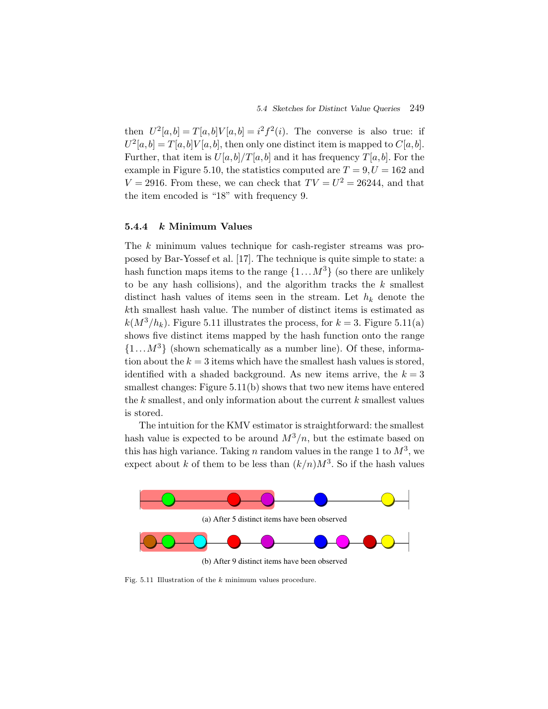
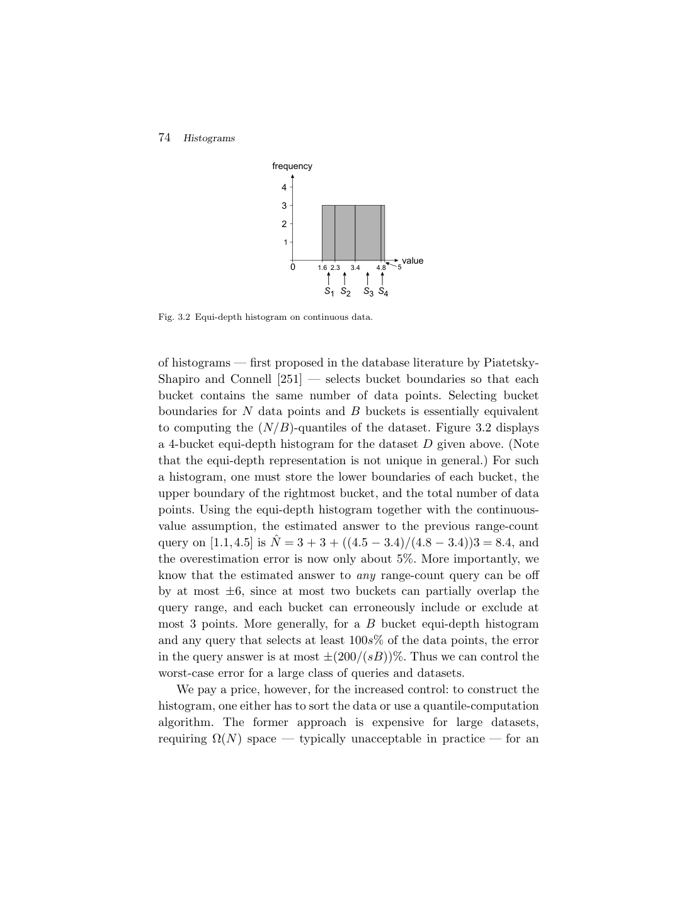

> 本组第 9 篇 · 统计与基数估计 · [全部论文]() · [上一篇]() · [下一篇]()

这不是提出单一新系统的论文，而是围绕近似查询处理（AQP）组织的长篇综述。其主线不是给四种摘要排出统一名次，而是选择可接受的信息损失：随机样本保留原始元组和抽样设计；直方图保留分桶及桶内统计；小波保留多尺度基函数的少量系数；sketch以特定更新规则和估计器保留查询所需投影。查询能力、误差归一化对象、失败概率、输入访问模型和构建工作区必须一起比较。
本报告由当前Codex会话重新编排并完成，背景材料是API对全部296页/28块的笔记与reduce；calls/0000240.json的draft因finish_reason=length而截断，不被视为完整API报告，也未通过补括号伪造完成。Codex实际阅读140个明确物理页，另对31、104、149、153、155、157页进行了图像核对；并非通读296页或独立人工认证。完整范围列于第1节与随附source QA。所有证据及连续原文精读均回到提取文本的指定物理页；9条被拒绝的数学转写没有用作证明。
核心判断有五点。第一，HT估计量的无偏性只控制期望，不能替代方差分析；先采样再连接与连接后采样通常具有不同的联合包含概率。第二，直方图的最优性必须绑定桶模型和误差函数，样本上最优不自动等于完整数据上最优。第三，Haar的top-B阈值仅在按归一化绝对值排序、以整体L2重建误差为目标时有直接最优性，不能据此承诺每个点或范围的相对误差。第四，Count-Min的epsilon*N、Count Sketch的epsilon*sqrt(F2)和AMS内积估计的范数乘积界不是同一种相对误差；一般有符号向量也不能沿用严格非负情况下的min估计器。第五，构建摘要所观察的数据、构建工作区和更新模型可能比最终摘要大小更决定工程可行性。
本文不给出自造性能数字或现代产品优劣结论。复现部分是尚未执行的读者方案；综述中引用的历史系统与实证结果均保留其任务和年代边界。

本文保留论文陈述、读者推断与待验证方案的区别；实验数字只适用于原文条件。原文和翻译来自已有 AI 辅助精读报告，已做来源匹配与编辑复核，不等于人工逐项核验或独立实验复现。所有页码均为 PDF 物理页。

## 论文与阅读范围

Graham Cormode, Minos Garofalakis, Peter J. Haas, Chris Jermaine. Synopses for Massive Data: Samples, Histograms, Wavelets, Sketches. Foundations and Trends in Databases, Vol. 4, Nos. 1–3 (2011), pp. 1–294; copyright 2012. DOI: 10.1561/1900000004。所用 PDF 共296物理页，含两页前置目录；以下页码一律为PDF物理页，不是印刷页。书目信息见物理页3。

[论文集中的原始 PDF](https://github.com/lonng/db-papers/blob/4ff1331069c7cf52ac97dd769e5f484c1c35c200/papers/statistics/synopses-for-massive-data%3A-samples%2C-histograms%2C-wavelets%2C-sketches.pdf) · 本地来源：`statistics/synopses-for-massive-data_-samples,-histograms,-wavelets,-sketches.pdf`，共 296 页。

本篇保留 16 组原文精读和 49 条证据。截图为原始 PDF 的局部页选，不是重新生成的图表；未将整份 PDF 复制到博客。

## 1. 研究问题、适用边界与审核来源

【作者问题】当完整扫描、聚合或保存数据不能满足交互延迟与流处理资源预算时，能否先构造紧凑、有损的synopsis，再在摘要上回答查询？作者关心的不只是压缩比，还包括查询类别、精度、构建和查询成本、最优性、误差反馈与增量维护（物理页3、7–8；E01–E02）。摘要设计必须先说明要保留什么问题的信息，不能把某些简单统计可准确维护的结论推广给所有查询。
【问题边界】综述的基本对象是确定的数据，其查询具有确定但可能昂贵的真值；这与概率数据库中的数据自身不确定性是不同问题（E40）。采样是通用估计框架，不代表任意SQL都能直接缩放：极少数命中的查询、重尾聚合、DISTINCT、NOT IN、外连接、极值等，可能缺乏可直接使用的包含概率或sum型估计结构（E03–E04）。Sketch也不是通用SQL执行容器：通常需要先选查询族，再定义估计器（E39）。
【公平比较的前提】样本可以只访问被选中的元组；sketch通常需要看到整个输入扫描或所有更新，只能少存，不能因此声称少读。若底层提供随机访问、分块读取或已经随机排列的文件，采样的实际成本会不同（E29）。本报告只研究原综述实际提出的机制和论断，不追加现代数据库产品综述。
【编写与复核范围】API分块笔记背景覆盖296物理页/28块，当前会话阅读了28块摘要，不以这些摘要替代原页证据。最终九节正文和16段连续原文解读由当前Codex编写。实际阅读140页：3；7–32；34–42；45–46；59；61–65；67–69；71；73–77；81–86；97–98；103–107；114–115；129–130；146–162；164–166；169；173；183–184；188；191；203–224；228；242–248；251；258；265–276。图像核对仅物理31、104、149、153、155、157，包括表4.1；其余图像未作视觉认证。
【未覆盖】未全面复核参考文献278–296页、采样复杂SQL全部推导、所有多维直方图与小波构造、所有非L2/动态流算法证明、完整distinct集合运算算法。补读的非连续页只支持文中相应局部论断，不构成整章审核。calls/0000240.json和all-notes保持原样，未重新调用模型API；engine为codex-current-session，usage为null。

依据：论文陈述；PDF 物理页 3, 7, 8, 21, 23, 209, 268, 275。证据：[E01](#evidence-e01), [E02](#evidence-e02), [E03](#evidence-e03), [E04](#evidence-e04), [E29](#evidence-e29), [E39](#evidence-e39), [E40](#evidence-e40)。

## 2. 四类摘要的数据结构、访问模型与关键不变量

【Sampling】存储对象仍是原始记录，可附抽样设计、样本量、入样概率和必要的分层元数据。对于每个目标贡献t_i，HT框架使用其包含概率或期望重数恢复总体sum。关键不变量不是“样本看起来像总体”，而是入样机制与估计权重一致。固定容量reservoir在只插入的前缀上维护均匀的size-n无放回样本；当第i个元组到来时，以n/i接纳并均匀替换已有元素（E09）。Bernoulli/Poisson设计的入样指示量独立，但样本大小随机；不能与固定size-n设计互换而沿用方差公式（E07）。
【Histograms】存储桶边界和桶统计。部分桶查询需要估计桶内细分分布，完整包含桶可直接使用桶总量（E12）。文中先讨论互斥连续域区间；这不等于所有直方图都必须互斥、等宽或平坦。必须区分datacube输入g(1)…g(M)和未预聚合的relational输入(index,value)列表：M是域/数组大小，N是原始输入长度，二者不能混用（E14）。在稀疏高维场景，先建完整datacube可能本身不可接受；从样本构建可以节省工作区，但改变误差与最优性契约（E15）。
【Wavelets】Haar变换把数组转成整体平均与各分辨率细节系数，原始完整变换是可逆的；丢弃系数之后才成为有损摘要。每个系数需要位置与数值，位置隐含其二进制对齐的support和符号变化。单点重建只沿Haar树祖先路径累加；范围和利用内部完整support的正负抵消，只访问与边界相关的保留系数（物理150、155–156；E21）。不同层系数影响范围不同，比较重要性时必须归一化（E19）。
【Sketches】以频率向量f为统一对象。strict表示f各项非负，不等于只允许正更新；strict turnstile可以删除，但合法净频率保持非负。general turnstile允许净频率为负（E28）。线性sketch是固定映射Sf：更新Δ只需加SΔ；共享映射的两个sketch可以相加表示频率向量之和。这个“union”是多重集/频率相加，不是对重复项去重的集合并集（E27）。
【具体布局】Count-Min维护d行w列计数器，每行一套哈希；每次更新只触及每行一个槽（E30）。Count Sketch增加随机±1符号，查询用符号还原每行估计并取中位数（E33）。AMS的F2估计需要平方/均值或哈希压缩后的相应估计器，不能把一个计数器本身当作F2（E35）。FM的bitmap按哈希几何层级占位；KMV存储最小的k个不同哈希值（E36、E38）。这些都是面向不同查询的状态，不能因为都叫sketch而认为支持同一种merge或删除操作。

依据：论文陈述；PDF 物理页 7, 8, 29, 36, 64, 74, 83, 86, 103, 149, 150, 153, 154, 155, 159, 205, 206, 209, 213, 217, 221, 244, 246, 247, 251。证据：[E02](#evidence-e02), [E05](#evidence-e05), [E07](#evidence-e07), [E09](#evidence-e09), [E12](#evidence-e12), [E14](#evidence-e14), [E15](#evidence-e15), [E16](#evidence-e16), [E19](#evidence-e19), [E20](#evidence-e20), [E21](#evidence-e21), [E23](#evidence-e23), [E26](#evidence-e26), [E27](#evidence-e27), [E28](#evidence-e28), [E29](#evidence-e29), [E30](#evidence-e30), [E32](#evidence-e32), [E33](#evidence-e33), [E35](#evidence-e35), [E36](#evidence-e36), [E37](#evidence-e37), [E38](#evidence-e38), [E41](#evidence-e41), [E42](#evidence-e42), [E43](#evidence-e43), [E44](#evidence-e44), [E45](#evidence-e45)。

*原论文 PDF 物理页 251，版权归原作者或出版方。点击图片可查看原尺寸。页面文本中定位到：Fig. 5.11 Illustration of the k minimum values procedure.。这是页面定位信息，不表示本次已复核图内所有数据。*

## 3. 核心算法、推导线索与小规模例子

3.1 抽样与HT估计。
【作者机制】若每项最多入样一次且其已知入样概率为p_i>0，sum估计为Y=sum_{i in sample} t_i/p_i；总体大小已知时，可用sum估计除以总体大小估计总体平均。若分子与分母都要估计，其比值通常不能声称严格无偏。对于放回样本，须按期望重数处理，而不是把每次抽中概率混同于至少入样一次的概率（物理16–17、29）。无偏性来自期望的线性，不要求各入样指示量独立；方差则需要联合包含关系（E05）。
【读者构造的假设示例】两个记录贡献为10和30，分别以1/2和1/4独立入样。入样后贡献分别加权为20和120；期望为10+30=40。某一次样本可能为空，返回0，仍不违背无偏性。这说明期望正确不是单次结果可靠。
【作者机制】先分别抽R、S再连接，可以得到正确加权的聚合估计，却不是对连接结果做同一种随机抽样。共享一个基表元组的多个连接结果会相关（E08）。Reservoir按E09的不变量维护插入前缀样本；online aggregation则逐步加样重算估计，文中常假设数据已随机排列以利用顺序扫描（E10）。
【作者机制】分层采样先按已知分层把总体划分，再独立估计各层总量并相加。独立层估计的方差可相加，因此把层划得内部更同质、合理分配样本预算能降低总体方差（物理38–40；E49）。本文不复写该页精确最优分配公式，也不将偏置入样误称为有偏估计：已知概率的加权仍可无偏。
3.2 直方图构建。
【作者机制】等宽桶的快速构建不等于良好误差；等深桶按质量分配边界，单区间查询最多有两个部分覆盖桶（E12–E13）。v-optimal DP的候选类是连续分段、桶内常数均值，目标是各单元重建平方误差之和。令D[b,j]为前j个单元使用b桶的最小误差，则D[b,j]=min_i{D[b-1,i-1]+cost(i,j)}，其中最后一桶为[i,j]，i须是可行切分点；b=1时直接用cost(1,j)。利用前缀和P与平方前缀和Q，cost(i,j)=Q[j]-Q[i-1]-(P[j]-P[i-1])^2/(j-i+1)。这是对物理103–104页递推的读者重写，不引用破碎数学转写。
【读者构造的假设示例】g=[1,1,9,9]、B=2时，以[1,2]和[3,4]分桶得到零重建误差；分成[1]和[2,3,4]则第二桶内部不恒定，误差大于零。该例只说明在此候选类中的DP目标，不证明所有查询都零误差。
3.3 Haar构建与阈值。
【作者机制】按相邻配对求平均与细节、逐层递归；归一化后取绝对值最大的B项，由Parseval得到整体L2最优（E19–E20）。对有序数组流，可同时维护各层未完成的straddling系数与当前top-B：一个系数完成后才参与候选比较（E21）。完整变换的线性时间不能冒充top-B在线构建的全部代价。
【读者构造的假设示例】A=[2,2,6,6]的非归一化系数为[4,-2,0,0]。只留均值时重建为[4,4,4,4]，平方误差16；保留前两项即可完全重建。一般跨层排序要先归一化，不能从此特例推出原始绝对值排序总正确。
【作者扩展】非L2误差不服从同样的局部贪心。Restricted优化从标准系数值选择；unrestricted允许重选数值。确定性DP必须把祖先选择造成的传入误差纳入子问题状态；随机舍入方案可以保持重建无偏，但其空间预算可能只在期望意义成立（E23–E24）。物理173页的加权Haar是在适当加权基中运用正交性，不是把任意工作负载权重乘到普通系数上就完成优化。
3.4 频率与distinct sketch。
【作者机制】Count-Min的更新为C[j,h_j(i)]+=Δ，strict情况下估计min_j C[j,h_j(i)]。Count Sketch的更新再乘g_j(i)∈{-1,+1}，查询median_j g_j(i)C[j,h_j(i)]。前者把碰撞作为非负噪声，后者通过随机符号使行估计噪声期望抵消；二者的误差尺度不同（E30–E33）。
【读者构造的假设示例】查询项真实频率5，在三行分别与质量7、0、2的其他项碰撞时，Count-Min读数为12、5、7，min为5；若三行都碰撞则可能大于5。这个构造不是随机试验，不提供任何失败概率估计。
【作者机制】AMS将内积/F2问题转成共享随机投影上的乘积估计，再通过独立重复控制方差和失败概率。FM则使用哈希层级的占位形状推断distinct量；允许删除时需要计数化，general signed频率的相互抵消还需要不同的零检测机制（E35–E37）。KMV保留最小k个不同哈希值，不是最小k个原始键，也不是均匀抽k个元组（E38）。本文不复写未逐页核完的KMV校正常数、集合操作估计式或distinct sampling的层级索引公式。

依据：论文陈述；PDF 物理页 17, 29, 36, 38, 39, 40, 45, 64, 68, 74, 76, 103, 104, 105, 149, 153, 154, 155, 156, 157, 159, 162, 164, 173, 191, 213, 214, 215, 217, 221, 228, 244, 246, 247, 251。证据：[E05](#evidence-e05), [E07](#evidence-e07), [E08](#evidence-e08), [E09](#evidence-e09), [E10](#evidence-e10), [E12](#evidence-e12), [E13](#evidence-e13), [E16](#evidence-e16), [E17](#evidence-e17), [E18](#evidence-e18), [E19](#evidence-e19), [E20](#evidence-e20), [E21](#evidence-e21), [E22](#evidence-e22), [E23](#evidence-e23), [E24](#evidence-e24), [E25](#evidence-e25), [E26](#evidence-e26), [E30](#evidence-e30), [E31](#evidence-e31), [E32](#evidence-e32), [E33](#evidence-e33), [E35](#evidence-e35), [E36](#evidence-e36), [E37](#evidence-e37), [E38](#evidence-e38), [E42](#evidence-e42), [E43](#evidence-e43), [E44](#evidence-e44), [E49](#evidence-e49)。

## 4. 正确性、误差、概率和复杂度的完整前提

4.1 采样保证是设计相关的随机保证。
HT的E[Y]=Q不意味着小方差。固定样本量设计的入样事件可以相关；即使两个设计有相同边际入样概率，方差也可能截然不同。常用均值CLT区间需独立样本或满足相应CLT变体的依赖条件、有限方差及适当的大样本/正态近似，实际往往还用样本方差替代真方差；严重偏态、稀少命中和尾部置信水平会使这种近似需要额外验证（E05–E06）。物理31页Chebyshev展示式的尾概率<=p应读作区间覆盖至少1-p，紧随其后的“p×100%”覆盖文字与展示式不一致，本文不沿用该笔误。Hoeffding的有界值条件也不能用这一次样本观察到的最小/最大值冒充已知总体上下界。上述区间是重复抽样下的随机区间覆盖，不是赋予固定总体真值一个贝叶斯后验概率。
4.2 直方图最优性不等于任意查询准确。
在理想B桶等深、每桶质量N/B的简单一维设定中，区间查询最多部分覆盖两个桶，得到至多2N/B的保守加性误差；只有真值至少sN时，才能换成2/(sB)的相对误差上界（E13）。离散值频率过大、分位点重合等情况须处理，不能把理想等质量划分当作所有数据都能精确实现。v-optimal最小化点重建平方误差，比较域限于给定的连续分段常数模型。样本上建桶并估计桶统计时，要加上抽样误差；若再全量扫描计算桶统计，则桶内统计可以准确，边界选择仍可能次优（E15–E16）。
物理130页的连接误差随连接数指数增长结论有明确模型：t-clique等值连接、每表单个连接列及单桶continuous-value估计。本文不将它写成所有直方图或所有连接的普遍定理。
4.3 Haar的Parseval保证及其反例。
在正交归一的Haar基中，丢弃项的系数平方和等于重建误差平方和；保留绝对归一化系数最大的B项，因而在这一B项稀疏重建目标下最优（E19–E20）。L2范数和平方L2是同一优化排序，但不是同一个数值单位。全局最优不推出单点、任意范围的低相对误差；表4.1刻意构造了一半重建完全失真、另一半准确的例子（E22）。相对误差中以max(|A[i]|,s)设置sanity bound，避免接近零的真值无限放大归一化误差。
Haar范围查询只需要边界路径上的保留贡献项，数量上界为min(B,2log M+1)；这是贡献项数，不自动包括在未建索引的系数列表中寻找它们的成本。用O(log M)倍项数模拟直方图也不是同等空间预算下的支配关系。随机舍入的重建无偏、期望B项与硬上限B项是三件不同的事（E21–E24）。
4.4 Sketch的随机性、符号及误差尺度。
对strict非负频率、合适的行哈希及独立重复，Count-Min以w=O(1/epsilon)、d=O(log(1/delta))计数器布局给定一个点查询f(i)的加性epsilon*N误差，成功概率至少1-delta；min不低估来自非负碰撞，并不是相对epsilon*f(i)误差（E31–E32）。对于general signed向量，仍可线性更新状态，但必须改变估计方法和相应分析；不能保留“一侧不低估”的陈述。原文提到median行估计，本文不据此无条件移植strict情况下以N=sum f归一化的界。
Count Sketch点误差为epsilon*sqrt(F2)，所需计数器为O(epsilon^-2 log(1/delta))；行估计无偏不自动使中位数也严格无偏（E33）。AMS估计F2与估计两个向量内积的误差不同：内积加性界尺度为epsilon*||f||2*||f'||2，而不是epsilon*|<f,f'>|。两个大向量近乎不相交时，连接真值可能很小，范数乘积界仍大；不能宣称得到小连接的低相对误差（E25、E35）。
概率是对哈希/随机选择而言，并与查询选择方式有关。对预先指定单个查询的失败概率delta，不等于对所有键、所有时刻或自适应查询序列同时成立。多个预先指定查询可以规划联合失败预算；本文不声称已经分析自适应场景。CMS分析需要适当的pairwise独立哈希，独立行用于概率放大；AMS的F2方差分析对随机符号有four-wise独立要求（E32、E35）。兼容哈希种子/参数/域编码是线性merge的必要工程前提，不是可忽略细节。
4.5 资源量必须分层。
固定n reservoir存n条记录，朴素接纳/随机槽替换每项只需常数次决策，实际字节数随元组宽度变化（E09）。已知固定边界的简单等宽桶可以单遍、每项常数时间累计，存O(B)桶计数；复杂自适应边界不能套用这一成本（E12）。基本v-optimal DP在datacube模型中需O(M^2 B)时间、O(MB)空间，另有空间优化和近似算法；这些是构建成本，不是最终O(B)桶摘要的存储成本（E18）。物理154–155页的有序一维top-B Haar构建为O(B+log M)空间、每输入项O(log M)处理，前提并非任意乱序turnstile更新（E21）。Count-Min/Count Sketch每次更新和点查询O(d)，空间以计数器计，若要换成bit还须说明计数范围与字长。物理191页所述动态小波近最优方案还带small-B能量集中假设，本文不将它概括为无条件的任意流最优算法。

依据：论文陈述；PDF 物理页 29, 30, 31, 36, 45, 64, 76, 86, 103, 105, 115, 130, 149, 153, 154, 155, 156, 157, 159, 162, 164, 191, 205, 206, 214, 215, 217, 221, 228, 246, 247。证据：[E05](#evidence-e05), [E06](#evidence-e06), [E07](#evidence-e07), [E08](#evidence-e08), [E09](#evidence-e09), [E13](#evidence-e13), [E15](#evidence-e15), [E16](#evidence-e16), [E18](#evidence-e18), [E19](#evidence-e19), [E20](#evidence-e20), [E21](#evidence-e21), [E22](#evidence-e22), [E23](#evidence-e23), [E24](#evidence-e24), [E25](#evidence-e25), [E27](#evidence-e27), [E28](#evidence-e28), [E31](#evidence-e31), [E32](#evidence-e32), [E33](#evidence-e33), [E35](#evidence-e35), [E37](#evidence-e37), [E41](#evidence-e41), [E42](#evidence-e42), [E43](#evidence-e43), [E44](#evidence-e44), [E45](#evidence-e45), [E46](#evidence-e46), [E47](#evidence-e47)。

## 5. 例证、历史实证与证据缺口

【证据形态】本综述汇集理论、构造例子和对他人实验的概括，没有一个把四类摘要放在统一硬件、等字节预算、相同查询负载和更新模型下的总benchmark。因此，本报告不把章节中的不同结果拼成一张统一性能排名表。
【Haar反例，而非吞吐实验】物理157–158页表4.1中的16个原始值，用8个最大归一化系数重建后，前半段均为65，后半段保持原值；两段范围[0,2]与[3,5]都被估为195，而真值分别为285和93。149、153、155、157页已视觉核对，158页文字已读。这里的数字是作者构造例子的值，不是系统延迟、平均准确率或读者运行结果。它直接反驳“整体L2最优必然让每一问都好”，并不反驳L2阈值的Parseval证明（E20、E22）。
【采样反例】物理21页用稀少命中和大离群值说明简单采样可能不稳定；这是估计分布问题，不能仅通过报告平均误差掩盖。物理69页ripple join的讨论揭示状态不能留在内存时的瓶颈，本报告将其记为作者分析的失败条件，未捏造磁盘溢出实验速度（E03、E11）。
【Distinct实证的任务反转】物理258页概述了不同研究：单纯distinct计数、等空间、特定网络数据且基数预先大致已知时，紧凑bitmap方法可能优于保留item/hash标识的方案；而更复杂集合操作任务又可能偏向KMV。这里的关键证据是比较对象与查询任务改变，排名就改变；不能提炼为“KMV总优于log-log”或“最早的Linear Counting全面最优”。我们未读取被引论文的独立全文或重新运行其实验，也未在本报告采用其吞吐/误差数字作为可移植性能承诺（E34）。
【缺口与处理】对于物理85页关于采样建直方图的历史经验值、物理273页图6.1的商业演示，本报告不引用为普遍保证；图6.1也未视觉审核。公式匹配、16段引文匹配和SHA一致只证明可追溯，不是实验复现。第8节的所有数据生成、运行次数、验收目标都是读者提出的方案，本次未执行。

依据：论文陈述；PDF 物理页 21, 69, 74, 76, 86, 153, 157, 158, 218, 258, 268。证据：[E03](#evidence-e03), [E11](#evidence-e11), [E12](#evidence-e12), [E13](#evidence-e13), [E15](#evidence-e15), [E20](#evidence-e20), [E22](#evidence-e22), [E34](#evidence-e34), [E39](#evidence-e39), [E47](#evidence-e47), [E48](#evidence-e48)。

*原论文 PDF 物理页 76，版权归原作者或出版方。点击图片可查看原尺寸。页面文本中定位到：Fig. 3.2 Equi-depth histogram on continuous data.。这是页面定位信息，不表示本次已复核图内所有数据。*

## 6. 性能、空间、更新与失败条件的工程取舍

【以下为原文机制之上的读者工程推断，不是作者测得的新系统结果。】
第一，选择摘要前先问输入是否可回访。若可以按需获取均匀样本，采样可避免提前构建通用模型，并按查询继续加样；若只允许观测一次完整更新流，sketch更自然。若已经是有序、预聚合数组，一遍Haar top-B和datacube直方图算法的条件可能成立。反过来，乱序记录先聚合成巨大数组的代价不能在比较中隐去（E14、E21、E29）。
第二，最终摘要小不等于建得起。O(B)桶或系数的成品可能对应O(MB)、O(M^2)甚至更大的工作区/计算。为降低工作区而先采样、先sketch再导出直方图/小波，还引入了额外误差和转换成本。只报最终字节数，会把昂贵的训练/构建过程从账上抹去（E15、E18、E24）。
第三，更新可线性维护不等于查询保证随更新自动成立。全Haar变换是线性的，固定top-B选择不是固定线性映射；一个原先未保留的系数可能在更新后变重要。类似地，Count-Min状态支持减法更新，但min估计依赖净频率非负；普通bitmap FM在删除时不能直接清位，因为该位可能还被其他键支持（E19–E25、E28、E31–E37）。
第四，信息可解释性与表达能力不是一条轴。桶边界和桶计数易解释，但桶内相关性丢失；小波能以多尺度support捕捉模式，但单个保留系数不是一组原始记录；sketch状态紧凑、更新规则简单，却通常不能供任意后续查询直接使用。样本保留记录，通常更容易支持临时分析，但对罕见项、极小群组、去重和极值可能很差（E03–E04、E39）。
第五，合并契约必须写进状态格式。线性sketch应记录算法版本、维度/编码、w/d、哈希种子、计数类型及更新模型；只有变换一致，分区结果相加才有统一含义。KMV需要按相同哈希序保留不同的最小值，不是逐槽整数相加；样本合并也不能直接拼接后当作固定容量均匀样本。这些是根据结构推导的接口要求，本文未声称完成实现。
第六，输出准确性元数据应区分估计值、误差类型和置信来源。可把“以全体质量N为尺度的加性界”“整体重建L2”“单次查询CLT区间”当作不同类型，避免用户把大N下的epsilon*N误读为罕见键的百分比误差。对近零连接或稀少命中，系统应该允许返回宽区间/不可靠提示，必要时回访原数据，而不是以无偏或最优字样隐藏不确定性。

依据：读者推断；PDF 物理页 21, 23, 29, 36, 45, 64, 68, 69, 74, 76, 83, 86, 103, 105, 115, 149, 153, 154, 155, 156, 157, 159, 162, 164, 191, 205, 206, 209, 214, 215, 217, 221, 228, 246, 247, 251, 258, 268。证据：[E03](#evidence-e03), [E04](#evidence-e04), [E05](#evidence-e05), [E07](#evidence-e07), [E08](#evidence-e08), [E09](#evidence-e09), [E10](#evidence-e10), [E11](#evidence-e11), [E12](#evidence-e12), [E13](#evidence-e13), [E14](#evidence-e14), [E15](#evidence-e15), [E16](#evidence-e16), [E18](#evidence-e18), [E19](#evidence-e19), [E20](#evidence-e20), [E21](#evidence-e21), [E22](#evidence-e22), [E23](#evidence-e23), [E24](#evidence-e24), [E25](#evidence-e25), [E27](#evidence-e27), [E28](#evidence-e28), [E29](#evidence-e29), [E31](#evidence-e31), [E32](#evidence-e32), [E33](#evidence-e33), [E35](#evidence-e35), [E37](#evidence-e37), [E38](#evidence-e38), [E34](#evidence-e34), [E39](#evidence-e39), [E41](#evidence-e41), [E42](#evidence-e42), [E43](#evidence-e43), [E45](#evidence-e45), [E46](#evidence-e46), [E47](#evidence-e47), [E48](#evidence-e48)。

## 7. 原综述内部的横向比较与选型问题

【范围】本节仅在原文的四类方法内部比较，不引入现代系统的外部事实。
1. 问题是一般聚合还是固定查询原语？样本保留记录，可对广泛查询应用适当估计，但并非所有SQL都能直接缩放。直方图和小波自然面向分布/范围聚合，sketch常从point frequency、F2、inner product或distinct等具体原语出发。查询更灵活不意味着同预算下每个任务更准（E02–E04、E39）。
2. 同空间到底是同什么？B桶、B系数和B计数器不是等字节。桶的边界、系数的位置、KMV的哈希标识与sketch的哈希种子/计数器位宽都要算入。Haar可用O(log M)倍项数模拟某些直方图，不能改写成相同B时一定更好。最后比较应该在固定序列化字节、构建工作区和查询时间三项下分别做（E18–E21、E38）。
3. 同精度的归一化对象相同吗？等深区间界是质量加性界，可在额外命中率条件下转相对界；v-optimal/Haar top-B是重建误差目标；CMS以N为误差尺度；Count Sketch以sqrt(F2)为尺度；AMS内积以两个L2范数乘积为尺度。它们不能只把epsilon写成同一个值就叫同等精度（E13、E16、E20、E25、E31、E33）。
4. 输入与更新模型相同吗？抽样可以依赖随机访问；流sketch看遍所有更新；有序数组上的一遍Haar不能自动用于任意turnstile。strict turnstile与general turnstile又决定哪些估计器成立（E14、E21、E28–E29）。
5. 动态增加精度需要什么？采样通常能继续收样并改进估计，但需要维护正确的设计/权重。固定尺寸摘要若最初舍弃了信息，不能无代价扩容恢复过去的数据。该区别不意味着样本在任意数据上单调提高每一次观测的准确度，也不意味着其他摘要不能重建；它关乎可回访性和成本（E10）。
6. 原文能支持哪种实际排名？物理258页distinct实验的任务反转足以否定跨任务绝对排名；Count-Min与Count Sketch的不同范数界也不构成单向支配。可据查询族、流模型与内存预算筛选候选，但最终选型仍需在目标分布/负载上测量。本报告未完成这样的实测，因此不宣布胜者（E31、E33–E34）。

依据：读者推断；PDF 物理页 7, 8, 21, 23, 68, 69, 76, 83, 86, 103, 105, 115, 149, 153, 154, 155, 156, 157, 159, 191, 205, 206, 209, 214, 215, 217, 221, 228, 246, 247, 251, 258, 268。证据：[E02](#evidence-e02), [E03](#evidence-e03), [E04](#evidence-e04), [E10](#evidence-e10), [E11](#evidence-e11), [E13](#evidence-e13), [E14](#evidence-e14), [E15](#evidence-e15), [E16](#evidence-e16), [E18](#evidence-e18), [E19](#evidence-e19), [E20](#evidence-e20), [E21](#evidence-e21), [E22](#evidence-e22), [E23](#evidence-e23), [E25](#evidence-e25), [E27](#evidence-e27), [E28](#evidence-e28), [E29](#evidence-e29), [E31](#evidence-e31), [E32](#evidence-e32), [E33](#evidence-e33), [E35](#evidence-e35), [E37](#evidence-e37), [E38](#evidence-e38), [E34](#evidence-e34), [E39](#evidence-e39), [E41](#evidence-e41), [E43](#evidence-e43), [E45](#evidence-e45), [E46](#evidence-e46), [E47](#evidence-e47), [E48](#evidence-e48)。

## 8. 可执行的复现设计与验收标准（未执行）

【本节全部为读者方案；本次没有实现算法、运行benchmark或获得统计结果。】目标是把数学契约与系统开销分别验收，不以公式匹配替代复现。
8.1 数据与真值。
生成均匀、分段常数、尖峰、重尾、稀疏高维及近乎不相交的两关系频率向量；明确域大小M、输入记录数N、频率总量、F2、键编码、顺序与随机种子。每个数据集都用完整扫描建立精确sum、point、range、F2、inner product和distinct真值。对turnstile生成合法严格流和允许负频率的一般流两个独立集合，不混报。
8.2 抽样验收。
先在小总体上枚举或大量独立重复Bernoulli与SRS设计，检查HT均值接近真值并记录方差，不要求每次估计正确。Reservoir小总体可枚举抽样结果，检查同样大小子集的概率，而不仅检查各单项边际概率；重复试验检验与分布一致性不能替代证明。连接测试使用物理45页的共享基元组构型，分别实现先抽后连和先连后抽，检查边际概率相同但联合概率不同。CLT区间在重尾、低命中和近正态场景分别检查覆盖率；标记未满足正态近似的组，不把一次覆盖当作成功。
8.3 直方图验收。
用小M穷举B桶边界和桶均值，与DP目标值比较。检查前缀和cost与直接逐项平方误差一致；改变目标为L1或范围误差后不能继续沿用原来的最优声明。等深简单设定检查区间部分桶误差；另构造高重复值测试边界重合。对“抽样建桶/抽样算统计”与“抽样建桶/全扫描算统计”分开测误差，以隔离抽样损失和分桶损失。
8.4 Haar验收。
对完整变换做正逆变换与Parseval数值检查；以归一化top-B同小数组穷举B项子集比较L2目标；加入跨层系数检验，防止原始绝对值排序混入。复现作者表4.1的失真例子，分别报告L2、逐点最大绝对/相对误差、范围误差；保留sanity bound。对top-B构建分别记录数组有序流与乱序更新，不能把前者的成本结论迁移到后者。非L2随机舍入如实现，必须同时记录实际项数分布，不能只验期望B。
8.5 Sketch验收。
检查序列更新后的状态等于显式Sf，以及共享映射分区相加等于单流状态；参数不一致时测试应明确拒绝合并。CMS在strict模型中检验不低估和指定点误差事件，CS检验epsilon*sqrt(F2)尺度，AMS区分F2相对误差与inner product范数乘积加性误差。随机试验以独立种子为样本，预先确定单点或多点联合失败预算；用二项置信区间报告观察到的失败率，不宣称有限次实验验证了所有输入的定理。一般负频率流另设测试，检查min估计的反例与不同估计器的分析条件。
8.6 资源与报告格式。
成品序列化字节、峰值构建内存、总扫描次数、更新时间、查询时间和真值误差分列。硬件、编译选项、随机种子、计数器字长、溢出策略、哈希家族都记录；同一实验只能对同查询、同输入模型和等字节预算作准确率排名。任何额外轮数、样本量和运行参数都应在实际执行前确定并记录，而不是从历史论文数字倒推成功标准。最终可交付物应包含原始结果、命令、种子与失败个案；本报告仅完成原文审核与研究方案，不将这些计划登记为已复现。

依据：待验证的工程设想；PDF 物理页 29, 30, 36, 45, 64, 68, 69, 74, 76, 83, 86, 103, 105, 149, 153, 154, 155, 156, 157, 159, 162, 164, 191, 205, 206, 209, 214, 215, 217, 221, 228, 246, 247, 258。证据：[E05](#evidence-e05), [E06](#evidence-e06), [E07](#evidence-e07), [E08](#evidence-e08), [E09](#evidence-e09), [E10](#evidence-e10), [E11](#evidence-e11), [E12](#evidence-e12), [E13](#evidence-e13), [E14](#evidence-e14), [E15](#evidence-e15), [E16](#evidence-e16), [E18](#evidence-e18), [E19](#evidence-e19), [E20](#evidence-e20), [E21](#evidence-e21), [E22](#evidence-e22), [E23](#evidence-e23), [E24](#evidence-e24), [E25](#evidence-e25), [E27](#evidence-e27), [E28](#evidence-e28), [E29](#evidence-e29), [E31](#evidence-e31), [E32](#evidence-e32), [E33](#evidence-e33), [E35](#evidence-e35), [E37](#evidence-e37), [E34](#evidence-e34), [E43](#evidence-e43), [E44](#evidence-e44), [E47](#evidence-e47)。

## 9. 结论、实际修正与尚未解决的问题

【综合判断】四类摘要分别丢弃不同信息，不能通过一个统一的“压缩率”或epsilon排名。对数据库工程真正有用的是契约：输入模型、支持的查询、估计器、误差尺度、失败概率、更新/合并条件和构建成本。缺任何一项，都可能得到代码可运行但结论不成立的组件。
【当前会话实际编排与修正】本报告补全了直方图DP目标、访问模型和样本构建的误差来源，不沿用截断draft中“相关部分材料不足”的笼统描述；澄清采样与连接只在适当聚合估计意义下可下推，不等于样本分布交换；对Haar补上归一化、整体L2与逐问误差的区别，并分开完整变换、top-B构建、范围贡献项数量和任意流维护；对sketch拆开strict/general、线性更新/估计保证、计数器数/bit数、单问/多问概率。Distinct方法的实验结论限定在具体查询任务，不使用绝对“KMV更优”的说法。所有现代产品性能和未执行复现均从事实结论中排除。
【Haar审计】物理147–157页与印刷页码不混用；149页归一化、153页Parseval、155页构建与查询式、157页表4.1已经视觉核对。原先9条因引文未匹配而拒绝的数学转写没有恢复，本报告使用独立匹配的连续原文和实际页内语义。读者重写的简单公式与例子明确标注，不伪装为作者原句。
【来源与状态】140页的实际阅读清单见第1节及source QA；全296页仅作为API分块笔记背景覆盖，不声称当前会话全读。16段原文精读跨四类摘要，逐段给出翻译、机制、误读和构造例子。来源SHA和quote匹配是溯源检查，不是语义正确性的独立人工认证。最终由离线bridge登记engine=codex-current-session、usage=null，状态保留generated_needs_review；API截断响应、原笔记和用量账单均未被覆盖。
【剩余风险】没有复现原论文算法和历史实验；除31、104及四个指定Haar页外，其他图表未视觉核查；多维/动态流/集合操作的大量算法只有背景定位或局部补读，不提供完整证明审计。真正投入系统前，应按第8节的分层验收先证明语义与状态不变量，再测目标负载上的准确率、更新与查询成本。

依据：读者推断；PDF 物理页 3, 29, 30, 45, 86, 103, 105, 149, 153, 154, 155, 156, 157, 159, 162, 164, 191, 205, 206, 209, 214, 215, 217, 221, 228, 246, 247, 258, 268, 275。证据：[E01](#evidence-e01), [E05](#evidence-e05), [E06](#evidence-e06), [E08](#evidence-e08), [E15](#evidence-e15), [E16](#evidence-e16), [E18](#evidence-e18), [E19](#evidence-e19), [E20](#evidence-e20), [E21](#evidence-e21), [E22](#evidence-e22), [E23](#evidence-e23), [E24](#evidence-e24), [E25](#evidence-e25), [E27](#evidence-e27), [E28](#evidence-e28), [E29](#evidence-e29), [E31](#evidence-e31), [E32](#evidence-e32), [E33](#evidence-e33), [E35](#evidence-e35), [E37](#evidence-e37), [E34](#evidence-e34), [E39](#evidence-e39), [E40](#evidence-e40), [E41](#evidence-e41), [E42](#evidence-e42), [E43](#evidence-e43), [E44](#evidence-e44), [E45](#evidence-e45), [E46](#evidence-e46), [E47](#evidence-e47), [E48](#evidence-e48)。

## 原文精读：从句子回到机制

以下保留原文、忠实翻译、含义与边界；假设示例不作为论文实验结果。

### P001 · PDF 物理页 29

**原文**

<blockquote class="paper-source-quote"><pre><code>The key point here is that, whereas E[Y ] only depends on the individ-&#10;ual inclusion probabilities pi, the variance of Y depends on the joint&#10;inclusion probabilities pij, which can be challenging to calculate. This&#10;additional complexity explains why the variance of an estimator can be&#10;much harder to estimate than the expected value. It also explains why&#10;two different sampling schemes can have the same marginal inclusion&#10;probabilities and hence can both lead to unbiased HT estimators, but&#10;the variance properties of the estimators can differ dramatically if the&#10;joint inclusion probabilities differ.</code></pre></blockquote>

**忠实翻译**

> 关键在于，E[Y]只依赖各项的单独包含概率p_i，而Y的方差依赖联合包含概率p_ij，后者可能难以计算。这解释了为什么方差通常比期望更难估计，也解释了为什么两个有相同边际包含概率、都能产生无偏HT估计量的抽样方案，会因联合包含概率不同而有截然不同的方差。

**技术含义与边界**

> 作者区分一阶概率与二阶依赖结构。无偏性证明所用的信息不足以自动构造可信的精度评估；需要保留实际抽样设计。

**常见误读**

> 不能把“每条记录有相同入样机会”当作样本中所有事件独立，也不能由两个估计都无偏推出其置信区间相同。

**读者构造的假设示例**

> 读者构造的假设示例：两条记录各自以1/2入样，一种方案让它们总是一起入样，另一种方案独立抛币。两者每项边际相同，联合概率分别为1/2与1/4，sum估计的方差因此可能不同。

### P002 · PDF 物理页 30

**原文**

<blockquote class="paper-source-quote"><pre><code>Although there is never any guarantee that the error of Y is nor-&#10;mally distributed, the statistical justification for assuming normality&#10;is typically the CLT, which states that as the number of independent&#10;samples taken from a distribution approaches infinity, the observed&#10;difference between the mean of the distribution and the mean of the&#10;samples looks increasingly like a sample from a normally-distributed&#10;random variable.</code></pre></blockquote>

**忠实翻译**

> Y的误差并不保证服从正态分布。假定正态性的统计依据通常是中心极限定理：从一个分布取得的独立样本数趋向无穷时，分布均值与样本均值的差异越来越呈现正态随机变量的行为。

**技术含义与边界**

> 这是渐近近似的解释，而非特定有限样本大小下自动成立的覆盖定理。实际区间还可能包含用样本方差估计真方差的误差。

**常见误读**

> 不能删掉独立性、渐近和适用条件，进而把任意查询上的两倍标准误区间称为严格95%保证。

**读者构造的假设示例**

> 读者构造的假设示例：金额大多接近零、极少数为巨额时，小样本可能完全漏掉巨额项。此时样本方差看似很小，并不能据此认定窄正态区间可信。

### P003 · PDF 物理页 45

**原文**

<blockquote class="paper-source-quote"><pre><code>In general, however, sampling relations R and S and&#10;then joining the samples is not equivalent to joining R and S and then&#10;sampling from the join. For example, suppose that in scheme S1 we&#10;take a 10% Bernoulli sample from each of R and S and join the samples.&#10;In scheme S2, we take a 1% Bernoulli sample from the join of R and S.&#10;It is true that the sample-inclusion probability for a tuple r • s is 1%&#10;for both schemes.</code></pre></blockquote>

**忠实翻译**

> 一般来说，先抽R、S再连接样本，不等价于先连接R、S再抽连接结果。例如S1分别对R和S做10% Bernoulli抽样后连接，S2对连接结果做1% Bernoulli抽样；单个连接元组在两种方案中的入样概率确实都是1%。

**技术含义与边界**

> 相同单项概率仍不足以证明两个随机样本分布等价；共享基表元组会产生共同入样依赖。后续合适HT聚合估计仍可成立。

**常见误读**

> 既不能据边际概率相同宣称完全交换，也不能反过来据分布不等价断言一切先抽后连的聚合估计都有偏。

**读者构造的假设示例**

> 读者构造的假设示例：r与s、t都能匹配。先抽基表时，两个结果同时存在须共同包含r；直接独立抽连接结果则没有同样的共享事件，联合概率不同。

### P004 · PDF 物理页 64

**原文**

<blockquote class="paper-source-quote"><pre><code>The algorithm starts by selecting the first n tuples from&#10;the input stream and putting them into an array called the “reservoir.”&#10;These tuples are trivially a size-n “random sample” of the tuples seen&#10;so far. Subsequently, when the ith tuple in the stream arrives (i &gt; n),&#10;the tuple is accepted into the reservoir with probability n/i, replacing&#10;a randomly chosen reservoir element; with probability 1 −(n/i), the&#10;ith tuple is ignored. It can be shown that, at any time during process-&#10;ing, the contents of the reservoir form a uniform, size-n random sample&#10;of all tuples seen so far.</code></pre></blockquote>

**忠实翻译**

> 算法先把前n个元组放入reservoir；它们自然就是当前前缀的size-n样本。此后第i个元组到来（i>n）时，以n/i的概率接纳并替换随机选中的reservoir元素，否则忽略。处理中任意时刻，reservoir都是已见元组的均匀size-n样本。

**技术含义与边界**

> 接纳概率和均匀替换共同维持固定容量的均匀子集分布，且无需预先知道流的最终长度。

**常见误读**

> 固定容量不等于Bernoulli独立入样；此段也没有证明带删除和任意时间窗口时同一规则仍成立。

**读者构造的假设示例**

> 读者构造的假设示例：容量2，第三项以2/3接纳并均匀替换两个槽之一；已有每项保留概率与新项入样概率均为2/3。后续须继续调整概率，不能一直使用2/3。

### P005 · PDF 物理页 74

**原文**

<blockquote class="paper-source-quote"><pre><code>Clearly, the contribution from the buckets S2 and S3 to the query&#10;answer are four points and one point, respectively, and these num-&#10;bers are exact. The computations for these buckets are easy since they&#10;are completely contained within the query range [1.1,4.5]. The prob-&#10;lem is to estimate the contributions from the buckets S1 and S4, each&#10;of which partially overlaps the query range. A standard approxima-&#10;tion is the continuous-value assumption, which simply assigns a count&#10;by multiplying the bucket frequency by the fraction of the bucket&#10;interval that lies within the query range.</code></pre></blockquote>

**忠实翻译**

> S2和S3对查询的贡献分别是4和1，且为精确值，因为它们完全包含在查询区间内。需要估计的是只与查询部分重叠的S1和S4。常用continuous-value假设将桶频数乘以桶区间被查询覆盖的比例，得到其贡献估计。

**技术含义与边界**

> 摘要保留的桶总量可以精确回答整桶贡献；部分桶贡献则需要丢失的桶内分布信息。误差来源不只是桶数少，而是模型如何填补信息。

**常见误读**

> 区间覆盖一半不表示真实记录一定占一半；分布集中在桶的一端时，按长度缩放可能非常差。

**读者构造的假设示例**

> 读者构造的假设示例：桶[0,10]有100个点且全在9附近；查询[0,5]按长度估50，真值却为0。增加可信桶内结构或调整边界才能处理这种偏差。

### P006 · PDF 物理页 86

**原文**

<blockquote class="paper-source-quote"><pre><code>Moreover, any potential histogram-&#10;related error bounds for an individual query must be inflated to reflect&#10;the additional error due to sampling, and the resulting overall error&#10;bounds will then be probabilistic in nature. In addition, any optimal-&#10;ity assertions about a histogram — see, for example, the algorithms in&#10;Section 3.4.2 — will then be compromised.</code></pre></blockquote>

**忠实翻译**

> 单个查询的直方图误差界必须扩大以计入额外抽样误差，因此总体误差界会变成概率性的。此外，关于直方图的最优性声明也会受到影响。

**技术含义与边界**

> 样本选桶和样本估计桶统计引入上游信息损失。下游分桶算法即使精确求解其输入实例，也不再自动对完整数据实例最优。

**常见误读**

> 不能将“算法对样本计算精确最优”缩写为“对总体严格最优”，更不能只报告直方图压缩误差而遗漏抽样误差。

**读者构造的假设示例**

> 读者构造的假设示例：样本漏掉一个窄尖峰，DP可能不给该区间单独设桶。随后即使用精确桶总量，边界仍可能次优；若桶总量也来自样本，误差来源更多。

### P007 · PDF 物理页 103

**原文**

<blockquote class="paper-source-quote"><pre><code>The (somewhat limited) class of histograms considered determines&#10;buckets by decomposing the domain U = [1,M] into disjoint seg-&#10;ments and estimating the g-values for the elements within a bucket&#10;using the continuous-value assumption; that is, for each i ∈[1,M], the&#10;histogram estimates g(i) as the average g-value for the bucket con-&#10;taining i.</code></pre></blockquote>

**忠实翻译**

> 这里考虑的是一个有所限制的直方图类别：将域[1,M]切成互斥区间，并用桶内平均g值估计该桶各元素的g值。

**技术含义与边界**

> v-optimal的候选空间不是任意摘要，而是连续分段常数模型。最优必须相对于候选类、桶预算和目标误差一起理解。

**常见误读**

> 不能把它称为所有直方图、所有查询工作负载甚至所有摘要中的全局最优；换成非连续桶、样条或范围误差后问题已改变。

**读者构造的假设示例**

> 读者构造的假设示例：数组[1,1,9,9]以两个连续均值桶可精确表示；若目标是某几个特定范围查询而非点平方误差，最优目标和可能的切分准则需要重新定义。

### P008 · PDF 物理页 153

**原文**

<blockquote class="paper-source-quote"><pre><code>Thus, the conventional thresholding method of retaining the B largest&#10;coefficients in absolute normalized value is in fact provably optimal with&#10;respect to minimizing the overall L2-norm (or, sum-squared) error in&#10;the data approximation for the given amount of space B. Despite its&#10;simplicity, L2-error thresholding may not always be the best choice&#10;for AQP systems — we discuss wavelet thresholding schemes for other&#10;error metrics later in this chapter.</code></pre></blockquote>

**忠实翻译**

> 保留归一化后绝对值最大的B个系数，对给定B项预算下的整体L2范数（或平方和）重建误差确有最优性。不过，尽管简单，L2阈值未必最适合AQP系统；后文还讨论其他误差度量。

**技术含义与边界**

> 正交基使能量分解到系数，因此对全局L2目标可直接排序。作者在给出最优性后立即提醒目标函数与用户需求可能不同。

**常见误读**

> 遗漏“归一化”会改变跨层排序；把整体L2最优改成每个查询相对准确，则换了没有被证明的目标。

**读者构造的假设示例**

> 读者构造的假设示例：一个小群组的真实值接近零，在总体能量中占比很小。全局L2最优可以牺牲该群组，但用户只查询它时相对误差仍可能很大。

### P009 · PDF 物理页 155

**原文**

<blockquote class="paper-source-quote"><pre><code>When processing A[i], the value for each of the affected straddling&#10;coefficients is updated. Following these updates, some coefficients may&#10;no longer be straddling (i.e., their computation is now complete).&#10;In that case, the value of these newly-completed coefficients is compared&#10;against the current set of B highest coefficients, and only the B largest&#10;coefficient values in the combined set are retained.</code></pre></blockquote>

**忠实翻译**

> 处理A[i]时更新受影响的跨界未完成系数；其中一些更新后完成计算。将这些刚完成的系数与当前B个最大系数比较，在合并候选中只保留B个最大的值。

**技术含义与边界**

> 有序数组扫描使系数support依次关闭，因此可在有限层级状态上完成系数，再进行top-B选择。它不是把任意时刻的部分和直接当作最终系数排序。

**常见误读**

> 任意乱序或带删除流未必具有同样的完成时刻，不能直接照搬该算法的空间和逐项成本。大小比较仍应遵守前文归一化规则。

**读者构造的假设示例**

> 读者构造的假设示例：某个support覆盖四个连续数组单元，读到第二个单元时系数尚未完成。若此时按部分值永久淘汰它，后两项的贡献可能使决定错误。

### P010 · PDF 物理页 157

**原文**

<blockquote class="paper-source-quote"><pre><code>Conventional wavelet synopses optimized for overall L2 error may not&#10;always be the best choice for AQP systems. The quality of the approx-&#10;imate answers such synopses provide can vary widely, and users have&#10;no way of knowing the accuracy of any particular answer. Even for&#10;the simplest case of approximating a value in the original dataset,&#10;the absolute and relative errors can show wide variation.</code></pre></blockquote>

**忠实翻译**

> 针对整体L2优化的传统小波摘要不一定最适合AQP。它们给出的近似答案质量可能差异很大，用户无法由此得知某一个答案的精度；即使只近似一个原始数据值，绝对与相对误差也可能变化很大。

**技术含义与边界**

> 作者用表4.1展示全局目标与个别答案体验的断裂；这是优化目标不匹配，不是Parseval定理失效。

**常见误读**

> 不能把表中构造反例当成普遍平均性能，也不能据此说Haar从来不准确。需要指出在哪一种误差指标上缺少保证。

**读者构造的假设示例**

> 读者构造的假设示例：系统整体重建平方误差达到预算内最小，但某个接近零的点仍被重建为较大值。该点的相对误差可能远高于其他点，用户需要单独反馈。

### P011 · PDF 物理页 162

**原文**

<blockquote class="paper-source-quote"><pre><code>Such schemes can suffer from important shortcomings,&#10;including the potential pitfalls of randomized techniques (e.g., a “bad”&#10;sequence of coin flips resulting in a poor synopsis), and the ad-hoc&#10;nature of the space-quantization requirement of [108, 109] whose impact&#10;on the quality of the final solution is not entirely clear. Furthermore,&#10;the synopsis space bound is only preserved on expectation, and the&#10;estimated variance in the space usage can be large [134].</code></pre></blockquote>

**忠实翻译**

> 这类方案存在一些重要缺点，包括随机方法可能遇到坏的抛币序列而产生差摘要，以及空间量化要求对解质量的影响并不完全清楚。并且，摘要空间界只在期望上保持，实际空间使用的方差可能很大。

**技术含义与边界**

> 重建无偏、优化某个随机误差度量和硬内存上限是不同性质。若实现部署要求绝不超过预算，需要比期望空间更强的约束或额外处理。

**常见误读**

> 不能把expected B coefficients翻译成“任何运行都最多B个系数”，也不能把随机舍入的无偏性当成每次重建都好。

**读者构造的假设示例**

> 读者构造的假设示例：独立保留许多系数，概率之和为100，则期望保留100项，但某次可能保留更多。预分配恰好100槽却没有溢出策略，会破坏工程预算。

### P012 · PDF 物理页 206

**原文**

<blockquote class="paper-source-quote"><pre><code>In fact, many of the sketches we will describe here also apply to the&#10;more general case where each f(i) can take on arbitrary real values,&#10;and even negative values. We say that f is “strict” when it can only&#10;take on non-negative values, and talk of the “general case” when this&#10;restriction is dropped.</code></pre></blockquote>

**忠实翻译**

> 许多后述sketch也适用于更一般情形：每个f(i)可为任意实数，甚至负数。仅允许f取非负值时称strict，取消这一限制时称general。

**技术含义与边界**

> 这是对净频率向量的限制，而不只是对单条更新符号的限制。合法删除完全可以出现在strict turnstile模型里。

**常见误读**

> 不能把strict译成“只有插入”，或把线性状态能处理负更新等同于原估计器对负净频率仍有相同保证。

**读者构造的假设示例**

> 读者构造的假设示例：先给键x加5再减3，净频率始终非负，可属于strict turnstile；若直接减3且先前为0，则进入general负频率情形，需要另审分析。

### P013 · PDF 物理页 214

**原文**

<blockquote class="paper-source-quote"><pre><code>In the strict case, all these f(i′)s are non-negative, and so C[1,h1(i)]&#10;will be an overestimate for f(i). The same is true for all the other&#10;rows: for each j, C[j,hj(i)] gives an overestimate of f(i), based on a&#10;different set of colliding items.</code></pre></blockquote>

**忠实翻译**

> 在strict情形，其他碰撞项f(i′)都非负，所以第1行相应槽会高估f(i)；其他行也一样，每行读数都是基于不同碰撞集合的高估。

**技术含义与边界**

> 取min之所以安全，是因为每行噪声都不能把结果往下拉；概率分析控制至少一行碰撞噪声足够小。这不是从“min通常较小”的经验直觉得到的保证。

**常见误读**

> 有负频率时，碰撞噪声可能向下，min反而挑中最严重低估；strict的单侧结论不能保留。

**读者构造的假设示例**

> 读者构造的假设示例：真实频率5，三行读数9、6、7时min为6；若有负碰撞项使某行变成-10，min会变成-10，原来的不低估性质消失。

### P014 · PDF 物理页 217

**原文**

<blockquote class="paper-source-quote"><pre><code>The intuition for this estimate comes from considering all the&#10;“noise” items which collide with i: the distribution of such items in&#10;the hj(i)th entry of row j should look about the same as the distri-&#10;bution in the h′&#10;j(i)th entry, and so in expectation, these will cancel&#10;out, leaving only f(i). More strongly, one can formally prove that this&#10;estimator is unbiased.</code></pre></blockquote>

**忠实翻译**

> 估计器的直觉是：与i碰撞的噪声项在该槽与配对槽中的分布相近，在期望上抵消，留下f(i)；可以进一步证明这个行估计器无偏。

**技术含义与边界**

> 该页先用配对槽差解释，再引入等价的随机符号压缩。这里的无偏针对行估计，最终median用于失败概率放大。

**常见误读**

> 不能把期望抵消读成每次都抵消，或把行估计无偏直接归给最终中位数；也不能忽略它以F2而非目标频率为误差尺度。

**读者构造的假设示例**

> 读者构造的假设示例：目标项为5，某一行噪声带符号贡献+8，读数可为13；另一随机种子可能给-8。重复并取中位数控制大偏差概率，但单行不保证接近5。

### P015 · PDF 物理页 246

**原文**

<blockquote class="paper-source-quote"><pre><code>The methods based on the Flajolet Martin sketch and its variants&#10;assume a cash-register model of the stream. But over transaction&#10;streams in the turnstile model, it is necessary to also process deletions&#10;of items. The natural solution is to replace the bits in the sketch with&#10;counters which are incremented for each inserted item that touches the&#10;entry, and decremented for each deleted item [97].</code></pre></blockquote>

**忠实翻译**

> 基于FM及其变体的方法假定cash-register流；turnstile交易流还需处理删除。自然的扩展是把位换成计数器，插入触及该槽时递增，删除时递减。

**技术含义与边界**

> 计数器保留同一槽由多少当前贡献支持的信息。strict模型可从非零计数恢复占位；下一页再说明general signed频率可能发生相互抵消，需要不同零检测。

**常见误读**

> 不能删除一个键就直接清bitmap位，因为该位可能由其他键支持；也不能把计数化当作解决任意signed L0的充分条件。

**读者构造的假设示例**

> 读者构造的假设示例：a、b都映到同一位，删除a后b仍存在。计数器从2减到1而不清位；若直接清位就会丢失b的证据。

### P016 · PDF 物理页 258

**原文**

<blockquote class="paper-source-quote"><pre><code>Still, to fully understand which methods are preferable for par-&#10;ticular tasks, empirical evaluation is necessary. A recent study by&#10;Metwally et al. performed a thorough comparison of algorithms for&#10;the core problem of distinct count estimation [226]. They gave each&#10;method the same amount of space for a sketch, and compared the&#10;accuracy and time cost on a networking dataset. Their experiments&#10;shows that methods using bitmaps could be the most accurate —&#10;perhaps unsurprising, since it is possible to squeeze in more informa-&#10;tion into bitmaps, compared to retaining item identifiers.</code></pre></blockquote>

**忠实翻译**

> 要理解特定任务中何种方法更合适，还需要实证。Metwally等人的研究在网络数据上，用相同sketch空间比较distinct估计算法的精度和时间；实验显示bitmap方法可能最准确，这也许因为同样空间能比保存item标识容纳更多信息。

**技术含义与边界**

> 作者强调固定任务、等空间和具体数据，而非从渐近同阶空间推导实际精度一样。紧凑表示和可支持后续查询的灵活性之间存在取舍。

**常见误读**

> 不能把一个网络数据集上的计数结果迁移成所有集合操作、所有基数和所有数据的普遍排名；本段也不是当前会话自己完成的实验。

**读者构造的假设示例**

> 读者构造的假设示例：只问distinct总数时可把更多bit用于占位统计；若还要求对保留键应用新谓词，保存item/hash信息可能更有价值，即使单纯计数误差更大。

## 尚未解决的问题

1. 在目标查询族中应优化点重建误差、范围误差，还是直接优化用户工作负载？本综述的不同最优性结论并不回答同一个目标。
2. 对低命中、极小分组和近零连接，能否向用户给出有意义且可校准的误差反馈，而不是仅返回以全体质量/范数为尺度的宽界？
3. 数据访问由随机抽取变成整流观测或预聚合数组时，构建工作区、扫描次数和可增量增加精度的能力如何改变？
4. 若支持多次或自适应查询，怎样明确总体失败预算？本文没有将单次固定查询定理扩展成自适应保证。
5. 对shared-hash合并、负更新、计数器溢出和高维编码，实际实现如何把数学模型与状态格式契约绑定？本次尚未实现或测试。
6. 未全面复核的非L2、多维和动态摘要算法，若将来进入具体实现方案，必须重新逐页核对其精确假设、递推和资源界，不能只引用本报告概述。

## 证据索引

证据编号沿用原报告，便于将上文判断追溯到原句。引文匹配只验证位置，不证明解读正确。

**E01 · PDF 物理页 3**

综述横向评估四类摘要，研究维度同时包含误差、适用范围、时间空间与维护，不是单一新系统的实验论文。

<blockquote class="paper-source-quote"><pre><code>We focus on four key synopses: random samples, histograms, wavelets,&#10;and sketches. We consider issues such as accuracy, space and time effi-&#10;ciency, optimality, practicality, range of applicability, error bounds on&#10;query answers, and incremental maintenance.</code></pre></blockquote>

**E02 · PDF 物理页 7**

抽样的对象是随机机制选出的数据子集；较广查询能力不意味着所有查询都能统一保证准确。

<blockquote class="paper-source-quote"><pre><code>A random sample comprises a “representative” subset of the data&#10;values of interest, obtained via a stochastic mechanism. Samples can&#10;be quick to obtain, and can be used to approximately answer a wide&#10;range of queries.</code></pre></blockquote>

**E03 · PDF 物理页 21**

极低命中查询会使普通采样估计失效或高方差，不能用平均无偏替代命中概率分析。

<blockquote class="paper-source-quote"><pre><code>Because sampling relies on having a reasonable chance of&#10;selecting some of the data objects that are relevant for&#10;answering a query, sampling can be unsuitable for approx-&#10;imating the answer to queries that depend only upon a few&#10;tuples from the dataset (that is, those queries that are highly&#10;selective).</code></pre></blockquote>

**E04 · PDF 物理页 23**

DISTINCT、集合语义及反连接等是抽样估计的困难对象，不应泛化简单sum的HT公式。

<blockquote class="paper-source-quote"><pre><code>Others that are difficult are those having the SQL DISTINCT&#10;keyword (in other words, duplicate removal), as well as those&#10;with the IN or EXISTS keywords, those containing antijoins&#10;and outer joins, and most queries with set-based (as opposed&#10;to bag-based) semantics.</code></pre></blockquote>

**E05 · PDF 物理页 29**

HT期望与方差需要的信息不同；相同边际概率/无偏性不能证明相同精度。物理17页还区分已知总体大小的平均与一般函数型近似无偏估计。

<blockquote class="paper-source-quote"><pre><code>The key point here is that, whereas E[Y ] only depends on the individ-&#10;ual inclusion probabilities pi, the variance of Y depends on the joint&#10;inclusion probabilities pij, which can be challenging to calculate. This&#10;additional complexity explains why the variance of an estimator can be&#10;much harder to estimate than the expected value. It also explains why&#10;two different sampling schemes can have the same marginal inclusion&#10;probabilities and hence can both lead to unbiased HT estimators, but&#10;the variance properties of the estimators can differ dramatically if the&#10;joint inclusion probabilities differ.</code></pre></blockquote>

**E06 · PDF 物理页 30**

CLT区间是有条件的正态近似，不是任意有限样本的分布无关保证；页31的Chebyshev与有界值方法应另行区分。

<blockquote class="paper-source-quote"><pre><code>Although there is never any guarantee that the error of Y is nor-&#10;mally distributed, the statistical justification for assuming normality&#10;is typically the CLT, which states that as the number of independent&#10;samples taken from a distribution approaches infinity, the observed&#10;difference between the mean of the distribution and the mean of the&#10;samples looks increasingly like a sample from a normally-distributed&#10;random variable.</code></pre></blockquote>

**E07 · PDF 物理页 36**

Poisson允许异质入样率、Bernoulli使用统一入样率；本页说明独立入样与随机样本量。

<blockquote class="paper-source-quote"><pre><code>In Poisson&#10;sampling, a (possibly separate and unique) inclusion probability pj is&#10;associated with each tuple in the dataset. In Bernoulli sampling, each&#10;pj must be the same.</code></pre></blockquote>

**E08 · PDF 物理页 45**

先抽后连与先连后抽可有相同边际而不同联合概率；适当HT聚合估计仍可下推，不是分布等价。

<blockquote class="paper-source-quote"><pre><code>In general, however, sampling relations R and S and&#10;then joining the samples is not equivalent to joining R and S and then&#10;sampling from the join. For example, suppose that in scheme S1 we&#10;take a 10% Bernoulli sample from each of R and S and join the samples.&#10;In scheme S2, we take a 1% Bernoulli sample from the join of R and S.&#10;It is true that the sample-inclusion probability for a tuple r • s is 1%&#10;for both schemes.</code></pre></blockquote>

**E09 · PDF 物理页 64**

经典reservoir保持只插入流前缀的均匀size-n样本；删除不是该简单更新规则的直接结果。

<blockquote class="paper-source-quote"><pre><code>The algorithm starts by selecting the first n tuples from&#10;the input stream and putting them into an array called the “reservoir.”&#10;These tuples are trivially a size-n “random sample” of the tuples seen&#10;so far. Subsequently, when the ith tuple in the stream arrives (i &gt; n),&#10;the tuple is accepted into the reservoir with probability n/i, replacing&#10;a randomly chosen reservoir element; with probability 1 −(n/i), the&#10;ith tuple is ignored. It can be shown that, at any time during process-&#10;ing, the contents of the reservoir form a uniform, size-n random sample&#10;of all tuples seen so far.</code></pre></blockquote>

**E10 · PDF 物理页 68**

文中online aggregation利用顺序扫描扩充随机样本时，随机排列是重要访问前提。

<blockquote class="paper-source-quote"><pre><code>The assumption which generally underlies online aggre-&#10;gation is that data are randomly shuffled on disk, so that an efficient&#10;relation scan can obtain random samples of larger and larger size.</code></pre></blockquote>

**E11 · PDF 物理页 69**

原文明确提示ripple join的扩展性问题；相邻文字说明内存无法保存已读两关系时会出现昂贵磁盘匹配。

<blockquote class="paper-source-quote"><pre><code>One big problem with the ripple join is that it is not scalable — it&#10;only works if the results become sufficiently accurate quickly, so that&#10;the query can be aborted very early on.</code></pre></blockquote>

**E12 · PDF 物理页 74**

完整包含桶与部分桶的估计性质不同；边界桶需要额外桶内分布假设。

<blockquote class="paper-source-quote"><pre><code>Clearly, the contribution from the buckets S2 and S3 to the query&#10;answer are four points and one point, respectively, and these num-&#10;bers are exact. The computations for these buckets are easy since they&#10;are completely contained within the query range [1.1,4.5]. The prob-&#10;lem is to estimate the contributions from the buckets S1 and S4, each&#10;of which partially overlaps the query range. A standard approxima-&#10;tion is the continuous-value assumption, which simply assigns a count&#10;by multiplying the bucket frequency by the fraction of the bucket&#10;interval that lies within the query range.</code></pre></blockquote>

**E13 · PDF 物理页 76**

简单等深例子的加性误差由两个边界桶控制；本页一般相对界另带最低查询命中比例前提。

<blockquote class="paper-source-quote"><pre><code>More importantly, we&#10;know that the estimated answer to any range-count query can be off&#10;by at most ±6, since at most two buckets can partially overlap the&#10;query range, and each bucket can erroneously include or exclude at&#10;most 3 points.</code></pre></blockquote>

**E14 · PDF 物理页 83**

构建复杂度必须明确输入已预聚合数组还是原始记录列表，M与N不可混淆。

<blockquote class="paper-source-quote"><pre><code>We focus on two primary data access models: the “datacube”&#10;and “relational” models. In the datacube model, the data is accessed&#10;as described previously, namely, as a list of values in the form&#10;g(1),g(2),...,g(M).</code></pre></blockquote>

**E15 · PDF 物理页 86**

样本上构建/统计的直方图必须计入抽样误差，不能不加限定继承全数据最优性。

<blockquote class="paper-source-quote"><pre><code>Moreover, any potential histogram-&#10;related error bounds for an individual query must be inflated to reflect&#10;the additional error due to sampling, and the resulting overall error&#10;bounds will then be probabilistic in nature. In addition, any optimal-&#10;ity assertions about a histogram — see, for example, the algorithms in&#10;Section 3.4.2 — will then be compromised.</code></pre></blockquote>

**E16 · PDF 物理页 103**

基本v-optimal DP的候选结构是连续互斥区间、桶内均值；本页目标为逐单元平方重建误差。

<blockquote class="paper-source-quote"><pre><code>The (somewhat limited) class of histograms considered determines&#10;buckets by decomposing the domain U = [1,M] into disjoint seg-&#10;ments and estimating the g-values for the elements within a bucket&#10;using the continuous-value assumption; that is, for each i ∈[1,M], the&#10;histogram estimates g(i) as the average g-value for the bucket con-&#10;taining i.</code></pre></blockquote>

**E17 · PDF 物理页 103**

DP最优子结构依赖误差能按桶分解；不能不改状态和cost就迁移到所有工作负载目标。

<blockquote class="paper-source-quote"><pre><code>The DP approach exploits the fact that the error metric E(H)&#10;decomposes into the sum of errors for the individual buckets.</code></pre></blockquote>

**E18 · PDF 物理页 105**

基本DP为O(M^2B)时间、O(MB)空间；本报告将其与成品摘要存储分开，不将改进算法或其他误差度量的成本混报。

<blockquote class="paper-source-quote"><pre><code>is O(M2B) — with multiple passes required over the data — and&#10;the space complexity is O(MB). The algorithm can be extended to&#10;other accuracy metrics, but the time complexity for the general case is&#10;O(M3B); see [202], as well as Lin and Zhang [216].</code></pre></blockquote>

**E19 · PDF 物理页 149**

跨层系数的top-B比较必须使用适当归一化；不能直接按原始系数绝对值排序。该物理页已视觉核对。

<blockquote class="paper-source-quote"><pre><code>Note that, intuitively, wavelet coefficients carry different weights&#10;with respect to their importance in rebuilding the original data val-&#10;ues. For example, the overall average is obviously more important than&#10;any detail coefficient since it affects the reconstruction of all entries&#10;in the data. In order to equalize the importance of all wavelet coeffi-&#10;cients, we need to normalize the final entries of WA appropriately.</code></pre></blockquote>

**E20 · PDF 物理页 153**

Parseval给出的最优性是按归一化绝对值取B项、最小化整体L2重建误差，非逐查询相对保证。该物理页已视觉核对。

<blockquote class="paper-source-quote"><pre><code>Thus, the conventional thresholding method of retaining the B largest&#10;coefficients in absolute normalized value is in fact provably optimal with&#10;respect to minimizing the overall L2-norm (or, sum-squared) error in&#10;the data approximation for the given amount of space B. Despite its&#10;simplicity, L2-error thresholding may not always be the best choice&#10;for AQP systems — we discuss wavelet thresholding schemes for other&#10;error metrics later in this chapter.</code></pre></blockquote>

**E21 · PDF 物理页 155**

有序datacube流中维护未完成系数与top-B候选。页155给O(B+logM)空间和逐项O(logM)处理；页155–156的范围重建只需边界路径贡献项，须与检索这些项的总成本区分。

<blockquote class="paper-source-quote"><pre><code>When processing A[i], the value for each of the affected straddling&#10;coefficients is updated. Following these updates, some coefficients may&#10;no longer be straddling (i.e., their computation is now complete).&#10;In that case, the value of these newly-completed coefficients is compared&#10;against the current set of B highest coefficients, and only the B largest&#10;coefficient values in the combined set are retained.</code></pre></blockquote>

**E22 · PDF 物理页 157**

整体L2最优不保证每点/每范围好；本页表4.1与页158数值反例是构造例子，不是性能实验。表4.1已视觉核对。

<blockquote class="paper-source-quote"><pre><code>Conventional wavelet synopses optimized for overall L2 error may not&#10;always be the best choice for AQP systems. The quality of the approx-&#10;imate answers such synopses provide can vary widely, and users have&#10;no way of knowing the accuracy of any particular answer. Even for&#10;the simplest case of approximating a value in the original dataset,&#10;the absolute and relative errors can show wide variation.</code></pre></blockquote>

**E23 · PDF 物理页 159**

Restricted与unrestricted非L2问题的数值选择空间不同，不能将前者最优写成后者最优。

<blockquote class="paper-source-quote"><pre><code>Most early work on&#10;the problem (e.g., [108, 109, 111]) focused solely on the case of restricted&#10;wavelets, where the algorithm selects values retained for the synopsis&#10;from the standard HWT coefficient values (i.e., computed by standard&#10;pairwise averaging and differencing). However, as observed by Guha&#10;and Harb [134], such a restriction makes little sense when optimizing&#10;for non-L2 error, and can, in fact, lead to sub-optimal synopses.</code></pre></blockquote>

**E24 · PDF 物理页 162**

前文概率阈值的B项预算只是期望保证；本页确定性DP需考虑传入误差，页164说明其时间/空间与改进。

<blockquote class="paper-source-quote"><pre><code>Furthermore,&#10;the synopsis space bound is only preserved on expectation, and the&#10;estimated variance in the space usage can be large [134].</code></pre></blockquote>

**E25 · PDF 物理页 228**

AMS内积误差以两个向量L2范数乘积为尺度，可能远大于内积本身。页191明确展示该概率界，也说明动态近最优小波方案的small-B假设。

<blockquote class="paper-source-quote"><pre><code>However,&#10;this is unavoidable: lower bounds show that no sketch (more strongly,&#10;no small data structure) can guarantee to estimate f · f′ with error&#10;proportional to f · f′ unless the space used is at least M [210].</code></pre></blockquote>

**E26 · PDF 物理页 205**

完整HWT是无损线性变换，阈值后才形成有损摘要；这一层次应与直接降维sketch区分。

<blockquote class="paper-source-quote"><pre><code>A key conceptual difference between the use of HWT and sketches is that the HWT is&#10;lossless, and so requires additional processing to produce a more compact summary via&#10;thresholding, whereas the sketching process typically provides data reduction directly.</code></pre></blockquote>

**E27 · PDF 物理页 205**

固定共享线性映射支持频率向量相加；该union不能被误解成自动去重的集合并，且要参数/种子兼容。

<blockquote class="paper-source-quote"><pre><code>Another property of&#10;linear sketches is that the sketch of the union of two relations can be&#10;found as the (vector) sum of their corresponding sketches.</code></pre></blockquote>

**E28 · PDF 物理页 206**

strict约束的是净频率非负，不等于无删除；general允许负频率，应分别审查估计保证。

<blockquote class="paper-source-quote"><pre><code>In fact, many of the sketches we will describe here also apply to the&#10;more general case where each f(i) can take on arbitrary real values,&#10;and even negative values. We say that f is “strict” when it can only&#10;take on non-negative values, and talk of the “general case” when this&#10;restriction is dropped.</code></pre></blockquote>

**E29 · PDF 物理页 209**

sketch少存不等于少读，与只获取选中元组的采样比较时应计入输入访问差别。

<blockquote class="paper-source-quote"><pre><code>the sketch&#10;“sees” the entire input, but is restricted to retain only a small summary&#10;of it. Therefore, to build a sketch, we must either be able to perform&#10;a single linear scan of the input data (in no particular order), or to&#10;“snoop” on the entire stream of transactions which collectively build&#10;up the input.</code></pre></blockquote>

**E30 · PDF 物理页 213**

Count-Min使用d行w列计数器，每次更新触及每行一个哈希位置。

<blockquote class="paper-source-quote"><pre><code>It is most easily understood as&#10;keeping a compact array C of d × w counters, arranged as d rows of&#10;length w. For each row a hash function hj maps the input domain&#10;U = {1,2,...,M} uniformly onto the range {1,2,...,w}.</code></pre></blockquote>

**E31 · PDF 物理页 214**

给定point的Count-Min加性误差尺度是总质量N；前文strict非负和独立行条件不能省略。

<blockquote class="paper-source-quote"><pre><code>Rewriting this, if we pick w = 2/ε and d = log1/δ, then our esti-&#10;mate of f(i) has error at most εN with probability at least 1 −δ.</code></pre></blockquote>

**E32 · PDF 物理页 215**

一般signed流状态可同样更新，但min估计器不再成立；本页另说明哈希家族的pairwise独立要求。

<blockquote class="paper-source-quote"><pre><code>Lastly, the same sketch can also be used when the stream is general,&#10;and so can contain some items with negative frequencies. In this case,&#10;the sketch can be built in the same way, but now it is not correct to&#10;take the smallest row estimate as the overall estimate: this could be&#10;far from the true value if, for example, all the f(i) values are negative.</code></pre></blockquote>

**E33 · PDF 物理页 217**

Count Sketch点误差相对sqrt(F2)而非目标f(i)，空间与CMS有不同epsilon依赖；本页给出随机符号版本。

<blockquote class="paper-source-quote"><pre><code>Rewriting, if the parameters are&#10;picked as d = O(log1/δ) and w = O(1/ε2), the sketch guarantees to find&#10;an estimate of f(i) so that the error is at most ε√F2 with probability&#10;at least 1 −δ.</code></pre></blockquote>

**E34 · PDF 物理页 258**

distinct排名具有任务、等空间和数据前提；不能用一组实验得出KMV或bitmap跨任务绝对更优。页218同样说明CMS与CS没有统一优劣。

<blockquote class="paper-source-quote"><pre><code>Still, to fully understand which methods are preferable for par-&#10;ticular tasks, empirical evaluation is necessary. A recent study by&#10;Metwally et al. performed a thorough comparison of algorithms for&#10;the core problem of distinct count estimation [226]. They gave each&#10;method the same amount of space for a sketch, and compared the&#10;accuracy and time cost on a networking dataset. Their experiments&#10;shows that methods using bitmaps could be the most accurate —&#10;perhaps unsurprising, since it is possible to squeeze in more informa-&#10;tion into bitmaps, compared to retaining item identifiers.</code></pre></blockquote>

**E35 · PDF 物理页 221**

AMS的F2方差分析需要four-wise随机符号；原版均值放大与fast hashing AMS的逐更新开销不同。

<blockquote class="paper-source-quote"><pre><code>To bound this requires gj to&#10;appear independent when considering sets of four items together: this&#10;adds the requirement that gj be four-wise independent. This condition&#10;is slightly more stringent than the pairwise independence needed of hj.</code></pre></blockquote>

**E36 · PDF 物理页 244**

FM使用哈希导出的非均匀层级bitmap占位来近似distinct，并非准确去重或任意查询摘要。

<blockquote class="paper-source-quote"><pre><code>The Flajolet–Martin sketch is probably the earliest, and perhaps the&#10;best known method for approximating the distinct count in small&#10;space [97]. It is also based on a bitmap B, but items are mapped&#10;non-uniformly to entries.</code></pre></blockquote>

**E37 · PDF 物理页 246**

FM删除扩展需计数化；strict计数与general signed的L0不同，页247说明碰撞后的正负抵消需不同零检测。

<blockquote class="paper-source-quote"><pre><code>The methods based on the Flajolet Martin sketch and its variants&#10;assume a cash-register model of the stream. But over transaction&#10;streams in the turnstile model, it is necessary to also process deletions&#10;of items. The natural solution is to replace the bits in the sketch with&#10;counters which are incremented for each inserted item that touches the&#10;entry, and decremented for each deleted item [97].</code></pre></blockquote>

**E38 · PDF 物理页 251**

KMV保留最小的不同哈希值而不是最小键/元组样本；本报告不宣称其未逐页核完的校正或集合运算公式。

<blockquote class="paper-source-quote"><pre><code>The k minimum values technique for cash-register streams was pro-&#10;posed by Bar-Yossef et al. [17]. The technique is quite simple to state: a&#10;hash function maps items to the range {1...M3} (so there are unlikely&#10;to be any hash collisions), and the algorithm tracks the k smallest&#10;distinct hash values of items seen in the stream.</code></pre></blockquote>

**E39 · PDF 物理页 268**

sketch常为专门查询设计；作者比较不能被压缩成一种摘要通吃全部查询的结论。

<blockquote class="paper-source-quote"><pre><code>The main limitation of sketching techniques — especially in contrast&#10;to the general-purpose sampling paradigm — is that each sketch tends&#10;to be focused on answering a single type of query.</code></pre></blockquote>

**E40 · PDF 物理页 275**

本文讨论主要是确定数据上的查询近似，与数据自身不确定性须区分。

<blockquote class="paper-source-quote"><pre><code>This article has focused on approximate answers to queries that are exe-&#10;cuted over exact, deterministic data and hence have an exact answer&#10;(though perhaps unknown and expensive to compute).</code></pre></blockquote>

**E41 · PDF 物理页 191**

本页动态小波近最优方案明确带small-B能量集中假设，不能说成任意流无条件最优。

<blockquote class="paper-source-quote"><pre><code>More recent solutions for maintaining an L2-optimized wavelet syn-&#10;opsis over turnstile data streams rely on randomized schemes that&#10;return only an approximate synopsis comprising (at most) B Haar&#10;coefficients that is provably near-optimal (in terms of the underlying L2&#10;error) assuming that the data vector satisfies the “small-B property”</code></pre></blockquote>

**E42 · PDF 物理页 173**

工作负载加权最优来自适当加权Haar基的正交性，而非对普通系数随意加权。

<blockquote class="paper-source-quote"><pre><code>retaining the B largest weighted&#10;HWT coefficients in the synopsis of A is optimal with respect to&#10;minimizing the weighted L2-error norm</code></pre></blockquote>

**E43 · PDF 物理页 150**

单点重建由祖先路径系数决定；物理156页进一步给出边界路径的范围贡献项数及与直方图模拟的空间膨胀。

<blockquote class="paper-source-quote"><pre><code>A key property of the HWT&#10;is that the reconstruction of any data value A[i] depends only on the&#10;values of coefficients on path(A[i]);</code></pre></blockquote>

**E44 · PDF 物理页 17**

总体大小已知时，HT sum除以总体大小估计平均；一般两个估计量之比不能直接宣称无偏。

<blockquote class="paper-source-quote"><pre><code>An unbiased&#10;sampling-based estimator of the average value in the data is Y/N, that&#10;is, we divide the HT estimator for the sum by the number of items&#10;in the data.</code></pre></blockquote>

**E45 · PDF 物理页 115**

高维稀疏和构造自由度限制直方图的准确性/可行性；本报告不提供所有多维构造的审核结论。

<blockquote class="paper-source-quote"><pre><code>Moreover, data tends to be sparser in higher dimensions, making effi-&#10;cient proximity-based compression difficult. The problem of providing&#10;accurate multi-dimensional histograms at reasonable cost is an ongoing&#10;research area, and the following results are provisional at best.</code></pre></blockquote>

**E46 · PDF 物理页 130**

本页的指数连接误差负面结果有t-clique、单列、单桶和桶内估计模型，不是所有直方图/连接的一般定理。

<blockquote class="paper-source-quote"><pre><code>The study in&#10;[180] focuses on a setting in which all joins are equality joins, but&#10;need not be key to foreign-key joins. Exactly one column in each table&#10;serves as the join column for all joins in which the table participates&#10;(“t-clique” joins). Individual single-bucket histograms are maintained&#10;on the join columns, using the continuous-values estimation scheme&#10;within the bucket.</code></pre></blockquote>

**E47 · PDF 物理页 218**

Count-Min与Count Sketch的不同范数保证不存在统一支配关系；负载和频率分布决定比较。

<blockquote class="paper-source-quote"><pre><code>In general, these bounds cannot be&#10;compared: there exist some frequency vectors where (given the same&#10;overall space budget) one guarantee is preferable, and others where the&#10;other dominates. Indeed, various experimental studies have shown that&#10;over real data it is not always clear which is preferable [65].</code></pre></blockquote>

**E48 · PDF 物理页 258**

同页另一项集合操作实验说明任务改变可能改变方法排名；本报告未将历史误差/吞吐数据写成当前复现结果。

<blockquote class="paper-source-quote"><pre><code>However, the conclusion is not the same for queries more complex&#10;than simple distinct counting. Beyer et al. performed experiments com-&#10;paring the KMV approach to a version of log-log counting for set oper-&#10;ation estimation [19].</code></pre></blockquote>

**E49 · PDF 物理页 39**

分层后独立估计并相加，方差可按层相加。本文只保留分层降方差机制，不转写本页精确分配公式。

<blockquote class="paper-source-quote"><pre><code>Since the various sampling processes are independent, the variance of&#10;Y is nothing more than the sum of the individual variances:</code></pre></blockquote>

## 版本与使用边界

- 原 PDF SHA256：`8134aa70c707116ed479c7c844fc30cf5daf0eaa7c1192dfa1e691d3be570ac6`。
- 报告来源：`codex-current-session`；此处按已完成报告整理，没有重新请求模型。
- OCR 记录页：[]；低文本页：[]。
- 本次新增页面截图，未据此自动重写原报告的数值、公式或实验结论；原有“未进行图像识别”限制仍适用于分析生成过程。
- 截图与短引仅服务于论文评论，版权归原作者或出版方；正式发布前复查转载范围和授权。
- 本文保留未核实的书目信息及研究问题，不用现代产品行为替代历史论文的证据。
