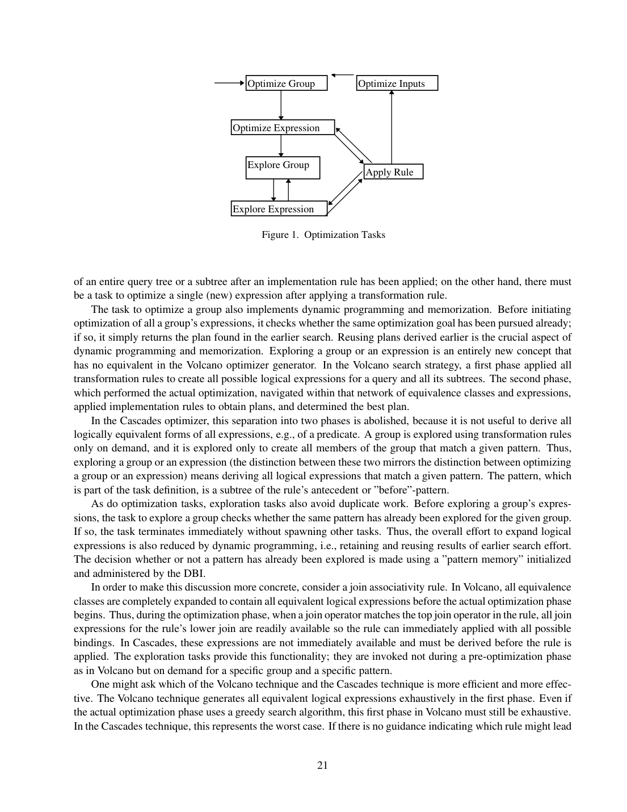
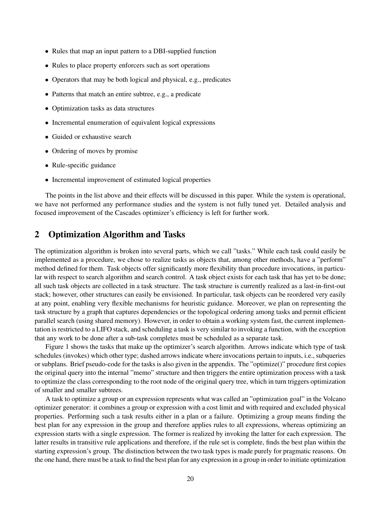

> 本组第 1 篇 · 优化器框架 · [全部论文]() · [下一篇]()

Cascades 框架旨在解决 Volcano Optimizer Generator 的两阶段搜索缺陷，通过引入按需探索（on-demand exploration）、统一的 Memo 结构以及混合逻辑/物理算子等机制，实现更紧凑的搜索空间与更灵活的规则表达。关键结论包括：(1) 消除穷举生成所有逻辑等价形式的冗余阶段；(2) Optimize Inputs 任务支持动态代价限制推导以实现紧剪枝；(3) 允许算子同时具备逻辑与物理属性以简化谓词处理。适用边界：论文明确指出系统虽可运行但未进行性能研究且未完全调优，关于搜索效率优于 Volcano 的论断停留在理论分析层面，缺乏实验数据支撑。若无 guidance，最坏情况效率等同于 Volcano 的穷举搜索。

本文保留论文陈述、读者推断与待验证方案的区别；实验数字只适用于原文条件。原文和翻译来自已有 AI 辅助精读报告，已做来源匹配与编辑复核，不等于人工逐项核验或独立实验复现。所有页码均为 PDF 物理页。

## 论文与阅读范围

作者：Goetz Graefe。年份与出处：根据提供的首页文本，出版信息未核实（仅知摘要提及将用于 Tandem NonStop SQL 与 Microsoft SQL Server）。缺口：未提供期刊/会议名称、卷号、页码范围及确切发表年份；PDF 物理页码共 10 页，但笔记仅覆盖部分页面。

[论文集中的原始 PDF](https://github.com/lonng/db-papers/blob/4ff1331069c7cf52ac97dd769e5f484c1c35c200/papers/optimizer-framework/the-cascades-framework-for-query-optimization.pdf) · 本地来源：`optimizer-framework/the-cascades-framework-for-query-optimization.pdf`，共 10 页。

本篇保留 10 组原文精读和 14 条证据。截图为原始 PDF 的局部页选，不是重新生成的图表；未将整份 PDF 复制到博客。

## 研究问题与适用边界

本节基于论文原文事实阐述 Cascades 框架试图解决的核心问题及其声明的适用边界。

**Volcano 两阶段搜索的缺陷**
Cascades 项目的直接动机是克服 Volcano Optimizer Generator 在实际应用中暴露的设计缺陷。根据笔记 C001N01，Volcano 采用了两阶段分离的搜索策略：第一阶段穷举应用所有 transformation rules 以生成全部逻辑等价表达式；第二阶段才进行实际的物理优化。Cascades 认为这种两阶段分离是多余的，因为并非所有表达式（例如谓词）都需要派生出全部逻辑等价形式。为此，Cascades 废除了这一分离，引入了按需探索（on-demand exploration）机制，仅在需要时才针对特定模式触发探索任务。

**适用边界与已知局限**
必须严格区分论文的架构设计与其实际验证状态。根据笔记 C001N05，论文明确指出：虽然系统已处于可运行状态（operational），但尚未执行任何性能研究（performance studies），且系统尚未完全调优（not fully tuned yet）。这意味着，关于 Cascades 搜索策略是否比 Volcano 更高效的讨论，在本文范围内仅停留在理论分析层面，缺乏实验数据的支撑。此外，作者承认了一个重要的边界条件：如果数据库实现者（DBI）不提供 guidance，Cascades 的最坏情况效率将等同于 Volcano 的穷举搜索。因此，Cascades 的效率优势高度依赖于 DBI 提供的启发式引导函数的质量。

**目标产品**
摘要部分提到，该优化器系统将作为 Tandem 的 NonStop SQL 产品和 Microsoft 的 SQL Server 产品中新查询优化器的基础。这界定了该框架的工程目标级别：面向工业级关系型数据库内核。

依据：论文陈述；PDF 物理页 2, 3。证据：[C001N01](#evidence-c001n01), [C001N05](#evidence-c001n05)。

## 系统架构与核心数据结构

本节描述 Cascades 框架的架构设计，重点涵盖接口抽象、Memo 结构、算子模型以及特殊算子。

**DBI 抽象接口层次结构**
Cascades 放弃了 EXODUS/Volcano 中通过代码生成器硬编码接口的做法，转而采用 C++ 抽象基类来定义 DBI 与优化器之间的接口。根据笔记 C001N12，接口中的每个类都被设计为子类层次结构的根（root of a subclass hierarchy）。对象的创建与其他类相关联，例如 guidance 结构的创建与 rule 对象关联。优化器内部仅依赖接口中定义的方法，而 DBI 可以在子类中自由添加额外方法。EXPR 类属于 DBI 接口的一部分，但优化器内部的数据结构不对外暴露。这种设计使得不同数据库系统可以通过继承和重写方法来定制优化器行为，而无需修改优化器内核代码。

**Memo 结构与去重机制**
Memo 是 Cascades 记忆化搜索的核心数据结构。根据笔记 C001N09，Memo 中的表达式去重采用自底向上的递归过程，从 substitute 的叶子节点开始向上至根节点进行。为了加速查找，系统使用哈希表，其哈希键由 operator 及其输入 groups 组成。论文明确强调，这个自底向上的方向对于正确的重复检测是必需的（is required for correct duplicate detection）。读者工程推断：当前插入中须先得到一致的子 group 引用，才能构造父表达式的哈希键；这不要求子 group 已包含所有等价形式，也不排除后续 group 合并。此为对插入依赖的解释，并非论文给出的形式化证明。

**混合逻辑/物理算子模型**
在 EXODUS 和 Volcano 中，逻辑算子与物理算子被要求严格互斥。Cascades 放弃了这一要求。根据笔记 C002N01，通过 OP-ARG 类中的 is-logical 和 is-physical 方法，一个算子可以同时是逻辑的和物理的（例如 System R 中的 sargable 单记录谓词），也可以两者都不是（用于类似 Starburst 的文法展开非终结符）。如果 DBI 希望保持两者的严格分离，仍可以通过定义子类来强制执行。根据笔记 C001N11，当一个算子同时具有两种属性时，一条规则可以同时是 transformation rule 和 implementation rule。当 substitute 的根节点是此类混合操作符时，系统会同时创建两种类型的 follow-on tasks。但论文预期这种情况是例外而非常态。

**算子参数内联与特殊算子**
根据笔记 C002N02，在 Cascades 中，算子的定义包含了其参数，因此不再需要像 EXODUS 和 Volcano 那样提供单独的“参数传递”机制。这允许将以前作为算子参数建模的谓词等直接作为逻辑和物理代数中的一级算子。结合混合算子特性以及支持调用 DBI 函数的规则，谓词操作（如将可下推的组件从复杂谓词中拆分）变得更加简便。

此外，Cascades 提供了两个特殊算子供规则使用（笔记 C002N03）：LEAF-OP 和 TREE-OP。LEAF-OP 在匹配时匹配任意子树；在应用规则前，从搜索内存中提取的表达式会在对应叶子位置放置引用等价类的叶算子。TREE-OP 类似，但提取的表达式包含完整的子表达式树，不受大小或复杂度限制，直到逻辑代数的叶算子为止。TREE-OP 特别适用于配合 function rules 使用。

**Pattern Memory**
根据笔记 C002N07，Pattern memory 与每个 group 关联，用于防止对同一 group 使用相同 pattern 进行不必要的重复探索。在最简单的穷举搜索中，pattern memory 只需一个布尔值记录是否已探索过；复杂的实现可以存储每个 pattern。当检测到两个等价表达式组实际上是同一个时（即转换后的表达式已存在于另一个 group 中），需要调用 pattern memory 的合并方法将两个 memory 合并为一个。这是 pattern memory 最复杂的方法。

依据：论文陈述；PDF 物理页 4, 5, 6, 7, 8。证据：[C001N09](#evidence-c001n09), [C001N11](#evidence-c001n11), [C001N12](#evidence-c001n12), [C002N01](#evidence-c002n01), [C002N02](#evidence-c002n02), [C002N03](#evidence-c002n03), [C002N07](#evidence-c002n07)。

*原论文 PDF 物理页 3，版权归原作者或出版方。点击图片可查看原尺寸。页面文本中定位到：Figure 1.  Optimization Tasks。这是页面定位信息，不表示本次已复核图内所有数据。*

## 搜索算法与任务调度机制

本节详细解析 Cascades 的搜索算法，包括按需探索、Optimize Inputs 任务的剪枝机制、规则控制函数以及 FUNCTION-RULE。

**按需探索（Explore Group/Expression）**
根据笔记 C001N04，Explore Group/Expression 是 Cascades 引入的全新概念，在 Volcano 中无对应物。探索任务仅针对特定 pattern（即规则 antecedent 的子树）按需触发，用于派生匹配该 pattern 的所有逻辑表达式。探索任务同样避免重复工作：通过 DBI 初始化和管理的 pattern memory 判断某 pattern 是否已在给定 group 上探索过，若已探索则立即终止。

**Optimize Inputs 任务与动态代价剪枝**
根据笔记 C001N10，Optimize Inputs 任务在 Cascades 的任务调度中具有特殊地位。其他任务通常在调度后续任务后即消失，而 Optimize Inputs 任务会多次激活，等待子任务完成后再调度下一个。作者陈述：它在每次输入优化完成后获取已推导出的最佳代价，并为下一个输入推导新的 cost limit，称之为尽可能紧的剪枝。第 5 页还明确声称，只优化确实可能参与某个查询执行计划的子树和 interesting properties；这里的“某个计划”不等于最终被选中的计划。读者工程推断：须区分固定估计代价目标下的最优计划与真实执行最快的计划。估计值偏离实际运行时间，会使两者不一致，但不能仅据此断言 branch-and-bound 会误剪固定估计目标下的最优解。相对于该目标的安全剪枝依赖有效的界限、相互一致的子计划代价组合与 cost limit 推导，以及保留必要候选的搜索；第 6–7 页将这些代价方法交给 DBI。上述条件是工程分析，不是本文给出的形式化证明，也不要求估计值精确预测真实运行时间。

**算子级别的 opt-cutoff 控制**
根据笔记 C002N04，所有算子必须实现 opt-cutoff 方法。该方法用于在优化任务中决定追求多少个可能的移动（moves）。默认行为是追求全部以保证穷举搜索找到最优计划。逻辑算子还需提供匹配和哈希方法（用于模式匹配和去重）、逻辑属性的发现与改进方法，以及探索任务的初始化方法。物理算子需提供计算局部代价、组合输入代价与属性生成子计划总代价的方法，以及在优化多个输入之间验证代价限制并计算新代价限制的方法。

**Promise 与 Condition 函数**
根据笔记 C002N09，规则应用受 promise 和 condition 两种函数控制。Promise 函数在探索开始前评估规则的潜在效用，返回实数值（<=0 阻止进一步工作，无引导穷举搜索应返回 1.0）。默认 promise 函数在要求特定物理属性时返回 0，substitute 为实现算法时返回 2，否则返回 1。Condition 函数在探索完成且完整模式可用后执行，返回布尔值以确认规则是否真正适用。作者在第 8 页明确声明：若 cutoff 方法选择穷举搜索，promise 不改变最终计划质量，但可影响计划发现顺序、剪枝有效性及优化耗时。读者工程解释：更早找到较优计划可收紧 cost limit，因而即使穷举配置也会改变安全代价剪枝的效率；这不等于遗漏可行候选或损失最优性。还须区分排序与过滤：promise <=0 会阻止当前规则和表达式的后续工作，故不能仅凭 opt-cutoff 不截断就断言任意 promise 实现都保留完整候选空间。非穷举 cutoff 或错误的 guidance/非正 promise 若排除了必要候选，才可能失去固定估计代价目标下的最优计划；不能把这种候选损失与剪枝效率混为一谈。

**FUNCTION-RULE 机制**
根据笔记 C002N11，FUNCTION-RULE 类允许 DBI 直接编写函数来转换表达式，而不是设计规则集。FUNCTION-RULE 仍需先进行 pattern 匹配以提取出对应规则 pattern 的表达式，一旦提取完成，就会反复调用迭代器方法来生成所有 substitutes。结合 TREE-OP，提取的表达式可以任意深和复杂，使得 DBI 能够编写几乎任何转换。例如，将复杂 join 谓词确定性地拆分为应用于左、右及两侧输入的子句。这为处理非标准关系代数转换提供了极大的灵活性。

依据：论文陈述；PDF 物理页 3, 5, 6, 8, 9。证据：[C001N04](#evidence-c001n04), [C001N10](#evidence-c001n10), [C002N04](#evidence-c002n04), [C002N09](#evidence-c002n09), [C002N11](#evidence-c002n11)。

> 来源限定：证据页码仅列已引用证据支持的页；建议对照页保留补充原文阅读位置，不表示新增证据或形式化证明。

> 建议另行对照的 PDF 物理页：[3, 5, 6, 7, 8, 9]。

## 正确性论证与边界条件

本节先区分论文明确陈述与读者工程推断；后者不是论文给出的形式化证明。

**Memo 去重的方向性要求**
作者陈述：第 4–5 页要求 substitute 自叶到根插入并检测重复，哈希键为 operator 及其输入 groups（笔记 C001N09）。读者工程推断：处理父节点前，应已获得当前插入所需的子 group 引用，并按当前 Memo 等价关系使用一致的规范引用；这只是当前插入的依赖顺序，不要求预先生成所有等价表达式，也不表示 Group ID 或归属永久最终确定。第 8 页明确要求在发现跨 group 等价时合并 pattern memories，第 9 页的 reduction rule 也会合并 groups。后续合并如何维护引用及哈希一致性属于实现责任，本文没有规定唯一方案。

**Pattern Memory 合并的正确性**
作者陈述：第 7–8 页将 pattern memory 与每个 group 关联，由 DBI 结合探索 promise 设计；穷举转换规则的简单情形可以只用一个 Boolean，更复杂情形可以存储各 pattern。发现两个 groups 实为同一组时，需要合并它们的 pattern memories（笔记 C002N07）。读者工程推断：合并应保持相应表示及探索策略预期的“已探索/仍需探索”语义。丢失有效探索记录可能引起重复工作，错误宣称某探索已完成则可能遗漏必要转换；但这些风险不推出所有实现都必须做字面上的集合精确并集。集合表示可采用适合其语义的合并，Boolean 或其他 DBI 表示也须按自身含义处理；本文未规定统一集合算法。

**Promise 函数不影响计划质量的边界**
作者在第 8 页声明，cutoff 选择穷举搜索时 promise 不影响最终计划质量，但会影响计划发现顺序、剪枝有效性和耗时（笔记 C002N09）；同页也明确 promise <=0 会阻止当前规则和表达式的后续工作，并建议无引导穷举搜索统一返回 1.0。读者工程推断：保留必要候选的前提下，排序可以改善代价剪枝效率而不改变固定估计代价目标下的最优结果。仅 opt-cutoff 不截断，不能弥补错误 promise/guidance 对必要候选的过滤。若截断为前 K 个 moves 或错误过滤候选，便不能依赖穷举搜索的最优性主张；这与代价预测是否准确对应真实运行时间是不同问题。

**混合算子的语义一致性**
允许算子同时具备逻辑和物理属性（笔记 C002N01, C001N11）带来了语义上的复杂性。推断其边界：当一个混合算子被用作 transformation rule 的 substitute 时，它产生的表达式既属于逻辑等价类，又可以直接参与代价估算。如果 DBI 在实现代价计算函数时未能正确处理这种双重身份（例如对纯逻辑上下文中的混合算子计算了物理代价），可能导致搜索状态的混乱。论文预期这是例外情况，暗示在常规使用中应谨慎对待。

依据：读者推断；PDF 物理页 4, 5, 6, 7, 8。证据：[C001N09](#evidence-c001n09), [C001N11](#evidence-c001n11), [C002N01](#evidence-c002n01), [C002N07](#evidence-c002n07), [C002N09](#evidence-c002n09)。

> 来源限定：证据页码仅列已引用证据支持的页；建议对照页保留补充原文阅读位置，不表示新增证据或形式化证明。

> 建议另行对照的 PDF 物理页：[4, 5, 6, 7, 8, 9]。

## 实验评估与性能数据

本节严格依据论文原文说明实验状况。

**实验数据的缺失**
根据笔记 C001N05，论文明确声明：“While the system is operational, we have not performed any performance studies and the system is not fully tuned yet”（虽然系统已可运行，但我们尚未进行任何性能研究，且系统尚未完全调优）。因此，本论文不包含任何关于 Cascades 框架的实验评估数据。

**缺失的具体维度**
由于上述声明，以下实验要素在本文中均明确缺失：
1. **工作负载（Workload）**：未提供用于测试的查询集（如 TPC-H、TPC-DS 或自定义查询）。
2. **硬件/软件环境**：未说明运行系统的机器配置、操作系统或编译器版本。
3. **基线（Baselines）**：虽然引言中大量对比了 Volcano 和 EXODUS，但未提供量化的对比实验。
4. **指标（Metrics）**：未定义衡量优化器性能的指标（如优化时间、生成的计划代价、内存消耗）。
5. **主要数字**：无任何性能相关的数字。

**不能得出的结论**
基于本文内容，绝对不能得出“Cascades 的优化速度比 Volcano 快 X%”或“Cascades 消耗的内存更少”等定量结论。关于 Cascades 搜索策略与 Volcano 搜索策略哪个更高效的讨论，仅停留在理论分析和架构设计的合理性论证层面。作者承认若无 guidance，最坏情况效率等同于 Volcano 的穷举，这进一步表明性能高度依赖于具体实现和配置，而非框架本身的绝对保证。

依据：论文陈述；PDF 物理页 2, 3。证据：[C001N05](#evidence-c001n05)。

*原论文 PDF 物理页 2，版权归原作者或出版方。点击图片可查看原尺寸。页面文本中定位到：Figure 1 shows the tasks that make up the optimizer’s search algorithm. Arrows indicate which type of task。这是页面定位信息，不表示本次已复核图内所有数据。*

## 设计权衡与工程取舍

本节基于论文描述的机制，分析 Cascades 框架在设计上做出的权衡。这些分析属于读者推断，论文未直接提供量化对比。

**按需探索 vs. 状态管理复杂度**
Cascades 废除了 Volcano 的两阶段搜索，采用按需探索（笔记 C001N01, C001N04）。这一设计的收益是避免了生成无用的逻辑等价形式，理论上缩小了搜索空间。然而，其代价是引入了极其复杂的状态管理机制。为了支持按需探索且不产生重复工作，Cascades 必须维护 Pattern Memory（笔记 C002N07），并且需要处理 Group 合并时的 Pattern Memory 合并。此外，Optimize Inputs 任务需要挂起、恢复并动态计算 cost limit（笔记 C001N10），这使得任务调度器从一个简单的队列演变为一个带有依赖关系的协程/状态机系统。工程实现难度显著增加。

**混合算子 vs. 概念清晰度**
允许算子同时是逻辑和物理的（笔记 C002N01, C002N02）极大地简化了谓词处理等操作，使得规则编写更加直观。但权衡在于破坏了代数层次的清晰界限。在传统优化器中，逻辑计划树和物理计划树是严格分离的。混合算子意味着同一个 Memo Group 中可能同时包含纯逻辑表达式、纯物理表达式和混合表达式。这要求优化器在遍历 Memo 时必须频繁调用 is-logical 和 is-physical 来判断当前上下文的合法性，增加了代码分支和认知负担。论文也承认这应是例外情况。

**FUNCTION-RULE/TREE-OP vs. 搜索可控性**
FUNCTION-RULE 结合 TREE-OP 允许 DBI 编写任意深度的转换函数（笔记 C002N03, C002N11）。这提供了无与伦比的表达能力，特别适合处理复杂的、确定性的代数重写（如谓词拆分）。但权衡在于，FUNCTION-RULE 仍需先进行 pattern 匹配以提取表达式，其特殊性在于使用迭代器方法生成 substitutes 而非传统的规则替换模板。如果一个 FUNCTION-RULE 编写不当，生成了大量低质量的 substitutes，可能会导致搜索空间膨胀。它将正确性和性能的责任很大程度上转移给了 DBI 开发者。

**Guidance 机制 vs. 最坏情况保证**
Promise 函数和 opt-cutoff 方法提供了强大的剪枝能力（笔记 C002N04, C002N09）。但在没有良好 guidance 的情况下，系统退化为穷举搜索（笔记 C001N05）。这意味着 Cascades 的性能下限并不比 Volcano 高，其优势完全建立在 DBI 能够提供高质量启发式信息的前提下。对于缺乏经验的 DBI 团队，Cascades 的复杂性可能无法转化为实际的性能收益。

依据：读者推断；PDF 物理页 2, 3, 5, 6, 7, 8, 9。证据：[C001N01](#evidence-c001n01), [C001N04](#evidence-c001n04), [C001N05](#evidence-c001n05), [C001N10](#evidence-c001n10), [C002N01](#evidence-c002n01), [C002N02](#evidence-c002n02), [C002N03](#evidence-c002n03), [C002N04](#evidence-c002n04), [C002N07](#evidence-c002n07), [C002N09](#evidence-c002n09), [C002N11](#evidence-c002n11)。

## 与相关系统及现代优化器的比较

本节首先总结论文中明确提及的与 EXODUS/Volcano 的比较，随后提出与现代数据库优化器的待验证比较问题。

**与 EXODUS 和 Volcano 的原文比较**
根据首页摘要和引言，Cascades 相比 Volcano 的主要改进包括：(i) 使用规则或函数操作算子参数；(ii) 算子可同时为逻辑和物理；(iii) 支持 schema 特定的规则（如物化视图）；(iv) 插入 enforcer 或 glue operators 的规则；(v) 规则特定的 guidance 及规则分组；(vi) 为并行搜索、偏序代价度量和动态计划提供基础；(vii) 广泛的 tracing 支持；(viii) 充分利用 C++ 抽象机制的干净接口。在搜索策略上，核心区别在于废除了 Volcano 的两阶段分离，引入了按需探索（笔记 C001N01）。

**与现代优化器的待验证联系（实验建议）**
以下联系仅作为待验证问题提出。由于未阅读相关系统的源码，不能断言其具体实现细节。

1. **Apache Calcite**：Calcite 的 VolcanoPlanner 实际上实现了 Cascades 风格的 Memo 和按需探索。待验证问题：Calcite 中的 RelSubset 和 RelSet 是否严格对应 Cascades 的 Group 和 Memo？Calcite 的规则匹配机制是否使用了类似 Pattern Memory 的结构来避免重复探索？

2. **DuckDB**：DuckDB 的优化器经历了从基于规则的优化（RBO）到基于代价的优化（CBO）的演进。待验证问题：DuckDB 当前的 CBO 是否采用了 Cascades 的 Memo 结构？其 Optimize Inputs 阶段的剪枝逻辑是否与笔记 C001N10 描述的动态 cost limit 推导一致？

3. **StarRocks / Doris**：这些 MPP 数据库的 CBO 广泛被认为基于 Cascades 框架。待验证问题：StarRocks 如何处理分布式执行属性（如数据分布、排序）的强制（enforcement）？这是否对应摘要中提到的“rules to insert enforcers”？其 Promise 函数的实现是否有效避免了最坏情况的穷举搜索？

4. **SQL Server**：摘要明确指出 Cascades 将用于 Microsoft SQL Server。待验证问题：经过数十年的演进，现代 SQL Server 的优化器在多大程度上保留了原始 Cascades 论文的接口设计（如 FUNCTION-RULE 和 TREE-OP）？

依据：待验证的工程设想；PDF 物理页 2, 3。证据：[C001N01](#evidence-c001n01), [C001N04](#evidence-c001n04)。

## 复现指南与工程挑战

由于论文未提供开源代码或详细的基准测试配置，复现 Cascades 框架面临重大挑战。本节提出复现建议和工程注意事项。

**复现所需材料（明确缺失）**
要完整复现论文描述的 Cascades 优化器，以下材料是必需的但论文未提供：
1. 完整的 C++ 接口定义（头文件），特别是 OP-ARG、EXPR、RULE、PATTERN 等抽象基类的具体方法签名。
2. Task 调度器的状态机实现细节，特别是 Optimize Inputs 任务的挂起与恢复机制。
3. 至少一个具体的 DBI 实现（包括逻辑代数、物理代数、代价模型和一组 transformation/implementation rules），否则无法运行任何查询。
4. Pattern Memory 的具体数据结构实现（布尔值还是哈希集合）。

**工程实现建议**
1. **Memo 与哈希去重**：实现自底向上的去重（笔记 C001N09）时，需要注意 Group 合并带来的哈希失效问题。Group 后续合并时，应维护引用与哈希查找的一致性；是否更新键、采用规范代表间接引用或使用其他机制，取决于 Memo 的表示，原文没有指定唯一算法。延迟更新或版本号只是待验证的工程选项。
2. **Task 栈管理**：Optimize Inputs 任务需要等待子任务完成（笔记 C001N10）。在现代 C++ 中，可以使用无栈协程（如 C++20 coroutines）或显式的状态机模式来实现，避免深层递归导致的栈溢出。
3. **FUNCTION-RULE 的安全沙箱**：由于 FUNCTION-RULE 允许执行任意代码（笔记 C002N11），在工业级系统中实现时，必须确保 DBI 提供的函数不会抛出未捕获的异常或导致死循环，否则会崩溃整个优化器进程。
4. **Tracing 与调试**：摘要提到 Cascades 提供了 extensive tracing support。在复现时，必须实现详细的日志系统，记录每个 Task 的创建、执行、剪枝原因以及 Memo 的每一次变更。没有 Tracing，调试 Cascades 的搜索过程几乎是不可能的。

**复杂度估算**
论文未给出严格的时间/空间复杂度证明。关于空间复杂度最坏情况、Pattern Memory 查找以及合并操作的具体 Big-O 复杂度数字，在提供的笔记中完全没有来源，属于未知，不应视为事实。

依据：待验证的工程设想；PDF 物理页 4, 5, 9。证据：[C001N09](#evidence-c001n09), [C001N10](#evidence-c001n10), [C002N11](#evidence-c002n11)。

## 总结与内核工程师视角

本节基于论文事实和前述分析，为数据库内核工程师提供总结。

**核心贡献总结**
Cascades 框架的核心贡献不在于提出了某种能绝对保证更快找到最优计划的魔法算法，而在于提供了一个高度模块化、可扩展且理论上完备的搜索基础设施。它通过废除两阶段搜索、引入按需探索和动态代价剪枝，在架构层面消除了 Volcano 的冗余工作。通过混合算子和 FUNCTION-RULE，它极大地提升了规则表达的灵活性，使得处理复杂谓词和非标准代数转换成为可能。

**对内核工程师的意义**
对于从事查询优化器开发的内核工程师而言，Cascades 论文的价值在于其接口设计和任务调度模型。它明确了优化器内核与 DBI 之间的职责边界：内核负责 Memo 管理、去重、任务调度和剪枝框架；DBI 负责定义代数、代价模型、规则逻辑和启发式引导。这种分离使得同一个优化器内核可以服务于完全不同的数据库产品（如摘要中提到的 Tandem 和 SQL Server）。

**局限性重申**
必须再次强调，本文是一篇架构设计论文，而非性能评估论文（笔记 C001N05）。估计代价与真实运行时间的偏差影响最终计划的实际表现；规则覆盖、guidance、代价界限与组合的一致性以及框架实现则影响搜索质量和开销。作者提出穷举搜索可找到最优计划，并认为无 guidance 时搜索效率与 Volcano 相当，但这不是实测性能上、下界，也不是实际执行最快的保证。本文不提供平均情况下的性能承诺。

依据：读者推断；PDF 物理页 2, 3。证据：[C001N01](#evidence-c001n01), [C001N05](#evidence-c001n05)。

## 原文精读：从句子回到机制

以下保留原文、忠实翻译、含义与边界；假设示例不作为论文实验结果。

### P001 · PDF 物理页 2

**原文**

<blockquote class="paper-source-quote"><pre><code>While the system is operational,&#10;we have not performed any performance studies and the system is not fully tuned yet. Detailed analysis and&#10;focused improvement of the Cascades optimizer’s efficiency is left for further work.</code></pre></blockquote>

**忠实翻译**

> 虽然系统是可运行的，但我们尚未执行任何性能研究，且系统尚未完全调优。对 Cascades 优化器效率的详细分析和针对性改进留待后续工作完成。

**技术含义与边界**

> 作者陈述：当前系统处于可运行状态，但未经过性能测试与充分调优；关于 Cascades 优化器效率的深入分析与改进被明确推迟到未来工作。适用边界：该段仅描述作者在撰写时的工程状态，不代表架构本身无法达到高性能。读者推断：由于缺乏性能数据，本文的重点在于架构设计与正确性保证，而非执行效率的实证。

**常见误读**

> 容易发生的错误解读是认为该系统因未调优而不可用或存在设计缺陷。原文不支持这种泛化，因为作者明确指出系统已 operational（可运行），只是 performance studies（性能研究）和 fully tuned（完全调优）尚未进行，这属于工程完善阶段的工作，不否定其理论或架构价值。

**读者构造的假设示例**

> 读者构造的假设示例：假设某数据库团队实现了一个新的查询优化器原型，能够正确生成执行计划，但尚未在 TPC-H 基准测试上测量耗时或调整内存分配参数。此时团队发表论文介绍架构，并声明性能评估留作 future work，这与原文描述的状态一致。

### P002 · PDF 物理页 9

**原文**

<blockquote class="paper-source-quote"><pre><code>For those&#10;cases, the Cascades optimizer supports a second class of rules, called the ”class FUNCTION-RULE.” Once an&#10;expression is extracted that corresponds to the rule’s pattern, an iterator method is invoked repeatedly to create&#10;all substitutes for the expression. Note that the extracted expression can be arbitrarily deep and complex if the&#10;tree operator (see above) is employed in the rule’s pattern.</code></pre></blockquote>

**忠实翻译**

> 对于这些情况，Cascades 优化器支持第二类规则，称为“class FUNCTION-RULE”。一旦提取出与规则模式匹配的表达式，就会重复调用一个迭代器方法来为该表达式创建所有替代项。注意，如果在规则模式中使用了树操作符（见上文），提取出的表达式可以是任意深度和复杂度的。

**技术含义与边界**

> 作者陈述：Cascades 引入了 FUNCTION-RULE 类，通过迭代器方法为匹配模式的表达式生成所有替代项；若结合树操作符，匹配目标可以具有任意深度和复杂度。机制：这是一种基于模式匹配和迭代生成的规则应用方式，区别于简单的单次替换。适用边界：适用于需要动态生成多个等价表达式的场景。读者推断：FUNCTION-RULE 提供了比传统单一转换更灵活的表达能力，迭代器的使用意味着替代项的生成可能是延迟或按需的。

**常见误读**

> 容易发生的错误解读是认为 FUNCTION-RULE 会无条件地展开所有深层表达式导致组合爆炸。原文不支持此推断，因为原文明确指出是在“Once an expression is extracted that corresponds to the rule's pattern”（一旦提取出匹配规则的表达式）之后才调用迭代器，且受限于具体规则模式的定义，并非盲目遍历。不能将局部支持的任意深度匹配泛化为全局无限制展开。

**读者构造的假设示例**

> 读者构造的假设示例：假设有一个表示嵌套 AND 条件的逻辑树，深度为 5 层。如果定义了包含树操作符的 FUNCTION-RULE 模式来匹配这种嵌套结构，迭代器方法可能会被调用多次，依次生成将该嵌套条件重写为不同等价形式（如转换为 CNF 的不同变体）的替代表达式。此为读者构造的假设示例，非作者实验。

### P003 · PDF 物理页 3

**原文**

<blockquote class="paper-source-quote"><pre><code>The second phase,&#10;which performed the actual optimization, navigated within that network of equivalence classes and expressions,&#10;applied implementation rules to obtain plans, and determined the best plan.&#10;In the Cascades optimizer, this separation into two phases is abolished, because it is not useful to derive all&#10;logically equivalent forms of all expressions, e.g., of a predicate. A group is explored using transformation rules&#10;only on demand, and it is explored only to create all members of the group that match a given pattern.</code></pre></blockquote>

**忠实翻译**

> 第二阶段执行实际的优化，在等价类和表达式的网络中进行导航，应用实现规则以获得计划，并确定最佳计划。在 Cascades 优化器中，这种分为两个阶段的分离被废除了，因为推导出所有表达式（例如谓词）的所有逻辑等价形式是没有用的。仅按需使用转换规则来探索一个 group，并且仅为了创建该 group 中匹配给定模式的所有成员而进行探索。

**技术含义与边界**

> 作者陈述：传统的两阶段优化（先穷举逻辑等价形式，再应用实现规则找最优计划）在 Cascades 中被废除。Cascades 采用按需（on demand）探索机制，仅在需要匹配特定模式时才使用转换规则扩展 group。机制：避免了无用逻辑等价形式的推导，提高了搜索效率。适用边界：针对不需要全局穷举逻辑空间的优化场景。读者推断：Cascades 的核心优势之一是将逻辑转换与物理实现交织在一个统一的按需搜索过程中，而非严格分阶段。

**常见误读**

> 容易发生的错误解读是认为 Cascades 完全不使用转换规则或不再维护等价类网络。原文不支持此推断，因为作者明确指出“A group is explored using transformation rules only on demand”（仅按需使用转换规则探索 group），说明转换规则和等价类网络依然存在，只是触发时机从“第一阶段全量执行”变为“按需执行”。不能将废除两阶段分离误解为废除转换规则本身。

**读者构造的假设示例**

> 读者构造的假设示例：假设查询中包含一个复杂的谓词 P。在传统两阶段系统中，第一阶段可能会生成 P 的数十种逻辑等价形式，即使最终计划只用到了其中一种。而在 Cascades 中，只有当某个实现规则的模式需要匹配 P 的某种特定等价形式时，才会触发转换规则去生成该形式，其余无关的等价形式不会被推导。此为读者构造的假设示例。

### P004 · PDF 物理页 6

**原文**

<blockquote class="paper-source-quote"><pre><code>Notice that these two sets are different; we call them logical and physical operators [Gra93].&#10;While previous extensible operators required that these two sets be disjunct, we have abandoned this requirement.&#10;The ”class OP-ARG” in the Cascades optimizer interface includes both logical and physical operators. For each&#10;operator, one method called ”is-logical” indicates whether or not an operator is a logical operator, while a second&#10;method called ”is-physical” indicates whether or not an operator is a physical operator.</code></pre></blockquote>

**忠实翻译**

> 注意这两个集合是不同的；我们称它们为逻辑操作符和物理操作符 [Gra93]。虽然以前的可扩展操作符要求这两个集合不相交，但我们已经放弃了这一要求。Cascades 优化器接口中的“class OP-ARG”同时包含逻辑和物理操作符。对于每个操作符，一个名为“is-logical”的方法指示该操作符是否为逻辑操作符，而第二个名为“is-physical”的方法指示该操作符是否为物理操作符。

**技术含义与边界**

> 作者陈述：Cascades 放弃了逻辑操作符与物理操作符必须互斥（disjunct）的传统约束。OP-ARG 类统一包含两者，并通过 is-logical 和 is-physical 两个独立方法分别标识属性。机制：允许同一个操作符实例同时具备逻辑和物理语义。适用边界：适用于需要统一抽象层或存在既是逻辑又是物理的操作符的系统设计。读者推断：这种设计增加了接口的灵活性，使得某些底层操作（如简单的标量计算）无需在逻辑和物理代数中重复定义。

**常见误读**

> 容易发生的错误解读是认为 Cascades 取消了逻辑与物理操作符的区别。原文不支持此推断，因为作者明确说“these two sets are different”（这两个集合是不同的），并且保留了 is-logical 和 is-physical 方法来区分它们。放弃的是“必须不相交”的强制要求，而不是概念上的区分。不能将接口层面的统一泛化为语义层面的混淆。

**读者构造的假设示例**

> 读者构造的假设示例：假设存在一个常量扫描操作符 ConstantScan。在某些简单场景下，它的逻辑语义（返回常量值）和物理语义（直接在寄存器中生成值）完全一致。在 Cascades 中，可以将 ConstantScan 定义为 OP-ARG 的子类，并让其 is-logical() 和 is-physical() 均返回 true，从而避免定义两个冗余的类。此为读者构造的假设示例，非作者已完成复现。

### P005 · PDF 物理页 4

**原文**

<blockquote class="paper-source-quote"><pre><code>In fact, since an operator&#10;can be both logical and physical, one rule may be both a transformation and an implementation rule. Correct rule&#10;application for such rules is guaranteed, although we expect such operators and rules to be exceptions rather than&#10;the norm.</code></pre></blockquote>

**忠实翻译**

> 事实上，由于一个操作符可以同时是逻辑的和物理的，一条规则可能同时是转换规则（transformation rule）和实现规则（implementation rule）。对于此类规则，正确的规则应用是有保证的，尽管我们预期此类操作符和规则是例外而非常态。

**技术含义与边界**

> 作者陈述：基于 P004 中操作符可同时为逻辑和物理的特性，单条规则也可兼具转换与实现的双重身份。系统保证这类双重规则的正确应用，但作者预期这在实际使用中属于少数例外情况。适用边界：适用于操作符语义重叠的特殊场景。读者推断：框架在设计上追求完备性和通用性，即使在边缘情况下也能保证正确性，但工程实践中仍鼓励遵循常规的分离原则。

**常见误读**

> 容易发生的错误解读是认为 Cascades 鼓励或推荐大量编写既是转换又是实现的规则。原文不支持此推断，因为作者明确指出“we expect such operators and rules to be exceptions rather than the norm”（我们预期此类操作符和规则是例外而非常态）。系统提供保证是为了框架的严谨性，而非提倡这种做法。

**读者构造的假设示例**

> 读者构造的假设示例：假设有一条规则 RuleX，其输入模式匹配一个既是逻辑又是物理的操作符 OpY，输出也是一个等价的具体执行形式。RuleX 既改变了表达式的逻辑形态（作为转换规则），又生成了可执行的物理节点（作为实现规则）。Cascades 引擎能正确处理这种重叠，但开发者通常应将逻辑重写与物理映射拆分为两条独立规则。此为读者构造的假设示例。

### P006 · PDF 物理页 5

**原文**

<blockquote class="paper-source-quote"><pre><code>detection. The search for duplicates is very fast as it employs a hash table using an operator and the groups of its&#10;inputs as keys.&#10;Finally, if a substitute’s root is a new expression, follow-on tasks may be initiated.</code></pre></blockquote>

**忠实翻译**

> 重复项检测。重复项的搜索非常快，因为它使用一个哈希表，以操作符及其输入的 groups 作为键。最后，如果替代项的根是一个新表达式，可能会启动后续任务。

**技术含义与边界**

> 作者陈述：系统通过哈希表进行快速的重复项检测，哈希表的键由操作符和其输入对应的 groups 组成。当生成的替代项根节点为新表达式时，会触发 follow-on tasks（后续任务）。机制：利用 group 级别的等价性进行哈希，避免了逐节点比较表达式的开销；新表达式的发现驱动了搜索过程的继续。适用边界：Memo 结构中防止冗余探索的核心机制。读者推断：以 groups 而非具体表达式作为键，体现了 Cascades 基于等价类（group）进行搜索的本质特征。 读者工程边界：这里需要的是当前插入可用且一致的输入 group 引用，不是预先穷举所有等价形式或永久固定 Group ID；第 8–9 页允许后续 group 合并。

**常见误读**

> 容易发生的错误解读是认为哈希表的键是具体的子表达式树。原文不支持此推断，因为原文明确说明键是“an operator and the groups of its inputs”（一个操作符及其输入的 groups）。使用 groups 作为键意味着只要输入属于相同的等价类，即使内部表达式不同，也会被识别为相同的结构从而避免重复。不能将局部哈希策略误解为对整个表达式树的深拷贝比较。

**读者构造的假设示例**

> 读者构造的假设示例：假设有两个表达式 Join(A, B) 和 Join(C, D)，如果 A 和 C 属于同一个 group G1，B 和 D 属于同一个 group G2，那么在哈希表中它们的键都是 (Join, G1, G2)。当尝试插入第二个 Join 时，哈希查找会发现重复项，从而避免重复优化。此为读者构造的假设示例，用于解释原文机制。

### P007 · PDF 物理页 8

**原文**

<blockquote class="paper-source-quote"><pre><code>Beyond checking whether a given pattern already exists in the memory, and saving it to detect a second ex-&#10;ploration with the same pattern, the most complex method for pattern memories is to merge two pattern memories&#10;into one. This method is required when two groups of equivalent expressions are detected to be actually one, i.e.,&#10;when a transformed expression already occurs in a different group in the search memory.&#10;3.6&#10;Rules&#10;Next to operators, the other important class of objects in the Cascades optimizer are rules.</code></pre></blockquote>

**忠实翻译**

> 除了检查给定模式是否已存在于内存中并保存它以检测使用相同模式的第二次探索之外，模式记忆（pattern memories）最复杂的方法是将两个模式记忆合并为一个。当检测到两组等价表达式实际上是同一组时，即当转换后的表达式已经出现在搜索内存中的不同 group 中时，就需要此方法。3.6 规则。除操作符外，Cascades 优化器中另一类重要的对象是规则。

**技术含义与边界**

> 作者陈述：Pattern memory 包括检查、保存探索模式及合并两个 memory；当转换后的表达式已存在于另一 group、从而发现两组实为同一组时，需要合并（第 8 页）。同节允许简单穷举搜索只用 Boolean，也允许更复杂的模式表示，由 DBI 配合探索 promise 设计。读者工程推断：合并要保持相应表示下的已探索语义及仍需探索的义务，不能一律规定为两个集合的字面精确并集。引用未指定底层指针更新算法。

**常见误读**

> 常见误读：把“最复杂的方法”理解为论文已证明合并很少发生，或断言所有 pattern memory 都是集合、合并只能取精确并集。原文仅给出合并触发条件，没有频率结论；同页还明确允许 Boolean 表示。正确边界是按 DBI 选择的表示和探索语义合并，而非套用唯一数据结构算法。

**读者构造的假设示例**

> 读者构造的假设示例：假设 Group 1 包含表达式 A=B，Group 2 包含表达式 B=A。某条交换律转换规则在处理 Group 1 时生成了 B=A，系统发现 B=A 已存在于 Group 2 中。此时判定 Group 1 和 Group 2 实际等价，需要将两者的 pattern memory 合并为一个，以确保后续搜索不会将它们视为独立空间。此为读者构造的假设示例。

### P008 · PDF 物理页 3

**原文**

<blockquote class="paper-source-quote"><pre><code>Reusing plans derived earlier is the crucial aspect of&#10;dynamic programming and memorization. Exploring a group or an expression is an entirely new concept that&#10;has no equivalent in the Volcano optimizer generator. In the Volcano search strategy, a first phase applied all&#10;transformation rules to create all possible logical expressions for a query and all its subtrees.</code></pre></blockquote>

**忠实翻译**

> 重用先前推导出的计划是动态规划和记忆化（memorization）的关键方面。探索（Exploring）一个 group 或表达式是一个全新的概念，在 Volcano 优化器生成器中没有等价物。在 Volcano 搜索策略中，第一阶段应用所有转换规则，为查询及其所有子树创建所有可能的逻辑表达式。

**技术含义与边界**

> 作者陈述：Cascades 继承了动态规划和记忆化以重用计划的核心思想。但“探索 group/表达式”是 Cascades 引入的全新概念，Volcano 中不存在。Volcano 的策略是第一阶段穷举所有逻辑表达式。机制对比：Volcano 采用全量预计算，Cascades 采用按需探索。适用边界：解释了 Cascades 相对于前身 Volcano 的核心演进点。读者推断：“探索”概念的引入正是为了实现前文提到的废除两阶段分离、按需应用转换规则的设计目标。

**常见误读**

> 容易发生的错误解读是认为 Cascades 抛弃了动态规划和记忆化。原文不支持此推断，因为第一句明确指出“Reusing plans derived earlier is the crucial aspect of dynamic programming and memorization”，说明 Cascades 依然依赖这些技术。Cascades 改变的是生成逻辑表达式的时机和方式（从 Volcano 的全量第一阶段变为按需探索），而非放弃计划重用。

**读者构造的假设示例**

> 读者构造的假设示例：在 Volcano 中，面对查询 Q，系统会先生成 Q 的所有逻辑等价形式集合 S，然后再在 S 上寻找物理计划。在 Cascades 中，没有这个生成全集 S 的第一阶段；相反，系统在需要时“探索”Q 的某个 group，仅生成当前模式匹配所需的逻辑成员，并利用记忆化缓存结果供后续重用。此为读者构造的假设示例，用于对比两者差异。

### P009 · PDF 物理页 5

**原文**

<blockquote class="paper-source-quote"><pre><code>Thus, like the Volcano search strategy, the Cascades search engine&#10;guarantees that only those subtrees and interesting properties are optimized that could indeed participate in a&#10;query evaluation plan. Each time after an input has been optimized, the optimize inputs task obtains the best&#10;execution cost derived, and derives a new cost limit for optimizing the next input. Thus, pruning is as tight as&#10;possible.&#10;3&#10;Data Abstraction and the User Interface&#10;Developing the Cascades optimizer system required pursuing three different activities in rapid alternation.</code></pre></blockquote>

**忠实翻译**

> 因此，与 Volcano 搜索策略一样，Cascades 搜索引擎保证只优化那些确实能参与查询评估计划的子树和有趣属性（interesting properties）。每次优化完一个输入后，optimize inputs 任务会获取推导出的最佳执行成本，并为优化下一个输入推导出一个新的成本上限。因此，剪枝尽可能紧密。

**技术含义与边界**

> 作者陈述：第 5 页保证只优化可能参与某个查询执行计划的子树及 interesting properties，并非只优化最终选中计划包含的部分。Optimize Inputs 在一个输入优化完成后取得最佳已推导代价，为下一个输入更新 cost limit；作者据此称剪枝尽可能紧。读者工程推断：输入顺序可影响界限收紧时机和搜索开销。固定估计代价目标下的最优性与真实运行最快是两件事；安全的代价剪枝要求界限及代价组合对该目标有效、一致，而不是要求估计值精确预测实际耗时。本文未给出形式化证明。

**常见误读**

> 常见误读：将“可能参与某个计划”改成“必然参与最终选中计划”，或仅因代价预测不准就断言 branch-and-bound 会误剪固定估计代价目标下的最优解。原文不支持这两种说法。估计与实际耗时不一致可使估计最优不等于实际最快；无效界限、不一致的代价组合或候选过滤则是另一类搜索正确性风险。超时或非穷举搜索也不能套用穷举的最优性主张。

**读者构造的假设示例**

> 读者构造的假设示例，非论文公式或实验：假设 Join 的估计总代价可加，为左输入代价加右输入代价，并暂设 Join 局部代价为 0。若上限为 150，左输入已得到估计代价 100，则可为右输入推导剩余上限 50；只有当右侧界限对同一估计目标有效时，才可据此排除不可能改善该上限的候选。真实执行耗时是否等于这些数值是另一问题。非加性代价或非零局部代价必须使用 DBI 的代价组合和 limit 方法，不能直接套用此减法。

### P010 · PDF 物理页 6

**原文**

<blockquote class="paper-source-quote"><pre><code>On the other hand, a&#10;DBI who wishes to do so can easily retain a strict separation of logical and physical operators, e.g., by defining&#10;subclasses with suitable definitions for the methods ”is-logical” and ”is-physical” and by defining all operators&#10;as subclasses of these two classes.&#10;The definition of operators includes their arguments. Thus, no separate mechanisms are required or provided&#10;for ”argument transfer” as in EXODUS and Volcano. Notice, however, that there are two crucial facilities that&#10;permits and encourage modeling predicates etc., which had been modeled as operator arguments in all our pro-&#10;totypes constructed in the EXODUS and Volcano frameworks, as primary operators in the logical and physical&#10;algebra’s.</code></pre></blockquote>

**忠实翻译**

> 另一方面，希望这样做的 DBI（数据库实现者）可以很容易地保留逻辑和物理操作符的严格分离，例如，通过定义子类并为“is-logical”和“is-physical”方法提供合适的定义，并将所有操作符定义为这两个类的子类。操作符的定义包含其参数。因此，不需要也不提供像 EXODUS 和 Volcano 中那样的单独“参数传递”机制。然而请注意，有两个关键设施允许并鼓励将谓词等建模为主操作符（primary operators），而在我们在 EXODUS 和 Volcano 框架构建的所有原型中，这些曾被建模为操作符参数。

**技术含义与边界**

> 作者陈述：尽管框架允许逻辑与物理操作符重叠，DBI 仍可通过继承体系强制保持两者分离。操作符定义内聚了其参数，废弃了 EXODUS/Volcano 中独立的参数传递机制。此外，新设施鼓励将过去作为参数的元素（如谓词）提升为逻辑和物理代数中的一等公民（主操作符）。机制：通过面向对象设计和代数重构简化了系统接口。适用边界：面向希望升级架构的数据库实现者。读者推断：将谓词提升为主操作符意味着可以对谓词本身应用转换规则和优化策略，增强了优化的细粒度。

**常见误读**

> 容易发生的错误解读是认为 Cascades 强制要求将所有谓词都改为操作符，或者完全禁止参数传递。原文不支持强制改变的推断，因为作者使用的是“permits and encourage modeling predicates etc... as primary operators”（允许并鼓励将谓词等建模为主操作符），这是一种架构引导而非硬性约束。同时，“no separate mechanisms are required or provided for argument transfer”指的是不需要旧系统中的独立机制，因为参数已被包含在操作符定义中，并非指操作符不能有参数。

**读者构造的假设示例**

> 读者构造的假设示例：在旧的 Volcano 原型中，Filter 操作符可能只有一个参数指向一个表示条件的黑盒函数指针。而在 Cascades 中，DBI 可以将该条件定义为一个独立的 Predicate 操作符（如 GreaterThan），使其成为逻辑代数的一部分。这样，优化器可以直接对 GreaterThan 节点应用交换律或下推规则，而无需特殊的参数解析逻辑。此为读者构造的假设示例，非作者实验数据。

## 尚未解决的问题

1. 在缺乏性能研究的情况下，Cascades 的按需探索机制在实际复杂查询（如 20+ 表 Join）中，相比 Volcano 究竟能减少多少百分比的搜索空间？这需要基于具体 DBI 实现的实证研究。
2. Pattern Memory 在 Group 频繁合并的场景下，其合并操作的开销是否会抵消按需探索带来的收益？论文未提供复杂度分析或实验数据。
3. FUNCTION-RULE 结合 TREE-OP 的表达能力极强，但这是否会导致优化器在面对恶意或编写拙劣的 DBI 规则时变得脆弱？如何在框架层面提供安全边界？
4. 现代 MPP 数据库（如 StarRocks）在扩展 Cascades 框架以支持分布式属性（如 Hash 分布、Broadcast）的 Enforcer 插入时，遇到了哪些原论文未预见的架构冲突？
5. Cascades 摘要中提到的 'partially ordered cost measures' 和 'dynamic plans' 基础设施，在后续的 SQL Server 或学术界实现中是否真正落地？其实际效果如何？

## 证据索引

证据编号沿用原报告，便于将上文判断追溯到原句。引文匹配只验证位置，不证明解读正确。

**C001N01 · PDF 物理页 3**

Cascades 项目旨在解决 Volcano Optimizer Generator 在实际应用中暴露的设计缺陷。Volcano 的搜索策略分为两个阶段：第一阶段穷举应用所有 transformation rules 生成全部逻辑等价表达式；第二阶段才进行实际优化。Cascades 认为这种两阶段分离是多余的，因为不需要为所有表达式（如谓词）派生全部逻辑等价形式，从而引入了按需探索（on-demand exploration）机制。

<blockquote class="paper-source-quote"><pre><code>In the Cascades optimizer, this separation into two phases is abolished, because it is not useful to derive all logically equivalent forms of all expressions</code></pre></blockquote>

**C001N04 · PDF 物理页 3**

Explore Group/Expression 是 Cascades 引入的全新概念，在 Volcano 中无对应物。探索任务仅针对特定 pattern（规则 antecedent 的子树）按需触发，用于派生匹配该 pattern 的所有逻辑表达式。探索任务同样避免重复工作：通过 DBI 初始化和管理的 pattern memory 判断某 pattern 是否已在给定 group 上探索过，若已探索则立即终止。

<blockquote class="paper-source-quote"><pre><code>Exploring a group or an expression is an entirely new concept that has no equivalent in the Volcano optimizer generator</code></pre></blockquote>

**C001N05 · PDF 物理页 2**

论文明确指出系统虽已可运行，但尚未进行任何性能研究，也未完全调优。关于 Cascades 搜索策略与 Volcano 搜索策略哪个更高效的讨论仅停留在理论分析层面，缺乏实验数据支撑。作者承认若无 guidance，Cascades 的最坏情况效率等同于 Volcano 的穷举。

<blockquote class="paper-source-quote"><pre><code>While the system is operational, we have not performed any performance studies and the system is not fully tuned yet</code></pre></blockquote>

**C001N09 · PDF 物理页 5**

Memo 结构中的表达式去重采用自底向上的递归过程，从 substitute 的叶子节点开始向上至根节点。使用哈希表加速查找，哈希键由 operator 及其输入 groups 组成。这个方向对于正确的重复检测是必需的。

<blockquote class="paper-source-quote"><pre><code>The search for duplicates is very fast as it employs a hash table using an operator and the groups of its inputs as keys</code></pre></blockquote>

**C001N10 · PDF 物理页 5**

Optimize Inputs 任务与其他任务不同：其他任务调度后续任务后即消失，而 Optimize Inputs 任务会多次激活，等待子任务完成后再调度下一个。它在每次输入优化完成后获取最佳执行代价，并为下一个输入推导新的 cost limit，从而实现尽可能紧的剪枝。这保证了只有真正可能参与查询执行计划的子树才会被优化。

<blockquote class="paper-source-quote"><pre><code>Each time after an input has been optimized, the optimize inputs task obtains the best execution cost derived, and derives a new cost limit</code></pre></blockquote>

**C001N11 · PDF 物理页 4**

Cascades 允许一个 operator 同时具有 logical 和 physical 属性（例如 predicates），因此一条规则可以同时是 transformation rule 和 implementation rule。当 substitute 根节点是此类混合操作符时，系统会同时创建两种类型的 follow-on tasks。论文预期这种情况是例外而非常态。

<blockquote class="paper-source-quote"><pre><code>since an operator can be both logical and physical, one rule may be both a transformation and an implementation rule</code></pre></blockquote>

**C001N12 · PDF 物理页 5**

DBI 接口设计为抽象基类层次结构。接口中的每个类都被设计为子类层次的根，对象的创建与其他类关联（例如 guidance 结构的创建与 rule 对象关联）。优化器仅依赖接口中定义的方法，DBI 可在子类中自由添加额外方法。EXPR 类属于 DBI 接口的一部分，而优化器内部数据结构不对外暴露。

<blockquote class="paper-source-quote"><pre><code>Each of the classes that make up the interface between the Cascades optimizer and the DBI is designed to become the root of a subclass hierarchy</code></pre></blockquote>

**C002N01 · PDF 物理页 6**

Cascades放弃了EXODUS/Volcano中逻辑算子与物理算子必须互斥的要求。通过OP-ARG类中的is-logical和is-physical方法，一个算子可以同时是逻辑和物理的（例如System R中的sargable单记录谓词），也可以两者都不是（用于类似Starburst的文法展开非终结符）。DBI仍可通过定义子类来强制保持两者的严格分离。

<blockquote class="paper-source-quote"><pre><code>we have abandoned this requirement. The ”class OP-ARG” in the Cascades optimizer interface includes both logical and physical operators.</code></pre></blockquote>

**C002N02 · PDF 物理页 6**

在Cascades中，算子的定义包含了其参数，因此不需要像EXODUS和Volcano那样提供单独的“参数传递”机制。这允许将以前作为算子参数建模的谓词等直接作为逻辑和物理代数中的一级算子。结合算子可同时为逻辑和物理的特性，以及支持调用DBI函数的规则，谓词操作（如将可下推的组件从复杂谓词中拆分）变得更加简便。

<blockquote class="paper-source-quote"><pre><code>The definition of operators includes their arguments. Thus, no separate mechanisms are required or provided for ”argument transfer” as in EXODUS and Volcano.</code></pre></blockquote>

**C002N03 · PDF 物理页 6**

Cascades提供了两个特殊算子供规则使用：LEAF-OP和TREE-OP。LEAF-OP在匹配时匹配任意子树；在应用规则前，从搜索内存中提取的表达式会在对应叶子位置放置引用等价类的叶算子。TREE-OP类似，但提取的表达式包含完整的子表达式树，不受大小或复杂度限制，直到逻辑代数的叶算子为止。TREE-OP特别适用于配合function rules使用。

<blockquote class="paper-source-quote"><pre><code>The tree operator is like the leaf operator except that the extracted expression contains an entire expression, independent of its size or complexity</code></pre></blockquote>

**C002N04 · PDF 物理页 6**

所有算子必须实现opt-cutoff方法，用于在优化任务中决定追求多少个可能的移动（moves），默认追求全部以保证穷举搜索找到最优计划。逻辑算子还需提供匹配和哈希方法（用于模式匹配和去重）、逻辑属性的发现与改进方法，以及探索任务的初始化方法。物理算子需提供计算局部代价、组合输入代价与属性生成子计划总代价的方法，以及在优化多个输入之间验证代价限制并计算新代价限制的方法。

<blockquote class="paper-source-quote"><pre><code>all operators must provide a method ”opt- cutoff”. Given a set of moves during an optimization task, this method determines how many of those will be pursued</code></pre></blockquote>

**C002N07 · PDF 物理页 8**

Pattern memory与每个group关联，用于防止对同一group使用相同pattern进行不必要的重复探索。在最简单的穷举搜索中，pattern memory只需一个布尔值记录是否已探索过；复杂的实现可以存储每个pattern。当检测到两个等价表达式组实际上是同一个时（即转换后的表达式已存在于另一个group中），需要调用pattern memory的合并方法将两个memory合并为一个。Pattern memory与exploration promise函数交互。

<blockquote class="paper-source-quote"><pre><code>the most complex method for pattern memories is to merge two pattern memories into one. This method is required when two groups of equivalent expressions are detected to be actually one</code></pre></blockquote>

**C002N09 · PDF 物理页 8**

规则应用受promise和condition两种函数控制。Promise函数在探索开始前评估规则的潜在效用，返回实数值（<=0阻止进一步工作，无引导穷举搜索应返回1.0）。默认promise函数在要求特定物理属性时返回0，substitute为实现算法时返回2，否则返回1。Condition函数在探索完成且完整模式可用后执行，返回布尔值以确认规则是否真正适用。如果opt-cutoff选择穷举搜索，promise函数的返回值不会改变最终计划质量，但会影响计划发现顺序、剪枝效果和耗时。

<blockquote class="paper-source-quote"><pre><code>If the cutoff methods associated with the operators choose exhaustive search (see above), the return value of the promise function will not change the quality of the final query evaluation plan</code></pre></blockquote>

**C002N11 · PDF 物理页 9**

FUNCTION-RULE类允许DBI直接编写函数来转换表达式，而不是设计规则集。一旦提取出匹配pattern的表达式，就会反复调用迭代器方法来生成所有substitutes。结合TREE-OP，提取的表达式可以任意深和复杂，使得DBI能够编写几乎任何转换（如将复杂join谓词确定性地拆分为应用于左、右及两侧输入的子句）。

<blockquote class="paper-source-quote"><pre><code>Once an expression is extracted that corresponds to the rule’s pattern, an iterator method is invoked repeatedly to create all substitutes for the expression.</code></pre></blockquote>

## 版本与使用边界

- 原 PDF SHA256：`43c3a97a615da30b530cda5003cdc94419400d92ebe58984cbd163c9b416379d`。
- 报告来源：`qwen3.8-max`；此处按已完成报告整理，没有重新请求模型。
- OCR 记录页：[]；低文本页：[]。
- 本次新增页面截图，未据此自动重写原报告的数值、公式或实验结论；原有“未进行图像识别”限制仍适用于分析生成过程。
- 截图与短引仅服务于论文评论，版权归原作者或出版方；正式发布前复查转载范围和授权。
- 本文保留未核实的书目信息及研究问题，不用现代产品行为替代历史论文的证据。
