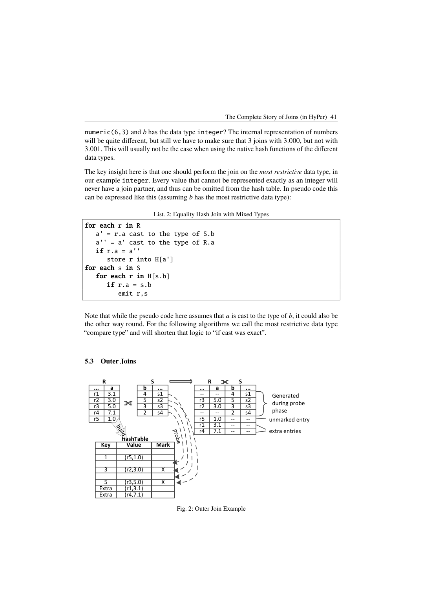
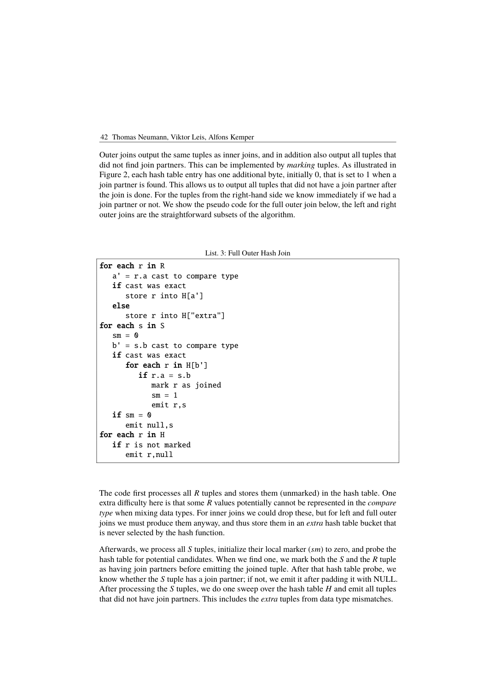

> 本组第 18 篇 · 嵌套查询与去相关 · [全部论文]() · [上一篇]() · [下一篇]()

本文以 HyPer 为例，将嵌套子查询翻译为包含 dependent、single 和 mark 的扩展关系代数，再进行去关联、受语义约束的连接重排与物理算法选择。single 保留 0 行为 NULL、1 行取值、多行报错；mark 保留指定侧元组并维护必要的 TRUE/FALSE/UNKNOWN，不能无条件替代为 semi/anti。本文给出高层 SQL 翻译流程及 hash/blockwise 实现，完整 unnesting 规则引用前作而未在此重证。表 1 是 TPC-H/TPC-DS 优化前后类型的 yes/no 分析，不能理解为每个基准都有全部类型。作者报告一个 TPC-H SF=1 示例中 HyPer 单线程 17 ms、PostgreSQL 26 小时，并明确归因于后者逐 part 行全扫；这不是全基准成绩或隔离算子收益。Codex 已读 SHA 匹配 extracted 的全部 20 页，并视觉核对 12 个关键 PDF 页；没有读取其他论文、运行数据库复现或核查当前外部系统。

本文保留论文陈述、读者推断与待验证方案的区别；实验数字只适用于原文条件。原文和翻译来自已有 AI 辅助精读报告，已做来源匹配与编辑复核，不等于人工逐项核验或独立实验复现。所有页码均为 PDF 物理页。

## 论文与阅读范围

Thomas Neumann, Viktor Leis, Alfons Kemper. The Complete Story of Joins (in HyPer). BTW 2017, Lecture Notes in Informatics (LNI), Gesellschaft für Informatik, Bonn, 2017, pp. 31–50（本地 PDF 物理页 1–20 的页眉核实；系列卷号未另行核验）。

[论文集中的原始 PDF](https://github.com/lonng/db-papers/blob/4ff1331069c7cf52ac97dd769e5f484c1c35c200/papers/nested-query/the-complete-story-of-joins.pdf) · 本地来源：`nested-query/the-complete-story-of-joins.pdf`，共 20 页。

本篇保留 10 组原文精读和 29 条证据。截图为原始 PDF 的局部页选，不是重新生成的图表；未将整份 PDF 复制到博客。

## 研究问题与适用边界

本文研究如何把允许深层嵌套子查询的 SQL 翻译为可优化的扩展关系代数，而不让表达式与查询继续互递归求值。作者认为，仅用 inner、outer、(anti) semi join 不足以在其翻译框架内完整处理这些构造，需要 single join 和 mark join。这里的“不足”不是对所有可能代数编码的不可表达性证明，也不是说只能使用这两个名称的算子。

相关性与算子种类是两个维度：dependent join 表达右侧 T2 随左侧 t1 求值，要求 F(T2) ⊆ A(T1)，不是一种指定的物理嵌套循环实现。本文约定只允许右侧依赖左侧；去关联的目标是消除这种依赖，以利用常规连接与重排序。

作者将互递归方式与常见模式的 nested-loop-style、O(n²) 执行联系起来。应将其读作本文讨论的求值方式与查询模式的风险，而非任意子查询、任意输入规模或所有 PostgreSQL 查询都必然二次方。本文没有将适用范围限定为 OLAP/HTAP；也没有证明所有连接可任意重排或均能线性执行。

依据：论文陈述；PDF 物理页 1, 2。证据：[C001N01](#evidence-c001n01), [C001N02](#evidence-c001n02)。

## 系统架构与 SQL 翻译管线

图 1 的流程是 AST → semantic analysis → canonical plan → unnesting → predicate pushdown → join ordering → join algorithm selection → optimized plan。语义分析把 AST 变为关系代数；初始翻译重正确性，不承诺高效。初始引入 inner、outer、(left) mark、single join；semi/anti semi 和其他方向变体在后续优化中出现。相关 FROM 输入仍需 dependent 形式，这并不与上述种类划分冲突。

第 3.4 节给出六步高层过程：① FROM 从左到右翻译，无相关时用叉积组合，有相关时用 dependent join；② WHERE 中 EXISTS/NOT EXISTS/UNIQUE/量化子查询先加 mark join，再以 marker 替代该表达式，标量子查询加 single join 并引用其结果列，最后应用选择；③ GROUP BY 先同样翻译分组表达式，再加 Γ；④ HAVING 同 WHERE；⑤ SELECT 翻译结果表达式后加投影；⑥ ORDER BY 翻译排序表达式后加 sort。相关 FROM 示例的脚注说明，一些系统要求 LATERAL，HyPer 接受文中的写法；不能将该示例原样当成所有 SQL 方言的通用语法。

Unnesting 的系统代数变换细节归于前作 [NK15]；本文指出 mark/single 是其构建块，没有重给完整的去关联规则或完备性证明。连接排序使用 DPhyp，枚举无叉积的连通组合，并遵守非 inner join 的顺序约束；“可重排序”不是“自由交换所有节点”。

方向变体用于在交换输入时保持相同的保留侧语义并改变构建/探测方向。本文约定 hash build 在左、probe 在右，按估计基数倾向让较小输入构建；这不是所有系统的统一约定。其他优化包括满足条件时 mark→(anti) semi、null-rejecting 过滤下 outer→inner，以及能证明每次标量求值至多一行时 single→left outer。

依据：论文陈述；PDF 物理页 2, 4, 7, 8, 9, 10。证据：[C001N02](#evidence-c001n02), [C001N06](#evidence-c001n06), [C001N07](#evidence-c001n07), [C001N08](#evidence-c001n08), [C001N10](#evidence-c001n10), [XR03](#evidence-xr03), [XR06](#evidence-xr06)。

*原论文 PDF 物理页 11，版权归原作者或出版方。点击图片可查看原尺寸。页面文本中定位到：Fig. 2: Outer Join Example。这是页面定位信息，不表示本次已复核图内所有数据。*

## 连接分类与物理算法

逻辑 taxonomy：inner 输出满足谓词的配对；left/right/full outer 另外保留对应侧未匹配行并补 NULL；semi 仅保留有匹配的指定侧元组，anti semi 保留没有匹配的指定侧元组；single 在 outer 类保留行为上增加至多一个伙伴的检查；mark 保留指定侧每个输入元组并附加谓词结果标记，而不立即据此过滤。dependent 描述右侧对左侧的依赖，可与这些种类组合。group join 在表 1 和相关工作中出现，是连接与分组的融合，本文并未给出它的完整算法。

Single join：标量子查询为一列、至多一行；0 行结果为 NULL，1 行取该值，多于 1 行必须报错。Listing 5 的 left single hash join 将 R 建表、S 探测；同一 r 首次匹配时标记并输出，第二次匹配抛异常，最后补出未匹配 r。这个标记检测行数而非不同值数。只有已知至多一行的情形（如绑定主键、无 GROUP BY 的单元组聚合）才可移除此检查。作者称它相对 outer 几乎免费，这是实现评述，不是隔离测出的零开销。

Outer/semi/anti：Listing 3 的 full outer 在探测时标记匹配的 r，未匹配 s 立即补 NULL，结束后扫描所有未匹配 r。Listing 4 的 left semi 只在同一 r 尚未标记时输出它；anti semi 则最后输出未标记者。并行 semi 的“检查并取得输出资格”必须保证只有一个线程成功，原子更新是作者给出的最简单方案；并非要求所有实现都只能使用原子指令。

Mark 的完整三值归约：存在 TRUE 则 marker=TRUE；否则有 UNKNOWN 则 UNKNOWN；否则 FALSE，右侧空集也为 FALSE。EXISTS 自身的结果是二值，SELECT 中的 =ANY 则可能需要完整三值。Listing 6 将 NULL 键 R 放入 H[null] 并初标 UNKNOWN，不能精确转为 compare type 的非 NULL 值放入 H[extra] 并初标 FALSE。探测 S 的 NULL 键设置 hadNull，真正相等的键标 TRUE。结束时若 S 为空，把 H[null] 改为 FALSE；若 hadNull，将仍为 FALSE 的条目改为 UNKNOWN，已 TRUE 的不变。right mark 类似但保留右侧。

混合类型等值连接：numeric(6,3) 对 integer 的例子使用最受限的 compare type，往返 cast 必须精确。inner 可舍弃不可能匹配的值，保留侧 outer/single 不能舍弃，须放 extra 桶。NULL 桶与 extra 桶不是同一种状态。

等值加残余谓词时可用等值部分找候选，但须据完整谓词判定匹配；inner 可等值连接后再选择，outer 一般不能这样拆。残余比较若为 UNKNOWN，会影响 mark 的三值状态。对不能用 hash 处理的一般谓词，本文采用 blockwise nested loop：R 分块入 B，每块扫描 S，块内输出匹配和未匹配 R，全部块后输出未匹配 S。S 跨块的标记使用带区间压缩的关联结构；该算法保持朴素嵌套循环的渐近复杂度。作者说实际往往快数个数量级，但本节没有给出相应独立测量，不能另归因成已证实的缓存收益。

依据：论文陈述；PDF 物理页 2, 3, 5, 6, 9, 10, 11, 12, 13, 14, 15, 16。证据：[C001N02](#evidence-c001n02), [C001N03](#evidence-c001n03), [C001N04](#evidence-c001n04), [C001N05](#evidence-c001n05), [C001N10](#evidence-c001n10), [C001N11](#evidence-c001n11), [C002N01](#evidence-c002n01), [C002N02](#evidence-c002n02), [C002N03](#evidence-c002n03), [C002N04](#evidence-c002n04), [C002N05](#evidence-c002n05), [C002N06](#evidence-c002n06), [C002N07](#evidence-c002n07), [C002N08](#evidence-c002n08), [C002N09](#evidence-c002n09), [XR01](#evidence-xr01), [XR02](#evidence-xr02), [XR03](#evidence-xr03)。

## NULL、重复行与语义边界

本节区分原文约束与由其直接构造的反例；它不是独立的 SQL 标准认证或本文未提供的完整形式化证明。

1. 重复行。Listing 4 的标记属于具体输入元组 r，而非全局值去重；一个左输入行有多个匹配时仅输出一次，不代表把左表中值相同的不同输入行合并。由 Listing 5 可直接推得，标量子查询返回两行相同值仍触发 single 的多行错误，不能以 DISTINCT 或任选首行规避。本文用集合式记号给出定义，没有逐一形式化完整 SQL bag semantics，不能借此声称投影默认去重或所有重复行情况均已证明。

2. 半连接、反半连接与 NULL。匹配取谓词为 TRUE 的配对；UNKNOWN 不是 TRUE 匹配。EXISTS 关注是否有结果行，子查询输出列含 NULL 不会使 EXISTS 本身变成 UNKNOWN。NOT EXISTS 类反半连接不能无条件等同于 NOT IN：读者构造的假设示例，5 = ANY({4,NULL}) 为 UNKNOWN，否定后仍 UNKNOWN，WHERE 不保留；但等值 anti semi 因没有 TRUE 匹配会保留 5。若要改写，须证明上下文及非空/非 NULL 等条件，不是见到 NOT 就直接选 anti。

3. Mark 不应提前筛行。第 6 页 EXISTS(...) OR Sabbatical=true 的教授即使无课程也可能通过另一分支，因此不能在 OR 之前用 semi 丢弃。这个反例即使没有 NULL 也成立；不只是“析取改变三值传播”。作者说合取用途通常可转 semi/anti，不能忽略 marker 是否还投影输出、否定位置或量化比较的 NULL 语义。UNKNOWN 与 FALSE 仅在最终保留行为相同的已证上下文可合并，不能当作通用逻辑等价。

4. 三值测试边界。读者构造的假设示例：左键 NULL、右侧空集的 =ANY 为 FALSE；左键 5 对 {5,NULL} 为 TRUE；对 {4,NULL} 为 UNKNOWN；对 {4} 为 FALSE。投影、NOT 或其他表达式仍观察 marker 时不得省去 UNKNOWN。对有相关分组或额外残余条件的谓词，Listing 6 的简单等值 hadNull 逻辑不能不经适配直接推广；第 5.7 节已指出残余 UNKNOWN 的处理。

5. 外连接与单行保证。残余谓词必须在决定是否补 NULL 前参与匹配；事后过滤可能丢掉本应保留的左行。single→outer 必须对每次相关求值证明至多一行，而不是对子查询结果列值作唯一性猜测。无 GROUP BY 的聚合产生一个聚合元组是本文的安全例子；不能推广到所有带 GROUP BY 的聚合。

6. 完备性与复杂度限定。第 3.4 节是高层翻译纲要，虽列出 UNIQUE 与量化比较，并未逐个展开 UNIQUE/ALL 的完整重写、所有 SQL 方言特性或完整去关联证明。本报告不以别篇理论补齐。重排需遵守非 inner 约束；交换输入并选择对应方向变体，与保持算子种类不变地随意交换，是不同操作。hash 的线性说法有适用谓词、散列行为、候选数及输出量前提，不是任意子查询去关联后的最坏情况保证。

依据：读者推断；PDF 物理页 2, 3, 5, 6, 9, 10, 11, 12, 13, 14, 15, 16。证据：[C001N02](#evidence-c001n02), [C001N03](#evidence-c001n03), [C001N04](#evidence-c001n04), [C001N05](#evidence-c001n05), [C001N10](#evidence-c001n10), [C001N11](#evidence-c001n11), [C002N02](#evidence-c002n02), [C002N03](#evidence-c002n03), [C002N05](#evidence-c002n05), [C002N06](#evidence-c002n06), [C002N07](#evidence-c002n07), [C002N08](#evidence-c002n08), [C002N09](#evidence-c002n09), [XR01](#evidence-xr01), [XR02](#evidence-xr02), [XR03](#evidence-xr03)。

## 表 1、实验数字与作者断言

第 6 节有两种证据：连接类型在 TPC-H/TPC-DS 的出现情况，以及 TPC-H 数据上一个示例查询的执行时间。表 1 是 yes/no 存在性表，不是出现次数、频率或性能表；“-”表示初始翻译阶段从不引入该类型，不等于优化后不存在。

表 1 按 TPC-H 优化前/后；TPC-DS 优化前/后抄录（已对照原 PDF 图像）：
inner: yes/yes；yes/yes
left outer: yes/no；yes/yes
right outer: no/no；no/yes
full outer: no/no；yes/yes
single: no/no；yes/yes
left mark: yes/no；yes/yes
right mark: -/no；-/yes
left semi: -/yes；-/yes
right semi: -/yes；-/yes
left anti semi: -/yes；-/yes
right anti semi: -/yes；-/no
group join: -/yes；-/yes

因此“所有类型都出现”应指两个基准和优化前后联合观察，不是每个基准都具有全部类型。TPC-H 没有 single，最终不保留 mark；TPC-DS 优化后保留 single、left/right mark，但 right anti semi 为 no。该表支持这些变体在实际基准中的相关性，不证明每个变体的独立性能收益。

时间示例是 SELECT p_name, (SELECT l_orderkey FROM lineitem WHERE l_partkey=p_partkey AND l_returnflag='R' AND l_linestatus='O') FROM part，在 TPC-H scale factor 1 数据上执行。原文报告 HyPer 使用 1 个线程为 17 ms，PostgreSQL 为 26 小时；没有声明 PostgreSQL 同样为单线程。它不是整个标准 TPC-H 查询集的运行时间。第 18 页作者明确把 PostgreSQL 的慢归于对每个 part 元组全表扫描、导致二次方时间；这不是读者新推断，也不是本审核独立测得的事实。

作者同时明确说，复杂基准中难以分离 query engine performance、join types、optimizations 的影响，因此用简单例子说明。本文没有给出该例的 CPU/内存、精确系统版本、索引配置、重复次数、方差或扩规模曲线；也没有隔离 single/mark、原子竞争或区间压缩的微基准。关于差距可随数据量“任意大”、单行连接“几乎免费”、blockwise 通常快数个数量级，须分别视为作者的渐近论点或实现评述，而非已经完成的参数化实验。不能据此判断当前 PostgreSQL 或其他系统的普遍性能。

依据：论文陈述；PDF 物理页 17, 18。证据：[C002N10](#evidence-c002n10), [C002N11](#evidence-c002n11), [C002N12](#evidence-c002n12), [XR04](#evidence-xr04), [XR05](#evidence-xr05)。

*原论文 PDF 物理页 12，版权归原作者或出版方。点击图片可查看原尺寸。页面文本中定位到：Figure 2, each hash table entry has one additional byte, initially 0, that is set to 1 when a。这是页面定位信息，不表示本次已复核图内所有数据。*

## 工程权衡与设计取舍

原文事实：mark 维护额外标记，满足语义条件时可化为较轻的 semi/anti；left/right 变体让优化器选择构建侧；混合类型中不可能匹配的保留行不能因 hash 优化而丢失。读者推断：逻辑层宜先保留全部可观察语义，再基于证明条件特化，而不是为减少分支提前删除 NULL 或多行错误检查。本文没有量化优化器搜索空间、开发或维护成本。

原文对 HyPer 与 Vectorwise 的具体评论是：在 hash join 中评估任意残余表达式，前者的编译模式处理自然，后者需要额外逻辑。这不证明编译执行普遍胜过向量化，也不支持对未读系统的实现下结论。

并行 semi 必须保证一个输入元组只被一个线程发出，原子指令是文中方案。读者可以研究热点竞争或分区方案，但不能在“正确性与吞吐量之间”牺牲正确性；本文没有竞争开销数据，也没有给出所有 join 变体的完整并发协议。

Blockwise nested loop 的右侧标记跨多次扫描存活；区间压缩适于少量或大量连续标记的情形，但不是任意匹配分布都压缩良好、常数空间或不需要右侧可重扫的保证。实现应测量标记分布、内存占用和扫描代价，不能只借用等值 hash join 的线性复杂度叙述。

依据：读者推断；PDF 物理页 9, 11, 12, 13, 14, 15, 16。证据：[C001N10](#evidence-c001n10), [C001N11](#evidence-c001n11), [C002N02](#evidence-c002n02), [C002N04](#evidence-c002n04), [C002N06](#evidence-c002n06), [C002N07](#evidence-c002n07), [C002N08](#evidence-c002n08), [C002N09](#evidence-c002n09), [XR02](#evidence-xr02), [XR03](#evidence-xr03)。

## 单篇来源内的比较与待验证问题

本文把完整 unnesting 细节、DPhyp、group join 和并行 hash join 分别指向前作；这些引用说明贡献与先前工作的衔接，不等于本审核已经读过或核实那些论文。第 7 节对 SQL Server/NF2 等工作的比较也仅是本文作者的陈述，本报告不将其升级为对其他系统的独立结论。

后续比较建议：在明确版本、提交、配置后，检查目标系统是否能表达 SELECT 中的标量子查询、WHERE 中 EXISTS 的析取、投影 =ANY 的 UNKNOWN 和多行错误，再追踪逻辑节点、去关联、重排限制与物理计划。可选 StarRocks、Calcite、DuckDB、PostgreSQL 作为调查对象，但这里不预设其节点名称、执行方式或当前支持边界。

对不同执行模型应分别测残余谓词、标记传播与构建/探测方向，不能用本文的一个时间例子替代跨系统功能调查。区间压缩在本文用于 blockwise nested loop 的右侧标记；不应误当成 mark hash join 必备机制或据此要求其他系统使用同一种结构。

依据：待验证的工程设想；PDF 物理页 8, 9, 15, 17, 18。证据：[C001N07](#evidence-c001n07), [C001N08](#evidence-c001n08), [C002N08](#evidence-c002n08), [C002N10](#evidence-c002n10), [C002N11](#evidence-c002n11), [XR05](#evidence-xr05)。

## 复现计划与可检验条件

以下均为未执行的读者构造测试和实验建议，不是作者已经发布的完整复现包。

语义测试：scalar 分别返回 0、1、2 行（第 2 行与第 1 行值相同也须报错）；EXISTS 与另一个可独立为真的 OR 分支组合，确保不提前丢弃外行；=ANY 覆盖右侧空、只有 NULL、有 TRUE 加 NULL、无 TRUE 但有 NULL、全 FALSE，以及左键 NULL。先比对结果多重集、NULL 与报错行为，再评价性能。single 的多行情况应使该语句报错，不是返回首行，更不能要求“不得报错退出整个查询”；错误的事务影响不在本文覆盖范围内。

重复行与类型测试：两个值相同但身份不同的左输入行，在 semi/mark 下分别保留其正确重数；single 不因相同结果值免除多行错误。numeric/integer 测 3.000 与 3、3.001 与整数，以及保留侧无法精确 cast 的行，验证 extra 不遗漏、NULL 桶不混淆。

残余谓词测试：outer join 中先产生等值候选但所有残余条件为 FALSE/UNKNOWN，仍须补出保留侧行；mark 中完整谓词 UNKNOWN 且无 TRUE 时须 UNKNOWN。有相关限制时按该输入行的有效右侧结果判断空集和 NULL，不能把未限定右表的全局 hadNull 生搬硬套。

翻译与重排测试：逐步检查六个子句处理过程和 F(T2) ⊆ A(T1)，保留相关 FROM 的方言差异；仅在语义约束允许时换方向、化 semi/anti 或 single→outer。本文未展开的 UNIQUE/ALL 规则不靠猜测补写。

性能实验：固定版本、硬件、索引、线程、数据分布与重复次数，单列端到端时间、构建/探测时间、输出量、标记空间与异常路径。先运行可控小数据，再谨慎复现第 18 页 SQL，避免无界等待。朴素逐外行全扫在 N、M 规模下为 O(NM)；适合散列的情形可预期构建加探测近线性，但候选、输出与碰撞可能改变成本，一般非等值 blockwise 仍可能 O(NM)。这些是测试假设，不是“去关联后必然 O(N+M)”的承诺。

依据：待验证的工程设想；PDF 物理页 2, 5, 6, 7, 11, 12, 13, 14, 15, 16, 17, 18。证据：[C001N02](#evidence-c001n02), [C001N03](#evidence-c001n03), [C001N05](#evidence-c001n05), [C001N06](#evidence-c001n06), [C001N11](#evidence-c001n11), [C002N01](#evidence-c002n01), [C002N03](#evidence-c002n03), [C002N05](#evidence-c002n05), [C002N06](#evidence-c002n06), [C002N08](#evidence-c002n08), [C002N09](#evidence-c002n09), [C002N10](#evidence-c002n10), [XR02](#evidence-xr02), [XR05](#evidence-xr05)。

## 结论、证据强度与剩余缺口

作者的主张是：在早期代数表示中显式引入 single/mark，把标量基数约束和谓词子查询的可观察结果保留下来，才能让去关联、受约束的重排及物理算法选择共同发挥作用。本文的价值是把这些逻辑语义与 hash/blockwise 变体连成 HyPer 的管线蓝图，而非重新给出所有前作的理论或完整实现。

原文证据支持 single 的 0/1/多行处理、mark 的三值与空集修正、保留侧未匹配行和残余谓词的处理；表 1 证明这些类型在两个基准的联合分析中确实出现，一个 SF=1 示例展示了极大的执行差异。它们不构成所有 SQL 方言、重复行规则和任意去关联变换的完整证明，也不构成各算子独立性能、所有数据分布或当前系统能力的全面评测。

读者的工程启示是先保证代数表达保存结果重数、NULL 和错误语义，再对满足条件的情形优化。删除“任何物理优化都无法挽救”的绝对化断言：本文反对的是被互递归束缚的特定求值策略，没有比较所有可能实现。后续应以可执行语义反例与控制变量实验补齐本文的实证缺口。

依据：读者推断；PDF 物理页 1, 5, 6, 8, 9, 13, 14, 15, 16, 17, 18。证据：[C001N01](#evidence-c001n01), [C001N03](#evidence-c001n03), [C001N05](#evidence-c001n05), [C001N07](#evidence-c001n07), [C001N08](#evidence-c001n08), [C002N05](#evidence-c002n05), [C002N06](#evidence-c002n06), [C002N08](#evidence-c002n08), [C002N09](#evidence-c002n09), [C002N10](#evidence-c002n10), [C002N11](#evidence-c002n11), [C002N12](#evidence-c002n12), [XR02](#evidence-xr02), [XR04](#evidence-xr04), [XR05](#evidence-xr05)。

## 原文精读：从句子回到机制

以下保留原文、忠实翻译、含义与边界；假设示例不作为论文实验结果。

### P001 · PDF 物理页 1

**原文**

<blockquote class="paper-source-quote"><pre><code>The&#10;easiest way to model this is as mutual recursion, i.e., expressions as well as queries can refer&#10;to and evaluate each other. Indeed, this is what some systems, for example, PostgreSQL do.&#10;The disadvantage of this simple, non-relational approach is that it makes many important&#10;optimizations nearly impossible. In effect, it pre-determines the execution plan of common&#10;query patterns to nested-loop-style execution with O(n2) runtime.&#10;We argue that the well-known inner, outer, and semi joins are not enough.</code></pre></blockquote>

**忠实翻译**

> 对此建模的最简单方式是将其视为互递归（mutual recursion），即表达式和查询可以相互引用并相互求值。事实上，一些系统（例如 PostgreSQL）正是这样做的。这种简单的、非关系型方法的缺点是它使得许多重要的优化几乎不可能实现。实际上，它将常见查询模式的执行计划预先确定为嵌套循环式（nested-loop-style）执行，运行时间为 O(n²)。我们认为，众所周知的内连接（inner join）、外连接（outer join）和半连接（semi join）是不够的。

**技术含义与边界**

> 作者把这里的互递归与常见模式的优化受限及 nested-loop-style 执行联系起来，并主张扩展传统 join 集合。该段不是所有相关子查询、所有 PostgreSQL 查询或所有替代实现的复杂度定理；O(n²) 对应本文所述重复求值模式。

**常见误读**

> 容易误认为 PostgreSQL 在所有场景下都只能做 O(n²) 嵌套循环。原文仅指在“这种简单的、非关系型的互递归方法”下，常见查询模式被预先决定了执行计划，不能泛化为 PostgreSQL 对所有查询的全局保证。

**读者构造的假设示例**

> 读者构造的假设示例：假设有一个查询在 SELECT 列表中调用一个标量子查询，而该子查询又引用外部查询的列。在互递归模型下，系统对外部表的每一行都重新执行一次子查询，若外部表有 n 行，子查询扫描 m 行，则总代价为 O(n*m)，当 m 与 n 成正比时即为 O(n²)。

### P002 · PDF 物理页 18

**原文**

<blockquote class="paper-source-quote"><pre><code>48 Thomas Neumann, Viktor Leis, Alfons Kemper&#10;select p_name,&#10;(select l_orderkey&#10;from lineitem&#10;where l_partkey = p_partkey&#10;and l_returnflag = 'R' and l_linestatus = 'O')&#10;from part&#10;In HyPer, this query is evaluated in 17 ms (with 1 thread), while PostgreSQL requires 26&#10;hours. The reason for the abysmal performance of PostgreSQL is that it has to perform a&#10;full table scan for each tuple of part, which results in quadratic runtime.</code></pre></blockquote>

**忠实翻译**

> select p_name, (select l_orderkey from lineitem where l_partkey = p_partkey and l_returnflag = 'R' and l_linestatus = 'O') from part
> 在 HyPer 中，此查询在 17 毫秒内求值（使用 1 个线程），而 PostgreSQL 需要 26 小时。PostgreSQL 性能极差的原因是它必须对 part 表的每个元组执行一次全表扫描，这导致了二次方（quadratic）的运行时间。

**技术含义与边界**

> 作者陈述：给出了一个具体的 SQL 查询示例，其中包含一个相关标量子查询。HyPer 单线程耗时 17 ms，PostgreSQL 耗时 26 小时。作者将 PostgreSQL 的性能问题归因于其对 part 表的每个元组执行 lineitem 全表扫描，导致 O(n²) 复杂度。读者推断：HyPer 通过某种去关联（unnesting）或更优的连接策略避免了逐行全表扫描。

**常见误读**

> 不应将此处的 17 ms 与 26 小时对比泛化为 HyPer 在所有工作负载下都比 PostgreSQL 快。原文仅针对这一特定查询模式和特定的执行策略差异（全表扫描 vs 优化后的执行）进行了测量。页码为 PDF 物理页码 18。

**读者构造的假设示例**

> 读者构造的假设示例：假设 part 表有 20 万行，lineitem 表有 600 万行。如果 PostgreSQL 对 part 的每一行都扫描整个 lineitem 表，则比较次数约为 20万 * 600万 = 1.2万亿次，这与“二次方运行时间”的描述一致。而 HyPer 可能将其转换为 hash join，只需线性或接近线性的时间。

### P003 · PDF 物理页 9

**原文**

<blockquote class="paper-source-quote"><pre><code>The Complete Story of Joins (in HyPer) 39&#10;Assistants. The decision between the three join orders is done by the cost-based join&#10;enumeration algorithm. HyPer uses a graph-based dynamic programming algorithm called&#10;DPhyp that only enumerates connected components without cross products [MN08]. The&#10;algorithm takes ordering constraints of non-inner joins into account.&#10;4.3&#10;Left and Right Join Variants&#10;For most join types HyPer has a left (e.g., left mark join) and a right (e.g., right mark&#10;join) variant.</code></pre></blockquote>

**忠实翻译**

> 三种连接顺序之间的决定由基于代价的连接枚举算法完成。HyPer 使用一种名为 DPhyp 的基于图的动态规划算法，该算法仅枚举没有叉积（cross products）的连通分量 [MN08]。该算法考虑了非内连接的排序约束。
> 4.3 左连接和右连接变体
> 对于大多数连接类型，HyPer 都有左变体（例如 left mark join）和右变体（例如 right mark join）。

**技术含义与边界**

> DPhyp 在无叉积的连通组合中作基于代价的枚举，并考虑非 inner 的顺序约束，不是任意排列。左右方向变体在交换输入后保持对应语义；同页第 4.3 节明确本文约定左构建、右探测，按估计基数倾向选择较小构建侧。

**常见误读**

> 不要误以为 DPhyp 会枚举所有可能的连接顺序。原文明确指出它“仅枚举没有叉积的连通分量”，这意味着搜索空间被有意限制了。页码为 PDF 物理页码 9。

**读者构造的假设示例**

> 读者构造的假设示例：A-B、B-C 有连接谓词而 A-C 没有时，可先连 A-B 或 B-C，不先做 A×C。这只说明连通限制；若有 outer/mark/single，还需检查额外合法顺序约束。

### P004 · PDF 物理页 13

**原文**

<blockquote class="paper-source-quote"><pre><code>If the semi join is executed multi-threaded, only one thread must be allowed to emit a&#10;particular r value. The easiest way to achieve this is to update the marker using atomic&#10;instructions. Anti semi joins mark the tuple, but do not emit it, and instead add a pass at the&#10;end to emit unmarked tuples.</code></pre></blockquote>

**忠实翻译**

> 如果半连接（semi join）是多线程执行的，则只允许一个线程发出特定的 r 值。实现这一点的最简单方法是使用原子指令更新标记（marker）。反半连接（anti semi joins）标记元组，但不发出它，而是在末尾添加一个传递阶段以发出未标记的元组。

**技术含义与边界**

> Listing 4 先将左侧 R 建表、右侧 S 探测；r 是左侧保留元组，不是右侧值。多线程时同一具体 r 只能由一个线程获得输出资格，原子更新是作者的简单方案。Anti semi 最后输出未标记者，不是全局 DISTINCT。

**常见误读**

> 变量 r 属于左构建表 R。避免的是同一输入元组因多个伙伴而重复输出，不是合并值相同的不同输入行；原子指令也不是唯一正确的同步方案。

**读者构造的假设示例**

> 读者构造的假设示例：R 的元组 r1 值为 5，S 有两个值 5 的元组，由两线程探测。left semi 只能输出 r1 一次，left anti 不输出 r1。若 R 另有 r2 也为 5，semi 仍分别输出 r1、r2，不全局去重。

### P005 · PDF 物理页 6

**原文**

<blockquote class="paper-source-quote"><pre><code>In the following query&#10;select Title, ECTS = any (select ECTS from Courses c2&#10;where Lecturer = 123) someEqual&#10;from Courses c1&#10;which can be translated directly into the following mark join:&#10;Courses c1&#10;M:someEqual&#10;c1.ECTS=c2.ECTSσc2.Lecturer=123Courses c2&#10;The result column someEqual can have the values TRUE, FALSE, and NULL (i.e.,&#10;unknown). Accordingly, some care is needed to implement the mark join correctly, as we&#10;will discuss in Section 5. But the great benefit is that we now translate arbitrary exists/not&#10;exists/unique/quantified-comparison queries into a join construct and eventually, after&#10;further optimizations, obtain an efficient evaluation strategy.</code></pre></blockquote>

**忠实翻译**

> 该查询计算每门课程的 ECTS 是否等于 Lecturer=123 的课程子查询中的任一 ECTS。它可直接翻译为以 c1.ECTS=c2.ECTS 为谓词、someEqual 为标记列的 mark join。结果列可取 TRUE、FALSE、NULL（unknown），实现必须特别注意。作者称此类转换将 EXISTS/NOT EXISTS/UNIQUE/量化比较变成连接构造，再通过优化取得高效求值策略。

**技术含义与边界**

> 本段展示 =ANY 的三值 marker，并列出作者可翻译的子查询类别。EXISTS 自身不会返回 UNKNOWN，也不能把全部类别都无条件替换成普通 semi/anti。该段未逐项展开 UNIQUE/ALL 完整重写，不能据类别列表补出完整规则。

**常见误读**

> 不要忽略三值逻辑（NULL）的处理复杂性。原文特别指出“结果列 someEqual 可以具有 TRUE、FALSE 和 NULL... 需要格外小心才能正确实现 mark join”。不能简单地用二值布尔逻辑来实现 mark join。页码为 PDF 物理页码 6。

**读者构造的假设示例**

> 读者构造的假设示例：假设 Courses c1 中某行的 ECTS 为 5，而 Courses c2 中 Lecturer=123 的记录里 ECTS 分别为 4 和 NULL。由于 5 不等于 4，但与 NULL 比较结果为 UNKNOWN，根据 ANY 的语义，整体结果应为 NULL。mark join 必须正确捕获这种 NULL 传播行为，而不是简单地返回 FALSE。

### P006 · PDF 物理页 11

**原文**

<blockquote class="paper-source-quote"><pre><code>This will usually not be the case when using the native hash functions of the different&#10;data types.&#10;The key insight here is that one should perform the join on the most restrictive data type, in&#10;our example integer. Every value that cannot be represented exactly as an integer will&#10;never have a join partner, and thus can be omitted from the hash table.</code></pre></blockquote>

**忠实翻译**

> 在使用不同数据类型的原生哈希函数时，通常不会是这种情况。这里的关键洞察是，应该在最具限制性（most restrictive）的数据类型上执行连接，在我们的例子中是 integer。任何无法精确表示为 integer 的值永远不会有连接伙伴，因此可以从哈希表中省略。

**技术含义与边界**

> numeric/integer 例子在 compare type 上取得一致 hash 键，以往返 cast 精确性避免误匹配。在此处 inner join 讨论中，不可能匹配的值可省略；补读第 12 页可知 left/full outer 的保留侧仍需放 extra 桶，不能丢弃。这不是无视类型比较语义的通用强制转换规则。

**常见误读**

> 不能把 inner 的省略推广到 outer/single/mark 保留侧，也不能以截断后的相等代替往返精确检查。本文没有建立任意字符串、排序规则或非精确数值类型间的通用定理。

**读者构造的假设示例**

> 读者构造的假设示例：DECIMAL 侧 1.0、2.5、3.0，INTEGER 侧 1、3。inner 可仅用精确转换的 1、3 建键；若保留 DECIMAL 侧作 left outer，2.5 必须在 extra 中保留，最终补 NULL 输出。

### P007 · PDF 物理页 15

**原文**

<blockquote class="paper-source-quote"><pre><code>However, some care&#10;must be taken for the non-equal part. For an inner join it is possible to split the predicate,&#10;i.e., R&#10;a=b^c&gt;dS ⌘σc&gt;d(R&#10;a=bS), which can be answered easily. But for outer joins, for&#10;example, this split is not possible, and the additional restrictions must be evaluated directly&#10;during the join to avoid incorrect results. For compiling database systems like HyPer [Ne11]&#10;this combined evaluation is quite natural, but systems like Vectorwise [ZB12] require extra&#10;logic to evaluate arbitrary expressions during a hash join.</code></pre></blockquote>

**忠实翻译**

> 然而，对于非等值部分必须格外小心。对于内连接，可以拆分谓词，即 R ⋈_{a=b ∧ c>d} S ≡ σ_{c>d}(R ⋈_{a=b} S)，这很容易回答。但对于外连接，例如，这种拆分是不可能的，必须在连接期间直接评估额外的限制条件以避免错误的结果。对于像 HyPer 这样的编译型数据库系统 [Ne11]，这种组合评估非常自然，但像 Vectorwise 这样的系统 [ZB12] 需要额外的逻辑来在哈希连接期间评估任意表达式。

**技术含义与边界**

> inner 等价式是等值连接后再做残余选择，这是后置过滤而非谓词下推。outer 一般不能如此拆，必须先按完整条件判断匹配再补 NULL。作者具体说 HyPer 处理自然、Vectorwise 需额外逻辑，不证明所有解释型/向量化引擎低效或编译执行普遍占优。

**常见误读**

> 不要误以为所有连接都可以安全地拆分为等值连接加后置过滤。原文明确限定“对于外连接，例如，这种拆分是不可能的”。如果在外连接中错误地应用了内连接的拆分规则，会导致结果不正确。页码为 PDF 物理页码 15。

**读者构造的假设示例**

> 读者构造的假设示例：LEFT JOIN 中，左表行如果在右表找不到满足 a=b 且 c>d 的行，仍应输出左表行并在右表列填 NULL。如果先做 a=b 的 LEFT JOIN，再对结果应用 σ_{c>d}，那么那些 a=b 成立但 c>d 不成立的行会被过滤掉，导致左表行丢失，违反了 LEFT JOIN 的语义。

### P008 · PDF 物理页 14

**原文**

<blockquote class="paper-source-quote"><pre><code>This complicates the code considerably. In cases&#10;where the NULL implicitly behaves like a FALSE (e.g., in a disjunctive WHERE clause)&#10;the NULL case can be simplified to be identical to the FALSE case, but in the general case&#10;extra logic for NULL is needed. The code for the left mark join is shown below:&#10;List.</code></pre></blockquote>

**忠实翻译**

> 这大大增加了代码的复杂性。在 NULL 隐式表现得像 FALSE 的情况下（例如，在析取的 WHERE 子句中），NULL 情况可以简化为与 FALSE 情况相同，但在一般情况下，需要针对 NULL 的额外逻辑。left mark join 的代码如下所示：
> List.

**技术含义与边界**

> 只有当前消费上下文把 UNKNOWN 与 FALSE 视为相同的保留决策时才能简化。原 passage 在 Listing 标题处截断；本次已补读并视觉核对第 14–15 页完整 Listing 6，确认 NULL 键、空右侧及 hadNull 收尾。投影或否定等可区分两者时须保留三值，不能断言每种 NULL 操作都必须生成固定代码分支。

**常见误读**

> UNKNOWN≠FALSE。WHERE 仅保留 TRUE 使某些表达式中两者不可区分，但不是 OR/AND/NOT 任意局部替换规则。NULL 左键对空集的 =ANY 为 FALSE；TRUE 伙伴存在时其他 NULL 不能覆盖 TRUE。

**读者构造的假设示例**

> 读者构造的假设示例：仅 WHERE m OR B 筛行且不再观察 m 时，m=UNKNOWN 或 FALSE 对任意三值 B 的保留决定相同；SELECT m 或 WHERE NOT m 可区分。NULL 左键对空集作 =ANY 为 FALSE，不能一直保留初始 UNKNOWN。

### P009 · PDF 物理页 17

**原文**

<blockquote class="paper-source-quote"><pre><code>The table also&#10;shows that both the right and left variants are chosen by the query optimizer. To summarize,&#10;Table 1 indicates that the “zoo” of join variants is indeed needed and a query optimizer will&#10;benefit from having all these variants.</code></pre></blockquote>

**忠实翻译**

> 该表还显示，右变体和左变体都会被查询优化器选中。总而言之，表 1 表明连接变体的“动物园”（zoo）确实是必需的，并且查询优化器将从拥有所有这些变体中受益。

**技术含义与边界**

> 已视觉核对表 1，它是 TPC-H/TPC-DS 优化前后的 yes/no 表，不是频率或收益。TPC-H 无 single、最终无 mark；TPC-DS 保留 single 和左右 mark，但最终 right anti semi=no。“全部变体出现”是联合观察，不可逐基准泛化。

**常见误读**

> 存在性不证明每个变体带来多少收益或生成全局最优计划。“-”表示初始翻译不引入，不是优化后不存在。原先“未提供表 1”的限制只针对模型当时的短摘录，不是本次全文审核的限制。

**读者构造的假设示例**

> 读者构造的假设示例：需保留大表 R 而 S 很小时，可将 R left mark S 改成 S right mark R，在本文左构建约定下构建 S，同时仍保留 R。需连同输入与变体一起改变，不是保持节点种类却任意交换输入。

### P010 · PDF 物理页 2

**原文**

<blockquote class="paper-source-quote"><pre><code>(By convention,&#10;only the right hand side may depend not the left hand side.) We denote the attributes&#10;produced by an expression T by A(T), and free variables occurring in an expression T by&#10;F (T). To evaluate the dependent join, F (T2) ✓A(T1) must hold, i.e., the attributes required&#10;by T2 must be produced by T1. The dependent join and its transformation rules form the&#10;basis for HyPer’s unnesting, which was described in a prior BTW paper [NK15].</code></pre></blockquote>

**忠实翻译**

> （按照惯例，只有右侧可以依赖，左侧不行。）我们用 A(T) 表示表达式 T 产生的属性，用 F(T) 表示表达式 T 中出现的自由变量。为了求值依赖连接（dependent join），必须满足 F(T2) ⊆ A(T1)，即 T2 所需的属性必须由 T1 产生。依赖连接及其转换规则构成了 HyPer 去关联（unnesting）的基础，这在之前的一篇 BTW 论文中已有描述 [NK15]。

**技术含义与边界**

> 作者陈述：定义了依赖连接的形式化符号。T1 是左侧（驱动侧），T2 是右侧（依赖侧）。T2 的自由变量（即外部引用）必须是 T1 输出属性的子集。这是 HyPer 执行子查询去关联（unnesting）的理论基础。读者推断：依赖连接本质上是对相关子查询的关系代数表达，通过 F(T2) ⊆ A(T1) 确保了相关性在代数层面是可追踪和可转换的。

**常见误读**

> 注意原文的限定条件“按照惯例，只有右侧可以依赖，左侧不行”。不能随意假设双向依赖的代数结构。此外，F(T2) ⊆ A(T1) 是求值依赖连接的必要条件，不满足此条件的表达式不能直接用此模型求值。页码为 PDF 物理页码 2。

**读者构造的假设示例**

> 读者构造的假设示例：SELECT * FROM Employees e WHERE EXISTS (SELECT 1 FROM Departments d WHERE d.id = e.dept_id)。这里 T1 是 Employees e，A(T1) 包含 e.dept_id 等。T2 是 Departments d 上的子查询，F(T2) 包含 e.dept_id。因为 e.dept_id ∈ A(T1)，满足 F(T2) ⊆ A(T1)，可以建模为依赖连接。

## 尚未解决的问题

1. 本文高层翻译没有逐一展开的 UNIQUE/ALL 情况，在指定目标 SQL 方言中如何保持 NULL、重复行与报错语义？
2. 怎样以可执行反例验证相关右侧结果的空集/NULL 状态，而不把简单等值 Listing 6 的全局 hadNull 误推广？
3. 在控制完整执行管线后，single 的第二匹配检查、mark 的三值状态和方向选择分别产生多少开销？
4. 多线程 semi 的原子更新在不同匹配热点下有多少竞争，其他正确同步方案如何比较？
5. 区间压缩右侧标记在不同匹配分布下的实际空间、更新与扫描代价是多少？
6. 固定版本、硬件与索引后，第 18 页示例的计划与扩规模曲线能否重现，结果差异有多少来自引擎、算子和优化？

## 证据索引

证据编号沿用原报告，便于将上文判断追溯到原句。引文匹配只验证位置，不证明解读正确。

**C001N01 · PDF 物理页 1**

作者认为在本文的 SQL 翻译框架内，传统 inner/outer/(anti) semi 不足以处理全部嵌套构造；表达式与查询互递归会限制常见模式的优化并可能导致 O(n²) 执行。single/mark 使其进入可按语义约束重排的关系代数。这不是所有 PostgreSQL 查询的复杂度断言。

<blockquote class="paper-source-quote"><pre><code>The disadvantage of this simple, non-relational approach is that it makes many important optimizations nearly impossible. In effect, it pre-determines the execution plan</code></pre></blockquote>

**C001N02 · PDF 物理页 2**

dependent join 定义为右侧对左侧每元组求值的连接：T1 ⋈_p T2 := {t1 ◦ t2 | t1 ∈ T1 ∧ t2 ∈ T2(t1) ∧ p(t1 ◦ t2)}。不变量要求 F(T2) ⊆ A(T1)，即右侧自由变量必须由左侧产生。按约定仅右侧可依赖左侧。dependent join 及其变换规则构成 HyPer unnesting 技术的基础。

<blockquote class="paper-source-quote"><pre><code>To evaluate the dependent join, F (T2) ✓A(T1) must hold, i.e., the attributes required by T2 must be produced by T1.</code></pre></blockquote>

**C001N03 · PDF 物理页 5**

single join（记作 ⋈¹_p）用于标量子查询：语义上类似 outer join，但若左表某元组在右表找到超过一个匹配则抛出 runtime error；若无匹配则标量值为 NULL；恰好一个匹配则使用该值。这保证了 SQL 标量子查询最多返回一行一列的语义正确性。初始翻译总是使用 single join，后续优化器才可能降级为普通 left outer join。

<blockquote class="paper-source-quote"><pre><code>It behaves nearly identical to an outer join, but reports an error if more than one join partner is found:</code></pre></blockquote>

**C001N04 · PDF 物理页 6**

mark join 保留指定侧每个输入元组并新增结果标记；EXISTS 的结果为二值，量化比较可能要求 TRUE/FALSE/UNKNOWN。作者列出 EXISTS/NOT EXISTS/UNIQUE/量化子查询用途，未在此逐项展开全部重写。合取用途通常可优化为 semi/anti，但须满足语义条件；第 6 页 OR 示例不能提前用 semi 筛去无伙伴的教授，即使无 NULL 也成立。

<blockquote class="paper-source-quote"><pre><code>Instead, we introduce the mark join, which creates a new attribute to mark a tuple as having join partners or not:</code></pre></blockquote>

**C001N05 · PDF 物理页 6**

mark join 在存在 NULL 值时语义显著复杂化。例如 ECTS = ANY(subquery) 翻译为 mark join 后，结果列可能取 TRUE、FALSE 或 NULL（unknown）。因此物理实现必须正确处理三值逻辑，不能简单用布尔标记。这是正确性要求而非性能启发式。

<blockquote class="paper-source-quote"><pre><code>The result column someEqual can have the values TRUE, FALSE, and NULL (i.e., unknown). Accordingly, some care is needed to implement the mark join correctly</code></pre></blockquote>

**C001N06 · PDF 物理页 7**

论文给出将任意 SQL 翻译为扩展关系代数的 6 步高层算法：依次处理 FROM（无相关用 ×，有相关用 dependent join）、WHERE（EXISTS 类加 mark join，标量加 single join，其余直接翻译后用 σ 挂载）、GROUP BY（Γ）、HAVING（同 WHERE 逻辑）、SELECT（Π）、ORDER BY（sort）。该过程保证不退回互递归，但此阶段仅关注正确性而非性能。

<blockquote class="paper-source-quote"><pre><code>This procedure translates an arbitrary SQL query into relational algebra, without having to fall back to mutual recursion between operators and expressions.</code></pre></blockquote>

**C001N07 · PDF 物理页 8**

HyPer 优化管线包含：semantic analysis（仅引入 inner/outer/mark/single join）→ unnesting → predicate pushdown → join ordering → join algorithm selection。unnesting 依赖 mark join 和 single join 作为隐式构建块；没有它们，部分查询无法用关系代数表达，unnesting 也就无法工作。其他连接变体（如 right mark join）在后续优化阶段才出现以提升性能。

<blockquote class="paper-source-quote"><pre><code>The mark and single join are an implicit building block of our unnesting technique. Without these joins, some queries could not be expressed in relational algebra</code></pre></blockquote>

**C001N08 · PDF 物理页 9**

join reordering 示例：含 EXISTS 析取 Sabbatical=true 的查询，若不使用 mark join，Professors 与 Assistants 的 inner join 顺序被固定；使用 mark join 后可先执行 mark join 再与 Assistants 连接。HyPer 使用基于图的动态规划算法 DPhyp 枚举连通分量（避免 cross product），并考虑非 inner join 的顺序约束。决策依据是代价模型，属于 cost-based 优化而非单纯启发式。

<blockquote class="paper-source-quote"><pre><code>HyPer uses a graph-based dynamic programming algorithm called DPhyp that only enumerates connected components without cross products [MN08].</code></pre></blockquote>

**C001N10 · PDF 物理页 9**

作者给出的优化包括语义允许时 mark→(anti) semi、null-rejecting 过滤下 outer→inner，以及能证明每次标量求值至多一行时 single→left outer；不能只因出现 AND/NOT 或聚合字样就无条件应用。单元组聚合的例子是无 GROUP BY 的聚合。

<blockquote class="paper-source-quote"><pre><code>Mark joins are slightly slower than (anti) semi joins because they have to maintain a marker. If possible, mark joins should therefore be translated to (anti) semi joins.</code></pre></blockquote>

**C001N11 · PDF 物理页 11**

混合数据类型等值连接问题：当连接两侧类型不同（如 numeric(6,3) 与 integer）时，原生 hash 函数可能导致 3 与 3.000 不匹配。解决方案是在最受限类型（most restrictive data type，文中称 compare type）上执行连接：将宽类型 cast 到受限类型再 cast 回原类型，仅当往返精确相等时才插入 hash 表。这保证了正确性。

<blockquote class="paper-source-quote"><pre><code>The key insight here is that one should perform the join on the most restrictive data type, in our example integer.</code></pre></blockquote>

**C001N12 · PDF 物理页 1**

摘要称两个基准显示这些变体有实际用途。该短引本身不提供逐基准明细；完整论文第 17 页表 1 是 yes/no 表，不支持“每个基准都有全部类型”。第 18 页另有时间数字，不能将分块内未见数字误写成全文没有数字。

<blockquote class="paper-source-quote"><pre><code>The practical need for the advanced join operators is proven by an analysis of the two well known TPC-H and TPC-DS benchmarks</code></pre></blockquote>

**C002N01 · PDF 物理页 12**

Full Outer Hash Join 通过在哈希表条目中增加一个初始为 0 的字节来标记是否找到匹配伙伴。构建阶段将 R 存入哈希表；探测阶段遍历 S，若找到匹配则将双方标记为 1 并输出，否则输出 (null, s)；最后扫描哈希表输出所有未标记的 r 并补 null。该算法统一处理了左外和右外连接的逻辑。

<blockquote class="paper-source-quote"><pre><code>each hash table entry has one additional byte, initially 0, that is set to 1 when a join partner is found.</code></pre></blockquote>

**C002N02 · PDF 物理页 12**

在混合数据类型时，R 中的某些值可能无法精确转换为比较类型（compare type）。对于内连接可以直接丢弃这些元组，但对于左外或全外连接必须保留它们。算法通过将这些无法转换的元组存入一个永远不会被哈希函数选中的特殊桶 H["extra"] 来解决此问题，确保它们在最终扫描时被正确输出。

<blockquote class="paper-source-quote"><pre><code>some R values potentially cannot be represented in the compare type when mixing data types. For inner joins we could drop these</code></pre></blockquote>

**C002N03 · PDF 物理页 13**

Listing 4 的 left semi 对左侧构建表 R 中每个具体元组，首次找到 TRUE 匹配时标记并输出；多个伙伴不重复发出同一 r。它不是对左侧相同值不同输入行的全局 DISTINCT。Anti semi 在最终扫描输出没有 TRUE 匹配的保留侧元组，不能无条件等同于带 NULL 的 NOT IN。

<blockquote class="paper-source-quote"><pre><code>In semi joins, we output a tuple only if it has not been marked before. In anti semi joins, we emit the tuples afterwards</code></pre></blockquote>

**C002N04 · PDF 物理页 13**

多线程 left semi 必须保证只有一个线程发出左侧 R 的特定输入元组 r。作者给出原子更新标记作为最简单方案；没有给出竞争开销或其他同步方案的性能数据。

<blockquote class="paper-source-quote"><pre><code>If the semi join is executed multi-threaded, only one thread must be allowed to emit a particular r value.</code></pre></blockquote>

**C002N05 · PDF 物理页 14**

Single Join 用于强制要求最多只能有一个匹配项的场景。它在 Left Outer Join 的基础上增加了一个检查：如果在探测阶段发现 r 已经被标记过（即找到了第二个匹配伙伴），则直接抛出异常。作者认为这种实现在实际应用中几乎是免费的，其代价与 Outer Join 几乎相同。

<blockquote class="paper-source-quote"><pre><code>if r was marked as joined throw an exception mark r as joined emit r,s</code></pre></blockquote>

**C002N06 · PDF 物理页 14**

Mark 的 marker 为 TRUE（至少一个完整谓词为 TRUE）、UNKNOWN（没有 TRUE 但有 UNKNOWN）或 FALSE（其余，包括右侧空集）。Listing 6 的 H[extra] 保存不能精确 cast 的非 NULL 值，H[null] 保存 NULL 键；后者初标 UNKNOWN 但在 S 为空时须改 FALSE，hadNull 只把尚 FALSE 的条目改为 UNKNOWN，不能覆盖 TRUE。

<blockquote class="paper-source-quote"><pre><code>the marker may not only be TRUE (had a join partner) or FALSE (had no join partner), but also NULL</code></pre></blockquote>

**C002N07 · PDF 物理页 14**

作者允许在 NULL 与 FALSE 对最终保留行为等效的特定上下文中简化三值处理，给出析取 WHERE 的例子。这不意味着所有 OR、AND、NOT 或投影表达式都可把 UNKNOWN 改成 FALSE。

<blockquote class="paper-source-quote"><pre><code>In cases where the NULL implicitly behaves like a FALSE (e.g., in a disjunctive WHERE clause) the NULL case can be simplified</code></pre></blockquote>

**C002N08 · PDF 物理页 15**

等值加残余条件的 inner 可写成等值连接后再选择；outer 一般不能这样拆，必须在决定是否匹配及补 NULL 前评估完整条件。这是后置选择的等价式，不是谓词下推。作者具体对比 HyPer 与 Vectorwise 的实现要求，不足以推出所有编译型/向量化引擎的普遍优劣。

<blockquote class="paper-source-quote"><pre><code>But for outer joins, for example, this split is not possible, and the additional restrictions must be evaluated directly during the join</code></pre></blockquote>

**C002N09 · PDF 物理页 16**

对不能用 hash 处理的一般谓词，本文采用 blockwise nested loop，R 分块且每块扫描 S，渐近复杂度不变。作者称实践往往快数个数量级；这段不是独立测量或缓存局部性的因果实证。S 的跨块标记使用区间压缩的关联结构，不代表所有分布下常数空间或完全无需右侧可重扫。

<blockquote class="paper-source-quote"><pre><code>HyPer instead uses an associative data structure that assigns a bit value to each tuple and that uses interval compression.</code></pre></blockquote>

**C002N10 · PDF 物理页 18**

作者报告 TPC-H SF=1 数据上的一个示例标量查询：HyPer 1 线程 17 ms，PostgreSQL 26 小时。紧随短引的原文明确归因于对每个 part 元组全表扫描而产生二次方时间（补充证据 XR05）；这不是全 TPC-H 时间、当前 PostgreSQL 的通用行为或本次审核已完成的复现。

<blockquote class="paper-source-quote"><pre><code>In HyPer, this query is evaluated in 17 ms (with 1 thread), while PostgreSQL requires 26 hours.</code></pre></blockquote>

**C002N11 · PDF 物理页 17**

表 1 是两个基准、优化前后四列的 yes/no 存在性分析。“全部类型出现”指联合观察，不是每个基准分别全有。TPC-H 无 single，优化后无 mark；TPC-DS 优化后保留 single 和左右 mark，但 right anti semi 为 no。“-”表示初始翻译从不引入该种类，不是出现频率或缺失实验。

<blockquote class="paper-source-quote"><pre><code>Table 1 indicates that the “zoo” of join variants is indeed needed and a query optimizer will benefit from having all these variants.</code></pre></blockquote>

**C002N12 · PDF 物理页 17**

作者以算法阶数差异解释为何不侧重一般数值比较；同时第 17 页明确说复杂基准难以分离引擎、连接类型和优化影响。实验是一张类型存在性表和一个示例时间，不是独立算子消融或已测得的任意规模加速曲线。

<blockquote class="paper-source-quote"><pre><code>numerical comparisons are largely pointless, because the differences get huge even for modest data sizes.</code></pre></blockquote>

**XR01 · PDF 物理页 3**

原文明确区分空分组键：无 GROUP BY 的聚合产生一个聚合元组。它是 single→outer 的例子之一，不应扩展为带 GROUP BY 的聚合都保证一行。

<blockquote class="paper-source-quote"><pre><code>If A is empty, just one aggregation tuple is produced—as in&#10;SQL with a missing group by-clause.</code></pre></blockquote>

**XR02 · PDF 物理页 15**

Listing 6 收尾必须处理右侧空集：左键 NULL 的初始 UNKNOWN 改 FALSE。S 有 NULL 时，尚 FALSE 的 marker 改 UNKNOWN，已 TRUE 的保留 TRUE；残余 UNKNOWN 也要参与状态归约。此页已视觉核对。

<blockquote class="paper-source-quote"><pre><code>If we did not see any tuples in S at all, the initial NULL marker&#10;from the “null” list must be converted into FALSE.</code></pre></blockquote>

**XR03 · PDF 物理页 9**

本文约定左构建、右探测，脚注强调其他系统可能相反；left/right 变体在交换输入后保持相应保留语义，以按估计基数选择构建侧，非任意交换非内连接。

<blockquote class="paper-source-quote"><pre><code>In hash-based execution, for example, a hash table is built from the left5 input (the build&#10;input).</code></pre></blockquote>

**XR04 · PDF 物理页 17**

表 1 已对照原 PDF：TPC-H single 前后均 no，left mark yes/no；TPC-DS single 与 left mark 均 yes/yes、right mark -/yes、right anti semi -/no。表为存在性而非次数，全部类型仅在联合观察下出现。

<blockquote class="paper-source-quote"><pre><code>In TPC-H, single joins do not occur and all the left mark joins&#10;can be translated to 4 left/right semi (anti) join variants.</code></pre></blockquote>

**XR05 · PDF 物理页 18**

作者对该示例明确给出逐 part 行全扫导致二次方时间的解释，不能按模型反向审查的建议误标为仅是读者因果推断。保留原审查作历史记录，不把它当成源事实。

<blockquote class="paper-source-quote"><pre><code>The reason for the abysmal performance of PostgreSQL is that it has to perform a&#10;full table scan for each tuple of part, which results in quadratic runtime.</code></pre></blockquote>

**XR06 · PDF 物理页 4**

相关 FROM 示例的语法有方言边界。HyPer 可接受原写法，一些 DBMS 要求 LATERAL；不能把作者的高层翻译视为各方言直接可执行的 SQL。

<blockquote class="paper-source-quote"><pre><code>Some DBMSs require extra syntax to indicate this correlation, for example LATERAL in PostgreSQL, but others&#10;like HyPer accept the query as it is.</code></pre></blockquote>

## 版本与使用边界

- 原 PDF SHA256：`e859d93a431c75d59da7f9283744845f06cf87b23e05a43e7dbd2927dfe750c4`。
- 报告来源：`qwen3.8-max`；此处按已完成报告整理，没有重新请求模型。
- OCR 记录页：[]；低文本页：[]。
- 本次新增页面截图，未据此自动重写原报告的数值、公式或实验结论；原有“未进行图像识别”限制仍适用于分析生成过程。
- 截图与短引仅服务于论文评论，版权归原作者或出版方；正式发布前复查转载范围和授权。
- 本文保留未核实的书目信息及研究问题，不用现代产品行为替代历史论文的证据。
