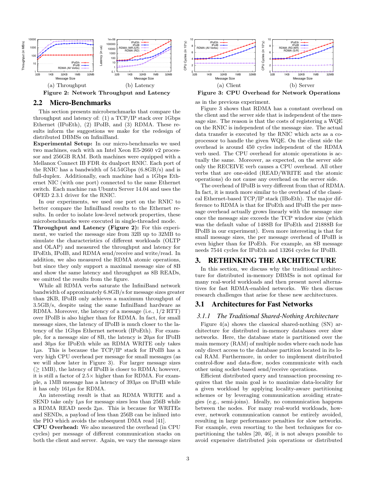
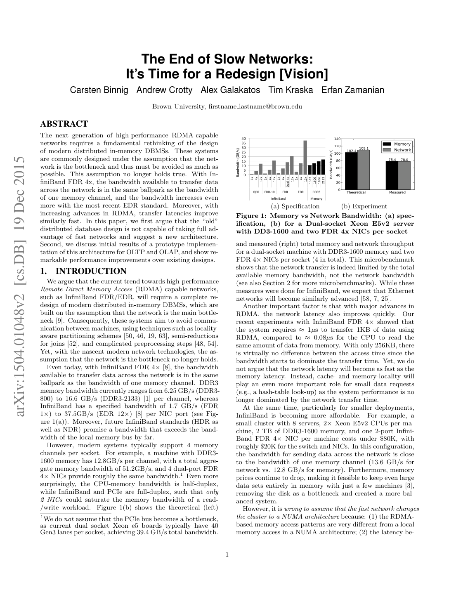

> 本组第 46 篇 · 网络与系统协同 · [全部论文]() · [上一篇]() · [下一篇]()

本文的2015年主张是：当RDMA批量传输带宽接近内存带宽时，应联合重设分布式数据库的协议、数据布局、缓冲和算子，而非只替换socket。它并未宣称网络延迟等于本地内存延迟。NAM在逻辑上分离计算与内存存储，RSI让计算端用单边操作完成正常路径的记录验证/加锁与安装，RRJ利用缓存大小缓冲和通信重叠。固定8机、低争用、闭环偏写原型的约1.8M TPS，以及4机均匀OLAP实验，支持特定条件下的收益，不证明故障恢复、热点鲁棒性或无限节点扩展。时间戳推进依赖客户端进度近似一致，实际RSI仅保留一个版本并中止需要旧快照的事务。本文公式、线程数和计时单位存在明确不一致，均保留原文并标注，未静默修复成已验证事实。

本文保留论文陈述、读者推断与待验证方案的区别；实验数字只适用于原文条件。原文和翻译来自已有 AI 辅助精读报告，已做来源匹配与编辑复核，不等于人工逐项核验或独立实验复现。所有页码均为 PDF 物理页。

## 论文与阅读范围

Carsten Binnig, Andrew Crotty, Alex Galakatos, Tim Kraska, Erfan Zamanian. The End of Slow Networks: It's Time for a Redesign [Vision]. arXiv:1504.01048v2 [cs.DB], 19 Dec 2015。仅依据本地12页版本。

[论文集中的原始 PDF](https://github.com/lonng/db-papers/blob/4ff1331069c7cf52ac97dd769e5f484c1c35c200/papers/network/the-end-of-slow-networks%3A-it%27s-time-for-a-redesign.pdf) · 本地来源：`network/the-end-of-slow-networks_-it's-time-for-a-redesign.pdf`，共 12 页。

本篇保留 20 组原文精读和 58 条证据。截图为原始 PDF 的局部页选，不是重新生成的图表；未将整份 PDF 复制到博客。

## 问题、硬件变化与主张边界

研究问题不是网络是否从此没有代价，而是高速RDMA条件下，为慢网络设计的少通信策略是否仍值得付出额外CPU和内存遍历。论文比较历史DDR3通道与InfiniBand端口规格，并以多NIC机器展示总网络吞吐可接近总内存吞吐。图1(b)理论内存/网络102.4/109.1GB/s、实测78.4/78.0GB/s属于该聚合配置，不能拿来解释图2单端口单线程的每请求延迟。PCIe不成为瓶颈是作者前提，而非所有部署的保证。

作者明确否定网络延迟会和内存一样快。1KB请求约1微秒网络与0.08微秒本地读取，说明相近的批量带宽可以与明显不同的小请求延迟并存；这是该文历史观察，不是今天设备的规格。RDMA WRITE/SEND在小于256B时可内联，约1微秒，READ约2微秒，不能把大块饱和吞吐泛化到随机细粒度访问。

RDMA集群也不是硬件一致的NUMA：有多个地址空间，跨节点复制的数据独立存在，缺少NUMA式跨节点缓存一致性。DMA与目标机本地cache的交互，不等于对其他客户端已复制记录的自动失效。网络升级使内存局部性、CPU路径和协议轮数更值得关注，未使这些约束失效。所有价格、版本、速率和路线图只作2015年论文语境。

依据：论文陈述；PDF 物理页 1, 2, 3。证据：[C001N02](#evidence-c001n02), [C001N03](#evidence-c001n03), [C001N04](#evidence-c001n04), [C001N05](#evidence-c001n05), [C001N06](#evidence-c001n06), [NX01](#evidence-nx01), [NX02](#evidence-nx02), [NX03](#evidence-nx03), [NX04](#evidence-nx04), [NX05](#evidence-nx05)。

## NAM与单边操作的责任分配

NAM将计算节点与提供分布式内存池的存储节点逻辑解耦，允许物理共置；OLAP实验正是在每台机器共置两种角色。存储端不执行每请求的数据库join或一致性处理，计算端承担寻址、事务及查询逻辑。任意计算端可访问远程分区，为负载分配提供机会；这是架构能力，不是已经完成任意倾斜处理和独立scale-out的实验。

单边READ/WRITE/原子操作避免正常请求的远端CPU处理函数；发起端仍创建WQE、提交请求、处理必要完成事件，RNIC、PCIe和内存仍搬运字节。双边SEND/RECEIVE还涉及远端CPU。本文队列与选择性信令描述是高层机制，不构成完整verbs权限、注册、错误恢复或跨QP排序规范。缓冲区不能在相关操作尚未完成时随意复用。

论文声称任何节点可读取共享元数据、编译并协调查询，从而移除对单一编译节点的依赖。这是分散职责的设计论证，不是元数据复制/故障切换证明；共享数据结构和物理资源依然可能争用。RSI也仍有时间戳服务。60k位预分配方案以连续置位前缀判定提交进度，依赖客户端近似同速，慢客户端和跳位方法不在本文解决范围。不能把没有独立中心TM处理每个提交，写成没有任何协调、服务或单点风险。

依据：论文陈述；PDF 物理页 2, 4, 5, 7, 8。证据：[C001N07](#evidence-c001n07), [C002N05](#evidence-c002n05), [C002N10](#evidence-c002n10), [C003N02](#evidence-c003n02), [NX07](#evidence-nx07), [NX08](#evidence-nx08), [NX11](#evidence-nx11), [NX28](#evidence-nx28), [NX29](#evidence-nx29)。

*原论文 PDF 物理页 3，版权归原作者或出版方。点击图片可查看原尺寸。页面文本中定位到：Figure 2: Network Throughput and Latency；Figure 3: CPU Overhead for Network Operations；Figure 3 shows that RDMA has a constant overhead on；Figure 4(a) shows the classical shared-nothing (SN) ar-。这是页面定位信息，不表示本次已复核图内所有数据。*

## RSI准备安装与RRJ代价模型

传统SI分析先完成读取，再讨论提交，假定无blind write且时间戳服务不是瓶颈。其顺序路径为9个单向消息延迟；允许时间戳申请与prepare并行、部分通知与安装阶段并行后，作者区分客户端知道结果的4个延迟与事务可见的至少6个延迟。消息编号不是每阶段只有一个包，更不是已证明的持久化确认点。选择性信令将队列中多数完成通知省去，减少完成处理和隐藏等待，不消除实际请求或自动建立跨队列的事务顺序。

RSI计算端持有读取结果和RID，取得CID后逐记录prepare。记录块首64位是1位锁加63位最新CID，之后是记录及可选历史版本。原文示例对旧值20003执行CAS，成功时设置为(1<<63)|20003；prepare只加锁并验证旧版本，没有在这一CAS里把CID提前改成拟提交的30000。这个具体示例确实在第8页，不应沿用旧critique的“原文没有位运算示例”判断。所有相关记录prepare成功后，计算端安装新版本，以signaled WRITE写整个记录块，再向时间戳服务通报结果。一个记录的原子CAS不等于多记录原子安装或崩溃恢复。

多版本块的n=max(16KB/record-size,2)是作者讨论的布局选择，依据约1-16KB传输延迟接近；实际代码原型n=1，需要更早版本时中止。另一个n在CPU信封模型里代表参与RM数，不能与版本槽位混同。时间戳位图回绕还需额外簿记，不能忽略未推进客户端。

OLAP模型假设无倾斜、CPU成本忽略、内存与网络为主要限制。令B=wR|R|+wS|S|，传统GHJ为B*(4*cmem+cnet)。Bloom规约仍有建过滤器的输入扫描；小过滤器的传输可以近似很小，不代表整个构建扫描免费。RRJ把远程分区与本地radix分区结合，用软件管理缓冲区、后台WRITE、约2KB及以上的有效传输和L3可容纳的fan-out减少遍历。只有网络/内存成本接近且一轮分区足够等条件下，作者给出2*cmem*B的预期成本。它描述被隐藏的关键路径成本，不表示网络字节、远端内存写入和缓冲分配消失。

正常提交路径的消息口径也需保留：作者把RSI记为3个round-trip加1条unsignaled消息，先前读取不在这段提交分析内。它不同于单次CAS的一个往返，更不是单个远程原子操作完成整个事务。

依据：论文陈述；PDF 物理页 2, 3, 5, 6, 7, 8, 9, 10。证据：[C001N07](#evidence-c001n07), [C001N11](#evidence-c001n11), [C002N11](#evidence-c002n11), [C002N12](#evidence-c002n12), [C003N05](#evidence-c003n05), [C003N06](#evidence-c003n06), [C003N10](#evidence-c003n10), [C003N11](#evidence-c003n11), [C004N01](#evidence-c004n01), [C004N04](#evidence-c004n04), [C004N05](#evidence-c004n05), [C004N07](#evidence-c004n07), [NX09](#evidence-nx09), [NX10](#evidence-nx10), [NX11](#evidence-nx11), [NX12](#evidence-nx12), [NX18](#evidence-nx18), [NX19](#evidence-nx19), [NX24](#evidence-nx24), [NX27](#evidence-nx27), [NX28](#evidence-nx28)。

## 原子性、快照和未解决故障

以下为基于文中机制的读者边界分析，不冒充形式化证明。CAS同时比较锁位和旧CID，使同一记录上两个预期旧值相同的写者不能都成功占锁；它验证的是该记录此前观察的版本，不能把任意事务RID直接当作所有记录当前CID。加锁后防止版本在验证与安装间被其他写者修改，是prepare的作用。payload批量WRITE、多个记录的prepare集合、时间戳可见前缀和故障恢复是另外的义务。

n=1意味着某些旧快照读必须中止，不等于作者明确放弃成功事务的SI安全性，也不能声称仅n>1才可能保持SI。更多版本有助于长快照可完成性，但不自动给出正确版本选择、垃圾回收或恢复协议；首64位CAS并不因历史槽更多而自动变为多字段原子操作。SI本身也不等于可串行化，不能从写写验证推出消除write skew。

原子CAS没有半个成功值，不代表客户端在准备若干记录、写入部分记录或通知时间戳服务前崩溃时系统自然可恢复。本文没有完整交代悬挂锁、部分安装、超时接管、日志/复制持久化和回绕跨失败语义，不能凭远程完成事件补出这些保证。读者建议后续分别注入失败验证这些状态，而不是断言当前实现已经在所有故障下保持持久事务原子性。

类似地，连续时间戳前缀可以因慢客户端未完成位而受阻。本文明确需要近似同速客户端，跳位协议未给出。正常路径低CPU开销和约1.8M TPS不检验这些失效情形；该文是性能与架构愿景，不是生产级可靠性证书。

依据：读者推断；PDF 物理页 2, 4, 6, 7, 8。证据：[C001N06](#evidence-c001n06), [C003N05](#evidence-c003n05), [C003N06](#evidence-c003n06), [NX07](#evidence-nx07), [NX08](#evidence-nx08), [NX09](#evidence-nx09), [NX10](#evidence-nx10), [NX11](#evidence-nx11), [NX12](#evidence-nx12), [NX27](#evidence-nx27), [NX28](#evidence-nx28)。

## 测量边界与原文不一致

微基准使用两台Xeon E5-2660 v2、256GB、Ubuntu14.04/OFED2.3.1机器，FDR4x Connect-IB只用一个端口，单线程。TCP/IP over 1Gb Ethernet与RDMA同时改变物理带宽和栈；IPoIB与RDMA才使用相同InfiniBand硬件。该配置大消息RDMA约6.8GB/s、IPoIB约3.5GB/s，发起端RDMA约450 cycles。延迟定义为半RTT，不是完整事务延迟，8B原子结果类似8B READ也不是原子更新争用成本永远为零。

OLTP为固定8机：4客户端、3存储、1时间戳服务/传统TM角色；每机一个双端口RNIC，而非微基准只开一端口的同一总容量。1-70是客户端线程数，不是机器数。偏写TPC-W-checkout-like事务读3个产品、建订单及订单行并更新库存；100万约1KB产品均匀分布以避免争用，客户端等上个事务完成才发下个。它不是完整TPC-W、开放到达模型或节点扩容测试。传统SI还采用本地时间戳服务作有利调整。

源文约32k IPoEth、22k IPoIB、RSI峰值1.8M TPS为该工作负载结果。双边RDMA简化基线峰值约1.1M，70客户端降到约320k；正文有该数值，图6省略此线。RSI约60客户端后也因网络饱和停止线性扩展。未报告延迟分位数、热点/故障测试、跨重复置信区间，不能以吞吐曲线填补。

OLAP用4机共置计算/存储，每节点每个join关系128M条、8B，Bloom通过比例0.25/0.5/0.75/1。聚合每分区128M条、8B，组键按均匀分布生成，distinct1到64M。图7是模型，图8是实测秒轴，显示所测场景RRJ和高基数聚合收益。第11页总设置写10线程/节点而join结果写8，尚不能自行判定哪句配置适用。该页确实印有0.17ms，并非文本缺失，但与图8秒轴冲突；不将它当作可信计时，也不默改成0.17秒。均匀实验不等于已完成倾斜鲁棒性检验。

依据：论文陈述；PDF 物理页 1, 3, 4, 8, 10, 11。证据：[C001N04](#evidence-c001n04), [C001N10](#evidence-c001n10), [C002N02](#evidence-c002n02), [C003N08](#evidence-c003n08), [C003N09](#evidence-c003n09), [C004N07](#evidence-c004n07), [C004N09](#evidence-c004n09), [C004N10](#evidence-c004n10), [NX02](#evidence-nx02), [NX03](#evidence-nx03), [NX04](#evidence-nx04), [NX05](#evidence-nx05), [NX06](#evidence-nx06), [NX13](#evidence-nx13), [NX14](#evidence-nx14), [NX15](#evidence-nx15), [NX16](#evidence-nx16), [NX20](#evidence-nx20), [NX21](#evidence-nx21), [NX22](#evidence-nx22), [NX23](#evidence-nx23), [NX29](#evidence-nx29)。

*原论文 PDF 物理页 1，版权归原作者或出版方。点击图片可查看原尺寸。页面文本中定位到：Figure 1(b) shows the theoretical (left)；Figure 1: Memory vs Network Bandwidth: (a) spec-。这是页面定位信息，不表示本次已复核图内所有数据。*

## CPU、通信、缓存与快照权衡

读者推断：NAM把数据库逻辑从存储CPU转到计算侧，使逻辑扩容更灵活，也增加寻址、注册内存、资源回收和通信调度的显式责任。将记录拉到计算端与在数据处执行过滤各有成本；本文不支持任意数据都必须全量搬运的绝对说法。低远端CPU不表示无限RNIC容量，更不表示PCIe/内存、时间戳进度、缓存或网络永不饱和。

小消息控制流与大块数据流的瓶颈不同。文中IPoIB在小消息路径CPU开销较高，是具体栈与设备的观察，不能推广为所有IPoIB实现的固有定律。选择性信令节约完成处理，但程序需正确管理已提交缓冲区生命周期；过小块增加请求率，过大fan-out挤占缓存，多轮分区则打破一轮模型。

Bloom应比较构建扫描/计算与减少后续搬运和join的收益，而非一律禁用。原文把50%匹配和10%误报近似加成60%；若按非成员上的误报概率0.1计算，则通过率为0.5+0.5*0.1=0.55。这是口径澄清，不用55%替换原文引号内的60%。c_mem是模型的每字节成本，也不是随机DRAM访问固定1ns的硬件事实。

源文还存在可核实的公式问题：第6页P(X>=0)=1-P(X=0)很可能把非空事件应有的>0写成>=0；第7页n个RM、n+1总服务器的式子与所报3/4节点例子索引不一致；第9页Tpart(R)最后一行不从前面三项推出。本文不把这些式子静默修好再称作作者证明。保留源句，另以读者构造算例检验合理读法；这些算例不验证整个协议或测量结论。

依据：读者推断；PDF 物理页 2, 4, 6, 7, 8, 9, 10, 11。证据：[C002N02](#evidence-c002n02), [C003N02](#evidence-c003n02), [C003N06](#evidence-c003n06), [C004N02](#evidence-c004n02), [C004N05](#evidence-c004n05), [C004N07](#evidence-c004n07), [NX07](#evidence-nx07), [NX08](#evidence-nx08), [NX11](#evidence-nx11), [NX12](#evidence-nx12), [NX16](#evidence-nx16), [NX17](#evidence-nx17), [NX18](#evidence-nx18), [NX19](#evidence-nx19), [NX20](#evidence-nx20), [NX25](#evidence-nx25), [NX26](#evidence-nx26)。

## 历史比较与证据层级

文中的shared-nothing基线保持传统SI协议，用socket经IPoEth或IPoIB通信；简化shared-memory-style基线把消息换为双边RDMA并改内存管理，不是硬件一致分布式共享地址空间。RSI则同时改变职责、存储布局和正常请求路径。因此RSI胜于双边实现不能被拆成单独由一项优化带来的纯因果倍率。OLAP没有测这个shared-memory-style基线。

论文把自己与较早的RDMA join比较：其描述文献[26]假定约1.25GB/s网络，采用类似block-nested-loop的关系流式传送；第10页描述[13]为shared-nothing优化，而本文RRJ面向NAM。这里仅复述本论文对相关工作的描述，未读取那些原文，不能进一步证明对方算法在全部配置下更差。

第11页对Oracle RAC、IBM pureScale及其他存算分离系统的评价是2015年作者的历史定位，不是当前功能审计或本次性能复测。本文删去原稿对现代引擎实现与现行云产品的未经验证描述，不引入外部资料来填空。共置、逻辑分离、固定集群的客户端并发扩展，以及增加计算/存储机器是不同维度；本文实验证据不支持将其中任一个自动替换为其他三个。

依据：论文陈述；PDF 物理页 7, 8, 10, 11, 12。证据：[C003N02](#evidence-c003n02), [C003N08](#evidence-c003n08), [C003N09](#evidence-c003n09), [C004N05](#evidence-c004n05), [C004N11](#evidence-c004n11), [NX15](#evidence-nx15), [NX16](#evidence-nx16), [NX19](#evidence-nx19), [NX29](#evidence-nx29)。

## 离线核对与后续实验建议

本次实际完成的是原文阅读、图表查看、精确引文核对和小型离线算例，未运行RDMA、数据库代码、集群、事务或算子benchmark。全部12页含参考文献已读，9页关键图表已看；API原始29条证据和10段英文原文保留。编辑重写全部继承精读的翻译、解释、误读与示例，并明确报告源文疑点。原始API critique也保留，但其中“第8页没有CAS数值示例”“0.17ms无文本来源”“图7不存在证据”等说法不作为全文复核后的结论。

离线读者算例包括1/0.08=12.5延迟比、旧CID锁位CAS排除陈旧/已锁预期值、GHJ前述三项的代数和Bloom误报分母。对CPU信封仅作条件读法：若用n个RM与n+1总服务器，c*clock*(n+1)/((5+8*n)*cycles_per_message)，8核2.2GHz/3750cycles时n=2/3/4约670476/647356/634234 TPS。该读法暴露源文索引歧义，不把源文647k/634k声称成新的实测。

建议后续复现分开配置：微基准2机、OLTP8机、OLAP4机，并固定物理链路比较栈、固定verbs比较协议。记录端口数、线程、消息大小、完成处理、注册缓冲、PCIe和内存计量边界；不要把换成新网卡称为原样复现。验证结果一致性后，再测吞吐、延迟、旧快照中止率和缓存行为。

故障与边界测试应单列：慢客户端/位图回绕、热点/倾斜、多个prepare之间故障、安装部分记录后故障、通知与可见之间故障、缓冲复用和内存分配。先解决原文10/8线程和0.17ms单位疑点，再追求精确重现图8。以上是建议，没有执行，也不是本文已提供的完整开源复现包。

依据：待验证的工程设想；PDF 物理页 1, 2, 3, 6, 7, 8, 9, 10, 11。证据：[C001N03](#evidence-c001n03), [C001N07](#evidence-c001n07), [C003N05](#evidence-c003n05), [C003N06](#evidence-c003n06), [C003N10](#evidence-c003n10), [C004N05](#evidence-c004n05), [NX01](#evidence-nx01), [NX02](#evidence-nx02), [NX03](#evidence-nx03), [NX10](#evidence-nx10), [NX11](#evidence-nx11), [NX12](#evidence-nx12), [NX17](#evidence-nx17), [NX18](#evidence-nx18), [NX19](#evidence-nx19), [NX21](#evidence-nx21), [NX22](#evidence-nx22), [NX23](#evidence-nx23), [NX24](#evidence-nx24), [NX25](#evidence-nx25), [NX26](#evidence-nx26), [NX27](#evidence-nx27)。

## 结论与可迁移的设计判断

可从本文迁移的工程判断是：当资源比例变化时，代价模型、数据布局、协议职责与缓存管理应一起重新审视。RSI与RRJ展示了这种联合设计在特定历史原型上的收益；简单把socket改成双边RDMA仍可能保留传统TM和CPU消息开销。这个结论不要求声称网络免费，反而要求分别测量issuer CPU、远端CPU、RNIC、内存与通信关键路径。

证据最强的是该文列明配置下的微基准与固定集群实验；模型是带前提的解释；NAM独立扩容、倾斜处理与元数据去中心化是设计机会；完整恢复、时钟服务容错和真实负载普遍优势尚未由这篇文章建立。单版本中止属于可完成快照范围/中止率限制，不应自动改写成已经损坏SI。

本报告没有提供当前产品评价，也没有读代码验证CAS内存顺序、事务恢复或算子实现。对公式和单位不一致保留疑问，对性能只保留实际测试边界。最终结果仍需人工复核，原文、API原始输出与本次编辑记录可以分别追踪。

依据：读者推断；PDF 物理页 1, 4, 6, 7, 8, 9, 10, 11, 12。证据：[C001N05](#evidence-c001n05), [C002N05](#evidence-c002n05), [C004N07](#evidence-c004n07), [C004N11](#evidence-c004n11), [NX08](#evidence-nx08), [NX09](#evidence-nx09), [NX11](#evidence-nx11), [NX12](#evidence-nx12), [NX15](#evidence-nx15), [NX16](#evidence-nx16), [NX17](#evidence-nx17), [NX18](#evidence-nx18), [NX19](#evidence-nx19), [NX23](#evidence-nx23)。

## 原文精读：从句子回到机制

以下保留原文、忠实翻译、含义与边界；假设示例不作为论文实验结果。

### P001 · PDF 物理页 1

**原文**

<blockquote class="paper-source-quote"><pre><code>For example, a machine with DDR3-&#10;1600 memory has 12.8GB/s per channel, with a total aggre-&#10;gate memory bandwidth of 51.2GB/s, and 4 dual-port FDR&#10;4× NICs provide roughly the same bandwidth.1 Even more&#10;surprisingly, the CPU-memory bandwidth is half-duplex,&#10;while InfiniBand and PCIe are full-duplex, such that only&#10;2 NICs could saturate the memory bandwidth of a read-&#10;/write workload.&#10;Figure 1(b) shows the theoretical (left)&#10;1We do not assume that the PCIe bus becomes a bottleneck,&#10;as current dual socket Xeon e5 boards typically have 40&#10;Gen3 lanes per socket, achieving 39.4 GB/s total bandwidth.</code></pre></blockquote>

**忠实翻译**

> 作者举例说，DDR3-1600每通道12.8GB/s、聚合51.2GB/s，4块双端口FDR4x NIC可提供近似带宽；由于作者将CPU-内存带宽视作半双工而InfiniBand/PCIe视作全双工，2块NIC便可能使混合读写负载的内存带宽饱和。末尾转入图1(b)理论值，脚注假定PCIe非瓶颈，并举当时每socket40条Gen3通道及39.4GB/s为依据。

**技术含义与边界**

> 这段比较指定配置及读写方向的资源预算，末尾句子被原始passage截断。图1聚合配置另有实测，不能把每通道、每socket和整机值互换，也不能把全双工当作单向带宽免费翻倍。

**常见误读**

> 2块NIC饱和内存是条件化例子；脚注的current指2015年语境。未测实际PCIe和内存限制就套用数值，或用它证明远程随机访问等同内存，均超出原文。

**读者构造的假设示例**

> 读者构造的假设示例：设混合读写共享50GB/s内存预算，网络收发合计需60GB/s内存流量；即使网卡可承载，内存也可能限制吞吐。这里50和60是算例，不是图1的测量。

### P002 · PDF 物理页 12

**原文**

<blockquote class="paper-source-quote"><pre><code>enabled transaction protocols, previous work has explored&#10;RDMA-aware join algorithms [26, 13]. Unlike our approach,&#10;the work in [26] still had the assumption that networks had&#10;limited bandwidth (only 1.25GB/s) and therefore streams&#10;one relation across all the nodes (similar to a block-nested&#10;loop join).</code></pre></blockquote>

**忠实翻译**

> 本段从上一句的尾部接起，随后说已有工作探索RDMA-aware join[26,13]。作者称[26]仍假定网络只有1.25GB/s，因而将一个关系流式传过所有节点，类似block-nested-loop join。

**技术含义与边界**

> 这是本论文对既有工作的历史转述，不是本次直接阅读[26]后的独立验证。一个关系across nodes并不等于每个节点的所有关系都重新广播，更不能自动断言其在原有网络下不合理。

**常见误读**

> 不能把带宽差异单独变成所有join算法的优劣证明，也不能从截断的起句补出完整事务协议。原始英文保留，不把断句尾部译成一个新术语。

**读者构造的假设示例**

> 读者构造的假设示例：同样要传1GB逻辑数据，理想1GB/s链路的传输项约1秒，10GB/s约0.1秒；算法额外扫描若不变，其相对权重会变化。这不证明哪种join在完整机器上必胜。

### P003 · PDF 物理页 7

**原文**

<blockquote class="paper-source-quote"><pre><code>Of course, these are only back-of-&#10;the-envelope calculations but they show that the message&#10;overhead essentially consumes all the added CPU power,&#10;making the system inherently unscalable (if the workload&#10;cannot be partitioned).&#10;Message batching can help, but with increased batch sizes,&#10;the processing time per message also increases.</code></pre></blockquote>

**忠实翻译**

> 作者强调这些只是粗略信封估算：在负载无法分区时，消息开销几乎吃掉新增CPU算力，使扩展受限；消息批处理可能有帮助，但批越大，每消息处理时间也增加。

**技术含义与边界**

> 其结论依赖前文协议消息数与所有参与RM处理同一事务的模型。这里未提供实测扩容曲线；第7页n与总服务器例子的索引还需澄清。原句processing time不应直接改译成一定的等批排队时间。

**常见误读**

> 不能省略cannot be partitioned条件，或写成一切2PC在任何硬件上绝不扩展。批处理等待延迟是可能的读者分析，不是这句话报告的独立测量。

**读者构造的假设示例**

> 读者构造的假设示例：按文中条件读法，8核2.2GHz、3750cycles/消息，n=2和3个RM对应约670476与647356TPS的模型上界；并非实测，也不是作者原文3/4总节点例子的静默更正。

### P004 · PDF 物理页 3

**原文**

<blockquote class="paper-source-quote"><pre><code>In&#10;addition, we also measured the RDMA atomic operations,&#10;but since they only support a maximal message size of 8B&#10;and show the same latency and throughput as 8B READs,&#10;we omitted the results from the figure.&#10;While all RDMA verbs saturate the InfiniBand network&#10;bandwidth of approximately 6.8GB/s for message sizes greater&#10;than 2KB, IPoIB only achieves a maximum throughput of&#10;3.5GB/s, despite using the same InfiniBand hardware as&#10;RDMA. Moreover, the latency of a message (i.e., 1/2 RTT)&#10;over IPoIB is also higher than for RDMA.</code></pre></blockquote>

**忠实翻译**

> 作者测了RDMA原子操作，因为只支持最大8B且该测试延迟/吞吐类似8B READ而未画出。该配置消息大于2KB时，可携较大payload的RDMA verbs约达6.8GB/s；同InfiniBand硬件上的IPoIB最高约3.5GB/s，半RTT消息延迟也更高。

**技术含义与边界**

> 原文all verbs要与刚说的原子仅8B一起理解，不能称原子操作也传2KB。上下文确认FDR4x单端口、单线程，两种软件路径使用相同IB链路。

**常见误读**

> 测得无争用8B原子接近READ，不代表热点锁CAS在任意并发下也同速；约6.8GB/s也不是所有RNIC或应用有效载荷的上限。半RTT不是完整提交延迟。

**读者构造的假设示例**

> 读者构造的假设示例：两个计算端连续CAS同一锁头时可能一成功一失败，重试将增加应用成本；即使单条CAS基准接近READ，也不能据此推算两个客户端的锁事务吞吐翻倍。

### P005 · PDF 物理页 9

**原文**

<blockquote class="paper-source-quote"><pre><code>For both, we develop a&#10;simple cost model and argue why these algorithms are (in&#10;most cases) not optimal for in-memory databases over fast&#10;RDMA-capable networks. Throughout the rest of this sec-&#10;tion, we assume that there is no skew in the data (i.e., before&#10;and after partitioning all nodes hold the same data).&#10;5.1.1&#10;An Optimized Grace Hash Join&#10;The GHJ executes a distributed join in two phases.</code></pre></blockquote>

**忠实翻译**

> 作者为前述两种方案建立简单代价模型，论证在快RDMA内存数据库上它们多数时候不是最优。余下分析假定无倾斜，即分区前后各节点数据均衡。随后进入优化GHJ，其分布式join分成两阶段。

**技术含义与边界**

> both指GHJ及加Bloom半规约的变体。相同数据在此语境是均衡的数据量，不是每节点复制完全相同记录。模型结论有多数情况与无倾斜两个边界，并非完整查询执行实验。

**常见误读**

> 不要把均衡分区翻成全复制，也不要把模型nonoptimal等同于语义错误。CPU、缓存、分区偏斜和轮数变化均可能使实际排序改变。

**读者构造的假设示例**

> 读者构造的假设示例：4节点各持25%的不同记录可满足数据量均衡；若hash后一个热点桶占80%，第二阶段不再均衡，原模型的并行时间就不能直接套用。

### P006 · PDF 物理页 5

**原文**

<blockquote class="paper-source-quote"><pre><code>In a classical architecture this central node&#10;can either fail or become a bottleneck under heavy loads.&#10;In a NAM architecture where all nodes can access central&#10;data structures using remote memory accesses, any node&#10;can read and update the metadata.&#10;Therefore, any node&#10;can compile queries and coordinate their execution. Thus,&#10;query compilation and metadata management exists as nei-&#10;ther a bottleneck nor a single point of failure.</code></pre></blockquote>

**忠实翻译**

> 原文称经典中心节点会故障或在重负载下受限；NAM允许各节点用远程内存访问中心数据结构，因此任意节点可读写元数据、编译查询并协调执行。作者由此主张编译与元数据管理不再形成瓶颈或单点。

**技术含义与边界**

> 忠实保留作者较强的结论，但证据层级是职责分散的架构论证。任意节点可发起访问不自动复制元数据、协调并发修改或验证故障后恢复。NAM全称在文中明确为Network-Attached-Memory，不是猜测名称。

**常见误读**

> 原稿将去中心化能力等同已消除全部单点和瓶颈，过于确定。共享元数据所在资源、时间戳前缀和访问冲突仍可能限制服务；这篇文没有完整故障测试。

**读者构造的假设示例**

> 读者构造的假设示例：10节点都能读取catalog并编译查询，确可分摊一个编译节点的CPU工作；但若catalog仅一份且所在机器丢失，这种权限本身并不提供恢复副本。

### P007 · PDF 物理页 2

**原文**

<blockquote class="paper-source-quote"><pre><code>tween machines is still higher to access a single (random)&#10;byte than with today’s NUMA systems; and (3) hardware-&#10;embedded coherence mechanisms ensure data consistency in&#10;a NUMA architecture, which is not supported with RDMA.&#10;Clusters with RDMA-capable networks are most similar to&#10;a hybrid shared-memory and message-passing system: it is&#10;neither a shared-memory system (several address spaces ex-&#10;ist) nor a pure message-passing system (data can be directly&#10;accessed via RDMA).</code></pre></blockquote>

**忠实翻译**

> 此段从上一句的尾部接起：机器间随机单字节访问延迟仍高于当时NUMA，且NUMA内嵌的硬件一致性机制不由RDMA提供。作者因此将RDMA集群视为共享内存与消息传递的混合：多个地址空间使它不是单一共享内存，直接RDMA数据访问又使它不只是消息传递。

**技术含义与边界**

> 核心是地址空间与副本一致性边界。目标机内DMA/cache协调，与另一个节点已RDMA读出的独立副本是否被自动更新，是不同问题；本文没有否认任何本机硬件一致性。

**常见误读**

> 不要说RDMA写目标内存之后目标CPU绝不可能看到更新，也不要假定另一个客户端的旧拷贝像NUMA缓存一样收到自动失效。两个极端都混淆了本地与跨节点语义。

**读者构造的假设示例**

> 读者构造的假设示例：C把B记录复制到自己的缓冲区，随后A更新B。即使B机器本地CPU能按平台规则读到新值，C的应用缓冲区也不会因此自动改写，需重新读取或用版本协议验证。

### P008 · PDF 物理页 8

**原文**

<blockquote class="paper-source-quote"><pre><code>We evaluated all protocols on an 8-node cluster using the&#10;same configuration as in Section 2.2. We use four machines&#10;to execute the clients, three as the NAM storage-servers, and&#10;one as the timestamp server (or as the transaction manager&#10;in traditional). We measured both protocols with a simple&#10;and extremely write-heavy workload, similar to the checkout&#10;transaction of the TPC-W benchmark.</code></pre></blockquote>

**忠实翻译**

> 作者在8节点集群评估协议，沿用2.2节机器配置：4机运行客户端、3机为NAM存储、1机为时间戳服务或传统事务管理器。工作负载简单且极度偏写，类似TPC-W的checkout事务。

**技术含义与边界**

> 这是固定角色配置，不是从1台机器扩到70台机器。完整上下文每事务也读取3个产品，并均匀布置100万产品以避免争用；客户端线程数变化构成图6横轴。

**常见误读**

> 偏写不等于没有读取，类似checkout不等于完整TPC-W。仅凭角色分配不能断言只读负载的时间戳服务一定没有压力，也不能推广到热点与开放到达请求。

**读者构造的假设示例**

> 读者构造的假设示例：固定8机把客户端线程从10增到20是在同一集群增加并发；把存储机从3加到6则改变拓扑与资源，属于另一项原文未给出的扩展实验。

### P009 · PDF 物理页 4

**原文**

<blockquote class="paper-source-quote"><pre><code>In particular, data-flow operations that&#10;send large messages (e.g., data re-partitioning) will benefit&#10;tremendously from this change. However, as shown in Sec-&#10;tion 2, IPoIB cannot fully leverage the network. Perhaps&#10;surprisingly, for some types of operations, upgrading the&#10;network with IPoIB can actually decrease the performance.&#10;This is particularly true for control-flow operations, which&#10;require sending many of small messages. Figure 3 shows that&#10;the CPU overhead of IPoIB is above the overhead of IPoEth&#10;for small messages.</code></pre></blockquote>

**忠实翻译**

> 大消息数据流如重分区可明显受益于升级，但作者所测IPoIB不能充分发挥网络；某些操作甚至变慢，尤其大量小消息的控制流。图3显示这些小消息的IPoIB CPU成本高于IPoEth。

**技术含义与边界**

> 原文是may decrease及特定实现/消息大小的测量与解释，不是物理带宽越快必然越差。协议处理CPU与传输字节成本需分别观察。

**常见误读**

> 不能将数据流收益和控制流损失写成所有设备上的确定定律，或把IPoEth与RDMA差距全归因于内核绕过，因为链路容量也不同。

**读者构造的假设示例**

> 读者构造的假设示例：某固定链路栈A每小消息消耗4000cycles、栈B消耗2000cycles，CPU限制下B可处理更多消息；这是算例，与大块流量的GB/s排行不必相同。

### P010 · PDF 物理页 10

**原文**

<blockquote class="paper-source-quote"><pre><code>For the network cost cnet per byte, we&#10;used the idealized latency per byte from Section 2 for mes-&#10;sages of size 2KB. For the Bloom filters, we assume a 10%&#10;error of false positives (i.e., 50% selectivity still selects 60%&#10;of the data). We use |R| = |S| = 1M as table sizes and&#10;wr = ws = 8 as tuple width. For main memory, we assume&#10;a cost of cmem = 10−9s for accessing a single byte.</code></pre></blockquote>

**忠实翻译**

> 作者将每字节网络成本取自2KB消息理想化延迟，设Bloom误报10%，其例子写50%选择率仍选60%数据；两表各1M条、元组8B，内存每字节成本取10的负9次方秒。

**技术含义与边界**

> 这些是图7模型输入，不是随机DRAM访问固定1ns的测量。原文60%按加10个百分点处理；若10%指通常定义的非成员误报概率，则同样50%真匹配得到55%，两者口径不可混同。

**常见误读**

> 继承示例曾算出55%后强行改成60%，混淆了分母。应保留引文60%，将55%明确标为读者对常规定义的计算，不称作者有一个已验证的统一Bloom概率模型。

**读者构造的假设示例**

> 读者构造的假设示例：1000条中500条真实匹配、500条非成员，后者10%误报为50条，则共550条通过；如果额外通过的是总输入的10%=100条，才是600条。

### P011 · PDF 物理页 8

**原文**

<blockquote class="paper-source-quote"><pre><code>A simple&#10;RDMA compare-and-swap operation on the first 64 Bits of&#10;the record at address 1F with test-value 20003, setting it to&#10;1 &lt;&lt; 63|20003), would only acquire the lock if the record&#10;has not changed since it was read by the transaction, and&#10;fails otherwise.</code></pre></blockquote>

**忠实翻译**

> 对1F地址前64位以20003为测试值做CAS，并设为锁位加20003，只有记录自读取后未变化时才加锁，否则失败。

**技术含义与边界**

> 原文示例确有位运算。prepare的CID保持旧20003，新提交CID30000是在后续安装过程使用；这是逐记录准备。

**常见误读**

> 不能把prepare CAS写成同时安装新payload/CID，或说任意RID都必须等于当前记录版本。更不能凭一个CAS建立多记录持久提交。

**读者构造的假设示例**

> 读者构造的假设示例：头值20003无锁，预期20003设置(1<<63)|20003可成功；再次以20003作预期会因锁位不同失败；预期19999也失败。

### P012 · PDF 物理页 7

**原文**

<blockquote class="paper-source-quote"><pre><code>This simple scheme allows the clients to use timestamps&#10;without having a synchronization bottleneck but implicitly&#10;assumes that all clients make progress at roughly the same&#10;rate.</code></pre></blockquote>

**忠实翻译**

> 这种简单时间戳方案让客户端使用预分配时间戳，但隐含所有客户端进展大致同速。

**技术含义与边界**

> 连续位前缀才能推进可见时间；回绕和慢客户端需附加处理，原文把跳位留在范围外。

**常见误读**

> 不能把无每次同步申请写成时间戳服务在任意故障/停顿下无阻塞，或说NAM完全没有协调。

**读者构造的假设示例**

> 读者构造的假设示例：分给A的时间戳5尚未置位，即使B的6和C的7完成，连续完成前缀仍停在4；这与后面两项已写入内存不同。

### P013 · PDF 物理页 8

**原文**

<blockquote class="paper-source-quote"><pre><code>our current implementation uses n = 1 and&#10;aborts all transactions which require an older snapshot.</code></pre></blockquote>

**忠实翻译**

> 当前实现使用n=1，并中止所有需要更旧快照的事务。

**技术含义与边界**

> 这是历史版本保留与可完成性限制；中止可避免错误读取，不自动表示成功事务不满足SI。

**常见误读**

> 增加n可能减少中止，但不自动补齐版本回收、崩溃恢复或可串行化，也不使首64位CAS成为多版本原子更新。

**读者构造的假设示例**

> 读者构造的假设示例：事务需要CID100可见版本，而唯一保留版本CID120太新，选择中止不同于错误返回120并称其属于快照100。

### P014 · PDF 物理页 3

**原文**

<blockquote class="paper-source-quote"><pre><code>an RDMA WRITE and a&#10;SEND take only 1µs for message sizes less than 256B while&#10;a RDMA READ needs 2µs.</code></pre></blockquote>

**忠实翻译**

> 小于256B的消息，RDMA WRITE和SEND约1微秒，而READ约2微秒。

**技术含义与边界**

> 这是该设备小消息测量，原文用内联避免后续DMA读取解释WRITE/SEND优势；不是端到端事务时间。

**常见误读**

> 不能将约1微秒直接乘以事务数当完整提交成本，也不能把大块吞吐接近内存解释成小消息同延迟。

**读者构造的假设示例**

> 读者构造的假设示例：若提交另有三个依赖往返与本地逻辑，即使一次小WRITE为1微秒，也不能据此称整个提交为1微秒。

### P015 · PDF 物理页 4

**原文**

<blockquote class="paper-source-quote"><pre><code>a re-&#10;mote memory access creates a fully-independent copy.</code></pre></blockquote>

**忠实翻译**

> 一次远程内存访问会产生完全独立的副本。

**技术含义与边界**

> 此处说明客户端取得的数据拷贝不享有NUMA式跨节点硬件副本一致性，需要数据库版本/同步机制。

**常见误读**

> 不要把独立副本等同目标机DMA与CPU毫无本地一致性，也不要把远程可访问等同共享虚拟地址。

**读者构造的假设示例**

> 读者构造的假设示例：A本地拷贝版本8，B远端已更新到9，A若继续使用旧缓冲区仍是8，必须重读或验证，而非等硬件自动改写。

### P016 · PDF 物理页 10

**原文**

<blockquote class="paper-source-quote"><pre><code>Assuming that the network cost is similar to the memory&#10;cost and that one partitioning pass is sufficient when using&#10;software managed buffers</code></pre></blockquote>

**忠实翻译**

> 作者假定网络成本类似内存成本，并且软件管理缓冲区下只需一轮分区。

**技术含义与边界**

> 这些是假设RRJ预期两遍内存式的条件，还要结合无倾斜、CPU忽略和足够重叠。

**常见误读**

> 网络成本未出现在简式不意味着没有字节或RNIC容量消耗；多轮分区与缓存不足可能改变模型。

**读者构造的假设示例**

> 读者构造的假设示例：若输入1GB而fan-out不足需要额外扫描/写出一遍，该额外流量不在原来的单轮两遍式里，应重新计价。

### P017 · PDF 物理页 11

**原文**

<blockquote class="paper-source-quote"><pre><code>a sim-&#10;ilar performance for a small number of distinct group-by&#10;keys (i.e., 0.17ms)</code></pre></blockquote>

**忠实翻译**

> 正文称少量不同group-by键时性能相近，并在括号里给出0.17ms。

**技术含义与边界**

> 该数值是确切原文，不是本次凭图生成；但图8(b)轴为秒，存在未解释单位冲突。

**常见误读**

> 既不能说文本根本无此数字，也不能擅自改成秒或当成已复现可靠时长；曲线定性结论与这个疑点应分开。

**读者构造的假设示例**

> 读者构造的假设示例：0.17毫秒与0.17秒相差1000倍；没有作者原始日志，不能任选单位后据此计算加速比。

### P018 · PDF 物理页 11

**原文**

<blockquote class="paper-source-quote"><pre><code>using 4 servers&#10;(10 threads per node).</code></pre></blockquote>

**忠实翻译**

> OLAP实验设置写使用4台服务器，每节点10线程。

**技术含义与边界**

> 同页join结果另写8线程；本次标注两种表述，未断定一个是预留线程或另一种是实际运行。

**常见误读**

> 不要把原稿的10线程、实际8线程解说当作已获源码确认。原文没有解释这个差别。

**读者构造的假设示例**

> 读者构造的假设示例：每节点8与10工作线程改变总并行度32与40；精确复现前应分别记录或向作者核实，不能悄悄混用。

### P019 · PDF 物理页 9

**原文**

<blockquote class="paper-source-quote"><pre><code>= wr · |R| · cmem + wr · |R| · cnet + wr · |R| · cmem&#10;= 2 · wr(·cmem · |R| + cnet · |S|)</code></pre></blockquote>

**忠实翻译**

> 原文先相加发送读取、网络传输和接收写入三项，随后印出含额外系数及S大小的末行等式。

**技术含义与边界**

> 末行不由前三项推出。读者可从前三项推得wR*|R|*(2*cmem+cnet)，再讨论总体GHJ式；源引文仍原样保留。

**常见误读**

> 不能把有误中间行视为已证明公式，或删除它后声称作者推导毫无疑点。核对代数也不是实测验证。

**读者构造的假设示例**

> 读者构造的假设示例：wR=8、|R|=1000、cmem=1、cnet=2，则前三项合计32000成本单位；两表总字节24000时GHJ式为144000单位。

### P020 · PDF 物理页 8

**原文**

<blockquote class="paper-source-quote"><pre><code>We slightly adjusted the&#10;traditional SI implementation by using a local time-stamp&#10;server instead of a remote service (i.e., we gave the tradi-&#10;tional implementation an advantage).</code></pre></blockquote>

**忠实翻译**

> 作者把传统SI实现调整为本地而非远程时间戳服务器，并称这是给传统实现的优势。

**技术含义与边界**

> 这是比较路径的非同一处；RSI另用所述外部服务/时间戳预分配方案。共享部分技术不代表每条控制路径相同。

**常见误读**

> 不要声称所有基线仅换一个通信verb，或从这一调整推出全部实验偏差都已消除。

**读者构造的假设示例**

> 读者构造的假设示例：基线少一次远程服务访问可有利于其延迟，但与RSI记录布局和prepare职责差异仍存在，不能把最终倍率全归一个因素。

## 尚未解决的问题

1. CAS准备成功后客户端失效，如何接管悬挂锁、部分安装和时间戳通知，且维持持久多记录原子性？原文没有完整恢复协议。
2. 慢客户端阻塞连续已提交时间戳前缀时，怎样安全跳位和回绕？增加版本如何改变快照可完成性、回收与吞吐？
3. 在相同设备和相同故障/可见性语义下，单边/双边协议的CPU、RNIC、内存及网络限制分别在哪里？
4. 第7页CPU模型中n和总节点数的索引、第9页中间代数、第11页10/8线程及0.17ms与秒轴不一致，应如何由作者材料澄清？
5. 在倾斜、缓存不足、多轮分区和动态全局内存分配时，RRJ与聚合的实际收益边界是什么？本次未运行这些实验。

## 证据索引

证据编号沿用原报告，便于将上文判断追溯到原句。引文匹配只验证位置，不证明解读正确。

**C001N02 · PDF 物理页 1**

作者以历史DDR3/InfiniBand规格讨论读写双工与带宽比例；两NIC示例依赖其配置，不是所有机器的事实。

<blockquote class="paper-source-quote"><pre><code>the CPU-memory bandwidth is half-duplex, while InfiniBand and PCIe are full-duplex, such that only 2 NICs could saturate the memory bandwidth</code></pre></blockquote>

**C001N03 · PDF 物理页 1**

作者假定PCIe不是限制，并给出当时主板通道数依据；实际部署仍需分别计量PCIe和其他I/O争用。

<blockquote class="paper-source-quote"><pre><code>We do not assume that the PCIe bus becomes a bottleneck, as current dual socket Xeon e5 boards typically have 40 Gen3 lanes per socket</code></pre></blockquote>

**C001N04 · PDF 物理页 1**

图1多NIC聚合实验说明特定配置网络吞吐可近内存吞吐；图中数值本次已查看，不应再说完全没有可读测量。

<blockquote class="paper-source-quote"><pre><code>This microbenchmark shows that the network transfer is indeed limited by the total available memory bandwidth, not the network bandwidth</code></pre></blockquote>

**C001N05 · PDF 物理页 1**

作者否定网络延迟等于内存延迟；小随机请求仍需关注缓存局部性，批量传输优势依赖消息大小。

<blockquote class="paper-source-quote"><pre><code>Yet, we do not argue that the network latency will become as fast as the memory latency. Instead, cache- and memory-locality will play an even more important role</code></pre></blockquote>

**C001N06 · PDF 物理页 2**

RDMA集群有多个地址空间，较高细粒度跨机延迟，且无NUMA式跨机硬件一致性；本次全文阅读确认上下文，而非只依截短quote。

<blockquote class="paper-source-quote"><pre><code>Clusters with RDMA-capable networks are most similar to a hybrid shared-memory and message-passing system: it is neither a shared-memory system</code></pre></blockquote>

**C001N07 · PDF 物理页 2**

选择性信令减少所跟踪的完成通知、帮助重叠工作；不表示省略网络请求或获得任意跨队列事务顺序。

<blockquote class="paper-source-quote"><pre><code>a typical pattern to reduce the overhead on the client side and to hide latency is to use selective signaling. That is, for send/receive queues of length n</code></pre></blockquote>

**C001N10 · PDF 物理页 3**

特定单端口单线程微基准：大消息RDMA约6.8GB/s、同IB硬件IPoIB约3.5GB/s；8B原子与8B READ相近是该测试观察，非任意争用场景保证。

<blockquote class="paper-source-quote"><pre><code>While all RDMA verbs saturate the InfiniBand network bandwidth of approximately 6.8GB/s for message sizes greater than 2KB, IPoIB only achieves a maximum throughput of 3.5GB/s</code></pre></blockquote>

**C001N11 · PDF 物理页 3**

小于256B WRITE/SEND可内联避免后续DMA读取，解释该设备路径约1微秒相对READ约2微秒；不是所有RDMA设备规格。

<blockquote class="paper-source-quote"><pre><code>for WRITEs and SENDs, a payload of less than 256B can be inlined into the PIO which avoids the subsequent DMA read</code></pre></blockquote>

**C002N02 · PDF 物理页 4**

本文实现的IPoIB对小消息控制流CPU成本高，故可能低于IPoEth；不能推广为全部IPoIB栈或全部工作负载。

<blockquote class="paper-source-quote"><pre><code>Perhaps surprisingly, for some types of operations, upgrading the network with IPoIB can actually decrease the performance. This is particularly true for control-flow operations</code></pre></blockquote>

**C002N05 · PDF 物理页 4**

NAM在逻辑上分离计算与共享内存存储，可物理共置；它为扩展/倾斜处理提供机会，不是已验证普遍解决方案。

<blockquote class="paper-source-quote"><pre><code>In a NAM architecture, compute and storage are logically decoupled. The storage servers provide a shared distributed memory pool, which can be accessed from any compute node.</code></pre></blockquote>

**C002N10 · PDF 物理页 5**

共享元数据使任意计算节点可编译/协调，是架构去中心化主张；不是共享数据结构无争用、容错复制或不存在单点风险的证明。

<blockquote class="paper-source-quote"><pre><code>In a NAM architecture where all nodes can access central data structures using remote memory accesses, any node can read and update the metadata.</code></pre></blockquote>

**C002N11 · PDF 物理页 6**

传统SI提交分析在先前读取完成后计算顺序9个单向消息延迟；未把初始读、崩溃恢复或持久化证明算成已解决。

<blockquote class="paper-source-quote"><pre><code>Overall the protocol requires 9 one-way message delays if done in the previously outlined sequential order. However, some messages can be done in parallel</code></pre></blockquote>

**C002N12 · PDF 物理页 6**

作者在无blind-write等假设下重叠消息，区分客户端结果4个延迟与可见至少6个延迟；不能等同为所有阶段均完成且持久。

<blockquote class="paper-source-quote"><pre><code>This reduces the number of message delays to 4 until the client can be informed about the outcome (one-way message 1, round-trip 3, one-way message 5), and to at least 6 until the transaction becomes visible</code></pre></blockquote>

**C003N01 · PDF 物理页 7**

CPU信封为不能分区的负载给出悲观扩展趋势；源文n个RM/n+1服务器与3/4节点数值存在索引疑点，不能当精确实测。

<blockquote class="paper-source-quote"><pre><code>the message overhead essentially consumes all the added CPU power, making the system inherently unscalable (if the workload cannot be partitioned).</code></pre></blockquote>

**C003N02 · PDF 物理页 7**

RSI把正常事务处理逻辑放计算端，以单边操作访问存储端。原文对RNIC限制的概括不是排除客户端CPU、PCIe、内存或时间戳进度限制。

<blockquote class="paper-source-quote"><pre><code>RSI moves the transaction processing logic to the client (i.e., compute nodes) and make the servers (i.e., storage nodes) “dumb”</code></pre></blockquote>

**C003N05 · PDF 物理页 8**

CAS比较首64位旧锁/CID并设置锁；原文20003示例prepare不提前改成新CID30000。一个记录原子验证加锁不同于整事务安装、持久化与恢复。

<blockquote class="paper-source-quote"><pre><code>the first bit is used as a lock (0=no-lock, 1=locked) while the next 63 bits contain the latest commit-id (CID)</code></pre></blockquote>

**C003N06 · PDF 物理页 8**

多版本槽位是布局讨论，实际n=1并中止需要旧快照的事务；限制快照可完成性，不自动说明成功事务违反SI。

<blockquote class="paper-source-quote"><pre><code>for simplicity, our current implementation uses n = 1 and aborts all transactions which require an older snapshot.</code></pre></blockquote>

**C003N08 · PDF 物理页 8**

固定8机4客户端/3存储/1时间戳或传统TM，偏写checkout-like低争用、闭环发起，不是完整TPC-W或节点增长实验。

<blockquote class="paper-source-quote"><pre><code>We use four machines to execute the clients, three as the NAM storage-servers, and one as the timestamp server</code></pre></blockquote>

**C003N09 · PDF 物理页 8**

该原型RSI约1.8M TPS，双边基线峰值1.1M并在70客户端降至320k；RSI60客户端后亦网络饱和，非无限线性扩展。

<blockquote class="paper-source-quote"><pre><code>our RSI protocol achieved a stunning ≈1.8 million distributed transactions per second.</code></pre></blockquote>

**C003N10 · PDF 物理页 9**

GHJ模型假设数据均衡、CPU忽略、内存/网络主导；不是任意倾斜和缓存条件的复杂度界。

<blockquote class="paper-source-quote"><pre><code>we assume that there is no skew in the data (i.e., before and after partitioning all nodes hold the same data).</code></pre></blockquote>

**C003N11 · PDF 物理页 9**

Bloom规约包含构造扫描及缩减分区/join成本。小过滤器通信可近似较小，不能据此抹掉整个构建扫描成本。

<blockquote class="paper-source-quote"><pre><code>Assuming that selS(bR) is the selectivity of the Bloom filter bR over relation S (including the error rate of the Bloom filter)</code></pre></blockquote>

**C004N01 · PDF 物理页 10**

模型假定两表相同有效通过比例，包括误报影响；用于比较代价，而非语义正确性不变量。

<blockquote class="paper-source-quote"><pre><code>the selectivity between both relations is the same, sel = selR(bS) = selS(bR) leads to this simplified total cost:</code></pre></blockquote>

**C004N02 · PDF 物理页 10**

图7使用2KB理想化网络每字节成本与简化Bloom口径50%到60%；常规非成员误报概率口径应得55%，原引文60%保留。

<blockquote class="paper-source-quote"><pre><code>For the Bloom filters, we assume a 10% error of false positives (i.e., 50% selectivity still selects 60% of the data).</code></pre></blockquote>

**C004N04 · PDF 物理页 10**

RDMA GHJ利用预取和通信重叠降低所模型化的关键路径分区成本；没有消除远程字节、内存写入和输出缓冲预留。

<blockquote class="paper-source-quote"><pre><code>Thus, only the CPU of the sender is active during the partitioning phase, and the cost of partitioning reduces to Tpart = Tmem(R) + Tmem(S)</code></pre></blockquote>

**C004N05 · PDF 物理页 10**

RRJ以L3可容纳的软件缓冲fan-out及后台WRITE整合分区；实际全局RDMA内存手动分配，非已解决动态内存管理。

<blockquote class="paper-source-quote"><pre><code>Moreover, the fan-out of the remote radix-partitioning phase is selected such that all buffers fit into the L3 cache of the CPU.</code></pre></blockquote>

**C004N07 · PDF 物理页 10**

RRJ两遍内存成本为网络/内存接近且单次分区等条件下的预期模型；不是所有网络成本消失的实测或无条件定理。

<blockquote class="paper-source-quote"><pre><code>Assuming that the network cost is similar to the memory cost and that one partitioning pass is sufficient when using software managed buffers</code></pre></blockquote>

**C004N09 · PDF 物理页 11**

4机join每节点每关系128M条8B；源文总设置10线程与join结果8线程未自洽，不自行指定真实配置。

<blockquote class="paper-source-quote"><pre><code>we generated a partition that has the size |R| = |S| = 128 Million and a tuple width wr = ws = 8B.</code></pre></blockquote>

**C004N10 · PDF 物理页 11**

聚合实测使用均匀键、distinct1到64M；0.17ms确在正文但与图8秒轴冲突，不当作可靠时长，也不当作已测倾斜鲁棒性。

<blockquote class="paper-source-quote"><pre><code>we generated data sets with a different number of distinct values for the group-by keys ranging from 1 to 64M using a uniform distribution.</code></pre></blockquote>

**C004N11 · PDF 物理页 12**

这是本论文对历史相关工作的叙述，未独立读取对方论文/代码；不可延伸为当前产品功能审计或无条件scale-out证明。

<blockquote class="paper-source-quote"><pre><code>Unlike our approach, the work in [26] still had the assumption that networks had limited bandwidth (only 1.25GB/s)</code></pre></blockquote>

**NX01 · PDF 物理页 1**

作者明确不声称网络延迟等同内存。

<blockquote class="paper-source-quote"><pre><code>we do&#10;not argue that the network latency will become as fast as the&#10;memory latency.</code></pre></blockquote>

**NX02 · PDF 物理页 3**

微基准只启用RNIC一个端口，不与多NIC聚合实验混同。

<blockquote class="paper-source-quote"><pre><code>we used one port on the RNIC to&#10;better compare the InfiniBand results to the Ethernet re-&#10;sults.</code></pre></blockquote>

**NX03 · PDF 物理页 3**

微基准为单线程，不是多核扩展保证。

<blockquote class="paper-source-quote"><pre><code>these&#10;microbenchmarks were executed in single-threaded mode.</code></pre></blockquote>

**NX04 · PDF 物理页 3**

同InfiniBand硬件IPoIB实测约3.5GB/s，说明比较并非都仅改变物理链路。

<blockquote class="paper-source-quote"><pre><code>IPoIB only achieves a maximum throughput of&#10;3.5GB/s, despite using the same InfiniBand hardware as&#10;RDMA.</code></pre></blockquote>

**NX05 · PDF 物理页 3**

小WRITE/SEND约1微秒、READ约2微秒，和内联路径有关。

<blockquote class="paper-source-quote"><pre><code>an RDMA WRITE and a&#10;SEND take only 1µs for message sizes less than 256B while&#10;a RDMA READ needs 2µs.</code></pre></blockquote>

**NX06 · PDF 物理页 3**

发起端约450 cycles是非零CPU开销的该测试观察。

<blockquote class="paper-source-quote"><pre><code>On the client side the&#10;overhead is around 450 cycles independent of the RDMA&#10;verb used.</code></pre></blockquote>

**NX07 · PDF 物理页 2**

双边操作涉及远端CPU，单边正常目标路径免处理函数不等于全系统无CPU。

<blockquote class="paper-source-quote"><pre><code>two-sided operations involve the CPU&#10;of the remote machine as well.</code></pre></blockquote>

**NX08 · PDF 物理页 4**

远程读得到独立副本，NAM不是跨机硬件一致内存。

<blockquote class="paper-source-quote"><pre><code>a re-&#10;mote memory access creates a fully-independent copy.</code></pre></blockquote>

**NX09 · PDF 物理页 6**

传统SI分析假定时间戳服务非瓶颈，不能将假定写成结果。

<blockquote class="paper-source-quote"><pre><code>we simply assume that&#10;the timestamp service is not a potential bottleneck</code></pre></blockquote>

**NX10 · PDF 物理页 6**

提交分析不允许blind write，读取和观察版本为先决条件。

<blockquote class="paper-source-quote"><pre><code>we assume blind&#10;writes are not allowed; therefore a transaction must read all&#10;data items (and their corresponding RID) in its working set&#10;before attempting to commit.</code></pre></blockquote>

**NX11 · PDF 物理页 7**

时间戳预分配依赖客户端进度近似一致，straggler方法未给出。

<blockquote class="paper-source-quote"><pre><code>implicitly&#10;assumes that all clients make progress at roughly the same&#10;rate.</code></pre></blockquote>

**NX12 · PDF 物理页 8**

实际n=1，需求旧快照时中止，不声称提供全部历史版本。

<blockquote class="paper-source-quote"><pre><code>our current implementation uses n = 1 and&#10;aborts all transactions which require an older snapshot.</code></pre></blockquote>

**NX13 · PDF 物理页 8**

100万产品和均匀分布是避免争用的测试设计。

<blockquote class="paper-source-quote"><pre><code>we&#10;created 1 million products (every record is roughly 1KB) to&#10;avoid contention, and all data was evenly distributed across&#10;the machines.</code></pre></blockquote>

**NX14 · PDF 物理页 8**

客户端闭环等待前事务完成，不是开放到达模型。

<blockquote class="paper-source-quote"><pre><code>Clients wait until a transaction is finished&#10;before issuing the next transaction.</code></pre></blockquote>

**NX15 · PDF 物理页 8**

约1.8M TPS为该固定配置及工作负载观察。

<blockquote class="paper-source-quote"><pre><code>our&#10;RSI protocol achieved a stunning ≈1.8 million distributed&#10;transactions per second.</code></pre></blockquote>

**NX16 · PDF 物理页 8**

60客户端后网络饱和，不是无限线性扩展。

<blockquote class="paper-source-quote"><pre><code>For&#10;greater than 60 clients, the network is saturated.</code></pre></blockquote>

**NX17 · PDF 物理页 9**

OLAP模型无倾斜，所有节点分区前后数据量均衡。

<blockquote class="paper-source-quote"><pre><code>we assume that there is no skew in the data (i.e., before&#10;and after partitioning all nodes hold the same data).</code></pre></blockquote>

**NX18 · PDF 物理页 9**

代价模型忽略CPU，不代表CPU在真实执行中免费。

<blockquote class="paper-source-quote"><pre><code>we ignore&#10;any CPU cost, as we assume that the limiting factor is the&#10;memory and network access (not the CPU)</code></pre></blockquote>

**NX19 · PDF 物理页 10**

RRJ预期式依赖网络/内存成本接近和单轮分区。

<blockquote class="paper-source-quote"><pre><code>Assuming that the network cost is similar to the memory&#10;cost and that one partitioning pass is sufficient when using&#10;software managed buffers</code></pre></blockquote>

**NX20 · PDF 物理页 11**

聚合采用均匀组键1到64M distinct，不是已完成倾斜评估。

<blockquote class="paper-source-quote"><pre><code>different number of distinct values for the group-by&#10;keys ranging from 1 to 64M using a uniform distribution.</code></pre></blockquote>

**NX21 · PDF 物理页 11**

源文OLAP总设置写每节点10线程，与后续8线程结果有疑点。

<blockquote class="paper-source-quote"><pre><code>using 4 servers&#10;(10 threads per node).</code></pre></blockquote>

**NX22 · PDF 物理页 11**

源文join结果写每节点8线程，不与总设置静默统一。

<blockquote class="paper-source-quote"><pre><code>when using 8 threads&#10;per node.</code></pre></blockquote>

**NX23 · PDF 物理页 11**

0.17ms确印在正文，但与实测图秒轴不一致，不能当可靠时间。

<blockquote class="paper-source-quote"><pre><code>a sim-&#10;ilar performance for a small number of distinct group-by&#10;keys (i.e., 0.17ms)</code></pre></blockquote>

**NX24 · PDF 物理页 9**

源文Tpart(R)中间最后等式不从前面三项推出，原样保留供复核。

<blockquote class="paper-source-quote"><pre><code>= wr · |R| · cmem + wr · |R| · cnet + wr · |R| · cmem&#10;= 2 · wr(·cmem · |R| + cnet · |S|)</code></pre></blockquote>

**NX25 · PDF 物理页 6**

源文P(X>=0)与1-P(X=0)不一致，疑似非空事件的符号错误。

<blockquote class="paper-source-quote"><pre><code>P(X &gt;= 0) = 1 −P(X = 0) =</code></pre></blockquote>

**NX26 · PDF 物理页 7**

647k是作者信封示例，不是实际测量；参与RM与总节点数存在索引疑点。

<blockquote class="paper-source-quote"><pre><code>this leads to ≈647, 000 trx/seconds.</code></pre></blockquote>

**NX27 · PDF 物理页 8**

原文确有CAS数值示例：test-value20003，prepare设置锁但保留旧CID20003，而不是先改成拟安装CID30000。

<blockquote class="paper-source-quote"><pre><code>A simple&#10;RDMA compare-and-swap operation on the first 64 Bits of&#10;the record at address 1F with test-value 20003, setting it to&#10;1 &lt;&lt; 63|20003), would only acquire the lock if the record&#10;has not changed since it was read by the transaction, and&#10;fails otherwise.</code></pre></blockquote>

**NX28 · PDF 物理页 7**

60k位预分配时间戳方案明确要求客户端进展近似同速；并不证明任意慢客户端下服务无瓶颈或可用。

<blockquote class="paper-source-quote"><pre><code>This simple scheme allows the clients to use timestamps&#10;without having a synchronization bottleneck but implicitly&#10;assumes that all clients make progress at roughly the same&#10;rate.</code></pre></blockquote>

**NX29 · PDF 物理页 8**

作者将传统SI时间戳服务改为本地作为有利调整，不是所有基线具有完全相同远程服务路径。

<blockquote class="paper-source-quote"><pre><code>We slightly adjusted the&#10;traditional SI implementation by using a local time-stamp&#10;server instead of a remote service (i.e., we gave the tradi-&#10;tional implementation an advantage).</code></pre></blockquote>

## 版本与使用边界

- 原 PDF SHA256：`465c4f64ada3c88cbc280a98633732ebb98609c2a7988df8e7611f39ae330be1`。
- 报告来源：`qwen3.8-max`；此处按已完成报告整理，没有重新请求模型。
- OCR 记录页：[]；低文本页：[]。
- 本次新增页面截图，未据此自动重写原报告的数值、公式或实验结论；原有“未进行图像识别”限制仍适用于分析生成过程。
- 截图与短引仅服务于论文评论，版权归原作者或出版方；正式发布前复查转载范围和授权。
- 本文保留未核实的书目信息及研究问题，不用现代产品行为替代历史论文的证据。

前序报告保留的书目与阅读过程记录

Carsten Binnig, Andrew Crotty, Alex Galakatos, Tim Kraska, Erfan Zamanian. The End of Slow Networks: It's Time for a Redesign [Vision]. arXiv:1504.01048v2 [cs.DB], 19 Dec 2015。仅依据本地12页版本。方法：保留API汇总、模型/usage/原始critique与引文记录，由codex-current-session通读全部12页并查看物理页1、3、4、6、7、8、9、10、11后实际改写正文和全部10条继承精读，再补充源证据与精读。此为单篇历史愿景/原型复核，不是现行产品事实、完整协议证明、实现审计或独立实验复现。API critique针对旧稿，不能视作对本次编辑的再次审查。

