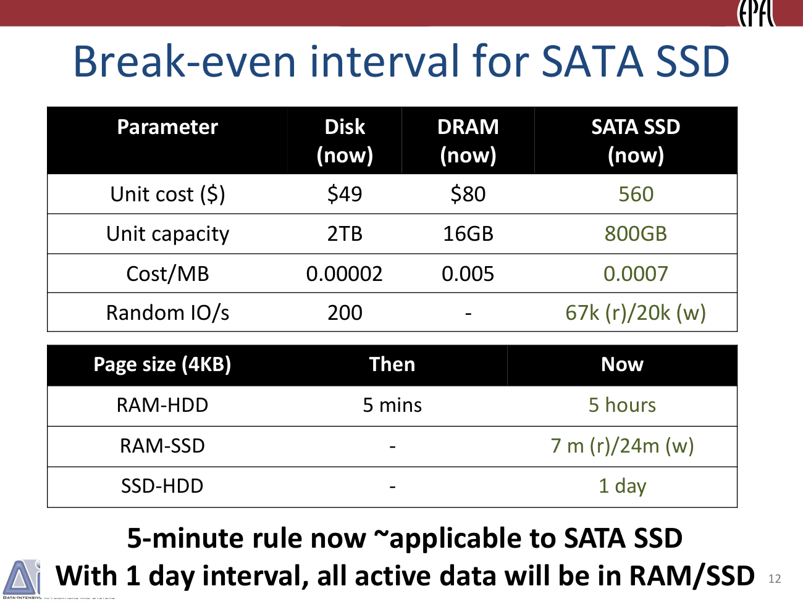
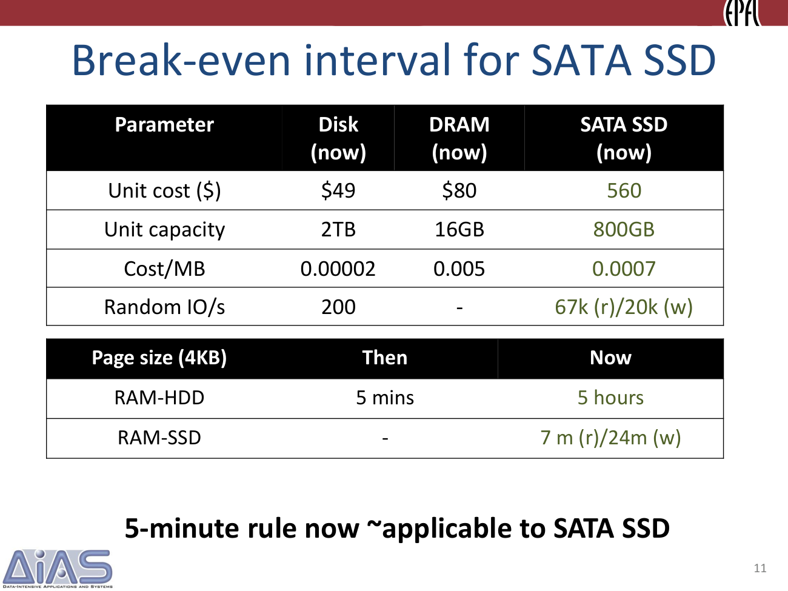

> 本组第 55 篇 · 存储介质与缓存 · [全部论文]() · [上一篇]() · [下一篇]()

本地PDF是29页演示稿，而非含完整方法和实验章节的论文正文。核心是用“每MB内存页数/后端IOPS”乘“设备价格/每MB快层价格”求经济临界参考间隔，再讨论随机访问与顺序批扫描适合的层级。五分钟不是缓存TTL、刷盘超时或永恒常数。稿件展示DRAM-HDD约五小时、DRAM-SATA读七分钟写24分钟、SSD-HDD约一天，以及NVMe/NVM和磁带的对比；部分打印输入不能精确重现显示阈值，带宽单位也有疑点。报告保留原值及算术限制，不将历史价格、未来预测或引用的40%节约当当前硬件事实或本机实验。

本文保留论文陈述、读者推断与待验证方案的区别；实验数字只适用于原文条件。原文和翻译来自已有 AI 辅助精读报告，已做来源匹配与编辑复核，不等于人工逐项核验或独立实验复现。所有页码均为 PDF 物理页。

## 论文与阅读范围

Raja Appuswamy, Renata Borovica-Gajic, Goetz Graefe, Anastasia Ailamaki. The five-minute rule thirty years later. Local 29-page slide deck, not the full prose paper. Title page has no verified date/venue; do not infer publication metadata solely from filename or thirty-year wording.

[论文集中的原始 PDF](https://github.com/lonng/db-papers/blob/4ff1331069c7cf52ac97dd769e5f484c1c35c200/papers/storage-media/the-five-minute-rule-thirty-years-later-and-its-impact-on-the-storage-hierarchy.pdf) · 本地来源：`storage-media/the-five-minute-rule-thirty-years-later-and-its-impact-on-the-storage-hierarchy.pdf`，共 29 页。

本篇保留 27 组原文精读和 28 条证据。截图为原始 PDF 的局部页选，不是重新生成的图表；未将整份 PDF 复制到博客。

## 研究问题与适用边界

**问的是“值得用更贵空间换多少访问能力”**
1987背景是昂贵DRAM与慢随机访问HDD。若某页访问很频繁，为其购买足够后端IOPS的设备份额可能比占DRAM更贵；临界参考间隔就是成本相等点。间隔更短意味着访问更频繁，按此模型更倾向快层。它不直接规定一致性、事务持久化或缓存失效。

三十年后多层介质的每GB成本、随机IOPS、带宽、访问启动时延演进不同，仅比较容量价格或吞吐都不足以确定位置。稿件把问题拆为性能层与容量/归档层：随机小页关注IOPS，顺序批扫描需要另一套度量。

本地封面列四位作者但没有核实的出版日期/场合；不能由“1987+30”或文件名虚构卷号。后续页为重复展开幻灯片，不应以29页充作29个独立新实验。

依据：论文陈述；PDF 物理页 2, 3, 7, 9, 23。证据：[FIVE-MINUTE-RULEREV02](#evidence-five-minute-rulerev02), [FIVE-MINUTE-RULEREV03](#evidence-five-minute-rulerev03), [FIVE-MINUTE-RULEREV05](#evidence-five-minute-rulerev05), [FIVE-MINUTE-RULEREV07](#evidence-five-minute-rulerev07), [FIVE-MINUTE-RULEREV14](#evidence-five-minute-rulerev14)。

## 存储层次架构模型

**这是层级设计分析，不是新引擎实现**
演示讨论DRAM、SATA/PCIe/NVMe、NVM与HDD，再到MAID式Cold Storage Device和磁带库。SSD作主存储时比较DRAM-SSD，作HDD缓存时比较SSD-HDD，公式快层的单位容量成本分母随角色改变。不能一律使用DRAM价格。

NVM介质、NVMe块协议、DIMM连接及CPU字节寻址并非同义；15页“标准化、NVDIMM-P soon”是当时展望，未查证当前产品状态。性能层与归档层的建议还需要容量、并发、数据持久性和SLA约束；稿件不是提供统一缓存淘汰算法、调度器或可执行部署方案。

依据：论文陈述；PDF 物理页 9, 12, 14, 15, 22, 28。证据：[FIVE-MINUTE-RULEREV07](#evidence-five-minute-rulerev07), [FIVE-MINUTE-RULEREV09](#evidence-five-minute-rulerev09), [FIVE-MINUTE-RULEREV10](#evidence-five-minute-rulerev10), [FIVE-MINUTE-RULEREV11](#evidence-five-minute-rulerev11), [FIVE-MINUTE-RULEREV13](#evidence-five-minute-rulerev13), [FIVE-MINUTE-RULEREV16](#evidence-five-minute-rulerev16)。

*原论文 PDF 物理页 12，版权归原作者或出版方。点击图片可查看原尺寸。这是页面定位信息，不表示本次已复核图内所有数据。*

## 盈亏平衡间隔计算算法

**公式如何读与使用**
t=(PagesPerMB_fast / AccessPerSecond_slow)*(PricePerDevice_slow / PricePerMB_fast)，t以秒计，表示成本比较下的平均参考间隔。页数与MB、价格、IOPS应口径一致，访问单位应能代表目标工作负载。更便宜快层扩大可缓存的间隔，更快后端缩短间隔，页变大使每MB页数减少并改变阈值。

实际读者脚本qa/rum-reader-tests.py只做算术，结果见qa/five-minute-rule-reader-tests.json。1024/15*(30000/5000)=409.6秒，接近第4页400秒；1024页/MB隐含约1KiB页，不能不变参数转写为后面4KB表。

明确采用256个4KiB页/二进制MiB并保留打印取整单价时，SATA560美元、67000/20000 IOPS、DRAM0.005美元/MB得到读427.94秒（7.13分）、写1433.6秒（23.89分）；SSD作缓存以0.0007美元/MB比较49美元200IOPS HDD，约89600秒（1.04天）。这是历史输入演算，不是本地设备测试或当前报价。

重用方法应先固定工作负载、访问粒度与成本边界，再填同日期设备输入，检查单位并做敏感性分析，最后才加入容量与SLA约束。该流程为读者建议。

依据：论文陈述；PDF 物理页 3, 4, 11, 12, 16。证据：[FIVE-MINUTE-RULEREV03](#evidence-five-minute-rulerev03), [FIVE-MINUTE-RULEREV04](#evidence-five-minute-rulerev04), [FIVE-MINUTE-RULEREV08](#evidence-five-minute-rulerev08), [FIVE-MINUTE-RULEREV09](#evidence-five-minute-rulerev09), [FIVE-MINUTE-RULEREV12](#evidence-five-minute-rulerev12)。

## 正确性与模型局限性

**模型与打印数据的核对**
第4页409.6秒与400秒是合理近似，但不能严格称300秒；第8页4KB的历史五分钟与第4页1024页/MB也非同页大小的直接比较。按256页/MiB、49美元、200IOPS、0.005美元/MB得约3.48小时，不精确等于演示五小时。

第16页沿前页DRAM价与表内设备价计算，Intel750读/写约70/111秒，而显示41秒/1分钟；P4800X约142/156秒而显示47/52秒。可能涉及隐藏输入、取整或版本混用，本报告不猜、也不把计算值冒充作者修正。原文与复算条件并列。

第14/16页带宽栏标GBps，但SATA行写500/460，其他行写2.5/1.2等，存在单位口径疑点。没有外部厂商核验，不应静默统一或当500GB/s已测。

经济临界并非硬实时性能保证。队列深度、访问突发、缓存命中、容量、能耗、冗余、压缩、设备内部WA、耐久性和运维成本未完整入公式。300年磁带例用来强调随机小页指标失配，不是磁带寿命或访问周期政策。

依据：读者推断；PDF 物理页 3, 4, 8, 14, 16, 23, 24。证据：[FIVE-MINUTE-RULEREV03](#evidence-five-minute-rulerev03), [FIVE-MINUTE-RULEREV04](#evidence-five-minute-rulerev04), [FIVE-MINUTE-RULEREV06](#evidence-five-minute-rulerev06), [FIVE-MINUTE-RULEREV10](#evidence-five-minute-rulerev10), [FIVE-MINUTE-RULEREV12](#evidence-five-minute-rulerev12), [FIVE-MINUTE-RULEREV14](#evidence-five-minute-rulerev14), [FIVE-MINUTE-RULEREV15](#evidence-five-minute-rulerev15)。

## 实验数据与参数演化

**没有独立端到端benchmark**
本地来源列设备参数和模型阈值、趋势与相关工作，没有足够实验方法、原始数据、误差条、代码和所有摊销定义。报告因此将其归为演示分析，不能补造读写实测、硬件采购调查或本机验证。

SATA例的七分钟/24分钟可在明示单位下近似重现；HDD和NVMe/NVM阈值有上述差异。价格与产品只代表稿件所举历史样本，不是2026行情。

第22页CSD约1000个SMR盘、MAID、PB密度、10秒延迟、2–10GB/s带宽，强调高启动时延与高批量带宽并存；不是每4KB都能按持续GB/s响应的设备证明。

第24页打印$/Kaps的tape/HDD比为8e−3/5e−9=160万，概括“百万倍”；$/TBScan为3e−2/3e−3=10。摊销周期与利用率不完整，不是完整TCO。第28页40%成本节约明确引用Skipper VLDB2016，本次未读该工作，不算这29页新测收益。

依据：论文陈述；PDF 物理页 7, 8, 11, 14, 16, 22, 23, 24, 28。证据：[FIVE-MINUTE-RULEREV05](#evidence-five-minute-rulerev05), [FIVE-MINUTE-RULEREV06](#evidence-five-minute-rulerev06), [FIVE-MINUTE-RULEREV08](#evidence-five-minute-rulerev08), [FIVE-MINUTE-RULEREV10](#evidence-five-minute-rulerev10), [FIVE-MINUTE-RULEREV12](#evidence-five-minute-rulerev12), [FIVE-MINUTE-RULEREV13](#evidence-five-minute-rulerev13), [FIVE-MINUTE-RULEREV14](#evidence-five-minute-rulerev14), [FIVE-MINUTE-RULEREV15](#evidence-five-minute-rulerev15), [FIVE-MINUTE-RULEREV16](#evidence-five-minute-rulerev16)。

*原论文 PDF 物理页 11，版权归原作者或出版方。点击图片可查看原尺寸。这是页面定位信息，不表示本次已复核图内所有数据。*

## 权衡与设计启示

随机访问、容量价格和顺序带宽给出不同选择，不能把更低$/GB或更高GB/s等同全部负载更优。慢启动成本可被大扫描摊销，却不适合低延迟点查；有限快层容量也使“所有活跃数据都在SSD/RAM”不是无条件结论。

存储层合并可能省成本，同时增加调度、预取、批次组织、重放恢复和SLA限制。公式提供讨论起点，而不是替代可靠性、能耗、冗余与业务容忍度的方案。

依据：读者推断；PDF 物理页 9, 12, 22, 23, 24, 28。证据：[FIVE-MINUTE-RULEREV07](#evidence-five-minute-rulerev07), [FIVE-MINUTE-RULEREV09](#evidence-five-minute-rulerev09), [FIVE-MINUTE-RULEREV13](#evidence-five-minute-rulerev13), [FIVE-MINUTE-RULEREV14](#evidence-five-minute-rulerev14), [FIVE-MINUTE-RULEREV15](#evidence-five-minute-rulerev15), [FIVE-MINUTE-RULEREV16](#evidence-five-minute-rulerev16)。

## 与现代系统及历史版本的比较

DRAM-HDD比较的是快空间与随机IOPS成本；DRAM-SATA因更高IOPS产生更短阈值且读写不对称；稿件预期NVM进一步缩短并减少差距。SSD-HDD缓存比较需把SSD空间成本放入公式。几条“规则”不能当同一个五分钟常数。

磁带/CSD不应沿用随机小页度量直接判死刑；TB扫描与可容忍启动时延的批分析是不同问题。演示主张重审容量/归档分工，但can、suggests与impending是预测及建议，未验证当今所有系统已合并层级。

依据：读者推断；PDF 物理页 8, 11, 12, 15, 16, 23, 24, 29。证据：[FIVE-MINUTE-RULEREV06](#evidence-five-minute-rulerev06), [FIVE-MINUTE-RULEREV08](#evidence-five-minute-rulerev08), [FIVE-MINUTE-RULEREV09](#evidence-five-minute-rulerev09), [FIVE-MINUTE-RULEREV11](#evidence-five-minute-rulerev11), [FIVE-MINUTE-RULEREV12](#evidence-five-minute-rulerev12), [FIVE-MINUTE-RULEREV14](#evidence-five-minute-rulerev14), [FIVE-MINUTE-RULEREV15](#evidence-five-minute-rulerev15), [FIVE-MINUTE-RULEREV17](#evidence-five-minute-rulerev17)。

## 复现指南与缺失信息

**实际已做：原页目视与公式算术**
已读全部29页文本，核对12张关键原页；脚本只计算打印输入，不对磁盘写入或改变设备设置。输出JSON保留采用的页数/单位、复算值与差异，不擅改原表。

后续建议先取得同版完整论文及价格/IOPS出处，确认页大小、MB/MiB、带宽单位、寿命摊销、读写IOPS对应队列条件。分别模拟随机页轨迹、突发和TB扫描，施加容量、SLA、能耗、复制与耐久性限制，再评价缓存或分层策略。所引Skipper/Nakshatra等需独立阅读，不能由幻灯片引用补造已复现。

依据：待验证的工程设想；PDF 物理页 1, 3, 4, 14, 16, 23, 24, 28。证据：[FIVE-MINUTE-RULEREV01](#evidence-five-minute-rulerev01), [FIVE-MINUTE-RULEREV03](#evidence-five-minute-rulerev03), [FIVE-MINUTE-RULEREV04](#evidence-five-minute-rulerev04), [FIVE-MINUTE-RULEREV10](#evidence-five-minute-rulerev10), [FIVE-MINUTE-RULEREV12](#evidence-five-minute-rulerev12), [FIVE-MINUTE-RULEREV14](#evidence-five-minute-rulerev14), [FIVE-MINUTE-RULEREV15](#evidence-five-minute-rulerev15), [FIVE-MINUTE-RULEREV16](#evidence-five-minute-rulerev16)。

## 结论与工程影响

核心价值是将“热/冷”转成受设备经济性和访问方式影响的可计算问题，并指出随机小页与顺序批扫描不能用同一把尺子。可迁移的是重新建模和统一单位的方法，不是五分钟、一天或300年的永久常数。

本地稿件提供历史趋势与架构推测，细节与部分数值尚待完整来源核验。用于当前机器时必须另收实测输入和约束，本报告没有作采购或部署收益承诺。

依据：读者推断；PDF 物理页 3, 23, 24, 28, 29。证据：[FIVE-MINUTE-RULEREV03](#evidence-five-minute-rulerev03), [FIVE-MINUTE-RULEREV14](#evidence-five-minute-rulerev14), [FIVE-MINUTE-RULEREV15](#evidence-five-minute-rulerev15), [FIVE-MINUTE-RULEREV16](#evidence-five-minute-rulerev16), [FIVE-MINUTE-RULEREV17](#evidence-five-minute-rulerev17)。

## 原文精读：从句子回到机制

以下保留原文、忠实翻译、含义与边界；假设示例不作为论文实验结果。

### P001 · PDF 物理页 2

**原文**

<blockquote class="paper-source-quote"><pre><code>The five-minute rule in 1987&#10;• Storage hardware: Two-tier hierarchy&#10;– 1MB RAM: $5,000 &#10;~   $5,000/MB&#10;– 180MB HDD: $30,000 ~   $160/MB&#10;• Optimization problem&#10;“When does it make sense to cache data in DRAM?”&#10;• Gray &amp; Putzolu’s answer&#10;“Pages referenced every 5 minutes should be memory resident”&#10;2</code></pre></blockquote>

**忠实翻译**

> 1987年的五分钟法则
> • 存储硬件：两层层级结构
> – 1MB RAM：5,000美元 ~ 约5,000美元/MB
> – 180MB HDD：30,000美元 ~ 约160美元/MB
> • 优化问题
> “什么时候将数据缓存在DRAM中是合理的？”
> • Gray与Putzolu的答案
> “每5分钟被引用一次的页面应当驻留在内存中”
> 2

**技术含义与边界**

> 稿件用1987年的两层硬件说明缓存经济问题。临界间隔比较每页DRAM占用成本与支撑随机访问所需HDD设备份额的成本，不是把两个介质的$/MB简单相除。五分钟是历史经验名称与近似阈值，不等于必须采用某种pin或淘汰实现。

**常见误读**

> 不能把五分钟作永恒常数、事务刷盘/提交超时或缓存TTL。此页未给所有公式细节，后页演算还使用特定页数/MB；不能把历史设备例视为当前报价。

**读者构造的假设示例**

> 读者构造的假设示例：在满足模型前提且快层有容量时，平均每4分钟访问的某页可能值得常驻DRAM；这不是命令系统对所有表页永久pin，也不改变WAL持久化要求。

### P002 · PDF 物理页 29

**原文**

<blockquote class="paper-source-quote"><pre><code>Summary&#10;• Growing DRAM-HDD &amp; shrinking DRAM-NVM intervals&#10;Most performance critical data will sit in SSD/NVM&#10;• Rapid improvements in SSD/NVM density&#10;All randomly accessed data can sit in SSD/NVM&#10;• Shrinking HDD—tape/CSD difference w.r.t $/TBscan&#10;Can merge archival+capacity tier into cold storage tier&#10;Sequential batch analytics can be hosted on new tier&#10;29&#10;Five-minute rule suggests impending consolidation in the &#10;storage hierarchy</code></pre></blockquote>

**忠实翻译**

> 总结
> • DRAM-HDD间隔增大，而DRAM-NVM间隔缩小
> 大多数对性能关键的数据将位于SSD/NVM中
> • SSD/NVM密度的快速提升
> 所有随机访问的数据都可以位于SSD/NVM中
> • HDD与磁带/CSD之间在$/TBscan方面的差异缩小
> 可以将归档层+容量层合并为冷存储层
> 顺序批处理分析可以托管在新的层级上
> 29
> 五分钟法则预示着存储层级结构中即将发生整合

**技术含义与边界**

> 这些是稿件时期设备输入启发的架构预测：随机/性能关键数据向SSD/NVM，顺序批分析考虑合并冷层。can、will、suggests/impending在此论证语境不是本报告对2026市场或所有系统的实证判断。

**常见误读**

> 不能推成所有数据必上SSD、HDD已无价值、或容量与归档合并已普遍完成；容量、启动时延、可靠性和SLA仍需单独满足。稿件也未给完整部署验证。

**读者构造的假设示例**

> 读者构造的假设示例：可分别模拟交易随机访问与月末历史扫描，比较高性能层和冷层的成本及SLA；没有测量前不直接迁移或承诺合并更优。

### P003 · PDF 物理页 17

**原文**

<blockquote class="paper-source-quote"><pre><code>Break even interval for PCIe SSD/NVM&#10;17&#10;Device&#10;Capacity&#10;Price ($)&#10;IOPS (k) r/w&#10;B/W (GBps)&#10;SATA SSD&#10;800GB&#10;560&#10;67/20&#10;500/460&#10;Intel 750&#10;1TB&#10;630&#10;460/290&#10;2.5/1.2&#10;Intel P4800X&#10;384GB&#10;1520&#10;550/500&#10;2.5/2&#10;Page size (4KB)&#10;Now&#10;RAM-SATA SSD&#10;7 m (r) / 24m (w)&#10;RAM-Intel 750&#10;41 s (r) / 1m (w)&#10;RAM-P4800X&#10;47 s (r) / 52s (w)&#10;DRAM-NVM break-even interval is shrinking&#10;Interval disparity between reads and writes is shrinking&#10;Impending shift from DRAM to NVM-based data &#10;management engines</code></pre></blockquote>

**忠实翻译**

> PCIe SSD/NVM的盈亏平衡间隔。设备/容量/价格/读写IOPS(k)/带宽栏（表头GBps，数字原样）：SATA SSD 800GB、560美元、67/20、500/460；Intel750 1TB、630美元、460/290、2.5/1.2；P4800X 384GB、1520美元、550/500、2.5/2。4KB页对应表列RAM-SATA读7分钟/写24分钟，RAM-Intel750读41秒/写1分钟，RAM-P4800X读47秒/写52秒。稿件主张DRAM-NVM临界间隔和读写差距缩小，并预期引擎转向NVM。

**技术含义与边界**

> 原表列出秒级阈值及未来架构判断；不是设备访问延迟，47秒也不是一次I/O耗时。本次核对第16页同一表，按其打印价格/IOPS、前页DRAM0.005美元/MB及256页/MiB计算，Intel750约70/111秒、P4800X约142/156秒，不能精确重现显示值，隐藏输入待澄清。带宽栏SATA500/460与GBps表头亦有单位疑点。

**常见误读**

> 不把显示数当已复算或本机实测，也不因读写阈值接近就忽略耐久、持久化、读写比例与队列条件。NVM介质、NVMe块接口和字节寻址内存不是同一概念，不能自动推断可直接替换CPU主存。

**读者构造的假设示例**

> 读者构造的假设示例：若某配置的模型阈值真为读47秒/写52秒，平均参考间隔50秒可能在读写两种口径下得到不同选择；这只是说明敏感性，不能据本表未重现的数字直接配置当前机器。

### P004 · PDF 物理页 10

**原文**

<blockquote class="paper-source-quote"><pre><code>Five-minute rule with SATA SSD&#10;10&#10;Parameter&#10;Disk (now)&#10;DRAM (now)&#10;SATA SSD&#10;(now)&#10;Unit cost ($)&#10;$49&#10;$80&#10;560&#10;Unit capacity&#10;2TB&#10;16GB&#10;800GB&#10;Cost/MB&#10;0.00002&#10;0.005&#10;0.0007&#10;Random IO/s&#10;200&#10;-&#10;67k/20k&#10;• Two properties of SSDs&#10;• Middleground between DRAM and HDD w.r.t cost/MB&#10;• 100-1000× higher random IOPS than HDD&#10;• Two new rules with SSDs&#10;• DRAM-SSD rule: SSD as a primary store&#10;• SSD-HDD rule: SSD as a cache</code></pre></blockquote>

**忠实翻译**

> 带有SATA SSD的五分钟法则
> 10
> 参数 磁盘(现在) DRAM(现在) SATA SSD(现在)
> 单位成本($) $49 $80 560
> 单位容量 2TB 16GB 800GB
> 成本/MB 0.00002 0.005 0.0007
> 随机IO/s 200 - 67k/20k
> • SSD的两个特性
> • 在成本/MB方面处于DRAM和HDD之间的中间地带
> • 随机IOPS比HDD高100-1000倍
> • 带有SSD的两个新法则
> • DRAM-SSD法则：SSD作为主存储
> • SSD-HDD法则：SSD作为缓存

**技术含义与边界**

> 稿件时期SATA SSD的容量成本居两者之间、随机IOPS较高，因此区分SSD作primary store时的DRAM-SSD比较，以及SSD作HDD缓存时的SSD-HDD比较。primary store应译主存储，不是CPU可字节寻址的主内存；两个公式使用的快层空间成本也不同。

**常见误读**

> 容易发生的错误解读是认为SSD只能作为缓存或者只能作为主存储。原文不支持这种单一角色的理解，作者明确指出SSD具有双重属性，并据此提出了两个不同的法则。另外，不能将‘随机IOPS比HDD高100-1000倍’泛化为所有类型的SSD对所有类型工作负载的性能提升倍数，原文限定了这是针对SATA SSD与HDD在随机IO/s上的对比。

**读者构造的假设示例**

> 读者构造的假设示例：同一系统可让部分高频页留DRAM、较温页缓存于SSD、很冷页留HDD；实际还要按每页轨迹、快层容量和持久性约束决定，而不是一条公式直接把整张业务表永久放某层。

### P005 · PDF 物理页 23

**原文**

<blockquote class="paper-source-quote"><pre><code>MB/s&#10;4 * 750 MB/s&#10;23&#10;• DRAM-tape break-even interval: 300 years!&#10;“Tape: The motel where data checks in and never checks out”&#10;- Jim Gray&#10;• Kaps is not the right metric for tape&#10;– Maps, TB-scan better</code></pre></blockquote>

**忠实翻译**

> MB/s
> 4 * 750 MB/s
> 23
> • DRAM-磁带盈亏平衡间隔：300年！
> “磁带：数据入住但从不退房的汽车旅馆”
> - Jim Gray
> • Kaps不是用于磁带的正确指标
> – Maps, TB-scan更好

**技术含义与边界**

> 300年用于说明随机小页访问成本指标套在高启动时延磁带上失配，随后转向更适合大访问/顺序TB扫描的度量。它不是磁带寿命、缓存保留期或实际访问计划。稿件只印Kaps/Maps缩写，没有足够定义，本报告不凭首字母展开为“千次/兆次访问每秒”。

**常见误读**

> 不能把300年当磁带无用、不可读取或永不退役的证明，也不能把缩写擅自解释为普通IOPS量级。顺序扫描比较仍需启动、驱动并行、摊销与SLA，不能仅由这页判磁带必定比其他介质划算。

**读者构造的假设示例**

> 读者构造的假设示例：一次容忍挂载等待、随后顺序读1TB的离线审计，应比较完整任务成本与时延，而不是按每个4KB随机定位累加；本报告没运行磁带或核实摊销参数。

### P006 · PDF 物理页 7

**原文**

<blockquote class="paper-source-quote"><pre><code>Storage hardware 30 years later&#10;7&#10;Parameter&#10;Disk &#10;(then)&#10;Disk &#10;(now)&#10;DRAM &#10;(then)&#10;DRAM &#10;(now)&#10;Unit cost ($)&#10;$30,000&#10;$49&#10;$5,000&#10;$80&#10;Unit capacity&#10;180MB&#10;2TB&#10;1MB&#10;16GB&#10;Random IO/s&#10;15&#10;200&#10;-&#10;-&#10;•&#10;Capacity:  10,000×, Cost:   1,000×, HDD Performance:  10×</code></pre></blockquote>

**忠实翻译**

> 三十年后的硬件对照：旧/新HDD设备价30000/49美元、容量180MB/2TB、随机IOPS15/200；旧/新DRAM设备价5000/80美元、容量1MB/16GB。稿件以约万倍容量、约千倍成本变化及约十倍HDD性能作趋势概括。

**技术含义与边界**

> 具体打印数字与概括倍数需区分：HDD设备价30000/49约612倍下降，不是精确1000；200/15约13.3倍而非恰10。Unit cost是设备价格，Cost/MB才是容量单价，两者不可混用。原图8同表以箭头提示方向，本次没有把口号改写成精确统计测量。

**常见误读**

> 不能把成本变化理解为贵1000倍，也不能反过来声称这里精确计算的是每MB价格下降1000倍。表列少量历史设备例，没有说明全行业样本或置信区间；更不是当前报价。

**读者构造的假设示例**

> 读者构造的假设示例：只用打印数字，旧盘30000美元、新盘49美元，设备价比约612；容量和随机性能的比另算，不能把设备价、容量价与性能比混为一数。

### P007 · PDF 物理页 27

**原文**

<blockquote class="paper-source-quote"><pre><code>• Clear division in workloads&#10;– Only non-latency sensitive, batch analytics in capacity tier&#10;• Is it economical to merge the two tiers?&#10;– “40% cost savings by using a cold storage tier” [Skipper, VLDB’16]</code></pre></blockquote>

**忠实翻译**

> • 工作负载的明确划分
> – 容量层中只有非延迟敏感的批处理分析
> • 合并这两个层级在经济上合理吗？
> – “通过使用冷存储层可节省40%的成本” [Skipper, VLDB’16]

**技术含义与边界**

> 稿件提出在其非延迟敏感批分析设定下重审容量/归档分工，并引用Skipper VLDB2016的40%节约。它不是这29页独立实测或所有容量层的现状调查；本次未读Skipper完整实验，不能补造其TCO定义与适用配置。

**常见误读**

> 不得将引用40%作为任意集群收益，也不应由“可能合并”宣布这是所有冷数据最优架构。稿件的工作负载简化、挂载延迟与业务约束都须保留。

**读者构造的假设示例**

> 读者构造的假设示例：企业可研究两个冷数据池合并，先测访问轨迹、并发、恢复和审计SLA，再建成本模型；不能因为引文写40%便把该企业预算直接减40%。

### P008 · PDF 物理页 4

**原文**

<blockquote class="paper-source-quote"><pre><code>Five-minute rule formulation&#10;4&#10;Break-even Reference Interval (seconds) = (400 secs)&#10;PagesPerMBofRAM (1024)      &#10;AccessPerSecondPerDisk (15) &#10;x&#10;PricePerDiskDrive ($30k)&#10;PricePerMBofDRAM ($5k)&#10;Technology ratio&#10;Economic ratio&#10;Popular rule of thumb for engineering data management &#10;systems</code></pre></blockquote>

**忠实翻译**

> 五分钟法则公式：临界参考间隔（秒）标示400秒；技术比率为每MB RAM页数1024除以每盘每秒访问数15，经济比率为盘价30000美元除以每MB DRAM价5000美元，二者相乘。稿件将其称数据管理工程常用经验法则。

**技术含义与边界**

> 图像给出的明确结构是(1024/15)*(30000/5000)，实际409.6秒，400为近似，不能说精确五分钟。1024页/MB意味着约1KiB页而不是4KiB；若采用4KiB及二进制MiB，应为256页。后页4KB表与这里的页数口径需分别核对。

**常见误读**

> 公式是特定成本模型，不是物理定律；不能从1024页/MB推导4KB，也不能不问访问粒度和介质接口就将同式无条件套任意层级，磁带例已显示度量失配。

**读者构造的假设示例**

> 读者构造的假设示例：假定256页/MB、100 IOPS、设备1000美元、快层10美元/MB，模型t=256/100*1000/10=256秒。该结果仅在这些假定与成本边界内，不是任何存储层对的通用保证。

### P009 · PDF 物理页 12

**原文**

<blockquote class="paper-source-quote"><pre><code>Break-even interval for SATA SSD&#10;12&#10;Parameter&#10;Disk &#10;(now)&#10;DRAM &#10;(now)&#10;SATA SSD&#10;(now)&#10;Unit cost ($)&#10;$49&#10;$80&#10;560&#10;Unit capacity&#10;2TB&#10;16GB&#10;800GB&#10;Cost/MB&#10;0.00002&#10;0.005&#10;0.0007&#10;Random IO/s&#10;200&#10;-&#10;67k (r)/20k (w)&#10;Page size (4KB)&#10;Then&#10;Now&#10;RAM-HDD&#10;5 mins&#10;5 hours&#10;RAM-SSD&#10;-&#10;7 m (r)/24m (w)&#10;SSD-HDD&#10;-&#10;1 day&#10;5-minute rule now ~applicable to SATA SSD&#10;With 1 day interval, all active data will be in RAM/SSD</code></pre></blockquote>

**忠实翻译**

> SATA SSD的盈亏平衡间隔
> 12
> 参数 磁盘(现在) DRAM(现在) SATA SSD(现在)
> 单位成本($) $49 $80 560
> 单位容量 2TB 16GB 800GB
> 成本/MB 0.00002 0.005 0.0007
> 随机IO/s 200 - 67k(读)/20k(写)
> 页面大小(4KB) 当时 现在
> RAM-HDD 5分钟 5小时
> RAM-SSD - 7分钟(读)/24分钟(写)
> SSD-HDD - 1天
> 五分钟法则现在~适用于SATA SSD
> 在1天的间隔下，所有活跃数据都将位于RAM/SSD中

**技术含义与边界**

> 表的7分钟/24分钟与一天是模型参考间隔，约等于SATA读写和SSD缓存HDD两种比较。本次明确单位复算约7.13分、23.89分、1.04天；RAM-HDD五小时不能用同一打印口径精确复现。所谓一天描述平均参考间隔及经济推断，不是“过去一天被访问过”便必须在快层的recency淘汰策略。

**常见误读**

> 波浪号是近似而非精确五分钟；7和24也不是访问延迟或刷盘时限。容量有限、访问突发或SLA约束下不能保证所有活跃数据自动驻RAM/SSD。

**读者构造的假设示例**

> 读者构造的假设示例：平均参考间隔10分钟介于读7分钟与写24分钟之间，读写口径可能影响快层经济选择；60分钟则大于两者，原例“60小于24”是算术错误，已修正。没有实际配置缓存。

### P010 · PDF 物理页 8

**原文**

<blockquote class="paper-source-quote"><pre><code>Five-minute rule 30 years later&#10;8&#10;Parameter&#10;Disk &#10;(then)&#10;Disk &#10;(now)&#10;DRAM &#10;(then)&#10;DRAM &#10;(now)&#10;Unit cost ($)&#10;$30,000&#10;$49&#10;$5,000&#10;$80&#10;Unit capacity&#10;180MB&#10;2TB&#10;1MB&#10;16GB&#10;Random IO/s&#10;15&#10;200&#10;-&#10;-&#10;•&#10;Capacity:  10,000×, Cost:   1,000×, HDD Performance:  10×&#10;Page size (4KB)&#10;Then&#10;Now&#10;RAM-HDD&#10;5 mins&#10;5 hours&#10;• RAM-HDD break-even 60× higher due to fall in DRAM price&#10;Store only extremely “cold” data in HDD</code></pre></blockquote>

**忠实翻译**

> 30年后的五分钟法则
> 8
> 参数 磁盘(当时) 磁盘(现在) DRAM(当时) DRAM(现在)
> 单位成本($) $30,000 $49 $5,000 $80
> 单位容量 180MB 2TB 1MB 16GB
> 随机IO/s 15 200 - -
> • 容量：10,000倍，成本：1,000倍，HDD性能：10倍
> 页面大小(4KB) 当时 现在
> RAM-HDD 5分钟 5小时
> • RAM-HDD盈亏平衡因DRAM价格下降而提高了60倍
> 仅在HDD中存储极度“冷”的数据

**技术含义与边界**

> 稿件用历史价格/IOPS例预测DRAM-HDD阈值拉长，并据此建议HDD偏冷数据；不能转成当前系统“HDD已被边缘化”的外部事实。临界是模型平均参考间隔，不是只要连续五小时没访问就必换出。打印输入按本报告明示单位约3.48小时，五小时可能有隐藏口径或取整，未擅改原表。

**常见误读**

> 不能说HDD性能变差造成阈值增长，也不能由经济模型废弃HDD的顺序扫描/容量用途；价格、IOPS和容量约束的比较不等于完整TCO或普遍最优策略。

**读者构造的假设示例**

> 读者构造的假设示例：若读者自选模型阈值五小时，平均两小时一次的页可能更值得快层；仍要检查工作集、访问突发、持久性与SLA。不是把本地数据自动迁往DRAM或宣称当前设备实测五小时。

### FIVE-MINUTE-RULEP001 · PDF 物理页 1

**原文**

<blockquote class="paper-source-quote"><pre><code>The five-minute rule &#10;thirty years later&#10;Raja Appuswamy, Renata Borovica-Gajic, &#10;Goetz Graefe, and Anastasia Ailamaki</code></pre></blockquote>

**忠实翻译**

> 标题为“五分钟法则三十年后”，列出Raja Appuswamy、Renata Borovica-Gajic、Goetz Graefe与Anastasia Ailamaki。

**技术含义与边界**

> 本地来源是29页演示稿，不是含详细实验方法、完整推导及参考文献的论文正文；标题页未给可核出版日期与场合。

**常见误读**

> 不把文件名中的长标题当已核正式标题，或把1987加30直接断言为本版本出版年。

**读者构造的假设示例**

> 读者构造的假设示例：读者整理可标“本地演示稿，日期场合未核”，而不虚构卷号、DOI或实测章节。

### FIVE-MINUTE-RULEP002 · PDF 物理页 2

**原文**

<blockquote class="paper-source-quote"><pre><code>Storage hardware: Two-tier hierarchy&#10;– 1MB RAM: $5,000 &#10;~   $5,000/MB&#10;– 180MB HDD: $30,000 ~   $160/MB&#10;• Optimization problem&#10;“When does it make sense to cache data in DRAM?”&#10;• Gray &amp; Putzolu’s answer&#10;“Pages referenced every 5 minutes should be memory resident”</code></pre></blockquote>

**忠实翻译**

> 1987年两层存储：1MB RAM约5000美元、180MB HDD约30000美元。问题是何时值得缓存于DRAM；Gray与Putzolu的回答为每五分钟访问一次的页应常驻内存。

**技术含义与边界**

> 这是经济与技术比率决定的缓存临界参考间隔，不是数据五分钟失效、必须刷盘或事务提交时限。

**常见误读**

> 不把五分钟当跨年代硬件通用常数，也不混同缓存TTL、WAL持久化与一致性协议。

**读者构造的假设示例**

> 读者构造的假设示例：同样一页频繁随机访问可能值得占DRAM，但其事务日志仍须按独立持久化要求处理。

### FIVE-MINUTE-RULEP003 · PDF 物理页 3

**原文**

<blockquote class="paper-source-quote"><pre><code>Break-even Reference Interval (seconds) =&#10;PagesPerMBofRAM&#10;AccessPerSecondPerDisk &#10;x&#10;PricePerDiskDrive&#10;PricePerMBofDRAM &#10;Technology ratio&#10;Economic ratio</code></pre></blockquote>

**忠实翻译**

> 临界参考间隔（秒）等于每MB内存页数除以每盘每秒访问数，再乘每盘价格除以每MB DRAM价格；分别称技术比率和经济比率。

**技术含义与边界**

> 模型把每页内存占用成本与支撑访问率所需设备份额成本比较，乘积量纲为秒。页大小、随机访问率与价格必须同一单位口径。

**常见误读**

> 不把公式中的价格比反过来；更便宜DRAM使该模型的可缓存间隔变长，而更高后端IOPS使间隔缩短。

**读者构造的假设示例**

> 读者构造的假设示例：实际读者脚本显式用256个4KiB页/二进制MiB及给定单价计算，不把混合单位暗中当精确当前硬件结果。

### FIVE-MINUTE-RULEP004 · PDF 物理页 4

**原文**

<blockquote class="paper-source-quote"><pre><code>Break-even Reference Interval (seconds) = (400 secs)&#10;PagesPerMBofRAM (1024)      &#10;AccessPerSecondPerDisk (15) &#10;x&#10;PricePerDiskDrive ($30k)&#10;PricePerMBofDRAM ($5k)&#10;Technology ratio&#10;Economic ratio&#10;Popular rule of thumb for engineering data management &#10;systems</code></pre></blockquote>

**忠实翻译**

> 演示例以每MB1024页、每盘15次每秒访问、盘价30000美元和DRAM每MB5000美元，标示约400秒临界间隔，作为工程经验法则。

**技术含义与边界**

> 直接代入为409.6秒，可理解400为近似；1024页/MB还隐含约1KiB页，而后面表格写4KB，不能不换页大小就横向比较。

**常见误读**

> 不说严格等于五分钟或同页演算已使用4KiB；历史昵称与近似示例须分开。

**读者构造的假设示例**

> 读者构造的假设示例：保持其他参数而将每MB页数从1024改256，结果变为102.4秒，说明页单位能带来四倍差异。

### FIVE-MINUTE-RULEP005 · PDF 物理页 7

**原文**

<blockquote class="paper-source-quote"><pre><code>Parameter&#10;Disk &#10;(then)&#10;Disk &#10;(now)&#10;DRAM &#10;(then)&#10;DRAM &#10;(now)&#10;Unit cost ($)&#10;$30,000&#10;$49&#10;$5,000&#10;$80&#10;Unit capacity&#10;180MB&#10;2TB&#10;1MB&#10;16GB&#10;Random IO/s&#10;15&#10;200&#10;-&#10;-&#10;•&#10;Capacity:  10,000×, Cost:   1,000×, HDD Performance:  10×</code></pre></blockquote>

**忠实翻译**

> 表中旧/新HDD价格30000/49美元、容量180MB/2TB、随机IOPS15/200；旧/新DRAM价格5000/80美元、容量1MB/16GB；幻灯片概括容量约万倍、成本约千倍、HDD性能约十倍变化。

**技术含义与边界**

> 这些是演示时期选定设备的历史示例和取整趋势，不是当前市场报价，也不是全体设备同速率演进的统计证明。

**常见误读**

> 不据此给当前机器采购建议或声称2026仍为相同美元价格；本报告未联网更新价格。

**读者构造的假设示例**

> 读者构造的假设示例：重用方法时把本机实测IOPS与同日期报价另存，再重算，不沿用49美元盘的历史输入。

### FIVE-MINUTE-RULEP006 · PDF 物理页 8

**原文**

<blockquote class="paper-source-quote"><pre><code>Page size (4KB)&#10;Then&#10;Now&#10;RAM-HDD&#10;5 mins&#10;5 hours&#10;• RAM-HDD break-even 60× higher due to fall in DRAM price&#10;Store only extremely “cold” data in HDD</code></pre></blockquote>

**忠实翻译**

> 表标4KB页时RAM-HDD临界由五分钟到五小时，称60倍增加主要来自DRAM降价，并建议HDD只放极冷数据。

**技术含义与边界**

> 这是模型导出的历史趋势与架构建议，不是实测所有热数据都迁走。按已印256页/MiB、49美元、200IOPS及0.005美元/MB计算约3.48小时，不能精确重现五小时，隐藏口径需澄清。

**常见误读**

> 不把演示五小时变成当前系统全局缓存策略；也不擅改原表成3.48小时称作者纠错。

**读者构造的假设示例**

> 读者构造的假设示例：实际读者算术明确保留打印取整单价，与显示阈值并列，只验证算术敏感性。

### FIVE-MINUTE-RULEP007 · PDF 物理页 9

**原文**

<blockquote class="paper-source-quote"><pre><code>Two properties of SSDs&#10;• Middleground between DRAM and HDD w.r.t cost/MB&#10;• 100-1000× higher random IOPS than HDD</code></pre></blockquote>

**忠实翻译**

> SSD每MB成本位于DRAM和HDD之间，随机IOPS比HDD高100至1000倍。

**技术含义与边界**

> 成本与访问能力共同决定层级用途；10页进一步区分SSD作主存储时的DRAM-SSD规则，与SSD作缓存时的SSD-HDD规则。

**常见误读**

> 不把价格/MB与设备IOPS当同一个排名，也不认为一种SSD一概取代DRAM或HDD。

**读者构造的假设示例**

> 读者构造的假设示例：同一SSD可服务随机点查，也可缓存HDD；这两种比较的快层成本分母不同。

### FIVE-MINUTE-RULEP008 · PDF 物理页 11

**原文**

<blockquote class="paper-source-quote"><pre><code>Page size (4KB)&#10;Then&#10;Now&#10;RAM-HDD&#10;5 mins&#10;5 hours&#10;RAM-SSD&#10;-&#10;7 m (r)/24m (w)&#10;5-minute rule now ~applicable to SATA SSD</code></pre></blockquote>

**忠实翻译**

> 4KB页表列RAM-HDD五小时，RAM-SATA SSD读约7分钟、写约24分钟，故称五分钟经验法则现在大致适用于SATA SSD。

**技术含义与边界**

> 读/写IOPS67k/20k导致不同阈值。按256页/MiB、560美元、0.005美元/MB，读约7.13分钟、写23.89分钟，与演示近似相符。

**常见误读**

> 不把24分钟当测得的刷脏超时，也不将读写完全合并为一个阈值；设备耐久性和队列延迟未入此简化公式。

**读者构造的假设示例**

> 读者构造的假设示例：实际读者只用表中输入作公式计算，不执行任何磁盘读写。

### FIVE-MINUTE-RULEP009 · PDF 物理页 12

**原文**

<blockquote class="paper-source-quote"><pre><code>SSD-HDD&#10;-&#10;1 day&#10;5-minute rule now ~applicable to SATA SSD&#10;With 1 day interval, all active data will be in RAM/SSD</code></pre></blockquote>

**忠实翻译**

> SSD-HDD临界约一天，演示推论为此间隔下所有活跃数据会在RAM或SSD中。

**技术含义与边界**

> 在此设备经济模型下，以SSD空间对比HDD访问能力可得约1.04天；“所有活跃数据”是架构推断，不是容量与SLA约束下的普遍部署事实。

**常见误读**

> 不把一天当数据保留期、删除期或SSD命中率保证；总容量有限时不能自动容纳一切活跃数据。

**读者构造的假设示例**

> 读者构造的假设示例：如果活跃集远超SSD容量，仍需成本与容量联合规划，不能只设一天缓存TTL解决。

### FIVE-MINUTE-RULEP010 · PDF 物理页 14

**原文**

<blockquote class="paper-source-quote"><pre><code>Device&#10;Capacity&#10;Price ($)&#10;IOPS (k) &#10;r/w&#10;B/W&#10;(GBps)&#10;SATA SSD&#10;800GB&#10;560&#10;67/20&#10;500/460&#10;Intel 750&#10;1TB&#10;630&#10;460/290&#10;2.5/1.2</code></pre></blockquote>

**忠实翻译**

> 表列SATA SSD800GB、560美元、读写IOPS67k/20k；Intel750为1TB、630美元、460k/290k，带宽栏写2.5/1.2。

**技术含义与边界**

> 同一表头标B/W GBps，但SATA行写500/460，和其他行量级口径可疑。保持原值并标单位疑点，不凭记忆换成厂商规格；本次未外部查证。

**常见误读**

> 不把500/460按该表头直读成500GB/s已测能力，也不悄悄替原文修单位。

**读者构造的假设示例**

> 读者构造的假设示例：复现先确认每行MB/s或GB/s的单位，再做带宽对比，不能只比数字大小。

### FIVE-MINUTE-RULEP011 · PDF 物理页 15

**原文**

<blockquote class="paper-source-quote"><pre><code>Storage Class Memory devices (ex: 3D Xpoint)&#10;– Faster than Flash, Denser than DRAM, and non-volatile&#10;– Standardized, byte-addressable, NVDIMM-P soon</code></pre></blockquote>

**忠实翻译**

> 稿件将Storage Class Memory如3D Xpoint描述为比Flash快、比DRAM密、非易失，并展望标准化、字节可寻址及NVDIMM-P即将到来。

**技术含义与边界**

> 这是演示时期技术叙述与预测；块设备P4800X、NVMe协议与字节寻址DIMM接口不是同一个层次。

**常见误读**

> 不把soon或即将替代DRAM当当前产品事实；未研究当前产业状态，也不把所有NVM都说成CPU load/store。

**读者构造的假设示例**

> 读者构造的假设示例：不同设备可同用非易失介质却暴露块I/O或字节接口，数据库访问模型不能只由NVM名词决定。

### FIVE-MINUTE-RULEP012 · PDF 物理页 16

**原文**

<blockquote class="paper-source-quote"><pre><code>Page size (4KB)&#10;Now&#10;RAM-SATA SSD&#10;7 m (r) / 24m (w)&#10;RAM-Intel 750&#10;41 s (r) / 1m (w)&#10;RAM-P4800X&#10;47 s (r) / 52s (w)&#10;DRAM-NVM break-even interval is shrinking&#10;Interval disparity between reads and writes is shrinking</code></pre></blockquote>

**忠实翻译**

> 表列RAM-Intel750读41秒、写约1分钟；RAM-P4800X读47秒、写52秒，主张DRAM-NVM阈值及读写间差距在缩小。

**技术含义与边界**

> 用该页价格630/1520美元、IOPS460k/290k及550k/500k、前页DRAM成本0.005和256页/MiB，分别约70/111秒、142/156秒，不能重现全部显示值。可能有隐藏输入或版本取整，本报告不猜测。

**常见误读**

> 不把显示41/47秒写为本机实测或精确可复现结果；趋势论证与数值复现状态分开。

**读者构造的假设示例**

> 读者构造的假设示例：实际算术把打印输入、明确单位与计算值全部保留，供回查完整论文而非替作者改数据。

### FIVE-MINUTE-RULEP013 · PDF 物理页 22

**原文**

<blockquote class="paper-source-quote"><pre><code>Cold storage devices (CSD) filling the gap&#10;– 1,000 high-density SMR disks in MAID setup&#10;– PB density, 10s latency, 2-10GB/s bandwidth</code></pre></blockquote>

**忠实翻译**

> Cold Storage Device以约1000个高密SMR盘组成MAID配置，具PB密度、约10秒延迟及2至10GB/s带宽。

**技术含义与边界**

> 高带宽和高唤醒延迟可以共存，适合批量顺序工作而非交互随机点查；这些是演示列举配置，不是本地设备测量。

**常见误读**

> 不把10秒延迟换成每页连续传输延迟，也不把GB/s带宽当随机IOPS。

**读者构造的假设示例**

> 读者构造的假设示例：一次批任务读TB能摊销唤醒，而逐个4KB点查难以摊销，同一设备可有完全不同经济性。

### FIVE-MINUTE-RULEP014 · PDF 物理页 23

**原文**

<blockquote class="paper-source-quote"><pre><code>DRAM-tape break-even interval: 300 years!&#10;“Tape: The motel where data checks in and never checks out”&#10;- Jim Gray&#10;• Kaps is not the right metric for tape&#10;– Maps, TB-scan better</code></pre></blockquote>

**忠实翻译**

> 演示称DRAM-tape临界达300年，并引用Jim Gray的磁带比喻，随后指出Kaps不是适合磁带的指标，Maps与TB扫描更好。

**技术含义与边界**

> 300年用来暴露随机小页指标失配，不是磁带保存寿命、数据永不读取或每300年才访问的调度策略。演示未给足以独立验证其全部换算的细节。

**常见误读**

> 不照字面给出300年缓存TTL，也不把比喻当可靠性保证；磁带依然可服务容忍启动延迟的顺序扫描。

**读者构造的假设示例**

> 读者构造的假设示例：一个离线小时级批任务可先等待挂载再流式读，不应按65秒/每个4KB随机访问来估全部TB吞吐。

### FIVE-MINUTE-RULEP015 · PDF 物理页 24

**原文**

<blockquote class="paper-source-quote"><pre><code>$/Kaps &#10;(amortized)&#10;9e-14&#10;5e-9&#10;8e-3&#10;$/TBScan &#10;(amortized)&#10;8e-6&#10;3e-3&#10;3e-2&#10;Alternate comparison metrics &#10;24&#10;HDD 1,000,000× cheaper w.r.t Kaps, only 10× w.r.t TBScan&#10;HDD—tape gap shrinking for sequential workloads</code></pre></blockquote>

**忠实翻译**

> 表中摊销$/Kaps：HDD5e−9、tape8e−3；$/TBScan：HDD3e−3、tape3e−2。稿件概括随机访问价格差约百万倍，而TB扫描仅约十倍，顺序负载差距缩小。

**技术含义与边界**

> 直接比打印数字为160万倍与10倍，前者百万是量级概括；摊销周期、利用率与Kaps/Maps详细定义本地稿件不充分，不能给完整TCO。

**常见误读**

> 不把10倍差距说成磁带对任何任务只慢10倍，或忽略挂载、驱动并发、复制、能耗等成本。

**读者构造的假设示例**

> 读者构造的假设示例：实际读者脚本仅核验两个价格比，不把它当独立成本审计。

### FIVE-MINUTE-RULEP016 · PDF 物理页 28

**原文**

<blockquote class="paper-source-quote"><pre><code>Is it economical to merge the two tiers?&#10;– “40% cost savings by using a cold storage tier” [Skipper, VLDB’16]&#10;• Can batch analytics be done on tape/CSD?&#10;– Query Execution in Tertiary Memory Databases [VLDB’96]&#10;– Skipper: Cheap data analytics over cold storage devices [VLDB’16]&#10;– Nakshatra: Running batch analytics on an archive [MASCOTS’14]&#10;Time to revisit traditional capacity—archival</code></pre></blockquote>

**忠实翻译**

> 稿件询问能否经济地合并容量层与归档层，引用Skipper VLDB2016的40%成本节约，并列出磁带/CSD批分析相关工作，建议重审传统分工。

**技术含义与边界**

> 40%是引述其他工作而非这29页给出的新实验；本次没读所引三篇，不把它们的方法细节补写成已验证。

**常见误读**

> 不把引用的40%当本地机器、本演示或任意存储集群的收益承诺。

**读者构造的假设示例**

> 读者构造的假设示例：先以自身批处理SLA、容量、访问轨迹和成本测模型，才能讨论合并层级。

### FIVE-MINUTE-RULEP017 · PDF 物理页 29

**原文**

<blockquote class="paper-source-quote"><pre><code>Growing DRAM-HDD &amp; shrinking DRAM-NVM intervals&#10;Most performance critical data will sit in SSD/NVM&#10;• Rapid improvements in SSD/NVM density&#10;All randomly accessed data can sit in SSD/NVM&#10;• Shrinking HDD—tape/CSD difference w.r.t $/TBscan&#10;Can merge archival+capacity tier into cold storage tier&#10;Sequential batch analytics can be hosted on new tier&#10;29&#10;Five-minute rule suggests impending consolidation in the &#10;storage hierarchy</code></pre></blockquote>

**忠实翻译**

> 总结预期DRAM-HDD间隔增长、DRAM-NVM间隔缩短，性能关键与随机访问数据可落SSD/NVM；HDD与磁带/CSD的TB扫描成本差缩小，容量和归档可合并为服务顺序批分析的冷层。

**技术含义与边界**

> 这是模型启发的架构预测，不是已经在所有系统发生的历史事实或当前市场验收结论。

**常见误读**

> 不把can/suggests/impending译成必然、无条件或已完成；数据寿命、容量与SLA仍约束架构。

**读者构造的假设示例**

> 读者构造的假设示例：读者可据随机点查与顺序扫描分两类做方案对比，不应仅按存储介质名字合并层级。

## 尚未解决的问题

1. 本地演示稿日期/场合及对应完整论文尚未核实。
2. HDD与NVM阈值的隐藏输入、页大小和取整口径未澄清。
3. 带宽单位和Kaps/Maps摊销定义需回查原来源。
4. 当前设备实际IOPS/价格/TCO以及批处理SLA均未测量。

## 证据索引

证据编号沿用原报告，便于将上文判断追溯到原句。引文匹配只验证位置，不证明解读正确。

**C001N01 · PDF 物理页 2**

五分钟法则用两级介质的价格与随机访问能力比较经济性，给出平均引用间隔的成本平衡点；它不是LRU的最后访问时间、TTL、强制flush截止期或内存容量保证。此处为历史演示稿中的简化价格/IOPS模型。

<blockquote class="paper-source-quote"><pre><code>When does it make sense to cache data in DRAM?</code></pre></blockquote>

**C001N03 · PDF 物理页 4**

历史参数为1024页/MB(约1KiB页)、每盘15次访问/秒、盘价30000美元、DRAM5000美元/MB，逐项计算1024/15×30000/5000=409.6秒，约6.83分钟。幻灯片写约400秒，“五分钟”为经验法则名，不能将400秒等同300秒。

<blockquote class="paper-source-quote"><pre><code>Break-even Reference Interval (seconds) = (400 secs)</code></pre></blockquote>

**C001N04 · PDF 物理页 7**

演示稿对比1987与约30年后的硬件采样点，盘价30000→49美元约降612倍而非精确1000倍；容量/性能的万倍/十倍为量级描述。设备单价、每MB成本和整系统TCO不同，历史参数不是当前报价。

<blockquote class="paper-source-quote"><pre><code>Capacity: 10,000×, Cost: 1,000×, HDD Performance: 10×</code></pre></blockquote>

**C001N05 · PDF 物理页 8**

本地历史演示稿将RAM–HDD的4KB平衡间隔写为约5小时；按图上另一组四舍五入参数256页/MiB、49美元/盘、200IOPS、0.005美元/MB计算约3.48小时，并非严格重现5小时。数值属于模型示意；不应将“只有极冷数据留HDD”当作不考虑容量/延迟的当前部署结论。

<blockquote class="paper-source-quote"><pre><code>RAM-HDD break-even 60× higher due to fall in DRAM price</code></pre></blockquote>

**C001N06 · PDF 物理页 10**

SATA SSD读写IOPS不同，使DRAM–SSD分别产生不同平衡间隔。SSD作为primary store应译为主存储介质，而不是CPU直接按字节访问的主内存；另一情形SSD作为HDD的缓存。历史单位价格只支撑当时模型。

<blockquote class="paper-source-quote"><pre><code>DRAM-SSD rule: SSD as a primary store</code></pre></blockquote>

**C001N07 · PDF 物理页 12**

历史稿列4KB页RAM–HDD约5小时、RAM–SSD读7分钟/写24分钟、SSD–HDD约1天。这些是平均引用间隔的经济性模型结果，既不等于“最近一天访问过都必须放SSD”，也不取消容量、负载分布和服务质量约束。

<blockquote class="paper-source-quote"><pre><code>With 1 day interval, all active data will be in RAM/SSD</code></pre></blockquote>

**C001N08 · PDF 物理页 17**

稿中Intel750/P4800X代入历史模型得RAM–NVM的41秒/约1分钟和47/52秒等平衡间隔；它们不是本次硬件测量，也未逐项独立复现实验。作者讨论NVM引擎方向是当时的推断，不是当前硬件或软件的验证结论。

<blockquote class="paper-source-quote"><pre><code>Interval disparity between reads and writes is shrinking</code></pre></blockquote>

**C001N09 · PDF 物理页 23**

磁带具有高延迟和较高顺序带宽，作者对比$/Kaps与$/TBScan。本地稿不足以可靠展开Kaps缩写，不能擅自定义为千次随机访问每秒。图中8e-3/5e-9约为160万、3e-2/3e-3=10，标题是量级概括；完整摊销推导未提供。这不是随机与顺序成本可互换的证据。

<blockquote class="paper-source-quote"><pre><code>Kaps is not the right metric for tape – Maps, TB-scan better</code></pre></blockquote>

**C001N10 · PDF 物理页 23**

DRAM–tape的300年是作者演示稿给出的模型极值，用来提示随机访问经济模型与磁带顺序批处理的错位；不是300年设备寿命、缓存TTL，也不构成公式在全部意义上失效的证明。本次未独立复现该值或测量T50e。

<blockquote class="paper-source-quote"><pre><code>DRAM-tape break-even interval: 300 years!</code></pre></blockquote>

**C001N11 · PDF 物理页 27**

容量层合并与冷存储批分析是作者讨论方向，40%节省来自所引Skipper工作而非本地新实验。引用只证明演示稿援引该结果，本次没有重跑原工作，也不能把节省比例承诺给当前机器。

<blockquote class="paper-source-quote"><pre><code>40% cost savings by using a cold storage tier</code></pre></blockquote>

**C001N12 · PDF 物理页 29**

本地材料为29页演示稿而非完整散文论文，主要含历史参数表、代数估算和外部工作引用。本地稿没有提供完整负载/TCO/SSD寿命/GC实测与复现数据；不能据此断言外部完整论文也未讨论这些因素。

<blockquote class="paper-source-quote"><pre><code>Five-minute rule suggests impending consolidation in the storage hierarchy</code></pre></blockquote>

**FIVE-MINUTE-RULEREV01 · PDF 物理页 1**

本地来源是29页演示稿，不是含详细实验方法、完整推导及参考文献的论文正文；标题页未给可核出版日期与场合。

<blockquote class="paper-source-quote"><pre><code>The five-minute rule &#10;thirty years later&#10;Raja Appuswamy, Renata Borovica-Gajic, &#10;Goetz Graefe, and Anastasia Ailamaki</code></pre></blockquote>

**FIVE-MINUTE-RULEREV02 · PDF 物理页 2**

这是经济与技术比率决定的缓存临界参考间隔，不是数据五分钟失效、必须刷盘或事务提交时限。

<blockquote class="paper-source-quote"><pre><code>Storage hardware: Two-tier hierarchy&#10;– 1MB RAM: $5,000 &#10;~   $5,000/MB&#10;– 180MB HDD: $30,000 ~   $160/MB&#10;• Optimization problem&#10;“When does it make sense to cache data in DRAM?”&#10;• Gray &amp; Putzolu’s answer&#10;“Pages referenced every 5 minutes should be memory resident”</code></pre></blockquote>

**FIVE-MINUTE-RULEREV03 · PDF 物理页 3**

模型把每页内存占用成本与支撑访问率所需设备份额成本比较，乘积量纲为秒。页大小、随机访问率与价格必须同一单位口径。

<blockquote class="paper-source-quote"><pre><code>Break-even Reference Interval (seconds) =&#10;PagesPerMBofRAM&#10;AccessPerSecondPerDisk &#10;x&#10;PricePerDiskDrive&#10;PricePerMBofDRAM &#10;Technology ratio&#10;Economic ratio</code></pre></blockquote>

**FIVE-MINUTE-RULEREV04 · PDF 物理页 4**

直接代入为409.6秒，可理解400为近似；1024页/MB还隐含约1KiB页，而后面表格写4KB，不能不换页大小就横向比较。

<blockquote class="paper-source-quote"><pre><code>Break-even Reference Interval (seconds) = (400 secs)&#10;PagesPerMBofRAM (1024)      &#10;AccessPerSecondPerDisk (15) &#10;x&#10;PricePerDiskDrive ($30k)&#10;PricePerMBofDRAM ($5k)&#10;Technology ratio&#10;Economic ratio&#10;Popular rule of thumb for engineering data management &#10;systems</code></pre></blockquote>

**FIVE-MINUTE-RULEREV05 · PDF 物理页 7**

这些是演示时期选定设备的历史示例和取整趋势，不是当前市场报价，也不是全体设备同速率演进的统计证明。

<blockquote class="paper-source-quote"><pre><code>Parameter&#10;Disk &#10;(then)&#10;Disk &#10;(now)&#10;DRAM &#10;(then)&#10;DRAM &#10;(now)&#10;Unit cost ($)&#10;$30,000&#10;$49&#10;$5,000&#10;$80&#10;Unit capacity&#10;180MB&#10;2TB&#10;1MB&#10;16GB&#10;Random IO/s&#10;15&#10;200&#10;-&#10;-&#10;•&#10;Capacity:  10,000×, Cost:   1,000×, HDD Performance:  10×</code></pre></blockquote>

**FIVE-MINUTE-RULEREV06 · PDF 物理页 8**

这是模型导出的历史趋势与架构建议，不是实测所有热数据都迁走。按已印256页/MiB、49美元、200IOPS及0.005美元/MB计算约3.48小时，不能精确重现五小时，隐藏口径需澄清。

<blockquote class="paper-source-quote"><pre><code>Page size (4KB)&#10;Then&#10;Now&#10;RAM-HDD&#10;5 mins&#10;5 hours&#10;• RAM-HDD break-even 60× higher due to fall in DRAM price&#10;Store only extremely “cold” data in HDD</code></pre></blockquote>

**FIVE-MINUTE-RULEREV07 · PDF 物理页 9**

成本与访问能力共同决定层级用途；10页进一步区分SSD作主存储时的DRAM-SSD规则，与SSD作缓存时的SSD-HDD规则。

<blockquote class="paper-source-quote"><pre><code>Two properties of SSDs&#10;• Middleground between DRAM and HDD w.r.t cost/MB&#10;• 100-1000× higher random IOPS than HDD</code></pre></blockquote>

**FIVE-MINUTE-RULEREV08 · PDF 物理页 11**

读/写IOPS67k/20k导致不同阈值。按256页/MiB、560美元、0.005美元/MB，读约7.13分钟、写23.89分钟，与演示近似相符。

<blockquote class="paper-source-quote"><pre><code>Page size (4KB)&#10;Then&#10;Now&#10;RAM-HDD&#10;5 mins&#10;5 hours&#10;RAM-SSD&#10;-&#10;7 m (r)/24m (w)&#10;5-minute rule now ~applicable to SATA SSD</code></pre></blockquote>

**FIVE-MINUTE-RULEREV09 · PDF 物理页 12**

在此设备经济模型下，以SSD空间对比HDD访问能力可得约1.04天；“所有活跃数据”是架构推断，不是容量与SLA约束下的普遍部署事实。

<blockquote class="paper-source-quote"><pre><code>SSD-HDD&#10;-&#10;1 day&#10;5-minute rule now ~applicable to SATA SSD&#10;With 1 day interval, all active data will be in RAM/SSD</code></pre></blockquote>

**FIVE-MINUTE-RULEREV10 · PDF 物理页 14**

同一表头标B/W GBps，但SATA行写500/460，和其他行量级口径可疑。保持原值并标单位疑点，不凭记忆换成厂商规格；本次未外部查证。

<blockquote class="paper-source-quote"><pre><code>Device&#10;Capacity&#10;Price ($)&#10;IOPS (k) &#10;r/w&#10;B/W&#10;(GBps)&#10;SATA SSD&#10;800GB&#10;560&#10;67/20&#10;500/460&#10;Intel 750&#10;1TB&#10;630&#10;460/290&#10;2.5/1.2</code></pre></blockquote>

**FIVE-MINUTE-RULEREV11 · PDF 物理页 15**

这是演示时期技术叙述与预测；块设备P4800X、NVMe协议与字节寻址DIMM接口不是同一个层次。

<blockquote class="paper-source-quote"><pre><code>Storage Class Memory devices (ex: 3D Xpoint)&#10;– Faster than Flash, Denser than DRAM, and non-volatile&#10;– Standardized, byte-addressable, NVDIMM-P soon</code></pre></blockquote>

**FIVE-MINUTE-RULEREV12 · PDF 物理页 16**

用该页价格630/1520美元、IOPS460k/290k及550k/500k、前页DRAM成本0.005和256页/MiB，分别约70/111秒、142/156秒，不能重现全部显示值。可能有隐藏输入或版本取整，本报告不猜测。

<blockquote class="paper-source-quote"><pre><code>Page size (4KB)&#10;Now&#10;RAM-SATA SSD&#10;7 m (r) / 24m (w)&#10;RAM-Intel 750&#10;41 s (r) / 1m (w)&#10;RAM-P4800X&#10;47 s (r) / 52s (w)&#10;DRAM-NVM break-even interval is shrinking&#10;Interval disparity between reads and writes is shrinking</code></pre></blockquote>

**FIVE-MINUTE-RULEREV13 · PDF 物理页 22**

高带宽和高唤醒延迟可以共存，适合批量顺序工作而非交互随机点查；这些是演示列举配置，不是本地设备测量。

<blockquote class="paper-source-quote"><pre><code>Cold storage devices (CSD) filling the gap&#10;– 1,000 high-density SMR disks in MAID setup&#10;– PB density, 10s latency, 2-10GB/s bandwidth</code></pre></blockquote>

**FIVE-MINUTE-RULEREV14 · PDF 物理页 23**

300年用来暴露随机小页指标失配，不是磁带保存寿命、数据永不读取或每300年才访问的调度策略。演示未给足以独立验证其全部换算的细节。

<blockquote class="paper-source-quote"><pre><code>DRAM-tape break-even interval: 300 years!&#10;“Tape: The motel where data checks in and never checks out”&#10;- Jim Gray&#10;• Kaps is not the right metric for tape&#10;– Maps, TB-scan better</code></pre></blockquote>

**FIVE-MINUTE-RULEREV15 · PDF 物理页 24**

直接比打印数字为160万倍与10倍，前者百万是量级概括；摊销周期、利用率与Kaps/Maps详细定义本地稿件不充分，不能给完整TCO。

<blockquote class="paper-source-quote"><pre><code>$/Kaps &#10;(amortized)&#10;9e-14&#10;5e-9&#10;8e-3&#10;$/TBScan &#10;(amortized)&#10;8e-6&#10;3e-3&#10;3e-2&#10;Alternate comparison metrics &#10;24&#10;HDD 1,000,000× cheaper w.r.t Kaps, only 10× w.r.t TBScan&#10;HDD—tape gap shrinking for sequential workloads</code></pre></blockquote>

**FIVE-MINUTE-RULEREV16 · PDF 物理页 28**

40%是引述其他工作而非这29页给出的新实验；本次没读所引三篇，不把它们的方法细节补写成已验证。

<blockquote class="paper-source-quote"><pre><code>Is it economical to merge the two tiers?&#10;– “40% cost savings by using a cold storage tier” [Skipper, VLDB’16]&#10;• Can batch analytics be done on tape/CSD?&#10;– Query Execution in Tertiary Memory Databases [VLDB’96]&#10;– Skipper: Cheap data analytics over cold storage devices [VLDB’16]&#10;– Nakshatra: Running batch analytics on an archive [MASCOTS’14]&#10;Time to revisit traditional capacity—archival</code></pre></blockquote>

**FIVE-MINUTE-RULEREV17 · PDF 物理页 29**

这是模型启发的架构预测，不是已经在所有系统发生的历史事实或当前市场验收结论。

<blockquote class="paper-source-quote"><pre><code>Growing DRAM-HDD &amp; shrinking DRAM-NVM intervals&#10;Most performance critical data will sit in SSD/NVM&#10;• Rapid improvements in SSD/NVM density&#10;All randomly accessed data can sit in SSD/NVM&#10;• Shrinking HDD—tape/CSD difference w.r.t $/TBscan&#10;Can merge archival+capacity tier into cold storage tier&#10;Sequential batch analytics can be hosted on new tier&#10;29&#10;Five-minute rule suggests impending consolidation in the &#10;storage hierarchy</code></pre></blockquote>

## 版本与使用边界

- 原 PDF SHA256：`4e9628377032704e5d52221d0125eb806337d847cc73170c6671eaf5515850a6`。
- 报告来源：`qwen3.8-max`；此处按已完成报告整理，没有重新请求模型。
- OCR 记录页：[]；低文本页：[]。
- 本次新增页面截图，未据此自动重写原报告的数值、公式或实验结论；原有“未进行图像识别”限制仍适用于分析生成过程。
- 截图与短引仅服务于论文评论，版权归原作者或出版方；正式发布前复查转载范围和授权。
- 本文保留未核实的书目信息及研究问题，不用现代产品行为替代历史论文的证据。

前序报告保留的书目与阅读过程记录

Raja Appuswamy, Renata Borovica-Gajic, Goetz Graefe, Anastasia Ailamaki. The five-minute rule thirty years later. Local 29-page slide deck, not the full prose paper. Title page has no verified date/venue; do not infer publication metadata solely from filename or thirty-year wording.

Codex实际逐页阅读全部29页提取文本，另目视核对PDF物理页[3, 4, 8, 11, 12, 14, 16, 22, 23, 24, 28, 29]。未逐项核对所有图表细节，未运行原系统、原始数据性能复现、硬件测量或当前软件兼容测试；读者小算例与作者实验明确区分。

