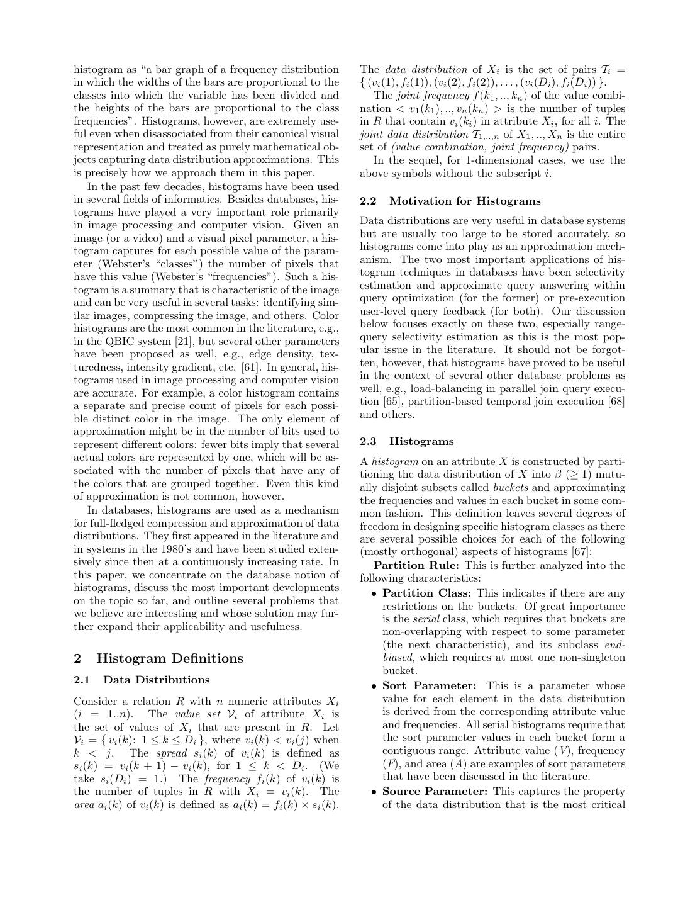

> 本组第 10 篇 · 统计与基数估计 · [全部论文]() · [上一篇]() · [下一篇]()

这是一篇 2003 年历史综述，不是提出新直方图算法或新基准实验的论文。核心是区分分桶规则（partition class、sort parameter、source parameter、partition constraint）、构建算法、桶内值近似、频率近似与误差保证。bucket 首先是分布元素的互斥子集，并不一律是属性值轴上的连续区间；serial 的连续性取决于排序参数。频率排序的最优性来自准确已知 value set 下的 equality-join 分析，不能泛化为值近似下 range-query 的普遍优势；后者的实验反而偏向 value 排序。end-biased 只要求至多一个非单例桶，允许多个单例桶。多维 uniform spread 的虚拟值组合可能失真，但不意味着必须物化、物理不可能或必然高估总行数。一维 v-optimal 的所引 DP 构建时间为 O(D²β)，而误差界限定于相应选择查询及其前提。DB2 的 10/20 桶与 SQL Server 的最多 199 桶仅为本文 2003 年产品快照；原文没有可复核的新性能实验数字。

本文保留论文陈述、读者推断与待验证方案的区别；实验数字只适用于原文条件。原文和翻译来自已有 AI 辅助精读报告，已做来源匹配与编辑复核，不等于人工逐项核验或独立实验复现。所有页码均为 PDF 物理页。

## 论文与阅读范围

Yannis Ioannidis. The History of Histograms (abridged). Proceedings of the 29th VLDB Conference, Berlin, Germany, 2003. 依据本地 PDF 全部 12 个物理页的提取文本复核，包括正文、个人研究史及参考文献 [1]-[79]；未逐页视觉检查 PDF，也未独立阅读被引论文或复现实验。

[论文集中的原始 PDF](https://github.com/lonng/db-papers/blob/4ff1331069c7cf52ac97dd769e5f484c1c35c200/papers/statistics/the-history-of-histograms.pdf) · 本地来源：`statistics/the-history-of-histograms.pdf`，共 12 页。

本篇保留 10 组原文精读和 41 条证据。截图为原始 PDF 的局部页选，不是重新生成的图表；未将整份 PDF 复制到博客。

## 研究问题与适用边界

论文研究的是有限空间预算下的数据分布近似，主要应用为查询优化中的选择率估计和近似查询回答，尤其是范围谓词选择率；也提到并行连接负载均衡与时态连接。它把直方图视为数学近似对象，不限于可视化柱状图。对属性 X，value set 只包含关系中实际出现的不同值 v(k)，按值递增；f(k) 是该值的元组数，spread s(k)=v(k+1)-v(k)，末项约定 s(D)=1；area a(k)=f(k)s(k)。这里 area 是派生源参数，不能直接当成概率或桶内总行数。

第 3 页综述了文献 [36] 的结论：在所述条件下，最坏情况的误差随 join 数量指数传播。这不等于每个实际多连接查询都难以估准，也不是对所有估计方法、所有平均工作负载的无条件不可能定理。原报告将其扩大为排除大型查询准确估计的希望，现收回该泛化。

紧接着，作者介绍限制 join 误差传播的最优直方图研究 [37]，明确提到 majorization theory；因此它不是仅来自模型笔记的术语。不过，本综述未重现原始证明，不能声称它在此完整证明了前面的指数界。对于后续最优性结果，必须另行核对 equality-join 类与准确 value set 等前提。

静态直方图构建后不随更新变化，可能因分布漂移而失真；在作者讨论的无法保存完整输入、只能单遍处理的流模型中，需动态维护摘要。这里不应引申为任何可保留窗口或可重建摘要的流系统都不能使用静态分桶。

依据：论文陈述；PDF 物理页 2, 3, 4, 6。证据：[H03](#evidence-h03), [H10](#evidence-h10), [H11](#evidence-h11), [H29](#evidence-h29), [C001N08](#evidence-c001n08), [C002N06](#evidence-c002n06)。

## 系统架构与数据结构设计

第 2-3 页给出分类法。一般定义是将属性数据分布分成 β≥1 个互斥子集（buckets），再以某种共同方式近似桶内值和频率。这不是“所有桶都是不相交超矩形”的总定义。serial 类要求桶在选定 sort parameter 上不重叠、各桶参数值形成连续范围；参数可以是属性值 V、频率 F 或 area A。按 F 排序时，一个桶中的原始属性值未必连续。end-biased 是 serial 的子类，要求至多一个非单例桶，不限制只能有一个单例桶。

分类法包含五个主要方面，其中第一项再细分四项：(1) partition rule：partition class 限制桶结构，sort parameter 决定排序，source parameter 指定近似所关注的分布性质，partition constraint 规定如何分桶；(2) construction algorithm：满足同一规则的算法可有不同效率；(3) value approximation；(4) frequency approximation；(5) error guarantees。记号 p(s,u) 指 serial 类的 partition constraint p、sort parameter s、source parameter u。分类轴不是数据的属性维数，源参数也不必是某个原始数据列。

多维直方图划分的是 joint data distribution；一维 partition rule 的四分法不一定能原样套用，因为不存在可直接沿用的一维全序 sort parameter。MHIST-2 从整个联合分布的单桶出发，反复选择最需要细分的桶和维度，由相应边际分布及一维约束/源参数驱动分裂，直到耗尽桶预算，并不是预先固定切分维度的简单轮换。

GENHIST 从均匀网格开始，扩大含大量数据元素的桶，允许几何范围重叠；重叠区域的近似由相关桶的贡献组合，不能理解成把每个桶的整桶频数无条件相加。STHoles 则从父桶有效区域扣除形成子桶的部分，使父桶不再是实心矩形；父子外接区域可以嵌套，但不能由此宣称父子有效计数区必然重叠。原报告把它写成打破“不相交”不变量，混淆了外接形状与有效区域，现予以纠正。相应结构的实现和求交成本需实测，原文没有证明其优化器延迟必然更高。

依据：论文陈述；PDF 物理页 2, 3, 5, 9。证据：[H04](#evidence-h04), [H05](#evidence-h05), [H06](#evidence-h06), [H07](#evidence-h07), [H08](#evidence-h08), [H14](#evidence-h14), [H15](#evidence-h15), [C002N02](#evidence-c002n02), [C002N03](#evidence-c002n03), [C003N02](#evidence-c003n02)。

*原论文 PDF 物理页 2，版权归原作者或出版方。点击图片可查看原尺寸。这是页面定位信息，不表示本次已复核图内所有数据。*

## 核心算法与计算步骤

1. 分桶规则与历史演进
Kooi 的 1980 年博士论文 [47] 是作者所知最早的数据库直方图提议，采用 equi-width，即 equi-sum(V,S)：按属性值排序，对 spread 等和分桶。[62] Piatetsky-Shapiro/Connell，SIGMOD 1984 提出 equi-depth/equi-height，即 equi-sum(V,F)，令每桶元组数大致相等，不是 distinct-value 数相等。多维 equi-depth 的早期工作是 [58] Muralikrishna/DeWitt，SIGMOD 1988。

v-optimal 试图最小化桶内 source-parameter 的变化；本文以“roughly”方差最小化作概述，没有展开完整目标函数。maxdiff 在 sort 顺序上相邻 source 值差距最大的地方设桶界，不等价于在原始属性值间距最大的地方切分。compressed 将最高 source 值放在单例桶，其余按 equi-sum 划分；因此它通常可有多个非单例桶，不能和只有至多一个非单例桶的 end-biased 混同。

2. End-biased 与一维构建
读者构造的假设示例：频率为 {a:100,b:50,c:10,d:5,e:2}，预算 β=3。将 a、b 分别存为单例桶，其余 c,d,e 合成唯一非单例桶（总频数 17）。这完全满足 end-biased 定义，无须降格为所谓非标准变体；β=2 时只分离 a 也同样成立。若 sort parameter 为 F，剩余值的原属性范围并非定义所要求的连续区间。

本文引用 [42] 的 DP 构建：对于任意指定 sort/source parameter，时间关于 D 个源参数条目为二次、关于 β 个桶为线性，即 O(D²β)。这是构建给定 v-optimal 分区目标的算法，不是“排序启发式”，也不意味着对任意查询工作负载全局最优。读者构造的假设示例：固定排序序列 x1,…,xD，并自行选定区间平方误差 cost(l,r)=Σ(xi-mean(l,r))²，可写 dp[i,b]=min_{b-1≤k<i}{dp[k,b-1]+cost(k+1,i)}；只允许非空桶，dp[0,0]=0，不可行状态为无穷。该递推是解释性构造，不是本文给出的公式。区间平方误差也不能无条件替换成未加权的各桶方差之和。后续“总体线性”的构建工作在本综述没有展开精度、问题模型与资源条件，不能据此认定任意精确问题都已获得相同线性保证。多维最优识别被概述为 NP-hard，具体分区类与近似条件需读 [59]。

3. 桶内近似
continuous value assumption 仅保存 min/max；uniform spread 另外保存 distinct-value 数，在边界间虚拟等距摆放相同数量的值。两者是值近似，不是频率近似；后者常另用 uniform distribution，令桶内频率等于实际平均值。第 5 页明确说两类值近似各有胜出的研究，未给出普遍赢家。

多维 uniform spread 的一种做法，是假定各维虚拟值的笛卡尔积组合存在。读者构造的假设示例：真实二维点只在对角线上，却按两个边际值集合的全组合近似，可能给离对角线的查询分配不存在的质量、低估对角附近的集中质量。这暴露相关性丢失，而非总行数必然增加；这些组合是概念支持集，不要求枚举物化。桶总质量如何归一化与具体估计器有关，不能从 d1×d2 或 5^10 推出“物理不可能且必然高估基数”。

依据：论文陈述；PDF 物理页 2, 3, 4, 5, 6, 12。证据：[H05](#evidence-h05), [H09](#evidence-h09), [H12](#evidence-h12), [H16](#evidence-h16), [H17](#evidence-h17), [H28](#evidence-h28), [C001N12](#evidence-c001n12), [C002N04](#evidence-c002n04), [C002N07](#evidence-c002n07)。

## 正确性保证与误差界限

必须将三种“最优/保证”分开：给定查询目标和信息前提下的最优 histogram 类、给定分区约束的精确最优构建，以及估计值附带的误差上界，三者不能相互替代。

第 3-4 页记述：[37] 最初分析 single equality join，或每个关系只有一个参与连接的属性（更一般地，关系中连接属性之间存在 1-1 functional dependency）的多连接查询；在 value set 准确已知的假设下，最优直方图是按频率排序的 serial。[34] Universality of Serial Histograms（VLDB 1993）将 equality-join 查询类推广到任意 equality joins。不能把这种推广写成已覆盖值近似的任意范围查询。第 4 页随即指出 value set 被近似时没有相应解析答案；所综述的大量实验偏向 value 作为 sort parameter，frequency/area 作为 source parameter，原因限定在值不准确时的 range-query 估计。

第 6-7 页引用 [42] 的方法：每桶存储某个值实际频率与近似频率（通常是平均值）的最大差，藉此给等值及范围选择查询的估计提供上界。本综述未在这里展开所有值近似、缺失值、归一化和更新维护条件，更未给任意 join、代价函数、计划 regret 或执行时间提供同一保证。

读者构造的假设示例：若值 v 确属准确已知的桶支持集、频率估计为 μ 且 Δ=max_i|fi-μ|，则 fi∈[max(0,μ-Δ),μ+Δ]。若一个查询准确命中桶内 m 个支持值，仅按逐值界求和可得行数误差不超过 mΔ；如需选择率还须按正确的关系基数归一化。这里明确假定值成员关系及计数已知；若 v 根本不存在，或使用了有额外误差的虚拟值位置，不能照搬该示例当作完整保证。

作者还提到针对 top-N range-query 的直方图级额外信息。确定性的频率偏差界不是统计置信区间，区间重叠不代表“统计学上无显著差异”，也不能直接保证候选计划不会选错。

依据：论文陈述；PDF 物理页 3, 4, 6, 7, 11。证据：[H10](#evidence-h10), [H11](#evidence-h11), [H12](#evidence-h12), [H13](#evidence-h13), [H19](#evidence-h19), [H27](#evidence-h27), [C002N09](#evidence-c002n09)。

## 实验设计与数据缺失分析

完整读取 12 页后确认：本文是历史综述，没有新增受控 benchmark，没有实验表、硬件配置、统一数据集规模、误差百分比、加速比或可复核的 SQL 实验脚本。摘要所谓历史压缩前后的 semantic distance 很小，以及致谢中请同事验证历史近似误差，属于自指写作表达，不是数据库性能实验，不能列为测量结果。

正文的实验性判断多为对所引研究的概述：equi-depth 相较 equi-width 更有效；v-optimal/maxdiff/compressed 在相应估计问题上较有效；值近似时 range queries 更偏向 value 排序；MHIST-2 相较早期多维 equi-depth 有改进；GENHIST 用少量桶得到低误差。这些是综述转述，没有给出统一实验条件或数值；尤其不能据此为 STHoles 与 GENHIST 排出未报告的整体优劣，也不能把 v-optimal 的复杂度当成实测时间。

原文确有具体产品数字，不能因缺 benchmark 而一概称“无数字”：第 8 页 DB2 的 compressed(V,F) 默认 10 个 singleton buckets 和 20 个 nonsingleton buckets，分别对应高频值与剩余 equi-depth 部分；SQL Server 被描述为最多 199 桶。它们是 2003 年产品配置描述，不是误差实验，也不是现代产品上限。Oracle 的“next release”同样是写作当时的未来发布，未在本文验证。

书目与历史节点也需分清：Pearson 的命名被关联到 1892 年讲座和 1895 年引文，不能合并成一个确定的发明年份；Playfair 1786 年书中图示 1781 年贸易，是作者所述最早已知条形图，而不是已证明的首个 histogram。数据库研究链条包括 [47] Kooi 1980，[62] equi-depth 1984，[58] 多维 equi-depth 1988，[36] join 误差传播 SIGMOD 1991，[37] Ioannidis/Christodoulakis 的 TODS 18:4 (1993), 709-748，[34] Ioannidis 的 VLDB 1993, 256-267，[38] v-optimal 相关工作 SIGMOD 1995，[67] taxonomy/改进范围谓词直方图 SIGMOD 1996，[66] 多维 MHIST 相关工作 VLDB 1997。以上是本文正文与书目对应关系，不代表已独立阅读这些被引论文。

原模型反向审查还错误地将多个 Top-K 单例桶判为非标准 end-biased。该历史记录予以保留用于追踪，不作为当前复核结论；正确判断依据第 2 页“至多一个非单例桶”。

依据：论文陈述；PDF 物理页 1, 2, 3, 4, 5, 8, 11, 12。证据：[H01](#evidence-h01), [H02](#evidence-h02), [H05](#evidence-h05), [H09](#evidence-h09), [H12](#evidence-h12), [H13](#evidence-h13), [H14](#evidence-h14), [H21](#evidence-h21), [H22](#evidence-h22), [H27](#evidence-h27), [H28](#evidence-h28), [C003N10](#evidence-c003n10)。

## 工程权衡与设计取舍

以下为基于原文机制的工程推断，不是本文的性能测量。

首先应按字节而不只按桶数比较摘要。第 5 页讨论：每桶保存更丰富信息，会挤占可用桶数；仅 min/max 与另存 distinct 数的 uniform spread、恒定频率与线性 spline、以及额外误差元数据之间均有空间取舍。因此同样 β 不能自动代表相同空间成本，选择给定目标下的最优分区也不等于端到端的最优计划。

一维 v-optimal 的 DP 代价随 D²β 增长，能否承受取决于 distinct 数、采样、重建频率和优化收益，不能简单断言单列过滤就能承担精确最优。多维需要关注分区结构、相关性与近似质量；不能将一维二分定位和多维带洞区域求交直接比较后宣布后者必然更慢，本综述没有相关延迟测量。

维护机制也不是一个维度上的同义词：更新驱动的动态摘要处理数据变化；stream sketch 可用于之后构建多维直方图；query feedback 在查询执行后利用实际结果大小修正统计。第 6 页 LEO 使用独立反馈目录，在估计时与原直方图合用，并非原地覆盖所有统计。无数据变化时，查询负载变化也可能改变值得保留的信息；反之，反馈稀疏未必能及时覆盖所有分布漂移。

对误差保证，工程上应跟踪额外字节、维护正确性和支持的谓词范围，再单独建立从行数区间到算子代价及计划选择的模型。不能用频率偏差界直接宣称避免 OOM、消除 plan flapping 或获得统计显著性。

依据：读者推断；PDF 物理页 5, 6, 7。证据：[H16](#evidence-h16), [H17](#evidence-h17), [H18](#evidence-h18), [H19](#evidence-h19), [C002N06](#evidence-c002n06), [C002N09](#evidence-c002n09)。

## 与现有系统及技术的联系

本节只比较论文实际讨论的 2003 年系统与技术，不以未核对的现代数据库记忆补充事实。

DB2：compressed，以 V 为 sort parameter、F 为 source parameter；可分别配置 singleton/nonsingleton 数，默认 10/20。非单例桶记录累计频率，基于 reservoir sample 构建；利用可用复合索引的多维 cardinality 信息近似列依赖，否则采用独立性假设，LEO 反馈另存目录。这一具体产品结构不是只有一个余桶的 end-biased。

Oracle：当时采用 equi-depth，结合复合索引信息、针对复杂谓词的动态采样，以及 cube 维度层级依赖。正文称 selection 和 single-table functions 已可用，而 joins 的动态采样和记忆历史谓词选择率的学习能力属于当时“next release”的预告，不能写成已经验证的实现事实。

SQL Server：maxdiff，以 V 排序，source parameter 近似为桶内平均频率；最多 199 桶，分别保留桶内 max value 的频率与其余较小值的累计频率，通常基于样本构建，也借助复合索引信息。第 8 页所说商业 DBMS 只实现一维直方图，是当时产品观察，不否认这些系统还利用一些间接依赖信息，也不代表后续所有系统的能力。

这些工业描述的引用 [9]、[50]、[78] 分别为 2003 年 personal communication，故需连同时间和来源强度一起理解。本文没有提供对应产品源码或精确版本。不能据此推断现代 DB2、Oracle、SQL Server，或其他系统的当前实现。

竞争关系方面，作者把 wavelets 作为重要竞争者，涉及 OLAP range-sum、关系查询和 streams；sampling 则经常用来构建直方图，是互补技术，不应简单排成胜负关系。其他专用方法可能在特定问题上优于直方图，作者强调的是简单性、效率、效果和适用性的综合权衡。空间对象不等同多维点，XML 则需先形成合适的数值表示；这些扩展不支持把所有数据类型套进同一个矩形桶算法。

依据：论文陈述；PDF 物理页 6, 7, 8, 11, 12。证据：[H18](#evidence-h18), [H20](#evidence-h20), [H21](#evidence-h21), [H22](#evidence-h22), [H23](#evidence-h23), [H24](#evidence-h24), [C003N10](#evidence-c003n10)。

## 复现指南与验证路径

以下均为尚未执行的读者实验建议；它们是验证局部机制的路径，不是本综述提供的可直接复现 benchmark。

1. 分类与近似测试。以不同值集合、频率、spread 构造小分布，分别实现 equi-sum(V,S)、equi-sum(V,F)、固定 sort/source 的 v-optimal、maxdiff 和 compressed。先明确桶预算与真实字节预算。测试频率排序下属性值不连续的桶，以及两个 singleton 加一个 nonsingleton 的合法 end-biased，防止实现把 taxonomy 写错。

2. 最优性边界测试。固定 equality-join 工作负载与准确 value set，再比较 F-sort serial 与受限子类；另设值近似下的 range-query 组，不混用目标函数。若要复现 [36]/[37]/[34] 的定理，必须先读相应原论文，确定误差度量、数据条件和查询类。任意向某桶加 1% 扰动并跑十表 chain join，只能得到该构造的经验结果，既不能验证也不能反驳最坏情况定理。

3. 多维支持集测试。用强相关、独立和反相关数据对照，固定桶总频数，检查边际虚拟值全组合是否导致质量放错位置，而非预设它必然增加总行数。若采用概念组合支持，区分估计公式与实际枚举的时间/空间成本；没有枚举代码就不能报告组合物化开销。

4. 误差界测试。先在准确成员集合且无更新的小桶中计算最大频率偏差，逐个验证等值查询和命中值集合已知的范围查询。然后单独测引入 value approximation、更新、采样的影响，明确原有界是否仍成立。计划选择另需代价传播模型；确定性误差区间不是显著性检验，不能靠区间重叠直接决定计划等价。

5. 未来方向测试。第 9-10 页提出 histogram 与 clustering、桶表示选择以及 tree indices 的联系。B+ tree 对应 equi-depth 的例子明确先假设节点完全满；加入统计字段还可能降低 fan-out、增加树高。用 v-optimal/maxdiff 等分桶生成不平衡树、按负载改善平均搜索或逐步提高近似答案质量，都是待评估的方向。实验应同时报告精确检索、更新、近似误差和存储，而不能只凭根节点摘要就宣布整体优于 B+ tree。

依据：待验证的工程设想；PDF 物理页 2, 3, 4, 5, 6, 7, 9, 10。证据：[H05](#evidence-h05), [H09](#evidence-h09), [H10](#evidence-h10), [H11](#evidence-h11), [H13](#evidence-h13), [H16](#evidence-h16), [H19](#evidence-h19), [H25](#evidence-h25), [H26](#evidence-h26), [C001N08](#evidence-c001n08), [C003N07](#evidence-c003n07), [C003N08](#evidence-c003n08), [C002N09](#evidence-c002n09)。

## 总结与内核工程启示

本文的主要价值是把历史发展放入可组合的分类框架：选择什么对象分桶、按什么参数排序、优化哪个源参数、使用什么分区约束、如何构建及维护、怎样近似桶内值和频率、提供什么误差信息。这些分类轴与属性维数、数据类型、更新模型、查询目标共同决定方法适用性，不能用“更多维”“v-optimal”或“自适应”等名称代替前提分析。

工程推断一：先固定 workload、已知信息和空间预算，再讨论最优。准确 value set 下 equality-join 的 F-sort 结论，与值近似后 range-query 更偏向 V-sort 的经验结果可以并存；v-optimal 的精确构建也只是固定目标的最优，不承诺最好的执行计划。

工程推断二：正确区分逻辑桶元素与几何覆盖、虚拟支持集与物化数据。多 singleton 的 end-biased 完全合法；compressed 不等于 end-biased；STHoles 的父桶应扣除子桶有效区域；uniform spread 的笛卡尔积近似可能双向失真，不能简单归为必然基数膨胀。

工程推断三：将测量结果、历史产品说明和研究提案分层记录。本文没有给出新受控实验的加速比或误差分布；10/20 与 199 是有日期的产品描述；clustering、灵活桶表示和非均匀索引树是未来问题。作者最后所说直方图“probably”是简单性、效率、效果、适用性之间的最佳平衡点，也是综合判断而非已证明的全球最优定理。

本次审核完整阅读了匹配 SHA 的 12 页提取文本和本篇全部报告/10 段 close readings，并补充逐页原文证据；没有逐页视觉检查 PDF、独立核实被引文献、联网确认现代产品、执行数据库性能实验或调用模型生成 API。原模型 critique 保留作历史记录，其 end-biased 误判及其他无依据延伸不代表当前结论。

依据：读者推断；PDF 物理页 2, 3, 4, 5, 8, 9, 10。证据：[H05](#evidence-h05), [H07](#evidence-h07), [H08](#evidence-h08), [H11](#evidence-h11), [H12](#evidence-h12), [H13](#evidence-h13), [H15](#evidence-h15), [H16](#evidence-h16), [H21](#evidence-h21), [H22](#evidence-h22), [H25](#evidence-h25), [H26](#evidence-h26)。

## 原文精读：从句子回到机制

以下保留原文、忠实翻译、含义与边界；假设示例不作为论文实验结果。

### P001 · PDF 物理页 3

**原文**

<blockquote class="paper-source-quote"><pre><code>In particular, it was shown&#10;that, under some rather general conditions, in the&#10;worst case, errors propagate exponentially in the query&#10;size (i.e., in the number of joins), removing any hope&#10;for high-quality estimates for large multi-join queries.&#10;The first results that led towards new types of his-&#10;tograms were derived in an effort to obtain statistics&#10;that would be optimal in minimizing/containing the&#10;propagation of errors in the size of join results [37].</code></pre></blockquote>

**忠实翻译**

> 特别地，已有研究表明，在一些相当一般的条件下，在最坏情况下，误差会随查询规模（即连接的数量）呈指数级传播，从而使得对大型多连接查询获得高质量估计的任何希望都破灭了。促使新型直方图出现的最初结果，是在努力获取能够最优地最小化/控制连接结果规模中误差传播的统计信息的过程中得出的 [37]。

**技术含义与边界**

> 原文综述了特定条件下最坏情况 join 误差随连接数指数传播，并以限制传播为动机引出 [37]。全文第 3 页紧接着明确提到 majorization theory，不能说该术语只存在于模型笔记；但本段没有给出定理证明，更不意味每个实际 workload 都会失准。读者推断：需要把数据条件、误差度量、查询类和信息模型分开核对。

**常见误读**

> 容易发生的错误解读是将“最坏情况下误差指数传播”泛化为“所有多连接查询都无法准确估计”。原文不支持这一泛化，因为作者明确限定了“under some rather general conditions, in the worst case”（在一些相当一般的条件下，在最坏情况下），并未声称平均情况或所有情况均如此。

**读者构造的假设示例**

> 读者构造的假设示例：假设有5个表进行链式连接，若每个连接步骤的估计误差放大系数为2，则最坏情况下最终结果的误差可能是初始误差的2^4=16倍。这仅用于帮助理解“指数传播”的概念，不代表作者的实验数据或已完成的复现。

### P002 · PDF 物理页 12

**原文**

<blockquote class="paper-source-quote"><pre><code>ICDT (2003) 16-30&#10;[36] Ioannidis Y., Christodoulakis S.: On the Propagation&#10;of Errors in the Size of Join Results. SIGMOD Conf.&#10;(1991) 268-277&#10;[37] Ioannidis Y., Christodoulakis S.: Optimal Histograms&#10;for Limiting Worst-Case Error Propagation in the Size&#10;of Join Results. ACM TODS 18:4 (1993) 709-748&#10;[38] Ioannidis Y., Poosala V.: Balancing Histogram Opti-&#10;mality and Practicality for Query Result Size Estima-&#10;tion.</code></pre></blockquote>

**忠实翻译**

> ICDT (2003) 16-30
> [36] Ioannidis Y., Christodoulakis S.: On the Propagation of Errors in the Size of Join Results. SIGMOD Conf. (1991) 268-277
> [37] Ioannidis Y., Christodoulakis S.: Optimal Histograms for Limiting Worst-Case Error Propagation in the Size of Join Results. ACM TODS 18:4 (1993) 709-748
> [38] Ioannidis Y., Poosala V.: Balancing Histogram Optimality and Practicality for Query Result Size Estimation.

**技术含义与边界**

> 这是书目片段，不是实验或技术证明。[36] 为 Ioannidis/Christodoulakis 的 SIGMOD 1991 误差传播工作，[37] 为二人的 TODS 18:4 (1993), 709-748 最优直方图工作；它不是 [34] Ioannidis 的 Universality of Serial Histograms（VLDB 1993, 256-267）。片段开头 ICDT 2003 页码属于上一条 [35] 的尾部，[38] 在这里截断，完整书目位于同页。以上定位来自本次全文上下文核对，并非仅从标题推导机制。

**常见误读**

> 不要把相同作者/年份的 [34] 和 [37] 合并，不要把前一条参考文献的尾部页码接到 [36] 上，也不要从文献标题反推出其全部假设或把被引研究当作本综述的新实验。原文书目按原样保留，未独立核对被引出版物。

**读者构造的假设示例**

> 读者构造的假设示例：假设某研究者想要深入了解如何设计限制最坏情况误差的直方图，可能会去阅读文献 [37]。这仅用于说明参考文献的作用，不代表作者已完成对该文献的复现。

### P003 · PDF 物理页 6

**原文**

<blockquote class="paper-source-quote"><pre><code>Even with the existence of efficient calculation al-&#10;gorithms, however, static histograms suffer from in-&#10;creasing errors between calculations.&#10;Moreover, in&#10;a data stream environment, static histograms are&#10;not an option at all, as there is no opportunity to&#10;store the incoming data or examine it more than&#10;once. Hence, several works have proposed various ap-&#10;proaches to dynamic/adaptive/self-tuning histograms,&#10;which change as the data gets updated, while remain-&#10;ing competitive to their static counterparts.</code></pre></blockquote>

**忠实翻译**

> 然而，即使存在高效的计算算法，静态直方图仍然受困于两次计算之间误差不断增加的问题。此外，在数据流环境中，静态直方图完全不是一个选项，因为没有机会存储传入的数据或对其检查超过一次。因此，多项工作提出了各种动态/自适应/自调优直方图的方法，这些直方图随着数据的更新而变化，同时保持与其静态对应物相比的竞争力。

**技术含义与边界**

> 作者在无法存下完整输入、不能复扫的 stream 模型中说明静态摘要的局限，并引出随更新变化的动态/自适应摘要。分布漂移可能增大两次重建间的误差，并不表示误差对每一次更新都单调增加。全文同页还区分更新时维护与查询反馈时适配；LEO 的反馈保存在独立目录而非原地替换直方图。

**常见误读**

> 高效的重建算法不自动解决摘要过时；但也不能把这里的单遍、不保留完整输入前提删掉，泛化成所有带窗口、保留数据或周期性重建能力的流系统都不能使用静态分桶。

**读者构造的假设示例**

> 读者构造的假设示例：假设一个传感器每秒产生1000条记录的数据流，系统内存不足以保存历史记录。此时无法像处理静态表那样先收集所有数据再构建直方图，必须使用能在数据到达时增量更新的自适应直方图。此为读者构造的假设示例，非作者实验。

### P004 · PDF 物理页 9

**原文**

<blockquote class="paper-source-quote"><pre><code>By storing ap-&#10;proximations of just these parameters, one is able to&#10;reconstruct an approximation of the entire group of&#10;elements with little error.&#10;Note that, in the terms&#10;of the histogram taxonomy, these parameters should&#10;be chosen as the source parameter(s), to satisfy the&#10;proximity-expressing partition constraint.&#10;How do we know which parameters are similar for&#10;elements so that we can group them together and rep-&#10;resent them in terms of them?</code></pre></blockquote>

**忠实翻译**

> 通过仅存储这些参数的近似值，人们就能够以很小的误差重构整组元素的近似值。注意，按照直方图分类法的术语，这些参数应当被选为源参数（source parameter(s)），以满足表达邻近性的划分约束。我们如何知道哪些参数对于元素是相似的，以便我们可以将它们分组在一起并用这些参数来表示它们？

**技术含义与边界**

> 原文陈述：直方图的核心思想是用少量参数的近似值代表一组元素；在分类法中，用于分组的参数应作为“源参数”以满足邻近性约束。最后提出一个开放性问题：如何确定哪些参数适合用于分组。读者推断：源参数的选择直接决定了直方图桶内数据的同质性和最终的近似质量。适用边界：原文在此处提出了问题但未给出具体解答方法，上下文不足。

**常见误读**

> 容易发生的错误解读是认为原文已经提供了一套自动发现相似参数的算法。原文不支持此解读，因为最后一句是一个疑问句（“How do we know...”），表明这是在引出后续讨论或指出研究挑战，而非陈述已解决的方案。

**读者构造的假设示例**

> 读者构造的假设示例：属性值为 {1,2,100} 时，按本文末项约定，spread 为 {1,98,1}；即使前后原始值相距很远，其 spread 仍可能相近。可以探索以 spread 或 frequency×spread 为 source parameter 的分桶目标，再分别规定 sort parameter 与 partition constraint。此例仅说明派生参数，不是作者实验，也不证明该选择对任意 workload 最优。

### P005 · PDF 物理页 4

**原文**

<blockquote class="paper-source-quote"><pre><code>Furthermore, their in-&#10;troduction essentially generalized some common prac-&#10;tices that were already in use in commercial systems&#10;(e.g., in DB2), where the highest frequency values were&#10;maintained individually and accurately due to their&#10;significant contribution to selectivity estimates. Such&#10;a practice is an instance of a special case of a histogram&#10;in the end-biased partition class, with frequency as the&#10;sort parameter: the highest sort-parameter values are&#10;maintained in singleton buckets.</code></pre></blockquote>

**忠实翻译**

> 此外，它们的引入本质上推广了商业系统中已经使用的一些常见实践（例如 DB2）：最高频的值由于对选择率估计有显著贡献，而被单独、准确地维护。这种实践是 end-biased 划分类中一种直方图特例，以频率为排序参数：最高排序参数值保存在单例桶中。

**技术含义与边界**

> 结合第 4 页前文，their introduction 指按频率排序的直方图的引入，而不是上下文未知的任意概念。第 2 页把 end-biased 定义为 serial 中至多一个 nonsingleton bucket 的子类，所以多个高频值各占 singleton bucket 完全合法。这里讨论早期实践的理论映射；第 8 页 DB2 的具体 compressed(V,F) 配置另有多个 nonsingleton buckets，不能混同。

**常见误读**

> “至多一个非单例桶”不等于“至多一个单例桶”。原模型 critique 在此误判，不能用它否定多个 Top-K 单例桶的例子；同时，也不能把某个早期实践推广为该产品所有年代或所有统计结构的完整定义。

**读者构造的假设示例**

> 读者构造的假设示例：频率 {a:100,b:50,c:10,d:5,e:2}、预算 3 桶，将 a、b 各存为一个单例桶，其余 c,d,e 存为唯一非单例桶，总频数 17。该结构满足本文 end-biased 定义，不是所谓非标准变体；这是解释性例子，非产品配置或作者实验。

### P006 · PDF 物理页 10

**原文**

<blockquote class="paper-source-quote"><pre><code>Returning to precise query answering, note that&#10;typically indices are built assuming all values or ranges&#10;of values being equally important.&#10;Hence, having a&#10;balanced tree becomes crucial. There are often cases,&#10;however, where different values have different impor-&#10;tance and different frequency in the expected work-&#10;loads [46].</code></pre></blockquote>

**忠实翻译**

> 回到精确查询回答的问题上，请注意，通常索引的构建是假设所有的值或值的范围具有同等重要性。因此，拥有一棵平衡树变得至关重要。然而，经常存在一些情况，其中不同的值在预期的工作负载中具有不同的重要性和不同的频率 [46]。

**技术含义与边界**

> 作者把不同值在预期 workload 中的重要性和查询频率不均，作为探索非均匀索引的动机；这里的查询频率不应与表中值频率直接混同。全文提出将负载参数与高级分桶规则结合可能改善平均搜索，但没有实现或测量结果。读者推断：可将其列为候选设计问题，不能推出必须放弃平衡树。

**常见误读**

> 容易发生的错误解读是认为作者在否定平衡树的价值。原文不支持这一解读，作者说的是“typically... balanced tree becomes crucial”（通常平衡树至关重要），然后用“However”指出存在例外情况（不同值重要性不同），并没有全盘否定平衡树，而是指出其在特定条件下的局限性。

**读者构造的假设示例**

> 读者构造的假设示例：假设一个电商数据库中，90%的查询都在搜索最近一周的商品，而历史商品极少被访问。如果索引对所有时间段的数据一视同仁地保持平衡，可能导致热点数据的访问路径不够优化。此为读者构造的假设示例，不代表作者实验。

### P007 · PDF 物理页 5

**原文**

<blockquote class="paper-source-quote"><pre><code>One of&#10;them is GENHIST [31], which was originally proposed&#10;in the context of multi-dimensional real-valued data,&#10;but its applicability is broader. The main characteris-&#10;tic of GENHIST is that it allows buckets to overlap in&#10;the space of multi-dimensional values: the algorithm&#10;starts from a uniform grid partitioning of the space and&#10;then iteratively enlarges the buckets that contain high&#10;numbers of data elements.</code></pre></blockquote>

**忠实翻译**

> 其中之一是 GENHIST [31]，它最初是在多维实值数据的背景下提出的，但其适用性更广。GENHIST 的主要特征是它允许桶在多维值的空间中重叠：该算法从空间的均匀网格划分开始，然后迭代地扩大包含大量数据元素的桶。

**技术含义与边界**

> GENHIST 起初面向多维实值数据，作者认为适用范围更广。机制是从均匀网格开始，扩大含较多数据元素的桶；原文依据是 high numbers of data elements，不能把所有迭代阶段都无条件改写成最高密度。全文说明扩大后桶密度降低并产生几何重叠，重叠区域的估计组合多个桶的贡献，而非无条件重复累加整桶计数。

**常见误读**

> 原文说起初面向多维实值数据但适用范围更广，并未在本段穷举扩展范围；不能据此直接断言已证明适用于任意维度或任意数据类型。允许几何重叠也不表示所有位置必须重叠，更不等于逻辑频数可重复计入。

**读者构造的假设示例**

> 读者构造的假设示例：假设在二维平面上有一个密集的点簇。GENHIST首先将平面划分为均匀的方格，然后发现某个方格内点数极多，于是将该方格的边界向外扩展，导致它与相邻的方格产生了重叠区域。此为读者构造的假设示例，非作者实验或已完成的复现。

### P008 · PDF 物理页 5

**原文**

<blockquote class="paper-source-quote"><pre><code>Another alternative is the STHoles Histogram [11],&#10;which takes, in some sense, a dual approach to GEN-&#10;HIST: instead of the region covered by a bucket in-&#10;creasing in size and overlapping with other buckets,&#10;in STHoles, this region may decrease in size due to&#10;the removal of a piece of it (i.e., opening a hole) that&#10;forms a separate, child bucket. This creates buckets&#10;that are not solid rectangles, and is therefore capable&#10;of capturing quite irregular data distributions.</code></pre></blockquote>

**忠实翻译**

> 另一种替代方案是 STHoles 直方图 [11]，它在某种意义上采取了与 GENHIST 相对偶的方法：在 STHoles 中，桶所覆盖的区域不是增大并与其他桶重叠，而是可能因为移除其中的一部分（即开一个洞）而形成单独的子桶，从而导致该区域尺寸减小。这创建了不是实心矩形的桶，因此能够捕获相当不规则的数据分布。

**技术含义与边界**

> STHoles 从父桶区域中移除一块形成子桶，父桶的有效区域因此带洞、不再是实心矩形。父子外接区域可以嵌套，但有效区域应扣除子桶，不能把本段说成必须打破互斥计数。读者推断：这提供了局部细化表示；原文没有给出相对 GENHIST 的统一误差或延迟数值。

**常见误读**

> 容易发生的错误解读是认为STHoles的桶是完全任意形状的多边形。原文不支持此解读，作者描述的是“removal of a piece of it (i.e., opening a hole) that forms a separate, child bucket”，即通过从原有区域（通常是矩形）中挖去子矩形形成的带孔形状，而非任意多边形。不能将“not solid rectangles”泛化为任意几何形状。

**读者构造的假设示例**

> 读者构造的假设示例：假设一个表示地理区域的矩形桶覆盖了整个城市，但市中心有一个公园没有相关数据。STHoles可以在这个城市桶内部“挖”出一个代表公园的子桶（hole），使得城市桶变成中间有空洞的非实心矩形。此为读者构造的假设示例，不得冒充作者实验。

### P009 · PDF 物理页 6

**原文**

<blockquote class="paper-source-quote"><pre><code>A key contribution in this direction has been&#10;the proposal of a dynamic-programming based algo-&#10;rithm that identifies the v-optimal histogram (for any&#10;sort and source parameter) in time that is quadratic&#10;in the number of source-parameter values and linear in&#10;the number of buckets, thus making these histograms&#10;practical as well [42].</code></pre></blockquote>

**忠实翻译**

> 在这一方向上的一个关键贡献是提出了一种基于动态规划的算法，该算法能在关于源参数值数量呈二次方、关于桶数量呈线性时间内识别出 v-optimal 直方图（对于任何排序和源参数），从而使这些直方图也变得实用 [42]。

**技术含义与边界**

> 本文引用 [42] 的动态规划算法：对给定 sort/source parameter 的 v-optimal 分区，时间与 D²β 同阶，D 表示待分桶的源参数条目数量，β 表示桶数；不能将相等的频率数值去重后就当成更小的输入规模。这是固定目标的精确构建，不是排序启发式，也不保证任意 workload 的最优查询答案。本段没有状态递推或实测时间。

**常见误读**

> 容易发生的错误解读是认为该算法的时间复杂度对所有输入变量都是线性的或多项式级别的低复杂度。原文不支持此解读，作者明确指出对源参数值数量是“quadratic”（二次方），当源参数值数量极大时，二次方开销依然可能很高。不能将“practical”（实用）等同于“在所有规模下都廉价”。

**读者构造的假设示例**

> 读者构造的假设示例：给定排序后的 1000 个分布条目和 10 桶，复杂度量级与 1000²×10 成正比；即使若干条目的源参数值相同，也不因此自动把输入条目去重。该量级不是操作次数的精确测量，更不是毫秒性能保证；非作者实验或已完成复现。

### P010 · PDF 物理页 10

**原文**

<blockquote class="paper-source-quote"><pre><code>On the other hand, other forms of searches&#10;would be served more effectively. In particular, in a&#10;system that provides approximate answers to queries,&#10;the root of such a tree would provide a higher-quality&#10;answer than the root of the corresponding B+ tree.&#10;Furthermore, the system may move in a progressive&#10;fashion, traversing the tree as usual and providing a&#10;series of answers that are continuously improving in&#10;quality, eventually reaching the leaves and the final,&#10;accurate result.</code></pre></blockquote>

**忠实翻译**

> 另一方面，其他形式的搜索将得到更有效的服务。特别地，在一个为查询提供近似答案的系统中，这样一棵树的根节点将提供比相应 B+ 树的根节点更高质量的回答。此外，系统可以以渐进的方式移动，像往常一样遍历树，并提供一系列质量不断提高的答案，最终到达叶子节点并获得最终的准确结果。

**技术含义与边界**

> 结合第 10 页上下文，such a tree 指节点按 v-optimal/maxdiff 等高级规则分桶的设想性不平衡层次索引，相对的是此前在节点完全满等前提下解释的 B+ tree/equi-depth 类比。作者讨论其可能提供更好的根级近似和逐层改进答案，同时指出精确搜索可能更差。这是未来研究方向，不是已实现算法的普遍保证，具体聚合及误差控制仍需设计。

**常见误读**

> 不能把 would/may 的设想写成已测得优于 B+ tree，不能省略精确搜索、fan-out、树高和维护代价。原文也没有证明任意具体聚合在每次下探时的误差都会严格单调下降。

**读者构造的假设示例**

> 读者构造的假设示例：先为某个明确的 range-count 查询设计节点摘要与误差控制，再考察访问更深层是否改善近似，最终用准确叶数据得到精确结果。需分别验证摘要组合与渐进质量，不能只凭树结构宣称任意平均值计算自然正确。此例是待实施设想，非作者实验或复现。

## 尚未解决的问题

1. 值近似下的 range-query 目标应如何联合优化分桶、distinct-value 表示与频率表示？需另读 [67] 等原研究，本文没有统一解析答案。
2. 在相同字节预算、相同 workload 与维护条件下，MHIST-2、GENHIST 和 STHoles 的误差与估计耗时如何比较？本综述没有给出统一数值。
3. 怎样在值成员关系被近似、采样或动态更新后，仍为指定选择查询维护有效误差上界？不能从频率偏差字段直接推定。
4. 查询反馈、更新驱动维护和 stream sketch 各自在反馈覆盖率、延迟与资源预算下有什么边界？
5. 按高级分桶规则构建不平衡层次索引，能否在同时计入检索、更新、fan-out 和近似回答质量后获得可验证收益？

## 证据索引

证据编号沿用原报告，便于将上文判断追溯到原句。引文匹配只验证位置，不证明解读正确。

**C001N08 · PDF 物理页 3**

第 3 页综述 [36] 在所述条件下的最坏情况 join 误差指数传播；不表示每个实际多连接查询都会失准。紧随其后的 majorization 描述用于引入 [37] 的最优直方图研究，需分清论文与证明角色。

<blockquote class="paper-source-quote"><pre><code>in the worst case, errors propagate exponentially in the query size (i.e., in the number of joins), removing any hope for high-quality estimates</code></pre></blockquote>

**C001N12 · PDF 物理页 4**

end-biased分区类是一种特殊的serial直方图，要求最多只有一个非单例桶。其实践起源早于理论框架，例如DB2等商业系统中已经在使用：将最高频率的值单独维护以保证准确性，因为它们对选择性估计贡献巨大。这种做法本质上就是以frequency为sort parameter的end-biased直方图实例（最高排序参数值放在单例桶中）。虽然不如一般的serial直方图准确，但在许多情况下被证明相当有效。

<blockquote class="paper-source-quote"><pre><code>the highest frequency values were maintained individually and accurately due to their significant contribution to selectivity estimates</code></pre></blockquote>

**C002N02 · PDF 物理页 5**

GENHIST 允许桶在多维值空间中重叠。算法从均匀网格划分开始，迭代放大包含大量数据元素的桶。这产生两个效果：降低每个桶的数据密度使整体密度更平滑；桶最终重叠，产生的不同区域数量多于桶本身的数量。每个区域内的数据分布近似是形成该区域的所有重叠桶指示的组合。原文声称这能用少量桶产生低误差近似，但未提供具体实验数字支撑。

<blockquote class="paper-source-quote"><pre><code>GENHIST is that it allows buckets to overlap in the space of multi-dimensional values: the algorithm starts from a uniform grid partitioning</code></pre></blockquote>

**C002N03 · PDF 物理页 5**

STHoles 从父桶有效区域移除一个区域形成子桶，使父桶不再是实心矩形；这改变有效区域形状，不等于父子计数区必然相交。

<blockquote class="paper-source-quote"><pre><code>in STHoles, this region may decrease in size due to the removal of a piece of it (i.e., opening a hole) that forms a separate, child bucket.</code></pre></blockquote>

**C002N04 · PDF 物理页 5**

多维 uniform spread 的一种做法是假定各维虚拟 distinct values 的全部组合存在；这是近似支持集，可丢失相关性，不要求物化且不必然高估总行数。

<blockquote class="paper-source-quote"><pre><code>assume that all possible combinations &lt; v′ 1(k1), .., v′ n(kn) &gt;, 1 ≤ki ≤di, exist in the bucket</code></pre></blockquote>

**C002N06 · PDF 物理页 6**

静态直方图在构建后即使原始数据更新也保持不变，最终会偏离其应近似的数据分布，导致估计误差越来越大。此时管理员要求重新计算，丢弃旧直方图并从头计算新直方图。在数据流环境中，静态直方图完全不可行，因为没有机会存储传入数据或多次检查数据。这是动态/自适应直方图被提出的前提假设。

<blockquote class="paper-source-quote"><pre><code>in a data stream environment, static histograms are not an option at all, as there is no opportunity to store the incoming data or examine it more than once.</code></pre></blockquote>

**C002N07 · PDF 物理页 6**

本文引用一维 v-optimal 的 DP 构建时间为 O(D²β)，是固定分区目标的精确构建而非排序启发式；后续线性构建和多维 NP-hard 的具体模型需另读被引工作。

<blockquote class="paper-source-quote"><pre><code>identifies the v-optimal histogram (for any sort and source parameter) in time that is quadratic in the number of source-parameter values and linear in the number of buckets</code></pre></blockquote>

**C002N09 · PDF 物理页 6**

为了提供误差保证，有工作建议在每个桶中存储实际频率与近似（通常为平均）频率之间的最大差值，并利用它为直方图针对等值和范围选择查询产生的任何选择性估计提供误差上界。这属于正确性保证范畴，而非仅仅是启发式优化。另一种替代方案专注于优化 top-N 范围查询，在直方图级别（而非桶级别）存储额外信息。

<blockquote class="paper-source-quote"><pre><code>storing in each bucket the maximum difference between the actual and the approximate (typically, the average) frequency of a value in the bucket</code></pre></blockquote>

**C003N02 · PDF 物理页 9**

在直方图分类法术语下，用于分组的参数应被选为源参数（source parameter），以满足表达邻近性的划分约束。作者指出这些参数不必是原始数据维度，可以是其派生量。例如，若干直方图近似直接在频率上寻求邻近性而非属性值；area作为源参数的成功即因其为频率与spread的乘积。

<blockquote class="paper-source-quote"><pre><code>these parameters should be chosen as the source parameter(s), to satisfy the proximity-expressing partition constraint.</code></pre></blockquote>

**C003N07 · PDF 物理页 10**

第 10 页提出将高级分桶规则用于不平衡层次索引，讨论近似回答及负载偏斜下平均搜索可能受益；这是研究方向，不是已实现结构或实测性能保证。

<blockquote class="paper-source-quote"><pre><code>the root of such a tree would provide a higher-quality answer than the root of the corresponding B+ tree.</code></pre></blockquote>

**C003N08 · PDF 物理页 10**

传统索引构建假设所有值或值范围同等重要，因此平衡树至关重要。但作者指出实际中不同值往往具有不同重要性和不同预期工作负载频率，这构成了引入非均匀桶化规则的前提假设。

<blockquote class="paper-source-quote"><pre><code>typically indices are built assuming all values or ranges of values being equally important.</code></pre></blockquote>

**C003N10 · PDF 物理页 12**

参考文献列表涵盖直方图在XML路径选择性估计[1]、自调优直方图[2]、空间选择[3]、近似连接查询[4]、小波直方图[56]、动态维护[26,27]、多维直方图[11,72]等方向的工作。其中[36][37]为作者早期关于serial histograms和误差传播的基础文献，[67]为Poosala等人关于改进范围谓词选择性估计直方图的SIGMOD 1996论文。

<blockquote class="paper-source-quote"><pre><code>Ioannidis Y., Christodoulakis S.: Optimal Histograms for Limiting Worst-Case Error Propagation in the Size of Join Results.</code></pre></blockquote>

**H01 · PDF 物理页 1**

Title includes (abridged); author Yannis Ioannidis; publication notice identifies the 29th VLDB Conference, Berlin, 2003.

<blockquote class="paper-source-quote"><pre><code>The History of Histograms (abridged)</code></pre></blockquote>

**H02 · PDF 物理页 1**

Pearson naming chronology separates the 1892 lectures from the quoted 1895 publication. Playfair's 1786 book depicts 1781 trade; it is described as the oldest known bar chart, not a proven first histogram.

<blockquote class="paper-source-quote"><pre><code>Stigler identifies the lectures as the 1892 lectures on&#10;the geometry of statistics [69].</code></pre></blockquote>

**H03 · PDF 物理页 2**

Spread is next present value minus current value, with terminal spread convention 1; frequency counts tuples; area is frequency times spread, not selectivity or probability mass by definition.

<blockquote class="paper-source-quote"><pre><code>(We&#10;take si(Di) = 1.)</code></pre></blockquote>

**H04 · PDF 物理页 2**

The general definition partitions distribution elements into mutually disjoint subsets, not necessarily contiguous attribute-value intervals. Geometric regions may overlap in later multidimensional variants.

<blockquote class="paper-source-quote"><pre><code>mutu-&#10;ally disjoint subsets called buckets</code></pre></blockquote>

**H05 · PDF 物理页 2**

End-biased is a subclass of serial with at most one nonsingleton bucket. It does not mean arbitrary mixtures of many singleton and many nonsingleton buckets.

<blockquote class="paper-source-quote"><pre><code>at most one non-singleton&#10;bucket</code></pre></blockquote>

**H06 · PDF 物理页 2**

Serial contiguity is relative to the chosen sort parameter, which can be value, frequency or area, not necessarily attribute value.

<blockquote class="paper-source-quote"><pre><code>the sort parameter values in each bucket form a&#10;contiguous range.</code></pre></blockquote>

**H07 · PDF 物理页 3**

Serial-class notation means partition constraint p, sort parameter s, source parameter u. Partition rule has four characteristics; construction algorithm, value approximation, frequency approximation and error guarantees are separate taxonomy aspects, not data dimensions.

<blockquote class="paper-source-quote"><pre><code>p(s,u)</code></pre></blockquote>

**H08 · PDF 物理页 3**

Multidimensional histograms partition joint distributions; their partition rules cannot always be decomposed into the same four 1D characteristics.

<blockquote class="paper-source-quote"><pre><code>there is no real&#10;sort parameter in this case</code></pre></blockquote>

**H09 · PDF 物理页 3**

Equi-width is equi-sum(V,S), whereas equi-depth/equi-height is equi-sum(V,F), with roughly equal tuple counts, not equal numbers of distinct values.

<blockquote class="paper-source-quote"><pre><code>equi-&#10;sum(V,S)</code></pre></blockquote>

**H10 · PDF 物理页 3**

The original optimal-frequency-sort analysis restricts equality joins and allows a more general 1-1 functional-dependency condition; the continuation on p4 also assumes accurately known value sets.

<blockquote class="paper-source-quote"><pre><code>single-join&#10;queries or multi-join queries with only one attribute&#10;participating in joins per relation</code></pre></blockquote>

**H11 · PDF 物理页 4**

The frequency-sort optimality result is conditional, not a universal guarantee for range selection with approximated values. VLDB'93 generalized the equality-join class.

<blockquote class="paper-source-quote"><pre><code>under the assumption that the value set is known ac-&#10;curately</code></pre></blockquote>

**H12 · PDF 物理页 4**

V-optimal addresses a partition objective; the second question, approximated value sets, explicitly has no analytical answer here. Maxdiff places cuts at largest adjacent source-parameter differences in sort order; compressed isolates highest source values and equi-sum partitions the remainder.

<blockquote class="paper-source-quote"><pre><code>The answer to the first question came in the form&#10;of the v-optimal histograms</code></pre></blockquote>

**H13 · PDF 物理页 4**

The empirical preference for value sorting over frequency sorting is qualified by value approximation and range-query workload. It does not refute the conditional equality-join theorem.

<blockquote class="paper-source-quote"><pre><code>if values are&#10;not known accurately, having buckets with overlapping&#10;value ranges does not pay offfor range queries.</code></pre></blockquote>

**H14 · PDF 物理页 5**

MHIST-2 repeatedly splits the currently most critical bucket/dimension using marginal distributions, rather than choosing a fixed dimension order.

<blockquote class="paper-source-quote"><pre><code>until it has exhausted its budget&#10;of buckets.</code></pre></blockquote>

**H15 · PDF 物理页 5**

GENHIST overlaps geometric regions and combines their contributions. STHoles removes a child region from its parent's effective region; it is not arbitrary double counting or a collection of independent solid rectangles.

<blockquote class="paper-source-quote"><pre><code>GENHIST is that it allows buckets to overlap</code></pre></blockquote>

**H16 · PDF 物理页 5**

Uniform spread stores the number of distinct values and virtually spaces that many equally between min and max. Continuous value approximation keeps min/max without the count. Neither is the uniform-frequency assumption; the survey reports no universal winner between the two value approximations.

<blockquote class="paper-source-quote"><pre><code>one also main-&#10;tains the number of values within each bucket</code></pre></blockquote>

**H17 · PDF 物理页 6**

The cited exact dynamic-programming construction has O(D^2 beta) time in this formulation. The later linear-overall statement is a survey of other work, not a new exact general algorithm proved here; multidimensional optimal identification is described as NP-hard.

<blockquote class="paper-source-quote"><pre><code>quadratic&#10;in the number of source-parameter values and linear in&#10;the number of buckets</code></pre></blockquote>

**H18 · PDF 物理页 6**

Query-feedback adaptation is distinct from update-driven maintenance and stream sketches. LEO keeps feedback in separate catalogs rather than updating original statistics in place.

<blockquote class="paper-source-quote"><pre><code>histogram adaptation at query time instead of&#10;at update time.</code></pre></blockquote>

**H19 · PDF 物理页 7**

Per-bucket maximum actual-versus-approximate frequency deviation supports error upper bounds for the stated selection-query classes; it does not bound arbitrary joins or optimizer plan regret.

<blockquote class="paper-source-quote"><pre><code>for equality and&#10;range selection queries.</code></pre></blockquote>

**H20 · PDF 物理页 7**

Ordinary multidimensional point histograms are not directly spatial-object histograms; the paper also treats XML-derived numeric spaces and graph synopses.

<blockquote class="paper-source-quote"><pre><code>these are for point data and do not extend&#10;to objects that are 2-dimensional themselves.</code></pre></blockquote>

**H21 · PDF 物理页 8**

DB2's 2003 snapshot uses compressed(V,F), defaults 10 singleton and 20 nonsingleton buckets respectively, with cumulative frequencies and reservoir-sample construction.

<blockquote class="paper-source-quote"><pre><code>with the default be-&#10;ing 10 and 20.</code></pre></blockquote>

**H22 · PDF 物理页 8**

The survey describes SQL Server maxdiff with V sort and essentially average frequency as source, storing max-value frequency separately. The 199 limit is a historical statement, not a modern specification or experimental datapoint.

<blockquote class="paper-source-quote"><pre><code>It&#10;permits up to 199 buckets</code></pre></blockquote>

**H23 · PDF 物理页 8**

The statement concerns the commercial systems described at publication time, alongside composite-index dependence information, Oracle dynamic sampling and LEO. It must not be universalized to all present systems.

<blockquote class="paper-source-quote"><pre><code>strictly 1-dimensional histograms.</code></pre></blockquote>

**H24 · PDF 物理页 8**

Wavelets are discussed as a major competitor; sampling often constructs histograms and is not categorized simply as an inferior competing synopsis.

<blockquote class="paper-source-quote"><pre><code>sampling is often a complementary&#10;technique to histograms</code></pre></blockquote>

**H25 · PDF 物理页 9**

Clustering links and adaptive per-bucket representations are research directions, not implemented results or proven improvements in this paper.

<blockquote class="paper-source-quote"><pre><code>there should be no fixed, predefined approxi-&#10;mation approach</code></pre></blockquote>

**H26 · PDF 物理页 10**

The B+ tree/equi-depth analogy is explicitly conditional on full nodes. Changing node bucketization to v-optimal/maxdiff and improving average search for skewed workloads are proposals, not measured wins.

<blockquote class="paper-source-quote"><pre><code>Consider again a B+ tree whose&#10;nodes are completely full.</code></pre></blockquote>

**H27 · PDF 物理页 11**

The VLDB'93 reference is [34], distinct from [37] Ioannidis/Christodoulakis TODS 18:4 (1993), 709-748, listed on p12.

<blockquote class="paper-source-quote"><pre><code>[34] Ioannidis Y.:&#10;Universality of Serial Histograms.&#10;VLDB Conf. (1993) 256-267</code></pre></blockquote>

**H28 · PDF 物理页 12**

Kooi 1980 is the earliest proposal known to the survey author; [62] equi-depth is Piatetsky-Shapiro/Connell SIGMOD 1984; [58] multidimensional equi-depth is Muralikrishna/DeWitt SIGMOD 1988; [67] taxonomy is Poosala et al. SIGMOD 1996; [66] MHIST is Poosala/Ioannidis VLDB 1997.

<blockquote class="paper-source-quote"><pre><code>[47] Kooi R.: The Optimization of Queries in Relational&#10;Databases. PhD Thesis, Case Western Reserve Univer-&#10;sity (1980)</code></pre></blockquote>

**H29 · PDF 物理页 3**

Majorization is explicitly named in the paragraph introducing optimal histograms for limiting join-error propagation; it is not merely an unsupported note summary and should not be presented as this survey's proof of the preceding exponential-error result.

<blockquote class="paper-source-quote"><pre><code>majorization theory [55].</code></pre></blockquote>

## 版本与使用边界

- 原 PDF SHA256：`15358f3fefdbef8d05970f949c17bc068d8fc4b220edb96abd0575353feb7888`。
- 报告来源：`qwen3.8-max`；此处按已完成报告整理，没有重新请求模型。
- OCR 记录页：[]；低文本页：[]。
- 本次新增页面截图，未据此自动重写原报告的数值、公式或实验结论；原有“未进行图像识别”限制仍适用于分析生成过程。
- 截图与短引仅服务于论文评论，版权归原作者或出版方；正式发布前复查转载范围和授权。
- 本文保留未核实的书目信息及研究问题，不用现代产品行为替代历史论文的证据。
