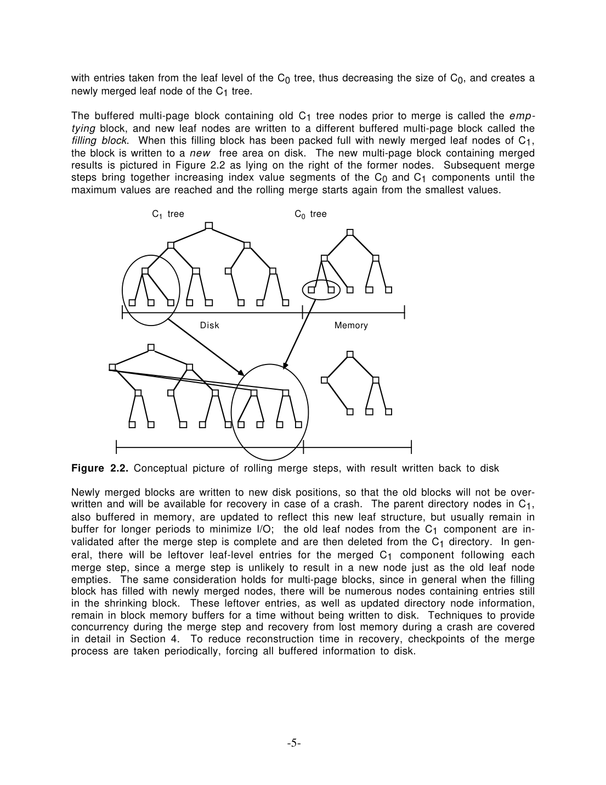
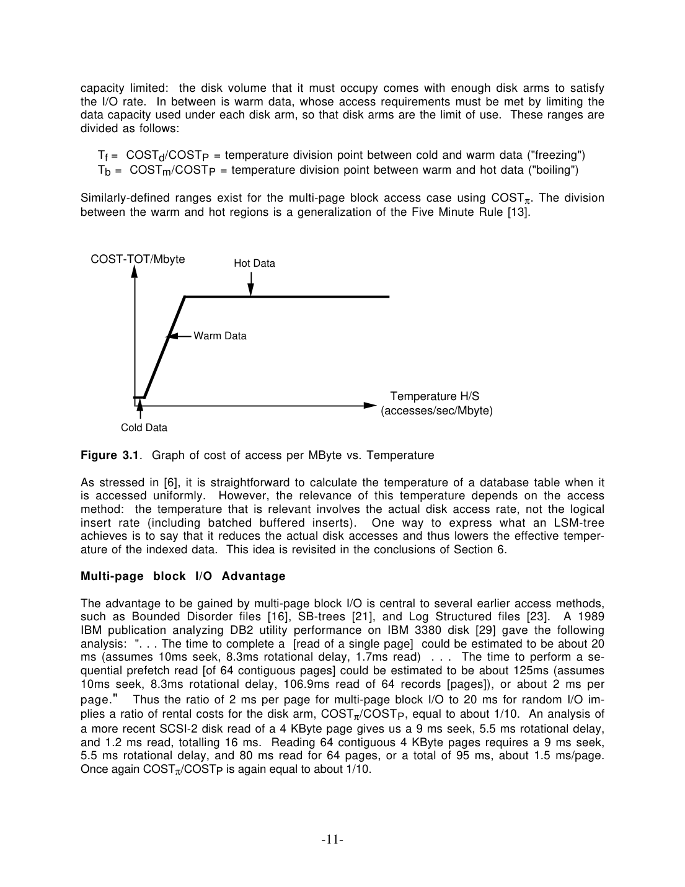

> 本组第 63 篇 · 存储结构与索引 · [全部论文]() · [上一篇]() · [下一篇]()

原始LSM-tree面向随机键、高插入率且即时查找较少的History/log索引：先把索引项放进保证常驻内存的C0，再通过相邻分量的rolling merge延迟并批量放到最终位置。收益同时来自多页顺序I/O与每叶页合入多条新项，不只是“日志顺序写”。

本文分析的最优有强前提：固定SK/S0/K、稳态字节插入率、记录存活到最终分量、纯归并I/O及当时价格。固定总尺寸S的最优又不同。节点锁讨论也只保护底层结构，事务范围锁/phantom和完整形式证明留待别处。报告不把原设计硬套成所有现代SSTable、MVCC、Bloom filter或compaction策略。

本文保留论文陈述、读者推断与待验证方案的区别；实验数字只适用于原文条件。原文和翻译来自已有 AI 辅助精读报告，已做来源匹配与编辑复核，不等于人工逐项核验或独立实验复现。所有页码均为 PDF 物理页。

## 论文与阅读范围

Patrick O'Neil, Edward Cheng, Dieter Gawlick, Elizabeth O'Neil. The Log-Structured Merge-Tree (LSM-Tree). 本地32页稿封面为“To be published: Acta Informatica”，正文价格表明确1995；不从其他元数据猜正式期刊卷年。页码均为PDF物理页，与稿内编号一致。

[论文集中的原始 PDF](https://github.com/lonng/db-papers/blob/4ff1331069c7cf52ac97dd769e5f484c1c35c200/papers/storage-structure/the-log-structured-merge-tree-%28lsm-tree%29.pdf) · 本地来源：`storage-structure/the-log-structured-merge-tree-(lsm-tree).pdf`，共 32 页。

本篇保留 40 组原文精读和 84 条证据。截图为原始 PDF 的局部页选，不是重新生成的图表；未将整份 PDF 复制到博客。

## 研究问题与适用边界

**索引维护的磁臂成本，而非“所有写都该用LSM”**
作者从修改过的TPC-A例子出发：事务在History留下记录，为按账户及时间查最近活动，需要AcctID||Timestamp索引。时间字段不让键整体单调，因为账户前缀随机分布；写入仍散落大量叶页。论文也明确单调右端追加已可由B-tree有效处理，不能拿它当相同基线。

最适合的场景是插入、删除等可延迟合并操作远多于需即时响应的查找。原文允许查询访问所有分量，代价不是免费；批处理减少I/O不保证任何读写比和硬件下都更快。

所谓系统成本是1995磁臂、介质与内存价格下的分析。修改TPC例、1000TPS与50个磁臂等是参数化算例，不是本文报告一次实测TPC成绩，也不是当前机器采购建议。

依据：论文陈述；PDF 物理页 1, 2, 12, 26。证据：[LSM01](#evidence-lsm01), [LSM02](#evidence-lsm02), [LSM12](#evidence-lsm12), [LSM26](#evidence-lsm26)。

## 架构设计与物理布局

**C0保证常驻，磁盘分量仍有页目录**
两分量设计由内存C0和磁盘C1组成。C0可用AVL或2-3树，无需为了磁盘I/O采用页大小节点；C1是类B-tree目录，页节点在各层按序装进多页块，归并和长范围读用大块I/O，即时匹配仍可读单页。常用目录节点照常缓冲。

rolling merge维护emptying/filling块：前者还有未处理旧节点，后者积累新归并节点；新块写往新位置，旧块在安全检查点之前不覆盖。目录指向当前可访问位置，包括仍在内存块中的节点。游标附近可有部分满节点与块，不能把100%填满目标说成每个瞬间的绝对不变量。

多分量C0..CK相邻间各有异步rolling merge，保证新项可继续流向更大分量。这不是本文已经规定一套现代不可变SSTable文件/版本号体系；C0先写入仍须有可恢复的事务日志，也不是无持久化成本。

依据：论文陈述；PDF 物理页 4, 5, 6, 16, 24, 25。证据：[LSM03](#evidence-lsm03), [LSM04](#evidence-lsm04), [LSM05](#evidence-lsm05), [LSM06](#evidence-lsm06), [LSM15](#evidence-lsm15), [LSM24](#evidence-lsm24), [LSM25](#evidence-lsm25)。

*原论文 PDF 物理页 5，版权归原作者或出版方。点击图片可查看原尺寸。页面文本中定位到：Figure 2.2. Conceptual picture of rolling merge steps, with result written back to disk。这是页面定位信息，不表示本次已复核图内所有数据。*

## 核心算法与代价推导

**归并、查询和删除沿不同路径**
当C0接近阈值，取连续键区间与C1对应页范围归并，减少C0并在filling块构造新的C1节点；块满时写到空闲新位置，再沿键空间前进，末端绕回。较大分量的原有条目也会被读写，因此C0过小可能造成反复扫描大C1，而不是任意小内存都优。

即时精确/范围查一般需搜索各分量。若键值由生成逻辑保证唯一，命中较早分量可提前结束；或有明确近期保留规则时，可证明某时段条目未迁出。它们不是任意重复键都适用的“找到最新一个即可”。

删除节点按键排序并记目标RID，向外迁移遇到对应项后湮灭；在此之前查找必须过滤该标记。索引值改变可拆delete+insert。读者例：同账户有r1、r2两条History，删除r2的标记不能被理解为删掉账户全部记录。predicate deletion可在正常归并中丢弃过期条目，long-latency find则用find note等待游标并积累RID。

这些是原稿机制描述，不自动提供多版本快照、全局最新值或并发延迟查的事务一致性。

依据：读者推断；PDF 物理页 7, 8, 14, 24。证据：[LSM07](#evidence-lsm07), [LSM08](#evidence-lsm08), [LSM09](#evidence-lsm09), [LSM14](#evidence-lsm14), [LSM24](#evidence-lsm24)。

## 正确性、并发控制与恢复协议

**节点物理安全不等于事务隔离**
第22页明确把并发与恢复的形式正确性证明留给后续。节点读写锁及C0子树范围锁避免归并与读取同时改结构；第23页又明确这里只管多层锁最低物理层，逻辑key-range和phantom留给其他工作。不能据节点锁认定可串行化、锁自由或所有查询快照语义。

相邻游标有不同循环速度，必须允许快速游标超越慢游标；此时后者内层位置可能失效而要重定位。原稿对部分高层目录复杂情况留待实现经验，不能把这段概念设计称完整已验证算法。

**检查点的明确阶段**
完成当前归并步、释放节点锁，暂缓新插入；把C0写已知位置后可恢复插入，但归并仍暂停；flush磁盘分量脏节点，记录LSN0、各根、游标与动态块分配信息。恢复加载C0及检查点可达分量，从LSN0之后逻辑插入日志补索引。后续写新位置保护旧检查点所需块，直到安全回收。

这不是全程零停顿fuzzy checkpoint。原稿承认暂停，且未逐项处理所有崩溃窗口、日志持久化屏障和分配器故障；本报告没有跑故障注入。

依据：读者推断；PDF 物理页 5, 22, 23, 24, 25。证据：[LSM05](#evidence-lsm05), [LSM21](#evidence-lsm21), [LSM22](#evidence-lsm22), [LSM23](#evidence-lsm23), [LSM24](#evidence-lsm24), [LSM25](#evidence-lsm25)。

## 实验设置、数值计算与缺失项

**参数化经济例，不是引擎实测**
正文用1995工作站价格、4KB页、16B索引项、随机和多页I/O相差约十倍等参数，计算B-tree和不同分量LSM成本。例3.3给B-tree约$56400、两分量约$11400；例3.4提高字节插入率后再比较两/三分量。数字依赖缓冲、近似容量与纯插入假设，不转成当前SSD吞吐倍数。

本报告实际运行qa/lsm-original-reader-tests.json：每页200项、S1=40S0时M=200/41≈4.878；在K=2、r=23、R=160000B/s、Sp=4000B代入式3.6得3800页/s，而例中叙述3680是省略低阶迁移项的近似，不能当两条精确相等或实测曲线。

图3.1和6.1是成本/温度解析示意，不是延迟基准。没有本次原系统代码运行、CPU剖析、尾延迟、并发正确性或恢复验证；引用DB2/SCSI数值也非本报告独立测量。

依据：读者推断；PDF 物理页 10, 11, 13, 17, 19, 21。证据：[LSM10](#evidence-lsm10), [LSM11](#evidence-lsm11), [LSM13](#evidence-lsm13), [LSM17](#evidence-lsm17), [LSM19](#evidence-lsm19), [LSM20](#evidence-lsm20)。

*原论文 PDF 物理页 11，版权归原作者或出版方。点击图片可查看原尺寸。页面文本中定位到：Figure 3.1.  Graph of cost of access per MByte vs. Temperature。这是页面定位信息，不表示本次已复核图内所有数据。*

## 权衡、局限性与边界条件

**两种摊销与一个容量下限**
COSTπ/COSTP体现多页连续I/O摊销seek/rotation；1/M体现一页往返合入多条新项。M=(Sp/Se)S0/(S0+S1)，C0更大或项更小可提高平均批量，但C0内存昂贵。M过小甚至会抵消顺序I/O优势，作者明确给出B-tree反胜区间。

磁盘同时提供容量与磁臂能力，所以磁盘成本是max(介质,所需I/O能力)，总成本再加C0及缓冲内存。降低磁臂需求只能省到介质容量下限，不能直接把1/50插入I/O比变成总成本必降50倍。温度H/S也应取实际I/O，而不是逻辑插入率。

固定SK、S0、K和R且记录存活到CK的稳态模型下，最小化H等价最小化正ri之和，乘积固定，等比可由AM-GM理解；这是读者补充解释。固定总S改了约束，定理3.2给不同递推且省略证明。包含即时查找、提前删除、近期保留和CPU开销的全面优化未在这里完成。

增加分量可降低C0所需容量，却增加归并CPU、buffer及读路径；“实践大概最多三分量”是作者历史判断，不是理论上限。

依据：读者推断；PDF 物理页 10, 11, 13, 14, 16, 17, 18, 19, 21, 30。证据：[LSM10](#evidence-lsm10), [LSM11](#evidence-lsm11), [LSM13](#evidence-lsm13), [LSM14](#evidence-lsm14), [LSM15](#evidence-lsm15), [LSM16](#evidence-lsm16), [LSM17](#evidence-lsm17), [LSM18](#evidence-lsm18), [LSM19](#evidence-lsm19), [LSM20](#evidence-lsm20), [LSM28](#evidence-lsm28)。

## 与相关工作的对比分析

**Continuum比较的前提应完整保留**
作者把立即放到最终全局位置的索引称Continuum Structure，并在巨大随机索引、难以经济缓冲和原地写回条件下论证一次插入至少读写两次。这不是所有索引与所有介质的普遍下界：右端追加已明确例外，现实缓冲和延迟更新也会改变基线。

TSB、MD/OD与Differential File有不同的历史/归档目标及介质，作者强调其初始动态部分未保证常驻内存。关于Bloom filter的句子出现在Differential File相关工作介绍，不表示本篇原LSM已经有现代每文件过滤器布局。

把后来的leveled/tiered、SSTable、MVCC或RocksDB具体策略写进这份原稿，会混淆沿革。可提出后续核查问题：哪些实现保留guaranteed-memory入口、如何分配后台带宽、如何让读/删与归并共用语义；本次没有读当前代码，不能宣称相同或优劣排名。

依据：读者推断；PDF 物理页 2, 6, 12, 26, 28。证据：[LSM02](#evidence-lsm02), [LSM06](#evidence-lsm06), [LSM12](#evidence-lsm12), [LSM26](#evidence-lsm26), [LSM27](#evidence-lsm27)。

## 复现指南与待验证问题

**分开机制、成本与崩溃协议**
先实现小规模有序C0/C1及rolling cursor，记录条目迁移、emptying/filling状态与目录指针，验证归并前后所有有效key/RID可查、删除标记先过滤后湮灭。并发测试应先覆盖节点访问和游标超越，不默认已经具备事务范围锁。

然后实现I/O事件模拟器，区分单页随机与多页顺序、字节插入率与记录率；复算M与H，并分别固定SK和总S求比率，加入容量下限与buffer成本。若要迁移到新介质，必须重新测量延迟、带宽与成本，不沿用1995的COST常数。

最后围绕checkpoint各阶段做故障注入：C0保存、恢复插入但暂停归并、flush目录与块、写checkpoint log、块回收及LSN重放。物理结构一致、事务隔离和应用语义分别验证。除上节两个算术检查外，以上程序、磁盘与故障实验均未执行。

原稿将混合find成本、提前删除/近期保留及另一CPU维护索引列为后续研究，复现计划也不把它们误记为已完成分布式服务。

依据：待验证的工程设想；PDF 物理页 7, 8, 13, 17, 18, 22, 23, 24, 25, 30, 31。证据：[LSM07](#evidence-lsm07), [LSM08](#evidence-lsm08), [LSM13](#evidence-lsm13), [LSM16](#evidence-lsm16), [LSM17](#evidence-lsm17), [LSM18](#evidence-lsm18), [LSM21](#evidence-lsm21), [LSM22](#evidence-lsm22), [LSM23](#evidence-lsm23), [LSM24](#evidence-lsm24), [LSM25](#evidence-lsm25), [LSM28](#evidence-lsm28), [LSM30](#evidence-lsm30)。

## 结论与工程启示

原LSM-tree的重要设计点是“保证内存入口+有控制的延迟放置”，并通过多页I/O与页内批量两重摊销减少随机写磁臂负担。它不是单凭顺序日志就解决所有读写成本，更不是已完成的现代LSM引擎规范。

本稿增加30段原文精读，保持成本最优假设、解析算例、节点锁范围和恢复未形式证明的边界。支持把记录放进项、Escrow聚簇、近期保留和CPU offload等扩展，也需分别重标项大小、带宽与语义，不把未来方向写成已实现功能。

依据：读者推断；PDF 物理页 1, 4, 13, 17, 18, 22, 23, 29, 30, 31。证据：[LSM01](#evidence-lsm01), [LSM03](#evidence-lsm03), [LSM13](#evidence-lsm13), [LSM16](#evidence-lsm16), [LSM18](#evidence-lsm18), [LSM21](#evidence-lsm21), [LSM22](#evidence-lsm22), [LSM28](#evidence-lsm28), [LSM29](#evidence-lsm29), [LSM30](#evidence-lsm30)。

## 原文精读：从句子回到机制

以下保留原文、忠实翻译、含义与边界；假设示例不作为论文实验结果。

### P001 · PDF 物理页 2

**原文**

<blockquote class="paper-source-quote"><pre><code>The Five Minute Rule&#10;The following two examples both depend on the Five Minute Rule [13].  This basic result states&#10;that we can reduce system costs by purchasing memory buffer space to keep pages in memory,&#10;thus avoiding disk I/O, when page reference frequency exceeds about once every 60 seconds.  The&#10;time period of 60 seconds is approximate, a ratio between the amortized cost for a disk arm&#10;providing one I/O per second and memory cost to buffer a disk page of 4 KBytes amortized over&#10;one second.</code></pre></blockquote>

**忠实翻译**

> 五分钟法则
> 以下两个示例都依赖于五分钟法则 [13]。这一基本结论指出，当页面引用频率超过约每 60 秒一次时，我们可以通过购买内存缓冲区空间将页面保留在内存中，从而避免磁盘 I/O，以降低系统成本。60 秒的时间周期是近似值，它是提供每秒一次 I/O 的磁盘臂的摊销成本与在一秒内摊销缓冲一个 4 KBytes 磁盘页面的内存成本之间的比率。

**技术含义与边界**

> 原文陈述了五分钟法则的核心机制：通过比较磁盘 I/O 的摊销成本与内存缓冲的摊销成本，得出一个临界访问间隔（约 60 秒）。若页面被访问的频率高于该阈值，将其缓存在内存中比执行磁盘 I/O 更经济。读者推断：该法则基于特定的硬件成本假设（如 4KB 页面大小），其具体数值会随硬件价格变化而变化。适用边界：仅适用于随机 I/O 场景下的成本权衡分析。

**常见误读**

> 容易发生的错误解读是将 60 秒视为一个绝对不变的物理常数。原文明确指出这是一个“近似值”（approximate），且是基于特定磁盘臂成本和 4KB 页面内存成本的比率计算得出的。不能将此局部结果泛化为所有存储系统或不同页面大小的全局保证。

**读者构造的假设示例**

> 读者例：在论文1995价格、4KB页及随机I/O模型下，50秒重访比近似60秒阈值更频繁，经济模型倾向保留内存。不是当前系统必须常驻的调度规则，也不覆盖工作集、并发、持久化和机会成本全部约束。

### P002 · PDF 物理页 32

**原文**

<blockquote class="paper-source-quote"><pre><code>[18]  David Lomet and Betty Salzberg, "The Performance of a Multiversion Access Method",&#10;Proceedings of the 1990 ACM SIGMOD Conference, pp 353-363.&#10;[19]  Patrick O'Neil, Edward Cheng, Dieter Gawlick, and Elizabeth O'Neil, "The Log-Structured&#10;Merge-Tree (LSM-tree)", UMass/Boston Math &amp; CS Dept Technical Report, 91-6, November,&#10;1991.&#10;[20]  Patrick E. O'Neil, "The Escrow Transactional Method", TODS, v 11, No 4 (December&#10;1986), pp. 405-430.&#10;[21]  Patrick E.</code></pre></blockquote>

**忠实翻译**

> 参考书目列出Lomet/Salzberg的1990多版本访问方法、O’Neil等1991年11月技术报告91-6，以及1986 Escrow事务方法。第21条只提取开头。

**技术含义与边界**

> 1991是被引早期技术报告日期，不是据此替本地待刊稿确定正式刊年。这些条目是追溯路线，本次未独立阅读它们。

**常见误读**

> 不根据标题推断已证明性能或事务正确性，也不把书目引用年份和本地稿1995价格表、正式出版元数据混为一谈。

**读者构造的假设示例**

> 读者构造的假设示例：假设研究人员需要追溯 LSM-tree 的原始定义，根据原文提供的引文 [19]，可以去查找 1991 年 11 月 UMass/Boston 数学与计算机科学系的技术报告 91-6。这仅是文献检索行为，不代表对其中内容的验证。

### P003 · PDF 物理页 19

**原文**

<blockquote class="paper-source-quote"><pre><code>In this case we size disk by its storage requirements, and then use all its I/O ca-&#10;pacity to minimize memory use.&#10;Example 3.3.  We consider the Account-ID||Timestamp index detailed in Example 3.1.  The&#10;following analysis calculates costs for inserts only, with an insertion rate R of 16,000 bytes&#10;per second to the index (1000 16 byte index entries, not counting overhead), resulting in an&#10;index of 576 million entries for 20 days of data, or 9.2 GBytes of data.&#10;Using a B-tree to support the index, the disk I/O will be the limiting factor as we saw in&#10;Example 3.1 — the leaf-level data is warm.</code></pre></blockquote>

**忠实翻译**

> 在这种情况下，我们根据存储需求来确定磁盘大小，然后利用其全部 I/O 容量来最小化内存使用。
> 示例 3.3。我们考虑示例 3.1 中详述的 Account-ID||Timestamp 索引。以下分析仅计算插入的成本，索引的插入速率 R 为每秒 16,000 字节（1000 个 16 字节的索引条目，不计开销），导致 20 天的数据产生 5.76 亿个条目的索引，即 9.2 GBytes 的数据。
> 使用 B-tree 支持该索引，正如我们在示例 3.1 中所见，磁盘 I/O 将成为限制因素——叶级数据是温热的（warm）。

**技术含义与边界**

> warm在此是经济成本区间：所需磁臂I/O能力而非容量决定磁盘成本，不是已测部分缓存命中。第19页假定上层目录常驻，随机叶页需读写，模型仅算插入。

**常见误读**

> 容易发生的错误解读是将“磁盘 I/O 将成为限制因素”泛化为所有 B-tree 操作的普遍规律。原文有严格的前提限定：“以下分析仅计算插入的成本”（calculates costs for inserts only）。此外，不能忽略“叶级数据是温热的”这一条件，如果叶级数据是冷的或全热的，瓶颈可能会发生变化。

**读者构造的假设示例**

> 按第3页明确的20个每天8小时工作日：1000条/秒×20×8×3600=576000000条，乘16B=9.216GB（十进制）。不能误按24小时持续流量再混用9.2GB；此为读者复算，不是新基准。

### P004 · PDF 物理页 10

**原文**

<blockquote class="paper-source-quote"><pre><code>cumstances that memory buffers can be populated in advance to support the&#10;random I/O requests, the cost for disk drops to the cost for disk media alone, so the calculated&#10;cost of accessing this buffer resident data, COST-B, is simply the cost of memory plus the cost&#10;of disk media:&#10;COST-B = S.COSTm + S.COSTd&#10;Now the total cost for supporting data access for this application is the minimum of these two&#10;calculated costs:&#10;COST-TOT = min(max(S.COSTd, H.COSTP), S.COSTm + S.COSTd)&#10;There are three cost regimes in the graph of COST-TOT as the page access rate H increases for a&#10;given volume of data S.</code></pre></blockquote>

**忠实翻译**

> ……情况下，可以预先填充内存缓冲区以支持随机 I/O 请求，磁盘的成本降至仅磁盘介质的成本，因此访问该缓冲区驻留数据的计算成本 COST-B 就是内存成本加上磁盘介质成本：
> COST-B = S.COSTm + S.COSTd
> 现在，支持该应用程序数据访问的总成本是这两个计算成本中的最小值：
> COST-TOT = min(max(S.COSTd, H.COSTP), S.COSTm + S.COSTd)
> 对于给定的数据量 S，随着页面访问率 H 的增加，COST-TOT 图中存在三个成本区间（regimes）。

**技术含义与边界**

> 磁盘购入同时给容量与磁臂能力，故成本取max(S·COSTd,H·COSTP)，不是把两项重复相加；再和全缓冲S·COSTm+S·COSTd比较取min。三个经济区间为冷数据容量约束、温数据I/O约束、热数据内存缓冲。

**常见误读**

> S·COSTd是介质容量成本，不是磁盘带宽。该历史模型也未全面计CPU、buffer、压缩、混合读及日志；成本最低不能直接等同任意系统延迟最低。

**读者构造的假设示例**

> 读者构造的假设示例：假设数据量 S=100MB，内存单价 COSTm=$10/MB，磁盘介质单价 COSTd=$1/MB，IOPS 单价 COSTP=$10/(IO/s)。若访问率 H=50 IO/s，则 max(100*1, 50*10) = max(100, 500) = 500；而 COST-B = 100*10 + 100*1 = 1100。此时 COST-TOT = min(500, 1100) = 500，即不使用全内存缓冲更便宜。若 H 增加到 200 IO/s，则 max(100, 2000)=2000，COST-TOT=min(2000, 1100)=1100，此时内存缓冲策略更优。

### P005 · PDF 物理页 25

**原文**

<blockquote class="paper-source-quote"><pre><code>y is complete.&#10;This recovery approach clearly works, and its only drawback is that there is a possibly large&#10;pause while various disk writes take place during the checkpoint process.  This pause is no</code></pre></blockquote>

**忠实翻译**

> ……y 完成。
> 这种恢复方法显然是有效的，它唯一的缺点是在检查点（checkpoint）过程中发生各种磁盘写入时，可能会出现较大的暂停（pause）。这个暂停不……

**技术含义与边界**

> 作者在第25页承认检查点可能有较大暂停；第22页已说明完整并发/恢复形式证明留后续。因此“clearly works”是作者的概念论证评价，不是本次已完成故障验证。

**常见误读**

> 原方法明确暂停，不能用fuzzy或零停顿检查点作替代描述。全文上下文已读，不必因本引句截短就猜测后文；也不能把only drawback当对一切故障和性能的认证。

**读者构造的假设示例**

> 原步骤是完成归并步后暂停插入、保存C0，再恢复插入而暂缓归并、flush磁盘分量并记LSN/根/游标等。故障注入与持久化原子性本次未执行，不虚构几秒暂停。

### P006 · PDF 物理页 7

**原文**

<blockquote class="paper-source-quote"><pre><code>As a rule, in order to guarantee that all entries in the LSM-tree have&#10;been examined, it is necessary for an exact-match find or range find to access each component Ci&#10;through its index structure.  However, there are a number of possible optimizations where this&#10;search can be limited to an initial subset of the components.</code></pre></blockquote>

**忠实翻译**

> 通常，为了保证 LSM-tree 中的所有条目都已被检查，精确匹配查找或范围查找必须通过其索引结构访问每个组件 Ci。然而，存在许多可能的优化，可以将此搜索限制在组件的初始子集中。

**技术含义与边界**

> 原设计一般须查各分量；紧接的原文优化依据是键生成唯一性或近期条目的保留规则，可在满足条件时查较前子集。本文并未在这里实现现代每SSTable Bloom布局。

**常见误读**

> 不要把后来的Bloom优化当成本段已经提出或实现的机制。默认多分量搜索与可证明的特殊早停要分开，重复键/多记录RID也不是一般最新值命中即可结束。

**读者构造的假设示例**

> 读者例：若生成规则保证目标键全局唯一，在C0找到唯一条目后可停；若同账户有多条History记录，不能据账户前缀一次命中就跳过外层其他记录。

### P007 · PDF 物理页 14

**原文**

<blockquote class="paper-source-quote"><pre><code>-14-&#10;( 3 . 3 ) COSTLSM-ins = 2.COSTπ/M&#10;Note that we have ignored the relatively insignificant costs associated with I/Os for index up-&#10;dates in both the LSM-tree and B-tree cases.&#10;A Comparison of LSM-</code></pre></blockquote>

**忠实翻译**

> -14-
> ( 3 . 3 ) COSTLSM-ins = 2.COSTπ/M
> 请注意，在 LSM-tree 和 B-tree 两种情况下，我们都忽略了与索引更新的 I/O 相关的相对不显著的成本。
> LSM- 的比较……

**技术含义与边界**

> 前文定义M=(Sp/Se)·S0/(S0+S1)，是每次C1页I/O往返合入的新项平均数，不是内存字节数。COSTπ是大块I/O下的每页能力成本；2/M包括读旧页与写新页的两程摊销。

**常见误读**

> 本段忽略的是较小的内部索引/目录更新I/O；不能用“任意二级索引额外0.5”冒充该省略项。它也不是完整每事务CPU、WAL、读取与恢复成本。

**读者构造的假设示例**

> 读者代入M10、COSTπ5得2×5/10=1，单位仍依前文成本参数；M若由C0容量改变，须先重新计算平均合入项数，不能直接把M换成10MB。

### P008 · PDF 物理页 22

**原文**

<blockquote class="paper-source-quote"><pre><code>Given these considera-&#10;tions, a concurrency approach for the LSM-tree must mediate three distinct types of physical&#10;conflict.&#10;  (i)&#10;A find operation should not access a node of a disk-based component at the same time that a&#10;different process performing a rolling merge is modifying the contents of the node.</code></pre></blockquote>

**忠实翻译**

> 考虑到这些因素，LSM-tree 的并发方法必须调解三种不同类型的物理冲突。
> (i)
> 查找（find）操作不应在不同进程执行滚动合并（rolling merge）修改节点内容的同时访问基于磁盘的组件的节点。

**技术含义与边界**

> 原文陈述了 LSM-tree 并发控制的一个核心挑战：必须处理三种物理冲突，并具体列出了第一种（i）。即读操作（find）与后台维护操作（rolling merge）在同一磁盘组件节点上的互斥要求。读者推断：rolling merge 是 LSM-tree 将数据从低层向高层合并的过程，会重写节点内容，如果不加控制会导致读操作读到不一致的数据。适用边界：针对基于磁盘的组件，且特指 find 与 rolling merge 之间的冲突。

**常见误读**

> 这只是三种物理冲突中的第一种。C0写者/归并及相邻归并也各有协议；物理节点安全不等于事务key-range/phantom或全局可串行化，原稿第23页明确将逻辑层留给他人。

**读者构造的假设示例**

> 读者构造的假设示例：假设进程 A 正在对 LSM-tree 的 C2 层执行 rolling merge，将 C1 的数据合并入 C2 并重写 C2 的某个磁盘页 P。同时，进程 B 发起一个查询，需要读取页 P。根据原文陈述的规则 (i)，系统必须通过锁或其他并发控制机制阻止进程 B 在进程 A 修改 P 的同时访问 P，否则进程 B 可能读到半更新的损坏数据。

### P009 · PDF 物理页 28

**原文**

<blockquote class="paper-source-quote"><pre><code>Without a guaranteed memory resident component to which new inserts are performed,&#10;we return to the situation of two I/Os for each entry insert.  Indeed, even with a small number&#10;of records used for simulation in [15], Figure 4 shows that the average number of pages read&#10;per insert never goes below two for the two variant structures investigated.  There is a rough&#10;correspondence between the LSM-Tree and the MD/OD R-Tree if the latter is promoted up one&#10;level of the memory hierarchy to use memory and disk, but most of the details are not the same&#10;because of the differences in the features of the three media.</code></pre></blockquote>

**忠实翻译**

> 如果没有一个保证驻留内存的组件来执行新的插入，我们将回到每次条目插入需要两次 I/O 的情况。事实上，即使在 [15] 中用于模拟的记录数量较少的情况下，图 4 也显示，对于所研究的两种变体结构，每次插入读取的平均页数从未低于两页。LSM-Tree 与 MD/OD R-Tree 之间存在粗略的对应关系，如果后者在内存层次结构中提升一级以使用内存和磁盘，但大多数细节并不相同，因为三种介质的特性存在差异。

**技术含义与边界**

> 作者在特定巨大、随机、难经济缓冲、原地更新模型下强调保证内存入口的作用，旁引MD/OD模拟为比较。该外部模拟未由本次独立读其原材料，不能当任意索引的普遍2IO下界。

**常见误读**

> 右端单调追加已在原文作为例外讨论。C0把放置延迟并批量化，不是将所有磁盘工作永久替换成一次内存写；事务日志、后续归并与读路径仍有I/O。

**读者构造的假设示例**

> 读者例：随机非缓存叶页的立即原地改动可需一次读、一次写；若键单调到右端、缓存覆盖或有别的延迟策略，前提已变。LSM还需后续摊销归并，不能记为总持久成本0。

### P010 · PDF 物理页 12

**原文**

<blockquote class="paper-source-quote"><pre><code>The nominal usable I/O rate&#10;to avoid long I/O queues is lower, about 40 I/Os per second.  The multi-block I/O advantage is&#10;significant.&#10; Typical Workstation Costs, 1995:&#10; &#10;COSTm = $100/MByte&#10;COSTd = $1/MByte&#10;COSTP = $25/(IOs/sec)&#10;COSTπ = $2.5/(IOs/sec)&#10; &#10;Tf = COSTd/COSTP = .04 IOs/(sec.MByte)  ("freezing point")&#10;Tb = COSTm/COSTP = 4 IOs/(sec.MByte)  ("boiling point")&#10;We use the Tb value to derive the reference interval τ for the Five Minute Rule, which asserts&#10;that data sustaining an I/O rate of one page every  seconds is incurring the same cost as the&#10;memory needed to hold it.</code></pre></blockquote>

**忠实翻译**

> 为避免长 I/O 队列，标称可用 I/O 速率较低，约为每秒 40 次 I/O。多块 I/O 优势显著。
> 典型工作站成本，1995 年：
> COSTm = $100/MByte
> COSTd = $1/MByte
> COSTP = $25/(IOs/sec)
> COSTπ = $2.5/(IOs/sec)
> Tf = COSTd/COSTP = .04 IOs/(sec.MByte) （“冰点”）
> Tb = COSTm/COSTP = 4 IOs/(sec.MByte) （“沸点”）
> 我们使用 Tb 值推导五分钟法则的参考间隔 τ，该法则断言，维持每 秒一个页面的 I/O 速率的数据所产生的成本与保存它所需的内存成本相同。

**技术含义与边界**

> Tf=COSTd/COSTP是容量与I/O能力成本交界，Tb=COSTm/COSTP是内存缓冲交界，单位为IO/(s·MB)。页面重访间隔tau还须除以页大小：tau=COSTP/(COSTm·Sp)=1/(Tb·Sp)，不能只写1/Tb而漏单位。

**常见误读**

> 容易发生的错误解读是将 1995 年的成本参数（如 $100/MByte 内存）直接应用于现代系统。原文明确标注了“典型工作站成本，1995 年”（Typical Workstation Costs, 1995）。硬件价格的剧烈变化意味着 Tf 和 Tb 的具体数值在现代已完全不同，不能将基于此计算的 τ 泛化为当前的全局保证。此外，原文末尾句子不完整，不能自行脑补缺失的数字。

**读者构造的假设示例**

> 读者算术：Tb4IO/(s·MB)，Sp约0.004MB时tau≈62.5s，符合原文近似60s。不是1/Tb=.25秒；价格和页大小变化会改变结果。1995参数不作为当前硬件建议。

### LSM-REVIEW-01 · PDF 物理页 1

**原文**

<blockquote class="paper-source-quote"><pre><code>most useful in applications where index inserts are&#10;more common than finds that retrieve the entries.</code></pre></blockquote>

**忠实翻译**

> LSM最适合索引插入比检索条目更常见的应用。

**技术含义与边界**

> 收益目标是高更新与较少即时查找，不是所有负载都更好。

**常见误读**

> 成本优势不能脱离查询混合和介质。

**读者构造的假设示例**

> 读者例：每写一次立刻多次随机读，需要把额外分量查询成本纳入。

### LSM-REVIEW-02 · PDF 物理页 2

**原文**

<blockquote class="paper-source-quote"><pre><code>index&#10;entries of the LSM-Tree are not assumed to have indentical temporal key order.  The only as-&#10;sumption for improved efficiency is high update rates compared to retrieval rates.</code></pre></blockquote>

**忠实翻译**

> 索引项不要求具有相同的时间键顺序；效率假设是更新率高于检索率。

**技术含义与边界**

> History时间序列不等于索引按单调时间右端追加，AcctID前缀让写入随机分散。

**常见误读**

> 不能把论文问题当B-tree最擅长的单调右端插入。

**读者构造的假设示例**

> 读者例：同一天不同账户的组合键仍落入不同叶页。

### LSM-REVIEW-03 · PDF 物理页 4

**原文**

<blockquote class="paper-source-quote"><pre><code>a log record to recover this insert is first written to the&#10;sequential log file in the usual way.  The index entry for the History row is then inserted into&#10;the memory resident C0 tree,</code></pre></blockquote>

**忠实翻译**

> 先按通常方式将恢复该History插入的日志写入顺序日志，再将索引项插入常驻内存C0。

**技术含义与边界**

> C0插入无索引页I/O，不等于事务完全无持久日志I/O。

**常见误读**

> 不要把后台归并延迟写盘解释成不需要恢复协议。

**读者构造的假设示例**

> 读者例：崩溃丢C0后，可由保存了字段和RID的事务日志重建索引。

### LSM-REVIEW-04 · PDF 物理页 4

**原文**

<blockquote class="paper-source-quote"><pre><code>nodes 100% full, and sequences of single-page nodes on each level below the&#10;root packed together in contiguous multi-page disk blocks  for efficient arm use;</code></pre></blockquote>

**忠实翻译**

> C1节点尽量填满，同层页节点按序装入连续多页磁盘块，以提高磁臂效率。

**技术含义与边界**

> 顺序大块归并与单页即时查找共存，不是所有请求都读256KB块。

**常见误读**

> 100%是稳态紧凑目标，游标附近部分满节点和块在后文明确允许。

**读者构造的假设示例**

> 读者例：点查只需叶页，大范围/归并才摊销整块顺序访问。

### LSM-REVIEW-05 · PDF 物理页 5

**原文**

<blockquote class="paper-source-quote"><pre><code>Newly merged blocks are written to new disk positions, so that the old blocks will not be over-&#10;written and will be available for recovery in case of a crash.</code></pre></blockquote>

**忠实翻译**

> 归并结果写新磁盘位置，不覆盖旧块，使旧信息在崩溃恢复时仍可用。

**技术含义与边界**

> 需与目录修改、checkpoint和安全回收共同理解。

**常见误读**

> 只copy-on-write一块不自动证明所有恢复窗口都正确。

**读者构造的假设示例**

> 读者例：新块写完但checkpoint尚未确认时，旧checkpoint可达块仍不能回收。

### LSM-REVIEW-06 · PDF 物理页 6

**原文**

<blockquote class="paper-source-quote"><pre><code>C0 tree is not ex-&#10;pected to have a B-tree-like structure.</code></pre></blockquote>

**忠实翻译**

> C0不要求是类B-tree结构。（摘录保留断词。）

**技术含义与边界**

> 内存结构可用2-3树或AVL，没必要为磁盘I/O强迫页大小节点。

**常见误读**

> 不要把所有现代memtable实现作为原文已指定结构。

**读者构造的假设示例**

> 读者例：内存树CPU路径与C1页目录可分别优化。

### LSM-REVIEW-07 · PDF 物理页 7

**原文**

<blockquote class="paper-source-quote"><pre><code>necessary for an exact-match find or range find to access each component Ci&#10;through its index structure.</code></pre></blockquote>

**忠实翻译**

> 要保证检查所有条目，精确查找或范围查找一般需访问每个Ci的索引。

**技术含义与边界**

> 提前停止需要唯一键生成或明确近期保留规则等额外前提。

**常见误读**

> 不能泛化成命中任一早层就保证完成所有重复键或所有RID结果。

**读者构造的假设示例**

> 读者例：同账户多条History记录可能分布多分量。

### LSM-REVIEW-08 · PDF 物理页 8

**原文**

<blockquote class="paper-source-quote"><pre><code>a delete node entry  can be placed in that position, also indexed by the key value,</code></pre></blockquote>

**忠实翻译**

> 删除可在C0目标位置放delete node，按键索引。（摘录在RID说明之前。）

**技术含义与边界**

> 随后原文明确该节点记要删除的RID，向外迁移时湮灭目标索引项；查找先过滤删除标记。

**常见误读**

> 不能不加说明套成任意仅key的last-write-wins或MVCC语义。

**读者构造的假设示例**

> 读者例：同键多条RID中删除r2，不代表删去该键全部History。

### LSM-REVIEW-09 · PDF 物理页 8

**原文**

<blockquote class="paper-source-quote"><pre><code>A find note entry is inserted in component C0, and the find is actually performed over an&#10;extended period of time as it migrates out to later components.  Once the find note entry has&#10;circulated out to the appropriate region of the largest relevant component of the LSM-tree, the&#10;accumulated list of RIDs for the long-latency find is complete.</code></pre></blockquote>

**忠实翻译**

> find note从C0迁移，在到达最大相关分量目标区后，累积RID列表才完整。

**技术含义与边界**

> 这是可等待慢游标的延迟查询，不是即时点查加速。

**常见误读**

> 没有因此给出并发快照一致性或固定毫秒延迟保证。

**读者构造的假设示例**

> 读者例：离线稽核可等待整轮归并，交互账户余额不一定能接受。

### LSM-REVIEW-10 · PDF 物理页 10

**原文**

<blockquote class="paper-source-quote"><pre><code>COST-D = max(S.COSTd, H.COSTP)</code></pre></blockquote>

**忠实翻译**

> 磁盘成本取max(S·COSTd,H·COSTP)。

**技术含义与边界**

> 同一批磁盘同时提供容量和磁臂能力，受较紧的一项支配，不是把两者当独立采购重复相加。

**常见误读**

> 此为论文硬件租用模型，不是今天云存储的现成报价公式。

**读者构造的假设示例**

> 读者例：磁臂受限时买来的未用容量不是第二份额外盘。

### LSM-REVIEW-11 · PDF 物理页 11

**原文**

<blockquote class="paper-source-quote"><pre><code>the actual disk access rate, not the logical&#10;insert rate</code></pre></blockquote>

**忠实翻译**

> 应考虑实际磁盘访问率，而非逻辑插入率。

**技术含义与边界**

> 温度H/S取决访问方法，LSM通过批处理降低实际I/O温度。

**常见误读**

> 不能以每秒相同逻辑操作数断言两结构磁盘温度相同。

**读者构造的假设示例**

> 读者例：十条更新合一次叶页访问，逻辑十次不等于磁盘十次。

### LSM-REVIEW-12 · PDF 物理页 12

**原文**

<blockquote class="paper-source-quote"><pre><code>insert-on-the-right  situ-&#10;ation, is a relatively common case that does not obey this assumption.  We note that such an&#10;insert-on-the-right situation can already be quite efficiently handled by the B-tree</code></pre></blockquote>

**忠实翻译**

> 右端递增键插入已可由B-tree高效处理。

**技术含义与边界**

> 随机落叶、页不经济驻留是后面比较的重要前提。

**常见误读**

> 两次I/O不是无条件适用于所有B-tree写入的下界。

**读者构造的假设示例**

> 读者例：单调时间主键与随机账户前缀的组合键不能混作同一基线。

### LSM-REVIEW-13 · PDF 物理页 13

**原文**

<blockquote class="paper-source-quote"><pre><code>( 3 . 2 ) M = (Sp/Se). (S0/(S0 + S1))</code></pre></blockquote>

**忠实翻译**

> M=(Sp/Se)·S0/(S0+S1)。

**技术含义与边界**

> M是每次C1叶页归并摊到的C0新项平均数，取决项大小和分量比例。

**常见误读**

> 不能把M当每批固定写入条数或不随容量变的常数。

**读者构造的假设示例**

> 已算读者例：每页200项、S1=40S0时M=200/41≈4.878，原文约为5。

### LSM-REVIEW-14 · PDF 物理页 14

**原文**

<blockquote class="paper-source-quote"><pre><code>M &lt; K1 . COSTπ/COSTP, this could even cancel the batching effect of multi-page disk&#10;reads, so we would do better to use a normal B-tree for inserts in place of an LSM-tree.</code></pre></blockquote>

**忠实翻译**

> 若M<K1·COSTπ/COSTP，则大块I/O优势也可能被抵消，普通B-tree插入更好。

**技术含义与边界**

> 作者明确给出两分量C0太小时的失败区间。

**常见误读**

> 不能声称任意小内存LSM总会更省I/O。

**读者构造的假设示例**

> 读者例：少量新项迫使反复扫描很大C1，摊销可能变差。

### LSM-REVIEW-15 · PDF 物理页 16

**原文**

<blockquote class="paper-source-quote"><pre><code>all newly inserted entries live to circulate out to component CK by a succession of&#10;rolling merge steps.</code></pre></blockquote>

**忠实翻译**

> 为简化，所有新项都存活到最终CK，经过一串归并迁移。

**技术含义与边界**

> steady-state模型还要求中间分量近阈值、CK插删平衡，磁盘条带负载均衡。

**常见误读**

> 提前删除、近期保留和不均匀负载会改变成本项，不能自动套最优比率。

**读者构造的假设示例**

> 读者例：许多记录在C0就失效时，传播率不再各层都等于R。

### LSM-REVIEW-16 · PDF 物理页 17

**原文**

<blockquote class="paper-source-quote"><pre><code>Given an LSM-tree of K+1 components, with a fixed largest-component size SK,&#10;insert rate R, and memory component size S0, the total page I/O rate H to perform all merges is&#10;minimized when the ratios ri = Si/Si-1 are all equal to a common value r.</code></pre></blockquote>

**忠实翻译**

> 对K+1分量，固定SK、R和S0时，所有相邻尺寸比ri相等可最小化归并总页I/O率H。

**技术含义与边界**

> 固定最大分量与固定总量是不同优化约束；还未包含所有查找和CPU成本。

**常见误读**

> 不是普遍证明任何LSM在任何负载下等比扇出都最优。

**读者构造的假设示例**

> 读者分析：正ri乘积固定时，用AM-GM可说明其和在相等时最小；不把这个证明移到固定总量情形。

### LSM-REVIEW-17 · PDF 物理页 17

**原文**

<blockquote class="paper-source-quote"><pre><code>( 3 . 6 ) H = (2R/Sp).(K . (1 + r) - 1/2),</code></pre></blockquote>

**忠实翻译**

> H=(2R/Sp)·(K(1+r)−1/2)。

**技术含义与边界**

> H是页/秒，不是每插入记录的延迟，也不是磁盘数量；K为磁盘分量数。

**常见误读**

> 不能把bytes/sec的R和记录/sec混用。

**读者构造的假设示例**

> 已算读者例：R=160000、Sp=4000、K=2、r=23得3800页/秒；叙述的3680忽略低阶项。

### LSM-REVIEW-18 · PDF 物理页 18

**原文**

<blockquote class="paper-source-quote"><pre><code>fix the total size S rather than the&#10;size SK of the largest component.</code></pre></blockquote>

**忠实翻译**

> 现在固定总尺寸S，而不是最大分量SK。

**技术含义与边界**

> 定理3.2给不同的比率递推，且原文说省略证明；等比用于后续数值近似。

**常见误读**

> 不能把近似结果与固定S的精确最优混称。

**读者构造的假设示例**

> 读者例：改变中间层尺寸同时改变总量时，两种约束的可行域不同。

### LSM-REVIEW-19 · PDF 物理页 19

**原文**

<blockquote class="paper-source-quote"><pre><code>C  ≈  s  + max(1, t/s)</code></pre></blockquote>

**忠实翻译**

> 归一化总成本近似C=s+max(1,t/s)。

**技术含义与边界**

> 其中s为C0内存相对C1介质成本，t为归一化温度，推导假定S0/S1小。

**常见误读**

> 大t时s=√t、小t时s=t分别最优；不是所有区域都用几何平均公式。

**读者构造的假设示例**

> 读者例：容量下限是max的1项，不能把磁臂成本降低到0后当磁盘免费。

### LSM-REVIEW-20 · PDF 物理页 21

**原文**

<blockquote class="paper-source-quote"><pre><code>CPU cost to perform the ad-&#10;ditional rolling merges and a memory cost to buffer the nodes of those merges (which will ac-&#10;tually swamp the memory cost of C0 in common cost regimes).  In addition, indexed finds re-&#10;quiring immediate response will sometimes have to perform retrieval from all component&#10;trees.  These considerations put a strong constraint on the appropriate number of components,&#10;and three components are probably the most that will be seen in practice.</code></pre></blockquote>

**忠实翻译**

> 增加分量有额外归并CPU、缓冲内存及可能遍历各分量的查找代价；作者据此预测实践大概最多三分量。

**技术含义与边界**

> 这是当时成本条件下的判断，不是LSM定义或可用层数的理论上限。

**常见误读**

> 不能拿此句否定后续多层实现，也不能忽略缓冲总内存只报C0。

**读者构造的假设示例**

> 读者例：C0降得更小，归并buffer反而可能主导内存。

### LSM-REVIEW-21 · PDF 物理页 22

**原文**

<blockquote class="paper-source-quote"><pre><code>We leave a formal demonstration of correctness of the concur-&#10;rency and recovery algorithms for a later work, and try here simply to motivate the design&#10;proposed.</code></pre></blockquote>

**忠实翻译**

> 并发与恢复算法的形式正确性证明留待后续，这里只是解释设计动机。

**技术含义与边界**

> 全文不是已完整形式验证的ACID实现。

**常见误读**

> 后文说recovery clearly works，不能抹去这项总范围限定。

**读者构造的假设示例**

> 读者计划：需要单独建模目录、块分配、游标和日志持久化顺序。

### LSM-REVIEW-22 · PDF 物理页 23

**原文**

<blockquote class="paper-source-quote"><pre><code>only considering concurrency at the lowest physical level of&#10;multi-level locking, in the sense of [28].  We leave to others the question of more abstract&#10;locks, such as key range locking to preserve transactional isolation, and avoid for now the&#10;problem of phantom updates;</code></pre></blockquote>

**忠实翻译**

> 这里只考虑多层锁最低物理层冲突；事务隔离的key-range锁和phantom问题留给别处。

**技术含义与边界**

> 短期节点锁保护结构修改，与事务可串行化不同。

**常见误读**

> 不能由read/write node locks推断完整隔离级别。

**读者构造的假设示例**

> 读者例：扫描期间新键插入可能涉及逻辑范围语义，不由单次页读锁自动排除。

### LSM-REVIEW-23 · PDF 物理页 24

**原文**

<blockquote class="paper-source-quote"><pre><code>We leave such complex considerations for later work,&#10;after an implementation of the LSM-tree has provided additional experience.</code></pre></blockquote>

**忠实翻译**

> 高层目录等复杂情况留待实现提供经验后再处理。

**技术含义与边界**

> 游标相互超越可能让被超越游标内层位置失效，需重定位；源文未给全细节。

**常见误读**

> 不是lock-free、无阻塞或已证明任意调度下活性。

**读者构造的假设示例**

> 读者计划：为两个相邻归并游标交错修改建立可控测试。

### LSM-REVIEW-24 · PDF 物理页 24

**原文**

<blockquote class="paper-source-quote"><pre><code>We write the contents of component C0 to a known disk location;  following this, entry in-&#10;serts to C0 can begin again, but merge steps continue to be deferred.</code></pre></blockquote>

**忠实翻译**

> checkpoint先把C0写到已知磁盘位置；随后可恢复C0插入，但归并继续暂停。

**技术含义与边界**

> 还要flush磁盘分量脏节点并记录LSN0、根、游标及分配器。

**常见误读**

> 不能简写成全程零暂停的fuzzy checkpoint，也不能说C0“永不以任何形式落盘”。

**读者构造的假设示例**

> 读者例：恢复插入不等于恢复归并，checkpoint中间有不同执行阶段。

### LSM-REVIEW-25 · PDF 物理页 25

**原文**

<blockquote class="paper-source-quote"><pre><code>None of this information has been wiped out by later writes of&#10;multi-page disk blocks since these writes are always to new locations on disk until subsequent&#10;checkpoints make outmoded multi-page blocks unnecessary.</code></pre></blockquote>

**忠实翻译**

> 后续块写往新位置，因此此前checkpoint依赖的信息直到下一检查点判为过时前都未被覆盖。

**技术含义与边界**

> 保旧块与记录根地址使恢复可回到已知状态，再重放LSN0之后的逻辑插入日志。

**常见误读**

> 新块落盘不等于旧块立即可回收，提交和checkpoint语义要分开。

**读者构造的假设示例**

> 读者计划：在写块、改目录、写checkpoint log之间分别注入崩溃。

### LSM-REVIEW-26 · PDF 物理页 26

**原文**

<blockquote class="paper-source-quote"><pre><code>a Continuum Structure that does not defer updates&#10;will require at least two I/Os for each index insert, approximately the same as a B-tree.</code></pre></blockquote>

**忠实翻译**

> 不延迟更新的Continuum Structure在所述条件下，每次索引插入至少两次I/O，约同B-tree。

**技术含义与边界**

> 前文巨大随机索引、不经济缓冲、原地更新等假设必须保留。

**常见误读**

> 这不是任意访问方法、任意硬件与顺序写的普遍下界。

**读者构造的假设示例**

> 读者例：右端追加已经在第12页排除，不能拿它验证这一随机模型。

### LSM-REVIEW-27 · PDF 物理页 28

**原文**

<blockquote class="paper-source-quote"><pre><code>The concept of a Bloom filter is suggested as the main mechanism to&#10;avoid such double accesses.</code></pre></blockquote>

**忠实翻译**

> Differential File提议用Bloom filter避免这样的两次查找。

**技术含义与边界**

> 这是相关工作介绍，不表示本篇原LSM已实现现代每文件filter布局。

**常见误读**

> 不能把后续SSTable、MVCC、compaction策略反向写入原稿。

**读者构造的假设示例**

> 读者问题：要比较后续实现，须独立定位其版本与代码。

### LSM-REVIEW-28 · PDF 物理页 30

**原文**

<blockquote class="paper-source-quote"><pre><code>Extend the cost analysis approach of Theorem 3.1 and Example 3.3 to situations where&#10;some proportion of find operations must be balanced with the merge for purposes of I/O bal-&#10;ancing.</code></pre></blockquote>

**忠实翻译**

> 将成本分析扩展到一部分查找与归并共享I/O容量的情况。

**技术含义与边界**

> 混合查询负载的全成本优化是明确未来方向，不能把纯插入最优当已完成读写均衡。

**常见误读**

> 查找占用了磁盘能力后，不能仍把全部带宽分配归并。

**读者构造的假设示例**

> 读者计划：加入点读/范围读率和尾延迟目标，再重新求容量与内存配置。

### LSM-REVIEW-29 · PDF 物理页 29

**原文**

<blockquote class="paper-source-quote"><pre><code>LSM-tree entries could themselves contain records&#10;rather than RIDs pointing to records elsewhere on disk.</code></pre></blockquote>

**忠实翻译**

> LSM项也可直接包含记录，而不只是指向别处记录的RID。

**技术含义与边界**

> 这是聚簇存储扩展，会增大项字节及R，从而提高归并I/O。

**常见误读**

> 不能不重标项大小就沿用16B索引项的数值收益。

**读者构造的假设示例**

> 读者例：每记录1KB而原索引项16B，字节传播率变化不能被记录数掩盖。

### LSM-REVIEW-30 · PDF 物理页 31

**原文**

<blockquote class="paper-source-quote"><pre><code>The design&#10;for such distributed work needs to be carefully thought out.</code></pre></blockquote>

**忠实翻译**

> 这种分布式工作设计还需要仔细思考。

**技术含义与边界**

> CPU offload是建议，不是已实现分布式共识或可部署服务。

**常见误读**

> 不能从另一CPU维护索引推出自动容错、一致性和几乎零延迟。

**读者构造的假设示例**

> 读者计划：另定日志传输、读路由、故障与确认语义后才谈实现。

## 尚未解决的问题

1. 完整游标超越与高层目录重定位的可执行算法及形式证明未由本稿提供。
2. 在混合即时查找、提前删除和近期保留下，如何重建最优成本模型？
3. checkpoint各持久化/分配器步骤的故障原子性与恢复幂等还需实现验证。
4. 本地稿封面仍标待刊，正式版本元数据及差异需另查，不据记忆补齐。

## 证据索引

证据编号沿用原报告，便于将上文判断追溯到原句。引文匹配只验证位置，不证明解读正确。

**C001N03 · PDF 物理页 2**

Five Minute Rule模型：该规则指出当页面引用频率超过约每60秒一次时，购买内存缓冲页面以避免磁盘I/O可降低系统成本。60秒是磁盘臂提供每秒一次I/O的摊销成本与缓冲4KB页面的内存摊销成本之比。文中明确指出该时间阈值会随内存价格下降快于磁盘臂而增长。

<blockquote class="paper-source-quote"><pre><code>we can reduce system costs by purchasing memory buffer space to keep pages in memory, thus avoiding disk I/O, when page reference frequency exceeds about once every 60 seconds.</code></pre></blockquote>

**C001N04 · PDF 物理页 2**

实验环境设定（Example 1.1）：基于TPC-A基准测试，设定1000 TPS。Account表有1亿行，每行100字节；History表每次事务写入50字节。计算得出Account表同一磁盘页的重复引用间隔约2500秒，远低于Five Minute Rule阈值，因此不在内存驻留。1000 TPS对应约2000次I/O/秒，按当时每个磁盘臂40 IOPS计算需50个磁盘臂。

<blockquote class="paper-source-quote"><pre><code>repeated references to the same disk page of the Accounts table will be about 2,500 seconds apart, well below the frequency needed to justify buffer residence</code></pre></blockquote>

**C001N05 · PDF 物理页 3**

基线代价分析（Example 1.2）：为History表建立Acct-ID||Timestamp的B-tree索引，假设累积20天（每天8小时），16字节索引条目，共产生5.76亿条目，占用9.2GB磁盘，叶级约230万页。由于随机访问，每次事务需至少一次页读和一次页写，增加2000 IOPS，额外需要50个磁盘臂，使磁盘需求翻倍。此处乐观假设删除操作可在空闲时批处理。

<blockquote class="paper-source-quote"><pre><code>assuming a 20 day period of accumulation, with eight hour days and 16 byte index entries, this implies 576,000,000 entries on 9.2 GBytes of disk</code></pre></blockquote>

**C001N06 · PDF 物理页 4**

两组件数据结构：LSM-Tree由完全驻留内存的较小C0树和驻留磁盘的较大C1树组成。新History行生成时，先写顺序日志，再将索引条目插入C0树。查找时先查C0再查C1。C0树的插入无I/O成本，但受限于昂贵的内存容量。C1树中频繁引用的目录节点会保留在内存缓冲区中。

<blockquote class="paper-source-quote"><pre><code>A two component LSM-tree has a smaller component which is entirely memory resident, known as the C0 tree (or C0 component), and a larger component which is resident on disk, known as the C1 tree</code></pre></blockquote>

**C001N07 · PDF 物理页 4**

Rolling Merge算法步骤：当C0树因插入达到接近最大分配值的阈值大小时，触发持续的滚动合并过程。该过程从C0树中删除一段连续条目，并将其合并到磁盘上的C1树中。合并步骤读取包含C1树叶节点的多页块，将其中一页大小的叶节点与C0树叶级条目合并，生成新的C1树叶节点，从而减小C0的大小。

<blockquote class="paper-source-quote"><pre><code>whenever the C0 tree as a result of an insert reaches a threshold size near the maximum allotted, an ongoing rolling merge process serves to delete some contiguous segment of entries</code></pre></blockquote>

**C001N08 · PDF 物理页 4**

C1树物理布局不变量：C1树具有类似B-tree的目录结构，但针对顺序磁盘访问进行了优化：节点100%满，根以下的单层节点被打包成连续的多页磁盘块。多页块大小设想为256KB。滚动合并和长范围检索使用多页块I/O，而精确匹配查找使用单页节点以最小化缓冲需求。根节点按定义始终为单页。

<blockquote class="paper-source-quote"><pre><code>optimized for sequential disk access, with nodes 100% full, and sequences of single-page nodes on each level below the root packed together in contiguous multi-page disk blocks</code></pre></blockquote>

**C001N11 · PDF 物理页 5**

局限性与恢复开销：C0条目迁移到C1存在延迟，意味着崩溃前未落盘的索引条目需要恢复。恢复依赖于逻辑日志重建History行及索引条目以恢复C0丢失的内容。为减少恢复时的重建时间，需要定期对合并过程执行checkpoint，将所有缓冲信息强制刷入磁盘。这引入了额外的周期性I/O开销。

<blockquote class="paper-source-quote"><pre><code>To reduce reconstruction time in recovery, checkpoints of the merge process are taken periodically, forcing all buffered information to disk.</code></pre></blockquote>

**C001N12 · PDF 物理页 6**

游标与层级状态不变量：滚动合并过程被概念化为一个游标，以量化步长在C0和C1的相等键值间缓慢循环。游标在C1的叶级及每个更高目录级都有位置。在每个层级，当前正在合并的多页块通常被分为两个块：条目已耗尽但保留游标未到达信息的emptying block，以及反映当前合并结果的filling block。

<blockquote class="paper-source-quote"><pre><code>We picture the rolling merge process in a two component LSM-tree as having a conceptual cursor which slowly circulates in quantized steps through equal key values of the C0 tree and C1 tree components</code></pre></blockquote>

**C002N01 · PDF 物理页 7**

LSM-tree的flush操作要求将每一层所有缓冲节点写入磁盘新位置，并在上层目录信息中反映新位置，同时写一条顺序日志用于恢复。旧数据在磁盘上永远不会被覆盖，只在新写入成功后被标记为无效。这保证了crash-safe recovery，但意味着每次全量flush都会产生大量顺序写。

<blockquote class="paper-source-quote"><pre><code>Whenever a complete flush of all buffered nodes to disk is required, all buffered information at each level must be written to new positions on disk</code></pre></blockquote>

**C002N02 · PDF 物理页 7**

与Log-Structured File System不同，LSM-tree中rolling merge的尾端会完全释放旧的多页块（totally freed up），因此重用这些块不需要额外的读改写I/O。LFS中块通常只是部分释放，重用需要一次读和一次写。这是LSM-tree在空间回收上的关键优势。

<blockquote class="paper-source-quote"><pre><code>In the LSM-Tree, blocks are totally freed up on the trailing edge of the rolling merge, so no extra I/O is involved.</code></pre></blockquote>

**C002N03 · PDF 物理页 7**

精确匹配或范围查找必须依次搜索C0树和C1树，可能带来比B-tree略高的CPU开销（需搜索两个目录）。对于多于两组件的LSM-tree，还可能存在I/O开销。为保证完备性（completeness），原则上必须访问每个组件Ci的索引结构，除非有特定优化可以提前终止。

<blockquote class="paper-source-quote"><pre><code>it is necessary for an exact-match find or range find to access each component Ci through its index structure.</code></pre></blockquote>

**C002N05 · PDF 物理页 8**

删除操作通过延迟和批处理实现：若C0中未找到对应键，则插入一个delete node entry（包含待删除的Row ID）。该条目在rolling merge过程中向更大组件迁移，遇到实际索引条目时将其湮灭（annihilate）。在此期间，查找请求必须经过delete node entry过滤以避免返回已删除记录。更新被视为删除后插入。

<blockquote class="paper-source-quote"><pre><code>a delete node entry can be placed in that position, also indexed by the key value, but noting an entry Row ID (RID) to delete.</code></pre></blockquote>

**C002N07 · PDF 物理页 8**

代价分析将LSM-tree与B-tree进行类比，前提是两者都在叶子层按排序序列为每行保存一个条目，且上层目录信息沿页面大小节点的路径引导访问。论文明确指出选择B-tree作为基线是因为两者结构易于比较，并声称其他磁盘访问方法在新条目插入的I/O代价上与B-tree相当。

<blockquote class="paper-source-quote"><pre><code>both containing an entry for each row indexed in collation sequence at a leaf level, with upper level directory information</code></pre></blockquote>

**C002N08 · PDF 物理页 8**

LSM-tree相对于B-tree的I/O插入代价比率是两个因子的乘积：(1) COSTπ/COSTP，即多页块I/O相比随机单页I/O消除寻道和旋转延迟的优势；(2) 1/M，即merge步骤中的批处理效率，M是从C0合并到C1的一个页面大小叶节点的平均条目数。这两个因子分别对应I/O模式和批处理粒度。

<blockquote class="paper-source-quote"><pre><code>the small ratio of cost for an LSM-tree of two components to that of a B-tree is a product of two factors.</code></pre></blockquote>

**C002N09 · PDF 物理页 9**

论文给出具体数值示例：16字节索引条目在4KByte节点中可容纳250个条目。若C0大小为C1的1/25，则每次节点I/O期间预期约有10个新条目进入每个含250个条目的新C1节点。引用Five Minute Rule论证B-tree中读入的叶页不太可能在缓冲区内被第二次插入引用，因此B-tree没有批处理效应。

<blockquote class="paper-source-quote"><pre><code>with 16 byte index entries, we can expect 250 entries in a fully packed 4 KByte node. If the C0 component is 1/25 the size of the C1 component</code></pre></blockquote>

**C002N11 · PDF 物理页 10**

磁盘代价模型定义了四个成本参数：COSTd（每MB磁盘存储成本）、COSTm（每MB内存成本）、COSTP（随机单页I/O的磁盘臂成本）、COSTπ（多页块I/O中单页的磁盘臂成本）。总成本COST-TOT = min(max(S.COSTd, H.COSTP), S.COSTm + S.COSTd)，分为冷、温、热三个区间，分界点Tf=COSTd/COSTP，Tb=COSTm/COSTP。

<blockquote class="paper-source-quote"><pre><code>COST-TOT = min(max(S.COSTd, H.COSTP), S.COSTm + S.COSTd)</code></pre></blockquote>

**C002N13 · PDF 物理页 12**

给出1995年典型工作站成本参数：COSTm=$100/MByte，COSTd=$1/MByte，COSTP=$25/(IOs/sec)，COSTπ=$2.5/(IOs/sec)。据此计算Tf=0.04 IOs/(sec.MByte)，Tb=4 IOs/(sec.MByte)。以4KByte页计算Five Minute Rule参考间隔τ≈62.5秒/IO。TPC-A示例中1000 TPS对应Account表H=2000 IOPS，S=10GB，温度T=0.2，属于warm data。

<blockquote class="paper-source-quote"><pre><code>COSTm = $100/MByte&#10;COSTd = $1/MByte&#10;COSTP = $25/(IOs/sec)&#10;COSTπ = $2.5/(IOs/sec)</code></pre></blockquote>

**C002N14 · PDF 物理页 12**

B-tree插入代价公式的前提假设是连续插入指向叶层的随机位置，使得访问路径上的节点页不会因过去的插入而持续驻留在缓冲区。论文明确指出insert-on-the-right（递增键值连续插入）是一种不满足此假设的常见情况，B-tree对此已经能高效处理（向右一致增长，I/O很少）。这意味着所给出的B-tree代价对比在最坏情况下成立。

<blockquote class="paper-source-quote"><pre><code>We assume that successive inserts to the tree are to random positions at the leaf level, so that node pages in the path of access will not be consistently buffer resident</code></pre></blockquote>

**C003N01 · PDF 物理页 13**

B-tree单次插入的I/O代价模型：搜索到叶子页需要De次随机I/O，更新后写回脏页需要1次随机I/O。节点分裂被视为罕见事件而忽略。所有读写均为随机访问，单位代价为COSTP。因此总插入代价COSTB-ins = COSTP * (De + 1)。该模型假设B-tree叶子页在内存中被引用的频率极低，以至于每次页面调入只能完成一次插入。

<blockquote class="paper-source-quote"><pre><code>To perform an insert to a B-tree, we perform a key-value search to a leaf level page (De I/Os), update it, and (in the steady state) write out a corresponding dirty leaf page (1 I/O).</code></pre></blockquote>

**C003N03 · PDF 物理页 14**

LSM-tree单次插入的摊销I/O代价公式：将C1树叶子页读入内存并写回的代价2*COSTπ，摊销到该页在此期间合并的M个插入操作上，得到COSTLSM-ins = 2*COSTπ / M。此处忽略了索引更新的I/O开销。结合B-tree代价公式，两者的代价比为 K1 * (COSTπ/COSTP) * (1/M)，其中K1 = 2/(De+1) 约等于0.67。代价比的改善直接正比于多页块读取带来的单页成本下降比例(COSTπ/COSTP)以及每页批合并条目数的倒数(1/M)。

<blockquote class="paper-source-quote"><pre><code>( 3 . 3 ) COSTLSM-ins = 2.COSTπ/M</code></pre></blockquote>

**C003N04 · PDF 物理页 14**

LSM-tree插入优势的前提是索引作为B-tree时具有较高的“温度”（即高写入率导致需要大量磁盘臂来提供IOPS而非仅满足容量）。如果M极小（例如C1远大于C0，或条目极大导致每页条目数极少），使得 M < K1 * (COSTπ/COSTP)，则批合并效应将被抵消，此时使用普通B-tree进行插入反而优于LSM-tree。这构成了LSM-tree适用的下界条件。

<blockquote class="paper-source-quote"><pre><code>if M &lt; K1 . COSTπ/COSTP, this could even cancel the batching effect of multi-page disk reads, so we would do better to use a normal B-tree for inserts in place of an LSM-tree.</code></pre></blockquote>

**C003N06 · PDF 物理页 15**

多组件LSM-tree（K+1个组件）的结构设计：包含C0到CK共K+1个递增大小的索引树结构。C0驻留内存，其余驻留磁盘（热门页可被缓冲）。当较小组件Ci-1超过其阈值大小时，触发异步rolling merge进程将条目从Ci-1移动到Ci。一个长生命周期条目从C0开始，经过K次异步rolling merge最终到达CK。这种设计旨在解决两组件LSM-tree中为了维持足够大的M而导致C0内存成本过高的问题，通过引入中间磁盘组件来限制磁盘臂成本同时减小C0体积。

<blockquote class="paper-source-quote"><pre><code>In general, an LSM-tree of K+1 components has components C0, C1, C2, . . ., CK-1 and CK, which are indexed tree structures of increasing size; the C0 component tree is memory resident and all other components are disk resident</code></pre></blockquote>

**C003N08 · PDF 物理页 17**

Theorem 3.1 证明了多组件LSM-tree的最优尺寸配置：给定K+1个组件、固定的最大组件大小SK、插入率R和内存组件大小S0，当相邻组件的大小比率 ri = Si/Si-1 全部等于同一个常数r时，执行所有合并操作的总页面I/O速率H最小化。总大小 S = S0 * (1 + r + r^2 + ... + r^K)。总I/O速率 H = (2R/Sp) * (K*(1+r) - 1/2)。证明过程基于稳态下各层迁出速率均为R的假设，推导出H关于ri的表达式，并在乘积约束 ∏ri = SK/S0 = C 下，通过偏导数求极值证明所有ri相等时总和最小。

<blockquote class="paper-source-quote"><pre><code>Theorem 3.1. Given an LSM-tree of K+1 components, with a fixed largest-component size SK, insert rate R, and memory component size S0, the total page I/O rate H to perform all merges is minimized when the ratios ri = Si/Si-1 are all equal to a common value r.</code></pre></blockquote>

**C003N09 · PDF 物理页 18**

Theorem 3.2 探讨了固定总大小S（而非最大组件SK）时的优化问题。该问题更为复杂，需使用拉格朗日乘数法求解，得到的结果是一组递推公式，每个ri由其更高索引的ri表示（如 rK-1 = rK + 1）。由于实际应用中ri的值通常较大（如20或更大），最大组件SK主导了总大小S，因此Theorem 3.2中每个ri与其相邻的ri+1差异很小。论文据此认为在实际感兴趣的范围内，Theorem 3.1的等比假设是合理的近似。

<blockquote class="paper-source-quote"><pre><code>Theorem 3.2. We vary the assumptions of Theorem 3.1 to fix the total size S rather than the size SK of the largest component. This minimization problem is much more difficult, but can be done using Lagrange multipliers.</code></pre></blockquote>

**C003N10 · PDF 物理页 19**

两组件LSM-tree的总代价最小化解析解：总代价为内存代价与磁盘代价之和，COSTtot = COSTm*S0 + max[COSTd*S1, COSTπ*H]。定义归一化温度t和内存存储成本比s。当 t >= 1（热数据，磁盘I/O为主导瓶颈）时，最优总代价 COSTmin = 2 * sqrt(COSTm*S1 * 2*COSTπ*R/Sp)，即全量内存成本与最低多页块I/O磁盘成本的几何平均值的两倍。此时一半成本用于C0内存，一半用于C1磁盘I/O。渐近地，当R趋于无穷时，LSM-tree代价按R^(1/2)增长，而B-tree按R线性增长。当 t <= 1（冷数据）时，最小代价发生在 s=t 处，总代价小于两倍的S1基本存储成本。

<blockquote class="paper-source-quote"><pre><code>Thus the total cost of the LSM-tree (for t ≥ 1) is seen to be twice the geometric mean of the (very high) cost of enough memory to hold all the data in the LSM-tree and the (extremely low) cost of disk required to support the multi-page block I/O needed to write its inserts to disk in the cheapest way.</code></pre></blockquote>

**C003N11 · PDF 物理页 19**

Example 3.3 提供了B-tree与LSM-tree代价对比的数值计算环境：针对Account-ID||Timestamp索引，插入率R为16,000字节/秒（每秒1000个16字节的索引条目，不计开销），20天数据量为5.76亿个条目，总计9.2 GBytes。B-tree场景下，叶子层数据被认为是热的，需要H=2000次随机I/O/秒来更新叶子层随机页（假设目录节点全在内存）。取COSTP=$25，I/O代价为$50,000。内存缓冲上层节点的代价计算：假设叶子节点70%填充率，每页180个条目，上层约320万条目，经前缀压缩每页200条目，需16,000个4KB页即64MB，内存单价$100/MB，代价$6400。

<blockquote class="paper-source-quote"><pre><code>Example 3.3. We consider the Account-ID||Timestamp index detailed in Example 3.1. The following analysis calculates costs for inserts only, with an insertion rate R of 16,000 bytes per second to the index (1000 16 byte index entries, not counting overhead), resulting in an index of 576 million entries for 20 days of data, or 9.2 GBytes of data.</code></pre></blockquote>

**C004N01 · PDF 物理页 20**

在 R=16,000 bytes/sec 的纯插入负载下，B-tree 总成本为 $56,400（磁盘 $50,000 + 内存 $6,400）。两组件 LSM-tree 采用 s=t 解，S1=9.2 GB 磁盘（$9,200），C0 需 20 MB 内存（$2,000），合并缓冲 2 MB（$200），总成本 $11,200+$200=$11,400。比值 r=S1/S0=460，t=0.22<1 表明该解最优且磁盘 I/O 能力被完全利用。

<blockquote class="paper-source-quote"><pre><code>the total cost of a B-tree is $50,000 for disk plus $6400 for memory, or a total cost of $56,400.</code></pre></blockquote>

**C004N02 · PDF 物理页 20**

两组件合并的 I/O 推导：插入率 R=16,000 bytes/sec 转化为 4 pages/sec 从 C0 合并到 C1。因 r=460，合并 C0 的一页需读写 C1 的 460 页，共 3680 pages/sec。这恰好等于 9.2 个磁盘臂在多页块 I/O 下的容量（每臂 400 pages/sec，是标称随机 I/O 率 40 pages/sec 的 10 倍）。此为启发式代价估算，非正确性证明。

<blockquote class="paper-source-quote"><pre><code>merging a page from C0 requires reading and writing 460 pages of C1, a total of 3680 pages per second.</code></pre></blockquote>

**C004N05 · PDF 物理页 21**

LSM-tree 的 find 操作比 B-tree 需要更多 I/O。两组件可能多一次读，三组件可能多几次读（因未付费缓冲叶节点之上的目录节点）。若购买内存缓冲所有非叶节点，三组件总成本升至 $17,700，仍远低于 B-tree。但作者指出应在全工作负载（更新+检索）上最小化总成本，而非仅优化插入。

<blockquote class="paper-source-quote"><pre><code>An LSM-tree of two or three components will require more I/O for find operations than the simple B-tree.</code></pre></blockquote>

**C004N06 · PDF 物理页 21**

组件数 K+1 的实际约束：虽然理论上增加组件可继续降低 S0，但收益递减（三组件时 S0 已仅 17 MB）。额外组件带来 CPU 开销（更多 rolling merge）、内存开销（合并缓冲将超过 C0 本身成本）、以及即时响应的 indexed find 可能需要遍历所有组件树。因此实践中最多三个组件。

<blockquote class="paper-source-quote"><pre><code>three components are probably the most that will be seen in practice.</code></pre></blockquote>

**C004N08 · PDF 物理页 22**

并发控制必须调解三类物理冲突：(i) find 不应与修改节点的 rolling merge 同时访问同一磁盘组件节点；(ii) C0 的 find/insert 不应与向 C1 合并的进程同时访问树的同一部分；(iii) Ci-1→Ci 的 merge cursor 速率不低于 Ci→Ci+1 的 cursor，前者必须能超越后者而不被阻塞。

<blockquote class="paper-source-quote"><pre><code>a concurrency approach for the LSM-tree must mediate three distinct types of physical conflict.</code></pre></blockquote>

**C004N09 · PDF 物理页 23**

锁策略：以 node 为锁粒度。rolling merge 更新的节点加写锁，find 读的节点加读锁。C0 若用 (2-3)-tree，可对受影响的子树加写锁，find 对路径上所有节点加读锁。读锁在扫描到叶级条目后立即释放；写锁在每合并完一个节点后释放，以便更快的 cursor 或 long range find 通过。此处仅讨论最低物理层多粒度锁，不涉及事务隔离级别的 key range lock 或 phantom 问题。

<blockquote class="paper-source-quote"><pre><code>Write locks for (all) nodes under the cursor are released following each node merged from the larger component.</code></pre></blockquote>

**C004N10 · PDF 物理页 23**

Rolling merge 的 buffer 管理：merge cursor 在内部组件 Ci-1 和外部组件 Ci 各有叶级及上层目录位置。新创建的 Ci 叶节点按从左到右顺序放入新的 buffer-resident multi-page block。cursor 周围的节点被分为两个部分填充的块："emptying" block（条目已被消耗但 cursor 尚未到达的信息保留）和 "filling" block（反映当前合并结果但尚未满到可写盘）。在最一般的情况下（保留部分条目在 Ci-1），cursor 同时影响四个节点。

<blockquote class="paper-source-quote"><pre><code>the "emptying" block whose entries have been depleted but which retains information not yet reached by the merge cursor</code></pre></blockquote>

**C004N11 · PDF 物理页 23**

锁释放量化点：在合并实际修改节点结构期间对四个节点加写锁，选择在外部组件 emptying block 中的一个节点被完全耗尽时释放锁，此时其他三个节点通常未满。这允许更快 cursor 超越。当一个 cursor 超越另一个时，被超越者的内部组件 cursor 位置会失效，需要重新定位。C0→C1 的合并较简单：预计算范围并提前加写锁，批量删除 C0 条目而不逐个 rebalance，合并完成后再整体 rebalance。

<blockquote class="paper-source-quote"><pre><code>we choose to release locks each time a node in the emptying block in the outer component has been completely depleted</code></pre></blockquote>

**C004N12 · PDF 物理页 24**

恢复协议：不需要为索引条目创建专用日志，而是复用事务插入日志（包含所有字段值和 RID）作为逻辑基础重建索引。Checkpoint 流程：在 T0 时刻完成所有进行中的 merge step 以释放锁，暂停新插入；将 C0 写入已知磁盘位置后恢复插入但继续推迟 merge；刷脏所有磁盘组件的 buffer 节点；写特殊 checkpoint 日志记录 LSN0、各组件根地址、所有 merge cursor 位置、multi-page block 动态分配信息。完成后恢复正常操作。

<blockquote class="paper-source-quote"><pre><code>transactional insert logs for these new records are written out to a sequential log file in the normal course of events</code></pre></blockquote>

**C005N01 · PDF 物理页 25**

恢复流程：将checkpoint时保存的C0组件重新加载到内存，连同其他组件的缓冲块一起继续rolling merge。从LSN0之后的第一条日志开始读入内存，将其关联的索引条目插入LSM-tree。由于checkpoint记录了所有磁盘组件的位置（从根节点开始的component directories），且后续的多页磁盘块写入总是写到新位置（直到下一次checkpoint使旧块失效），因此索引信息不会被覆盖。恢复期间新插入的条目放入C0，然后重新启动rolling merge，覆盖checkpoint之后写入的多页块，直到最近插入的行被索引。

<blockquote class="paper-source-quote"><pre><code>the saved component C0 loaded back into memory, together with the buffered blocks of other components needed to continue rolling merges.</code></pre></blockquote>

**C005N02 · PDF 物理页 25**

该恢复方法的唯一缺点是checkpoint过程中各种磁盘写入可能导致较大的暂停。但作者认为这不严重，因为可以在短时间内将C0写入磁盘后恢复对C0的插入，其余磁盘写入在后台完成；这只会导致新插入C0的索引条目合并到更大磁盘组件的延迟变长。checkpoint完成后rolling merge可以追赶进度。原文未提供暂停时长或吞吐下降的实验数据。

<blockquote class="paper-source-quote"><pre><code>This recovery approach clearly works, and its only drawback is that there is a possibly large pause while various disk writes take place during the checkpoint process.</code></pre></blockquote>

**C005N03 · PDF 物理页 25**

崩溃恢复时需要确定动态磁盘分配算法中哪些多页块可用。checkpoint日志列表的最后一条信息是当前动态分配新多页块的信息。作者声称这不是难题，并引用[23]中解决的更困难的碎片垃圾回收问题作为依据，但未给出具体算法步骤。

<blockquote class="paper-source-quote"><pre><code>In the case of a crash, we will need to figure out in recovery what multi-page blocks are available in our dynamic disk storage allocation algorithm.</code></pre></blockquote>

**C005N04 · PDF 物理页 25**

目录不变量与维护：rolling merge过程中，每当一个多页块或高层目录节点从磁盘读入以清空时，必须立即为其分配新的磁盘位置，以防在清空完成前发生checkpoint而需要将剩余缓冲信息强制刷盘。这意味着指向正在清空节点的目录条目必须立即修正为新位置。同样，新创建的节点也必须立即分配磁盘位置。包含指向下层节点指针的目录节点本身也必须被缓冲，以确保能快速修改而不阻塞checkpoint I/O。每个缓冲块涉及的指针数量大约只有64个，这些修改应在大量合并节点上分摊。

<blockquote class="paper-source-quote"><pre><code>each time a multi-page block or a higher level directory node is brought in from disk to be emptied it must immediately be assigned a new disk position</code></pre></blockquote>

**C005N05 · PDF 物理页 25**

checkpoint频率假设：作者假设checkpoint的频率仅足以将恢复时间控制在几分钟以内，这意味着两次checkpoint之间有几分钟的I/O操作。目录指针修改的开销应在这个时间窗口内分摊。这是关于系统运行参数的设计前提，非实验测量结果。

<blockquote class="paper-source-quote"><pre><code>assuming that the checkpoints are only taken frequently enough to keep recovery time from growing beyond a few minutes; this implies a few minutes of I/O between checkpoints.</code></pre></blockquote>

**C005N07 · PDF 物理页 26**

I/O下界推导的工作负载参数：假设Acct-ID||Timestamp索引每秒生成1000个条目，累积20天（每天8小时）。每个索引条目16字节（4字节Acct-ID + 8字节timestamp + 4字节RID），总计9.2 GBytes条目，约230万个4KByte页面（无空间浪费）。TPC基准中有1亿个可能的Acct-ID值随机生成，5.76亿累积条目平均每个Acct-ID有5.76个条目。每次新插入仍会在230万个现有页面中随机选择一个。

<blockquote class="paper-source-quote"><pre><code>Given index entries 16 bytes in length (4 bytes for the Acct-ID, 8 bytes for the timestamp, and 4 bytes for the History row RID) this implies 9.2 GBytes of entries</code></pre></blockquote>

**C005N08 · PDF 物理页 26**

Continuum Structure的I/O代价论证：230万个页面是9.2 GB条目在Continuum Structure上的最小页面数。在每秒1000次插入下，每个页面约每2300秒被访问一次用于新插入。根据Five Minute Rule，将所有这些页面缓存在内存中是不经济的。使用更大的节点（如Bounded Disorder file）没有优势，因为虽然引用频率增加，但缓冲节点的内存成本也相应增加，两者抵消。因此页面必须读入内存缓冲区再被淘汰。在原位更新的系统中，每次索引插入需要第二次I/O来写回。结论：不延迟更新的Continuum Structure每次索引插入至少需要2次I/O。

<blockquote class="paper-source-quote"><pre><code>Thus we are able to state that a Continuum Structure that does not defer updates will require at least two I/Os for each index insert, approximately the same as a B-tree.</code></pre></blockquote>

**C005N10 · PDF 物理页 27**

TSB-tree对比局限：TSB-tree是二维搜索结构（timestamp和keyvalue），当节点满时可按key-value或time分裂，目标是将过时记录迁移到廉价的write-once存储。但其当前树被视为磁盘驻留，没有尝试像LSM-tree的C0那样保持在内存中。原文指出TSB-tree的设计意图不是加速插入性能，而是提供历史索引。没有保证内存驻留组件意味着每次条目插入回到2次I/O的情况。

<blockquote class="paper-source-quote"><pre><code>Without a guaranteed memory resident component to which new inserts are performed, we are back to the situation of two I/Os for each entry insert.</code></pre></blockquote>

**C005N11 · PDF 物理页 28**

MD/OD R-tree对比局限：MD/OD R-tree跨越磁盘(MD)和光盘(OD)，通过Vacuum Cleaner Process (VCP)在R-tree达到阈值大小时将最旧的叶页移动到光盘归档。当前MD R-tree是磁盘驻留的，OD目标排除了rolling merge技术。原文提到即使在[15]中使用少量记录的模拟，图4显示两种变体结构每次插入的平均读取页数从未低于2。作者提出如果将MD/OD R-tree在存储层次中提升一级（用内存和磁盘替代磁盘和光盘）会与LSM-tree有粗略对应关系，但因三种介质特性差异，大部分细节不同。

<blockquote class="paper-source-quote"><pre><code>Figure 4 shows that the average number of pages read per insert never goes below two for the two variant structures investigated.</code></pre></blockquote>

**C005N13 · PDF 物理页 28**

选择性延迟文本索引更新对比：Dadum等人的方法将索引更新缓存在内存中，直到被查询冲突强制刷出或由后台任务缓慢写出。冲突指更新文档的关键字与查询关键字之间的冲突。更新后查询运行在磁盘索引上。因此内存缓存不是权威索引的一部分，这与LSM-tree不同。延迟方法允许批量处理，但更新模式仍然类似Continuum Structure。

<blockquote class="paper-source-quote"><pre><code>Thus the memory cache is not part of the authoratative index, unlike the LSM-Tree. The deferral method allows some batching of updates in both in the forced and trickled cases.</code></pre></blockquote>

**C005N14 · PDF 物理页 29**

数据温度模型与代价分析：图6.1展示了每MB访问代价与每MB访问速率（数据温度）的关系。冷数据代价与磁盘介质成正比，典型代价数字下，高达0.04 IOPS/MB为"冰点"，磁盘访问代价$1/MB。温数据区域从冰点开始，磁盘臂成为瓶颈，1 page IOPS/MB代价$25/MB。热数据访问频繁到B-tree应将数据留在内存缓冲，内存$100/MB意味着至少4 IOPS/MB的"沸点"。LSM-tree的效果是将可合并操作（插入和删除）在任何实际访问速率下的访问代价强烈降低至接近冷数据水平。逻辑上热的插入速率因LSM-tree的批处理效应在物理磁盘访问速率上只是温的。此为定性理论分析，未附实验验证。

<blockquote class="paper-source-quote"><pre><code>the data is hot in terms of logical access rate (inserts/sec) but only warm in terms of physical disk access rate because of the batching effect of the LSM tree.</code></pre></blockquote>

**C006N02 · PDF 物理页 30**

Escrow日志聚簇方案针对的具体问题是：单个TID可能在较长时间内产生约二十条Escrow日志，时间跨度足以使这些日志在经典日志结构中不再驻留内存。此时若需abort，必须快速定位同一事务的所有日志（按TID聚簇的优势），并在字段不在内存时延迟修正（按FID聚簇）。适用边界为长活事务对非内存驻留数据的大量更新场景。

<blockquote class="paper-source-quote"><pre><code>We might easily have twenty Escrow logs with a single TID in existence over an extended period (extended enough so that the logs are no longer be memory resident</code></pre></blockquote>

**C006N03 · PDF 物理页 30**

Escrow日志双阶段聚簇方案的前提假设包括：(1) 存在足够磁盘介质存储记录和索引；(2) 三组件LSM-tree能提供必要的circulation能力；(3) 字段可能处于cold或warm状态（不在内存中）；(4) abort处理需要一定速度要求。文中未给出实验证据验证这些假设下的实际性能提升幅度。

<blockquote class="paper-source-quote"><pre><code>a three component LSM-tree should be able to provide the necessary circulation at a cost of the disk media to store the records and index</code></pre></blockquote>

**C006N04 · PDF 物理页 30**

提出一种LSM-tree变体：在最近τi秒内生成的条目保留在组件Ci中，不立即迁移到Ci+1。在cursor circulation期间可生成类似TSB-tree的时间-键索引。rolling merge用于高效插入新版本，多组件结构建议最终组件迁移至一次写入存储(write-once storage)，以控制归档时间-键索引。这属于设计构想，文中明确指出需要进一步研究。

<blockquote class="paper-source-quote"><pre><code>retaining recent entries (generated in the last τi seconds) in component Ci rather then letting them migrate out to Ci+1.</code></pre></blockquote>

**C006N05 · PDF 物理页 30**

Theorem 3.1和Example 3.3的代价分析假设所有磁盘I/O容量可分配给rolling merge操作。但当find操作必须与merge平衡以进行I/O均衡时，此假设不再成立。需要将一部分磁盘容量预留给find工作负载，导致无法单纯针对merge优化。这是当前代价模型的重要局限。

<blockquote class="paper-source-quote"><pre><code>it will no longer be possible to assign all of the disk I/O capacity to rolling merge operations and optimize for that case.</code></pre></blockquote>

**C006N07 · PDF 物理页 30**

提出将维护LSM-tree的CPU工作卸载(offload)到另一个CPU的方案：生成日志记录的CPU只需将日志通信给维护CPU，后续find请求也通信给该CPU。在共享内存情况下，find操作几乎不增加延迟。这是一个架构层面的设计建议，文中承认分布式工作的设计需要仔细考虑，未给出具体实现细节或延迟量化。

<blockquote class="paper-source-quote"><pre><code>we can offload the CPU work to maintain the LSM-tree so that this doesn't have to be done by the CPU that produces the log records.</code></pre></blockquote>

**C006N08 · PDF 物理页 31**

CPU卸载方案的关键前提假设是系统具有共享内存(shared memory)或多CPU间低延迟通信能力。在共享内存条件下，find请求可以几乎无额外延迟地执行。对于非共享内存的分布式环境，文中仅表示设计需要仔细思考，未讨论网络延迟对find操作的影响。

<blockquote class="paper-source-quote"><pre><code>In cases where there is shared memory, it is possible that finds can be done almost without added latency.</code></pre></blockquote>

**C006N09 · PDF 物理页 30**

本块内容不包含任何实验证据。Escrow日志聚簇方案的I/O节省声称、保留近期条目变体的效率声称、CPU卸载的延迟声称均缺乏实验数据、基线对比或量化指标支撑。引用的会议论文[22]被提及但本文未复现其结果。

<blockquote class="paper-source-quote"><pre><code>This approach clearly deserves further study, and has been the subject of a conference paper [22].</code></pre></blockquote>

**C006N10 · PDF 物理页 32**

参考文献列表包含29条引用，涵盖B-tree并发[3]、恢复与并发控制[4]、Extendible Hashing[9]、Sagas[11]、Log-Structured File System[23]、Differential Files[25]等基础工作。LSM-tree本身的技术报告编号为UMass/Boston Math & CS Dept Technical Report, 91-6。LHAM相关会议论文[22]发表于1993年High-Performance Transaction Systems Workshop。

<blockquote class="paper-source-quote"><pre><code>Patrick O'Neil, Edward Cheng, Dieter Gawlick, and Elizabeth O'Neil, "The Log-Structured Merge-Tree (LSM-tree)", UMass/Boston Math &amp; CS Dept Technical Report, 91-6</code></pre></blockquote>

**LSM01 · PDF 物理页 1**

收益目标是高更新与较少即时查找，不是所有负载都更好。 成本优势不能脱离查询混合和介质。

<blockquote class="paper-source-quote"><pre><code>most useful in applications where index inserts are&#10;more common than finds that retrieve the entries.</code></pre></blockquote>

**LSM02 · PDF 物理页 2**

History时间序列不等于索引按单调时间右端追加，AcctID前缀让写入随机分散。 不能把论文问题当B-tree最擅长的单调右端插入。

<blockquote class="paper-source-quote"><pre><code>index&#10;entries of the LSM-Tree are not assumed to have indentical temporal key order.  The only as-&#10;sumption for improved efficiency is high update rates compared to retrieval rates.</code></pre></blockquote>

**LSM03 · PDF 物理页 4**

C0插入无索引页I/O，不等于事务完全无持久日志I/O。 不要把后台归并延迟写盘解释成不需要恢复协议。

<blockquote class="paper-source-quote"><pre><code>a log record to recover this insert is first written to the&#10;sequential log file in the usual way.  The index entry for the History row is then inserted into&#10;the memory resident C0 tree,</code></pre></blockquote>

**LSM04 · PDF 物理页 4**

顺序大块归并与单页即时查找共存，不是所有请求都读256KB块。 100%是稳态紧凑目标，游标附近部分满节点和块在后文明确允许。

<blockquote class="paper-source-quote"><pre><code>nodes 100% full, and sequences of single-page nodes on each level below the&#10;root packed together in contiguous multi-page disk blocks  for efficient arm use;</code></pre></blockquote>

**LSM05 · PDF 物理页 5**

需与目录修改、checkpoint和安全回收共同理解。 只copy-on-write一块不自动证明所有恢复窗口都正确。

<blockquote class="paper-source-quote"><pre><code>Newly merged blocks are written to new disk positions, so that the old blocks will not be over-&#10;written and will be available for recovery in case of a crash.</code></pre></blockquote>

**LSM06 · PDF 物理页 6**

内存结构可用2-3树或AVL，没必要为磁盘I/O强迫页大小节点。 不要把所有现代memtable实现作为原文已指定结构。

<blockquote class="paper-source-quote"><pre><code>C0 tree is not ex-&#10;pected to have a B-tree-like structure.</code></pre></blockquote>

**LSM07 · PDF 物理页 7**

提前停止需要唯一键生成或明确近期保留规则等额外前提。 不能泛化成命中任一早层就保证完成所有重复键或所有RID结果。

<blockquote class="paper-source-quote"><pre><code>necessary for an exact-match find or range find to access each component Ci&#10;through its index structure.</code></pre></blockquote>

**LSM08 · PDF 物理页 8**

随后原文明确该节点记要删除的RID，向外迁移时湮灭目标索引项；查找先过滤删除标记。 不能不加说明套成任意仅key的last-write-wins或MVCC语义。

<blockquote class="paper-source-quote"><pre><code>a delete node entry  can be placed in that position, also indexed by the key value,</code></pre></blockquote>

**LSM09 · PDF 物理页 8**

这是可等待慢游标的延迟查询，不是即时点查加速。 没有因此给出并发快照一致性或固定毫秒延迟保证。

<blockquote class="paper-source-quote"><pre><code>A find note entry is inserted in component C0, and the find is actually performed over an&#10;extended period of time as it migrates out to later components.  Once the find note entry has&#10;circulated out to the appropriate region of the largest relevant component of the LSM-tree, the&#10;accumulated list of RIDs for the long-latency find is complete.</code></pre></blockquote>

**LSM10 · PDF 物理页 10**

同一批磁盘同时提供容量和磁臂能力，受较紧的一项支配，不是把两者当独立采购重复相加。 此为论文硬件租用模型，不是今天云存储的现成报价公式。

<blockquote class="paper-source-quote"><pre><code>COST-D = max(S.COSTd, H.COSTP)</code></pre></blockquote>

**LSM11 · PDF 物理页 11**

温度H/S取决访问方法，LSM通过批处理降低实际I/O温度。 不能以每秒相同逻辑操作数断言两结构磁盘温度相同。

<blockquote class="paper-source-quote"><pre><code>the actual disk access rate, not the logical&#10;insert rate</code></pre></blockquote>

**LSM12 · PDF 物理页 12**

随机落叶、页不经济驻留是后面比较的重要前提。 两次I/O不是无条件适用于所有B-tree写入的下界。

<blockquote class="paper-source-quote"><pre><code>insert-on-the-right  situ-&#10;ation, is a relatively common case that does not obey this assumption.  We note that such an&#10;insert-on-the-right situation can already be quite efficiently handled by the B-tree</code></pre></blockquote>

**LSM13 · PDF 物理页 13**

M是每次C1叶页归并摊到的C0新项平均数，取决项大小和分量比例。 不能把M当每批固定写入条数或不随容量变的常数。

<blockquote class="paper-source-quote"><pre><code>( 3 . 2 ) M = (Sp/Se). (S0/(S0 + S1))</code></pre></blockquote>

**LSM14 · PDF 物理页 14**

作者明确给出两分量C0太小时的失败区间。 不能声称任意小内存LSM总会更省I/O。

<blockquote class="paper-source-quote"><pre><code>M &lt; K1 . COSTπ/COSTP, this could even cancel the batching effect of multi-page disk&#10;reads, so we would do better to use a normal B-tree for inserts in place of an LSM-tree.</code></pre></blockquote>

**LSM15 · PDF 物理页 16**

steady-state模型还要求中间分量近阈值、CK插删平衡，磁盘条带负载均衡。 提前删除、近期保留和不均匀负载会改变成本项，不能自动套最优比率。

<blockquote class="paper-source-quote"><pre><code>all newly inserted entries live to circulate out to component CK by a succession of&#10;rolling merge steps.</code></pre></blockquote>

**LSM16 · PDF 物理页 17**

固定最大分量与固定总量是不同优化约束；还未包含所有查找和CPU成本。 不是普遍证明任何LSM在任何负载下等比扇出都最优。

<blockquote class="paper-source-quote"><pre><code>Given an LSM-tree of K+1 components, with a fixed largest-component size SK,&#10;insert rate R, and memory component size S0, the total page I/O rate H to perform all merges is&#10;minimized when the ratios ri = Si/Si-1 are all equal to a common value r.</code></pre></blockquote>

**LSM17 · PDF 物理页 17**

H是页/秒，不是每插入记录的延迟，也不是磁盘数量；K为磁盘分量数。 不能把bytes/sec的R和记录/sec混用。

<blockquote class="paper-source-quote"><pre><code>( 3 . 6 ) H = (2R/Sp).(K . (1 + r) - 1/2),</code></pre></blockquote>

**LSM18 · PDF 物理页 18**

定理3.2给不同的比率递推，且原文说省略证明；等比用于后续数值近似。 不能把近似结果与固定S的精确最优混称。

<blockquote class="paper-source-quote"><pre><code>fix the total size S rather than the&#10;size SK of the largest component.</code></pre></blockquote>

**LSM19 · PDF 物理页 19**

其中s为C0内存相对C1介质成本，t为归一化温度，推导假定S0/S1小。 大t时s=√t、小t时s=t分别最优；不是所有区域都用几何平均公式。

<blockquote class="paper-source-quote"><pre><code>C  ≈  s  + max(1, t/s)</code></pre></blockquote>

**LSM20 · PDF 物理页 21**

这是当时成本条件下的判断，不是LSM定义或可用层数的理论上限。 不能拿此句否定后续多层实现，也不能忽略缓冲总内存只报C0。

<blockquote class="paper-source-quote"><pre><code>CPU cost to perform the ad-&#10;ditional rolling merges and a memory cost to buffer the nodes of those merges (which will ac-&#10;tually swamp the memory cost of C0 in common cost regimes).  In addition, indexed finds re-&#10;quiring immediate response will sometimes have to perform retrieval from all component&#10;trees.  These considerations put a strong constraint on the appropriate number of components,&#10;and three components are probably the most that will be seen in practice.</code></pre></blockquote>

**LSM21 · PDF 物理页 22**

全文不是已完整形式验证的ACID实现。 后文说recovery clearly works，不能抹去这项总范围限定。

<blockquote class="paper-source-quote"><pre><code>We leave a formal demonstration of correctness of the concur-&#10;rency and recovery algorithms for a later work, and try here simply to motivate the design&#10;proposed.</code></pre></blockquote>

**LSM22 · PDF 物理页 23**

短期节点锁保护结构修改，与事务可串行化不同。 不能由read/write node locks推断完整隔离级别。

<blockquote class="paper-source-quote"><pre><code>only considering concurrency at the lowest physical level of&#10;multi-level locking, in the sense of [28].  We leave to others the question of more abstract&#10;locks, such as key range locking to preserve transactional isolation, and avoid for now the&#10;problem of phantom updates;</code></pre></blockquote>

**LSM23 · PDF 物理页 24**

游标相互超越可能让被超越游标内层位置失效，需重定位；源文未给全细节。 不是lock-free、无阻塞或已证明任意调度下活性。

<blockquote class="paper-source-quote"><pre><code>We leave such complex considerations for later work,&#10;after an implementation of the LSM-tree has provided additional experience.</code></pre></blockquote>

**LSM24 · PDF 物理页 24**

还要flush磁盘分量脏节点并记录LSN0、根、游标及分配器。 不能简写成全程零暂停的fuzzy checkpoint，也不能说C0“永不以任何形式落盘”。

<blockquote class="paper-source-quote"><pre><code>We write the contents of component C0 to a known disk location;  following this, entry in-&#10;serts to C0 can begin again, but merge steps continue to be deferred.</code></pre></blockquote>

**LSM25 · PDF 物理页 25**

保旧块与记录根地址使恢复可回到已知状态，再重放LSN0之后的逻辑插入日志。 新块落盘不等于旧块立即可回收，提交和checkpoint语义要分开。

<blockquote class="paper-source-quote"><pre><code>None of this information has been wiped out by later writes of&#10;multi-page disk blocks since these writes are always to new locations on disk until subsequent&#10;checkpoints make outmoded multi-page blocks unnecessary.</code></pre></blockquote>

**LSM26 · PDF 物理页 26**

前文巨大随机索引、不经济缓冲、原地更新等假设必须保留。 这不是任意访问方法、任意硬件与顺序写的普遍下界。

<blockquote class="paper-source-quote"><pre><code>a Continuum Structure that does not defer updates&#10;will require at least two I/Os for each index insert, approximately the same as a B-tree.</code></pre></blockquote>

**LSM27 · PDF 物理页 28**

这是相关工作介绍，不表示本篇原LSM已实现现代每文件filter布局。 不能把后续SSTable、MVCC、compaction策略反向写入原稿。

<blockquote class="paper-source-quote"><pre><code>The concept of a Bloom filter is suggested as the main mechanism to&#10;avoid such double accesses.</code></pre></blockquote>

**LSM28 · PDF 物理页 30**

混合查询负载的全成本优化是明确未来方向，不能把纯插入最优当已完成读写均衡。 查找占用了磁盘能力后，不能仍把全部带宽分配归并。

<blockquote class="paper-source-quote"><pre><code>Extend the cost analysis approach of Theorem 3.1 and Example 3.3 to situations where&#10;some proportion of find operations must be balanced with the merge for purposes of I/O bal-&#10;ancing.</code></pre></blockquote>

**LSM29 · PDF 物理页 29**

这是聚簇存储扩展，会增大项字节及R，从而提高归并I/O。 不能不重标项大小就沿用16B索引项的数值收益。

<blockquote class="paper-source-quote"><pre><code>LSM-tree entries could themselves contain records&#10;rather than RIDs pointing to records elsewhere on disk.</code></pre></blockquote>

**LSM30 · PDF 物理页 31**

CPU offload是建议，不是已实现分布式共识或可部署服务。 不能从另一CPU维护索引推出自动容错、一致性和几乎零延迟。

<blockquote class="paper-source-quote"><pre><code>The design&#10;for such distributed work needs to be carefully thought out.</code></pre></blockquote>

## 版本与使用边界

- 原 PDF SHA256：`2fba8f74a15cee6b7965daa8e11d39f9a77d03b36e9dd4814120e771be81a173`。
- 报告来源：`qwen3.8-max`；此处按已完成报告整理，没有重新请求模型。
- OCR 记录页：[]；低文本页：[]。
- 本次新增页面截图，未据此自动重写原报告的数值、公式或实验结论；原有“未进行图像识别”限制仍适用于分析生成过程。
- 截图与短引仅服务于论文评论，版权归原作者或出版方；正式发布前复查转载范围和授权。
- 本文保留未核实的书目信息及研究问题，不用现代产品行为替代历史论文的证据。

前序报告保留的书目与阅读过程记录

Patrick O'Neil, Edward Cheng, Dieter Gawlick, Elizabeth O'Neil. The Log-Structured Merge-Tree (LSM-Tree). 本地32页稿封面为“To be published: Acta Informatica”，正文价格表明确1995；不从其他元数据猜正式期刊卷年。页码均为PDF物理页，与稿内编号一致。

Codex实读本地稿物理1-32页，视觉核对4、5、11、15、17、18、19、23、24、29页。仅运行成本公式的Python读者算术，没有原LSM实现、磁盘基准、并发或崩溃测试；未独立核查被引访问方法或当前数据库源码，也未完整形式验证所有算法。API全文已读，原来源、模型、用量、引文与审查结果保留，Codex编辑用量未测量。仍为AI来源复核稿，非独立人工认证。

