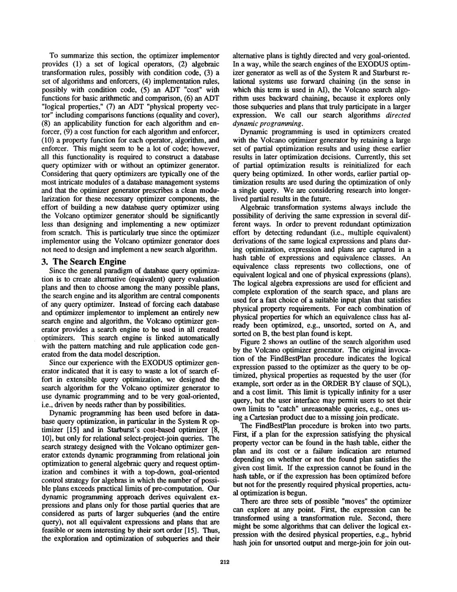
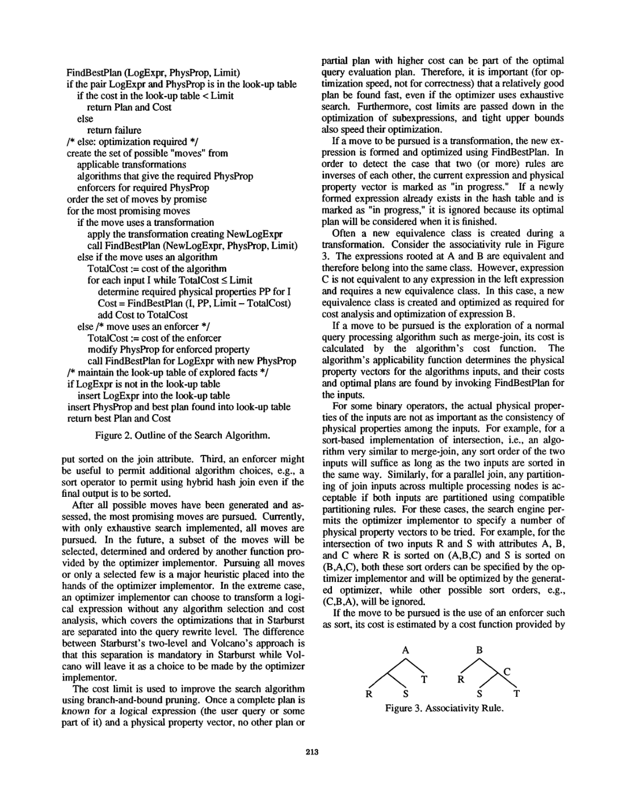

> 本组第 3 篇 · 优化器框架 · [全部论文]() · [上一篇]() · [下一篇]()

Volcano Optimizer Generator 将动态规划、由物理属性驱动的自顶向下目标导向搜索及分支定界结合，用于生成数据模型可扩展的查询优化器。哈希表组织等价逻辑表达式与物理计划，为已优化的物理属性组合保留最佳计划，并缓存失败；这些部分结果当时仅在单次查询内复用。当前实现追求全部候选 moves，未来选择 moves 子集的启发式机制与 Limit 剪枝须区分。第7–8页的初步实验在特定 select-join 工作负载下比较 EXODUS 与 Volcano 的优化时间及计划估计执行代价：复杂查询优化耗时相差约一个数量级，但这不是实测查询执行加速比，图中还只纳入 EXODUS 完成的查询。适用前提是 bulk-type 代数、合法规则和适配的代价/属性接口，而非仅关系模型或仅单机执行。

本文保留论文陈述、读者推断与待验证方案的区别；实验数字只适用于原文条件。原文和翻译来自已有 AI 辅助精读报告，已做来源匹配与编辑复核，不等于人工逐项核验或独立实验复现。所有页码均为 PDF 物理页。

## 论文与阅读范围

作者：Goetz Graefe、William J. McKenna；1993；本文 PDF 物理页1–10，对应印刷页209–218。首页有 IEEE 版权信息；所供十页正文未明确列出完整会议名称，本文不据版权行猜测会议。参考文献表在 PDF 第10页。

[论文集中的原始 PDF](https://github.com/lonng/db-papers/blob/4ff1331069c7cf52ac97dd769e5f484c1c35c200/papers/optimizer-framework/the-volcano-optimizer-generator--extensibility-and-efficient-search.pdf) · 本地来源：`optimizer-framework/the-volcano-optimizer-generator--extensibility-and-efficient-search.pdf`，共 10 页。

本篇保留 18 组原文精读和 33 条证据。截图为原始 PDF 的局部页选，不是重新生成的图表；未将整份 PDF 复制到博客。

## 研究问题与适用边界

Volcano 项目的提出源于新兴数据库应用领域（特别是面向对象数据库和科学计算数据库）对功能扩展和高性能的双重需求。论文指出，数据量的持续增长超出了多数现有数据库系统的能力；同时，为了在科学计算等领域克服接受度问题，数据库系统必须至少达到当前文件系统的性能水平。额外的数据库管理软件层带来的开销，必须通过通常在这些领域未被利用的数据库性能优势（即优化和并行化）来抵消。

在此背景下，作者回顾了此前构建的 EXODUS optimizer generator 原型。虽然 EXODUS 验证了优化器生成器范式的可行性和有效性，但实践表明，使用该原型难以构建出高效的生产级优化器。因此，Volcano Optimizer Generator 的设计目标是解决 EXODUS 遗留的工程瓶颈，具体要求包括：第一，既能作为 Volcano 项目的一部分与现有查询执行软件协同工作，也能作为独立工具供其他项目使用；第二，在优化时间和搜索内存消耗上必须更高效；第三，必须为物理属性（如排序顺序、压缩状态）提供有效、高效且可扩展的支持；第四，允许使用启发式规则和数据模型语义来引导搜索并剪除无效的搜索空间；第五，支持灵活的代价模型，以便为不完全指定的查询生成动态计划。

关于适用边界，需明确区分作者声明的前提假设与读者推断的潜在局限性。作者声明的前提假设是：高级查询语言将继续基于集合、其他批量类型（bulk types）、谓词和算子。因此，消费和生产集合或序列项的算子是下一代查询处理系统的基本构建块。该框架旨在支持任何集合代数，包括异构集合和多类代数（many-sorted algebras）。这一假设同时兼容高性能并行处理，因为集合和算子间的数据传递也是并行算法的基础。读者推断的潜在局限性在于：对于不遵循集合代数语义的查询模型，或者缺乏明确代价函数的场景，本文所述的动态规划与分支定界机制是否直接适用，属于未经验证的边界。

依据：论文陈述；PDF 物理页 1, 9。证据：[C001N01](#evidence-c001n01), [C003N10](#evidence-c003n10)。

## 系统架构与核心组件

Volcano Optimizer Generator 遵循生成器范式（Generator Paradigm）：在构建 DBMS 软件时，模型规范（Model Specification）被翻译为优化器源代码，随后编译并与 DBMS 的其他组件链接。当接收查询时，生成的优化器输出执行计划。

架构的核心设计原则包括以下几点：

1. 双代数体系：Volcano 使用两套代数——逻辑代数（logical algebra）和物理代数（physical algebra）。用户查询被指定为逻辑算子的代数表达式树，而输出是由算法组成的物理代数表达式（即执行计划）。算子消费和生产 bulk types（如 set、bag、array 等），选择最高效的算法是优化的核心任务。

2. 独立的规则表达：代数等价知识通过独立的规则表达。这些规则彼此独立翻译，仅在优化查询时才由搜索引擎组合。这种设计保证了模块化，便于初始构建和后续维护。

3. 规则分类：规则分为 transformation rules（表达代数等价，如交换律、结合律）和 implementation rules（表达算子到算法的映射）。系统支持复杂映射，例如可以将多个逻辑算子（如 join 后跟 projection）映射为单个物理过程。两种规则均可附加 condition code，在模式匹配成功后调用以进行进一步检查。

4. Enforcers 机制：Enforcers 是物理代数中不对应任何逻辑算子的特殊算子（如排序、解压缩）。其唯一目的是强制输出满足后续算法所需的物理属性。一个 enforcer 可能确保两个属性，也可能强制一个属性但同时破坏另一个。论文指出这与 Starburst 系统中的 glue operators 类似。

5. 优化器实现者接口：Volcano 要求优化器实现者提供 10 类组件：(1) 逻辑算子集合；(2) 代数变换规则（可带条件代码）；(3) 算法与 enforcer；(4) 实现规则；(5) 代价抽象数据类型（ADT）；(6) 逻辑属性 ADT；(7) 物理属性向量 ADT（包含 equality 和 cover 比较函数）；(8) 适用性函数；(9) 代价函数；(10) 属性函数。论文明确强调，这些是构建任何查询优化器所必需的功能，并非生成器额外强加的负担。

6. 模块化等价类结构：等价类（equivalence classes）的内部结构被设计为高度模块化和可扩展的，能够支持替代性的搜索策略。作者指出，这种扩展能力远超仅对规则条件代码进行参数化的方式（后者在 Starburst 和 EXODUS 系统中只能达到大致相似的程度）。这意味着 Volcano 的搜索空间表示不仅允许修改触发条件，还允许替换底层的图遍历或枚举算法。

依据：论文陈述；PDF 物理页 2, 3, 4, 10。证据：[C001N05](#evidence-c001n05), [C001N06](#evidence-c001n06), [C001N10](#evidence-c001n10), [C001N12](#evidence-c001n12), [C002N01](#evidence-c002n01), [C004N02](#evidence-c004n02)。

*原论文 PDF 物理页 4，版权归原作者或出版方。点击图片可查看原尺寸。页面文本中定位到：Figure 2 shows an outline of the search algorithm use。这是页面定位信息，不表示本次已复核图内所有数据。*

## 搜索算法与剪枝机制

Volcano 将动态规划与自顶向下、目标导向的控制结合，称为 directed dynamic programming。动态规划指保存并复用部分优化结果，不等于自底向上枚举所有子集。哈希表组织表达式及等价类；一个等价类含等价逻辑表达式与物理计划两类集合，按已优化的物理属性组合保留最佳计划。当前部分结果在每个查询开始时重置，不是已实现的跨查询计划缓存（第4页）。

1. Figure 2 的 FindBestPlan(LogExpr, PhysProp, Limit) 是概要接口。优化目标为逻辑表达式与所需物理属性的配对；查到已优化结果时，依其成本是否严格小于 Limit 返回计划或失败。第6页另说明失败可复用于相同目标及相同或更低的上限，不能把一次有界失败解释为任何上限下都无计划。
2. 候选 moves 包括适用的逻辑变换、能满足输出属性的算法，以及能强制所需属性的 enforcer。第5页明确当前仅实现穷举，所有候选 moves 都会被追求；由实现者提供函数挑选/排序子集是未来扩展。这个选择机制不同于代价上界剪枝。不过候选集合本身已经受逻辑模式、条件和属性适用性限制，不能称为完全没有过滤的枚举。
3. 算法分支先计算本算子成本，再按输入顺序以 Limit - TotalCost 优化子输入，每得到一个子成本就累加。分支定界可以在当前实现中与穷举 moves 并存。原文所谓“影响速度而不影响正确性”指尽早找到较好可行计划这一搜索顺序因素，不是任意剪枝策略都不影响正确性。
4. 逻辑变换生成等价表达式，按需要创建新的子等价类并递归优化。表达式/物理属性配对的 in-progress 标记用于阻断逆规则等对活动状态的重复进入；它不把原本可能有环的等价关系图变成 DAG。
5. Enforcer 分支放松所需属性后优化同一逻辑表达式，并从上界中扣除 enforcer 成本（第9页）。第6页还给出 Figure 2 未显示的额外 excluding physical property vector 参数，专门用于 enforcer 输入优化：原本已能满足被强制属性的算法不再作为该 enforcer 的输入候选。这解释了为何已可直接产出有序结果的 merge-join 不应再次放到该 sort 下。
6. 对 intersection 等多输入算子，可尝试实现者指定的多个相容属性组合。第5页例子只试 (A,B,C) 与 (B,A,C)，忽略 (C,B,A)，所以“追求全部 moves”不能直接等同于“穷举任意物理属性组合”。

读者构造的数值演示（不是实测数据）：令目标为 Join(A,B) 按连接键 k 排序，上限1000。merge-join 若本身成本20，先以980优化 A 的有序输入；若其成本30，则 B 的剩余预算为950，而非仍为980。hash join 不直接满足有序输出；须经 Sort(HashJoin(...)) 路径满足目标。若整个排序后计划成本200，才能用200收紧该有序目标的上界，不能用仅含 hash join 的无序计划成本收紧它。对子输入的 in-progress 检查针对重复进入同一逻辑表达式/属性状态，而不要求叶子关系本身具有某条可用的变换规则。

复杂度边界：全文没有给出适用于任意代数和属性空间的统一大O界。实验中近似指数增长是特定 select-join 搜索空间的趋势；等价类、候选规则和属性组合都会影响实际开销。

依据：论文陈述；PDF 物理页 2, 3, 4, 5, 6, 7, 9。证据：[C001N09](#evidence-c001n09), [C002N04](#evidence-c002n04), [C002N05](#evidence-c002n05), [C002N06](#evidence-c002n06), [C002N10](#evidence-c002n10), [C002N12](#evidence-c002n12), [C003N12](#evidence-c003n12), [CE005](#evidence-ce005), [CE006](#evidence-ce006), [CE008](#evidence-ce008), [CE009](#evidence-ce009), [CE012](#evidence-ce012), [CE013](#evidence-ce013)。

## 正确性保证与边界条件

本节区分论文的机制说明与读者给出的必要条件；全文没有给出适用于任意规则、代价ADT和属性空间的形式化完备性或终止性定理。

1. 最优性范围：作者把搜索设计目标表述为从逻辑表达式映射到最优等价物理表达式，并说明当前追求全部候选 moves。但保证不能仅由“用了动态规划和穷举”推出。作为读者的条件化解释：规则须保持语义且覆盖目标候选空间，所需输入属性组合与算法/enforcer须被纳入，子问题状态必须保留影响可替代性的上下文，代价组合与比较须允许子计划最优性和有效的分支下界。第5页明确会忽略未指定的排序组合，因此不应宣称涵盖任意代数下所有可能物理计划的无条件全局最优。若初始 Limit 有限且没有更低成本计划，允许返回失败；这不证明不存在可执行计划。
2. 上界剪枝：Figure 2 用 TotalCost 与 Limit 比较，并将 Limit - TotalCost 传给输入。读者推断其安全性依赖部分成本确为剩余候选的有效下界、成本运算/比较保持所需次序，不能只列“可加”而忽略这些条件。第5页“for optimization speed, not for correctness”修饰的是尽快找到较好计划，不是对任意启发式删减候选作出的保证。
3. 终止性：in-progress 标记阻断当前递归链上对同一表达式/物理属性状态的重入，原文以互逆规则为例。它不会消除搜索空间中的环，也不能单凭此证明任意扩展规则集必然终止。一般性的终止论证还需要有限可达状态，或其他有界/良基条件；这是读者说明，不是论文定理。
4. 属性与缓存：第3页要求适用性函数确定输出是否满足目标及输入属性要求，并在选定计划后检查实际物理属性。enforcer 可能强制一个属性同时破坏另一属性，不能把插入 enforcer 本身当作自动正确性保证。第6页失败缓存限于同一逻辑目标、物理属性及相同或更低成本上限；其读者解释还假设缓存期内代价与目标语义保持一致。
5. 非标量代价与动态计划：第7页 cost 可为数值、CPU/I/O记录，甚至可用内存的函数，运算与比较由实现者提供；第1页把不完全指定查询的动态计划列为设计要求。本文没有完整证明这类代价下的搜索性质，但不能因此断言静态 Limit 必然失效，或必须改为运行时代价评估。

依据：读者推断；PDF 物理页 3, 5, 6, 7。证据：[C002N05](#evidence-c002n05), [C002N06](#evidence-c002n06), [C002N12](#evidence-c002n12), [CE005](#evidence-ce005), [CE007](#evidence-ce007), [CE009](#evidence-ce009), [CE013](#evidence-ce013)。

## 实验评估与数据局限

第4.2节及图4（PDF第7–8页）比较 EXODUS 与 Volcano 的搜索效率和计划质量，属于初步、受控的 select-join 实验，不是对全部可扩展代数的通用性能定理。

1. 配置与公平性：两者尽可能采用相同模型描述，算子为 get/select/join，算法为 file scan、filter、sort、merge-join、hybrid hash join，使用相同变换/实现规则、属性函数和代价函数。Volcano 将 sort 建模为 enforcer，EXODUS 则把 sort 成本隐含在 merge-join 成本函数中。规则允许全部计划形状，包括 bushy plans。关系含1,200–7,200条记录，每条100字节；代价包括 I/O 与 CPU。hash join 假设无需分区文件，sort 按单层归并计算。全文未逐条给出完整规则和成本公式，具体连接图拓扑及交叉积策略也未明确交代。
2. 规模与机器：穷举优化的查询含1–7个二元 join，即2–8个输入关系，selection 数量等于输入关系数；每个复杂度级别生成并优化50个查询。机器为 Sun SparcStation-1，约12 MIPS。图4纵轴为对数刻度，单位 seconds；实线为优化时间，虚线为生成计划的估计执行时间。操作系统、完整内存配置等仍未说明，但“机器与时间单位完全缺失”不成立。
3. 样本限制：部分复杂查询的 EXODUS 运行因内存不足终止，或因远慢于 Volcano 被终止，且重复试验有较大波动。图4仅纳入 EXODUS 完成优化的查询（句子跨第7–8页），不能把图中均值当成全部生成查询的无删失统计。Volcano 对全部查询完成穷举搜索，工作空间少于1 MB；论文没有给出完整逐查询时间和内存表。
4. 优化时间：EXODUS 从3增至4个输入关系时搜索开销显著跃升，作者归因于重新分析负担；Volcano 耗时近似指数增长。更复杂查询的优化时间“about an order of magnitude”之差仅针对这里的实验与完成样本，可概括为约一个数量级，不能写成普遍或精确10倍加速，更不是实测查询执行加速。
5. 计划质量：最多4个输入关系时两者估计执行代价相同；更复杂查询的 EXODUS 计划估计代价显著更高，作者解释为未系统探索/利用物理属性与 interesting orderings。因此本文并非只比较优化耗时。不过虚线是代价模型估计，不是对实际执行时间的测量。
6. 未验证项：没有 Starburst 的同期定量基准、现代硬件性能保证、端到端执行加速测量，或对任意查询模型的数量级收益保证。

依据：论文陈述；PDF 物理页 7, 8。证据：[C003N02](#evidence-c003n02), [C003N06](#evidence-c003n06), [CE001](#evidence-ce001), [CE002](#evidence-ce002), [CE003](#evidence-ce003), [CE004](#evidence-ce004)。

*原论文 PDF 物理页 5，版权归原作者或出版方。点击图片可查看原尺寸。页面文本中定位到：Figure 2. Outline of the Search Algorithm.；Figure 3. Associativity Rule.。这是页面定位信息，不表示本次已复核图内所有数据。*

## 工程权衡与设计取舍

本节为基于机制的读者分析，未将可能的风险写成论文已测量的缺陷。

1. 候选覆盖与启发式：当前追求全部候选 moves，同时使用属性导向与 Limit 分支定界。未来按实现者函数选择 moves 子集允许降低搜索量，但可能改变候选覆盖。最优性还受规则、属性组合和代价语义约束，不能把“穷举”本身当成无条件保证。
2. 记忆化的空间开销：保存最佳子计划及失败可减少重复工作，也需占用存储；第4页说明当时仅在单次查询内复用。相对无缓存搜索可能形成时间/空间权衡，但不能据此称 Volcano 相对 EXODUS 内存增加；第7页恰报告 Volcano 全部查询使用少于1 MB，而部分 EXODUS 查询内存不足。没有统一的常数空间保证或完整内存曲线。
3. 表示分离：EXODUS 的规则语言已经区分逻辑/物理代数；问题是 MESH 节点同时携带逻辑算子与物理算法，保存多种物理方案会重复逻辑表示。Volcano 将分离贯彻到搜索引擎与等价类表示，而不是首次要求实现者建立两套代数。因此不能把“双代数建模新增负担”当作相对 EXODUS 的特有代价。
4. 属性接口：enforcer 隔离属性获得方式，但适用性、属性函数、equality/cover 以及 enforcer 输入的 excluding vector 仍须协作正确。属性交互可能增加搜索量是读者的风险判断；论文没有给出所谓 enforcer 组合爆炸的实测结论。
5. 编译与解释：第2页明确承认解释式规则更便于运行时扩充，编译规则通常更快，因优化工作CPU密集而选择编译。这支持编译期规则与运行时扩充灵活性的权衡，不支持推断现代插件/UDF必然与之冲突，也不提供所有编译规则都“执行效率极高”的独立性能证明。源码具体语言、二进制插件机制与现代系统的装载细节不在本文核验范围内。

依据：读者推断；PDF 物理页 2, 4, 5, 6, 7, 10。证据：[C001N05](#evidence-c001n05), [C001N06](#evidence-c001n06), [C002N01](#evidence-c002n01), [C002N04](#evidence-c002n04), [C002N10](#evidence-c002n10), [CE003](#evidence-ce003), [CE005](#evidence-ce005), [CE010](#evidence-ce010), [CE011](#evidence-ce011)。

## 与相关系统的对比分析

1. EXODUS：Volcano 继承了生成器范式、逻辑/物理代数与属性的区分以及模块化规则；第10页明确这些代数区分在 EXODUS 规则语言中已存在。关键改进是搜索引擎/数据结构真正利用这种区分、显式以物理属性驱动目标，并用 directed dynamic programming 减少重复工作。EXODUS MESH 单节点混合逻辑算子和物理算法，保存 merge-join/hash join 方案会重复逻辑节点；其最高预期代价改善优先策略偏向总成本高的上层表达式，底层后来变换时需要重新分析大量上层消费者。Volcano 控制方向明确为自顶向下，不能描述为默认自底向上枚举。复杂查询优化耗时约一个数量级之差及计划估计代价差异仅适用于第7–8页测试。

2. Starburst：论文并未把其扩展能力归结为只能改条件代码。第8页描述 query rewrite 的启发式层和成本优化层，后者在结构边界内做动态规划与穷举，能考虑物理属性和 glue operators；脚注说明其覆盖所有算子，但对非 SPJ 算子的优化及算法选择很有限。作者批评的是为扩展 grammar-like expansion 而调整中间层级/规则的复杂性，以及预先固定两层优化职责。Volcano 采用统一的代数规则体系，未来允许实现者决定何时选用启发式或代价优化。第10页“超出条件代码参数化”是搜索策略可扩展程度的比较，不证明 Starburst 仅可定制规则触发条件。文中没有对 Starburst 做定量性能实验。

3. System R 与动态规划：第4页直接点名 System R [15] 与 Starburst 的 SPJ 动态规划，并明确称 Volcano 将其扩展到通用代数、结合 top-down goal-oriented 控制。这是正文论述，不是仅凭第10页文献表推测的思想传承；也不等于其实现或代价模型与 System R 完全相同。

4. Ono/Lohman：第8页用[13]联系等价逻辑表达式数目的增长；这支持实验趋势的背景解释，不能据此声称借鉴了某个未在本篇展开的算法，或“突破”未核验的空间复杂度下界。

本文未读现代 Calcite、DuckDB 或 Cascades 源码，不对其实际实现、继承路径和参数化能力下结论；跨时代对比属于另需证据的后续研究。

依据：论文陈述；PDF 物理页 3, 4, 6, 7, 8, 10。证据：[C001N12](#evidence-c001n12), [C002N10](#evidence-c002n10), [C003N02](#evidence-c003n02), [C004N02](#evidence-c004n02), [C004N09](#evidence-c004n09), [C004N10](#evidence-c004n10), [CE004](#evidence-ce004), [CE006](#evidence-ce006), [CE008](#evidence-ce008), [CE010](#evidence-ce010)。

## 复现指南与缺失信息

以下是读者提出的复现方案，不是论文已完成的工作。

1. 首先对齐原实验：2–8个输入关系、1–7个二元join、selection 数量等于关系数，每个规模50个查询；允许 bushy plans。使用 get/select/join 与 file scan/filter/sort/merge-join/hybrid hash join，I/O+CPU代价，关系大小1,200–7,200条、每条100字节，hash join 不写分区文件、sort 按单层归并计价。Volcano 的 sort enforcer 与 EXODUS merge-join 内含 sort 成本的差异应保留。
2. 已知机器是约12 MIPS 的 Sun SparcStation-1，图示时间单位是秒。尚缺具体操作系统、完整机器配置、逐查询数据、随机生成器、连接图分布、完整规则清单和精确成本公式。论文原代码当前是否可获得未在本次核验；不得把未搜索到等同于不存在。只依本文实现的是近似重建，不能称为原实现复现。
3. 可先实现两个受控版本：A模拟 EXODUS 的 MESH 表示和预期成本改善优先搜索；B实现 Volcano 的等价类/属性目标、动态规划、Limit剪枝、in-progress及 enforcer excluding vector。若缺精确代价公式，可明确选择一个假设模型用于机制实验，但其结果不能冒充图4原数据。用小规模穷举 oracle 检查候选空间内最优性，加入有序输出、互逆变换、有界失败复用与 enforcer 排重测试。
4. 分别记录优化时间、估计计划代价、状态/节点数、重新分析次数、峰值工作空间及所有未完成查询；同时报告完整样本与仅两者均完成的样本，避免隐去 EXODUS 失败。链状/星状查询可作为自选扩展，但不是原文已说明的连接拓扑。检查是否出现3→4关系的开销变化及近似指数趋势，而非预设一定复现。
5. 现代硬件、替代实现或不同规则/成本会改变相对时间；不能保证仍获得约一个数量级差距。现代系统的比较需另行核对源码、控制搜索空间和代价接口，本次不声称已验证 Calcite、DuckDB 等系统的属性缓存或搜索实现。

依据：待验证的工程设想；PDF 物理页 1, 4, 5, 6, 7, 8。证据：[C001N01](#evidence-c001n01), [C002N01](#evidence-c002n01), [C002N04](#evidence-c002n04), [C002N06](#evidence-c002n06), [C002N10](#evidence-c002n10), [C003N06](#evidence-c003n06), [CE001](#evidence-ce001), [CE002](#evidence-ce002), [CE003](#evidence-ce003), [CE005](#evidence-ce005)。

## 结论与未来研究方向

Volcano 的贡献是将可扩展代数规则与由物理属性驱动的自顶向下动态规划、分支定界结合，并在搜索引擎中贯彻逻辑/物理分离。它保存单次查询内可复用的最佳子计划和失败，提供 enforcer 及其输入排重机制。第7–8页的初步实验在受控 select-join 工作负载下显示：较复杂且 EXODUS 完成的查询中，优化时间相差约一个数量级，Volcano 的计划估计执行代价也更低；不是实测查询执行速度提高10倍。

第10页列举正在探索的方向：preoptimized subplans、学习变换序列、更参数化且可切换的搜索算法，以及共享内存机器上的并行搜索。本文没有给出这些方向的实验结果；这是本次阅读的证据边界，不应改写成作者明说“缺少实验证据”的引文。缓存常见模式、按历史经验引导等用途是读者解释，不是本文已完成机制。

设计并非“单机集合代数代价模型”：第5–6页已讨论并行join、分区/位置属性及 exchange enforcer，第7页允许函数形式代价，第9页说明 bulk-type 代数与并行处理兼容。论文的范围限制在于未对所有这些扩展情形给出形式证明或完整基准，而不是明确排除了非关系或分布式处理。与后来的 Cascades、Calcite、DuckDB 的关系需另寻原始材料，不能仅由本篇推出。

依据：论文陈述；PDF 物理页 6, 7, 8, 9, 10。证据：[C003N10](#evidence-c003n10), [C004N03](#evidence-c004n03), [C003N06](#evidence-c003n06), [CE003](#evidence-ce003), [CE004](#evidence-ce004), [CE007](#evidence-ce007), [CE005](#evidence-ce005)。

## 原文精读：从句子回到机制

以下保留原文、忠实翻译、含义与边界；假设示例不作为论文实验结果。

### P001 · PDF 物理页 1

**原文**

<blockquote class="paper-source-quote"><pre><code>McKenna &#10;Portland State University &#10;University of Colorado at Boulder &#10;graefe @ cs.pdx.edu &#10;bill @ cs.colorado.edu &#10;Abstract &#10;Emerging database application domains demand not only &#10;new functionality but also high performance. To satisfy &#10;these two requirements, the Volcano project provides &#10;efficient, extensible tools for query and request processing, &#10;particularly for object-oriented and scientific database &#10;systems.</code></pre></blockquote>

**忠实翻译**

> McKenna，波特兰州立大学，科罗拉多大学博尔德分校，graefe @ cs.pdx.edu，bill @ cs.colorado.edu。摘要：新兴的数据库应用领域不仅要求新功能，还要求高性能。为满足这两项需求，Volcano 项目为查询与请求处理提供了高效、可扩展的工具，尤其面向面向对象和科学数据库系统。

**技术含义与边界**

> 原文陈述了 Volcano 项目的目标（高效、可扩展）及其主要应用场景（面向对象与科学数据库）。这是作者对项目定位的说明，不涉及具体技术实现细节。读者可推断该项目试图同时解决功能扩展性与执行性能两个维度的问题。

**常见误读**

> 容易将“提供高效、可扩展的工具”误解为对所有数据库场景的全局性能保证。原文仅限定在“面向对象和科学数据库系统”这一特定领域，且是项目目标而非已验证的性能结论。

**读者构造的假设示例**

> 读者构造的假设示例：假设某科研机构需要处理多维数组数据（科学数据库），Volcano 项目旨在通过其可扩展架构支持此类新型数据类型的高效查询，但这仅是基于原文目标的假设，不代表实际基准测试结果。

### P002 · PDF 物理页 10

**原文**

<blockquote class="paper-source-quote"><pre><code>consideration applies to location and partitioning in paral- &#10;lel and distributed relational query processing, no earlier &#10;query optimizer has provided this feature. &#10;Fourth, the internal structure for equivalence classes is &#10;sufficiently modular and extensible to support alternative &#10;search strategies, far beyond the parameterization of rule &#10;condition codes, which can be found to a roughly similar &#10;extent in Starburst and EXODUS.</code></pre></blockquote>

**忠实翻译**

> 这一考量适用于并行和分布式关系查询处理中的位置与分区，此前没有任何查询优化器提供过此特性。第四，等价类的内部结构足够模块化和可扩展，能够支持替代的搜索策略，远远超出了规则条件代码的参数化程度，而后者在 Starburst 和 EXODUS 中只能找到大致相似的程度。

**技术含义与边界**

> 原文陈述了 Volcano 在两个方面优于早期系统：一是支持并行/分布式环境下的位置与分区属性；二是等价类结构的模块化程度高于 Starburst 和 EXODUS 的规则条件参数化。适用边界在于比较对象明确限定为“此前的查询优化器”以及 Starburst 和 EXODUS。

**常见误读**

> 容易将“支持替代的搜索策略”误解为 Volcano 已经内置或实现了所有可能的搜索策略。原文仅表示其内部结构“足够模块化和可扩展以支持”，这是一种架构能力声明，而非已完成的功能列表。

**读者构造的假设示例**

> 读者构造的假设示例：假设开发者希望将 Volcano 默认的自底向上搜索替换为某种启发式搜索算法，原文表明其等价类结构的模块化设计允许这种替换，而无需像早期系统那样仅能修改规则的条件代码。此为基于原文架构描述的推断。

### P003 · PDF 物理页 6

**原文**

<blockquote class="paper-source-quote"><pre><code>First, Volcano makes a distinction &#10;between logical expressions and physical expressions. In&#10;EXODUS, only one type of node existed in the hash table&#10;called MESH, which contained both a logical operator&#10;such as join and a physical algorithm such as hybrid hash&#10;join.</code></pre></blockquote>

**忠实翻译**

> 首先，Volcano 区分了逻辑表达式与物理表达式。在 EXODUS 中，名为 MESH 的哈希表中只存在一种类型的节点，该节点既包含诸如 join 这样的逻辑算子，也包含诸如 hybrid hash join 这样的物理算法。

**技术含义与边界**

> 原文陈述了 Volcano 与 EXODUS 在表达式表示上的核心架构差异：Volcano 显式分离逻辑层与物理层，而 EXODUS 在单一数据结构（MESH 哈希表）中混合存储两者。这一区分是 Volcano 优化器生成框架的基础机制之一。

**常见误读**

> 容易推断 EXODUS 的混合设计必然导致性能低下或无法工作。原文仅客观描述了两种设计的结构差异，并未在此段落中对两者的优劣做出评价，不应将架构差异直接等同于性能缺陷。

**读者构造的假设示例**

> 读者构造的假设示例：在 EXODUS 的 MESH 表中，一个节点可能同时标记为“Join（逻辑）”和“Nested Loop Join（物理）”；而在 Volcano 中，逻辑算子 Join 和物理算子 Nested Loop Join 会作为不同类型的表达式分别存在于不同的结构中。这有助于理解原文所述的“区分”。

### P004 · PDF 物理页 8

**原文**

<blockquote class="paper-source-quote"><pre><code>The &#10;increase of Volcano's optimization costs is about ex- &#10;ponential, shown in an almost straight line, which mirrors &#10;exactly the increase in the number of equivalent logical &#10;algebra expressions [13]. For more complex queries, the &#10;EXODUS' and Volcano's optimization times differ by &#10;about an order of magnitude. &#10;The plan quality (shown by the estimated execution &#10;cost; dashed lines in Figure 4) is equal for moderately &#10;complex queries (up to 4 input relations).</code></pre></blockquote>

**忠实翻译**

> Volcano 优化成本的增长大约呈指数级，表现为一条几乎笔直的线，这精确反映了等价逻辑代数表达式数量的增长 [13]。对于更复杂的查询，EXODUS 与 Volcano 的优化时间相差大约一个数量级。计划质量（由估计的执行成本显示；图 4 中的虚线）对于中等复杂度的查询（最多 4 个输入关系）是相等的。

**技术含义与边界**

> 原文陈述了三个实验观察结果：1) Volcano 优化时间随等价表达式数量呈近似指数增长；2) 在复杂查询上 Volcano 比 EXODUS 快约一个数量级；3) 在最多 4 个关系的查询上两者生成的计划估计成本相同。适用边界明确限定在“更复杂的查询”和“最多 4 个输入关系”的范围内。

**常见误读**

> 容易将“最多 4 个输入关系时计划质量相等”泛化为“在所有查询规模下两者计划质量均相等”。原文明确限定了“moderately complex queries (up to 4 input relations)”，超过此范围的计划质量对比在此段落中未作断言。此外，“大约呈指数级”是基于图表趋势的描述，不应视为严格的数学证明。

**读者构造的假设示例**

> 读者构造的假设示例：假设有两个查询，一个涉及 3 张表的连接，另一个涉及 8 张表的连接。根据原文，对于 3 张表的查询，Volcano 和 EXODUS 生成的计划估计执行成本相同；而对于 8 张表的查询，Volcano 的优化耗时可能仅为 EXODUS 的十分之一左右。此为帮助理解的假设场景。

### P005 · PDF 物理页 9

**原文**

<blockquote class="paper-source-quote"><pre><code>Therefore, operators consuming &#10;and producing sets or sequences of items are the funda- &#10;mental building blocks of next-generation query and re- &#10;quest processing systems. In other words, we assume that &#10;some algebra of sets is the basis of query processing, and &#10;our research tries to support any algebra of collections, in- &#10;cluding heterogeneous collections and many-sorted alge- &#10;bras. Fortunately, algebras and algebraic equivalence &#10;rules are a very suitable basis for database query optimiza- &#10;tion.</code></pre></blockquote>

**忠实翻译**

> 因此，消费和生产项目集合或序列的算子是下一代查询与请求处理系统的基本构建块。换言之，我们假设某种集合代数是查询处理的基础，并且我们的研究试图支持任何集合代数，包括异构集合和多类代数（many-sorted algebras）。幸运的是，代数和代数等价规则是非常适合数据库查询优化的基础。

**技术含义与边界**

> 原文陈述了 Volcano 的设计哲学前提：将查询处理抽象为对集合或序列的消费与生产操作，并以此为基础支持广泛的代数类型（包括异构和多类代数）。作者认为代数及等价规则天然适合作为查询优化的理论基础。

**常见误读**

> 容易将“试图支持任何集合代数”误解为 Volcano 已经完整实现了对所有已知集合代数的支持。原文使用的是“tries to support”（试图支持），表明这是一个研究目标和架构愿景，而非已完成的功能清单。

**读者构造的假设示例**

> 读者构造的假设示例：假设一个面向对象数据库需要同时处理整数集合和多媒体对象集合（异构集合），Volcano 的架构理念是通过定义相应的代数算子和等价规则来统一处理这些不同类型的数据，而不是为每种类型硬编码独立的处理逻辑。

### P006 · PDF 物理页 3

**原文**

<blockquote class="paper-source-quote"><pre><code>For &#10;example, a join followed by a projection (without dupli- &#10;cate removal) should be implemented in a single pro- &#10;cedure; therefore, it is possible to map multiple logical &#10;operators to a single physical operator. Beyond simple &#10;pattern matching of operators and algorithms, additional &#10;conditions may be specified with both kinds of rules.</code></pre></blockquote>

**忠实翻译**

> 例如，一个连接（join）后跟一个投影（projection，无去重操作）应当在单个过程中实现；因此，可以将多个逻辑算子映射到单个物理算子。除了算子与算法的简单模式匹配之外，还可以在这两类规则中指定额外的条件。

**技术含义与边界**

> 原文陈述了 Volcano 中逻辑到物理映射的灵活性：允许多对一映射（如 join+projection 融合为一个物理过程），并且规则不仅限于模式匹配，还可以附带额外条件。前提是投影“without duplicate removal”（无去重），因为去重可能会改变语义从而影响融合的合法性。

**常见误读**

> 容易忽略“without duplicate removal”这一关键限定条件，误以为所有的 join 加 projection 都可以无条件融合为单一物理算子。如果投影包含去重，融合后的语义可能与原始逻辑表达式不等价，原文通过括号内的限定排除了这种情况。

**读者构造的假设示例**

> 读者构造的假设示例：假设逻辑计划是先对表 A 和 B 做 Join，然后选取其中的两列（Projection，不去重）。在 Volcano 中，可以通过一条实现规则，将这个两步的逻辑模式直接映射为一个自定义的物理算子“FusedJoinProject”，从而减少中间数据的物化开销。

### P007 · PDF 物理页 4

**原文**

<blockquote class="paper-source-quote"><pre><code>To summarize this section, the optimizer implementor &#10;provides (1) a set of logical operators, (2) algebraic &#10;transformation rules, possibly with condition code, (3) a &#10;set of algorithms and enforcers, (4) implementation rules, &#10;possibly with condition code, (5) an ADT "cost" with &#10;functions for basic arithmetic and comparison, (6) an ADT &#10;"logical properties," (7) an ADT "physical property vec- &#10;tor" including comparisons functions (equality and cover), &#10;(8) an applicability function for each algorithm and en- &#10;forcer, (9) a cost function for each algorithm and enforcer, &#10;(10) a property function for each operator, algorithm, and &#10;enforcer.</code></pre></blockquote>

**忠实翻译**

> 总结本节，优化器实现者需提供：(1) 一组逻辑算子，(2) 代数转换规则，可能带有条件代码，(3) 一组算法与 enforcers，(4) 实现规则，可能带有条件代码，(5) 一个包含基本算术和比较函数的 ADT“cost”，(6) 一个 ADT“logical properties”，(7) 一个 ADT“physical property vector”，包含比较函数（equality 和 cover），(8) 每个算法和 enforcer 的适用性函数，(9) 每个算法和 enforcer 的成本函数，(10) 每个算子、算法和 enforcer 的属性函数。

**技术含义与边界**

> 原文精确列举了使用 Volcano 优化器生成器时，数据库开发者（优化器实现者）必须提供的 10 个组件。这体现了 Volcano 作为“生成器”的架构边界：框架负责搜索和控制流，而领域特定的算子、规则、成本和属性由用户注入。ADT 指抽象数据类型。

**常见误读**

> 容易将这 10 项误解为 Volcano 系统自带的默认实现。原文明确主语是“the optimizer implementor provides”（优化器实现者提供），这意味着 Volcano 本身是一个空壳框架，不包含具体的关系代数算子或成本模型，必须由使用者填充。

**读者构造的假设示例**

> 读者构造的假设示例：假设某团队要基于 Volcano 构建一个新的图数据库优化器。他们需要自己定义图遍历逻辑算子（第1项）、图模式匹配的转换规则（第2项）、BFS/DFS等物理算法（第3项），以及计算图遍历代价的 cost ADT（第5项），Volcano 框架则利用这些输入自动进行计划搜索。

### P008 · PDF 物理页 7

**原文**

<blockquote class="paper-source-quote"><pre><code>Since the ex- &#10;pected cost improvement was calculated as product of a &#10;factor associated with the transformation rule and the &#10;current cost before transformation, nodes at the top of the &#10;expression (with high total cost) were preferred over lower &#10;expressions. When the lower expression were finally &#10;transformed, all consumer nodes above (of which there &#10;were many at this time) had to be reanalyzed creating an &#10;extremely large number of MESH nodes.</code></pre></blockquote>

**忠实翻译**

> 由于预期的成本改善被计算为与转换规则相关联的一个因子乘以转换前的当前成本的乘积，表达式顶部的节点（具有较高的总成本）比底部的表达式更受偏好。当底部的表达式最终被转换时，上方所有的消费者节点（此时数量众多）都必须被重新分析，从而产生了极其大量的 MESH 节点。

**技术含义与边界**

> 原文陈述了 EXODUS 优化器中的一个性能病理现象（pathology）：其启发式评估函数（预期成本改善 = 因子 × 当前成本）导致优化器优先探索顶层节点。当底层节点稍后被转换时，引发上层大量节点的连锁重新分析，导致 MESH 表膨胀。这是对 EXODUS 机制缺陷的事实描述。

**常见误读**

> 容易将此段落描述的 MESH 节点爆炸问题错误地归因于 Volcano。原文明确是在分析 EXODUS 的行为（提及 MESH 节点，结合 P003 可知 MESH 属于 EXODUS），用以反衬 Volcano 改进的必要性。不能将此局部缺陷泛化为所有基于代数的优化器的通病。

**读者构造的假设示例**

> 读者构造的假设示例：假设有一个包含 5 层算子的查询树。在 EXODUS 的启发式下，优化器先尝试转换第 5 层（根节点），因为其总成本高，预期改善大。之后当第 1 层（叶子节点）发生转换时，第 2 到第 5 层的所有依赖节点都需要重新计算和生成新的 MESH 条目，导致内存和时间消耗剧增。

### P009 · PDF 物理页 2

**原文**

<blockquote class="paper-source-quote"><pre><code>However, the set of operators and the set &#10;of algorithms are different, and selecting the most efficient &#10;algorithms is one of the central tasks of query optimiza- &#10;tion. Therefore, the Volcano optimizer generator uses two &#10;algebras, called the logical and the physical algebras, and &#10;generates optimizers that map an expression of the logical &#10;algebra (a query) into an expression of the physical alge- &#10;bra (a query evaluation plan consisting of algorithms).</code></pre></blockquote>

**忠实翻译**

> 然而，算子集合与算法集合是不同的，选择最高效的算法是查询优化的核心任务之一。因此，Volcano 优化器生成器使用两种代数，称为逻辑代数和物理代数，并生成优化器，将逻辑代数的表达式（一个查询）映射为物理代数的表达式（一个由算法组成的查询执行计划）。

**技术含义与边界**

> 原文陈述了 Volcano 的核心架构动机：因为“做什么”（逻辑算子）和“怎么做”（物理算法）是两个不同的概念空间，所以 Volcano 采用双代数架构。优化器的本质作用被定义为从逻辑代数空间到物理代数空间的映射过程。

**常见误读**

> 容易将“生成优化器”误解为 Volcano 在运行时动态编译出优化器代码。原文的“generates optimizers”指的是 Volcano 作为一个生成器工具，基于用户提供的规则集构造出优化器实例，但具体是代码生成还是配置驱动的解释执行，本段未详细说明，不应过度推断。

**读者构造的假设示例**

> 读者构造的假设示例：逻辑代数中包含“Join”算子，表达“连接两张表”的需求；物理代数中包含“Hash Join”、“Sort-Merge Join”等算法。Volcano 优化器的任务就是接收包含“Join”的逻辑表达式，输出包含具体“Hash Join”算法的物理执行计划。

### P010 · PDF 物理页 5

**原文**

<blockquote class="paper-source-quote"><pre><code>FindBestPlan (LogExpr, PhysProp, Limit) &#10;if the pair LogExpr and PhysProp is in the look-up table &#10;if the cost in the look-up table &lt; Limit &#10;return Plan and Cost &#10;else &#10;return failure &#10;/* else: optimization required */ &#10;create the set of possible "moves" from &#10;applicable transformations &#10;algorithms that give the required PhysProp &#10;enforcers for required PhysProp &#10;order the set of moves by promise &#10;for the most promising moves &#10;if the move uses a transformation &#10;apply the transformation creating NewLogExpr &#10;call FindBestPlan (NewLogExpr, PhysProp, Limit) &#10;else if the move uses an algorithm &#10;TotalCost := cost of the algorithm &#10;for each input I while TotalCost &lt; Limit &#10;determine required physical properties PP for I &#10;Cost = FindBestPlan (I, PP, Limit - TotalCost) &#10;add Cost to TotalCost &#10;else/* move uses an enforcer */ &#10;TotalCost := cost of the enforcer &#10;modify PhysProp for enforced property</code></pre></blockquote>

**忠实翻译**

> FindBestPlan (LogExpr, PhysProp, Limit)
> 如果 LogExpr 和 PhysProp 对在查找表中
> 如果查找表中的 cost < Limit
> 返回 Plan 和 Cost
> 否则
> 返回 failure
> /* 否则：需要优化 */
> 从适用的转换、给出所需 PhysProp 的算法、所需 PhysProp 的 enforcers 创建可能的“moves”集合
> 按 promise 对 moves 集合排序
> 对于最有希望的 moves
> 如果 move 使用转换
> 应用转换创建 NewLogExpr
> 调用 FindBestPlan (NewLogExpr, PhysProp, Limit)
> 否则如果 move 使用算法
> TotalCost := 算法的成本
> 对于每个输入 I，当 TotalCost < Limit 时
> 确定 I 所需的物理属性 PP
> Cost = FindBestPlan (I, PP, Limit - TotalCost)
> 将 Cost 加入 TotalCost
> 否则 /* move 使用 enforcer */
> TotalCost := enforcer 的成本
> 为强制属性修改 PhysProp

**技术含义与边界**

> 原文给出了 Volcano 核心搜索算法 `FindBestPlan` 的伪代码。该算法采用带备忘录（查找表）和分支限界（Limit 剪枝）的递归搜索。它通过三种“moves”（逻辑转换、物理算法应用、enforcer 插入）探索计划空间，并在递归调用子计划时将剩余的成本上限（Limit - TotalCost）向下传递。

**常见误读**

> 容易忽略 `Limit` 参数的动态变化机制。在递归调用子输入 `I` 时，传入的 Limit 是 `Limit - TotalCost`，这意味着随着父节点累积成本的增加，子节点的搜索空间会被更严格地剪枝。如果不注意这一点，可能会误以为每个子计划都在全局相同的成本限制下独立优化。此外，伪代码末尾截断，enforcer 分支的后续递归调用未在提供的文本中显示。

**读者构造的假设示例**

> 读者构造的假设示例：假设当前 Limit 为 100，正在评估一个 Hash Join 算法（成本 20）。算法有两个输入，当评估第二个输入时，TotalCost 已累加第一个输入的最优成本（假设为 30），此时 TotalCost = 20 + 30 = 50。那么寻找第二个输入最优计划的 Limit 将被设定为 100 - 50 = 50。如果第二个输入的任何计划成本超过 50，该分支将被提前剪枝。

### P011 · PDF 物理页 7

**原文**

<blockquote class="paper-source-quote"><pre><code>For the experiments, we specified the data model &#10;descriptions as similarly as possible for the EXODUS and &#10;Volcano optimizer generators. In particular, we specified &#10;the same operators (get, select, join) and algorithms (file &#10;scan, filter for selections, sort, merge-join, hybrid hash &#10;join), the same transformation and implementation rules, &#10;and the same property and cost functions. Sorting was &#10;modeled as an enforcer in Volcano while it was implicit in &#10;the cost function for merge-join in EXODUS. &#10;The &#10;transformation rules permitted generating all plans includ- &#10;ing bushy ones (composite inner inputs). The test rela- &#10;tions contained 1,200 to 7,200 records of 100 bytes. The &#10;cost functions included both I/O and CPU costs. Hash join &#10;was presumed to proceed without partition files, while &#10;sorting costs were calculated based on a single-level &#10;merge.</code></pre></blockquote>

**忠实翻译**

> 原文说明两套模型描述尽可能一致，列出相同的算子、算法、变换与实现规则、属性及成本函数。Volcano 把排序作为 enforcer，EXODUS 则在 merge-join 成本中隐含排序。规则能生成含 bushy 在内的所有计划。关系有1,200至7,200条、每条100字节；成本含 I/O 与 CPU，hash join 假设不写分区文件，排序按单层归并估计。

**技术含义与边界**

> 这是实验控制与模型假设，不是任意数据库上的通用代价设定。两者共享成本/规则接口，主要差别之一是属性与排序在搜索中的表达方式，因此估计计划代价的差异不能解释成使用了不同数据规模。

**常见误读**

> 不能把无分区文件的 hash join 和单层归并成本假设推广为 Volcano 支持算法的限制，也不能称实验规则只能生成左深树。

**读者构造的假设示例**

> 读者构造：若重建实验改用磁盘溢出的多轮 hash join 成本，应明确这是新的成本条件，不能把所得比值直接当作原图4复现。

### P012 · PDF 物理页 7

**原文**

<blockquote class="paper-source-quote"><pre><code>As a first comparison between the two search engines, &#10;we performed exhaustive optimizations of relational &#10;select-join queries. Figure 4 shows the average optimiza- &#10;tion effort and, to show the quality of the optimizer output, &#10;the estimated execution time of produced plans for queries &#10;with 1 to 7 binary joins, i.e., 2 to 8 input relations, and as &#10;many selections as input relations. Solid lines indicate op- &#10;timization times on a Sun SparcStation-1 delivering about &#10;12MIPS.</code></pre></blockquote>

**忠实翻译**

> 作者先对关系 select-join 查询进行穷举优化。图4展示含1至7个二元连接、即2至8个输入关系的查询的平均优化工作量，并用生成计划的估计执行时间表示输出质量；selection 数量与输入关系数相同。实线表示在约12 MIPS 的 Sun SparcStation-1 上的优化时间。

**技术含义与边界**

> 本段直接提供硬件与负载范围。图4文本标注 seconds，后文说明虚线是估计执行时间；因此报告不应称完全没有硬件或时间单位，也不应称只测了优化时间。

**常见误读**

> 估计执行时间是模型输出，不是把所生成计划实际执行后测得的运行时间。

**读者构造的假设示例**

> 读者构造：8个关系、7个二元连接、8个selection符合该规模说明，但具体是链状还是星状仍不能由本段确定。

### P013 · PDF 物理页 7

**原文**

<blockquote class="paper-source-quote"><pre><code>For each complexity level, we generated and optimized &#10;50 queries. For some of the more complex queries, the &#10;EXODUS optimizer generator aborted due to lack of &#10;memory or was aborted because it ran much longer than &#10;the Volcano optimizer generator. Furthermore, we ob- &#10;served in repeated experiments that the EXODUS optimiz- &#10;er generator measurements were quite volatile. Similar &#10;problems were observed in EXODUS experiments report- &#10;ed in [3]. The Volcano-generated optimizer performed ex- &#10;haustive search for all queries with less than 1 MB of work &#10;space.</code></pre></blockquote>

**忠实翻译**

> 对每个复杂度级别，作者生成并优化50个查询。对部分更复杂查询，EXODUS 生成的优化器因内存不足而终止，或因耗时比 Volcano 长得多而被终止；重复试验中 EXODUS 测量值波动较大。Volcano 对全部查询进行穷举搜索，工作空间少于1 MB。

**技术含义与边界**

> 这里的50是每个规模最初生成的数量，不保证图4每个点都含50个配对完成样本。第7页下一句延续到第8页，明确图中只包含 EXODUS 完成优化的查询。

**常见误读**

> 不能把被终止查询当成有完整运行时间，也不能把少于1 MB理解为任意查询的统一内存上限。

**读者构造的假设示例**

> 读者构造：若某规模50个查询中只有40个被两者完成，配对平均耗时只描述这40个；完整报告还应记录另10个未完成情况。此数字是说明，不是论文数据。

### P014 · PDF 物理页 8

**原文**

<blockquote class="paper-source-quote"><pre><code>The plan quality (shown by the estimated execution &#10;cost; dashed lines in Figure 4) is equal for moderately &#10;complex queries (up to 4 input relations). For more com- &#10;plex queries, however, the cost is significantly higher for &#10;EXODUS-optimized &#10;plans, &#10;because &#10;the &#10;EXODUS- &#10;generated optimizer and its search engine do not systemat- &#10;ically explore and exploit physical properties and interest- &#10;ing orderings.</code></pre></blockquote>

**忠实翻译**

> 计划质量由图4虚线的估计执行代价表示。中等复杂度、至多4个输入关系时两者相同；更复杂查询中 EXODUS 优化计划的成本显著更高，因为其搜索引擎未系统探索和利用物理属性与有利排序。

**技术含义与边界**

> 该结果与优化耗时约一个数量级之差是两个不同维度。作者把复杂查询的估计质量差归因于物理属性搜索，而不是宣称实测执行快同样倍数。

**常见误读**

> 不能将至多4关系时相等泛化到所有规模，也不能把估计代价降低等同于已观测的端到端运行加速。

**读者构造的假设示例**

> 读者构造：两个计划的估计成本不同，支持比较模型预测质量；若要验证实际执行差，仍需执行引擎与数据上的测量。

### P015 · PDF 物理页 6

**原文**

<blockquote class="paper-source-quote"><pre><code>During optimization with the &#10;modified physical property vector, algorithms that already &#10;applied before relaxing the physical properties must not be &#10;explored again. For example, if a join result is required &#10;sorted on the join column, merge-join (an algorithm) and &#10;sort (an enforcer) will apply. When optimizing the sort in- &#10;put, i.e., the join expression without the sort requirement, &#10;hybrid hash join should apply but merge-join should not. &#10;To ensure this, FindBestPlan uses an additional parameter, &#10;not shown in Figure 2, called the excluding physical pro- &#10;perty vector that is used only when inputs to enforcers are &#10;optimized. In the example, the excluding physical proper- &#10;ty vector would contain the sort condition, and since &#10;merge-join is able to satisfy the excluding properties, it &#10;would not be considered a suitable algorithm for the sort &#10;input.</code></pre></blockquote>

**忠实翻译**

> 在修改后的物理属性向量下优化时，不应再次探索放松属性之前已适用的算法。有序join结果可由merge-join或sort满足；优化sort输入、不再要求排序时，应允许hybrid hash join而非再次考虑merge-join。为此，FindBestPlan使用图2未显示的额外参数 excluding physical property vector，仅用于优化enforcer输入；能满足排除属性的merge-join不被视为sort输入的合适算法。

**技术含义与边界**

> 图2是概要而非完整函数签名。这个排除向量在放松属性后避免重复候选，与所需属性向量以及普通模式适用性判断不是同一概念。

**常见误读**

> 不能只实现图2三个参数就声称完全覆盖论文算法；也不能将此特定排重规则直接推成任意enforcer组合都不会爆炸的证明。

**读者构造的假设示例**

> 读者构造：目标为按k排序的join时，直接考虑MergeJoin与Sort(HashJoin)。在本例的Sort输入子问题中排除已可满足排序要求的MergeJoin，以避免Sort(MergeJoin)冗余路径。

### P016 · PDF 物理页 7

**原文**

<blockquote class="paper-source-quote"><pre><code>Third, the Volcano algorithm is driven top-down; su- &#10;bexpressions are optimized only if warranted. In the ex- &#10;treme case, if the only move pursued is a transformation, a &#10;logical expression is transformed on the logical algebra &#10;level without optimizing its subexpressions and without &#10;performing algorithm selection and cost analysis for the &#10;subexpressions.</code></pre></blockquote>

**忠实翻译**

> 第三，Volcano算法由自顶向下驱动；只在有需要时优化子表达式。极端情况下，若只追求变换move，逻辑表达式可仅在逻辑代数层转换，而不优化子表达式，也不为它们进行算法选择或代价分析。

**技术含义与边界**

> 原文明定控制方向为top-down。动态规划描述缓存与复用子问题结果，并不表示默认采用System R式自底向上子集枚举。最后的极端情况是机制可表达的控制选择，不代表当时已实现启发式moves子集选择。

**常见误读**

> 保留的早期P002示例称默认自底向上，是与全文不符的旧解读；应以本段和修订正文为准。不能因子输入成本回传就把控制方向称为自底向上。

**读者构造的假设示例**

> 读者构造：从要求有序的根Join目标，向下请求各输入的排序属性，是top-down目标传播；返回子计划并缓存其成本则体现动态规划复用。

### P017 · PDF 物理页 7

**原文**

<blockquote class="paper-source-quote"><pre><code>Fourth, cost is defined in much more general terms in &#10;Volcano than in the EXODUS optimizer generator. In &#10;Volcano, cost is an abstract data type for which all calcu- &#10;lations and comparisons are performed by invoking func- &#10;tions provided by the optimizer implementor. It can be a &#10;simple number, e.g., estimated elapsed seconds, a struc- &#10;ture, e.g., a record consisting of CPU time and I/O count &#10;for a cost model similar to the one in System R [15], or &#10;even a function, e.g., of the amount of available main &#10;memory.</code></pre></blockquote>

**忠实翻译**

> 第四，Volcano对成本的定义比EXODUS更一般。成本是抽象数据类型，所有计算和比较调用实现者提供的函数。它可以是估计秒数，可是CPU时间和I/O次数的记录，也可为函数，例如可用主存量的函数。

**技术含义与边界**

> 这里把成本运算的具体语义留给实现者，说明框架不限定单一标量。它没有给出任意函数成本下最优子结构与分支定界的通用证明。

**常见误读**

> 不能把标量可加性冒充论文唯一允许的成本模型，也不能从参数未知直接推断必须改用运行时代价评估。

**读者构造的假设示例**

> 读者构造：用可用内存m表示两种算法的成本函数f(m)与g(m)符合这种接口设想；如何比较函数与建立安全下界仍需定义，而非本段自动解决。

### P018 · PDF 物理页 5

**原文**

<blockquote class="paper-source-quote"><pre><code>For these cases, the search engine per- &#10;mits the optimizer implementor to specify a number of &#10;physical property vectors to be tried. For example, for the &#10;intersection of two inputs R and S with attributes A, B, &#10;and C where R is sorted on (A,B,C) and S is sorted on &#10;(B,A,C), both these sort orders can be specified by the op- &#10;timizer implementor and will be optimized by the generat- &#10;ed optimizer, while other possible sort orders, e.g., &#10;(C,B,A), will be ignored.</code></pre></blockquote>

**忠实翻译**

> 对这类情形，搜索引擎允许实现者指定若干要尝试的物理属性向量。例如R和S都有A、B、C属性，R按(A,B,C)有序、S按(B,A,C)有序，实现者可指定这两种排序并由优化器优化；其他可能排序如(C,B,A)则被忽略。

**技术含义与边界**

> 前文以intersection解释：只要输入同序，具体是哪种顺序不重要。这里表明搜索覆盖依赖于实现者提供的候选属性组合，即使当前追求全部moves，也不是穷举所有排列。

**常见误读**

> 忽略(C,B,A)不自动是漏洞，因为所讨论的是指定候选空间；反过来也不能只据穷举moves就证明对任意属性选择全局最优。

**读者构造的假设示例**

> 读者构造：若要比较第三种排序，需把相应属性向量加入候选配置，并保持算法与成本模型一致；这是新的搜索配置，不是原文已默认探索的路径。

## 尚未解决的问题

1. 对于论文未完整展开的非标量或函数形式 cost ADT，哪些组合、比较和下界性质足以保持子计划最优性与 Limit 剪枝安全？
2. 如何系统生成多输入算子的候选属性向量，使第5页按实现者给定向量搜索的机制获得明确的候选空间覆盖保证？
3. 在保留 enforcer excluding vector 排重语义时，如何验证复杂属性交互下没有漏掉所需候选计划？
4. 能否获得原实验的查询生成器、规则集、成本公式与未完成查询数据，以分离表示结构、搜索次序和属性处理的收益？
5. 第10页提出的共享内存并行搜索若实现，in-progress 与失败缓存应如何协调并发状态？本文没有提供该并行实现。

## 证据索引

证据编号沿用原报告，便于将上文判断追溯到原句。引文匹配只验证位置，不证明解读正确。

**C001N01 · PDF 物理页 1**

Volcano 项目旨在为面向对象和科学数据库系统提供高效且可扩展的查询优化工具。其动机是新兴应用领域不仅要求新功能，还要求高性能；数据库系统必须至少达到当前文件系统的性能水平才能被接受。此前 EXODUS optimizer generator 原型验证了可行性，但难以构建高效的生产级优化器，因此需要新系统。

<blockquote class="paper-source-quote"><pre><code>Emerging database application domains demand not only new functionality but also high performance.</code></pre></blockquote>

**C001N05 · PDF 物理页 2**

设计原则一：使用两套代数——逻辑代数和物理代数。逻辑代数表达式（查询）通过等价变换和基于代价的映射转换为物理代数表达式（由算法组成的执行计划）。算子消费和生产 bulk types（如 set、bag、array 等），选择最高效算法是优化核心任务。

<blockquote class="paper-source-quote"><pre><code>the Volcano optimizer generator uses two algebras, called the logical and the physical algebras</code></pre></blockquote>

**C001N06 · PDF 物理页 2**

设计原则二：使用独立的规则表达代数等价知识。规则彼此独立翻译，仅在优化查询时由搜索引擎组合。这保证了模块化，便于初始构建和维护。

<blockquote class="paper-source-quote"><pre><code>rules are translated independently from one another and are combined only by the search engine when optimizing a query.</code></pre></blockquote>

**C001N09 · PDF 物理页 2**

设计原则五：搜索引擎基于动态规划。用户查询指定为逻辑算子的代数表达式树，输出为算法代数上的表达式（plan）。优化即重排算子并选择实现算法。

<blockquote class="paper-source-quote"><pre><code>the search engine used by optimizers generated with the Volcano optimizer generator is based on dynamic programming.</code></pre></blockquote>

**C001N10 · PDF 物理页 3**

规则分为 transformation rules（表达代数等价，如交换律结合律）和 implementation rules（表达算子到算法的映射）。支持复杂映射，例如将 join 后跟 projection 映射为单个物理过程。两种规则均可附加 condition code，在模式匹配成功后调用。

<blockquote class="paper-source-quote"><pre><code>therefore, it is possible to map multiple logical operators to a single physical operator.</code></pre></blockquote>

**C001N12 · PDF 物理页 3**

Enforcers 是物理代数中不对应任何逻辑算子的特殊算子（如排序、解压缩），其唯一目的是强制输出满足后续算法所需的物理属性。一个 enforcer 可能确保两个属性，或强制一个但破坏另一个。这与 Starburst 中的 glue operators 类似。

<blockquote class="paper-source-quote"><pre><code>We call these operators enforcers; they are comparable to the "glue" operators in Starburst.</code></pre></blockquote>

**C002N01 · PDF 物理页 4**

Volcano 要求优化器实现者提供 10 类组件：逻辑算子、代数变换规则、算法与 enforcer、实现规则、代价 ADT、逻辑属性 ADT、物理属性向量 ADT（含 equality 和 cover 比较函数）、适用性函数、代价函数、属性函数。这些是构建任何查询优化器所必需的功能，并非生成器额外强加的负担。

<blockquote class="paper-source-quote"><pre><code>the optimizer implementor provides (1) a set of logical operators, (2) algebraic transformation rules, possibly with condition code</code></pre></blockquote>

**C002N04 · PDF 物理页 5**

FindBestPlan 过程接收逻辑表达式、物理属性和代价上限 Limit。首先查表，若已有满足物理属性的计划且代价低于 Limit 则直接返回；否则生成三类可能的 move：变换规则、能产出所需物理属性的算法、以及 enforcer。当前实现为穷举搜索，会追求所有 move，但设计允许实现者通过自定义函数选择和排序 move 子集。

<blockquote class="paper-source-quote"><pre><code>create the set of possible "moves" from applicable transformations algorithms that give the required PhysProp enforcers for required PhysProp</code></pre></blockquote>

**C002N05 · PDF 物理页 5**

代价上限 Limit 用于 branch-and-bound 剪枝。一旦某逻辑表达式和物理属性向量的完整计划已知，更高代价的计划或局部计划不可能成为最优解的一部分。Limit 在递归优化子表达式时向下传递（Limit - TotalCost），紧的上界能加速子表达式的优化。这对优化速度至关重要，但不影响正确性。

<blockquote class="paper-source-quote"><pre><code>The cost limit is used to improve the search algorithm using branch-and-bound pruning.</code></pre></blockquote>

**C002N06 · PDF 物理页 5**

为防止互为逆的规则导致无限循环，当前正在优化的表达式和物理属性向量被标记为 in progress。如果新形成的表达式已在哈希表中且被标记为 in progress，则忽略它，因为其最优计划将在完成时被考虑。这是一种基于状态标记的环路检测机制。

<blockquote class="paper-source-quote"><pre><code>the current expression and physical property vector is marked as "in progress."</code></pre></blockquote>

**C002N10 · PDF 物理页 6**

EXODUS 的 MESH 数据结构在时间和空间复杂度上极其笨拙，且几乎随机的表达式变换导致大量时间花在重新分析已有计划上。Volcano 通过区分逻辑和物理表达式解决了此问题：EXODUS 中 MESH 节点同时包含逻辑算子和物理算法，为保留等价计划必须复制逻辑表达式节点。

<blockquote class="paper-source-quote"><pre><code>In EXODUS, only one type of node existed in the hash table called MESH, which contained both a logical operator</code></pre></blockquote>

**C002N12 · PDF 物理页 6**

哈希表不仅记录最优计划，还记录优化失败（failures）。失败信息可用于避免未来对相同逻辑表达式和物理属性向量在相同或更低代价上限下的重复优化工作。这属于记忆化搜索中的负缓存机制。

<blockquote class="paper-source-quote"><pre><code>includes both plans optimal for given physical properties as well as failures that can save future optimization effort</code></pre></blockquote>

**C003N02 · PDF 物理页 7**

EXODUS 优化器按最高预期代价改进优先执行变换，预期改进计算为规则因子与变换前当前代价的乘积。这导致顶层节点（总代价高）被优先处理；当底层表达式最终被变换时，上方所有消费者节点必须重新分析，产生极大量 MESH 节点，严重损害优化器性能。这是 EXODUS 搜索策略的关键缺陷。

<blockquote class="paper-source-quote"><pre><code>nodes at the top of the expression (with high total cost) were preferred over lower expressions</code></pre></blockquote>

**C003N06 · PDF 物理页 8**

实验结果显示，EXODUS 的搜索开销从 3 个输入关系到 4 个输入关系时急剧增加，因为此时重新分析（reanalyzing）成为 EXODUS 查询优化的主要负担。Volcano 的优化代价增长近似指数级（在半对数坐标上呈直线），恰好反映了等价逻辑代数表达式数量的增长。对于更复杂的查询，两者的优化时间相差约一个数量级。

<blockquote class="paper-source-quote"><pre><code>For more complex queries, the EXODUS' and Volcano's optimization times differ by about an order of magnitude.</code></pre></blockquote>

**C003N10 · PDF 物理页 9**

Volcano 的基本假设是高级查询语言将继续基于集合、其他批量类型、谓词和算子，因此消费和生产集合或序列项的算子是下一代查询处理系统的基本构建块。研究目标是支持任何集合代数，包括异构集合和多类代数（many-sorted algebras）。该假设同时兼容高性能并行处理，因为集合和算子间的数据传递也是并行算法的基础。

<blockquote class="paper-source-quote"><pre><code>we assume that some algebra of sets is the basis of query processing, and our research tries to support any algebra of collections</code></pre></blockquote>

**C003N12 · PDF 物理页 9**

对于能从多种物理属性组合中受益的二元（或多元）操作，Volcano 允许对子表达式进行多次优化。例如，只要两个输入以相同方式排序，基于 merge-join 的 intersection 算法就可以利用任意排序顺序。这体现了 Volcano 对物理属性的高效利用能力。

<blockquote class="paper-source-quote"><pre><code>the subexpressions can be optimized multiple times</code></pre></blockquote>

**C004N02 · PDF 物理页 10**

Volcano中等价类（equivalence classes）的内部结构被设计为高度模块化和可扩展的，能够支持替代性的搜索策略。作者指出这种扩展能力远超仅对规则条件代码进行参数化的方式，而后者在Starburst和EXODUS系统中只能达到大致相似的程度。这意味着Volcano的搜索空间表示不仅允许修改触发条件，还允许替换底层的图遍历或枚举算法。

<blockquote class="paper-source-quote"><pre><code>the internal structure for equivalence classes is sufficiently modular and extensible to support alternative search strategies, far beyond the parameterization of rule condition codes</code></pre></blockquote>

**C004N03 · PDF 物理页 10**

作者列出了正在探索的几个搜索策略研究方向：预优化的子计划（preoptimized subplans）、转换序列的学习（learning of transformation sequences）、一种可切换为不同现有算法的更高参数化搜索算法，以及共享内存机器上的并行搜索（parallel search）。这些是未来的研究假设和方向，并非已在本文中验证或实现的机制。缺少实验证据说明这些策略的有效性或开销。

<blockquote class="paper-source-quote"><pre><code>We are exploring several directions with respect to the search strategy, namely preoptimized subplans, learning of transformation sequences, an alternative, even more parameterized search algorithm</code></pre></blockquote>

**C004N09 · PDF 物理页 10**

参考文献[3]引用了Graefe和DeWitt关于EXODUS优化器生成器的SIGMOD 1987论文，参考文献[15]引用了Selinger等人关于System R访问路径选择的经典论文（1979年）。这些文献构成了Volcano设计的基线系统背景，说明Volcano是在EXODUS的生成器思想和System R的代价模型基础上演进而来的。

<blockquote class="paper-source-quote"><pre><code>G. Graefe and D. J. DeWitt, "The EXODUS Optimizer Generator", Proc. ACM SIGMOD Conf., San Francisco, CA, May 1987</code></pre></blockquote>

**C004N10 · PDF 物理页 10**

参考文献[13]引用了Ono和Lohman关于测量查询优化中连接枚举复杂度的VLDB 1990论文。这与Volcano关注的搜索策略和等价类枚举复杂度直接相关，暗示Volcano的设计可能借鉴或回应了该文中提出的连接枚举复杂度度量问题。

<blockquote class="paper-source-quote"><pre><code>K. Ono and G. M. Lohman, "Measuring the Complexity of Join Enumeration in Query Optimization", Proc. Int'l. Conf. on Very Large Data Bases</code></pre></blockquote>

**CE001 · PDF 物理页 7**

实验使用相同算子、算法、变换/实现规则与属性/代价函数；规则允许 bushy plans。关系大小为 1,200–7,200 条、每条 100 字节；代价含 I/O 和 CPU，hash join 假设无分区文件，sort 按单层归并计价。

<blockquote class="paper-source-quote"><pre><code>For the experiments, we specified the data model &#10;descriptions as similarly as possible for the EXODUS and &#10;Volcano optimizer generators. In particular, we specified &#10;the same operators (get, select, join) and algorithms (file &#10;scan, filter for selections, sort, merge-join, hybrid hash &#10;join), the same transformation and implementation rules, &#10;and the same property and cost functions. Sorting was &#10;modeled as an enforcer in Volcano while it was implicit in &#10;the cost function for merge-join in EXODUS. &#10;The &#10;transformation rules permitted generating all plans includ- &#10;ing bushy ones (composite inner inputs). The test rela- &#10;tions contained 1,200 to 7,200 records of 100 bytes. The &#10;cost functions included both I/O and CPU costs. Hash join &#10;was presumed to proceed without partition files, while &#10;sorting costs were calculated based on a single-level &#10;merge.</code></pre></blockquote>

**CE002 · PDF 物理页 7**

穷举实验覆盖 1–7 个二元 join，即 2–8 个输入关系，并有同样数量的 selection；实线是在约 12 MIPS 的 Sun SparcStation-1 上的优化时间，图中单位为秒，虚线是估计执行时间。

<blockquote class="paper-source-quote"><pre><code>As a first comparison between the two search engines, &#10;we performed exhaustive optimizations of relational &#10;select-join queries. Figure 4 shows the average optimiza- &#10;tion effort and, to show the quality of the optimizer output, &#10;the estimated execution time of produced plans for queries &#10;with 1 to 7 binary joins, i.e., 2 to 8 input relations, and as &#10;many selections as input relations. Solid lines indicate op- &#10;timization times on a Sun SparcStation-1 delivering about &#10;12MIPS.</code></pre></blockquote>

**CE003 · PDF 物理页 7**

每个复杂度级别生成并优化 50 个查询；部分复杂查询的 EXODUS 因内存不足或过慢而终止，且结果波动；Volcano 对全部查询穷举搜索使用少于 1 MB 工作空间。图4仅纳入 EXODUS 完成的查询，句子在第8页续完。

<blockquote class="paper-source-quote"><pre><code>For each complexity level, we generated and optimized &#10;50 queries. For some of the more complex queries, the &#10;EXODUS optimizer generator aborted due to lack of &#10;memory or was aborted because it ran much longer than &#10;the Volcano optimizer generator. Furthermore, we ob- &#10;served in repeated experiments that the EXODUS optimiz- &#10;er generator measurements were quite volatile. Similar &#10;problems were observed in EXODUS experiments report- &#10;ed in [3]. The Volcano-generated optimizer performed ex- &#10;haustive search for all queries with less than 1 MB of work &#10;space.</code></pre></blockquote>

**CE004 · PDF 物理页 8**

计划质量按估计执行代价比较：最多4个输入关系时相等，更复杂查询的 EXODUS 计划估计代价显著更高；不是实测执行时间对比。

<blockquote class="paper-source-quote"><pre><code>The plan quality (shown by the estimated execution &#10;cost; dashed lines in Figure 4) is equal for moderately &#10;complex queries (up to 4 input relations). For more com- &#10;plex queries, however, the cost is significantly higher for &#10;EXODUS-optimized &#10;plans, &#10;because &#10;the &#10;EXODUS- &#10;generated optimizer and its search engine do not systemat- &#10;ically explore and exploit physical properties and interest- &#10;ing orderings.</code></pre></blockquote>

**CE005 · PDF 物理页 6**

enforcer 放松所需属性后，通过 Figure 2 未显示的额外 excluding physical property vector 排除原本已能满足该属性的算法，避免重复考虑 merge-join 作为 sort 输入。

<blockquote class="paper-source-quote"><pre><code>During optimization with the &#10;modified physical property vector, algorithms that already &#10;applied before relaxing the physical properties must not be &#10;explored again. For example, if a join result is required &#10;sorted on the join column, merge-join (an algorithm) and &#10;sort (an enforcer) will apply. When optimizing the sort in- &#10;put, i.e., the join expression without the sort requirement, &#10;hybrid hash join should apply but merge-join should not. &#10;To ensure this, FindBestPlan uses an additional parameter, &#10;not shown in Figure 2, called the excluding physical pro- &#10;perty vector that is used only when inputs to enforcers are &#10;optimized. In the example, the excluding physical proper- &#10;ty vector would contain the sort condition, and since &#10;merge-join is able to satisfy the excluding properties, it &#10;would not be considered a suitable algorithm for the sort &#10;input.</code></pre></blockquote>

**CE006 · PDF 物理页 7**

Volcano 的控制方向明确为 top-down，只有有需要时才优化子表达式；单独追求变换 move 可不进行算法选择或子表达式代价分析。

<blockquote class="paper-source-quote"><pre><code>Third, the Volcano algorithm is driven top-down; su- &#10;bexpressions are optimized only if warranted. In the ex- &#10;treme case, if the only move pursued is a transformation, a &#10;logical expression is transformed on the logical algebra &#10;level without optimizing its subexpressions and without &#10;performing algorithm selection and cost analysis for the &#10;subexpressions.</code></pre></blockquote>

**CE007 · PDF 物理页 7**

cost 是实现者提供运算与比较的 ADT，可为标量、CPU/I/O 结构或可用内存的函数；不能把框架限定为单一标量成本，也不能由此断言必须改用运行时代价评估。

<blockquote class="paper-source-quote"><pre><code>Fourth, cost is defined in much more general terms in &#10;Volcano than in the EXODUS optimizer generator. In &#10;Volcano, cost is an abstract data type for which all calcu- &#10;lations and comparisons are performed by invoking func- &#10;tions provided by the optimizer implementor. It can be a &#10;simple number, e.g., estimated elapsed seconds, a struc- &#10;ture, e.g., a record consisting of CPU time and I/O count &#10;for a cost model similar to the one in System R [15], or &#10;even a function, e.g., of the amount of available main &#10;memory.</code></pre></blockquote>

**CE008 · PDF 物理页 4**

正文直接将 System R 和 Starburst 的关系 SPJ 动态规划与 Volcano 扩展到通用代数、采用 top-down goal-oriented 控制联系起来，并非只可从参考文献推断。

<blockquote class="paper-source-quote"><pre><code>Dynamic programming has been used before in data- &#10;base query optimization, in particular in the System R op- &#10;timizer [15] and in Starburst's cost-based optimizer [8, &#10;10], but only for relational select-project-join queries. The &#10;search strategy designed with the Volcano optimizer gen- &#10;erator extends dynamic programming from relational join &#10;optimization to general algebraic query and request optim- &#10;ization and combines it with a top-down, goal-oriented &#10;control strategy for algebras in which the number of possi- &#10;ble plans exceeds practical limits of pre-computation.</code></pre></blockquote>

**CE009 · PDF 物理页 5**

对多个可替代的输入属性组合，搜索引擎尝试实现者给定的向量；示例只尝试两种已有排序，忽略第三种排序。因此 moves 穷举并非自动穷举所有可能属性组合。

<blockquote class="paper-source-quote"><pre><code>For these cases, the search engine per- &#10;mits the optimizer implementor to specify a number of &#10;physical property vectors to be tried. For example, for the &#10;intersection of two inputs R and S with attributes A, B, &#10;and C where R is sorted on (A,B,C) and S is sorted on &#10;(B,A,C), both these sort orders can be specified by the op- &#10;timizer implementor and will be optimized by the generat- &#10;ed optimizer, while other possible sort orders, e.g., &#10;(C,B,A), will be ignored.</code></pre></blockquote>

**CE010 · PDF 物理页 10**

逻辑/物理代数的分离在 EXODUS 规则语言中已经存在；Volcano 进一步在搜索引擎中利用该分离。

<blockquote class="paper-source-quote"><pre><code>While &#10;the separation of logical and physical algebras was already &#10;present in the EXODUS rule language, the Volcano design &#10;also exploits this separation in the search engine,</code></pre></blockquote>

**CE011 · PDF 物理页 2**

原文明示编译规则相对解释规则的性能/运行时扩充权衡，并选择类似 EXODUS 的规则编译；没有据此测量所有场景的速度或证明与现代插件架构根本冲突。

<blockquote class="paper-source-quote"><pre><code>The fourth fundamental design decision concerns rule &#10;interpretation vs. compilation. In general, interpretation &#10;can be made more flexible (in particular the rule set can be &#10;augmented at run-time), while compiled rule sets typically &#10;execute faster. Since query optimization is very CPU- &#10;intensive, we decided on rule compilation similar to the &#10;EXODUS optimizer generator.</code></pre></blockquote>

**CE012 · PDF 物理页 9**

enforcer 成本从 branch-and-bound 上界扣除；先考虑要求的物理属性及能强制它的算法，而非先无属性优化再补 glue。

<blockquote class="paper-source-quote"><pre><code>Rather than optimizing an expression &#10;first and then adding "glue" operators and their cost to a &#10;plan (the Starburst approach), the Volcano optimizer &#10;generator's search algorithm immediately considers which &#10;physical properties are to be enforced and can be enforced &#10;by which enforcer algorithms, and subtracts the cost of the &#10;enforcer algorithms from the bound that is used for &#10;branch-and-bound pruning.</code></pre></blockquote>

**CE013 · PDF 物理页 3**

要求 join 结果按连接属性排序时，hybrid hash join 不直接满足目标；merge-join 需有序输入，sort enforcer 可接受不要求排序的 join 输入。

<blockquote class="paper-source-quote"><pre><code>For example, when optimizing a join &#10;expression whose result should be sorted on the join attri- &#10;bute, hybrid hash join does not qualify while merge-join &#10;qualifies with the requirement that its inputs be sorted. &#10;The sort enforcer also passes the test, and the requirements &#10;for its input do not include sort order. When the input to &#10;the sort is optimized, hybrid hash join qualifies. There is &#10;also a provision to ensure that algorithms do not qualify &#10;redundantly, e.g., merge-join must not be considered as in- &#10;put to the sort in this example.</code></pre></blockquote>

## 版本与使用边界

- 原 PDF SHA256：`77a4930474ee3caf2e774c72d1b842190e299fd4f492ea3577f8307972cc3f5f`。
- 报告来源：`qwen3.8-max`；此处按已完成报告整理，没有重新请求模型。
- OCR 记录页：[]；低文本页：[]。
- 本次新增页面截图，未据此自动重写原报告的数值、公式或实验结论；原有“未进行图像识别”限制仍适用于分析生成过程。
- 截图与短引仅服务于论文评论，版权归原作者或出版方；正式发布前复查转载范围和授权。
- 本文保留未核实的书目信息及研究问题，不用现代产品行为替代历史论文的证据。
