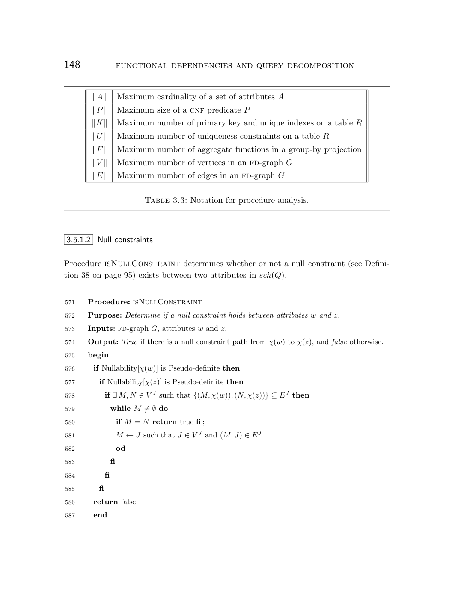
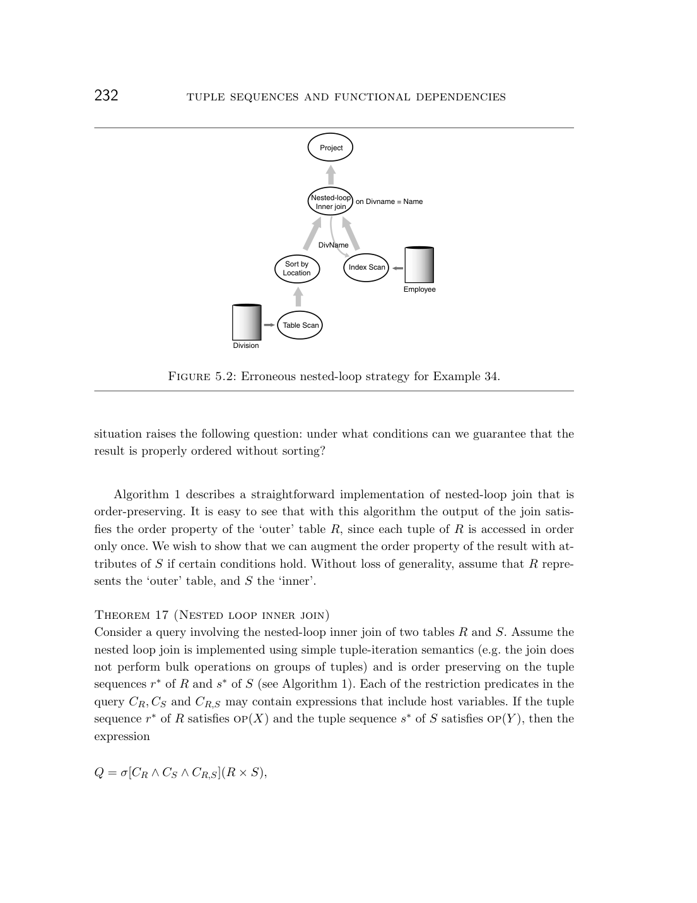

> 本组第 12 篇 · 属性与函数依赖 · [全部论文]() · [上一篇]() · [下一篇]()

论文在含NULL、三值逻辑、多重集语义和外连接的模型下定义strict/lax FD、等价约束和null constraints，以扩展FD-graph推导可用于唯一性重写和排序优化的约束。Theorem 5保证推导的约束在模型内成立，不保证找全所有约束；公理完备性未被证明。η(p,X)连同补NULL侧已有strict FD，是Lemma 7的充分保留测试，不是必要条件。排序扩展/约简需要决定属性前缀；连接顺序拼接需要额外FD/唯一性条件及保序物理实现。全外连接详细构图算法被省略。作者报告SQL Anywhere采用第4章简化算法变体及部分第5章技术，这不等于完整框架已实现或已作性能基准评测。

本文保留论文陈述、读者推断与待验证方案的区别；实验数字只适用于原文条件。原文和翻译来自已有 AI 辅助精读报告，已做来源匹配与编辑复核，不等于人工逐项核验或独立实验复现。所有页码均为 PDF 物理页。

## 论文与阅读范围

作者：Glenn Norman Paulley；年份：2000；出处：University of Waterloo 博士学位论文（Computer Science）。书目信息核对PDF物理第1页；未核查后续出版情况。本次是有限范围的原文语义复核，不是334页全文的独立复审。

[论文集中的原始 PDF](https://github.com/lonng/db-papers/blob/4ff1331069c7cf52ac97dd769e5f484c1c35c200/papers/functional-dependencies/%5Bthesis%5D-exploiting-functional-dependence-in-query-optimization.pdf) · 本地来源：`functional-dependencies/[thesis]-exploiting-functional-dependence-in-query-optimization.pdf`，共 334 页。

本篇保留 10 组原文精读和 33 条证据。截图为原始 PDF 的局部页选，不是重新生成的图表；未将整份 PDF 复制到博客。

## 研究问题与适用边界

传统关系数据库查询优化器在处理 ANSI SQL 时面临一个根本矛盾：SQL 语义包含三值逻辑（three-valued logic）、多重集（multiset semantics）、空值（NULL）以及外连接（outer join），而经典关系代数理论（如投影与选择的交换律）在这些特性下会失效。本论文的研究问题是：如何在扩展关系模型中形式化地建模、推导并利用函数依赖（Functional Dependencies, FD），以支持诸如去除冗余 Group-by 列、子查询转连接、Distinct 消除等语义查询重写。

具体而言，当存在函数依赖 P.PartID → P.Description 时，对中间结果同时按两列分组是冗余的，仅按 P.PartID 分组即可保证正确性（C002N01，第24页）。这是利用 FD 进行语义查询重写的典型场景。然而，这种优化在引入 NULL 和外连接后变得极其复杂。例如，宽松依赖（lax dependency）通常不满足传递性：仅凭严格依赖 X→Y 和宽松依赖 Y&→Z 不能一般推出 X→Z 或 X&→Z；Figure 2.1的具体反例中二者均不成立，因为 NULL 属性不会导致依赖违反，从而打破了传递链（C004N12，第60页）。

适用边界方面，论文明确指出其依赖推导算法不具备完备性（completeness）。引用 Klug 的结论指出，给定任意关系代数表达式，确定其中成立的所有依赖是不可能的，特别是差集（difference）和并集（union）算子，以及从关系与其自身的投影的连接中推导派生依赖的情况（C012N05，第135页）。此外，为简化算法和证明，作者故意忽略了 ANSI SQL 中如 'P(x) is unknown' 形式的复杂三值逻辑谓词（C024N06，第275页）。这些构成了该方法在实际工程应用中的理论边界。

依据：论文陈述；PDF 物理页 24, 60, 135, 275。证据：[C002N01](#evidence-c002n01), [C004N12](#evidence-c004n12), [C012N05](#evidence-c012n05), [C024N06](#evidence-c024n06)。

## 系统架构与数据模型

论文的核心架构建立在扩展关系模型（extended relational model）之上。该模型形式化地包含了实属性与虚属性（real and virtual attributes）、三值逻辑以及多重集语义，并定义了与之对应的 ANSI SQL 算子（C024N04，第273页）。在此模型上，架构引入了两种依赖类型：严格函数依赖（strict functional dependencies）和宽松函数依赖（lax functional dependencies），以及等价约束（equivalence constraints），用于建模唯一约束、真解释谓词（true-interpreted predicates）和外连接产生的语义。

为了在查询计划树中传播和计算这些依赖，论文构建了 extended fd-graph representation（扩展函数依赖图表示法）。该图结构不仅表示属性间的决定关系，还编码了依赖的严格性或宽松性。架构的关键组件是按所定义的代数算子传播约束，给定输入依赖集，计算输出上成立的有趣依赖集（C007N09，第87页）。作者声称分析了比 Darwen [70] 或 Klug [162] 更广泛的代数算子集合。

在标量函数的处理上，架构作出了四个严格假设以保证标量函数输出能参与 FD 推导：(1) 仅引用常量和输入属性；(2) 无副作用；(3) 幂等（相同输入始终返回相同结果）；(4) 参数列表可视为集合（参数顺序不重要）（C002N08，第30页）。若违反所需假设，则不能直接沿用本文的FD推导保证；不表示每个具体结果都必然错误。这构成了架构在表达式求值层面的前置约束。

范围限定：§3.4.9明确省略full outer join详细构图算法，只说明按Theorem 4修改左外连接算法，不能声称所有算子均提供同等详细的伪代码（QA-FD03，PDF第163页）。模型还区分tuple identifier、真实/虚拟属性、strict/lax等价边和null-constraint结构；pseudo-definite不等于结果NOT NULL（QA-FD12，PDF第132页）。参数作为依赖决定集可忽略顺序，不代表交换函数实参后值不变，Price-Cost本身就是非交换运算。

依据：论文陈述；PDF 物理页 30, 87, 132, 163, 273。证据：[C002N08](#evidence-c002n08), [C007N09](#evidence-c007n09), [C024N04](#evidence-c024n04), [QA-FD03](#evidence-qa-fd03), [QA-FD12](#evidence-qa-fd12)。

*原论文 PDF 物理页 170，版权归原作者或出版方。点击图片可查看原尺寸。页面文本中定位到：Table 3.3: Notation for procedure analysis.。这是页面定位信息，不表示本次已复核图内所有数据。*

## 核心算法与推导机制

**1. η(p,X)与补NULL侧已有FD的保留**
Definition 37定义：X至少有一个属性原本definite，或ON谓词p在该属性为NULL时不能为true，则η(p,X)=true。Lemma 7证明：若补NULL侧S中strict FD X→Y原本成立且η(p,X)=true，则该FD在左外连接结果中仍成立。它是充分测试，不是必要条件；Corollary 2明确可利用等价约束扩展保留情形（C009N11、QA-FD01，PDF第109–110页）。模型二轮审查写成“必要条件”有误。

读者构造例：R LEFT JOIN S ON R.A=S.C，已知S.C→S.D。S.C为NULL时等值谓词为unknown，η(p,{S.C})=true，因此Lemma 7足以保留S.C→S.D。结果中S.C仍可在补NULL行中为NULL，不能标成结果NOT NULL。

**2. Left Outer Join 过程的时间复杂度分解**
Claim 37 声明 Left Outer Join 过程时间复杂度为 O(‖V‖² + ‖E‖ × ‖P‖ × ‖V‖)。论文给出了按代码段的严格分解（C016N12，第191页）：
- 图合并初始化：O(‖V‖ + ‖E‖)
- 建立 null-supplying 属性与新 outer join 顶点边的循环：O(‖V‖²)
- 链接 unnested outer join 顶点：O(‖V‖)
- null-supplying 表的依赖分析三个循环：分别为 O(‖V‖ × ‖E‖ × ‖P‖)、O(‖V‖ × ‖E‖ × ‖P‖)、O(‖E‖ × ‖P‖)
- On 条件分析：O(‖P‖)（假设 fd-graph 更新为常数时间）
- strict 依赖构造：O(‖V‖)
- 标记 nullable 属性：O(‖V‖ × ‖P‖)（假设 nullability 函数 η 为 O(‖P‖)）
此处 ‖V‖ 代表顶点数，‖E‖ 代表边数，‖P‖ 代表CNF谓词大小。这是图上依赖推导过程的理论界，不是执行数据连接的复杂度或实测开销；依赖O(1)图操作、CNF谓词及η的线性谓词分析假设（QA-FD05，PDF第169页），不是整个优化器统一O(V²)的界。

**3. 排序拼接不等于所有FD的保留问题**
Theorem 19讨论保序、逐元组迭代的左外连接何时能把外侧op(X)与内侧op(Y)拼接为op(X,Y)；条件涉及结果中的X→Y或外侧X的唯一性（QA-FD08，PDF第260–261页）。第262页的单一等值ON讨论属于该排序问题，不是“复合ON一定破坏右侧已有strict FD”的一般定理。

修正原报告读者例：ON Employee.DeptID=Dept.DeptID AND Dept.DeptName='IT'中，Dept.DeptName='IT'仍是等值条件。若Dept.DeptID→Dept.DeptName在Dept中成立，ON对Dept.DeptID为null-intolerant，Lemma 7仍保证这个右侧内部FD保留。不要混淆Employee.DeptID与Dept.DeptID，也无需把Employee.DeptID假设为候选键来保留该FD。

**4. 子查询规范化不是无条件转普通连接**
§2.3.1.2将IN/SOME/ANY/ALL谓词转换为仅用EXISTS/NOT EXISTS的规范形式并处理三值逻辑；第44页说其他复杂子查询也可同样转换、但省略证明。这不是任意子查询可转普通连接的断言。Theorem 12对正EXISTS转连接另给唯一性条件，避免多重集重复（QA-FD09、QA-FD13，PDF第41、229页）。

**5. 唯一性重写的判定边界**
Theorem 11在所限制的SPJ及候选键模型内给出DISTINCT冗余的充要条件；简化算法只利用键与合取原子等值条件，测试的是充分条件，返回No不能证明一定有重复（QA-FD14，PDF第217–218、227页）。

依据：论文陈述；PDF 物理页 41, 44, 109, 110, 169, 170, 191, 217, 218, 227, 229, 260, 261, 262。证据：[C003N08](#evidence-c003n08), [C009N11](#evidence-c009n11), [C016N12](#evidence-c016n12), [C023N05](#evidence-c023n05), [QA-FD01](#evidence-qa-fd01), [QA-FD05](#evidence-qa-fd05), [QA-FD08](#evidence-qa-fd08), [QA-FD09](#evidence-qa-fd09), [QA-FD13](#evidence-qa-fd13), [QA-FD14](#evidence-qa-fd14)。

## 正确性保证与理论局限

论文的正确性保证建立在构建 strict 与 lax 依赖组合的 sound axiom system（可靠公理系统）之上（C024N04，第273页）。Theorem 5的结论是从所构造图推导的每个约束在表达式所有可能结果实例中成立；证明按表达式树高度归纳，并假设代数树正确表示原SQL（QA-FD02，PDF第165页）。本次未逐行重证全部分支。然而，正确性保证伴随着明确的理论局限和边界条件。

首先，SPJ 视图合并依赖于经典关系代数中投影与选择的交换律恒等式(2.21)。然而，该恒等式不能无条件扩展到含外连接及标量表达式的情形。原因是外连接的语义：当连接条件对至少一个保留行不为 True 时，null-supplying 侧会生成全 NULL 行。Example 13 展示了具体反例：若标量函数 f 在其参数为 NULL 时能求出确定值（如 ANSI SQL 的 Nullif、Case、Coalesce），则将外连接子查询中的投影上提会导致语义不等价（C006N06，第77页）。这证明了在包含特定标量函数的外连接上下文中，传统的代数变换是不正确的。

其次，宽松依赖的传递性断裂是正确性的另一个关键边界。Lemma 2 证明了如果中间属性集 Y 是 definite 的（无 NULL），则宽松传递性（X&→Y, Y&→Z => X&→Z）是 sound 的（C004N12，第60页）。若Y可包含NULL，该一般传递规则不再有保证，不意味着每个实例都必然违反传递结论。算法必须通过 η 函数或其他机制确保传递链条上的属性满足 definite 条件，否则推导出的依赖将导致错误的查询重写。

第三，关于全外连接（Full Outer Join），论文指出其 On condition 仅推导出有限的 lax dependencies，导致后续能将 full outer join 转为 left/right outer join 的 null-intolerant restriction predicate 无法利用缺失的依赖（C024N06，第275页）。此外，Corollary 2 仅为维持 outer join null-supplying side 已有 strict functional dependency 的 sufficient condition，未利用 null constraint 进一步证明，这意味着算法在某些合法场景下可能过于保守，但不会推导出不正确的依赖（保证了 soundness，牺牲了部分 completeness）。

最后，fd6的lax→strict强化要求XY-definite，而strict FD定义本身不要求所有列NOT NULL：strict比较允许两值同时为NULL（PDF第57–60页）。公理完备性未被证明，构图也不保证找全依赖（QA-FD04、C012N05）。§3.4.9省略全外连接详细算法，不能声称所有实现细节都已展示验证。

排序/分组：op(X,A,Y)中只有在前缀X→A时才可删A；属性替换要求逐元组值等价，不是仅凭双向FD。物理实现须保序，hash join或block nested-loop不能自动套用。分组可利用分组列不同排列/升降方向的聚簇性；DISTINCT聚合需要聚合属性后缀，文中这种sort-based方式至多处理一个distinct aggregate（QA-FD06、QA-FD07、QA-FD10，PDF第248、251、265页）。

依据：论文陈述；PDF 物理页 57, 58, 60, 77, 87, 163, 165, 248, 249, 251, 265, 273, 275, 281。证据：[C004N12](#evidence-c004n12), [C006N06](#evidence-c006n06), [C007N09](#evidence-c007n09), [C024N04](#evidence-c024n04), [C024N06](#evidence-c024n06), [QA-FD02](#evidence-qa-fd02), [QA-FD03](#evidence-qa-fd03), [QA-FD04](#evidence-qa-fd04), [QA-FD06](#evidence-qa-fd06), [QA-FD07](#evidence-qa-fd07), [QA-FD10](#evidence-qa-fd10), [QA-FD15](#evidence-qa-fd15)。

## 实验评估与工业落地

本节区分作者的实现陈述、理论调用计数与正确性反例。§6.3明确说没有构建用于比较不同实现效率的原型（QA-FD04，PDF第281页）；这不抹去第3章已有的条件式渐近分析，也不否认下述简化算法的商业采用。

**1. 工业落地：Sybase SQL Anywhere**
作者在结论中报告Sybase SQL Anywhere实现了 Chapter 4 中 simplified fd-graph algorithms 的两个变体。应用场景包括：确定 subquery-to-join transformations（包括需要后续 duplicate elimination 的转换）的正确性，以及在 SPJ queries、nested queries 和 SPJ views 上进行 Distinct elimination。这些算法已扩展支持 left outer joins、grouping、aggregation，并利用 Where 子句导出的 equivalence constraints。实现的一个显著结果是使更大类的 join elimination optimizations 成为可能，直接影响查询执行时间（C024N05，第274页）。
*证据范围*：已核对实现说明没有提供可复核的测试环境、负载、基线和实测加速数据。只能报告作者所述的部分采用，不能将完整第3章框架的性能或普遍收益视为已验证。

**2. IMS 层次数据库示例（Example 38）**
IMS 示例展示了 join 转 subquery 的收益：原 join 策略在内层循环需两次 GNP（Get Next within Parent）调用（第二次总是返回 'GE' 失败状态），改写为 Exists subquery 后，内层找到第一个匹配即可停止，针对vsupply段的DL/I/GNP调用次数减半。若连接谓词涉及非键属性（如 OEM-PartID），join 策略需扫描所有匹配段，而 nested 版本一旦找到匹配立即停止搜索，可能进一步降低访问代价，并非实测加速倍数。此优化的必要条件是 at most a single instance of vsupply can join with each vendor（C024N11，第278-279页）。
*指标与数字性质修正*：“针对vsupply段的DL/I/GNP调用次数减半”是 Example 38 针对特定层次数据库访问路径（GNP 调用模式）的理论分析结果，而非在真实硬件上测量的性能实验数据。将其归类为实验评估中的实测基准测试结果会产生误导。*边界*：依赖于底层存储引擎（IMS 层次结构）的访问路径特性，不能直接泛化为关系型数据库中 Hash Join 与 Nested Loop 的通用性能对比。

**3. 嵌套循环连接的反例验证（Example 34）**
Example 34 给出了一个嵌套循环连接的反例：查询按 D.Location, E.EmpID 排序，但由于 Location 属性不唯一，可能存在两个 division 具有相同 location 但 employee id 集合不同且重叠的情况，导致图 5.2 所示的 nested-loop 策略无法在所有数据库实例上返回正确排序结果。这说明仅凭外层表满足某 order property 并不能无条件地将内层表的 order property 拼接到结果中（C022N07，第253-254页）。
*实验性质*：这是一个逻辑正确性反例，而非性能实验。它验证了排序属性传递算法的边界条件。

**4. 优化搜索的成本边界**
第245页讨论利用排序状态时子计划选择会依赖上下文，经典动态规划及DB2所用启发式剪枝因此没有文中意义下的全局最优保证（C021N09）。这不是所有DP优化器一定输出非最优计划的证明，也没有给出状态空间必然指数增长的定量结论。

依据：论文陈述；PDF 物理页 245, 253, 254, 274, 278, 279, 281。证据：[C021N09](#evidence-c021n09), [C022N07](#evidence-c022n07), [C024N05](#evidence-c024n05), [C024N11](#evidence-c024n11), [QA-FD04](#evidence-qa-fd04)。

*原论文 PDF 物理页 254，版权归原作者或出版方。点击图片可查看原尺寸。页面文本中定位到：Figure 5.2: Erroneous nested-loop strategy for Example 34.。这是页面定位信息，不表示本次已复核图内所有数据。*

## 设计权衡与工程取舍

本节基于论文事实进行读者推断，探讨该理论框架在数据库内核工程中面临的设计权衡。论文正文主要关注约束推导的可靠性与算法正确性，较少讨论系统工程层面的资源消耗权衡。

**1. Soundness 与 Completeness 的权衡**
论文明确承认无法推导出 F+ 中的所有可能依赖（C012N05，第135页）。这是一种刻意的设计权衡：在论文模型和前提内保证推导可靠（Soundness），牺牲了发现所有潜在优化机会的能力（Completeness）。在数据库内核中，错误的 FD 推导会导致静默的数据错误（如错误消除Distinct导致重复行保留、结果行数可能增加），其代价远高于错过一次优化。第275页明确说为简化算法和证明，故意忽略实践中罕见的'P(x) is unknown'谓词（C024N06），不能反过来说原文没有给出动机。

**2. 图维护与按需闭包的权衡**
§3.8直接讨论了空间、维护软件复杂度、反复按需重算闭包可能更贵等取舍，未证明某一种表示最佳。O(V+E)闭包在这里是counter technique的可改进方向，不是已实现并测量的结果（QA-FD11，PDF第212页）。第245页的搜索限制也不应推广为所有动态规划方法的失败定理。

**3. 函数前提与复合ON**
读者建议：实现区分确定性、无副作用与NULL容忍性。COALESCE/CASE并非仅因能对NULL返回非空值就违反确定性假设；确定性关系到FD来源，NULL容忍性关系到外连接和投影变换（C002N08、C006N06）。Theorem 19的排序拼接限制不能推出复合ON下不再可利用任何FD做Join/Distinct elimination，需逐个检查依赖及目标重写前提。

依据：读者推断；PDF 物理页 30, 77, 110, 135, 212, 213, 245, 262, 275。证据：[C002N08](#evidence-c002n08), [C012N05](#evidence-c012n05), [C021N09](#evidence-c021n09), [C023N05](#evidence-c023n05), [C024N06](#evidence-c024n06), [C006N06](#evidence-c006n06), [QA-FD11](#evidence-qa-fd11), [QA-FD01](#evidence-qa-fd01)。

## 相关工作与技术对比

本节基于论文引用的相关工作进行读者推断与对比分析。论文本身主要与学术界早期工作进行对比，未涉及现代开源 OLAP 引擎。

**1. 与 Darwen 和 Klug 的对比**
论文明确指出，其分析的代数算子集合比 Darwen [70] 或 Klug [162] 更广泛，特别是包含了左外连接和全外连接（C007N09，第87页）。Klug 的结论被引用来证明依赖推导的不可能性（C012N05，第135页），表明本论文是在前人划定的理论边界内寻找最大化的实用子集。本论文的 extended relational model 引入了三值逻辑和多重集语义（C024N04，第273页），使其更贴近 ANSI SQL 标准。*修正*：删除了对 Darwen 工作范围（如“主要集中在经典关系代数”）的定性描述，因原文未提供证据支撑该推断，仅保留本论文分析的算子集合比 Darwen 更广这一事实。

**2. 现代系统对照仅列为待验证问题**
本次未读取其他系统源码，不给Calcite、StarRocks、DuckDB归类优化器框架，也不把RelTraitSet、Memo或物理属性机制认定为本文模型的实现。目标系统如何维护nullable-unique、FD/等价约束，以及哪些物理算子保序，均须另查，不是本论文已给出的结论。

**3. 非关系系统的访问路径取舍**
§6.2的IMS导航访问例支持在特定唯一性条件下将join转为EXISTS，以省去针对vsupply的一次必败GNP调用（C024N11）。它说明重写收益取决于物理访问方式，不证明某种连接策略在层次或关系数据库中普遍更优。

依据：读者推断；PDF 物理页 87, 135, 273, 278, 279。证据：[C007N09](#evidence-c007n09), [C012N05](#evidence-c012n05), [C024N04](#evidence-c024n04), [C024N11](#evidence-c024n11)。

## 复现指南与验证建议

本节为读者推断与实验建议，旨在为数据库内核工程师提供复现或验证论文核心机制的指导。本次核对页段未取得可直接运行的实现或测试套件；以下是读者实验建议，不是论文实验结果。

**1. 图模型与复杂度**
建议区分属性/复合决定集/tuple-ID/外连接顶点、strict/lax FD与等价边、null constraints，以及definite/nullable/pseudo-definite状态；不能只存二值非空标记（QA-FD12）。Claim 37的总界是O(V²+E×P×V)，不是O(V²)；P是CNF谓词大小，图操作和η的成本假设也需测量。

**2. 分离测试η与函数语义**
读者建议：测试已知右侧strict FD在简单等值、复合等值和NULL容忍ON下的保留/降为lax；核验η=true足够但并非必要。把不确定函数与确定但NULL-tolerant的COALESCE/CASE分开测试，不能自动把后两者判为不确定。比较多重集结果与NULL行，不只检查是否省略Sort。

**3. 嵌套循环排序反例的集成测试**
基于 Example 34（C022N07，第253-254页），建议在目标数据库系统中构造包含重复非唯一键的嵌套循环连接查询，验证优化器是否会错误地省略 Sort 算子。具体步骤：创建 Division 表和 Employee 表，插入具有相同 Location 但不同 EmpID 集合的数据，执行要求按 Location, EmpID 排序的查询，检查执行计划中是否缺失 Sort 节点，并比对结果集的正确性。

**4. 可复现范围**
第2章确实给出了研究SQL子集及代数语义，第3章提供大部分算子算法，因此“没有语法与代数映射”不成立。全外连接详细构图算法明确省略，第281页也明确没有完整框架的效率比较原型。可实现选定机制并独立测量，不能据此声称已复现SQL Anywhere产品实现，也不应断言任何完整复现绝对不可能（QA-FD03、QA-FD04）。

依据：待验证的工程设想；PDF 物理页 30, 109, 110, 132, 133, 163, 169, 191, 253, 254, 281。证据：[C002N08](#evidence-c002n08), [C009N11](#evidence-c009n11), [C016N12](#evidence-c016n12), [C022N07](#evidence-c022n07), [QA-FD01](#evidence-qa-fd01), [QA-FD03](#evidence-qa-fd03), [QA-FD04](#evidence-qa-fd04), [QA-FD05](#evidence-qa-fd05), [QA-FD12](#evidence-qa-fd12)。

## 总结与工程启示

本论文系统地解决了在包含 NULL、三值逻辑和外连接的扩展 SQL 语义下，如何安全地推导和利用函数依赖进行查询优化的问题。其核心贡献在于形式化了 strict 与 lax 依赖的公理系统，提出了 extended fd-graph 及其在各关系代数算子上的推导算法，并用Nullability函数η(p,X)给出补NULL侧已有严格依赖的充分保留测试（C024N04，第273页；C009N11，第109页）。

从工程启示来看，论文揭示了几个关键事实：第一，依赖推导本质上是不完备的（C012N05，第135页），优化器设计者必须在追求更多优化机会与保证算法终止性/正确性之间做出妥协；第二，利用 FD 消除冗余操作（如 Group-by 简化、Distinct 消除、Join 消除）具有直接的工业价值，Sybase SQL Anywhere 的落地证明了这一点（C024N05，第274页）；第三，排序属性的传递并非无条件成立，特别是在嵌套循环和外连接场景下，需要保序物理实现并校验定理中的FD或唯一性条件，而非一律要求唯一键（C022N07，第253-254页；C023N05，第262页）。

论文的局限性同样明确：忽略了复杂的三值逻辑谓词，全外连接的依赖推导能力有限，且标量函数的四个严格假设在实际 UDF 场景中难以普遍满足（C024N06，第275页；C002N08，第30页）。对于现代数据库内核工程师而言，本文提供了一套严谨的理论词汇表和边界检查清单，可作为检查外连接重写和排序约简前提的参考。模型可靠性证明不等于实现无bug、依赖完备或普遍性能改善；完整框架仍缺实证效率比较（QA-FD02、QA-FD04）。

依据：论文陈述；PDF 物理页 30, 109, 110, 135, 165, 251, 253, 254, 262, 273, 274, 275, 281。证据：[C002N08](#evidence-c002n08), [C009N11](#evidence-c009n11), [C012N05](#evidence-c012n05), [C022N07](#evidence-c022n07), [C023N05](#evidence-c023n05), [C024N04](#evidence-c024n04), [C024N05](#evidence-c024n05), [C024N06](#evidence-c024n06), [QA-FD01](#evidence-qa-fd01), [QA-FD02](#evidence-qa-fd02), [QA-FD04](#evidence-qa-fd04), [QA-FD07](#evidence-qa-fd07)。

## 原文精读：从句子回到机制

以下保留原文、忠实翻译、含义与边界；假设示例不作为论文实验结果。

### P001 · PDF 物理页 24

**原文**

<blockquote class="paper-source-quote"><pre><code>2&#10;introduction&#10;P.PartID is the key of the Part table there exists the functional dependency P.PartID&#10;−→P.Description. Consequently grouping the intermediate result by both columns is&#10;unnecessary—grouping the rows by P.PartID alone is sufficient1.</code></pre></blockquote>

**忠实翻译**

> 2 引言 P.PartID 是 Part 表的键，因此存在函数依赖 P.PartID −→ P.Description。所以，按两列对中间结果进行分组是不必要的——仅按 P.PartID 对行进行分组就足够了1。

**技术含义与边界**

> 原文陈述：当分组键集合中包含某表的主键时，由于主键已唯一确定该表的其他属性（如 Description），额外的分组列不会改变分组粒度，可被省略。这是查询优化中利用函数依赖消除冗余分组的典型手段。适用边界：前提是 P.PartID 确为键且该函数依赖在中间结果上成立。读者推断：优化器可在生成执行计划前通过依赖分析自动识别并裁剪多余的 GROUP BY 列。

**常见误读**

> 原文例中主键提供了所需FD，但不能反过来说只有键才能简化分组。一般须证明保留分组列严格决定被删列、且FD在分组输入上成立；也不能只凭lax FD在NULL处任意合并组。

**读者构造的假设示例**

> 读者构造的假设示例：假设 Part 表有 (PartID=1, Description='A') 和 (PartID=2, Description='B') 两行，中间结果包含这两列。按 (PartID, Description) 分组与仅按 PartID 分组产生的组数相同，因为 PartID 唯一决定 Description。

### P002 · PDF 物理页 279

**原文**

<blockquote class="paper-source-quote"><pre><code>6.2&#10;exploiting uniqueness in nonrelational systems&#10;257&#10;This version reduces the number of dl/i calls against the vsupply segment by half,&#10;since the second GNP call in the join strategy (line 1722) will always fail with a ‘GE’ (not&#10;found) status code.</code></pre></blockquote>

**忠实翻译**

> 6.2 在非关系系统中利用唯一性 257 此版本将针对 vsupply 段的 dl/i 调用次数减少了一半，因为在连接策略中的第二个 GNP 调用（第 1722 行）总是会失败，返回 'GE'（未找到）状态码。

**技术含义与边界**

> 原文针对Example 38的访问伪代码计数：在给定part条件下，每个vendor至多匹配一个vsupply实例，第二次GNP必败，可改为EXISTS后早停。减半的是针对vsupply段的调用次数，不是物理I/O、所有DL/I调用或查询耗时的测量。

**常见误读**

> 容易误认为所有 GNP 调用都可以被省略或减半。原文不支持此结论：只有当唯一性约束保证父段下不存在第二个匹配子段时，第二个 GNP 才会必然返回 GE。若无此唯一性前提，省略调用会导致丢失数据。

**读者构造的假设示例**

> 读者构造例：某vendor针对所查PartID恰有一个匹配vsupply实例。原循环第一次GNP命中、第二次返回GE；EXISTS版本只做第一次，省掉一次必败调用。不能把这推成包括外侧VENDOR访问在内的总调用数或耗时减半。

### P003 · PDF 物理页 135

**原文**

<blockquote class="paper-source-quote"><pre><code>thesis). Maier also shows that finding a minimal cover with fewer than k&#10;vertices is also np-complete.&#10;Perhaps most importantly, we cannot guarantee that the algorithms below determine&#10;all possible dependencies in F+. Klug [162] showed that given an arbitrary relational&#10;algebra expression e it was impossible to determine all the dependencies that held in e.</code></pre></blockquote>

**忠实翻译**

> 论文）。Maier 还证明了寻找顶点数少于 k 的极小覆盖也是 NP 完全的。也许最重要的是，我们无法保证下面的算法能确定 F+ 中所有可能的依赖。Klug [162] 证明了给定一个任意的关系代数表达式 e，不可能确定 e 中成立的所有依赖。

**技术含义与边界**

> 原文陈述了两个理论限制：(1) 寻找规模受限的极小函数依赖覆盖是 NP 完全问题；(2) 对于任意关系代数表达式，无法计算其输出上成立的全部依赖闭包 F+。这意味着依赖推导算法只能发现部分依赖，而非全部。适用边界：针对任意复杂的关系代数表达式；对于受限的子集可能存在完备算法。

**常见误读**

> 容易误认为文中提到的算法能够推导出所有隐含的函数依赖。原文明确否定了这一点（cannot guarantee... all possible dependencies），并以 Klug 的不可判定性结果作为依据。不应将算法的部分推导能力等同于完备性。

**读者构造的假设示例**

> 读者说明：任意表达式上的一般不可判定结果不代表每个简单join都必然遗漏FD。对一个给定查询，仍应检查具体规则与实际表示，不能仅凭一般理论断言该例一定不完备。

### P004 · PDF 物理页 87

**原文**

<blockquote class="paper-source-quote"><pre><code>In particular, for each relational algebra operator (projection, selec-&#10;tion, etc.) we give an algorithm to compute the set of interesting dependencies that hold&#10;on output, given the set of dependencies that hold for its inputs. Our contributions are:&#10;1. we analyze a wider set of algebraic operators (including left- and full outer join)&#10;than did Darwen [70] or Klug [162], and in addition consider the implications of&#10;null values and sql2 semantics;&#10;2.</code></pre></blockquote>

**忠实翻译**

> 特别地，对于每个关系代数运算符（投影、选择等），我们给出一个算法，用于在给定输入上成立的依赖集的情况下，计算输出上成立的有趣依赖集。我们的贡献是：1. 与 Darwen [70] 或 Klug [162] 相比，我们分析了更广泛的代数运算符集合（包括左外连接和全外连接），此外还考虑了空值和 SQL2 语义的影响；2.

**技术含义与边界**

> 原文陈述：作者提出了一套针对各关系代数运算符的依赖传播算法，输入为操作数上的依赖集，输出为结果上的依赖集。其扩展点在于覆盖了左外连接和全外连接，并处理了 NULL 值及 SQL2 语义。适用边界：限于所列举的运算符及其定义的语义模型。读者推断：此前的工作（Darwen, Klug）未充分覆盖外连接或 NULL 语义。 但§3.4.9在PDF第163页明确省略全外连接详细构图算法；概述不等于每个算子的伪代码均完整展示。

**常见误读**

> 容易误认为该算法能处理所有 SQL 特性或所有类型的依赖。原文限定为 'interesting dependencies'（有趣的依赖）以及特定的代数运算符集合，并未声称覆盖所有 SQL 结构或所有依赖类型。

**读者构造的假设示例**

> 读者构造例：R LEFT JOIN S，若A→B只涉及保留侧R的列，则原有FD可保留。若依赖来自补NULL侧S，则应按Lemma 7等条件判断是否仍strict或仅能保留为lax；不要把两侧混为一谈。

### P005 · PDF 物理页 30

**原文**

<blockquote class="paper-source-quote"><pre><code>Then we interpret ‘margin’ as a scalar function λ with two input parameters P.Price&#10;and P.Cost. In this thesis we assume that scalar functions (1) reference only constants&#10;κ and input attributes; (2) are free of side-effects; (3) are idempotent—they return the&#10;same result for the same input values in every case; and (4) for the purposes of functional&#10;dependency analysis the function’s parameter list can be treated as a set, that is, the&#10;order of the function’s parameters is unimportant.</code></pre></blockquote>

**忠实翻译**

> 然后我们将 'margin' 解释为一个具有两个输入参数 P.Price 和 P.Cost 的标量函数 λ。在本文中，我们假设标量函数 (1) 仅引用常量 κ 和输入属性；(2) 无副作用；(3) 是幂等的——在任何情况下对相同的输入值返回相同的结果；并且 (4) 为了函数依赖分析的目的，函数的参数列表可以被视为一个集合，即函数参数的顺序不重要。

**技术含义与边界**

> 原文对函数要求仅依赖给定常量和输入、无副作用、相同输入值总产生同一输出。论文在此用idempotent一词表达确定性，并非通常的f(f(x))=f(x)。参数列表作为FD的决定属性集时可忽略顺序和重复，但不表示函数值对实参排列不变。

**常见误读**

> 不能把参数集合化读成函数交换律。Price-Cost是原文自己的非交换表达式：{Price,Cost}决定其结果，并不意味着Price-Cost=Cost-Price。COALESCE/CASE也不因NULL容忍性就自动违反确定性前提。

**读者构造的假设示例**

> 读者构造例：Margin=Price-Cost有FD {Price,Cost}→Margin，输入的具名取值固定后结果固定。交换两个参数的角色可改变值，但不改变该表达式依赖于哪两个输入属性。若函数还依赖未建模的可变外部状态，则不能直接沿用这个FD。

### P006 · PDF 物理页 191

**原文**

<blockquote class="paper-source-quote"><pre><code>Claim 37 (Analysis)&#10;Procedure Left Outer Join executes in time proportional to O(∥V ∥2 + ∥E∥× ∥P∥×&#10;∥V ∥).&#10;Proof. We proceed by code section, following our explanation of the algorithm in Sec-&#10;tion 3.4.8.1 beginning on page 137.&#10;1.</code></pre></blockquote>

**忠实翻译**

> 断言 37（分析）过程 Left Outer Join 的执行时间与 O(∥V∥² + ∥E∥ × ∥P∥ × ∥V∥) 成正比。证明。我们按照代码段进行，遵循我们在第 137 页开始的第 3.4.8.1 节中对算法的解释。1.

**技术含义与边界**

> Claim 37分析的是FD-graph上的Left Outer Join依赖推导过程，不是物理数据连接。V是图顶点规模，E是边规模，P是CNF谓词大小（§3.5.1.1及Table 3.3，PDF第169–170页）。界依赖O(1)图操作和η按谓词大小线性分析等假设，不是实测优化器开销。

**常见误读**

> 容易误认为这是所有左外连接实现的通用复杂度。原文不支持此泛化：这是针对文中特定 'Procedure Left Outer Join' 的分析结果，依赖于特定的数据结构（图表示）和算法逻辑。不同实现可能有不同复杂度。

**读者构造的假设示例**

> 读者代数示例：令V=10、E=20、P=5，将上界表达式代入得V²+E×P×V=1100。这里只展示表达式的代入，不代表1100次实际操作、固定耗时或精确工作量；大O省略常数和低阶项，P也不是5个属性。

### P007 · PDF 物理页 330

**原文**

<blockquote class="paper-source-quote"><pre><code>. . 108–109&#10;lax functional dependency . . 36, see functional de-&#10;pendency&#10;closure . . . . . . . . . . . . . . . . . . . . . . . . . . . . . . .67, 174&#10;conversion to strict dependency 37, 73, 78, 80,&#10;89, 95, 107, 121, 125–126, 128, 134, 137&#10;implied by&#10;full outer join . . . . . . . . . . . . . . . . . . . . .100–101&#10;intersection . . . . . . . . . . . . . . . . . . . . . . . . .</code></pre></blockquote>

**忠实翻译**

> . . 108–109 lax 函数依赖 . . 36, 参见 functional dependency closure . . . . . . . . . . . . . . . . . . . . . . . . . . . . . . .67, 174 转换为严格依赖 37, 73, 78, 80, 89, 95, 107, 121, 125–126, 128, 134, 137 由...蕴含 full outer join . . . . . . . . . . . . . . . . . . . . .100–101 intersection . . . . . . . . . . . . . . . . . . . . . . . . .

**技术含义与边界**

> 原文陈述：这是索引片段，列出了 'lax functional dependency'（宽松函数依赖）的相关页码，以及 'conversion to strict dependency'（转换为严格依赖）和 'implied by full outer join / intersection'（由全外连接/交集蕴含）的页码引用。说明全文围绕 lax 依赖与 strict 依赖的转换及在不同运算符下的推导展开。

**常见误读**

> 容易误将此索引片段当作技术定义或定理。原文仅为目录/索引条目，不包含任何机制解释或证明。不能从中推断出转换的具体条件或全外连接如何蕴含依赖。

**读者构造的假设示例**

> 索引导航示例：此页的100–101是论文印刷页，按本文件正文偏移+22，对应PDF物理第122–123页，不是物理第100–101页。本次未据这一索引条目核验那两页的完整机制；相关正文阅读范围另列，索引不能替代证明。

### P008 · PDF 物理页 245

**原文**

<blockquote class="paper-source-quote"><pre><code>in the case of Select Top n&#10;queries) through order-preserving operations to restrict the size of intermediate re-&#10;sults [44].&#10;Such analysis, however, comes at a cost to the process of optimization [261]. Utilizing the&#10;sort order of a tuple stream means that an optimizer implemented with a classic dynamic&#10;programming algorithm [247] can no longer produce optimal access plans, since the choice&#10;of join strategy for a sub-plan may differ depending on the sort order of the strategy for&#10;an outer query block [100].</code></pre></blockquote>

**忠实翻译**

> 在 Select Top n 查询的情况下）通过保序操作来限制中间结果的大小 [44]。然而，这种分析是以优化过程的成本为代价的 [261]。利用元组流的排序顺序意味着使用经典动态规划算法 [247] 实现的优化器不再能产生最优访问计划，因为子计划的连接策略选择可能会根据外层查询块策略的排序顺序而有所不同 [100]。

**技术含义与边界**

> 原文讨论利用排序状态后子计划选择依赖上下文，并说明经典动态规划优化器的实现及DB2启发式剪枝的最优性限制。可据此提醒需要保留相关排序状态，不能推出每个查询都会次优、所有DP优化器都不能处理排序，或状态空间一定按某个指数式增长。

**常见误读**

> 此处没有给出对所有动态规划算法的普遍不可能性证明，也没有保证任何启发式剪枝安全。报告只能保留作者在该优化语境下的限制陈述，不把“无全局保证”改写成“每次必然非最优”。

**读者构造的假设示例**

> 读者构造的假设示例：假设子查询 Q1 可通过哈希连接或排序合并连接执行。若外层需要有序输出，Q1 选排序合并更优；若外层不需要，哈希连接可能更优。经典 DP 若只为 Q1 保留一个最优子计划，则可能在外层需要有序时选择了错误的子计划，从而失去全局最优性。

### P009 · PDF 物理页 109

**原文**

<blockquote class="paper-source-quote"><pre><code>For brevity, we assume the existence&#10;of a nullability function η(p, X) that determines if either case (a) or (b) holds for the&#10;determinant of any strict dependency f.&#10;Definition 37 (Nullability function)&#10;The function η(p, X) over attributes α(p) ∪X evaluates to true if and only if at least one&#10;attribute x ∈X meets one of the following conditions:&#10;1. x is guaranteed to be definite, or&#10;2. x ∈α(p) and p evaluates to false or unknown whenever x is Null.&#10;Otherwise, η(p, X) evaluates to false.</code></pre></blockquote>

**忠实翻译**

> 为简洁起见，我们假设存在一个可空性函数 η(p, X)，用于确定对于任何严格依赖 f 的决定因素，情况 (a) 或 (b) 是否成立。定义 37（可空性函数）在属性 α(p) ∪ X 上的函数 η(p, X) 当且仅当至少一个属性 x ∈ X 满足以下条件之一时求值为 true：1. x 保证是确定的（definite），或 2. x ∈ α(p) 且每当 x 为 Null 时 p 求值为 false 或 unknown。否则，η(p, X) 求值为 false。

**技术含义与边界**

> 在左外连接语境中，η(p,X)检查决定集X至少一个属性是否原本非NULL，或在匹配的右侧元组中会被ON的null-intolerance约束为非NULL。结合S上已成立的strict FD，Lemma 7给出充分保留条件。它并不排除最终输出中的补NULL行。

**常见误读**

> η=true既不表示所有决定属性均非NULL，也不表示最终结果中决定集绝不会全NULL。未匹配行仍可补NULL，只是此时右侧依赖的被决定值也一起补NULL，所以不破坏该strict FD；该测试也不是必要条件。

**读者构造的假设示例**

> 读者构造例：S中有strict FD {A,B}→C，ON中合取A>0。匹配右侧行的A非NULL，所以η(p,{A,B})=true；输出中的未匹配保留侧行仍可带(A,B,C)=(NULL,NULL,NULL)。Lemma 7允许该FD继续strict，不能因此把A标成结果NOT NULL。

### P010 · PDF 物理页 60

**原文**

<blockquote class="paper-source-quote"><pre><code>Strengthening&#10;fd6&#10;If X &amp;−→Y and I(R) is XY -definite then X −→Y .&#10;Strict transitivity&#10;fd7a&#10;If X −→Y and Y −→Z then X −→Z.&#10;Proof. Omitted.&#10;✷&#10;Note that, in general, transitivity does not hold for lax dependencies in the same way&#10;that transitive relationships break down for other definitions of weak dependencies [17]&#10;[16, pp. 243]. Consider the table instance shown in Figure 2.1.</code></pre></blockquote>

**忠实翻译**

> 强化 fd6 如果 X &−→ Y 且 I(R) 是 XY-确定的（XY-definite），则 X −→ Y。严格传递性 fd7a 如果 X −→ Y 且 Y −→ Z，则 X −→ Z。证明。省略。✷ 注意，一般而言，传递性对 lax 依赖不成立，正如传递关系在其他弱依赖定义中也会失效一样 [17] [16, pp. 243]。考虑图 2.1 所示的表实例。

**技术含义与边界**

> 原文陈述：给出了两条推理规则。fd6 表明当 lax 依赖（&−→）的决定因素和被决定因素在实例上均非空（XY-definite）时，可强化为严格依赖（−→）。fd7a 表明严格依赖满足传递性。但明确指出 lax 依赖一般不满足传递性。适用边界：fd6 需要 definite 前提；fd7a 仅限严格依赖；lax 依赖不可直接套用传递律。

**常见误读**

> 容易误将严格依赖的传递性推广到 lax 依赖。原文明确警告 'in general, transitivity does not hold for lax dependencies'，并引用文献支持。若对 lax 依赖使用传递性推导，会得到错误结论。

**读者构造的假设示例**

> 沿原文Figure 2.1反例：两行(A,B,C)=(3,NULL,5)、(3,NULL,3)。A→B为strict，A laxly determines B及B laxly determines C也成立，但A不能strictly或laxly决定C。此例真正共享同一个非NULL的A值；仅说两行B为NULL而不固定A，不能构成反例。

## 尚未解决的问题

1. 目标系统实际维护哪些nullable-unique、FD、等价和null constraints？需读取源码，不能凭系统名称推断。
2. 按需闭包与缓存/增量维护在代表性查询上的时间和空间取舍如何？这是§3.8留下的效率问题。
3. 如何用多重集和NULL反例交叉验证本次未逐行核查的构图/闭包证明分支及其实现？
4. 补全遗漏依赖带来的优化机会与维护开销各有多大？本报告未测量。
5. 排序约简与一个DISTINCT聚合后缀的前提在目标物理算子中是否真正保序？多个不同DISTINCT聚合需另行设计，不能直接套用文中方法。

## 证据索引

证据编号沿用原报告，便于将上文判断追溯到原句。引文匹配只验证位置，不证明解读正确。

**C002N01 · PDF 物理页 24**

在存在函数依赖 P.PartID → P.Description 的前提下，对中间结果同时按两列分组是冗余的，仅按 P.PartID 分组即可保证正确性。这是利用 FD 进行语义查询重写（去除冗余 Group-by 列）的典型场景。文中脚注提及 ANSI SQL 标准委员会曾考虑允许省略被函数决定的列，但属于个人通信而非已发布标准。

<blockquote class="paper-source-quote"><pre><code>P.PartID is the key of the Part table there exists the functional dependency P.PartID −→P.Description. Consequently grouping the intermediate result by both columns is unnecessary</code></pre></blockquote>

**C002N08 · PDF 物理页 30**

标量函数仅引用常量和输入属性、无副作用且相同输入给相同结果。输入属性作为FD决定集可集合化，但不代表函数交换律；违反相关前提时不能直接沿用本文推导保证。

<blockquote class="paper-source-quote"><pre><code>In this thesis we assume that scalar functions (1) reference only constants κ and input attributes; (2) are free of side-effects; (3) are idempotent</code></pre></blockquote>

**C003N08 · PDF 物理页 44**

第44页without-proof的扩展断言针对前文EXISTS/NOT EXISTS规范化，不是任意子查询转普通连接的保证；须结合第41–43页阅读。

<blockquote class="paper-source-quote"><pre><code>We claim, without proof, that all other forms of subquery predicates that occur in a Where clause can be converted in the same manner</code></pre></blockquote>

**C004N12 · PDF 物理页 60**

宽松依赖通常不满足传递性。Figure 2.1提供了一个反例：严格依赖X->Y和宽松依赖Y&->Z同时成立，但X->Z和X&->Z均不成立。原因是宽松依赖的定义使得Null属性不会导致依赖违反，从而打破了传递链。但是，Lemma 2证明了如果中间属性集Y是definite的（无null），则宽松传递性fd7b（X&->Y, Y&->Z => X&->Z）是sound的。

<blockquote class="paper-source-quote"><pre><code>transitivity does not hold for lax dependencies in the same way that transitive relationships break down</code></pre></blockquote>

**C006N06 · PDF 物理页 77**

第77页Example 13表明：若投影中的标量函数对NULL能返回非NULL，不能无条件把它从补NULL侧子查询移到外连接之后求值；不是断言所有含外连接的视图合并都必然失败。

<blockquote class="paper-source-quote"><pre><code>Identity (2.21) above, originally defined for classical relational algebra, fails to hold when e can contain any form of outer join</code></pre></blockquote>

**C007N09 · PDF 物理页 87**

第3章概述按算子推导interesting dependencies并处理SQL NULL/多重集/外连接；§3.4.9另明确省略全外连接详细算法，不能据概述声称每种算子的实现细节均已展开。

<blockquote class="paper-source-quote"><pre><code>we analyze a wider set of algebraic operators (including left- and full outer join) than did Darwen [70] or Klug [162]</code></pre></blockquote>

**C009N11 · PDF 物理页 109**

Definition 37形式化了Nullability函数η(p, X)，用于判断Left Outer Join中null-supplying侧的strict FD能否保留。η(p, X)在属性集α(p)∪X上求值，当且仅当X中至少有一个属性x满足以下条件时为true：1. x保证是definite的；2. x∈α(p)且当x为Null时p求值为false或unknown。该函数封装了前述的条件(a)和(b)，为Lemma 7提供了判定基础。这是正确性保证的关键组件，而非启发式剪枝。

<blockquote class="paper-source-quote"><pre><code>The function η(p, X) over attributes α(p) ∪X evaluates to true if and only if at least one attribute x ∈X meets one of the following conditions:</code></pre></blockquote>

**C012N05 · PDF 物理页 135**

作者坦承无法保证算法能推导出 F+ 中的所有可能依赖。引用 Klug 的结论指出，给定任意关系代数表达式 e，确定其中成立的所有依赖是不可能的。特别棘手的情况包括差集（difference）和并集（union）算子，以及从关系与其自身的投影的连接中推导派生依赖。因此，该模型不具备依赖推导的完备性（completeness），但作者声称对一大类查询能推导出有用的依赖集合。这是该方法的根本理论局限。

<blockquote class="paper-source-quote"><pre><code>we cannot guarantee that the algorithms below determine all possible dependencies in F+</code></pre></blockquote>

**C016N12 · PDF 物理页 191**

理论复杂度分析，非性能实验：Claim 37声明Left Outer Join过程时间复杂度为O(‖V‖²+‖E‖×‖P‖×‖V‖)。证明按代码段分解：图合并初始化O(‖V‖+‖E‖)；建立null-supplying属性与新outer join顶点边的循环O(‖V‖²)；链接unnested outer join顶点O(‖V‖)；null-supplying表的依赖分析三个循环分别为O(‖V‖×‖E‖×‖P‖)、O(‖V‖×‖E‖×‖P‖)、O(‖E‖×‖P‖)；On条件分析O(‖P‖)（假设fd-graph更新为常数时间）；strict依赖构造O(‖V‖)；标记nullable属性O(‖V‖×‖P‖)（假设nullability函数η为O(‖P‖)）。

<blockquote class="paper-source-quote"><pre><code>Procedure Left Outer Join executes in time proportional to O(∥V ∥2 + ∥E∥× ∥P∥× ∥V ∥).</code></pre></blockquote>

**C021N09 · PDF 物理页 245**

第245页讨论利用排序顺序时子计划选择的上下文依赖及DB2启发式剪枝的最优性限制。这不是所有DP算法、所有查询必定次优的证明。

<blockquote class="paper-source-quote"><pre><code>Utilizing the sort order of a tuple stream means that an optimizer implemented with a classic dynamic programming algorithm [247] can no longer produce optimal access plans</code></pre></blockquote>

**C022N07 · PDF 物理页 253**

逻辑反例，非实测实验：Example 34 给出了一个嵌套循环连接的反例：查询按 D.Location, E.EmpID 排序，但由于 Location 属性不唯一，可能存在两个 division 具有相同 location 但 employee id 集合不同且重叠的情况，导致图 5.2 所示的 nested-loop 策略无法在所有数据库实例上返回正确排序结果。这说明仅凭外层表满足某 order property 并不能无条件地将内层表的 order property 拼接到结果中。

<blockquote class="paper-source-quote"><pre><code>This is because the Location attribute is not unique. It is possible that a database instance will have two divisions with identical locations</code></pre></blockquote>

**C023N05 · PDF 物理页 262**

第262页讨论Theorem 19下把连接两侧排序属性拼接的应用限制。该段的X、Y是排序属性，不可用来推断复合ON会破坏补NULL侧任意已有strict FD；后者应查Lemma 7及Corollary 2。

<blockquote class="paper-source-quote"><pre><code>the dependency X −→Y will only hold when the left outer join’s On condition contains the single equality condition X = Y</code></pre></blockquote>

**C023N08 · PDF 物理页 263**

第263页说直接嵌套循环及其变体用于全外连接并不现实，不是数学上不能实现；其额外扫描成本与保序是不同问题。普通hash和全外merge join不应自动视为保序。

<blockquote class="paper-source-quote"><pre><code>Null values can be introduced at any point during the merge of the two sorted input sequences.</code></pre></blockquote>

**C024N04 · PDF 物理页 273**

本文核心贡献包括：定义包含 real/virtual attributes、three-valued logic 和 multiset semantics 的 extended relational model 及对应 ANSI SQL 算子；定义 lax functional dependencies 和 equivalence constraints 以建模 unique constraints、true-interpreted predicates 和 outer joins；构建 strict 与 lax 依赖组合的 sound axiom system；形式化刻画各算子（特别是 left/right/full outer join）结果中的依赖；以及提出 extended fd-graph representation 及其正确表示有效依赖的算法。

<blockquote class="paper-source-quote"><pre><code>a formal definition of an extended relational model that includes real and virtual attributes, three-valued logic, and multiset semantics</code></pre></blockquote>

**C024N05 · PDF 物理页 274**

作者的部分商业采用陈述，非完整框架实测：理论成果已在商业数据库产品中落地。Sybase SQL Anywhere 实现了 Chapter 4 中 simplified fd-graph algorithms 的两个变体，用于确定 subquery-to-join transformations（包括需要后续 duplicate elimination 的转换）的正确性，以及在 SPJ queries、nested queries 和 SPJ views 上进行 Distinct elimination。这些算法已扩展支持 left outer joins、grouping、aggregation，并利用 Where 子句导出的 equivalence constraints。实现的一个显著结果是使更大类的 join elimination optimizations 成为可能，直接影响查询执行时间。

<blockquote class="paper-source-quote"><pre><code>Two variants of the simplified fd-graph algorithms described in Chapter 4 have been implemented in Sybase sql Anywhere</code></pre></blockquote>

**C024N06 · PDF 物理页 275**

当前依赖推导算法存在多处局限：(1) 为简化算法和证明，故意忽略了 ANSI SQL 中如 'P(x) is unknown' 形式的 complex 3-valued logic predicates；(2) full outer join 的 On condition 仅推导出有限的 lax dependencies，导致后续能将 full outer join 转为 left/right outer join 的 null-intolerant restriction predicate 无法利用缺失的依赖；(3) Corollary 2 仅为维持 outer join null-supplying side 已有 strict functional dependency 的 sufficient condition，未利用 null constraint 进一步证明。

<blockquote class="paper-source-quote"><pre><code>we intentionally ignored predicates of the form ‘P(x) is unknown’, which occur rarely in practice.</code></pre></blockquote>

**C024N11 · PDF 物理页 279**

Example 38在至多一个匹配vsupply实例等前提下省去一次必败GNP，将针对vsupply段的调用数减半。这是伪代码访问计数，不是总DL/I调用、物理I/O或运行时间减半的实测保证。

<blockquote class="paper-source-quote"><pre><code>This version reduces the number of dl/i calls against the vsupply segment by half</code></pre></blockquote>

**C029N02 · PDF 物理页 330**

这是索引导航而非机制证据。索引数字为印刷页码，正文需加22得到PDF物理页；strict/lax转换条件应核对第57–61、109–110等正文原页，不能由索引条目证明。

<blockquote class="paper-source-quote"><pre><code>conversion to strict dependency 37, 73, 78, 80,&#10;89, 95, 107, 121, 125–126, 128, 134, 137</code></pre></blockquote>

**QA-FD01 · PDF 物理页 110**

Lemma 7中补NULL侧已有strict FD且η=true是充分保留测试，不是必要条件；不能与排序拼接的条件混淆。

<blockquote class="paper-source-quote"><pre><code>The condition in Lemma 7 stated above is sufficient but not necessary; we can utilize&#10;an existing strict equivalence constraint to draw the proper inferences.</code></pre></blockquote>

**QA-FD02 · PDF 物理页 165**

Theorem 5证明图所推导约束的模型内可靠性；不等于捕获所有有效约束、实现无bug或性能保证。

<blockquote class="paper-source-quote"><pre><code>Then every dependency and constraint inferred from G must hold in ev-&#10;ery instance I(Q) that could result from expression e.</code></pre></blockquote>

**QA-FD03 · PDF 物理页 163**

§3.4.9明确省略全外连接详细构图算法，不能声称所有算子均有完整展开的伪代码。

<blockquote class="paper-source-quote"><pre><code>Because full outer join only differs slightly in its semantics from left or right outer join, we&#10;omit the presentation of a detailed algorithm to construct an fd-graph representing the&#10;dependencies and equivalences that hold in the result of a full outer join.</code></pre></blockquote>

**QA-FD04 · PDF 物理页 281**

公理完备性未尝试证明，完整框架没有比较实现效率的原型。这里的效率缺口不否定第3章已有的条件式渐近复杂度分析。

<blockquote class="paper-source-quote"><pre><code>We&#10;made no attempt to prove the completeness of the inference axioms for strict and lax de-&#10;pendencies, defined in Chapter 2, and strict and lax equivalence constraints, defined in&#10;Chapter 3. We have also not analyzed the algorithms’ efficiency, nor have we constructed&#10;a prototype to experiment with various implementations to find an efficient one (see Sec-&#10;tion 3.8 for some additional remarks).</code></pre></blockquote>

**QA-FD05 · PDF 物理页 169**

复杂度分析以O(1)图操作、CNF谓词和η与谓词大小成正比为前提；P指谓词大小，不是数据行数或属性个数。

<blockquote class="paper-source-quote"><pre><code>Finally, as with restriction conditions, we assume that an outer join’s On condition p&#10;is specified in conjunctive normal form, and that the nullability function η(p, X) returns&#10;a result in time proportional to the size of p</code></pre></blockquote>

**QA-FD06 · PDF 物理页 248**

FD支持决定属性前缀之后的排序属性增广/约简；不表示FD决定列本身按相同顺序有序。替换需要逐元组等价。

<blockquote class="paper-source-quote"><pre><code>Therefore we can&#10;add attribute A at any position in the order property after its determinant.</code></pre></blockquote>

**QA-FD07 · PDF 物理页 251**

顺序传播依赖物理实现保序，不能无条件用于hash、block、批量或并行连接。

<blockquote class="paper-source-quote"><pre><code>For example, most implementations of both hash-&#10;join [41] and block nested-loop join [156] do not preserve the sequence of their inputs.</code></pre></blockquote>

**QA-FD08 · PDF 物理页 260**

Theorem 19讨论保序逐元组左外连接的op(X,Y)拼接；其FD或外侧唯一性条件不应泛化为所有FD的保留条件。

<blockquote class="paper-source-quote"><pre><code>Assume the&#10;nested loop outer join is implemented using simple tuple-iteration semantics (e.g. the join&#10;does not perform bulk operations on groups of tuples) and is order preserving on both&#10;tuple sequences r∗of R and s∗of S.</code></pre></blockquote>

**QA-FD09 · PDF 物理页 41**

§2.3.1.2的规范化目标是EXISTS/NOT EXISTS而非普通连接，第44页without-proof的扩展断言应在该上下文中理解。

<blockquote class="paper-source-quote"><pre><code>In this thesis we assume that all complex predicates containing In, Some, Any, and All&#10;quantifiers over nested subquery blocks have been converted into an equivalent canon-&#10;ical form that utilizes only Exists and Not Exists</code></pre></blockquote>

**QA-FD10 · PDF 物理页 265**

分组依赖聚簇性而非任意序；DISTINCT聚合需要聚合属性后缀，文中这种方法至多处理一个distinct aggregate。

<blockquote class="paper-source-quote"><pre><code>Note that with sort-based aggregation we can compute at most one dis-&#10;tinct aggregate function in this way.</code></pre></blockquote>

**QA-FD11 · PDF 物理页 212**

O(V+E)闭包是这里指出的可改进方向，不能写成现有伪代码已实现或实测的复杂度；§3.8也讨论按需闭包重算与空间开销。

<blockquote class="paper-source-quote"><pre><code>For example, we could quite easily reduce the running time of the De-&#10;pendency Closure algorithm from O(∥V ∥2) to O(∥V ∥+ ∥E∥), using Beeri and Bern-&#10;stein’s [22, pp. 44–5] ‘counter’ technique</code></pre></blockquote>

**QA-FD12 · PDF 物理页 132**

pseudo-definite允许生成的全NULL行，是三态属性之一，不等同结果列NOT NULL。

<blockquote class="paper-source-quote"><pre><code>This value will be used to mark the nullability of a vertex v when η(p, v)&#10;is true, meaning that it is only a generated all-Null row that can produce a null value for&#10;this attribute; otherwise its values are guaranteed to be definite.</code></pre></blockquote>

**QA-FD13 · PDF 物理页 229**

Theorem 12是受限正EXISTS与join等价性的定理，要求至多一个匹配元组的唯一性条件，不是任意子查询的无条件去嵌套。

<blockquote class="paper-source-quote"><pre><code>Consider a nested query on tables R and S that contains a positive existential subquery&#10;block. Assume that R and S have at least one candidate key and the same preconditions&#10;for host variables, as described in Theorem 11, hold.</code></pre></blockquote>

**QA-FD14 · PDF 物理页 227**

Theorem 11在限制的SPJ模型内给充要条件，简化算法只测充分条件；返回No不证明一定有重复。

<blockquote class="paper-source-quote"><pre><code>Algorithm simplified-duplicate-elimination tests a simpler, sufficient condition than&#10;that stated in Theorem 11; it ignores table constraints TR and TS and considers only&#10;conjunctive, atomic equality conditions in the query’s Where clause.</code></pre></blockquote>

**QA-FD15 · PDF 物理页 57**

Strict FD使用null-aware相等，不等于NOT NULL；fd6加强lax FD另有XY-definite条件。

<blockquote class="paper-source-quote"><pre><code>Note&#10;the treatment of null values implicit in this definition: corresponding attributes in A1 and&#10;A2 must either agree in value, or both be Null.</code></pre></blockquote>

## 版本与使用边界

- 原 PDF SHA256：`25b531958f39817c1839ef422dc07d75222233cc6e2ea7baf3c21b596366d8af`。
- 报告来源：`qwen3.8-max`；此处按已完成报告整理，没有重新请求模型。
- OCR 记录页：[]；低文本页：[2, 4, 6, 8, 11, 12, 18, 20, 22, 28, 86, 214, 240, 272, 294, 296]。
- 本次新增页面截图，未据此自动重写原报告的数值、公式或实验结论；原有“未进行图像识别”限制仍适用于分析生成过程。
- 截图与短引仅服务于论文评论，版权归原作者或出版方；正式发布前复查转载范围和授权。
- 本文保留未核实的书目信息及研究问题，不用现代产品行为替代历史论文的证据。
