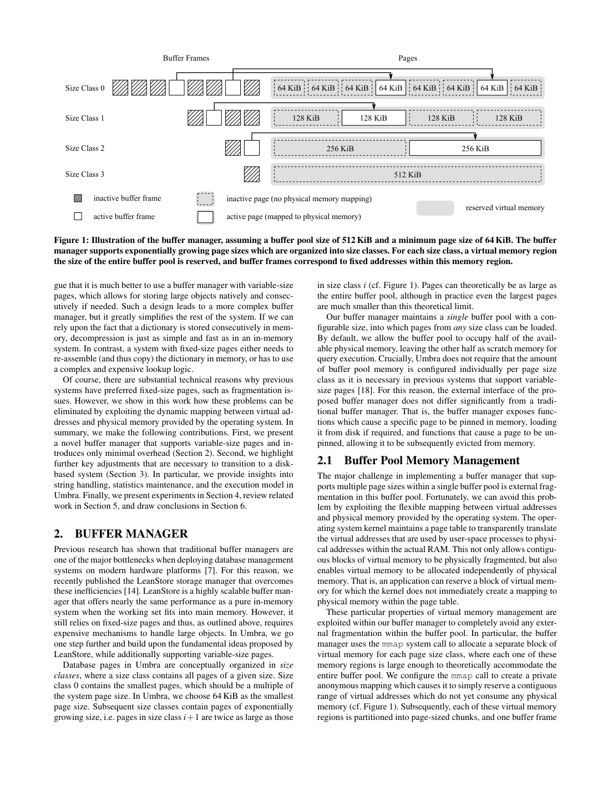
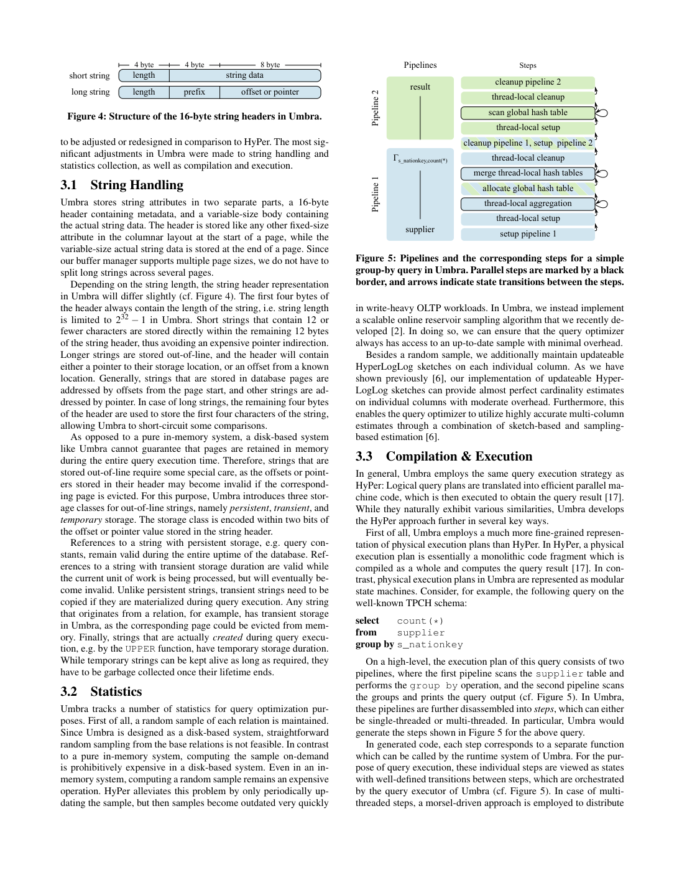

> 本组第 64 篇 · 存储结构与索引 · [全部论文]() · [上一篇]() · [下一篇]()

Umbra以可变页大小缓冲管理为核心，把HyPer式内存执行路线拓展到SSD。它为每个size class分别预留虚拟地址区，却共享一个物理页字节预算；64KiB最小页、private anonymous mapping及父节点辅助扫描均在全文中明确出现，不能因短quote截断而说未知。shared latch pin页以支持分页无感知算子，optimistic读仍须验证，零页内容不能当作有效数据。字符串生命期、同尺寸磁盘空间复用及step/bytecode/LLVM路径是跨组件配合。性能证据分四层：热缓存系统比较、排除编译优化的纯执行比较、同计划存储层消融、冷缓存I/O微基准。3.0/1.8倍几何均值不是缓冲器本身的加速；平均小于2%/6%的存储层波动也不是每查询最大开销。1.15与1.13GiB/s仅是指定单SSD冷SUM实验。多SSD收益是作者建议，不是本文已测的线性扩展。

本文保留论文陈述、读者推断与待验证方案的区别；实验数字只适用于原文条件。原文和翻译来自已有 AI 辅助精读报告，已做来源匹配与编辑复核，不等于人工逐项核验或独立实验复现。所有页码均为 PDF 物理页。

## 论文与阅读范围

Thomas Neumann, Michael Freitag. Umbra: A Disk-Based System with In-Memory Performance. CIDR2020, January12-15, Amsterdam, Netherlands。依据完整本地7页稿，含结论及全部18条参考文献，不是未完的前7页摘录。

[论文集中的原始 PDF](https://github.com/lonng/db-papers/blob/4ff1331069c7cf52ac97dd769e5f484c1c35c200/papers/storage-structure/umbra%3A-a-disk-based-system-with-in-memory-performance.pdf) · 本地来源：`storage-structure/umbra_-a-disk-based-system-with-in-memory-performance.pdf`，共 7 页。

本篇保留 20 组原文精读和 58 条证据。截图为原始 PDF 的局部页选，不是重新生成的图表；未将整份 PDF 复制到博客。

## 问题、版本与性能主张边界

论文讨论从纯内存系统走向SSD系统：让缓存工作集保持接近内存引擎的性能，同时显式处理不驻留数据。题名的in-memory performance不能脱离cached working set限定，也不表示SSD随机延迟等于DRAM，或任何超RAM查询都没有降级。第1页的DRAM容量、SSD价格与带宽描述是CIDR2020语境，本文不把它们当现行硬件事实或采购建议。

固定页易实现buffer manager，却迫使大型字符串和字典等对象拆分、重组。Umbra选择按size class分组的可变大小页，class0明确为64KiB，后续翻倍；页大小应是系统页大小的倍数。它使大型对象可在一页内连续存储，减少上层处理复杂性，并不消除全部内部浪费、外部资源约束或分配成本。

实际本地稿一共7页，第7页包含完整结论和参考文献。因此原稿“只拿到前7页，缺后续章节/参考文献”的描述不成立。本次不读取外部引用来补算法，也不将作者宣称完全摆脱HyPer数据大小限制解释成无限虚拟地址、无限物理预算或所有工作负载等速。

依据：论文陈述；PDF 物理页 1, 2, 7。证据：[UX01](#evidence-ux01), [UX02](#evidence-ux02), [UX03](#evidence-ux03), [UX34](#evidence-ux34), [C003N06](#evidence-c003n06), [C003N08](#evidence-c003n08)。

## 虚拟分区、物理预算与页表示

每个size class有一个足以容纳整个buffer pool的独立虚拟区，buffer frame对应固定虚拟地址。所有类共享单一的已加载页面总字节预算，默认池为物理内存一半，另一半留作执行scratch。图1的512KiB池为64/128/256/512KiB四类各预留512KiB虚拟区；这不是四份物理池，也不是预先固定四类的物理配额。frame、页表等元数据和执行内存不能被悄悄算成零成本。

第2页明确说private anonymous mapping；它预留地址而不先为全部页内容分配物理内存。第3页以pread显式读入、pwrite写出更改，再以MADV_DONTNEED允许物理内存复用。DB文件并不是这个匿名映射的后备文件；不能把此设计写成完全依赖OS对数据库文件mmap自动缺页与回写。固定类内地址避免相应虚拟槽位的外部碎片，但源文明确物理内存仍可碎片化，也没有证明size-class取整内部浪费为零。

swip为64位：图2中swizzled是63位pointer及低位tag0；unswizzled是57位PID、6位size class及tag1。8字节对齐允许使用低位标签。这是Umbra明确的位域，不应反向套为LeanStore稿未指定的极性。页所有权须为树，只有一个owning swip，禁止额外叶兄弟拥有引用；临时读指针并非第二owner。

关系主树使用合成8字节单调tuple ID，叶页按需分配，通常64KiB，足以容纳大tuple时可选更大类。内页64KiB/fan-out8192；原文仍讨论内页结构修改，不能推成任何B-tree都永不split。扫描持当前叶父节点的optimistic latch，只要它仍有效便可沿父节点定位下一叶，不能说算法全文未知。PAX将定长属性页内列式置前、变长数据置尾，冷数据投影仍需读入整页；DataBlocks是未来计划。

依据：论文陈述；PDF 物理页 2, 3, 4, 5。证据：[C001N02](#evidence-c001n02), [C001N04](#evidence-c001n04), [C001N05](#evidence-c001n05), [C001N09](#evidence-c001n09), [C002N03](#evidence-c002n03), [C002N05](#evidence-c002n05), [C002N08](#evidence-c002n08), [UX02](#evidence-ux02), [UX03](#evidence-ux03), [UX04](#evidence-ux04), [UX05](#evidence-ux05), [UX06](#evidence-ux06), [UX07](#evidence-ux07), [UX08](#evidence-ux08), [UX09](#evidence-ux09), [UX10](#evidence-ux10), [UX16](#evidence-ux16), [UX17](#evidence-ux17), [UX34](#evidence-ux34), [UX35](#evidence-ux35), [UX37](#evidence-ux37)。

*原论文 PDF 物理页 2，版权归原作者或出版方。点击图片可查看原尺寸。页面文本中定位到：Figure 1: Illustration of the buffer manager, assuming a buffer pool size of 512 KiB and a minimum page size of 64 KiB. The buffer。这是页面定位信息，不表示本次已复核图内所有数据。*

## Latching、字符串与分步执行

versioned latch是64位，59位版本加5位状态。0为未锁、1为exclusive，shared时n个持有者编码n+1，不足时另用64位溢出计数。修改前取exclusive，修改内容后增加版本。shared读稳定并pin页，避免处理中被卸载；optimistic模式记住版本而不写latch，可与修改/卸载竞争，释放前须验证，失败则重试。这些页访问同步不同于事务并发控制，后者需要在其上实现。

额外shared模式使关系分页细节不必由每个pipeline算子自行处理验证失败。遍历时可乐观，实际读叶tuple或装载子页使用shared，结构修改或插入需相应exclusive。无兄弟链接的扫描利用父节点的有效optimistic视图，而不是固定每叶都从根重走或凭空假设一个未说明游标。

字符串header16B，4B长度；短串占剩余12B，长串用4B前缀与8B offset/pointer，body在页尾等位置。页内字符串通常用相对页首offset，其他字符串可用pointer，2bit编码persistent/transient/temporary生命期。12B不是12个任意Unicode码点；32bit长度上界也不保证任何大小字符串一定能分配。persistent指引用在数据库uptime中有效，不是WAL持久级别；关系来源串是transient，跨生命期物化须拷贝；执行产生的temporary需管理和回收。

执行计划由有明确转移的step函数构成，分为单线程和并行step，后者每次处理一个morsel。运行时能在调用边界暂停，并避免仅一个morsel时不必要的线程派发，这不等于任意机器指令处挂起。每step自定义IR先译bytecode由VM执行；并行step的进度决定是否值得转LLVM IR后交给LLVM JIT。LLVM没有被移除，具体阈值、单morsel是否永远不编译及PHI限制等原稿补充均无本文依据。在线样本和updateable HLL用于统计，详细算法与准确性不能从引用自动补齐。

依据：论文陈述；PDF 物理页 3, 4, 5, 6。证据：[C002N02](#evidence-c002n02), [C002N03](#evidence-c002n03), [C002N08](#evidence-c002n08), [C002N10](#evidence-c002n10), [C002N11](#evidence-c002n11), [UX10](#evidence-ux10), [UX11](#evidence-ux11), [UX12](#evidence-ux12), [UX13](#evidence-ux13), [UX14](#evidence-ux14), [UX15](#evidence-ux15), [UX19](#evidence-ux19), [UX20](#evidence-ux20), [UX21](#evidence-ux21), [UX22](#evidence-ux22), [UX23](#evidence-ux23), [UX24](#evidence-ux24), [UX37](#evidence-ux37)。

## 页安全、生命周期和恢复义务

以下区分作者机制与读者判断，不宣称完整形式化证明。固定虚拟区保留有效地址不等于旧页内容一直驻留；原文说MADV_DONTNEED后的读可映射共享zero page，得到零值，不重新读数据库原页。optimistic读若遇卸载/修改，必须通过版本协议判为无效并丢弃结果；零值不是可以返回SQL查询的有效记录。shared latch则通过pin避免这一处理期卸载。这些平台语义与内存顺序仍须实现验证，本次未做OS移植或C++并发模型审计。

稳定地址、唯一owning swip和latch分别解决寻址/引用维护、生命周期与内容访问的问题，不提供事务隔离。报告不把shared latch叫事务锁，也不把乐观验证叫可串行化。相对offset和稳定地址同样不能自动延长字符串引用的有效期，transient串的物化拷贝是跨组件安全条件。原稿说关系字符串在承诺的当前unit有效期结束前可随意失效，过于宽泛；源文称其在当前工作单元有效，但跨该生命期持有需拷贝。

ARIES反例是把曾占128KiB的旧页空间改给两个64KiB新页。若日志已落盘而新页尚未实际写入，恢复读取第二个64KiB页头的LSN位置时可能看到旧128KiB页中间的任意残留数据，并误作LSN；不必恰好是旧页LSN100。Umbra采用磁盘空间只供同尺寸页复用的规则，避免这类位置解释问题。

同尺寸规则是设计约束，不是完整ARIES正确性证明。pwrite返回、页内容在内存中写好、日志持久和事务commit是不同边界，本文没有给所有屏障和故障注入结果；不能补成一串API原子事务。本次不从性能数据推断所有崩溃状态安全，也不以数据库已经实现ARIES替代完整实现审计。

依据：读者推断；PDF 物理页 3, 4, 5。证据：[C001N09](#evidence-c001n09), [C002N02](#evidence-c002n02), [C002N07](#evidence-c002n07), [C002N08](#evidence-c002n08), [UX09](#evidence-ux09), [UX10](#evidence-ux10), [UX11](#evidence-ux11), [UX12](#evidence-ux12), [UX13](#evidence-ux13), [UX14](#evidence-ux14), [UX18](#evidence-ux18), [UX19](#evidence-ux19), [UX20](#evidence-ux20), [UX21](#evidence-ux21)。

## 四类实验与不可混用的指标

机器为i7-7820X，8物理/16逻辑核、3.6GHz、64GiB内存与Samsung960EVO500GiB SSD；历史版本HyPer v0.6-165、MonetDB v11.33.3。系统比较使用JOB和TPCH SF10，每query跑5次取最快，是热缓存结果，不是5次均值、median-of-runs或冷启动测量。

第一类系统比较：正文几何均值Umbra对HyPer为JOB3.0倍/TPCH1.8倍，对MonetDB4.6/2.3倍，包含优化/编译路径差异。作者明确将部分差距归于自适应编译避免短query编译成本；不能像原稿那样说全文完全未提原因，也不能说全部差距都是更好的逻辑计划或buffer manager。图6是跨query速度比分布：蓝色中位标签JOB3.0/4.6、TPCH1.7/1.9；TPCH中位数不同于正文几何均值1.8/2.3。本次以图6细节重新查看，修正早期QA把蓝线误称均值的文字。分位数不是重复测量置信区间。

第二类与HyPer的纯执行比较：排除优化/编译时间，但没有移除Umbra缓冲管理器。作者称平均执行波动JOB30%、TPCH10%，并另列个别query相对差异0.2-2.3倍和0.5-1.6倍，部分异常主要因逻辑计划不同。不能把平均波动翻成每条query最多30%/10%，也不能把个别计划解释变成全体几何加速的唯一原因。

第三类同计划存储消融：先禁止eviction以免关系串拷贝物化，再用flat mmap文件绕过buffer manager及树间接层。三种存储用相同逻辑/物理计划，排除优化/编译时间。波动在两个方向都有，仅去字符串物化平均小于2%，全绕过平均小于6%，极端可达30%。这不是最大开销6%，也不是隔离测出一个指针判断恒有6%成本。

第四类冷缓存I/O：250M个随机8B double做SUM，数据库与OS缓存都冷。绕过缓冲器的flat mmap约1.15GiB/s，实际缓冲器约1.13GiB/s，接近该SSD可用随机访问带宽；访问顺序因并行执行近似随机，不是顺序盘规格或内存CPU查询时长。原稿漏掉1.13及同计划消融已补齐。缩小池的JOB/TPCH也受I/O限制，但本文无完整曲线明细。增加多SSD是建议，未测多设备线性扩展。

依据：论文陈述；PDF 物理页 6, 7。证据：[C002N12](#evidence-c002n12), [C003N01](#evidence-c003n01), [C003N04](#evidence-c003n04), [C003N05](#evidence-c003n05), [UX25](#evidence-ux25), [UX26](#evidence-ux26), [UX27](#evidence-ux27), [UX28](#evidence-ux28), [UX29](#evidence-ux29), [UX30](#evidence-ux30), [UX31](#evidence-ux31), [UX32](#evidence-ux32), [UX33](#evidence-ux33), [UX36](#evidence-ux36), [UX38](#evidence-ux38)。

*原论文 PDF 物理页 5，版权归原作者或出版方。点击图片可查看原尺寸。页面文本中定位到：Figure 4: Structure of the 16-byte string headers in Umbra.；Figure 5: Pipelines and the corresponding steps for a simple。这是页面定位信息，不表示本次已复核图内所有数据。*

## 大对象、缓存与执行取舍

读者推断：size class降低大对象拆分成本，但预留多份虚拟区不代表物理容量增加。类内固定槽位避免相应外部碎片，仍可能有页内空余、页表/frame管理和大页读放大。默认半内存池是策略而非整个进程最多半内存的保证，scratch、元数据及执行结构另有资源需求。

PAX有页内列布局，不等于冷盘只读被投影列。更大页有助于连续大对象，也可能为只访问少量字段引入更多I/O；DataBlocks为未来方向，本次不能评价未实现布局的实测收益。synthetic ID使主关系插入有利，但不能凭此推断任意用户键secondary tree都不split。

shared latch用写状态/可能等待换稳定页访问，optimistic模式减少读侧共享状态写入却需验证和重试，二者是按访问阶段选择，不是所有reader只走一个模式。长串拷贝与生命周期分类让eviction可行，因而不是任何情况下零拷贝。禁eviction消融同时改变了字符串物化义务，不应把差值全归于某个单一指令。

分步VM到JIT让启动成本与长期执行成本可动态权衡，但不是预言所有query都最佳、所有长step必编译或所有短step都无需优化。高吞吐I/O路径也不证明在任意设备/线程规模不受latch、映射管理或CPU限制；本文在其特定单SSD上观察到存储带宽瓶颈，不能无限外推。

依据：读者推断；PDF 物理页 2, 3, 4, 5, 6, 7。证据：[C001N04](#evidence-c001n04), [C002N03](#evidence-c002n03), [C002N05](#evidence-c002n05), [C002N08](#evidence-c002n08), [C002N10](#evidence-c002n10), [C002N11](#evidence-c002n11), [C003N04](#evidence-c003n04), [UX02](#evidence-ux02), [UX03](#evidence-ux03), [UX07](#evidence-ux07), [UX08](#evidence-ux08), [UX11](#evidence-ux11), [UX17](#evidence-ux17), [UX19](#evidence-ux19), [UX23](#evidence-ux23), [UX29](#evidence-ux29), [UX30](#evidence-ux30)。

## 历史基线与证据层次

HyPer是本文继承和改造的对象，Umbra保留编译执行思路但增加显式缓冲、变页大小和相关生命期适配。JOB/TPCH热系统速度比并非只控制buffer manager，因编译策略、优化时间和逻辑计划也可不同；同计划三存储消融才更适合讨论存储管理成本。MonetDB版本比较同样不是当前产品排行或每条查询都获相同倍率。

LeanStore提供基本swip、替换及乐观同步思路。本文明确增加可变页与shared reader latch，以照顾上层算子分页无感知；不能将两篇所有机制逐字互换，也不将其作为两引擎同语义benchmark。第7页引导读者查LeanStore相关工作，不表示本次已独立验证外部引用。

ADABAS比较是作者所知的历史定位：两种页大小分别管理物理配额，须预先指定各pool大小。Umbra是每class独立虚拟区加一个共享物理字节预算，不是一个唯一虚拟mapping，也不是每class再单独配置等大的物理池。所谓only other是作者知识范围，不是本次全球产品普查。

本报告删去现代引擎/优化器或云产品的未经查证实现联系，不对它们是否采用类似机制作现行断言。多SSD增加带宽、可移植性和复杂查询混合负载只作为待验证问题；没有额外联网、产品审计或跨系统复测。

依据：论文陈述；PDF 物理页 1, 2, 4, 6, 7。证据：[C001N04](#evidence-c001n04), [C002N03](#evidence-c002n03), [C002N12](#evidence-c002n12), [C003N06](#evidence-c003n06), [C003N07](#evidence-c003n07), [C003N09](#evidence-c003n09), [C003N10](#evidence-c003n10), [UX01](#evidence-ux01), [UX02](#evidence-ux02), [UX03](#evidence-ux03), [UX15](#evidence-ux15), [UX27](#evidence-ux27), [UX29](#evidence-ux29), [UX36](#evidence-ux36), [UX38](#evidence-ux38)。

## 已完成核对与后续验证

本次实际完成完整7页分批阅读含18条参考文献、查看页2-6、终稿重看图2/3/6及图6放大细节、所有引用定位、继承精读四字段修正和有限算术/位域检查。没有运行Umbra、mmap行为测试、SQL benchmark或故障注入。早期QA图6文字把蓝中位标作几何均值已更正；原API critique及旧稿另存，不掩盖原始记录。

读者算例核对4类各512KiB的虚拟页区共2048KiB，但物理页预算仅512KiB；64+128+256=448KiB剩64KiB，不含metadata。57+6+1及59+5都为64位，shared状态2到31编码1到30持有者，超出用计数器。对部分PID边界和全部64个class索引作表示编码/解码检查，不代表所有巨大页类都实际可分配。

冷SUM原始值字节250M*8约1.863GiB，不是包含所有树/文件元数据的总大小，也不直接提供实测时长。1.13/1.15-1约-1.739%是吞吐比例，不是所有query时延开销。图6几何均值与中位数不同，不能相互替换。

建议后续匹配历史构建/版本、SQL答案与计划，分别计总时间和执行时间；记录5次最快取样、冷热缓存和池大小，单独测禁eviction/字符串物化与flat mmap替换。对虚拟保留/实际页字节做独立计量，对latch验证、pin、页卸载和transient引用跨生命周期做正确性用例。

恢复测试应在受控临时数据上模拟128KiB旧页空间被改为两个64KiB页且仅日志落盘的状态，验证残留LSN解释；这不是建议破坏用户进程或设备，也未实际执行。private anonymous是原文明示语义，具体系统调用flag组合、页错误时序、内存顺序、日志屏障和JIT策略仍需源码/平台证据，不能编造“避免PHI节点”或单morsel必不编译的规则。

依据：待验证的工程设想；PDF 物理页 2, 3, 4, 5, 6, 7。证据：[C001N04](#evidence-c001n04), [C001N05](#evidence-c001n05), [C002N07](#evidence-c002n07), [C002N11](#evidence-c002n11), [C003N01](#evidence-c003n01), [UX03](#evidence-ux03), [UX08](#evidence-ux08), [UX10](#evidence-ux10), [UX11](#evidence-ux11), [UX12](#evidence-ux12), [UX18](#evidence-ux18), [UX19](#evidence-ux19), [UX23](#evidence-ux23), [UX29](#evidence-ux29), [UX32](#evidence-ux32), [UX34](#evidence-ux34), [UX35](#evidence-ux35), [UX36](#evidence-ux36), [UX37](#evidence-ux37)。

## 结论及仍待验证事项

Umbra的价值在于把内存驻留执行与可控外存管理作为一个跨组件问题解决：虚拟地址与物理页分离，可变页简化大对象，shared/optimistic模式服务不同访问阶段，字符串引用与分步执行为eviction保留安全边界。它不只是给HyPer加一个read/write缓存，也未证明任意外存访问可忽略。

证据应按层次使用：特定热缓存版本比较展示系统效果；排除编译优化的比较展示执行差异；同计划存储消融估计几种表示/物化变化；冷SUM说明单SSD I/O路径吞吐接近其可用带宽。不能把这些数字合成统一“3倍快且开销最多6%”的性能保证，或把多SSD建议称作实测线性扩展。

页latch不是事务控制，稳定地址不是永久数据，persistent字符串不是事务持久化，同尺寸复用也不是完整恢复证明。本地稿全文已读，不存在用缺失后续章节解释明确机制的问题；真正未完成的是独立实现审计、故障验证、外部文献核查和新实验。所有API来源与原引文保留，本次编辑仍需人工复核。

依据：读者推断；PDF 物理页 1, 2, 3, 4, 5, 6, 7。证据：[UX01](#evidence-ux01), [UX03](#evidence-ux03), [UX08](#evidence-ux08), [UX10](#evidence-ux10), [UX11](#evidence-ux11), [UX18](#evidence-ux18), [UX19](#evidence-ux19), [UX23](#evidence-ux23), [UX29](#evidence-ux29), [UX30](#evidence-ux30), [UX32](#evidence-ux32), [UX33](#evidence-ux33), [UX36](#evidence-ux36), [UX38](#evidence-ux38)。

## 原文精读：从句子回到机制

以下保留原文、忠实翻译、含义与边界；假设示例不作为论文实验结果。

### P001 · PDF 物理页 2

**原文**

<blockquote class="paper-source-quote"><pre><code>In Umbra, we go&#10;one step further and build upon the fundamental ideas proposed by&#10;LeanStore, while additionally supporting variable-size pages.&#10;Database pages in Umbra are conceptually organized in size&#10;classes, where a size class contains all pages of a given size. Size&#10;class 0 contains the smallest pages, which should be a multiple of&#10;the system page size. In Umbra, we choose 64 KiB as the smallest&#10;page size. Subsequent size classes contain pages of exponentially&#10;growing size, i.e.</code></pre></blockquote>

**忠实翻译**

> Umbra在LeanStore基本思路之上增加可变页。页面按大小类组织，class0最小且应为系统页大小倍数，本文选64KiB；随后页按指数增长，原摘录在i.e.处截断。

**技术含义与边界**

> 完整下一句说明后续类是前一类两倍，不是全文未知基数。类内大小固定，选择合适类并不保证内部空余为零，也不等于完全照搬LeanStore。

**常见误读**

> 原API critique称64KiB没有来源，只是它看到的短证据截断；本段本身就含64KiB。不能将它翻成所有系统的最佳页大小。

**读者构造的假设示例**

> 读者构造的假设示例：系统页4KiB时64KiB为16倍，后续128/256KiB；100KiB对象可选128KiB类，但这不是100KiB任意长度页，也不代表没有剩余空间。

### P002 · PDF 物理页 7

**原文**

<blockquote class="paper-source-quote"><pre><code>values with cold database and OS caches. When bypassing the&#10;buffer manager, Umbra relies on the operating system to load the&#10;contents of the flat memory-mapped file containing the relation data&#10;into memory. In this case, Umbra achieves a read throughput of&#10;1.15 GiB/s which we determined to be close to the maximum avail-&#10;able random access bandwidth on our SSD.</code></pre></blockquote>

**忠实翻译**

> 开头承接冷数据库和冷OS缓存下对数值求和。绕过buffer manager时，用flat mmap文件交OS读入，达到1.15GiB/s，作者认为接近其SSD可用随机访问带宽。

**技术含义与边界**

> 这是冷SUM微基准的一条比较路径，全文还给实际buffer manager1.13GiB/s。小段以values开头不能译成一种称为“取值”的新通用操作。

**常见误读**

> 接近作者设备带宽不单独证明全软件无成本；不能当顺序SSD规格、热query时长或所有硬件保证，也不能遗漏1.13对照。

**读者构造的假设示例**

> 读者构造的假设示例：两条I/O受限路径1.15和1.13GiB/s接近，即便如此，换成全驻留CPU敏感query时，其成本差仍需单测，不能直接照搬吞吐比例。

### P003 · PDF 物理页 4

**原文**

<blockquote class="paper-source-quote"><pre><code>This is possible since the virtual&#10;memory region reserved for a buffer frame always remains valid&#10;(see above), and read accesses to a memory region that was marked&#10;with the MADV_DONTNEED flag simply result in zero bytes. No&#10;additional physical memory is allocated in this case, as all such&#10;accesses are mapped to the same zero page.</code></pre></blockquote>

**忠实翻译**

> 帧保留的虚拟区始终有效；对MADV_DONTNEED区域的读取可得到零值并映射同一zero page，不为这些读分配独立物理页。

**技术含义与边界**

> 这使未pin的乐观读在并发卸载时不因原地址消失而失去语义基础，但完整上下文要求校验版本、失败即丢弃读取。不是保留原始业务数据。

**常见误读**

> 不能把“零值”翻成返回零个字节的I/O成功，也不能称任何读到零的线程都属于程序错误；允许乐观访问但结果必须验证。

**读者构造的假设示例**

> 读者构造的假设示例：读者开始读旧页，另一线程卸载它，读者随后看到零；版本校验失败后重试，而不是输出一行全零SQL记录。

### P004 · PDF 物理页 3

**原文**

<blockquote class="paper-source-quote"><pre><code>This&#10;ensures by design that each page is referenced by exactly one own-&#10;ing swip, and no further swips besides that owning swip need to be&#10;updated when a page is loaded or evicted. In case of B+-trees, for&#10;instance, this entails that leaf pages may not contain references to&#10;their siblings, as this would require that leaf pages are referenced&#10;by more than one swip. We will outline below how efficient scans&#10;can still be implemented in light of these restrictions.</code></pre></blockquote>

**忠实翻译**

> 每页只有一个owning swip，因此加载/驱逐只更新该拥有引用。B+-tree叶页不能再引用兄弟页，否则增加owner；本段预告后面说明高效扫描。

**技术含义与边界**

> 完整第4页已说明保持当前叶父节点的optimistic latch，其有效时从父导航下一叶。当前摘录的预告不等于全文未给算法。

**常见误读**

> 不能把禁叶兄弟owner译成不支持范围扫描，也不能认为parent导航在父版本失效时仍可无验证继续。

**读者构造的假设示例**

> 读者构造的假设示例：父页含C1/C2两个孩子，扫描C1后若父optimistic版本仍有效可定位C2；若父发生修改，须按协议重新验证/寻找，而非用过期位置。

### P005 · PDF 物理页 5

**原文**

<blockquote class="paper-source-quote"><pre><code>Figure 4). The first four bytes of&#10;the header always contain the length of the string, i.e. string length&#10;is limited to 232 −1 in Umbra. Short strings that contain 12 or&#10;fewer characters are stored directly within the remaining 12 bytes&#10;of the string header, thus avoiding an expensive pointer indirection.&#10;Longer strings are stored out-of-line, and the header will contain&#10;either a pointer to their storage location, or an offset from a known&#10;location.</code></pre></blockquote>

**忠实翻译**

> 字符串头前4字节长度，表示上界2的32次方减1；短串直接占剩余12字节，长串存body地址指针或相对已知位置offset。

**技术含义与边界**

> 图4和全文再说明长串剩余12B为4B前缀加8B地址；不是整个12B都为pointer。页内body常用offset，不必是堆分配。12B也不是12个任意Unicode码点。

**常见误读**

> 不能从内联阈值推出一切字符串分配成本为零，也不能从长度域上界推出实际可分配4GiB对象。引用生命期需另考虑。

**读者构造的假设示例**

> 读者构造的假设示例：5字节ASCII串可内联；100字节串用4B长度、4B前缀和8B地址字段，body若来自可evict页，跨有效期物化仍需复制。

### P006 · PDF 物理页 6

**原文**

<blockquote class="paper-source-quote"><pre><code>The relative performance of Umbra in comparison to&#10;HyPer and MonetDB is shown in Figure 6.&#10;We observe that Umbra performs excellently in comparison to&#10;HyPer. In particular, Umbra achieves a geometric mean speedup of&#10;3.0× on JOB and of 1.8× on TPCH. To some extent, this notably&#10;large gap can be attributed to the much more efficient adaptive com-&#10;pilation strategy employed by Umbra.</code></pre></blockquote>

**忠实翻译**

> 图6比较Umbra与HyPer/MonetDB。作者报告对HyPer几何均值JOB3.0倍、TPCH1.8倍，并将部分显著差距归于更高效自适应编译。

**技术含义与边界**

> 原文明确有部分归因，不能因另一个quote讨论不同逻辑计划而说总差距完全无解释。它没有给每个因素严格分解。图中蓝TPCH中位1.7不同于正文几何均值1.8。

**常见误读**

> 不能称全部3倍来自buffer manager或计划更好，也不能把几何均值当所有query同样快。图6跨query分布不是5次重复的置信区间。

**读者构造的假设示例**

> 读者构造的假设示例：两个query速度比1和9，几何均值为3，但没有一个query恰好3倍；若另减短query编译时间，总速度比也会变，并非单独证明执行内核快3倍。

### P007 · PDF 物理页 7

**原文**

<blockquote class="paper-source-quote"><pre><code>As suggested in Section 1, we can increase the available&#10;I/O bandwidth by simply placing multiple SSDs into a single sys-&#10;tem, allowing Umbra to rival the performance of a pure in-memory&#10;system even on workloads that do not fit into main memory alone.&#10;5.&#10;RELATED WORK&#10;As a re-design of our HyPer system, Umbra builds heavily on the&#10;insights gained during the development of HyPer [9]. We concur&#10;with the argument set forth by Lomet that pure in-memory systems&#10;are uneconomical [15], and present Umbra as an evolution of Hy-&#10;Per towards a high-performance disk-based system.</code></pre></blockquote>

**忠实翻译**

> 作者建议在一台系统加多个SSD提高I/O带宽，以让超主存负载接近内存性能；随后进入相关工作，称Umbra借鉴HyPer经验，并认同Lomet对纯内存经济性的观点。

**技术含义与边界**

> 本地加盘是单机I/O扩充，不是集群横向节点扩展。论文实际机器只有一块SSD，这段是设计建议与文献定位，不是多盘实测。

**常见误读**

> 不能保证8块盘等于8倍有效带宽或等延迟；CPU、PCIe、软件与并行度限制仍需测。引用号是定位线索，本次没有读[15]来独立核查经济性。

**读者构造的假设示例**

> 读者构造的假设示例：总工作量的CPU下界2秒，单盘I/O下界10秒；即便假设多盘降低I/O项，最终时间也不能低于其他关键路径，且是否线性降I/O仍须实验。

### P008 · PDF 物理页 4

**原文**

<blockquote class="paper-source-quote"><pre><code>That is, the fixed-size attributes are stored in a columnar&#10;layout at the start of the page, and the variable-size attributes are&#10;stored densely at the end of the page. Pages are compactified dur-&#10;ing inserts if required. However, such a page layout is not optimal&#10;for data that resides on disk, as all attributes of a relation have to&#10;be loaded even if only few are actually accessed. Thus, we also&#10;plan to integrate alternative storage layouts in the future, such as&#10;DataBlocks for cold parts of the data [11].</code></pre></blockquote>

**忠实翻译**

> 定长属性页首列式，变长数据页尾紧密存，插入可压实；作者指出冷盘即便少列访问仍加载全部属性，并计划未来加入DataBlocks等布局。

**技术含义与边界**

> 这是当前PAX的I/O局限与未来方向，不是全部页内列布局都无价值。page加载与CPU只访问某列不同。

**常见误读**

> 不能把DataBlocks写成这篇已实现和验证的冷列存，也不能猜其具体分块机制或加速倍数。

**读者构造的假设示例**

> 读者构造的假设示例：64KiB页含多列，query只需一列但仍读64KiB；若另一个假设布局支持独立列块，才可能减少读量，这不是本文已跑的DataBlocks实验。

### P009 · PDF 物理页 2

**原文**

<blockquote class="paper-source-quote"><pre><code>These particular properties of virtual memory management are&#10;exploited within our buffer manager to completely avoid any exter-&#10;nal fragmentation within the buffer pool. In particular, the buffer&#10;manager uses the mmap system call to allocate a separate block of&#10;virtual memory for each page size class, where each one of these&#10;memory regions is large enough to theoretically accommodate the&#10;entire buffer pool. We configure the mmap call to create a private&#10;anonymous mapping which causes it to simply reserve a contiguous&#10;range of virtual addresses which do not yet consume any physical&#10;memory (cf.</code></pre></blockquote>

**忠实翻译**

> 作者为每size class各分配整池大小的虚拟区，mmap明确配置为private anonymous mapping，只预留连续地址，不先占这些页内容的物理内存；摘录在cf.处截断。

**技术含义与边界**

> 私有匿名是原文而非本次工程猜测。一个物理页预算与多虚拟区并不矛盾；虚拟地址区外部碎片与物理碎片也不同，后页明确物理仍可能碎片。

**常见误读**

> 不能把映射预留称整进程RAM初始严格0，frame/页表等另有成本，也不能把每class整池虚拟区当多份物理容量。

**读者构造的假设示例**

> 读者构造的假设示例：4类各预留512KiB共2048KiB虚拟页区，活动页64+128+256=448KiB，仍共用512KiB页字节上限，而非每类各能实用512KiB物理页。

### P010 · PDF 物理页 3

**原文**

<blockquote class="paper-source-quote"><pre><code>If a previously active buffer frame becomes inactive due to eviction&#10;from the buffer pool, we first write any changes to the page data&#10;back to disk using the pwrite system call, and subsequently allow&#10;the kernel to immediately reuse the associated physical memory.&#10;On Linux, this can be achieved by passing the MADV_DONTNEED&#10;flag to the the madvise system call. This step is critical to ensure&#10;that the physical memory consumption of the buffer pool does not&#10;exceed the configured buffer pool size, as several times more vir-&#10;tual memory is allocated internally (cf. Figure 1).</code></pre></blockquote>

**忠实翻译**

> 活跃frame驱逐变不活跃时，先pwrite页更改，再用MADV_DONTNEED允许内核复用物理内存；因内部虚拟区多于池大小，这有助于维持buffer pool页字节预算。

**技术含义与边界**

> 预算针对页内容而非整个进程；有效虚拟区仍保留。pread/pwrite和madvise是显式管理步骤，不是三者自动构成持久事务。

**常见误读**

> pwrite返回不单独证明事务日志与数据的持久顺序；不应把进程崩溃未归还物理页当作本段证实的数据库恢复故障。实际ARIES问题在跨尺寸复用。

**读者构造的假设示例**

> 读者构造的假设示例：释放一个64KiB活动页可降低已加载页字节计数64KiB，但不承诺OS监控中的整个进程RSS恰好同步下降64KiB，元数据/执行内存需另计。

### P011 · PDF 物理页 2

**原文**

<blockquote class="paper-source-quote"><pre><code>In Umbra, we choose 64 KiB as the smallest&#10;page size.</code></pre></blockquote>

**忠实翻译**

> Umbra选64KiB作为最小页。

**技术含义与边界**

> 这是本文具体设计选择，完整上下文给后续类翻倍，并非全行业最优页尺寸。

**常见误读**

> 不能因旧quote截断改称字节数未知，也不能写100KiB对象必形成任意100KiB数据库页。

**读者构造的假设示例**

> 读者构造的假设示例：100KiB对象可选能容纳它的128KiB类；剩余空间与以后tuple如何使用仍依页布局，不代表零浪费。

### P012 · PDF 物理页 2

**原文**

<blockquote class="paper-source-quote"><pre><code>For each size class, a virtual memory region&#10;the size of the entire buffer pool is reserved</code></pre></blockquote>

**忠实翻译**

> 每size class预留与整个buffer pool同大的虚拟内存区。

**技术含义与边界**

> 按类分开的地址槽位配合单一总物理预算；虚拟预留量可为池大小多倍。

**常见误读**

> 不等于多个等大物理池，也非必须预先指定每类物理份额。

**读者构造的假设示例**

> 读者构造的假设示例：512KiB池、4类对应2048KiB虚拟页区，但活动页总和仍至多512KiB，不含元数据。

### P013 · PDF 物理页 3

**原文**

<blockquote class="paper-source-quote"><pre><code>thread synchro-&#10;nization is independent of transaction concurrency control which&#10;has to be implemented on top of these data structures.</code></pre></blockquote>

**忠实翻译**

> 线程同步独立于必须另建在数据结构上的事务并发控制。

**技术含义与边界**

> page latch协调结构访问，不直接定义事务快照/serializability。

**常见误读**

> 不能用shared页锁和版本计数取代完整隔离协议，也不能凭本文page机制推出无write skew。

**读者构造的假设示例**

> 读者构造的假设示例：两个事务先后安全读不同页，不发生内存竞争，但是否允许各自根据旧值再写另一页，仍是事务隔离规则的问题。

### P014 · PDF 物理页 4

**原文**

<blockquote class="paper-source-quote"><pre><code>A shared latch&#10;effectively pins the associated page in the buffer manager, prevent-&#10;ing it from being unloaded.</code></pre></blockquote>

**忠实翻译**

> shared latch会pin关联页，阻止卸载。

**技术含义与边界**

> 让读取叶tuple等访问在持有期间稳定，代价是状态维护/潜在等待，不等于永久pin。

**常见误读**

> 不能将optimistic latch也理解为pin，或称shared页锁会自动保护整个事务所有历史版本。

**读者构造的假设示例**

> 读者构造的假设示例：算子处理当前页时持shared，evict不能卸载它；释放后若把页内串指针长久保留，仍须按生命期规则物化。

### P015 · PDF 物理页 4

**原文**

<blockquote class="paper-source-quote"><pre><code>all optimistic accesses have to be&#10;validated when an optimistic latch is released.</code></pre></blockquote>

**忠实翻译**

> 释放optimistic latch时所有乐观访问都必须验证。

**技术含义与边界**

> 读期间可以与修改/卸载竞争，验证是接受结果前的必要条件，不只是性能优化。

**常见误读**

> 不能读到zero page后直接输出，或仅凭地址仍有效就说原记录没有变化。

**读者构造的假设示例**

> 读者构造的假设示例：开始版本8，读后版本9，即使取到一组可解析字段也必须丢弃并重试，不能把它拼成有效行。

### P016 · PDF 物理页 4

**原文**

<blockquote class="paper-source-quote"><pre><code>Umbra only&#10;reuses disk space for pages of the same size.</code></pre></blockquote>

**忠实翻译**

> Umbra只把磁盘空间复用于同尺寸页。

**技术含义与边界**

> 避免旧大页中间残留被当新小页头LSN的恢复误解；必要性由该反例说明。

**常见误读**

> 同尺寸约束不等于所有日志/分配/恢复次序已证明安全，也不应假设残留一定正好等于旧页LSN。

**读者构造的假设示例**

> 读者构造的假设示例：旧128KiB页偏移64KiB处可能是任意tuple字节，新第二个64KiB页若尚未落盘，恢复会错把它当页头；这是结构解释风险。

### P017 · PDF 物理页 5

**原文**

<blockquote class="paper-source-quote"><pre><code>transient strings need to be&#10;copied if they are materialized during query execution.</code></pre></blockquote>

**忠实翻译**

> transient字符串在查询中被物化时需要拷贝。

**技术含义与边界**

> 需要让物化结果活过原引用生命期时，拷贝避免底层页释放后引用失效；不是每次比较都必须复制。

**常见误读**

> persistent/transient/temporary不是ACID持久级别，offset也不自动延长生命期。

**读者构造的假设示例**

> 读者构造的假设示例：当前unit中比较页内字符串可使用有效引用；若写进后续hash表并跨越该生命期，必须保存有足够寿命的副本。

### P018 · PDF 物理页 6

**原文**

<blockquote class="paper-source-quote"><pre><code>Initially,&#10;the IR associated with a step is always translated into an efficient&#10;bytecode format and interpreted by a virtual machine backend.</code></pre></blockquote>

**忠实翻译**

> step的IR最初总被译为高效bytecode并由VM解释。

**技术含义与边界**

> 后续并行step可根据进度考虑LLVM编译，初始解释和按需JIT并存。

**常见误读**

> 不能说LLVM已取消、所有查询直接机器码或单morsel必不编译；后一项只给了避免线程派发的明示机制。

**读者构造的假设示例**

> 读者构造的假设示例：一个step先由VM执行若干工作单元；若运行时判断编译值得，再切换实现，具体阈值不能由本文猜成1000行。

### P019 · PDF 物理页 6

**原文**

<blockquote class="paper-source-quote"><pre><code>Optimization and&#10;compilation time are disregarded in this case, as Umbra uses the&#10;exact same logical and physical plans with all three storage layers.</code></pre></blockquote>

**忠实翻译**

> 该存储消融不计优化/编译，因为三种存储用完全相同逻辑和物理计划。

**技术含义与边界**

> 这是与总系统比较不同的控制实验，改变eviction/物化或绕过管理及树间接层。

**常见误读**

> 不能拿执行-only差值和另一系统总时间比，也不能把移除优化/编译说成剥离buffer manager。

**读者构造的假设示例**

> 读者构造的假设示例：相同计划A/B执行100和106ms与另系统总时间300ms属不同问题；即使都有“速度”，也不能合并成一个机制的3倍收益。

### P020 · PDF 物理页 6

**原文**

<blockquote class="paper-source-quote"><pre><code>by less than 2 % on average if only string materializations&#10;are avoided, and by less than 6 % on average if the entire buffer&#10;manager is bypassed.</code></pre></blockquote>

**忠实翻译**

> 仅去字符串物化平均变化小于2%，绕过整个缓冲管理平均变化小于6%。

**技术含义与边界**

> 前句说两方向均有波动，后文极端可达30%；平均不是每query最大值，且两次改动各有多个影响。

**常见误读**

> 不能写最坏仅6%或所有查询都变快，也不能据均值保证尾延迟。

**读者构造的假设示例**

> 读者构造的假设示例：若9个query差异0%、1个30%，简单均值3%仍小于6%，但有一条30%；这里只演示平均与极端不同，不重建作者统计方法。

## 尚未解决的问题

1. 在完整实现中，optimistic校验、writer状态、MADV_DONTNEED与页复用如何满足具体内存模型？本次没有源码/平台审计。
2. 同尺寸磁盘空间复用之外，ARIES分配日志、页LSN与持久屏障如何组合，并覆盖全部崩溃点？
3. 增加SSD/并发后，映射、页元数据、latch、CPU与内存带宽何时取代存储成为瓶颈？本文无多SSD扩展曲线。
4. 替代冷数据布局、不同大对象分布和投影宽度怎样改变I/O放大与物化成本？DataBlocks在本文是未来计划。
5. 如何在固定逻辑/物理计划下分离VM/JIT、字符串生命周期与缓冲器成本，并报告最慢query/尾延迟而非仅均值或最快重复？

## 证据索引

证据编号沿用原报告，便于将上文判断追溯到原句。引文匹配只验证位置，不证明解读正确。

**C001N02 · PDF 物理页 2**

全文第2页明确最小64KiB且后续翻倍，不能因短quote截断说未知。可变类简化大对象，不证明零内部浪费。

<blockquote class="paper-source-quote"><pre><code>Database pages in Umbra are conceptually organized in size classes, where a size class contains all pages of a given size. Size class 0 contains the smallest pages</code></pre></blockquote>

**C001N04 · PDF 物理页 2**

每class独立虚拟区、各可容整池，共享物理页字节预算。原文明说private anonymous mapping；保留虚拟地址非全部物理页，不意味着元数据零开销或无物理碎片。

<blockquote class="paper-source-quote"><pre><code>the buffer manager uses the mmap system call to allocate a separate block of virtual memory for each page size class, where each one of these memory regions is large enough to theoretically accommodate the entire buffer pool.</code></pre></blockquote>

**C001N05 · PDF 物理页 3**

显式pread/pwrite与MADV_DONTNEED管理页内容；该物理页预算不等于进程总内存上限，pwrite也不单独证明事务持久性。

<blockquote class="paper-source-quote"><pre><code>On Linux, this can be achieved by passing the MADV_DONTNEED flag to the the madvise system call. This step is critical to ensure that the physical memory consumption of the buffer pool does not exceed the configured buffer pool size</code></pre></blockquote>

**C001N09 · PDF 物理页 3**

单owning swip禁止叶兄弟拥有引用；第4页完整说明保留父optimistic latch导航下一叶，不是全文算法缺失。

<blockquote class="paper-source-quote"><pre><code>In case of B+-trees, for instance, this entails that leaf pages may not contain references to their siblings, as this would require that leaf pages are referenced by more than one swip.</code></pre></blockquote>

**C002N02 · PDF 物理页 4**

有效虚拟区允许乐观读碰到已释放内容的zero page，但必须版本验证并丢弃无效读取，零字节值不是合法查询记录。

<blockquote class="paper-source-quote"><pre><code>read accesses to a memory region that was marked with the MADV_DONTNEED flag simply result in zero bytes</code></pre></blockquote>

**C002N03 · PDF 物理页 4**

shared latch pin页以支持分页无感知算子；optimistic遍历仍在，二者不是事务并发控制。

<blockquote class="paper-source-quote"><pre><code>operators in Umbra are generally oblivious of the paged nature of relations</code></pre></blockquote>

**C002N05 · PDF 物理页 4**

PAX页内布局仍让冷数据读取全部属性；DataBlocks为未来计划，不是已实现的独立列I/O优化。

<blockquote class="paper-source-quote"><pre><code>such a page layout is not optimal for data that resides on disk, as all attributes of a relation have to be loaded</code></pre></blockquote>

**C002N07 · PDF 物理页 4**

ARIES反例是旧128KiB页中间残留被误解为第二个64KiB新页LSN；故仅同尺寸空间复用。不是已证明全部恢复状态安全。

<blockquote class="paper-source-quote"><pre><code>Umbra only reuses disk space for pages of the same size.</code></pre></blockquote>

**C002N08 · PDF 物理页 5**

16B字符串头，12B内联短串；长串4B前缀+8B地址，页内常用offset。三类是引用生命期，不是durability等级。跨transient有效期物化须拷贝。

<blockquote class="paper-source-quote"><pre><code>Short strings that contain 12 or fewer characters are stored directly within the remaining 12 bytes of the string header</code></pre></blockquote>

**C002N10 · PDF 物理页 6**

单morsel检测避免不必要线程派发，step调用边界可暂停；并非单morsel必不编译或任意指令处暂停。

<blockquote class="paper-source-quote"><pre><code>our query executor can detect at runtime whether a parallel step would only consist of a single morsel</code></pre></blockquote>

**C002N11 · PDF 物理页 6**

自定义IR先bytecode/VM，并行step进度可触发LLVM翻译/JIT；LLVM未移除，阈值及PHI限制本文未给。

<blockquote class="paper-source-quote"><pre><code>the IR associated with a step is always translated into an efficient bytecode format and interpreted by a virtual machine backend</code></pre></blockquote>

**C002N12 · PDF 物理页 6**

热缓存最快5次系统比较与纯执行比较不同。全文说部分总差距来自自适应编译，个别执行异常主要与逻辑计划有关；不能去掉缓冲器后才称纯执行。

<blockquote class="paper-source-quote"><pre><code>Umbra achieves a geometric mean speedup of 3.0× on JOB and of 1.8× on TPCH</code></pre></blockquote>

**C003N01 · PDF 物理页 7**

250M8B double冷DB/OS缓存SUM中，flat mmap绕过管理器1.15GiB/s，对比实际缓冲器1.13GiB/s；为该SSD随机顺序并行I/O条件，不是一般查询性能。

<blockquote class="paper-source-quote"><pre><code>When bypassing the buffer manager, Umbra relies on the operating system to load the contents of the flat memory-mapped file containing the relation data into memory.</code></pre></blockquote>

**C003N04 · PDF 物理页 7**

该单SSD实验存储吞吐是主要瓶颈；多SSD接近内存性能是作者建议，无已测线性扩展结果。

<blockquote class="paper-source-quote"><pre><code>we observe that the primary bottleneck in Umbra is caused by limited storage throughput, whereas the buffer manager itself is easily capable of handling highly parallel</code></pre></blockquote>

**C003N05 · PDF 物理页 7**

高度并行页面访问无跨线程顺序约束，解释该冷读近随机访问；不推成所有Umbra请求都严格随机或该调度始终最优。

<blockquote class="paper-source-quote"><pre><code>due to the highly parallelized nature of query execution in Umbra which imposes no inter-thread constraints on the order in which pages are processed.</code></pre></blockquote>

**C003N06 · PDF 物理页 7**

Umbra是HyPer演进的历史定位，经济性为作者/引用观点，非当前硬件价格判断。

<blockquote class="paper-source-quote"><pre><code>As a re-design of our HyPer system, Umbra builds heavily on the insights gained during the development of HyPer [9].</code></pre></blockquote>

**C003N07 · PDF 物理页 7**

本文建立在LeanStore基础上并增加可变页及shared模式；不表示二者所有位域和机制完全相同或已有同语义对比benchmark。

<blockquote class="paper-source-quote"><pre><code>The buffer manager in Umbra shares many properties with LeanStore [14], and we refer the reader to [14] for a detailed review of the relevant literature.</code></pre></blockquote>

**C003N08 · PDF 物理页 7**

可变页目标是降低大对象处理复杂性，不是完全消除所有资源限制。

<blockquote class="paper-source-quote"><pre><code>We furthermore argue that it is desirable to support variable-size pages in the buffer manager to reduce the complexity of handling large data objects.</code></pre></blockquote>

**C003N09 · PDF 物理页 7**

ADABAS only-other为作者知识范围的历史转述，未独立核查外部原文或全球所有实现。

<blockquote class="paper-source-quote"><pre><code>the only other buffer manager with variable-size pages was developed for the ADABAS system [18]. However, in comparison to Umbra, this buffer manager is much less flexible</code></pre></blockquote>

**C003N10 · PDF 物理页 7**

Umbra通过每class虚拟区加单一物理页预算避免预分固定物理配额，不是一个单mapping或多个等大物理pool。

<blockquote class="paper-source-quote"><pre><code>A major downside of their approach is that we have to specify in advance how much memory is allocated for each pool.</code></pre></blockquote>

**UX01 · PDF 物理页 1**

接近内存性能明确限定cached working set。

<blockquote class="paper-source-quote"><pre><code>comparable performance to an in-memory database system for&#10;the cached working set</code></pre></blockquote>

**UX02 · PDF 物理页 2**

默认buffer pool为物理内存一半，另一半留执行scratch，不是进程总内存证明。

<blockquote class="paper-source-quote"><pre><code>By default, we allow the buffer pool to occupy half of the avail-&#10;able physical memory, leaving the other half as scratch memory for&#10;query execution.</code></pre></blockquote>

**UX03 · PDF 物理页 2**

每class各预留整池大小虚拟区，不能乘成物理容量。

<blockquote class="paper-source-quote"><pre><code>For each size class, a virtual memory region&#10;the size of the entire buffer pool is reserved</code></pre></blockquote>

**UX04 · PDF 物理页 3**

buffer frame对应虚拟地址在管理器生命期静态，不等于内容一直驻留。

<blockquote class="paper-source-quote"><pre><code>remain static for the entire&#10;lifetime of the buffer manager.</code></pre></blockquote>

**UX05 · PDF 物理页 3**

显式pread加载数据库页，不是对DB文件匿名映射后靠OS自动读原页。

<blockquote class="paper-source-quote"><pre><code>the buffer manager uses the&#10;pread system call to read data from disk into memory.</code></pre></blockquote>

**UX06 · PDF 物理页 3**

先pwrite写出更改再释放页内存，不凭此推出完整事务持久。

<blockquote class="paper-source-quote"><pre><code>we first write any changes to the page data&#10;back to disk using the pwrite system call</code></pre></blockquote>

**UX07 · PDF 物理页 3**

源文明确物理页仍可能碎片化。

<blockquote class="paper-source-quote"><pre><code>the physical memory that&#10;is used to store the page data associated with an active buffer frame&#10;may still be fragmented.</code></pre></blockquote>

**UX08 · PDF 物理页 3**

按所有内存页面总字节数计预算，不是各class固定物理配额。

<blockquote class="paper-source-quote"><pre><code>the buffer manager keeps track of the total size&#10;of all pages that are currently held in memory.</code></pre></blockquote>

**UX09 · PDF 物理页 3**

单owning swip要求页所有权树，临时读指针不等于第二owner。

<blockquote class="paper-source-quote"><pre><code>all buffer-managed data structures in Umbra are required to or-&#10;ganize their constituent pages in a (possibly degenerate) tree.</code></pre></blockquote>

**UX10 · PDF 物理页 3**

线程同步独立于事务控制，后者需另建于数据结构上。

<blockquote class="paper-source-quote"><pre><code>thread synchro-&#10;nization is independent of transaction concurrency control which&#10;has to be implemented on top of these data structures.</code></pre></blockquote>

**UX11 · PDF 物理页 4**

shared latch pin页，禁止该期间卸载。

<blockquote class="paper-source-quote"><pre><code>A shared latch&#10;effectively pins the associated page in the buffer manager, prevent-&#10;ing it from being unloaded.</code></pre></blockquote>

**UX12 · PDF 物理页 4**

optimistic读结束必须验证，并可能重试。

<blockquote class="paper-source-quote"><pre><code>all optimistic accesses have to be&#10;validated when an optimistic latch is released.</code></pre></blockquote>

**UX13 · PDF 物理页 4**

optimistic读取时可发生卸载，但不是数据永远有效。

<blockquote class="paper-source-quote"><pre><code>it is even legal for a page to be unloaded while the page con-&#10;tent is being read optimistically.</code></pre></blockquote>

**UX14 · PDF 物理页 4**

MADV_DONTNEED后原文说读到零值，不能当作查询结果或从磁盘自动重读。

<blockquote class="paper-source-quote"><pre><code>read accesses to a memory region that was marked&#10;with the MADV_DONTNEED flag simply result in zero bytes.</code></pre></blockquote>

**UX15 · PDF 物理页 4**

Umbra添加shared读模式，非全部reader都只optimistic。

<blockquote class="paper-source-quote"><pre><code>While LeanStore only supports optimistic latching for readers,&#10;we additionally support shared latching</code></pre></blockquote>

**UX16 · PDF 物理页 4**

合成单调TID服务主关系插入，不是全部用户键索引无split。

<blockquote class="paper-source-quote"><pre><code>We en-&#10;sure that tuple identifiers increase strictly monotonically</code></pre></blockquote>

**UX17 · PDF 物理页 4**

PAX冷盘投影仍需加载全部属性，未来DataBlocks未声称已集成。

<blockquote class="paper-source-quote"><pre><code>all attributes of a relation have to&#10;be loaded even if only few are actually accessed.</code></pre></blockquote>

**UX18 · PDF 物理页 4**

磁盘空间仅同尺寸页复用以避ARIES残留LSN解释问题。

<blockquote class="paper-source-quote"><pre><code>Umbra only&#10;reuses disk space for pages of the same size.</code></pre></blockquote>

**UX19 · PDF 物理页 5**

transient串在跨其生命期物化时须拷贝。

<blockquote class="paper-source-quote"><pre><code>transient strings need to be&#10;copied if they are materialized during query execution.</code></pre></blockquote>

**UX20 · PDF 物理页 5**

关系来源串归transient，不是整个查询期间引用永远有效。

<blockquote class="paper-source-quote"><pre><code>Any string&#10;that originates from a relation, for example, has transient storage&#10;in Umbra</code></pre></blockquote>

**UX21 · PDF 物理页 5**

2bit编码引用生命期，不是数据库事务durability级别。

<blockquote class="paper-source-quote"><pre><code>The storage class is encoded within two bits of&#10;the offset or pointer value stored in the string header.</code></pre></blockquote>

**UX22 · PDF 物理页 5**

在线reservoir样本及HLL统计只概述，详细算法未在本文展开。

<blockquote class="paper-source-quote"><pre><code>we instead implement&#10;a scalable online reservoir sampling algorithm</code></pre></blockquote>

**UX23 · PDF 物理页 6**

每step初始执行以bytecode/VM，不是全立即LLVM编译。

<blockquote class="paper-source-quote"><pre><code>Initially,&#10;the IR associated with a step is always translated into an efficient&#10;bytecode format and interpreted by a virtual machine backend.</code></pre></blockquote>

**UX24 · PDF 物理页 6**

需要时转LLVM IR/JIT，LLVM没有被完全移除。

<blockquote class="paper-source-quote"><pre><code>the Umbra IR is translated into LLVM IR and com-&#10;pilation is delegated to the LLVM just-in-time compiler.</code></pre></blockquote>

**UX25 · PDF 物理页 6**

对比历史HyPer v0.6-165。

<blockquote class="paper-source-quote"><pre><code>HyPer (v0.6-165)</code></pre></blockquote>

**UX26 · PDF 物理页 6**

对比历史MonetDB v11.33.3。

<blockquote class="paper-source-quote"><pre><code>MonetDB (v11.33.3)</code></pre></blockquote>

**UX27 · PDF 物理页 6**

每query5次取最快，为warm cache，不是均值或置信区间。

<blockquote class="paper-source-quote"><pre><code>Each query is repeated five times, and we report the fastest&#10;repetition</code></pre></blockquote>

**UX28 · PDF 物理页 6**

正文报告几何均值，不能混作图6所有蓝中位标签。

<blockquote class="paper-source-quote"><pre><code>geometric mean speedup of&#10;3.0</code></pre></blockquote>

**UX29 · PDF 物理页 6**

同计划三存储消融排除优化/编译，不与总系统比较混同。

<blockquote class="paper-source-quote"><pre><code>Optimization and&#10;compilation time are disregarded in this case, as Umbra uses the&#10;exact same logical and physical plans with all three storage layers.</code></pre></blockquote>

**UX30 · PDF 物理页 6**

存储消融极端变化仍可30%，平均6%不是最大上界。

<blockquote class="paper-source-quote"><pre><code>the most extreme changes in&#10;performance still amount to just 30 %.</code></pre></blockquote>

**UX31 · PDF 物理页 7**

冷SUM数据库及OS缓存皆冷，和warm系统比较不同。

<blockquote class="paper-source-quote"><pre><code>values with cold database and OS caches.</code></pre></blockquote>

**UX32 · PDF 物理页 7**

实际buffer manager冷读1.13GiB/s，不只给绕过方案1.15。

<blockquote class="paper-source-quote"><pre><code>When actu-&#10;ally utilizing the buffer manager, Umbra achieves virtually the same&#10;read throughput of 1.13 GiB/s.</code></pre></blockquote>

**UX33 · PDF 物理页 7**

特定实验受限存储吞吐，不证明任意设备/并发下管理器无限扩展。

<blockquote class="paper-source-quote"><pre><code>the primary bottleneck in Umbra is&#10;caused by limited storage throughput</code></pre></blockquote>

**UX34 · PDF 物理页 2**

全文明确64KiB最小页；不以被截短的旧quote制造未知。

<blockquote class="paper-source-quote"><pre><code>In Umbra, we choose 64 KiB as the smallest&#10;page size.</code></pre></blockquote>

**UX35 · PDF 物理页 2**

private anonymous mapping是原文明示语义，不是本次外部常识补足；不声称给出确切代码flag组合。

<blockquote class="paper-source-quote"><pre><code>We configure the mmap call to create a private&#10;anonymous mapping</code></pre></blockquote>

**UX36 · PDF 物理页 6**

同计划消融平均波动小于2%/6%，与正文极端30%同时保留，不当最大上界。

<blockquote class="paper-source-quote"><pre><code>by less than 2 % on average if only string materializations&#10;are avoided, and by less than 6 % on average if the entire buffer&#10;manager is bypassed.</code></pre></blockquote>

**UX37 · PDF 物理页 4**

全文第4页说明扫描保持父节点optimistic latch，其有效时可向下一叶导航。

<blockquote class="paper-source-quote"><pre><code>we maintain an&#10;optimistic latch on the parent of the current leaf node during table&#10;scans.</code></pre></blockquote>

**UX38 · PDF 物理页 6**

作者明确将部分系统总差距归于自适应编译，不能说全文没有任何整体差距解释，也不能称唯一原因。

<blockquote class="paper-source-quote"><pre><code>To some extent, this notably&#10;large gap can be attributed to the much more efficient adaptive com-&#10;pilation strategy employed by Umbra.</code></pre></blockquote>

## 版本与使用边界

- 原 PDF SHA256：`de89479593e78f484930b40ab6287e07509e0977355c9e549c0e1f1067904e31`。
- 报告来源：`qwen3.8-max`；此处按已完成报告整理，没有重新请求模型。
- OCR 记录页：[]；低文本页：[]。
- 本次新增页面截图，未据此自动重写原报告的数值、公式或实验结论；原有“未进行图像识别”限制仍适用于分析生成过程。
- 截图与短引仅服务于论文评论，版权归原作者或出版方；正式发布前复查转载范围和授权。
- 本文保留未核实的书目信息及研究问题，不用现代产品行为替代历史论文的证据。

前序报告保留的书目与阅读过程记录

Thomas Neumann, Michael Freitag. Umbra: A Disk-Based System with In-Memory Performance. CIDR2020, January12-15, Amsterdam, Netherlands。依据完整本地7页稿，含结论及全部18条参考文献，不是未完的前7页摘录。方法：保留API source/SHA/model/usage/critique、原始引文和10段英文，由codex-current-session完成7页分批全文阅读及物理页2-6共5页图表查看，实际改写九节正文及全部继承精读四字段；终稿又核对页3/4/6和图6高分辨率细节。API critique只针对旧稿，未代表本次编辑再次经API或人工复核。无实现审计、外部参考文献阅读、benchmark或崩溃恢复复现，无当前产品断言。

