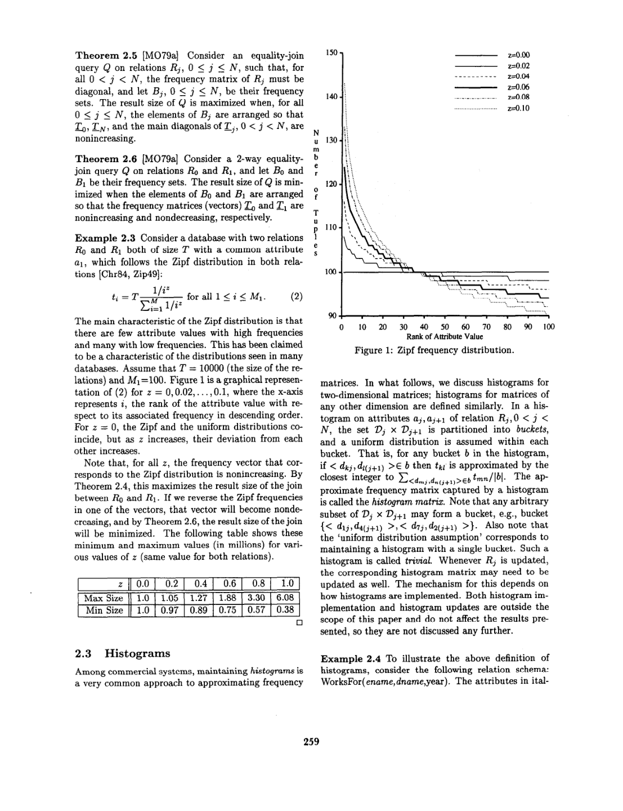
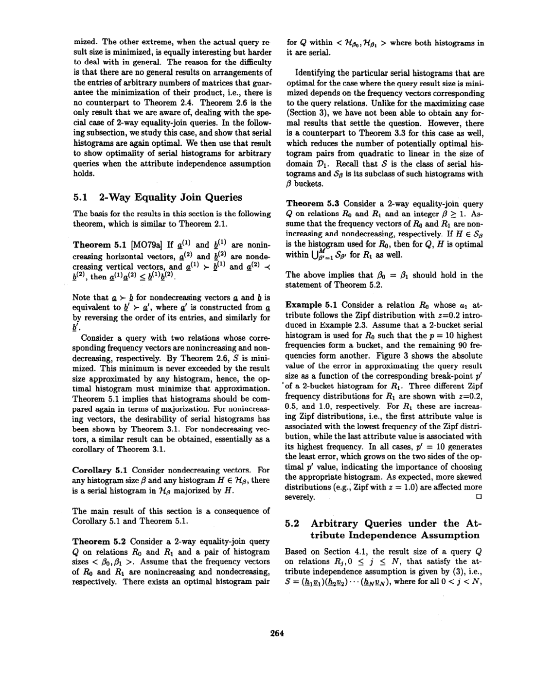

> 本组第 11 篇 · 统计与基数估计 · [全部论文]() · [上一篇]() · [下一篇]()

本文研究在固定查询、频率矩阵与桶数约束下减少树形等值连接结果大小估计的极端情形误差。核心是存在性结论：结果大小最大化时（独立属性版本与一般相关属性的联合直方图版本分别处理），以及任意树结果大小最小化且满足属性独立性时，存在全 serial 的最优直方图元组；不表示每个 serial、每个数据实例或所有单列直方图都最优。Serial 按频率而非自然属性值分桶。定理 6.1 在固定频率集及桶划分、遍历满足函数依赖的合法排列的平均模型下给出 E[S]-E[S']=0，不是平均绝对误差、平方误差或现实负载上的误差为零。本文陈述定理但省略完整证明，有 Zipf 数值例和误差表，没有实际系统性能评测或通用构造/维护算法。

本文保留论文陈述、读者推断与待验证方案的区别；实验数字只适用于原文条件。原文和翻译来自已有 AI 辅助精读报告，已做来源匹配与编辑复核，不等于人工逐项核验或独立实验复现。所有页码均为 PDF 物理页。

## 论文与阅读范围

Yannis E. Ioannidis, Universality of Serial Histograms, Proceedings of the 19th VLDB Conference, Dublin, Ireland, 1993, printed pages 256-267（PDF 物理页 1-12）。本文提供定理陈述、论证线索和数值示例；第 2 页明确省略完整证明并指向 [Ioa93]。无真实 DBMS 性能评测；直方图实现与更新不在本文范围内。

[论文集中的原始 PDF](https://github.com/lonng/db-papers/blob/4ff1331069c7cf52ac97dd769e5f484c1c35c200/papers/statistics/universality-of-serial-histograms.pdf) · 本地来源：`statistics/universality-of-serial-histograms.pdf`，共 12 页。

本篇保留 10 组原文精读和 35 条证据。截图为原始 PDF 的局部页选，不是重新生成的图表；未将整份 PDF 复制到博客。

## 研究问题与适用边界

关系数据库系统的查询优化器依赖统计信息来估计查询结果大小和访问计划代价。直方图是最常见的统计信息形式，用于近似关系中属性值的频率分布。然而，直方图近似引入的误差会直接或间接影响优化器的决策质量。本文研究给定查询、频率矩阵与桶数约束下，在查询结果规模达到指定极端的情形中，是否存在全由 serial histograms 组成的最优直方图元组。这里不是对所有查询/数据实例建立一个固定直方图的通用 minimax 误差界。

本文的适用边界非常明确。首先，研究对象仅限于能够准确记录每个桶内平均频率的直方图（"accurately record the average frequency within each bucket"）。其次，不失一般性地假设关系之间的连接是在单个属性上进行的，不处理如 (R0.a = R1.a and R0.b = R1.b) 这样的多属性复合连接条件。第三，查询类型限定为等值连接查询（equality-join queries），包括链式连接及其推广的任意树形连接查询。第 3 页原文明确说推广到任意树查询是 straightforward，数学工具更复杂但本质不变；不能把原有短笔记未覆盖写成全文未知。本文不覆盖循环连接、非等值连接和选择查询的相应最优性。

在相关工作方面，Piatetsky-Shapiro 和 Connell [PSC84] 研究了 equi-width 和 equi-depth 直方图在选择查询上的误差，发现 equi-depth 的最坏情况和平均误差更小。Muralikrishna 和 Dewitt [MD88] 将其扩展到多维直方图。其他工作关注选择查询的变宽直方图。本文区别在于处理任意规模的树形等值连接，并在后续定理限定的极端结果规模下识别包含最优解的 serial 类；universality 不能脱离这些限定。单连接查询的直方图研究极少且未强调最优性。

读者工程问题：该数学模型如何转化为实际计划选择收益，需要额外验证；本次未调查现代系统统计机制，不对当前实现或误差主要来源作事实断言。

依据：论文陈述；PDF 物理页 1, 2, 3, 5。证据：[C001N02](#evidence-c001n02), [C001N03](#evidence-c001n03), [C001N10](#evidence-c001n10), [SHR001](#evidence-shr001), [SHR002](#evidence-shr002), [SHR015](#evidence-shr015)。

## 数据模型与直方图架构

本文的数据模型基于频率矩阵（frequency matrix）Zj 来表示关系 Rj 的内容。对于中间关系，Zj 是一个 (Mj x Mj+1) 矩阵，其中 tkl 是属性值对 <dkj, dl(j+1)> 的频率。R0 的频率矩阵是水平向量，RN 的是垂直向量。定理 2.3 建立了关键不变量：等值连接查询的结果大小 S 等于参与关系的频率矩阵的乘积。这是后续 majorization 分析的基础。

直方图模型将属性域 Vj x Vj+1 划分为若干桶（buckets），并在每个桶内假设均匀分布（uniform distribution）。正文聚焦准确记录桶均值，模型的核心是以桶均值近似频率；第 4 页定义还写了最近整数近似。桶大小是桶包含的属性值对个数，不是包围这些值对的矩形面积。后续平均模型的精确等式不应未经分析就被推广为任意工程取整/采样实现的保证。由直方图捕获的近似频率矩阵称为 histogram matrix。桶可以是域的任意子集，不要求连续。特别地，只有一个桶的直方图对应于均匀分布假设，被称为 trivial histogram。

t-clique 查询被等价建模为一般查询 Q 的受限形式：对每个中间关系 Rj，关系内部的两个相邻连接属性 aj 与 a(j+1) 存在双向函数依赖，且在作者选定的值标签映射下对应同一编号。在此约束下，频率矩阵 Zj 必为方阵且为对角阵，查询结果大小为 sum_i T0[i] * T1[i,i] * ... * T(N-1)[i,i] * TN[i]；这不是跨关系的一对一匹配或每个键仅有一条元组的假设。该归约使得后续关于对角矩阵的直方图优化结论可直接应用于 t-clique 场景。

读者推断：频率矩阵乘积模型将基数估计问题转化为线性代数问题，这使得可以应用 majorization 理论来分析误差界。这种架构抽象忽略了物理存储细节（如页面布局、索引结构），纯粹关注逻辑层面的数据分布与查询语义。频率矩阵乘积计算的是逻辑连接基数，不是物理执行算法，也不要求单机存储或向量化执行。本文不讨论直方图物理实现和更新。

依据：论文陈述；PDF 物理页 3, 4, 6, 7。证据：[C001N04](#evidence-c001n04), [C001N07](#evidence-c001n07), [C002N01](#evidence-c002n01), [SHR008](#evidence-shr008), [SHR019](#evidence-shr019), [SHR021](#evidence-shr021)。

*原论文 PDF 物理页 4，版权归原作者或出版方。点击图片可查看原尺寸。页面文本中定位到：Figure 1: Zipf frequency distribution.。这是页面定位信息，不表示本次已复核图内所有数据。*

## Serial 定义、最优性陈述与构造边界

本文以 majorization 理论陈述 serial 最优性结果，而非给出执行过程或通用可运行算法。第 2 页说明所有完整证明因篇幅省略，详细版本指向 [Ioa93]；不能把本报告的解释写成论文内已有的完整证明。第 3 节重述 [IC92] 的受限情形结果，其他章节扩大适用范围。

Definition 2.4 要求任意两个桶之间，原始频率整体可排序且不交错：一个桶中所有频率都不小于另一个桶中所有频率，或反之。Serial 基于频率而非属性值自然顺序，也不规定固定宽度、等深度或最重值必须独占一桶。定理3.1（引用[IC92]）证明：对于任意桶数 p 和任意属于 BP 类的直方图 H，都存在一个 serial histogram 对其构成 majorization。定理3.2进一步将此推广到 t-clique 查询：当频率矩阵对角线非递增时，在给定各关系直方图桶数元组 <pj> 下，最优直方图元组可在全部由 serial histogram 组成的集合中找到。这是给定查询、极端频率设置、候选类与桶数预算下的最优解存在性陈述，不是所有 serial 都最优、唯一最优或统一的执行正确性保证。

定理4.2将 serial histogram 最优性推广到无独立性假设的一般情况：只要频率矩阵非递增（使 S 最大化），对本文范围内的树形 equality-join 查询，在给定各关系桶数元组 <βj> 下，存在全 serial 的最优元组。一般相关属性使用一般/联合直方图类，不等于只用单列 serial 就能保留相关性。第 4.2 节给出围绕非递增矩阵乘积和 majorization 的推导线索，但本次未独立补全或验证全文省略的证明。

传统直方图按属性域的自然全序将值划分到连续范围的桶中。定理3.2的重要推论是：对 t-clique 查询，这种传统方法可能远非最优。应当按频率的接近程度而非实际属性值来分组。文中明确指出这两种排序可能完全无关，这不表示每个按值范围分桶的直方图都差，也不是本文逐一证明 equi-width/equi-depth 在所有实例被严格支配。

以下为报告作者自行构造的小例子，用于说明 serial histogram 的构造步骤与非 serial histogram 的差异，该例子不包含在原文献中：

假设关系 R 的属性域有5个值，频率分别为 {100, 10, 90, 20, 80}，限制桶数 p=2。
步骤1：按频率降序排列值，得到序列 (v1:100), (v3:90), (v5:80), (v4:20), (v2:10)。
步骤2：构造 serial histogram。一种合法的 serial 划分是将前 k 个最高频放入一个桶，其余放入另一个桶。例如，桶1={v1, v3, v5}（频率100,90,80，平均90），桶2={v4, v2}（频率20,10，平均15）。
步骤3：对比 nonserial histogram。如果按属性值自然顺序划分，桶1={v1, v2, v3}（频率100,10,90，精确平均200/3），桶2={v4, v5}（频率20,80，平均50）。
步骤4：将各近似向量分别按频率排序，可比较 (90,90,90,15,15) 与 (200/3,200/3,200/3,50,50) 的前缀和；它们总和均为300，前者前缀和不小于后者。这只说明这个读者例子的相应排序向量关系，不能忽略真实连接键的对齐、另一侧频率权重与极值条件而推出任意连接的误差更小，更没有证明该断点全局最优。

复杂度说明：论文论证了 serial histogram 的存在性和最优性，但未给出在大规模数据集上高效寻找最优 serial 划分的多项式时间算法的具体复杂度分析。读者估算：若需穷举所有可能的 serial 划分以找到绝对最优解，复杂度与桶数和域大小相关，可能需要动态规划。

最小值情形另有边界：二表反向排序的频率向量可用定理 5.2；推广到任意树的定理 5.4 要求属性独立性及使结果最小的 mixed-monotone 设置。第 5.1 节没有给出一般最小值最优断点的闭式解。第 3 节提及的最大值二表闭式和长查询极限重频单桶倾向是先前 [IC92] 的特殊结果，不是通用构造法。

依据：论文陈述；PDF 物理页 2, 3, 5, 6, 7, 8, 9, 10。证据：[C002N02](#evidence-c002n02), [C002N03](#evidence-c002n03), [C002N09](#evidence-c002n09), [SHR001](#evidence-shr001), [SHR002](#evidence-shr002), [SHR003](#evidence-shr003), [SHR004](#evidence-shr004), [SHR005](#evidence-shr005), [SHR006](#evidence-shr006), [SHR007](#evidence-shr007), [SHR009](#evidence-shr009), [SHR010](#evidence-shr010), [SHR011](#evidence-shr011), [SHR013](#evidence-shr013), [SHR014](#evidence-shr014), [SHR015](#evidence-shr015)。

## 最优性前提与期望等式

本文陈述极端结果规模下的最优性定理与特定平均模型下的期望等式；第 2 页明确省略完整证明。本节解释其前提和含义，不声称已从这 12 页复核完整证明。

第一层面，定理3.1、3.2和4.2构成了 serial histograms 最优性论述的核心定理关系。其中第 3.1/3.2 节针对受限 t-clique 类，第 4.1/4.2 节针对最大值独立/一般联合直方图；最小值另由第 5.2/5.4 定理处理。结论是在各自设置与桶预算下存在最优 serial 元组，不是一个 serial 对所有其他候选都严格支配。对任意树的最小值需要独立性，但二表反向排序的特例无需额外独立假设。

第二层面，第6节探讨以期望值作为优化目标的可能性。定理6.1证明：对树形 equality-join 查询，在固定各关系的频率多重集和桶划分后，对所有尊重函数依赖的合法频率-属性值安排及其组合等权平均，真实结果大小的期望 E[S] 与直方图近似结果大小的期望 E[S'] 之差恒为零。这只使上述 E[S]-E[S'] 指标无法区分直方图；不等于 E[|S-S'|]、MSE、方差、相对误差或 q-error 为零。它也不是 serial 的专有性质，不能据此否定现实工作负载上的平均绝对误差等评价指标。文中还指出可以构造反例使大量 serial 和非 serial 直方图误差高于 trivial 直方图。

Example 6.1 通过两个关系 R0 和 R1 的频率集 B0={a,b,c}、B1={d,e,f} 及其划分 {{a},{b,c}} 与 {{d},{e,f}}，构造近似频率集 B0' 和 B1'。为计算期望结果大小 E[S]，固定 R0 的频率向量并枚举 B1 元素的所有排列（共6种），得到公式(4)。对近似后的频率集同样计算 E[S'] 得到公式(5)，通过代数操作证明两者相等，即 E[S]-E[S']=0。这是一个正确性验证示例，用于说明直方图近似不改变期望结果大小。

边界与可验证问题：定理6.1的证明依赖于“在所有尊重函数依赖的频率排列上取期望”这一前提。在实际数据库中，数据分布并非均匀随机排列，而是具有特定的偏斜和相关性。因此，期望误差为零的结论不能直接推导为“在实际工作负载中所有直方图表现相同”。因此本文没有提供工业界通常采用何种指标的证据；不作这类现代实践归因。

依据：论文陈述；PDF 物理页 2, 3, 5, 7, 8, 9, 10, 11。证据：[C002N12](#evidence-c002n12), [C003N01](#evidence-c003n01), [SHR001](#evidence-shr001), [SHR002](#evidence-shr002), [SHR005](#evidence-shr005), [SHR006](#evidence-shr006), [SHR007](#evidence-shr007), [SHR009](#evidence-shr009), [SHR010](#evidence-shr010), [SHR011](#evidence-shr011), [SHR012](#evidence-shr012), [SHR015](#evidence-shr015)。

## 实验评估与数值示例

本文缺乏传统意义上的系统实验评估。没有提供真实DBMS的硬件/软件环境、基线系统或运行时间/吞吐等执行性能测量；但有明确的基数相对误差指标与合成Zipf设定。定量材料是计算型示例与代数演示，不是 DBMS 执行性能实测。

例4.2在定理4.1的独立属性/最大结果条件下，使用 Zipf 分布 (z=0.2, domain=100) 及相同单属性直方图，比较4种直方图在 1/2/5/10 个 join 时的相对误差：Trivial（均匀）、Nonserial（5桶；原文第 i 桶的频率秩公式印为 (5x+1)，定义存在未随 i 改变的排版疑点，本次不擅自修订公式）、Serial-(b)（5桶各20元素）、Serial-(c)（4桶各含1个最高频+1桶含剩余96个）。结果显示：Serial-(b) 在 10 joins 时误差 11.56%，远低于 Trivial 的 57.39%；Nonserial 虽信息量为 Trivial 的5倍但误差几乎相同；作者在此设置下指出误差随 join 数呈指数增长，不是对所有分布的增长率定理。此为数值计算示例，非完整实验评估。

Example 6.1 仅为代数推导示例，用于验证 E[S]=E[S'] 的理论性质，并非实验评估。

缺失的关键实验要素：
1. 工作负载：未使用标准基准测试（如 TPC-H、JOB），仅在合成 Zipf 分布上进行数值计算。
2. 硬件/软件：未提及任何数据库系统、操作系统或硬件配置。
3. 基线：此数值例比较 Trivial、Nonserial、Serial-(b)/(c)。其他方法的提出年代和系统对比均未在本次本地来源核对中验证，不以现代方法缺席作为本文缺陷。
4. 指标：仅报告了相对误差百分比，未涉及构建时间、内存占用或对优化器最终计划选择的影响。
5. 主要数字：10 joins 时 Serial-(b) 误差 11.56%，Trivial 误差 57.39%。
6. 不能得出的结论：不能得出 serial histograms 在实际数据库系统中总是优于其他方法的结论，其定理已受查询拓扑、连接条件、极值排列和直方图维度等约束；也没有真实系统实验。多属性联合频率矩阵并非本文未处理，未处理的是同一对关系上同时施加多个属性相等的复合连接条件，二者须区分。局部数据（Zipf z=0.2）不能泛化为整篇结论。

不从这篇论文推断整个1993年研究领域的实验惯例。但从现代内核工程师的角度看，缺乏实验使得无法评估 serial histograms 的构建开销和维护成本，这在动态更新的数据库中至关重要。

其他数值材料也实际存在：Example 2.3 在关系大小10000、域100下列出 Zipf z 从0到1时的二表最大/最小结果（单位百万），如 z=1 时最大6.08、最小0.38；Example 5.1 固定一侧2桶断点p=10，另一侧逆序 Zipf 的 z=0.2/0.5/1.0 三条曲线均在p'=10处最小。它们分别说明极值对齐和条件性断点选择，不是通用误差界或执行时间收益。

依据：论文陈述；PDF 物理页 4, 7, 8, 9, 11。证据：[C002N07](#evidence-c002n07), [C003N08](#evidence-c003n08), [SHR016](#evidence-shr016), [SHR017](#evidence-shr017), [SHR018](#evidence-shr018), [SHR022](#evidence-shr022)。

*原论文 PDF 物理页 9，版权归原作者或出版方。点击图片可查看原尺寸。页面文本中定位到：Figure 3 shows the absolute。这是页面定位信息，不表示本次已复核图内所有数据。*

## 权衡与局限性

本节基于论文事实进行读者推断，分析 serial histograms 在实际应用中的权衡。原文明确指出的局限性包括：仅处理单属性等值连接，不处理多属性复合连接条件；第6节的合法排列平均使 E[S]-E[S'] 不能区分直方图，但不排除绝对误差、平方误差或方差等目标。

推断的权衡点：
1. 最优性与构建成本的权衡：定理3.2指出应当按频率的接近程度而非实际属性值来分组。按频率排序是一种读者可尝试的构造方式，并非本文证明了所有构造必须做全局排序；传统方法是否更易流式或增量维护需具体实现比较。在大规模数据或分布式环境下，全局频率排序的通信和计算开销可能抵消其在基数估计精度上的收益。
2. 最坏情况与常见情况的权衡：serial histograms 被证明在极端情况（结果大小最大化或最小化）下最优。然而，实际查询优化器面对的通常是混合工作负载。过度针对最坏情况优化可能导致在常见分布下不如启发式方法（如 equi-depth）稳定。
3. 理论模型与物理实现的鸿沟：本文假设直方图准确记录桶内平均频率，且在桶内假设均匀分布。实际系统中，采样误差或更新延迟可能破坏准确均值假设；数据偏斜本身则是本文允许并研究的对象，不是对模型前提的违反。serial histogram 对频率排序的敏感性可能使其在面对噪声数据时更加脆弱。
4. 桶数分配的权衡：定理4.2讨论了给定桶数元组 <βj> 下的最优性，但未解决如何在多个关系之间分配总桶数预算的问题。不同关系的频率分布差异可能导致均匀分配桶数并非全局最优。

边界：以上权衡分析为读者推断，论文本身未提供关于构建开销、更新维护或与其他统计信息协同工作的实证数据。

依据：读者推断；PDF 物理页 4, 6, 7, 8, 10, 11。证据：[C002N03](#evidence-c002n03), [C002N09](#evidence-c002n09), [C002N12](#evidence-c002n12), [SHR005](#evidence-shr005), [SHR006](#evidence-shr006), [SHR007](#evidence-shr007), [SHR012](#evidence-shr012), [SHR019](#evidence-shr019), [SHR020](#evidence-shr020)。

## 与现代数据库系统的联系

本节仅列读者待验证问题，不作现代系统实现、默认统计形式或论文未说明的部署假设断言。

1. 对任一现代优化器，应先查其统计接口和直方图定义，再判断桶按自然值、频率或其他维度组织，不能预设 Calcite、DuckDB 或 StarRocks 已有某种默认直方图。
2. 应区分单列边际统计、联合频率统计和错误独立性近似，再研究本文有条件的最优性是否适用；不能把第4.2节的联合直方图结论当成单列统计解决相关性的保证。
3. 频率矩阵乘积描述逻辑结果基数，不是单节点执行/存储假设。若研究分布式构建与维护，应自行测采集、传输和更新成本，而不是宣称分片必然改变该逻辑公式。
4. 与其他基数估计器比较前，应统一查询语义、统计预算、误差目标和排列/工作负载分布；本文没有给所有现代方法共享的数值最坏误差界。

这些都是后续研究问题，本次没有联网、读其他系统源码或验证当前产品能力。

依据：待验证的工程设想；PDF 物理页 1, 3, 4, 5, 6, 7, 8。证据：[C001N03](#evidence-c001n03), [C002N01](#evidence-c002n01), [SHR001](#evidence-shr001), [SHR002](#evidence-shr002), [SHR005](#evidence-shr005), [SHR006](#evidence-shr006), [SHR007](#evidence-shr007), [SHR019](#evidence-shr019)。

## 复现指南与验证路径

由于本文主要是定理陈述、论证线索与数值示例，复现的重点在于验证数学推导和重现数值示例，而非运行系统级基准测试。

1. 数值示例复现（例4.2）：
   - 步骤：生成 Zipf 分布 (z=0.2, domain=100) 的频率向量。
   - 实现四种直方图构建逻辑：Trivial（1桶）、Nonserial（5桶，按频率秩而非自然值考虑；原文 (5x+1) 未随桶索引 i 改变，复现须记录这一排版疑点，不将读者修正式当作原文）、Serial-(b)（5桶各20元素按频率排序）、Serial-(c)（4桶各1最高频+1桶96剩余）。
   - 按独立性/最大值条件构造1、2、5、10个join，分别涉及2、3、6、11个关系，计算每次连接的估计结果大小与真实结果大小（通过频率向量精确计算）的相对误差。
   - 验证点：确认 Nonserial 与 Trivial 误差是否几乎相同；确认 Serial-(b) 在 10 joins 时误差是否约为 11.56%；确认误差是否随 join 数呈指数增长。
   - 工具建议：Python/NumPy 足以完成此数值计算。

2. 定理6.1代数验证（Example 6.1）：
   - 步骤：定义 B0={a,b,c}, B1={d,e,f} 及划分。
   - 枚举 B1 的所有 6 种排列，计算公式(4)的 E[S]。
   - 对近似频率集计算公式(5)的 E[S']。
   - 验证点：通过符号计算（如 SymPy）证明 E[S] - E[S'] 恒等于 0。

3. Majorization 关系验证：
   - 编写代码验证定理3.1：给定任意直方图 H，是否存在 serial histogram 对其构成 majorization。
   - 必须限于第3.1定理的对角项候选类、非递增排列及相同桶数，不能直接测试任意联合矩阵或把排序后的比较误当原连接键对齐下的任意查询保证。小规模枚举是读者检验，不是完整证明。

4. 缺失的复现材料：
   - 论文未提供源代码或数据集。
   - 未提供构建 serial histogram 的具体多项式时间算法伪代码，仅有存在性证明。复现者需要自行设计划分算法。
   - 未提供多表 join 时频率矩阵乘积的高效计算方法，在域较大时直接矩阵乘法可能面临维度灾难。

边界：符号演算和小规模枚举只能核对相应公式/实例，不等于证明所有定理或替代本文省略的完整证明；本次没有执行这些复现方案，无法证明其在真实数据库系统中的有效性。

依据：待验证的工程设想；PDF 物理页 2, 3, 5, 6, 7, 8, 9, 11。证据：[C002N07](#evidence-c002n07), [C003N01](#evidence-c003n01), [C003N08](#evidence-c003n08), [SHR001](#evidence-shr001), [SHR002](#evidence-shr002), [SHR013](#evidence-shr013), [SHR014](#evidence-shr014), [SHR015](#evidence-shr015), [SHR016](#evidence-shr016), [SHR017](#evidence-shr017)。

## 结论与工程启示

本文的核心贡献是陈述树形等值连接在指定极端结果规模、直方图类型和桶数预算下，存在最优 serial 元组；完整证明另见作者指向的版本，不在这12页内。第6.1定理仅使其合法排列平均模型下的 E[S]-E[S'] 无法区分直方图，不否定现实平均绝对误差/MSE等指标，也不推出必须采用某个尾部指标。

对数据库内核工程师的启示（读者推断）：
1. 统计信息收集策略：可研究频率分组而非仅按自然值范围分桶，但必须指定查询、相关性和预算；本文未测得构建成本或实际计划收益，不能直接据此替换现有统计方案。
2. 误差传播意识：例4.2显示误差随 join 数指数增长。这仅是该示例的传播现象，不是所有长链或星型负载的定理。是否引入误差追踪或运行时应对机制，属于需要单独论证的工程建议，不是本文给出的实现结论。
3. 期望 vs 极值：期望等式不等于平均绝对误差为零。读者可同时考察绝对/相对误差、方差和极值，不应把本文解释成已比较或推荐 P99，也不把基数误差混同尾延迟。
4. 理论到实践的鸿沟：本文假设单属性连接和准确的桶内平均频率。本文已用联合矩阵讨论属性相关性，但错误独立性近似仍可能高估或低估；NULL 语义、数据更新和采样实现则未在此给出保证。serial histograms 的理论最优性在这些现实约束下是否依然鲁棒，是需要进一步研究的工程问题。

局限重申：本文结论严格受限于其数学模型。未涉及范围查询、聚合操作、物理 I/O 代价模型或并发控制。不能将“serial histograms 对 join 基数估计最优”泛化为“serial histograms 对所有数据库操作最优”。

作者第7节真正列出的开放方向包括：误差界要求多少桶、多查询最优性、以误差方差为目标、循环/非等值/选择查询，以及算子代价与计划排序。不能从基数误差定理直接推出计划成本或排序最优。

依据：读者推断；PDF 物理页 1, 2, 3, 5, 7, 8, 9, 10, 11。证据：[C001N02](#evidence-c001n02), [C002N12](#evidence-c002n12), [SHR001](#evidence-shr001), [SHR002](#evidence-shr002), [SHR005](#evidence-shr005), [SHR006](#evidence-shr006), [SHR007](#evidence-shr007), [SHR009](#evidence-shr009), [SHR010](#evidence-shr010), [SHR011](#evidence-shr011), [SHR012](#evidence-shr012), [SHR015](#evidence-shr015), [SHR020](#evidence-shr020)。

## 原文精读：从句子回到机制

以下保留原文、忠实翻译、含义与边界；假设示例不作为论文实验结果。

### P001 · PDF 物理页 1

**原文**

<blockquote class="paper-source-quote"><pre><code>We identify the &#10;class of serial histograms and demonstrate that they &#10;are optimal for reducing the query result size error for &#10;several classes of queries when the actual query result &#10;size (and hence the value of that error) reaches some &#10;extreme. Specifically, serial histograms are shown to &#10;be optimal for arbitrary tree equality-join queries when &#10;the query result size is maximized, whether or not the &#10;attribute &#10;independence assumption holds, and when &#10;the query result size is minimized and the attribute in- &#10;dependence assumption holds.</code></pre></blockquote>

**忠实翻译**

> 我们识别出 serial histograms（串行直方图）这一类，并证明当实际查询结果大小（以及因此该误差的值）达到某个极端时，它们对于减少几类查询的查询结果大小误差是最优的。具体而言，serial histograms 被证明在以下情况下对任意树形等值连接查询（arbitrary tree equality-join queries）是最优的：当查询结果大小被最大化时，无论属性独立性假设（attribute independence assumption）是否成立；以及当查询结果大小被最小化且属性独立性假设成立时。

**技术含义与边界**

> 作者概括树等值连接在极端结果规模下的最优性。须结合定理：固定查询、频率矩阵、候选类及桶预算，存在全serial的最优元组，不是任意serial都优于其他直方图。最大结果的独立单属性版本和一般相关属性的联合直方图版本不同；任意树最小结果要求独立性，二表反向频率排序另有特例。

**常见误读**

> 容易将‘对树形等值连接查询在极端情况下最优’泛化为‘对所有查询类型或在所有数据分布下都最优’。原文明确限定了查询类型为 arbitrary tree equality-join queries，且最优化目标是在查询结果大小达到 extreme 时的误差，不支持将其推广为全局保证。

**读者构造的假设示例**

> 读者构造的假设示例：某三关系链满足最大结果的非递增频率设置，并给每个候选直方图固定相同预算；定理允许把搜索限于包含最优解的serial元组类。它没有指定随意选出的一个serial断点就是最优，也没有保证对另一个非极端数据实例误差更小。

### P002 · PDF 物理页 11

**原文**

<blockquote class="paper-source-quote"><pre><code>Simple algebraic manipulations show that their sum is &#10;equal to the sum of the first two parentheses in (4). &#10;Similarly, &#10;the last four parentheses of (5) are equal &#10;and their sum is equal to the sum of the corresponding &#10;parentheses in (4). Hence, E[S] - E[S’] = 0.</code></pre></blockquote>

**忠实翻译**

> 简单的代数运算表明，它们的和等于 (4) 中前两个括号的和。类似地，(5) 的最后四个括号是相等的，并且它们的和等于 (4) 中对应括号的和。因此，E[S] - E[S’] = 0。

**技术含义与边界**

> 这是第11页Example6.1的代数收尾：两个关系的频率集分别为{a,b,c}、{d,e,f}，桶划分为{{a},{b,c}}、{{d},{e,f}}，固定第一侧后枚举第二侧6种排列。公式(4)/(5)比较的是这种排列平均下的真实与桶均值近似结果；上下文已在本次全文阅读中确认，不能再称查询结构未知。等式不是每次连接无误差或平均绝对误差为零。

**常见误读**

> 容易将 E[S] - E[S’] = 0 误解为直方图在任何查询上都没有误差。原文仅说明期望值之差为零，这并不排除单次估计存在方差或非零绝对误差的可能性。此外，该结论依赖于特定的代数恒等式，不能脱离其前提条件泛化。

**读者构造的假设示例**

> 读者构造的假设示例：取两侧频率分别(4,1)与{4,1}，第一侧近似成均值(2.5,2.5)、第二侧保持精确。第二侧两种排列的真实点积为17和8，近似都为12.5，平均相同但平均绝对误差为4.5。这是说明正负偏差可抵消的读者算例，不是论文Example6.1中的数字。

### P003 · PDF 物理页 6

**原文**

<blockquote class="paper-source-quote"><pre><code>For uniformity &#10;with the rest &#10;of the paper, however, we cast the specialized prob- &#10;lem into our formulation &#10;of Section 2.2 and use that &#10;to present the results of our earlier work. Specifically, &#10;dealing with a t-clique query is equivalent to dealing &#10;with a query Q of the general form discussed in this &#10;paper with the additional restriction on the data that, &#10;for each relation Rj,O &lt; j &lt; N, the functional &#10;de- &#10;pendencies oj + oj+i and oj+i --+ oj hold.</code></pre></blockquote>

**忠实翻译**

> 然而，为了与本文其余部分保持一致，我们将这个专门问题转化为我们在第 2.2 节中的表述，并用它来呈现我们早期工作的结果。具体而言，处理一个 t-clique 查询等价于处理本文中讨论的一般形式的查询 Q，并对数据附加如下限制：对于每个关系 Rj，0 < j < N，函数依赖 oj -> oj+1 和 oj+1 -> oj 成立。

**技术含义与边界**

> t-clique在前文指每个关系在其参与的连接中使用同一属性的受限查询，不能简单定义为所有关系在一组属性上两两连接。作者为统一表述，将其转到链式模型，并对每个中间关系内部相邻连接属性施加双向函数依赖；选取一一对应标签后得到对角频率矩阵，用来重述先前[IC92]的结果。

**常见误读**

> 函数依赖在同一个关系Rj内部，不是Rj与R(j+1)之间的元组一对一匹配。双向属性值依赖不排除同一值对有多个元组，也不把频率矩阵的计数都变成1。本文在此重述先前受限结果，不是说任意树查询都满足这种依赖。

**读者构造的假设示例**

> 读者构造的假设示例：中间关系R1的连接属性A、B只出现值对(a1,b1)与(a2,b2)，每种值对可重复多次。A->B和B->A在R1内部成立；按对应标签编号后联合频率只在对角项非零。这不保证R0或R2中每个连接值只有一条记录。

### P004 · PDF 物理页 2

**原文**

<blockquote class="paper-source-quote"><pre><code>Histograms for single-join queries &#10;have been minimally &#10;studied and then again without &#10;emphasis on optimality &#10;[Chr83, Koo80, MK85]. &#10;Our &#10;work is different from all the above in that it deals &#10;with arbitrarily &#10;large join queries and identifies a sin- &#10;gle class of histograms that are universally optimal for &#10;reducing errors in the worst-case.</code></pre></blockquote>

**忠实翻译**

> 针对单连接查询的直方图研究极少，而且同样没有强调最优性 [Chr83, Koo80, MK85]。我们的工作与上述所有工作不同之处在于，它处理任意大的连接查询，并识别出一类单一的直方图，在最坏情况下对减少误差是普遍最优的（universally optimal）。

**技术含义与边界**

> 作者说明相较以往主要单连接研究，本文允许任意规模的树形等值连接。universally optimal须连同极端结果规模、候选类和桶预算阅读，是包含最优元组的类，而不是公布对所有数据的统一数值误差上界或唯一最优直方图。

**常见误读**

> 容易将‘universally optimal for reducing errors in the worst-case’误解为在任何实际平均负载下都是最优的。原文明确限定了最优性的评价标准是‘最坏情况’（worst-case），最坏情况下的最优策略在实际平均情况下未必表现最好。同时，‘任意大的连接查询’受限于前文提到的树形等值连接等前提，不应泛化为包含循环的任意拓扑查询。

**读者构造的假设示例**

> 读者构造的假设示例：对含20个关系的树形等值连接，若满足某个最大结果定理的频率排列和直方图类型条件，并固定预算，可研究serial类内的最优元组。不能据这句话保证任意serial估计严格好于其他类，也不能虚构一个误差上界。

### P005 · PDF 物理页 10

**原文**

<blockquote class="paper-source-quote"><pre><code>Then, generate the expected approxi- &#10;mate value for the query result size, which is denoted &#10;by E[S’]. The following theorem deals with the value &#10;of E[SJ - E[S’]. &#10;Theorem &#10;6.1 Consider a tree equality-join &#10;query Q &#10;on relations Rj, 0 5 j 5 N, and an (N + 1)-vector &#10;&lt; Bj &gt; of frequency sets together with partitionings &#10;of them. If E[,!9l and E[S’] are defined as above, then &#10;E[sj - E[S’] = 0. &#10;Note that Theorem 6.1 deals with arbitrary &#10;his- &#10;tograms, not only serial ones.</code></pre></blockquote>

**忠实翻译**

> 然后，生成查询结果大小的期望近似值，记为 E[S’]。以下定理处理 E[S] - E[S’] 的值。定理 6.1 考虑在关系 Rj（0 <= j <= N）上的树形等值连接查询 Q，以及一个由频率集组成的 (N + 1)-向量 < Bj > 连同对它们的划分。如果 E[S] 和 E[S’] 如上定义，那么 E[S] - E[S’] = 0。注意，定理 6.1 处理的是任意直方图，而不仅仅是 serial 直方图。

**技术含义与边界**

> 第6.1定理先固定每个关系的频率多重集和桶划分，将桶内频率替换为均值，再对满足函数依赖的所有合法安排组合等权平均，得到E[S]-E[S']=0；原文特别说明适用于任意直方图。不是以现实查询工作负载或真实数据随机采样为期望空间，也不表示桶近似不产生实际误差。

**常见误读**

> 不能把有符号期望差为零写成E[|S-S'|]、MSE、误差方差或q-error为零，也不能说大量现实重复查询平均后就必定无偏。该等式只使本文定义的期望差目标无法区分直方图。

**读者构造的假设示例**

> 读者构造的假设示例：固定一组频率与某个桶划分，枚举完整合法安排后，正、负估计偏差可能抵消；换一个划分，该有符号平均仍可为零，但各安排的绝对误差可不同。若仅测试一个固定数据库上的反复执行，就不是此定理的期望模型。

### P006 · PDF 物理页 4

**原文**

<blockquote class="paper-source-quote"><pre><code>In a his- &#10;togram on attributes aj, aj+r of relation Rj, 0 &lt; j &lt; &#10;N, the set Vj x Vj+i &#10;is partitioned &#10;into buckets, &#10;and a uniform distribution &#10;is assumed within &#10;each &#10;bucket. That is, for any bucket b in the histogram, &#10;if &lt; dkj, dl(j+l) &gt;E b then i&amp;l is approximated by the &#10;closest integer to &amp;,,j,d,cj+lj,Eb &#10;tdlbl.</code></pre></blockquote>

**忠实翻译**

> 在中间关系Rj的属性aj和a(j+1)上构建直方图时，将值对域划分为若干桶，并在每个桶内假设均匀分布。对于桶中的任意属性值对，其频率近似为该桶中所有频率的算术平均值的最近整数。（原引文公式提取有乱码；本句已对照原PDF第4页的定义，未改动英文引文。）

**技术含义与边界**

> 原PDF定义中的分母为|b|，即桶实际包含的属性值对个数。桶可以是任意子集，不必为连续矩形，因而不能用外包矩形面积替代|b|。准确记录桶均值仍不等于桶内每个值对的频率都准确；最近整数处理与后文理想平均等式的工程适用条件不能混为一谈。

**常见误读**

> 不要把任意联合桶都当成规则值域网格，不要从均值准确推出每个点准确，也不要静默把损坏的英文原始公式重写成校正后的quote。本次仅校正翻译/解释，raw引文保持原样。

**读者构造的假设示例**

> 读者构造的假设示例：中间关系R1的桶仅包含值对(1,1)、(1,4)、(4,2)，对应频率合计30，则|b|=3，均值为10；不能因为外包范围是4乘4就除以16。三个值对各自的真实频率仍可并不相同。

### P007 · PDF 物理页 8

**原文**

<blockquote class="paper-source-quote"><pre><code>Histogram &#10;1 join &#10;2 joins &#10;5 joins &#10;10 joins &#10;Trivial &#10;4.64% &#10;9.50% &#10;25.46% &#10;57.39% &#10;Nonserial &#10;4.60% &#10;9.41% &#10;25.22% &#10;56.79% &#10;Serial-(b) &#10;1.10% &#10;2.21% &#10;5.62% &#10;11.56% &#10;Serial-(c) &#10;2.15% &#10;4.34% &#10;11.22% &#10;23.70% &#10;As expected, the serial histograms do better than the &#10;trivial and the nonserial ones. Note that the nonserial &#10;and the trivial &#10;histograms generate almost identical &#10;errors, although the former maintains five times more &#10;information &#10;than the latter. Also, although not clear &#10;due to their small values, the errors grow exponentially &#10;with the query size. &#10;cl &#10;r: &#10;= ( ;:; &#10;f:; ) , &#10;r; &#10;= ( ;:;5” &#10;;I;; &#10;) .</code></pre></blockquote>

**忠实翻译**

> 直方图 1个连接 2个连接 5个连接 10个连接 Trivial 4.64% 9.50% 25.46% 57.39% Nonserial 4.60% 9.41% 25.22% 56.79% Serial-(b) 1.10% 2.21% 5.62% 11.56% Serial-(c) 2.15% 4.34% 11.22% 23.70% 正如预期的那样，serial 直方图的表现优于 trivial 和 nonserial 直方图。注意，nonserial 和 trivial 直方图产生了几乎相同的误差，尽管前者维护的信息量是后者的五倍。此外，尽管由于数值较小而不明显，但误差随查询大小呈指数增长。

**技术含义与边界**

> 这是Example4.2的计算型误差表，不是数据库系统实验。第7页限定定理4.1的属性独立/最大结果设置、Zipf z=0.2、域100及相同单属性直方图；两种serial方案均为5桶但误差不同，serial-(b)比重频单桶的serial-(c)更准。因此既不能无条件推广百分比，也不能说每个serial或最重值独占桶总是最优。原文此例的nonserial公式有桶索引排版疑点，不能据猜测补成原文算法。

**常见误读**

> 容易将此表格中的误差百分比泛化为所有数据库负载下的通用规律。原文提供的仅是特定实验设置下的局部结果，且明确指出‘误差随查询大小呈指数增长’是在该特定测试条件下的观察。不能据此断言 Nonserial 直方图在所有场景下都比 Trivial 差，也不能将具体的百分比数字视为理论常数。

**读者构造的假设示例**

> 读者构造的假设示例：设同一预算下两个serial候选断点不同，得到不同误差；应比较它们而非只检查serial标签。这说明serial性质只约束候选类，不能单独决定断点或通用误差值。示例不补写原文未明确的nonserial分桶公式。

### P008 · PDF 物理页 3

**原文**

<blockquote class="paper-source-quote"><pre><code>The following theorem establishes that the size of &#10;the result of an equality-join &#10;query is equal to the &#10;product of the frequency matrices of the participat- &#10;ing relations. &#10;Theorem &#10;2.3 The size S of the result relation of &#10;query Q is equal to &#10;(1) &#10;Example &#10;2.2 Consider three relations Ro, RI, and &#10;R2, whose frequency matrices are &#10;G = ( 20 15 ), T1 = (;z” &#10;‘: &#10;;), &#10;x2=( &#10;:;).</code></pre></blockquote>

**忠实翻译**

> 以下定理把本文连接模型的结果大小表示为参与关系频率矩阵的乘积。定理2.3：查询Q的结果关系大小S由式(1)给出。Example2.2考虑三个关系R0、R1、R2及其频率矩阵。（本段提取中的式(1)与矩阵数值损坏，不将乱码当成数值翻译。）

**技术含义与边界**

> 本次已对照原PDF第3页确认式(1)为S=T0*T1*...*TN：端点是行/列向量，中间为相邻连接属性的联合频率矩阵，维度相容后乘积为标量。它计算逻辑连接结果基数，不是连接物理执行过程或单节点存储假设。无需用修订英文quote的方式补公式；原始抽取片段保持不动。

**常见误读**

> 不能猜测损坏的矩阵数值，也不能把逻辑频率矩阵乘积理解为引擎必须实际构造完整稠密矩阵执行join。若补充原图信息，必须明确来源为原PDF视觉核对，而非伪造缓存中的exact quote。

**读者构造的假设示例**

> 读者构造的假设示例：假设 R0 和 R1 在属性 A 上等值连接，A 的域为 {v1, v2}。R0 的频率向量为 [10, 20]（即 v1 出现 10 次，v2 出现 20 次），R1 的频率向量为 [5, 15]。则连接结果大小为 10*5 + 20*15 = 350。此为帮助理解频率矩阵乘积计算基数的假设示例，非原文例 2.2 的真实内容。

### P009 · PDF 物理页 1

**原文**

<blockquote class="paper-source-quote"><pre><code>We investigate the optimality &#10;of histograms for lim- &#10;iting the errors in the estimates of query result sizes. &#10;Our focus is on histograms that accurately record the &#10;average frequency within each bucket. In an earlier ef- &#10;fort, we identified the class of serial histograms and &#10;dealt with equality-join &#10;queries where each relation &#10;is joined on the same attribute &#10;for all joins in which &#10;it participates [IC92].</code></pre></blockquote>

**忠实翻译**

> 我们研究了直方图在限制查询结果大小估计误差方面的最优性。我们的重点是准确记录每个桶内平均频率的直方图。在早期的努力中，我们识别出了 serial histograms 类，并处理了等值连接查询，其中每个关系在其参与的所有连接中都在同一个属性上进行连接 [IC92]。

**技术含义与边界**

> 准确记录桶内平均频率是确定性统计模型前提，不是一个关于随机估计器无偏的结论。均值记录准确与用该均值替代桶内每个真实频率导致误差是两件事。[IC92]的受限连接属性设置也不能误套到本文一般联合矩阵模型。

**常见误读**

> 容易将‘准确记录每个桶内平均频率’等同于‘估计结果完全准确’。原文仅指直方图在构建时对桶内平均值没有记录误差，但在利用该平均值去近似桶内各个具体值的频率时（如 P006 所述），仍会因均匀分布假设产生误差。此外，不能将早期工作 [IC92] 的局限性（同属性连接）错误地归加于本文。

**读者构造的假设示例**

> 读者构造的假设示例：R0分别以A连接R1、以B连接R2，仍可构成树形查询；本文可用R0的A、B联合频率讨论这种情况，而不是要求A与B必然独立。若只保留边际单属性统计并错误假设独立，就不自动获得一般相关属性定理的保证。

### P010 · PDF 物理页 6

**原文**

<blockquote class="paper-source-quote"><pre><code>The important implication &#10;of Theorem 3.2 is &#10;that this traditional approach may be far from optimal &#10;for t-clique queries. Histograms should be constructed &#10;so that attribute values are grouped in buckets based &#10;on closeness in their corresponding frequencies and not &#10;in their actual values. This is a significant difference, &#10;since the two orderings may be completely unrelated. &#10;Identifying &#10;which of the many serial histograms is &#10;the optimal one in each case is not straightforward.</code></pre></blockquote>

**忠实翻译**

> 定理 3.2 的重要含义是，这种传统方法对于 t-clique 查询可能远非最优。直方图的构建应当使得属性值根据它们在对应频率上的接近程度被分组到桶中，而不是根据它们的实际值。这是一个显著的差异，因为这两种排序可能是完全不相关的。在每种情况下识别众多 serial histograms 中哪一个是最佳的并不简单。

**技术含义与边界**

> 原文说自然值分桶对t-clique查询可能远非最优，不是说它在所有实例必然很差。频率顺序和自然值顺序可以完全无关；即便选用serial，最佳桶边界仍取决于查询、频率分布和预算。这里没有通用构造算法、复杂度下界或所有实例的严格支配结论。

**常见误读**

> 容易将‘根据频率接近程度分组’误解为只需对频率进行简单排序后等宽切分。原文强调的是 closeness in their corresponding frequencies，且明确指出‘识别哪一个是最佳的并不简单’（is not straightforward），暗示这涉及复杂的搜索或优化过程，而非简单的启发式规则。此外，该结论明确针对 t-clique 查询，不应无条件推广到所有查询拓扑。

**读者构造的假设示例**

> 读者构造的假设示例：假设属性值 'apple', 'banana', 'cherry' 的出现频率分别为 1000, 10, 990。传统方法可能按字母顺序将它们放入同一个桶，导致桶内频率极度不均；而基于频率的方法会将 'apple' 和 'cherry' 分入同一桶，因为它们频率接近。此为帮助理解两种分桶策略差异的假设示例，非作者提供的实验案例。

## 尚未解决的问题

1. 作者问题（第11页）：为满足预设误差界需要多少桶，多查询目标应如何定义？
2. 作者问题（第11页）：结论能否扩展到循环连接、非等值连接、选择查询，以及算子代价或计划排序？
3. 读者延伸：在分布式数据库（如 Shared-nothing 架构）中，如何高效收集全局频率信息以构建 serial histograms，而不产生过高的网络 shuffle 开销？
4. 读者延伸：当查询包含多属性复合连接条件时，majorization 理论和 serial histograms 的最优性是否仍然成立？如果不成立，高维空间中的最优直方图结构是什么？
5. 读者延伸：在数据频繁更新的 OLTP 场景中，维护 serial histograms 的增量更新算法复杂度是多少？其开销是否会超过基数估计精度提升带来的收益？
6. 作者问题（第11页）：是否可用误差方差而非极端误差选择直方图，其结构如何？这不等于在本模型下绝对误差的期望为零。
7. 读者延伸：如何将 serial histograms 的频率聚类思想与现有的 sketch 数据结构（如 Count-Min Sketch）结合，以同时获得空间效率和最坏情况误差保证？

## 证据索引

证据编号沿用原报告，便于将上文判断追溯到原句。引文匹配只验证位置，不证明解读正确。

**C001N02 · PDF 物理页 1**

核心为给定查询、频率矩阵、直方图类型与桶预算下最优元组的存在性：树等值连接最大结果情形（独立单属性/一般联合版本分别处理），以及最小结果且属性独立的任意树情形，存在全serial最优元组。不表示每个serial或所有实际实例都最优。

<blockquote class="paper-source-quote"><pre><code>serial histograms are shown to be optimal for arbitrary tree equality-join queries when the query result size is maximized</code></pre></blockquote>

**C001N03 · PDF 物理页 1**

关键前提：本文仅关注能准确记录每个桶内平均频率的直方图（"accurately record the average frequency within each bucket"）。此外，不失一般性地假设关系之间的连接是在单个属性上进行的，不处理如 (R0.a = R1.a and R0.b = R1.b) 这样的多属性复合连接条件。对于链式连接查询的推广到任意树查询被认为是直接的，但数学表达会更复杂。

<blockquote class="paper-source-quote"><pre><code>Our focus is on histograms that accurately record the average frequency within each bucket.</code></pre></blockquote>

**C001N04 · PDF 物理页 3**

数据结构与模型：使用频率矩阵（frequency matrix）Zj 表示关系 Rj 的内容。对于中间关系，Zj 是一个 (Mj x Mj+1) 矩阵，其中 tkl 是属性值对 <dkj, dl(j+1)> 的频率。R0 的频率矩阵是水平向量，RN 的是垂直向量。定理 2.3 建立了不变量：等值连接查询的结果大小 S 等于参与关系的频率矩阵的乘积。这是后续 majorization 分析的基础。

<blockquote class="paper-source-quote"><pre><code>The size S of the result relation of query Q is equal to</code></pre></blockquote>

**C001N07 · PDF 物理页 4**

直方图模型（第 2.3 节）：将属性域 Vj x Vj+1 划分为若干桶（buckets），并在每个桶内假设均匀分布（uniform distribution）。桶内频率用平均值近似。由直方图捕获的近似频率矩阵称为 histogram matrix。桶可以是域的任意子集。特别地，只有一个桶的直方图对应于均匀分布假设，被称为 trivial histogram。

<blockquote class="paper-source-quote"><pre><code>a uniform distribution is assumed within each bucket.</code></pre></blockquote>

**C001N10 · PDF 物理页 2**

相关工作边界：Piatetsky-Shapiro 和 Connell [PSC84] 研究了 equi-width 和 equi-depth 直方图在选择查询上的误差，发现 equi-depth 的最坏情况和平均误差更小。Muralikrishna 和 Dewitt [MD88] 将其扩展到多维直方图。其他工作 [M079b, MK85, KK85] 关注选择查询的变宽直方图。单连接查询的直方图研究极少且未强调最优性 [Chr83, Koo80, MK85]。本文的区别在于处理任意大的连接查询并识别出在最坏情况下普遍最优的单一类直方图。

<blockquote class="paper-source-quote"><pre><code>Our work is different from all the above in that it deals with arbitrarily large join queries</code></pre></blockquote>

**C002N01 · PDF 物理页 6**

本文将先前t-clique问题转到受限链式形式：每个中间关系内部的相邻连接属性有双向函数依赖，选取对应标签后矩阵为方形对角阵；这是关系内部的数据约束，不是跨关系每个键唯一匹配一条元组。结果由端点频率与各对角项逐项相乘后求和。

<blockquote class="paper-source-quote"><pre><code>dealing with a t-clique query is equivalent to dealing with a query Q of the general form discussed in this paper with the additional restriction on the data</code></pre></blockquote>

**C002N02 · PDF 物理页 6**

第3.1/3.2定理重述[IC92]的受限对角项直方图类、非递增频率及固定桶预算下的majorization与全serial最优元组存在性。不是每个serial都全局最优；本篇完整证明省略，不能称此12页提供完整证明链。

<blockquote class="paper-source-quote"><pre><code>Theorem 3.1 [IC92] For any histogram size p and any histogram H E BP, there is a serial histogram in Ba that majorizes it.</code></pre></blockquote>

**C002N03 · PDF 物理页 6**

第3.2定理在t-clique极值情形下说明自然属性值分桶可能远非最优，频率接近与属性值接近可完全无关；不是所有等宽/等深或值域桶在全部实例都有结构性缺陷。

<blockquote class="paper-source-quote"><pre><code>Histograms should be constructed so that attribute values are grouped in buckets based on closeness in their corresponding frequencies and not in their actual values.</code></pre></blockquote>

**C002N07 · PDF 物理页 8**

Example4.2 是在定理4.1独立性/最大结果条件下，以Zipf z=0.2、域100及相同单属性直方图计算的相对误差例。10joins时trivial57.39%、nonserial56.79%、serial-(b)11.56%、serial-(c)23.70%；不是系统测量或通用误差界。第7页nonserial桶的印刷公式未随i改变，复现需保留定义疑点，不能擅改来源。

<blockquote class="paper-source-quote"><pre><code>Note that the nonserial and the trivial histograms generate almost identical errors, although the former maintains five times more information than the latter.</code></pre></blockquote>

**C002N09 · PDF 物理页 8**

第4.2定理在本文树等值连接、非递增频率矩阵的最大结果设置下，对给定每关系桶预算的一般联合直方图类，存在全serial最优元组。不能推广成任意拓扑或声称单列直方图解决相关性；本篇未给完整证明。

<blockquote class="paper-source-quote"><pre><code>Theorem 4.2 Consider a query Q on relations Rj, 0 5 j 5 N, with nonincreasing frequency matrices, and an (N + 1)-tuple of histogram sizes &lt; /3j &gt;.</code></pre></blockquote>

**C002N12 · PDF 物理页 10**

第6.1定理固定频率多重集与桶划分，在尊重函数依赖的合法安排组合上等权平均，得到E[S]-E[S']=0。不能推出平均绝对误差、MSE、方差或现实负载误差为零。作者另指出非极端实例中部分serial和nonserial均可比trivial更差。

<blockquote class="paper-source-quote"><pre><code>Theorem 6.1 Consider a tree equality-join query Q on relations Rj, 0 5 j 5 N, and an (N + 1)-vector &lt; Bj &gt; of frequency sets together with partitionings of them.</code></pre></blockquote>

**C003N01 · PDF 物理页 11**

Example 6.1 通过两个关系 R0 和 R1 的频率集 B0={a,b,c}、B1={d,e,f} 及其划分 {{a},{b,c}} 与 {{d},{e,f}}，构造近似频率集 B0' 和 B1'。为计算期望结果大小 E[S]，固定 R0 的频率向量并枚举 B1 元素的所有排列（共6种），得到公式(4)。对近似后的频率集同样计算 E[S'] 得到公式(5)，通过代数操作证明两者相等，即 E[S]-E[S']=0。这是一个正确性验证示例，用于说明直方图近似不改变期望结果大小。

<blockquote class="paper-source-quote"><pre><code>To compute the expected value of the query result size, it is enough to consider a fixed frequency vector for &amp; and examine all arrangements</code></pre></blockquote>

**C003N08 · PDF 物理页 11**

第11页Example6.1是代数示例，不是系统实验。这不等于整篇没有数值材料：第4页、第7-8页和第9-10页还有Zipf极值、误差表和断点示例。

<blockquote class="paper-source-quote"><pre><code>Simple algebraic manipulations show that their sum is equal to the sum of the first two parentheses in (4).</code></pre></blockquote>

**SHR001 · PDF 物理页 3**

第2.2节限定树形等值连接，按单属性边与链式形式表述，并明确说可推广到任意树，数学工具更复杂但本质不变。

<blockquote class="paper-source-quote"><pre><code>The focus of this paper is tree equality-join queries. In &#10;what follows we often omit the ‘tree’ and/or ‘equality- &#10;join’ qualifications. &#10;Without &#10;loss of generality, we &#10;assume that joins between relations are on individ- &#10;ual attributes. &#10;For example, if I&amp;, Ri, R2 are relation &#10;names and a, b are attribute names of these relations, &#10;we do not deal with queries whose qualifications con- &#10;tain (R0.a = R1.a and &amp;.b = R1.b). Also without &#10;loss of generality, we only deal with chain join queries, &#10;i.e., ones whose qualification &#10;is of the generic form &#10;Q := (&amp;.a1 = Rl.al &#10;and &#10;RI .a2 = R2.a~ and &#10;. . . and &#10;RN-l.aN &#10;= &amp;r.aNN), &#10;where &amp;,..., &#10;RN are relations and al,. . . ,aN are &#10;appropriate attributes. &#10;Generalizing the results pre- &#10;sented in this paper to arbitrary &#10;tree queries is &#10;straightforward. &#10;The required mathematical machin- &#10;ery becomes hairier but its essence remains unchanged.</code></pre></blockquote>

**SHR002 · PDF 物理页 5**

Definition2.3 的最优性按给定查询、频率矩阵和候选集合，联合选择所有关系的 histogram tuple，使 |S-S'| 最小；不指固定直方图对一切实例最优。

<blockquote class="paper-source-quote"><pre><code>Optimal histograms are defined as follows. &#10;Definition &#10;2.3 Consider &#10;a query Q on relations &#10;Ri , 0 &lt; j 5 N, whose result size is S, as determined by &#10;the frequency matrices of the relations. For each rela- &#10;tion Rj , let ‘Hj be a collection of histograms of interest. &#10;The(N+l)-tuple&lt;Hj&gt;,whereHjE’Hj,O&lt;j&lt;N, &#10;is an optimal &#10;histogram tuple for Q within &#10;&lt; 7ij &gt;, &#10;if it minimizes 1s - S’(, where S’ is the approximate &#10;query result size determined by any such histogram &#10;tuple. &#10;Note that optimality &#10;is defined per query and per &#10;collection of frequency matrices, &#10;and for the his- &#10;tograms of all relations together. &#10;The reason is that &#10;the optimal histograms differ for different queries and &#10;for different frequency matrices. The following defines &#10;a very important class of histograms for relations with &#10;nonincreasing matrices.</code></pre></blockquote>

**SHR003 · PDF 物理页 5**

Definition2.4 的 serial 要求每对桶的频率整体有序且不交错，图2区分 serial 与 nonserial。

<blockquote class="paper-source-quote"><pre><code>Definition &#10;2.4 Consider relation &#10;Rj, 0 &lt; j &#10;&lt; &#10;N, &#10;with a nonincreasing frequency matrix &#10;rj. &#10;A his- &#10;togram for relation &#10;Rj is serial &#10;wifh nzspecf to its &#10;buckets bl and bz, if either V &lt; dkj,d,(j+l) &#10;&gt;E bl, &lt; &#10;d,j,d,(j+l) &#10;&gt;E b2, the inequality ttr 2 t,, &#10;holds, or &#10;V &lt; drjtdl(j+l) &#10;&gt;E b1, &lt; dmj, dn(j+l) &gt;E bz, the in- &#10;equality ttl 5 t,, &#10;holds. It is called serial if it is serial &#10;with respect to all pairs of its buckets. &#10;Note that the buckets of a serial histogram group &#10;frequencies that are close to each other with no inter- &#10;leaving. For example, the histogram of Figures 2(d)- &#10;(e) is serial, while that of Figures 2(b)-(c) is not.</code></pre></blockquote>

**SHR004 · PDF 物理页 6**

按频率接近分桶与按自然属性值分桶可完全无关；传统方法可能远非最优，不是所有自然值桶都被严格支配。

<blockquote class="paper-source-quote"><pre><code>Histograms are usually constructed in a way that &#10;each bucket stores attribute &#10;values that belong in a &#10;certain range in the natural total order of the attribute &#10;domain. The important implication &#10;of Theorem 3.2 is &#10;that this traditional approach may be far from optimal &#10;for t-clique queries. Histograms should be constructed &#10;so that attribute values are grouped in buckets based &#10;on closeness in their corresponding frequencies and not &#10;in their actual values. This is a significant difference, &#10;since the two orderings may be completely unrelated.</code></pre></blockquote>

**SHR005 · PDF 物理页 7**

Theorem4.1 为非递增、属性独立的频率矩阵以及成对单属性桶预算，存在全serial最优元组。

<blockquote class="paper-source-quote"><pre><code>Theorem &#10;4.1 Consider an equality-join &#10;query Q on &#10;relations Rj, 0 5 j 5 N, with nonincreasing frequency &#10;matrices that satisfy the attribute &#10;independence as- &#10;sumption, and an N-tuple of histogram sizes &lt; @j &gt;, &#10;where /3j is associated with both a, and zj, 1 5 j 5 N. &#10;There exists an optimal histogram tuple for Q within &#10;&lt; 7-&amp; &gt; where all histograms in it are serial.</code></pre></blockquote>

**SHR006 · PDF 物理页 8**

属性独立性不成立时，单个属性上的serial直方图未必最优；不能用一般联合直方图定理为单列边际统计担保。

<blockquote class="paper-source-quote"><pre><code>This implies that serial his- &#10;tograms for individual &#10;attributes may not be optimal &#10;when the attribute independence assumption does not &#10;hold.</code></pre></blockquote>

**SHR007 · PDF 物理页 8**

Theorem4.2 在非递增频率矩阵、给定每关系桶预算的一般直方图类内，存在全serial最优元组；仍在树等值连接和最大结果设置内。

<blockquote class="paper-source-quote"><pre><code>Theorem &#10;4.2 Consider a query Q on relations Rj, &#10;0 5 j 5 N, with nonincreasing frequency matrices, &#10;and an (N + 1)-tuple of histogram sizes &lt; /3j &gt;. &#10;There exists an optimal histogram tuple for Q within &#10;&lt; XH~, &gt; where all histograms in it are serial.</code></pre></blockquote>

**SHR008 · PDF 物理页 7**

独立属性情形采用两个单属性直方图；一般二维桶可能破坏矩阵可分解为两向量乘积这一信息，不能无条件互换。

<blockquote class="paper-source-quote"><pre><code>When the attribute independence assumption holds, &#10;the frequency matrix rj should be approximated with &#10;two histograms on the individual &#10;attributes &#10;aj and &#10;aj+r instead of one on the combination &#10;of the at- &#10;tributes. &#10;The reason is dual: &#10;first, most systems &#10;only support &#10;single-dimensional &#10;histograms, &#10;possi- &#10;bly because they are useful more often than higher- &#10;dimension ones; second, a two-dimensional histogram &#10;may destroy the independence of attributes, i.e., may &#10;result in a histogram matrix that is not a product of &#10;two vectors, and this important &#10;piece of information &#10;on the data will be lost. Therefore, the question of &#10;histogram optimality &#10;for this case is reduced to iden- &#10;tifying &#10;the optimal single-dimensional &#10;histogram for &#10;each attribute aj separately.</code></pre></blockquote>

**SHR009 · PDF 物理页 9**

一般多矩阵最小乘积排列尚无对应最大值的通用结果；作者先处理二表，再借独立性扩展任意树，不是证明相关多表无最优解。

<blockquote class="paper-source-quote"><pre><code>mized. The other extreme, when the actual query re- &#10;sult size is minimized, is equally interesting but harder &#10;to deal with in general. The reason for the diiculty &#10;is that there are no general results on arrangements of &#10;the entries of arbitrary numbers of matrices that guar- &#10;antee the minimization &#10;of their product, i.e., there is &#10;no counterpart &#10;to Theorem 2.4. Theorem 2.6 is the &#10;only result that we are aware of, dealing with the spe- &#10;cial csse of P-way equality-join &#10;queries. In the follow- &#10;ing subsection, we study this case, and show that serial &#10;histograms are again optimal. We then use that result &#10;to show optima&amp;y &#10;of serial histograms for arbitrary &#10;queries when the attribute &#10;independence assumption &#10;holds.</code></pre></blockquote>

**SHR010 · PDF 物理页 9**

Theorem5.2 针对非递增与非递减的两侧频率向量及桶数预算，存在全serial最优对。

<blockquote class="paper-source-quote"><pre><code>Theorem &#10;5.2 Consider a P-way equality-join &#10;query &#10;Q on relations Be and RI and a pair of histogram &#10;sizes &lt; &amp;,pI &#10;&gt;. Assume that the frequency vectors &#10;of Be and RI are nonincreasing and nondecreasing, &#10;respectively. &#10;There exists an optimal histogram pair &#10;for Q within &lt; Hp,, 7-10~ &gt; where both histograms in &#10;it are serial.</code></pre></blockquote>

**SHR011 · PDF 物理页 10**

Theorem5.4 要求mixed-monotone、满足属性独立性且使结果最小的矩阵，以及成对桶预算，才给任意树的serial最优元组存在性。

<blockquote class="paper-source-quote"><pre><code>Theorem &#10;5.4 Consider an equality-join &#10;query Q on &#10;relations Rj, 0 5 j 5 N, with (mixed-monotone) &#10;frequency matrices that satisfy the attribute indepen- &#10;dence assumption and minimize the result size of Q. &#10;Also consider an N-tuple of histogram sizes &lt; pj &gt;, &#10;where pj is associated with both bj and 2j, 1 5 j 5 N. &#10;There exists an optimal histogram tuple for Q within &#10;&lt; 7-&amp; &gt; where all histograms in it are serial.</code></pre></blockquote>

**SHR012 · PDF 物理页 10**

Theorem6.1 固定频率集与桶划分，在满足函数依赖的合法安排上平均，得到E[S]-E[S']=0；不是平均绝对误差、MSE或现实工作负载误差为零。

<blockquote class="paper-source-quote"><pre><code>We first provide a formal definition for the expected &#10;value of the query result size. We assume that for each &#10;relation Rj, 0 &lt; j 5 N, in query Q, its frequency set &#10;Bj together with a partitioning &#10;of Bj into buckets are &#10;given. Let B( be the approximate frequency set gener- &#10;ated from Bj by replacing each frequency by the aver- &#10;age of the frequencies that belong to the same bucket &#10;in the given partitioning. &#10;For each frequency matrix &#10;rj, consider all possible arrangements of the elements &#10;of Bj in the matrix that respect any functional depen- &#10;dencies that may hold in Rj, 0 &lt; j &lt; N. Each com- &#10;bination of arrangements in all matrices corresponds &#10;to a (possibly unique) value for the query result size. &#10;The average of all these values is the expected value for &#10;the query result size and is denoted by E(S]. Similarly, &#10;consider all possible combinations of arrangements of &#10;the elements of Bi in the frequency matrices that re- &#10;spect any functional &#10;dependencies that may hold in &#10;Rj, 0 &lt; j &lt; N. Then, generate the expected approxi- &#10;mate value for the query result size, which is denoted &#10;by E[S’]. The following theorem deals with the value &#10;of E[SJ - E[S’]. &#10;Theorem &#10;6.1 Consider a tree equality-join &#10;query Q &#10;on relations Rj, 0 5 j 5 N, and an (N + 1)-vector &#10;&lt; Bj &gt; of frequency sets together with partitionings &#10;of them. If E[,!9l and E[S’] are defined as above, then &#10;E[sj - E[S’] = 0. &#10;Note that Theorem 6.1 deals with arbitrary &#10;his- &#10;tograms, not only serial ones. The above, somewhat &#10;surprising, result implies that all histograms are accu- &#10;rate in their approximation &#10;of the expected value of &#10;the query result size. Hence, this quantity cannot be &#10;used for optimizing the histogram choice.</code></pre></blockquote>

**SHR013 · PDF 物理页 6**

二表最大值闭式和多join极限重频单桶结论来自先前受限研究，不是本文给出了任意树与最小值的通用构造算法。

<blockquote class="paper-source-quote"><pre><code>Identifying &#10;which of the many serial histograms is &#10;the optimal one in each case is not straightforward. &#10;In our previous work, we have solved the problem &#10;for the two extreme cases with respect to query size. &#10;First, for P-way equality-join queries (all of which are t- &#10;clique) on relations with nonincreasing frequency ma- &#10;trices (vectors), we have obtained a closed-form for- &#10;mula identifying the buckets that should be formed in &#10;the optimal histograms. &#10;Second, for t-clique queries &#10;with N joins, we have proved that, as N -+ 00, the &#10;optimal histograms of all relations tend to become &#10;identical favoring the placement of the highest fre- &#10;quencies in individual &#10;buckets. &#10;We do not attempt &#10;to formally present the above results due to lack of &#10;space.</code></pre></blockquote>

**SHR014 · PDF 物理页 9**

最小结果情形的具体最优serial选择尚无形式化通解；作者提出条件配对关系以缩减搜索，不是任意断点最优。

<blockquote class="paper-source-quote"><pre><code>Identifying &#10;the particular serial histograms that are &#10;optimal for the case where the query result size is mini- &#10;mized depends on the frequency vectors corresponding &#10;to the query relations. Unlike for the maximizing case &#10;(Section 3), we have not been able to obtain any for- &#10;mal results that settle the question. &#10;However, there &#10;is a counterpart to Theorem 3.3 for this case as well, &#10;which reduces the number of potentially &#10;optimal his- &#10;togram pairs from quadratic to linear in the size of &#10;domain Vi.</code></pre></blockquote>

**SHR015 · PDF 物理页 2**

第2页明确所有结果在本篇因篇幅不给完整证明，详细版本指向[Ioa93]。

<blockquote class="paper-source-quote"><pre><code>All results in this paper are given without proof due &#10;to lack of space. The full details can be found else- &#10;where [Ioa93].</code></pre></blockquote>

**SHR016 · PDF 物理页 7**

Example4.2 使用独立性和最大值前提、Zipf z=0.2、域100及相同单属性直方图；nonserial桶的印刷公式未随i改变，有定义疑点，不能静默修正为原文。

<blockquote class="paper-source-quote"><pre><code>Example &#10;4.2 Consider a query Q on many relations &#10;that satisfy the premises of Theorem 4.1. Assume that &#10;the columns and rows of the frequency matrices of all &#10;relations are identically &#10;distributed &#10;based on the Zipf &#10;distribution &#10;introduced in Example 2.3 with z = 0.2. &#10;Recall that the domain size for all attributes &#10;is 100. &#10;Assume that all individual &#10;attribute histograms main- &#10;tained are identical as well. We have calculated the &#10;error generated when the histograms are trivial &#10;(i.e., &#10;they capture a uniform distribution) &#10;and for three &#10;other interesting types of histograms that have five &#10;buckets: (a) a nonserial histogram whose i-th bucket, &#10;1 5 i 5 5, includes the (5~ + 1)-st highest frequencies, &#10;0 5 x 5 19; (b) the unique serial histogram with five &#10;buckets with twenty elements each; and (c) the unique &#10;serial histogram with four buckets containing the four &#10;highest frequencies and one containing the remaining</code></pre></blockquote>

**SHR017 · PDF 物理页 8**

Example4.2 报告1/2/5/10 joins的相对误差；例如10joins时trivial57.39%、serial-(b)11.56%、serial-(c)23.70%。这不是运行时性能收益或通用误差界。

<blockquote class="paper-source-quote"><pre><code>frequencies. &#10;The values of the relative error in the &#10;estimate of the query result sizes for various sizes of &#10;queries is shown below. &#10;II &#10;Number of Joins &#10;! &#10;Histogram &#10;1 join &#10;2 joins &#10;5 joins &#10;10 joins &#10;Trivial &#10;4.64% &#10;9.50% &#10;25.46% &#10;57.39% &#10;Nonserial &#10;4.60% &#10;9.41% &#10;25.22% &#10;56.79% &#10;Serial-(b) &#10;1.10% &#10;2.21% &#10;5.62% &#10;11.56% &#10;Serial-(c) &#10;2.15% &#10;4.34% &#10;11.22% &#10;23.70% &#10;As expected, the serial histograms do better than the &#10;trivial and the nonserial ones. Note that the nonserial &#10;and the trivial &#10;histograms generate almost identical &#10;errors, although the former maintains five times more &#10;information &#10;than the latter. Also, although not clear &#10;due to their small values, the errors grow exponentially &#10;with the query size.</code></pre></blockquote>

**SHR018 · PDF 物理页 9**

Example5.1 固定一侧2桶断点p=10，另一侧逆序Zipf z=0.2/0.5/1.0的示例在p'=10最小；这是给定一侧直方图的条件示例。

<blockquote class="paper-source-quote"><pre><code>Example &#10;5.1 Consider a relation Be whose al at- &#10;tribute follows the Zipf distribution &#10;with 2=0.2 intro- &#10;duced in Example 2.3. Assume that a P-bucket serial &#10;histogram is used for &amp; such that the p = 10 highest &#10;frequencies form a bucket, and the remaining 90 fre- &#10;quencies form another. &#10;Figure 3 shows the absolute &#10;value of the error in approximating &#10;the query result &#10;size as a function of the corresponding break-point p’ &#10;of a 2-bucket histogram for RI. Three different Zipf &#10;frequency distributions &#10;for RI are shown with r=O.2, &#10;0.5, and 1.0, respectively. &#10;For RI these are increas- &#10;ing Zipf distributions, &#10;i.e., the first attribute &#10;value is &#10;associated with the lowest frequency of the Zipf distri- &#10;bution, while the last attribute value is associated with &#10;its highest frequency. In all cases, p’ = 10 generates &#10;the least error, which grows on the two sides of the op- &#10;timal p’ value, indicating the importance of choosing &#10;the appropriate histogram. As expected, more skewed &#10;distributions &#10;(e.g.; Zipf with z = 1.0) are affected more &#10;severely.</code></pre></blockquote>

**SHR019 · PDF 物理页 4**

直方图实现与更新明确在本文范围之外，未提供线上维护算法和开销测量。

<blockquote class="paper-source-quote"><pre><code>Whenever Rj is updated, &#10;the corresponding histogram matrix may need to be &#10;updated as well. The mechanism for this depends on &#10;how histograms are implemented. Both histogram im- &#10;plementation and histogram updates are outside the &#10;scope of this paper and do not affect the results pre- &#10;sented, so they are not discussed any further.</code></pre></blockquote>

**SHR020 · PDF 物理页 11**

作者开放问题包括误差界所需桶数、多查询目标、误差方差、其他查询类型、算子代价和计划排序；不能从已有极值基数定理直接推出这些答案。

<blockquote class="paper-source-quote"><pre><code>Several interesting and important questions on his- &#10;togram optimality &#10;remain open. How many buckets &#10;should an optimal histogram have in order for the er- &#10;ror to be within certain prespecified bounds? How is &#10;histogram optimality &#10;defined with respect to multiple &#10;queries and which histograms are to be preferred for a &#10;variety of queries? Is it reasonable to use histograms &#10;that are optimai in reducing the variance of the er- &#10;ror instead of the worst-case error and what are the &#10;characteristics of such histograms? How do the results &#10;of this paper change when considering completely dif- &#10;ferent types of queries (e.g., cyclic joins, non-equality &#10;joins, or selections) and different parameters of inter- &#10;est (e.g., operator cost or ranking of alternative &#10;ac- &#10;cess plans, which determines the final decision of the &#10;optimizer)? &#10;Many of these questions are part of our &#10;current and future work.</code></pre></blockquote>

**SHR021 · PDF 物理页 4**

直方图把值对域划为任意桶；原定义以桶内频率均值的最近整数近似，各点共享值。桶大小是成员值对数，不是外包矩形面积；理论平均等式不能未经分析推广到任意工程取整。

<blockquote class="paper-source-quote"><pre><code>In a his- &#10;togram on attributes aj, aj+r of relation Rj, 0 &lt; j &lt; &#10;N, the set Vj x Vj+i &#10;is partitioned &#10;into buckets, &#10;and a uniform distribution &#10;is assumed within &#10;each &#10;bucket. That is, for any bucket b in the histogram, &#10;if &lt; dkj, dl(j+l) &gt;E b then i&amp;l is approximated by the &#10;closest integer to &amp;,,j,d,cj+lj,Eb &#10;tdlbl. &#10;The ap- &#10;proximate frequency matrix captured by a histogram &#10;is called the histogram matrix. Note that any arbitrary &#10;subset of Vj x Vj+r may form a bucket, e.g., bucket &#10;{&lt; dlj,dd(j+l) &#10;&gt;,&lt; &#10;dTj,ds(j+l) &#10;&gt;}. &#10;Also &#10;note that &#10;the ‘uniform distribution &#10;assumption’ corresponds to &#10;maintaining a histogram with a single bucket. Such a &#10;histogram is called trivial.</code></pre></blockquote>

**SHR022 · PDF 物理页 4**

Example2.3 使用两关系各10000元组、域100的Zipf分布；z=1时所列最大/最小连接结果为6.08/0.38百万，是计算例非运行时实验。

<blockquote class="paper-source-quote"><pre><code>Example &#10;2.3 Consider a database with two relations &#10;Ro and RI both of size T with a common attribute &#10;al, which follows the Zipf distribution &#10;in both rela- &#10;tions [Chr84, Zip49): &#10;ti = T ,i’i: &#10;,.‘, for all 1 I i 5 MI. &#10;(2) &#10;The main characteristic of the Zipf distribution &#10;is that &#10;there are few attribute &#10;values with high frequencies &#10;and many with low frequencies. This has been claimed &#10;to be a characteristic of the distributions &#10;seen in many &#10;databases. Assume that T = 10000 (the size of the re- &#10;lations) and Mr=lOO. Figure 1 is a graphical represen- &#10;tation of (2) for z = 0,0.02, . . . , 0.1, where the x-axis &#10;represents i, the rank of the attribute &#10;value with re- &#10;spect to its associated frequency in descending order. &#10;For z = 0, the Zipf and the uniform distributions &#10;co- &#10;incide, but as z increases, their deviation from each &#10;other increases. &#10;Note that, for all 2, the frequency vector that cor- &#10;responds to the Zipf distribution &#10;is nonincreasing. By &#10;Theorem 2.4, this maximizes the result size of the join &#10;between Rs and RI. If we reverse the Zipf frequencies &#10;in one of the vectors, that vector will become nonde- &#10;creasing, and by Theorem 2.6, the result size of the join &#10;will be minimized. &#10;The following table shows these &#10;minimum and maximum values (in millions) for vari- &#10;ous values of z (same value for both relations). &#10;z &#10;0.0 &#10;0.2 &#10;0.4 &#10;0.6 &#10;0.8 &#10;1.0 &#10;Max Size &#10;1.0 &#10;1.05 &#10;1.27 &#10;1.88 &#10;3.30 &#10;6.08 &#10;Min Size &#10;1.0 &#10;0.97 &#10;0.89 &#10;0.75 &#10;0.57 &#10;0.38</code></pre></blockquote>

## 版本与使用边界

- 原 PDF SHA256：`e6cf1f82f35feb94109d1cc9e806a5b8b68579ac5b0ea43d44caa7f70b698996`。
- 报告来源：`qwen3.8-max`；此处按已完成报告整理，没有重新请求模型。
- OCR 记录页：[]；低文本页：[]。
- 本次新增页面截图，未据此自动重写原报告的数值、公式或实验结论；原有“未进行图像识别”限制仍适用于分析生成过程。
- 截图与短引仅服务于论文评论，版权归原作者或出版方；正式发布前复查转载范围和授权。
- 本文保留未核实的书目信息及研究问题，不用现代产品行为替代历史论文的证据。
