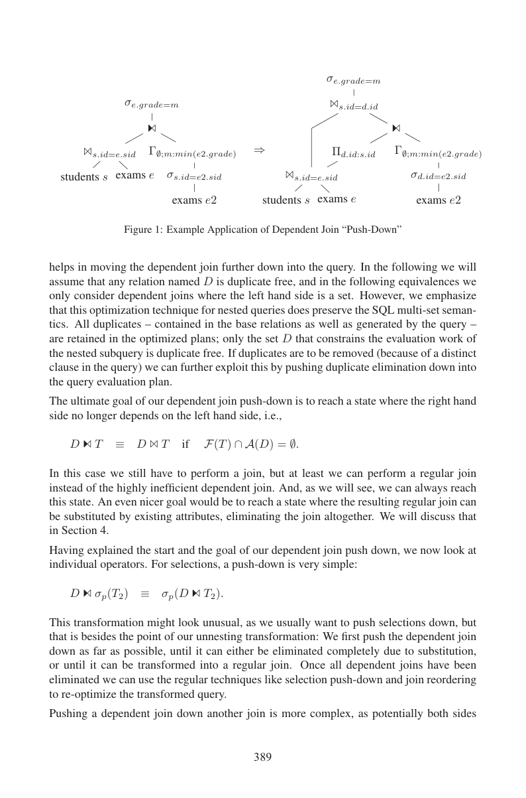
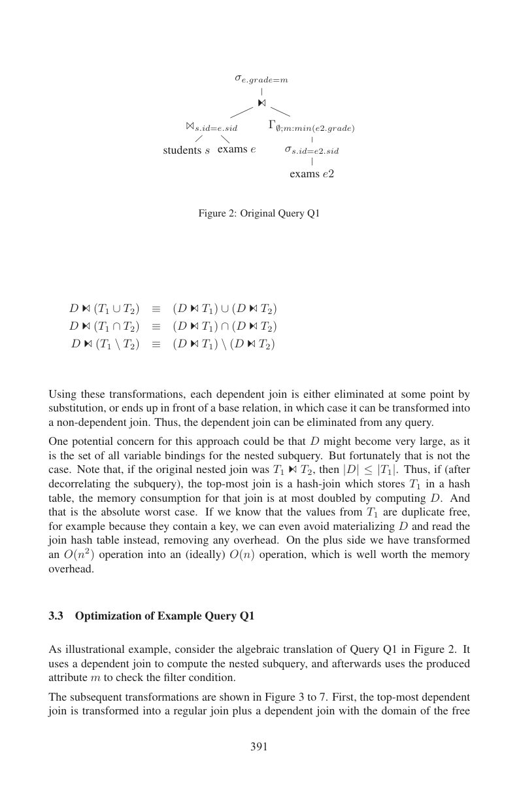

> 本组第 19 篇 · 嵌套查询与去相关 · [全部论文]() · [上一篇]() · [下一篇]()

本文把相关子查询去关联组织为简单谓词上提和一般性域绑定下推：先从外层输入T1提取无重复绑定域D，再对D推动依赖连接，最后将结果重新接回原始T1。只有D去重，最终SQL bag重复必须保留；绑定比较还需遵守文中的NULL-equal约定。作者称该方法已在HyPer实现，历史实验中Q1为<1ms对51ms、Q2为42ms对408ms；这些是该系统开关unnesting的结果，不是当代系统排名。工程价值是把逐行绑定显式化为可优化的数据流，不是保证所有查询线性或一定比索引嵌套求值更快。本次原文核对还发现：显示的空全局聚合下推和Q3的ALL反连接图在直接照搬成可空SQL时需要额外语义处理。本报告以读者最小测试说明这些实现边界，不据此断言HyPer存在相同实现错误，也不把论文的一般性声明当成现代SQL全覆盖证明。

本文保留论文陈述、读者推断与待验证方案的区别；实验数字只适用于原文条件。原文和翻译来自已有 AI 辅助精读报告，已做来源匹配与编辑复核，不等于人工逐项核验或独立实验复现。所有页码均为 PDF 物理页。

## 论文与阅读范围

Thomas Neumann, Alfons Kemper. Unnesting Arbitrary Queries. Technische Universität München。本地PDF含20个物理页，印刷页383–402；本地首页未明确给出本文出版年份及正式出处，仍记未核实。

[论文集中的原始 PDF](https://github.com/lonng/db-papers/blob/4ff1331069c7cf52ac97dd769e5f484c1c35c200/papers/nested-query/unnesting-arbitrary-queries.pdf) · 本地来源：`nested-query/unnesting-arbitrary-queries.pdf`，共 20 页。

本篇保留 10 组原文精读和 36 条证据。截图为原始 PDF 的局部页选，不是重新生成的图表；未将整份 PDF 复制到博客。

## 研究问题与适用边界

在SQL-99标准中，嵌套子查询可以出现在查询的几乎任何位置。从用户视角看，嵌套查询极大地简化了复杂查询的表达。然而，当子查询与外层查询存在相关性（correlated）时，概念上需要对每个外层元组重新求值子查询，这在代数层面形成了依赖连接（dependent join）。若每个外层元组都完整扫描内侧，工作量可达O(N×M)，两侧等规模时是二次方。论文使用了“at least quadratic”的概括，但这不是所有相关求值的数学下界：第3页明确承认小外侧配合索引查找时嵌套求值可能更好。

现有的数据库管理系统（DBMS）通常使用一系列启发式方法来对这些查询进行去关联（de-correlate / unnest），将其转化为更高效的执行计划。这些技术能够显著提升查询处理速度，但通常局限于特定类别的查询模式。据作者所知，在本文发表时，没有现有系统能够在一般情况下对所有查询进行去关联。

本文的研究问题是：如何提出一种通用的代数方法，对任意嵌套查询进行去关联，使得去关联后的查询允许更简单、更高效的求值。适用边界在于，该方法旨在解决相关子查询导致的嵌套循环求值问题，其前提是能够将SQL查询映射到支持依赖连接的扩展关系代数上。对于非相关子查询，常规的优化器下推规则已经足够，不属于本通用方法的核心攻坚目标。

依据：论文陈述；PDF 物理页 1, 2, 3。证据：[C001N01](#evidence-c001n01), [UREV07](#evidence-urev07)。

## 系统架构与处理流程

本文提出的去关联框架并非一个独立的系统，而是作为查询优化器中的一个转换阶段，并已在作者开发的内存数据库系统HyPer中完全实现。整体架构的处理流程分为两个主要阶段：简单去关联（Simple Unnesting）和通用去关联（Universal Unnesting）。

第一阶段是简单去关联。这是一种启发式方法，优先被尝试，因为其实现简单且能处理常见的简单嵌套查询。其核心机制是将依赖谓词沿代数树尽可能向上移动（push up），直到该谓词所需的所有属性都可以从其输入关系中获取。一旦满足条件，依赖连接就被转化为常规连接。需要注意的是，后续的优化步骤可能会将这些谓词再次下推（push down）以实现尽早过滤，但这属于常规优化器的职责。

第二阶段是通用去关联。当简单去关联无法处理复杂的嵌套结构时，系统应用基于代数等价规则的通用下推框架。该框架通过将依赖连接逐步下推穿过各种关系代数算子（如Selection、Join、Outer Join、Group-By、Projection），最终到达可以被消除或转化为常规连接的位置。完成去关联后，系统再使用常规技术（如选择下推和连接重排序）对生成的纯常规代数树进行重新优化。

此外，架构中还包含一个可选的替换（Substitution）优化模块。在计算出用于去关联的域D之后，如果查询树中存在等价类，可以通过map算子用现有属性替换与D的连接，从而避免物化D的开销。但这会改变中间结果的基数，因此是否执行替换必须由查询优化器基于代价模型来决定。

依据：论文陈述；PDF 物理页 3, 5。证据：[C001N10](#evidence-c001n10), [C001N02](#evidence-c001n02)。

*原论文 PDF 物理页 7，版权归原作者或出版方。点击图片可查看原尺寸。页面文本中定位到：Figure 1: Example Application of Dependent Join “Push-Down”。这是页面定位信息，不表示本次已复核图内所有数据。*

## 核心算法与代数变换规则

本节详细阐述通用去关联的核心代数变换规则。所有规则均基于论文提供的形式化定义。

**1. 核心等价变换**
通用去关联的基础是一个代数恒等式，用于消除冗余求值。原始依赖连接表示为 T1 ⋈_p^C T2，其中T2的求值依赖于T1的属性。核心变换规则为：
T1 ⋈_p^C T2 ≡ T1 ⋈_{p ∧ T1=A(D)} (D ⋈^C T2)
其中 D := Π_{F(T2)∩A(T1)}(T1)。
这里，F(T2)表示T2中引用的自由变量（即来自外层的属性），A(T1)表示T1的属性集。D是对T1在T2所需的自由变量上进行投影并去重得到的绑定域。该变换将原始对T1每个元组求值T2的操作，转化为先计算D，对D中每个不同绑定仅求值一次T2，最后再通过常规连接匹配回原T1元组。

*读者构造示例*：学生1有两条考试记录c1=1.0、c2=2.0。Q1的外侧T1是students与exams的连接，因此同一学生绑定会在两条外侧行中出现，不需要违反学生主键。D仅保留绑定{id=1}，对这一绑定计算一次min=1.0，再接回两条原外侧行并执行e.grade=min，最终只留下c1。局部D去重不等于删除外侧重复行；一般绑定重连使用NULL-safe比较，而不是无条件普通“=”。

**2. 依赖连接的下推规则**
先完成上述域分解，再把新的D依赖连接逐算子下推，而不是先下推后才应用域分解。整个下推框架假设任何命名为D的关系都是无重复的集合（duplicate free）。

*   **下推至选择算子（Selection）**：D ⋈^C σ_p(T2) ≡ σ_p(D ⋈^C T2)。这与常规的选择下推方向相反，目的是先将依赖连接下推到底层。
*   **下推至内连接（Join）**：若T2不依赖D，则将依赖连接推入左侧；若T1不依赖D，则推入右侧。若两侧均依赖D，则必须将D复制到两侧，并在连接谓词中增加 natural join D 以确保两侧在D值上匹配。作者指出，这种复制相对于原始表达式并非性能惩罚，因为两种情况下T1和T2都被求值|D|次。
*   **下推至外连接（Outer Join）**：如果内侧（inner side）依赖于D，则始终必须将D复制到两侧，否则无法跟踪外侧未匹配的元组。全外连接无条件需要两侧复制。半连接和反连接也要保留左侧资格：只有右侧不依赖D时才可只把D推入左侧，否则两侧都带D并按绑定匹配。不能照内连接的对称性把D仅推入右侧；第8页原图明确给出这种不对称。
*   **下推至Group-By算子**：Group-By必须保留D产生的所有属性。规则为：D ⋈^C (Γ_{A;a:f}(T)) ≡ Γ_{A∪A(D);a:f}(D ⋈^C T)。
*   **下推至Projection算子**：需扩展投影属性集：D ⋈^C (Π_A(T)) ≡ Π_{A∪A(D)}(D ⋈^C T)。

**3. 处理ALL量词**
对于包含ALL量词的关联子查询，无法直接翻译为dependent join。算法首先对谓词取反，将其转化为dependent anti-join，随后在unnesting优化过程中进一步转换为普通的anti-join。这是作者Q3给出的变换示意。读者核对：若R.X或S.Y可为NULL，仅用普通SQL的X<>Y作反例并反连接，会把本应在WHERE中排除的UNKNOWN误保留。因此这张图不能被当成无需NULL-aware语义层的直接SQL实现证明。

**4. 域D的替换（Substitution）与等价类**
为了完全消除物化D的开销，可以利用查询树中已有的值进行替换。算法通过分析查询树找出由join和filter条件诱导的等价类（equivalence classes）。例如过滤条件σ_{a=b}意味着a和b属于同一等价类。识别出等价类C后，替换的形式化条件为：若存在B⊆A(T)使得A(D)≡C B，则 D ⋈_C T ⊆ χ_{A(D):B}(T)。即不使用D进行join，而是使用map算子扩展T。尽管outer join可能导致等价关系失效，但由于最顶层与D的join已知是NULL-rejecting的，因此在此上下文中不会引发问题。

**5. 集合运算与空聚合的边界**
第9页还列出D对union、intersection、difference两侧分发的规则。这些是论文代数表示中的规则，不能省略SQL ALL/DISTINCT及NULL语义核对。第8页显示把D加入grouping键；对每绑定都有输入的聚合可直观理解，但无GROUP BY的标量聚合在空输入上也要产生一行。若照式子先做普通D×T/过滤再按D分组，缺少内侧行的绑定会消失。相关读者测试与限定见正确性一节。

依据：论文陈述；PDF 物理页 4, 6, 7, 8, 9, 14, 15。证据：[C001N03](#evidence-c001n03), [C001N04](#evidence-c001n04), [C001N05](#evidence-c001n05), [C001N06](#evidence-c001n06), [C001N07](#evidence-c001n07), [C001N08](#evidence-c001n08), [C002N01](#evidence-c002n01), [C002N02](#evidence-c002n02), [C002N03](#evidence-c002n03), [C002N04](#evidence-c002n04), [UREV01](#evidence-urev01), [UREV02](#evidence-urev02), [UREV03](#evidence-urev03), [UREV04](#evidence-urev04), [UREV05](#evidence-urev05), [UREV06](#evidence-urev06), [UREV15](#evidence-urev15)。

## 正确性保证与不变量

**原文明确的不变量**
D是绑定参数的集合，而不是把整个SQL查询改成集合语义。第7页明确说基础关系与查询产生的重复均保留，只有D无重复；域计算后必须接回原始外侧行。第4页的属性组比较采用IS语义，NULL绑定也应相等。若把它误译成普通SQL“=”，NULL绑定会丢失。读者测试以外侧(1),(1),(2),(NULL)展示：接回DISTINCT域时普通等号仅留下3行，NULL-safe IS保留4行。

**局部替换不是独立子树等价**
第15页写的是D依赖连接T包含于map扩展T，而不是相等。只有保留上层域过滤与相应谓词，额外中间元组才会被后续过滤。不能因为局部结果是超集，就任意删掉上层连接。第13页还明确要求可空e2.sid的派生等值选择保留为not-NULL检查。有关外连接的NULL-rejecting说法属于该特定重写上下文，不能推广成外连接任意等值推导都安全。

**读者验证一：空全局聚合**
第4页定义空grouping列表仍产生一个聚合元组；第8页显示一般group-by下推式。用外侧绑定(1),(1),(2),(NULL)，内表仅(1)的读者数据，原相关COUNT(*)得到(1,1),(1,1),(2,0),(NULL,0)。若把显示式直接实现为D与内表匹配、按D分组再普通重连，只得到两行(1,1)，丢失零计数绑定。这个SQLite最小测试说明需要明确空组保持/补偿或前置SQL降级条件；它没有执行HyPer，也不能证明HyPer的实际编译器犯了同样错误。本文的Q1外侧已连接考试表，不能用Q1恰好有匹配来替代所有空组情况的证明。

**读者验证二：ALL与UNKNOWN**
第14页Q3画出以X<>Y为谓词的antijoin。若X=1而相关子查询只返回NULL，1=ALL(NULL)为UNKNOWN，WHERE不接受；普通NOT EXISTS(...WHERE 1<>Y)却为TRUE。X=NULL、内侧有1时也有同样差异。空子查询的ALL则为TRUE，不能简单把所有NULL外侧行预先剔除。只针对WHERE接收条件，可用“存在比较结果不为TRUE的内行”构成反例；若ALL出现在SELECT等需要返回三值的位置，还要保存TRUE/FALSE/UNKNOWN而非只有反连接布尔值。这是读者实现建议，不是本文已经展示的NULL-aware算法。

**保证的范围**
第9页作者声称所列变换可将依赖连接消除到普通连接，第18页称已实现。应保留这一贡献主张，但不能据当前20页就宣称对所有现代SQL语法、可空量词及空聚合都已给出完整可执行证明。上述测试只是对显示规则字面SQL翻译的检查，不是独立形式化验证。

依据：论文陈述；PDF 物理页 4, 7, 8, 13, 14, 15。证据：[C001N04](#evidence-c001n04), [C001N07](#evidence-c001n07), [C001N09](#evidence-c001n09), [C002N01](#evidence-c002n01), [C002N03](#evidence-c002n03), [C002N04](#evidence-c002n04), [C002N05](#evidence-c002n05), [UREV01](#evidence-urev01), [UREV03](#evidence-urev03), [UREV04](#evidence-urev04), [UREV05](#evidence-urev05), [UREV06](#evidence-urev06), [UREV09](#evidence-urev09), [UREV10](#evidence-urev10)。

## 实验评估与性能数据

本节核对第15–16页的实验正文。本PDF使用文本层提取，coverage.ocr_pages为空；第5节数字主要在正文，不存在“必须依赖未识别实验图表”的缺口。本次还视觉核对第16页，但未做新基准运行。

**1. 硬件与软件环境**
所有实验均在配备Intel i7-3930K处理器和64GB主存的机器上运行。测试系统包括作者实现的内存数据库系统HyPer，以及PostgreSQL 9.1和SQL Server 2014作为基线对比。SQL Server 2014因许可条款限制未公布具体运行时间数字。

**2. 工作负载与数据集**
实验使用了两种工作负载：
*   **人工生成数据集**：包含1,000个student元组和10,000个exam元组（每学生10次考试）。作者刻意使用小数据集，并以“roughly speaking”的文字称增大规模可放大差距。这不是对所有工作负载的加速比平方增长定理；即便比较二次与线性工作量，其比值也不自动按平方增长。
*   **TPC-H基准测试**：使用Scale Factor = 1 (SF=1) 的数据集，重点测试了Query 4和Query 17。

**3. 评估指标**
主要指标为查询执行时间（毫秒级）。

**4. 主要实验数字**
*   **Query 1（相对简单的关联子查询）**：HyPer系统使用unnesting加substitution耗时 <1ms (人工数据集: 1k students, 10k exams)；HyPer不进行unnesting耗时 51ms (人工数据集: 1k students, 10k exams)。PostgreSQL 9.1无法对该查询进行unnesting，耗时 1,300ms (人工数据集: 1k students, 10k exams) 且随数据量急剧增长；但如果手动改写为非关联形式（Q1'），PostgreSQL可在 17ms (人工数据集: 1k students, 10k exams) 内执行完毕。SQL Server 2014能够unnest该查询，但未提供具体时间。
*   **Query 2（更难unnest的查询）**：除HyPer外作者未发现其他系统能处理。HyPer unnesting后耗时 42ms (人工数据集: 1k students, 10k exams)，未unnesting耗时 408ms (人工数据集: 1k students, 10k exams)。SQL Server 2014无法unnest，生成了包含nested loop joins的执行计划。PostgreSQL耗时 12,099ms (人工数据集: 1k students, 10k exams)。
*   **TPC-H Query 4 (SF=1)**：HyPer开启unnesting耗时 7ms (TPC-H SF=1)，关闭unnesting耗时 157,616ms (TPC-H SF=1)，相差数个数量级。
*   **TPC-H Query 17 (SF=1)**：HyPer开启unnesting耗时 9ms (TPC-H SF=1)，关闭耗时 4,664ms (TPC-H SF=1)。

**5. 缺失信息与不能得出的结论**
*   **缺失**：具体的实验环境操作系统版本、编译器优化级别、各系统的详细配置参数（如缓冲区大小、并发设置）在提供的文本中未提及。缺乏更大规模数据集（如TPC-H SF=10或更高）的量化数据。缺乏对内存消耗峰值的具体测量数字。
*   **不能得出的结论**：不能基于人工小数据集的绝对时间（<1ms vs 1300ms）推断该系统在生产环境大规模并发下的吞吐量表现。不能得出HyPer在所有查询上都优于PostgreSQL或SQL Server的结论，因为这里的对比仅限于“去关联能力”这一特定维度。TPC-H SF=1的结果不能泛化为整篇论文的普遍性能保证，它仅证明了通用unnesting在标准基准上的有效性。

**解读界限**
Q1的<1ms与51ms、Q2的42ms与408ms是HyPer内的unnesting开关对照。PostgreSQL与HyPer之间的差距还包含执行引擎、配置与版本差异，不是只归因于一条重写规则的受控消融。Q4/Q17证明这些具体查询的去关联很重要，并不单独证明通用算法比所有特化规则更快或已经覆盖全部SQL。

依据：论文陈述；PDF 物理页 15, 16。证据：[C002N07](#evidence-c002n07), [C002N08](#evidence-c002n08), [C002N09](#evidence-c002n09), [C002N10](#evidence-c002n10), [UREV11](#evidence-urev11), [UREV12](#evidence-urev12), [UREV13](#evidence-urev13), [UREV14](#evidence-urev14)。

*原论文 PDF 物理页 9，版权归原作者或出版方。点击图片可查看原尺寸。页面文本中定位到：Figure 2: Original Query Q1。这是页面定位信息，不表示本次已复核图内所有数据。*

## 设计权衡与局限性

本文提出的通用去关联方法在获得强大表达能力的同时，引入了若干设计权衡和潜在的性能陷阱，需要查询优化器谨慎处理。

**1. 域D的物化开销 vs. 嵌套求值开销**
通用unnesting需要计算domain D并与之join，这产生了一次性开销。代价分析假设去关联后的顶层连接为哈希连接，并将T1存入哈希表。在此前提下，计算D的内存消耗最多使该哈希表的内存翻倍，这是作者在该顶层hash join假设下的上界讨论，不是整个计划的内存上限；去重结构、条目宽度、分配开销和其他中间状态仍需实测。如果已知T1的值无重复（例如包含键），则可以避免物化D，直接读取连接哈希表，从而消除额外开销。尽管如此，作者认为这种一次性开销远优于嵌套求值的二次方运行时间。

**2. 替换D带来的基数膨胀**
为了消除D的物化，可以使用等价类进行替换（Substitution）。然而，这种替换可能导致中间结果集基数增加，两者的关系是子集（⊆）而非相等（=）。这是因为失去了与D join时潜在的剪枝能力。需要明确指出，此处的“剪枝”是指关系代数中Join算子对元组的过滤作用（filtering effect），即原本只对在D中有join partner的T中元组求值相关子树，替换后需要对T中的所有元组求值。那些没有join partner的元组只能在执行原始dependent join时在树的更高层被消除。这会增加下游算子的处理压力。请勿将此处的“剪枝”与查询优化器搜索空间中的启发式剪枝（heuristic pruning）相混淆。

**3. 代价模型驱动的决策**
替换D是否划算取决于与D的join的选择率。只有当join是非选择性的（unselective）时，替换才具有收益；对于选择性高的join，保留D能尽早消除元组，效果更好。因此，是否移除该连接必须由查询优化器基于代价模型进行比较和决定，这属于代价模型驱动的决策，而非无条件的启发式剪枝。如果替换的属性可为NULL，还不能简单丢弃相关的选择条件，增加了优化的复杂性。

**4. 依赖连接下推的悲观复制**
在依赖连接下推至内连接且两侧均依赖D时，必须将D复制到两侧。作者指出这种下推规则是“过度悲观的”（overly pessimistic），尽管相对于原始的嵌套循环求值并非性能惩罚，但它确实增加了中间计划的宽度和潜在的内存占用。

作者第3页明确承认小外侧加索引内查找时，保留嵌套求值可能有利。此外，D在两支被使用不自动等于两份物理物化；共享、重复扫描或内联是待实现的物理选择。复制不增加理论上每绑定的子树求值次数，也不等价于缓存、内存或wall-clock零开销。

依据：论文陈述；PDF 物理页 3, 8, 9, 13, 14, 15。证据：[C001N11](#evidence-c001n11), [C001N09](#evidence-c001n09), [C002N02](#evidence-c002n02), [C002N05](#evidence-c002n05), [C002N06](#evidence-c002n06), [C001N06](#evidence-c001n06), [UREV07](#evidence-urev07), [UREV08](#evidence-urev08), [UREV10](#evidence-urev10)。

## 与现有系统及方法的比较

**历史系统对照，不是当前排名**
论文实验中的PostgreSQL9.1无法自动去关联Q1，原形1300ms，手工改写Q1'为17ms。这个对照说明该查询的形式与优化路径很关键，不能据此证明其底层引擎对所有查询都快或慢。HyPer的<1ms与51ms是本系统对照，不能与跨系统1300ms混成纯算法加速比。

SQL Server2014能去关联Q1但不能处理作者的Q2；作者因许可约束不公布其运行时间。作者还报告Q2在HyPer中42ms/408ms，在PostgreSQL9.1中12099ms。这些只支持所测查询、所用历史版本的结论，不能推出当前PostgreSQL、SQL Server或全部商业引擎的能力。

**通用规则与模式特化**
第16页称主要商业系统都能处理TPC-H的嵌套模式，第17页把通用方法与特殊模式处理对照。Q4/Q17的开关实验证明消除这些查询的相关性很重要，但没有在同一引擎内把通用框架和所有特化算法逐一对比。因此“更广的表示覆盖”与“任何场景性能都更好”必须区分。

本文也在第16–20页列出Kim、Kiessling、Dayal、Seshadri、Galindo-Legaria等前序工作，不能把所有既有研究概括成同一种简单启发式。对现代StarRocks、DuckDB、Calcite等的实现比较需另读各自源码、版本和执行计划，本报告未作这些外部核验。

依据：论文陈述；PDF 物理页 1, 2, 15, 16。证据：[C001N01](#evidence-c001n01), [C002N08](#evidence-c002n08), [C002N09](#evidence-c002n09), [C002N10](#evidence-c002n10), [UREV11](#evidence-urev11), [UREV12](#evidence-urev12), [UREV13](#evidence-urev13), [UREV14](#evidence-urev14)。

## 复现指南与工程验证

以下均为读者建议，不是已完成的论文复现。

1. 在实际优化器IR中定义依赖连接、输出属性、自由变量与绑定作用域；先检查现有算子，不预设“所有Volcano/Cascades都缺这个算子”。保留D的去重与回接外侧bag的职责区别，给绑定连接明确NULL-safe语义。
2. 先实现简单谓词上提，再做域分解及各算子的依赖下推。可把它放在规范化阶段或现有规则框架中；注册为Memo任务只是可选工程方案，不是本文规定。必须覆盖selection、join、outer/semi/anti、grouping、projection与集合运算，并逐一处理左右输出语义。
3. 给“空全局COUNT/SUM/AVG”“左侧重复绑定”“NULL绑定”“空的ALL子查询”“可空ALL比较”“外连接未匹配行”做结果多重集回归测试。qa/unnesting-reader-tests.py已经实际在SQLite3.45.1内存库执行了最小的COUNT、binding rejoin及WHERE-ALL接受性检查；ALL真值由Python组合SQLite比较结果，并非声称SQLite执行了ALL语法，更不是HyPer复现。
4. 对D替换用等价类分析，但保留原域的高层过滤及可空列not-NULL检查。局部superset不能当成整棵树独立等价；只在有正确成本模型和语义测试后比较替换与保留D两个方案。
5. 复现实验先固定数据、执行器与版本，分别做同系统unnesting开关、D替换开关、D选择率/外侧规模/可重复绑定比例/索引可用性扫描，测优化时间、编译时间、执行时间和峰值内存。论文的O(N×M)到理想hash等值join近线性讨论不是优化器搜索复杂度或所有非等值查询的界。
6. 对现代系统仅提出核查清单：实际支持哪些SQL lowering及相关算子、哪一阶段去关联、是否存在空组和NULL-aware量词处理、是否共享D。未读源码，不预设具体类名或某系统已实现全部规则。若做分布式版本，再单独测网络与数据分布；论文内存单机数据不能替代这部分证据。

依据：待验证的工程设想；PDF 物理页 3, 4, 8, 9, 14。证据：[UREV01](#evidence-urev01), [UREV04](#evidence-urev04), [UREV05](#evidence-urev05), [UREV06](#evidence-urev06), [UREV07](#evidence-urev07), [UREV08](#evidence-urev08)。

## 结论与工程启示

本文的重要工程贡献是把相关绑定显式化为关系D，并用统一代数数据流给优化器更多普通连接的优化空间。D局部去重与外侧bag保留、NULL-safe绑定回接、依赖下推的左右不对称，以及D替换保留高层过滤，是实现时必须读懂的机制。

作者的一般性声明和HyPer历史结果值得重视，但不等于所有相关查询具有二次下界、去关联后必线性、所有查询都更快或整个计划内存最多翻倍。小外侧配合索引的例外及替换膨胀都说明成本选择仍重要。

本次Codex原文核对用最小数据发现显示规则在空全局聚合和可空ALL的直接SQL翻译上需要额外条件或语义层。这些是读者验证的实现边界，不是对HyPer代码的漏洞鉴定。应在保留论文机制的同时补齐语义测试，再研究物理共享、缓存和分布式成本；不能把普通hash join说成必然连续访问或把这些待测收益写成已证结论。

依据：读者推断；PDF 物理页 3, 4, 8, 9, 14。证据：[UREV01](#evidence-urev01), [UREV04](#evidence-urev04), [UREV05](#evidence-urev05), [UREV06](#evidence-urev06), [UREV07](#evidence-urev07), [UREV08](#evidence-urev08)。

## 原文精读：从句子回到机制

以下保留原文、忠实翻译、含义与边界；假设示例不作为论文实验结果。

### P001 · PDF 物理页 2

**原文**

<blockquote class="paper-source-quote"><pre><code>dependent join, i.e., a nested loop join where the evaluation of the right hand side depends&#10;on the current value of the left-hand side. These joins are highly inefficient, and lead to (at&#10;least) quadratic execution time.&#10;Database management systems (DBMSs) therefore internally rewrite the query to elimi-&#10;nate the correlation.</code></pre></blockquote>

**忠实翻译**

> 依赖连接（dependent join），即一种嵌套循环连接（nested loop join），其中右侧的求值依赖于左侧的当前值。这些连接非常低效，并导致（至少）二次方的执行时间。因此，数据库管理系统（DBMSs）在内部重写查询以消除相关性。

**技术含义与边界**

> 原文把dependent join描述为逐外侧绑定求值右侧，并用at least quadratic强调朴素重复扫描代价。严格说，全扫描实现工作量可达O(N×M)，等规模才是二次；“所有相关求值至少二次”不是有效普遍下界。第3页小外侧加索引的例外就在同一篇原文中。

**常见误读**

> 不能把原文这一性能概括当复杂度下界定理；索引、早停、输入规模不等和已有缓存都会改变成本。消除相关性也不保证非等值连接最终变成线性hash join。

**读者构造的假设示例**

> 读者构造：无索引且1000个外侧键与1000个内侧键全部不匹配时，朴素EXISTS反复全扫最多比较100万次。若有合适索引或外侧只有一行，就不能继续用这个二次例子代表所有相关求值。

### P002 · PDF 物理页 16

**原文**

<blockquote class="paper-source-quote"><pre><code>This demonstrates how important it is to unnest subqueries.&#10;Query 2 is more difficult to unnest, and we are not aware of any system besides our HyPer&#10;system that is able to unnest it. HyPer can execute that query in 42ms (408ms without&#10;unnesting). SQL Server 2014 is not able to unnest this query and generates an execution&#10;plan with nested loop joins.</code></pre></blockquote>

**忠实翻译**

> 这展示了去嵌套（unnest）子查询有多么重要。Query 2 更难去嵌套，除了我们的 HyPer 系统之外，我们不知道有任何其他系统能够对其进行去嵌套。HyPer 可以在 42ms 内执行该查询（不去嵌套则为 408ms）。SQL Server 2014 无法去嵌套此查询，并生成了带有嵌套循环连接的执行计划。

**技术含义与边界**

> 原文陈述了一个具体实验结果：对于特定的 Query 2，作者声称除 HyPer 外未发现其他系统能去嵌套；HyPer 去嵌套后耗时 42ms，未去嵌套耗时 408ms；SQL Server 2014 未能去嵌套，退化为嵌套循环连接计划。适用边界：这些数字和结论仅限于作者测试的特定查询、特定硬件和特定版本的 SQL Server 2014，不能推断为所有查询或所有系统的普遍表现。

**常见误读**

> 容易将“SQL Server 2014 无法去嵌套此查询”误解为 SQL Server 在所有版本或所有查询上都无法去嵌套。原文明确限定了是“this query”和“SQL Server 2014”。此外，42ms 与 408ms 的数据来自作者的实验环境，读者不应将其视为绝对性能指标。

**读者构造的假设示例**

> 原文Q2不是必须多层嵌套：其单个AVG子查询含s.id=e2.sid OR (e2.curriculum=s.major AND s.year>e2.date)。作者的HyPer开关数据是42/408ms；读者相除约9.71倍，仅针对这个数据与实现，不是新增测量。

### P003 · PDF 物理页 9

**原文**

<blockquote class="paper-source-quote"><pre><code>One potential concern for this approach could be that D might become very large, as it&#10;is the set of all variable bindings for the nested subquery. But fortunately that is not the&#10;case. Note that, if the original nested join was T1 C T2, then |D| ≤|T1|. Thus, if (after&#10;decorrelating the subquery), the top-most join is a hash-join which stores T1 in a hash&#10;table, the memory consumption for that join is at most doubled by computing D. And&#10;that is the absolute worst case.</code></pre></blockquote>

**忠实翻译**

> 这种方法的一个潜在担忧可能是 D 会变得非常大，因为它是嵌套子查询的所有变量绑定的集合。但幸运的是情况并非如此。注意，如果原始嵌套连接是 T1 ⋈_C T2，那么 |D| ≤ |T1|。因此，如果在去相关子查询之后，最顶层的连接是一个将 T1 存储在哈希表中的哈希连接，那么计算 D 所消耗的内存最多使该连接的内存消耗翻倍。而那是绝对的最坏情况。

**技术含义与边界**

> D投影去重给出行数上界|D|≤|T1|。原文的at most doubled针对顶层hash join且T1为build side的特定讨论，不是整个查询峰值内存的证明；条目宽度、哈希/去重元数据以及其他中间状态需另外测量。

**常见误读**

> 行数上界不直接等于字节上界。不能拿T1占10MB就无条件推出完整执行最多20MB，也不能把作者的该join讨论推广到所有物理布局。

**读者构造的假设示例**

> 读者构造：T1有10000行但仅100个不同绑定时，D只有100行；即便10000行都是不同绑定，能证明的也是D行数不超过10000。实际字节数还取决于键宽、桶容量和执行器元数据。

### P004 · PDF 物理页 5

**原文**

<blockquote class="paper-source-quote"><pre><code>This is translated into an algebra expression of the form&#10;l1 O (σl1.okey=l2.okey(l2))&#10;It is easy to see that this fragment can be unnested by moving the dependent predicate up&#10;the tree, transforming the dependent join into a regular join:&#10;l1 Nl1.okey=l2.okey (l2)&#10;In general the simple unnesting phase moves all dependent predicates up the algebra tree as&#10;far as possible, potentially beyond joins, selections, group by, etc., until it reaches a point&#10;where all its attributes are available from the input.</code></pre></blockquote>

**忠实翻译**

> 这被翻译成形如 l1 ⋉ (σ_{l1.okey=l2.okey}(l2)) 的代数表达式。很容易看出，这个片段可以通过将依赖谓词沿树向上移动来去嵌套，从而将依赖连接转换为常规连接：l1 ⋈_{l1.okey=l2.okey} l2。一般来说，简单去嵌套阶段将所有依赖谓词尽可能地在代数树上向上移动，可能越过连接、选择、分组等，直到到达其所有属性都可以从输入中获得的那一点。

**技术含义与边界**

> 原文陈述了简单去嵌套（simple unnesting）的核心机制：当依赖谓词引用的属性在当前算子下方不可用但在上方可用时，可以将该谓词沿代数树向上推移，穿过 selection、join、group by 等算子，直到所有引用的属性都在输入中可用，从而将依赖连接（DependentJoin）转化为常规连接（⋈）。适用边界：这只适用于谓词可以被安全上推的情况，即上推过程不改变语义。

**常见误读**

> 容易误认为任何依赖谓词都可以无条件上推。原文限定了条件是“until it reaches a point where all its attributes are available from the input”，如果上推过程中跨越了会改变属性可见性或基数语义的算子（如某些聚合），则不能简单上推。

**读者构造的假设示例**

> 读者构造的假设示例：假设有代数树 Join(A, Filter(B, A.id=B.id))，其中 Filter 依赖于 A 的属性。通过将谓词 A.id=B.id 上移到 Join 节点，变为 EquiJoin(A, B, A.id=B.id)，消除了依赖。此为读者构造的假设示例，用于解释上推机制。

### P005 · PDF 物理页 13

**原文**

<blockquote class="paper-source-quote"><pre><code>The nice thing about this substitution&#10;is that the parts of the query are completely independent, no trace of the original nesting&#10;remains. However, substitution creates a superset of the original tuples! At least in general,&#10;in this example referential integrity will most likely prevent that. But in general dropping&#10;the join with the domain and substituting instead can lead to larger intermediate results, as&#10;the filter effect of the join is removed, too.</code></pre></blockquote>

**忠实翻译**

> 这种替换的好处在于查询的各个部分完全独立，没有留下原始嵌套的任何痕迹。然而，替换会产生原始元组的超集！至少一般来说是这样，在这个例子中参照完整性很可能会防止这种情况。但一般来说，丢弃与 domain 的连接并进行替换会导致更大的中间结果，因为连接的过滤效应也被移除了。

**技术含义与边界**

> 原文讨论的是去掉局部域过滤后的中间子树超集，不是最终SQL查询允许返回更多行。更高层的原始域连接仍负责过滤；局部替换保留哪些谓词是正确性前提，参照完整性等条件只可能使局部膨胀不发生。

**常见误读**

> 容易忽略“superset”警告，误以为替换在所有情况下都与原查询等价且不增加数据量。原文明确指出“substitution creates a superset of the original tuples”，仅在具备参照完整性等特定条件下才可能避免。不应将局部例子的安全性泛化为全局保证。

**读者构造的假设示例**

> 读者构造的假设示例：假设原查询通过连接域表 D 过滤掉了 T1 中不存在于 D 的行。若直接去掉与 D 的连接并用替换逻辑，T1 中那些本应被过滤的行会保留下来参与后续计算，导致中间结果变大。此为读者构造的假设示例。

### P006 · PDF 物理页 7

**原文**

<blockquote class="paper-source-quote"><pre><code>he query. In the following we will&#10;assume that any relation named D is duplicate free, and in the following equivalences we&#10;only consider dependent joins where the left hand side is a set. However, we</code></pre></blockquote>

**忠实翻译**

> ……查询。在下文中，我们将假设任何名为 D 的关系都是无重复的，并且在下面的等价式中我们只考虑左侧是集合（set）的依赖连接。然而，我们……

**技术含义与边界**

> 这不是两个互相独立的全局限制：先把一般外侧T1拆成无重复域D，后续下推规则只处理左侧为D的那一个依赖连接。原始T1和最终结果仍可为bag；同页紧接着明确所有基础与查询产生的重复均保留。

**常见误读**

> 不能由“D是set”推导“原始T1不能重复”或“算法不能用于SQL bag”。必须区分被下推的局部D连接与保留外侧重数的顶层重连。

**读者构造的假设示例**

> 读者构造：原T1有两行id=1时，D只含一个绑定1；子查询为该绑定得到一行结果后接回两条T1行，仍返回两行。若误把整个T1去重，才会错误少返回一行。

### P007 · PDF 物理页 3

**原文**

<blockquote class="paper-source-quote"><pre><code>Our contribution can thus be seen as a universally applicable technique for unnest-&#10;ing any kind of nested subquery ± in contrast to the special case treatments published and&#10;implemented so far. The universal unnesting technique has been fully implemented in&#10;our main-memory database system HyPer [KN11] and can be experienced via our web&#10;interface hyper-db.de that visualizes the resulting query plans.</code></pre></blockquote>

**忠实翻译**

> 因此，我们的贡献可以被视为一种普遍适用的技术，用于去嵌套任何类型的嵌套子查询——与迄今为止发表和实现的特殊情况处理形成对比。这种通用去嵌套技术已在我们的主存数据库系统 HyPer [KN11] 中完全实现，并且可以通过我们的 Web 界面 hyper-db.de 进行体验，该界面可视化生成的查询计划。

**技术含义与边界**

> 原文陈述了作者对其工作的定位：提出了一种通用的子查询去嵌套方法，区别于以往文献和系统中针对特定模式的特殊处理（special case treatments）。该技术已在 HyPer 系统中完整实现，并提供了可视化查询计划的 Web 接口。适用边界：这是作者对自身贡献的声明，关于“普遍适用”的范围由论文定义的方法论决定。

**常见误读**

> 容易将“universally applicable technique for unnesting any kind of nested subquery”解读为该方法能优化所有查询的执行时间。原文指的是去嵌套转换的适用性（即能把各种嵌套转为非嵌套形式），并不等同于去嵌套后的计划一定是最优的，也不代表没有运行时限制。

**读者构造的假设示例**

> 原文的具体对照是Q1能被SQLServer2014去关联而PostgreSQL9.1未做到；更复杂Q2仅HyPer在作者测试中去关联成功。不能用“旧系统都只支持EXISTS不支持标量聚合”的虚构概括替代这个有版本边界的对照。

### P008 · PDF 物理页 6

**原文**

<blockquote class="paper-source-quote"><pre><code>Thus, in the first step, we use the following equivalence&#10;T1 Cp T2&#10;≡&#10;T1 Bp∧T1=A(D)D (D C T2)&#10;where D := ΠF(T2)∩A(T1)(T1).&#10;At a first glance this transformation did not improve the query plan much, as we have&#10;replaced one dependent join by a regular join and another dependent join.</code></pre></blockquote>

**忠实翻译**

> 第一步把T1与T2的依赖连接，改写成T1与子树(D依赖连接T2)的普通连接；普通连接谓词同时检查原谓词p及外侧与D的绑定一致。D是T1在T2所需自由变量上的去重投影。乍看一个依赖连接变成普通连接加另一个依赖连接，并没有立即完成去关联。

**技术含义与边界**

> 括号很重要：是T1普通连接(D依赖连接T2)，不是先让T1连接D再把整个结果逐行绑定给T2。第6页余文解释每个唯一绑定只评估一次，第7–9页继续列出下推和终止条件；这些后文在本地全文中存在，不应因摘录窗口截断就说整份来源没有展示。

**常见误读**

> 不要把plain projection当SQL bag投影，D必须去重；绑定比较还要遵循NULL-equal约定。单独的域分解不是最后性能保证，仍需后续下推及物理优化。

**读者构造的假设示例**

> 读者构造：T1有100条外侧行、只引用10个不同参数，先构建10行D并在(D依赖连接T2)子树计算，再接回100条T1；不把100条外侧行重新送进逐行依赖求值。

### P009 · PDF 物理页 15

**原文**

<blockquote class="paper-source-quote"><pre><code>Note further that substitution might increase the size of intermediate&#10;results, the relationship between the two formulations is not = but ⊆. This cardinality&#10;increase is caused by losing the (potential) pruning power of the join with D. Instead of&#10;evaluating the formed correlated subtree with every tuple in T that will find a join partner&#10;in D, we evaluate with every tuple from T.</code></pre></blockquote>

**忠实翻译**

> 进一步注意，替换可能会增加中间结果的大小，两种表述之间的关系不是 = 而是 ⊆。这种基数增加是由失去了与 D 连接的（潜在）剪枝能力引起的。我们不再是对 T 中每一个将在 D 中找到连接伙伴的元组来评估形成的相关子树，而是对 T 中的每一个元组进行评估。

**技术含义与边界**

> 原文陈述了替换策略导致中间结果膨胀的根本原因：数学上，替换后的结果集是原结果集的超集（⊆ 而非 =）。机制上，原本通过与 D 的连接可以提前过滤掉 T 中无法匹配的行（剪枝），替换后去掉了这个过滤步骤，导致 T 中的所有元组都会进入相关子树的评估，增加了计算量和中间数据量。适用边界：这是对替换操作副作用的理论解释。

**常见误读**

> 容易将“might increase”理解为“always increases”。原文使用了“might”和“(potential) pruning power”，意味着如果 D 本身不具备过滤效果（例如 T 的所有行都能在 D 中匹配），则基数不会增加。不应将可能性泛化为必然性。

**读者构造的假设示例**

> 读者构造：明确令T有100行，其中恰好10行能在D找到连接伙伴、90行不能。保留域过滤时仅这10行进入子树；替换后100行都可能进入，直到更高层重连才去掉90行。仅知道D有10行本身不能推导T恰有10行匹配。

### P010 · PDF 物理页 8

**原文**

<blockquote class="paper-source-quote"><pre><code>If the values provided by the dependent join are only required on one side we push it to&#10;the corresponding side, otherwise we wave to replicate it in both sides. Note that this&#10;push-down rule is overly pessimistic, we can often simplify the parts below the join (see&#10;Section 4), but we stick to the basic push-down for now.</code></pre></blockquote>

**忠实翻译**

> 如果D提供的值只被连接的一侧使用，就下推到相应侧；否则必须复制到两侧。原文本层的“wave to”与第8页原图“have to”不一致，此处依原图译为“必须”，不是名为wave的新操作。作者称基本规则偏悲观，后文第4节再讨论简化。

**技术含义与边界**

> 内连接两侧都依赖D时，两侧携带同一绑定并按D匹配。原图是have to，不是wave术语；原始提取短引保持不变并在译意说明损坏。overly pessimistic指基础形式可进一步简化，不等于已量化成本为零。

**常见误读**

> 容易将“overly pessimistic”误解为该规则是错误的或会导致错误结果。在数据库优化语境中，“pessimistic”通常指保守、不够激进，即产生的计划合法但可能不是最优的。原文说“we stick to the basic push-down for now”，表明这是有意为之的阶段性简化。

**读者构造的假设示例**

> 读者构造：两支都用到绑定键X时，各支结果都携带X并在合并时匹配相同X；是否共享一份物化D还是内联扫描，是物理实现选择，不能仅从“复制”二字断言必然存两份。

## 尚未解决的问题

1. HyPer实际SQL降级层如何保持空全局聚合的一行结果，显示的group-by下推规则是否另有前提？
2. Q3的可空ALL在实现中用什么NULL-aware语义，WHERE接受性与SELECT三值返回是否分别处理？
3. D的高基数去重、共享和重连占多少实际内存；源文的单个hash join讨论不能替代整计划测量。
4. 哪些相关查询在小外侧、有效索引下适合保留嵌套求值，代价估计误差如何影响选择？
5. 现代系统的实际SQL范围、窗口/递归/副作用函数等特性是否适用这些规则，需要逐项源码与结果测试。
6. 分布式D复制/数据交换和替换选择率应如何计入成本？任何近似域过滤都不能未经证明丢失真实绑定。

## 证据索引

证据编号沿用原报告，便于将上文判断追溯到原句。引文匹配只验证位置，不证明解读正确。

**C001N01 · PDF 物理页 2**

作者以at least quadratic概括逐外侧行重算内侧的代价。朴素全扫描是O(N×M)，但它不是所有相关求值的下界；第3页明确保留小外侧加索引的例外。本文提出一般域绑定下推框架。

<blockquote class="paper-source-quote"><pre><code>These joins are highly inefficient, and lead to (at least) quadratic execution time.</code></pre></blockquote>

**C001N02 · PDF 物理页 5**

简单去关联（Simple Unnesting）通过将依赖谓词沿代数树尽可能上提，直到其所需属性均可从输入获取，从而将依赖连接转化为常规连接。这是一种启发式方法，优先尝试，因为实现简单且能处理常见的简单嵌套查询。后续优化步骤可能会将谓词再次下推以尽早过滤。

<blockquote class="paper-source-quote"><pre><code>In general the simple unnesting phase moves all dependent predicates up the algebra tree as far as possible</code></pre></blockquote>

**C001N03 · PDF 物理页 6**

通用去关联的核心等价变换为：T1 ⋈_p^C T2 ≡ T1 ⋈_{p ∧ T1=A(D)} D ⋈^C T2，其中 D := Π_{F(T2)∩A(T1)}(T1)。该变换将原始对T1每个元组求值T2的操作，转化为先计算自由变量的唯一绑定域D，对D中每个不同绑定仅求值一次T2，再通过常规连接匹配回原T1元组。这消除了冗余求值。

<blockquote class="paper-source-quote"><pre><code>T1 Cp T2 ≡ T1 Bp∧T1=A(D)D (D C T2) where D := ΠF(T2)∩A(T1)(T1).</code></pre></blockquote>

**C001N04 · PDF 物理页 7**

通用下推框架假设任何命名为D的关系都是无重复的集合（duplicate free）。这一不变量对于正确下推Group-By和Projection算子至关重要。但该优化技术保留了SQL的多重集语义，基础关系中的重复项以及查询生成的重复项均被保留，只有用于约束嵌套子查询求值的D是无重复的。

<blockquote class="paper-source-quote"><pre><code>we will assume that any relation named D is duplicate free</code></pre></blockquote>

**C001N05 · PDF 物理页 7**

依赖连接下推至选择算子（Selection）的规则为 D ⋈^C σ_p(T2) ≡ σ_p(D ⋈^C T2)。虽然这与常规的选择下推方向相反，但此处的目的是先将依赖连接下推到可以消除或转为常规连接的位置，完成去关联后再使用常规技术（如选择下推和连接重排序）重新优化。

<blockquote class="paper-source-quote"><pre><code>D C σp(T2) ≡ σp(D C T2).</code></pre></blockquote>

**C001N06 · PDF 物理页 8**

依赖连接下推至内连接（Join）时，若T2不依赖D则推入左侧，若T1不依赖D则推入右侧；若两侧均依赖，则必须将D复制到两侧，并在连接谓词中增加 natural join D 以确保两侧在D值上匹配。作者指出这种复制相对于原始表达式并非性能惩罚，因为两种情况下T1和T2都被求值|D|次。

<blockquote class="paper-source-quote"><pre><code>otherwise we wave to replicate it in both sides. Note that this push-down rule is overly pessimistic</code></pre></blockquote>

**C001N07 · PDF 物理页 8**

第8页：left outer/semi/anti只有右侧不依赖D时可仅把D推入左侧；否则两侧携带D并按相同绑定匹配。full outer在显示规则中两侧均携带D。不能把内连接的对称选择直接套到左保留算子。

<blockquote class="paper-source-quote"><pre><code>For outer joins we always have to replicate the dependent join if the inner side depends on it</code></pre></blockquote>

**C001N08 · PDF 物理页 8**

依赖连接下推至Group-By算子时，Group-By必须保留D产生的所有属性，规则为 D ⋈^C (Γ_{A;a:f}(T)) ≡ Γ_{A∪A(D);a:f}(D ⋈^C T)。下推至Projection算子时同理，需扩展投影属性集：D ⋈^C (Π_A(T)) ≡ Π_{A∪A(D)}(D ⋈^C T)。这些规则同样依赖于D是集合的前提。

<blockquote class="paper-source-quote"><pre><code>the group-operator must preserve all attributes produces by the dependent join</code></pre></blockquote>

**C001N09 · PDF 物理页 13**

在Q1示例的最终优化中，可以通过map算子用现有属性替换域D的连接（即 substitution），但这会产生原始元组的超集（superset），因为移除了连接的过滤效应。虽然不影响最终结果（过滤会在后续阶段发生），但可能影响查询运行时的中间结果大小。因此是否移除该连接必须由查询优化器决定。此外，若替换的属性可为NULL，则不能简单丢弃相关的选择条件。

<blockquote class="paper-source-quote"><pre><code>substitution creates a superset of the original tuples! At least in general, in this example referential integrity will most likely prevent that.</code></pre></blockquote>

**C001N10 · PDF 物理页 3**

该方法已在内存数据库系统HyPer中完全实现。文中声称典型性能提升巨大，可将O(n^2)的嵌套循环连接替换为O(n)的哈希连接，在大数据集上容易获得10倍甚至100倍的性能提升。但本块正文中并未提供具体的实验环境配置、基线系统对比数据或量化指标，仅提到第5节会有粗略的性能评估。

<blockquote class="paper-source-quote"><pre><code>The universal unnesting technique has been fully implemented in our main-memory database system HyPer</code></pre></blockquote>

**C001N11 · PDF 物理页 9**

代价分析假设去关联后的顶层连接为哈希连接，并将T1存入哈希表。在此前提下，计算D的内存消耗最多使该哈希表的内存翻倍，这是绝对最坏情况。如果已知T1的值无重复（例如包含键），则可以避免物化D，直接读取连接哈希表，从而消除额外开销。

<blockquote class="paper-source-quote"><pre><code>if the original nested join was T1 C T2, then |D| ≤|T1|. Thus, if (after decorrelating the subquery), the top-most join is a hash-join</code></pre></blockquote>

**C002N01 · PDF 物理页 14**

作者Q3示意把=ALL转为否定谓词的dependent anti-join再去关联。对可空SQL，普通<>反连接不能完整处理UNKNOWN；这是显示公式需要额外语义层的读者核查边界，不是已证明HyPer实现错误。

<blockquote class="paper-source-quote"><pre><code>it is possible to negate the predicate and use a dependent anti-join as shown on the left hand side</code></pre></blockquote>

**C002N02 · PDF 物理页 14**

作者讨论D的一次域构建与连接开销，并提出等值推导下的map替换；没有匹配的绑定在相应上层连接被过滤。收益必须结合选择率与成本，而不是所有嵌套求值都必然更差。

<blockquote class="paper-source-quote"><pre><code>we can eliminate D, if we can substitute it with values that already exist in the subtree anyway</code></pre></blockquote>

**C002N03 · PDF 物理页 14**

决定是否能替换D的前提是分析查询树以找出由join和filter条件诱导的等价类（equivalence classes）。例如过滤条件σa=b意味着a和b属于同一等价类，最终结果中两者值相同，因此可以用b替换a。作者指出，尽管outer join可能导致等价关系失效，但由于最顶层与D的join已知是NULL-rejecting的，因此在此上下文中不会引发问题。

<blockquote class="paper-source-quote"><pre><code>One potential cause for problems would be outer joins, which can cause a and b to not be equal</code></pre></blockquote>

**C002N04 · PDF 物理页 15**

识别出等价类C后，替换的形式化条件为：若存在B⊆A(T)使得A(D)≡C B，则D ⋈_C T ⊆ χ_{A(D):B}(T)。即不使用D进行join，而是使用map算子扩展T，通过等价属性计算隐含的属性值。该替换成立的关键前提是D必须是一个集合（set）。

<blockquote class="paper-source-quote"><pre><code>Note that this only holds because D is a set.</code></pre></blockquote>

**C002N05 · PDF 物理页 15**

D替换产生局部超集，可能而非必然增加中间结果；只有保留相关上层连接和过滤，才可丢弃多余行。这里剪枝指数据过滤，不是Memo搜索剪枝。

<blockquote class="paper-source-quote"><pre><code>This cardinality increase is caused by losing the (potential) pruning power of the join with D.</code></pre></blockquote>

**C002N06 · PDF 物理页 15**

替换D是否划算取决于与D的join的选择率。只有当join是非选择性的（unselective）时，替换才具有收益；对于选择性高的join，保留D能尽早消除元组，效果更好。因此查询优化器必须比较两种方案的代价并选择较优者。这属于代价模型驱动的决策，而非无条件的启发式剪枝。

<blockquote class="paper-source-quote"><pre><code>substitution only pays off if the join with D is unselective</code></pre></blockquote>

**C002N07 · PDF 物理页 15**

实验环境为i7-3930K/64GB，人工1000学生/10000考试。作者roughly speaking称增大规模会放大差距，但这不是加速比对任何规模呈平方增长的定理。

<blockquote class="paper-source-quote"><pre><code>All experiments were run on an Intel i7-3930K with 64GB main memory.</code></pre></blockquote>

**C002N08 · PDF 物理页 15**

对于相对简单的Query 1，HyPer系统使用unnesting加substitution耗时<1ms，不unnesting耗时51ms。PostgreSQL 9.1无法对该查询进行unnesting，耗时1,300ms且随数据量急剧增长；但如果手动改写为非关联形式（Q1'），PostgreSQL可在17ms内执行完毕。SQL Server 2014能够unnest该查询，但因许可条款限制未公布具体运行时间。

<blockquote class="paper-source-quote"><pre><code>Our HyPer system unnests the query and uses substitution, which result in a runtime of &lt;1ms.</code></pre></blockquote>

**C002N09 · PDF 物理页 16**

对于更难unnest的Query 2，除HyPer外作者未发现其他系统能处理。HyPer unnesting后耗时42ms，未unnesting耗时408ms。SQL Server 2014无法unnest，生成了包含nested loop joins的执行计划。PostgreSQL耗时12,099ms。这表明不同系统的unnesting完备性存在显著差异。

<blockquote class="paper-source-quote"><pre><code>we are not aware of any system besides our HyPer system that is able to unnest it</code></pre></blockquote>

**C002N10 · PDF 物理页 16**

在TPC-H基准测试中（SF=1），HyPer系统允许开关unnesting功能以对比性能。Query 4开启unnesting耗时7ms，关闭则需157,616ms，相差数个数量级。Query 17开启耗时9ms，关闭需4,664ms。作者以此证明即使商业系统针对知名TPC-H查询做了特化模式匹配，通用的unnesting能力依然不可或缺。

<blockquote class="paper-source-quote"><pre><code>the runtime of Query 4 is 7ms with unnesting, and 157,616ms without</code></pre></blockquote>

**UREV01 · PDF 物理页 4**

D is duplicate-eliminated, not the complete query result. SQL bag duplicates are preserved by reconnecting original outer rows; binding comparison uses the paper's NULL-equal attribute comparison.

<blockquote class="paper-source-quote"><pre><code>Note that unless indicated otherwise this operator has is semantics, i.e., it compares NULL&#10;values as equal.</code></pre></blockquote>

**UREV02 · PDF 物理页 6**

D is duplicate-eliminated, not the complete query result. SQL bag duplicates are preserved by reconnecting original outer rows; binding comparison uses the paper's NULL-equal attribute comparison.

<blockquote class="paper-source-quote"><pre><code>Therefore, it is important&#10;to implement the projection in the true, duplicate-eliminating semantics and not in the&#10;duplicate-preserving multi-set semantics of SQL.</code></pre></blockquote>

**UREV03 · PDF 物理页 7**

D is duplicate-eliminated, not the complete query result. SQL bag duplicates are preserved by reconnecting original outer rows; binding comparison uses the paper's NULL-equal attribute comparison.

<blockquote class="paper-source-quote"><pre><code>All duplicates ± contained in the base relations as well as generated by the query ±&#10;are retained in the optimized plans; only the set D that constrains the evaluation work of&#10;the nested subquery is duplicate free.</code></pre></blockquote>

**UREV04 · PDF 物理页 4**

The displayed group-by pushdown needs an empty-global-aggregate caveat before literal SQL implementation. The source defines an empty grouping list as yielding one aggregate tuple, while grouping by D after an inner product can lose bindings with no inner matches. This is a reader's test of the displayed rule, not proof that HyPer implements it incorrectly.

<blockquote class="paper-source-quote"><pre><code>If A is empty, just one aggregation tuple is produced ±&#10;as in SQL with a missing group by-clause.</code></pre></blockquote>

**UREV05 · PDF 物理页 8**

The displayed group-by pushdown needs an empty-global-aggregate caveat before literal SQL implementation. The source defines an empty grouping list as yielding one aggregate tuple, while grouping by D after an inner product can lose bindings with no inner matches. This is a reader's test of the displayed rule, not proof that HyPer implements it incorrectly.

<blockquote class="paper-source-quote"><pre><code>When pushing the dependent join down a group-by operator, the group-operator must&#10;preserve all attributes produces by the dependent join</code></pre></blockquote>

**UREV06 · PDF 物理页 14**

The printed Q3 uses an inequality antijoin for = ALL. For nullable operands, literal ordinary SQL inequality is insufficient to preserve WHERE acceptance. The local text does not spell out the needed NULL-aware lowering; do not silently generalize its drawing to all nullable SQL.

<blockquote class="paper-source-quote"><pre><code>Obviously, it is not possible to translate this query into a dependent join; but it is possible&#10;to negate the predicate and use a dependent anti-join as shown on the left hand side of&#10;the subsequent figure.</code></pre></blockquote>

**UREV07 · PDF 物理页 3**

Attribute the source's cost assertions to the authors; do not convert ideal equijoin/hash behavior into a universal linear-runtime guarantee. The doubled-memory discussion is conditional and about that topmost hash join, not a bound on the complete execution plan.

<blockquote class="paper-source-quote"><pre><code>There are a few cases where nested evaluation&#10;is actually beneficial, in particular if the outer side is very small and the inner side can be&#10;evaluated using an index lookup</code></pre></blockquote>

**UREV08 · PDF 物理页 9**

Attribute the source's cost assertions to the authors; do not convert ideal equijoin/hash behavior into a universal linear-runtime guarantee. The doubled-memory discussion is conditional and about that topmost hash join, not a bound on the complete execution plan.

<blockquote class="paper-source-quote"><pre><code>Thus, if (after&#10;decorrelating the subquery), the top-most join is a hash-join which stores T1 in a hash&#10;table, the memory consumption for that join is at most doubled by computing D.</code></pre></blockquote>

**UREV09 · PDF 物理页 13**

Substitution is a superset transformation locally; the higher join filters extra rows. It can increase intermediates and remove useful domain filtering, so cost selection matters. A derived equality filter cannot be dropped for a nullable source key.

<blockquote class="paper-source-quote"><pre><code>But this is&#10;only safe if e2.sid is not nullable. If e2.sid can assume NULL values, then the selection&#10;must be preserved (and in fact is simply a not-NULL check).</code></pre></blockquote>

**UREV10 · PDF 物理页 15**

Substitution is a superset transformation locally; the higher join filters extra rows. It can increase intermediates and remove useful domain filtering, so cost selection matters. A derived equality filter cannot be dropped for a nullable source key.

<blockquote class="paper-source-quote"><pre><code>Note further that substitution might increase the size of intermediate&#10;results, the relationship between the two formulations is not = but ⊆.</code></pre></blockquote>

**UREV11 · PDF 物理页 15**

作者实验机器是Intel i7-3930K、64GB主存；不是本机测量。

<blockquote class="paper-source-quote"><pre><code>All experiments were run on an Intel i7-3930K with 64GB main&#10;memory.</code></pre></blockquote>

**UREV12 · PDF 物理页 16**

HyPer内同一TPC-H SF1 Q4，开启/关闭unnesting为7ms/157616ms。不是不同系统之间的因果消融。

<blockquote class="paper-source-quote"><pre><code>Even at SF = 1, the runtime of Query 4 is 7ms with unnesting, and&#10;157,616ms without.</code></pre></blockquote>

**UREV13 · PDF 物理页 16**

HyPer内TPC-H SF1 Q17，开启/关闭unnesting为9ms/4664ms。

<blockquote class="paper-source-quote"><pre><code>For example Query 17&#10;takes 9ms with unnesting, and 4,664ms without.</code></pre></blockquote>

**UREV14 · PDF 物理页 15**

人工数据是1000个学生、10000条考试记录；作者称每学生10次考试。

<blockquote class="paper-source-quote"><pre><code>As test data for our two example&#10;queries we generated 1,000 student and 10,000 exam tuples, i.e., 10 exams per student.</code></pre></blockquote>

**UREV15 · PDF 物理页 9**

作者在列举代数算子下推规则后声称依赖连接可被消除；这是其模型内的方法主张，不是所有现代SQL扩展的实现证明。

<blockquote class="paper-source-quote"><pre><code>Using these transformations, each dependent join is either eliminated at some point by&#10;substitution, or ends up in front of a base relation, in which case it can be transformed into&#10;a non-dependent join.</code></pre></blockquote>

## 版本与使用边界

- 原 PDF SHA256：`f73b4d6716c16eaf4731774597323537f2ef4b6e9362355bc6c826b5df891fd8`。
- 报告来源：`qwen3.8-max`；此处按已完成报告整理，没有重新请求模型。
- OCR 记录页：[]；低文本页：[]。
- 本次新增页面截图，未据此自动重写原报告的数值、公式或实验结论；原有“未进行图像识别”限制仍适用于分析生成过程。
- 截图与短引仅服务于论文评论，版权归原作者或出版方；正式发布前复查转载范围和授权。
- 本文保留未核实的书目信息及研究问题，不用现代产品行为替代历史论文的证据。

前序报告保留的书目与阅读过程记录

Thomas Neumann, Alfons Kemper. Unnesting Arbitrary Queries. Technische Universität München。本地PDF含20个物理页，印刷页383–402；本地首页未明确给出本文出版年份及正式出处，仍记未核实。API读取了全部20页的两个文本块，21条笔记通过引文检查，第二块第11条未通过；这不表示整块未读。本次Codex全文阅读并视觉核对物理第8、14、16页，没有外部书目查询或HyPer源码核验。

