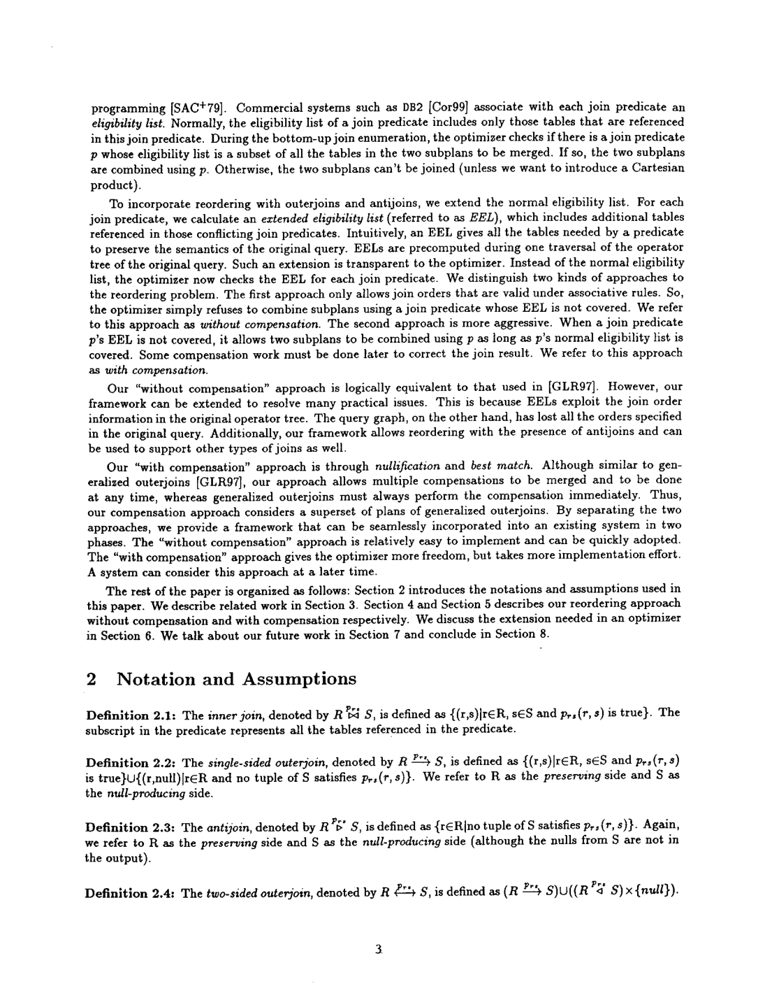
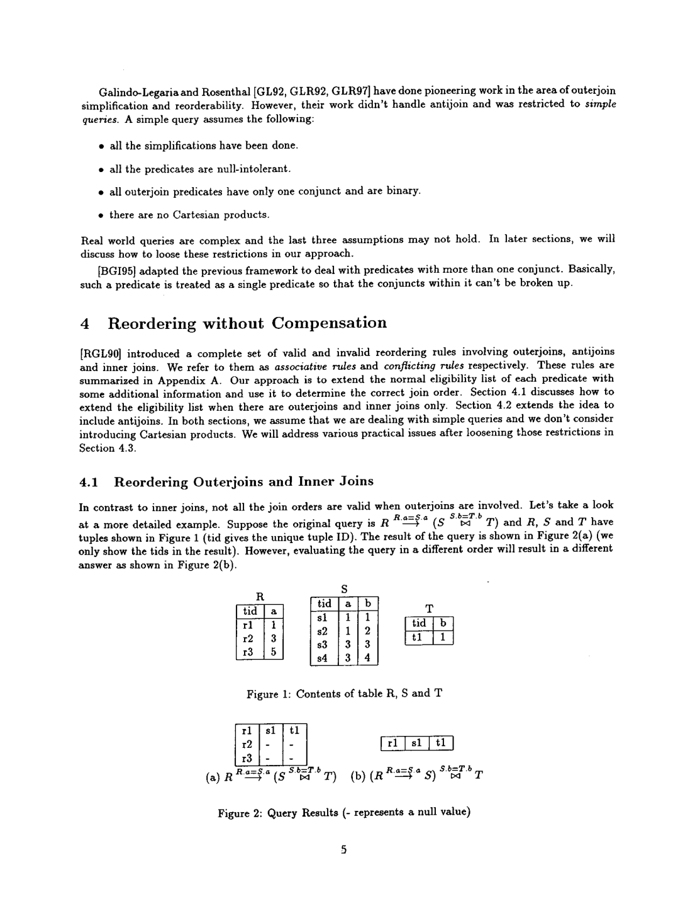

> 本组第 5 篇 · 连接重排 · [全部论文]() · [上一篇]() · [下一篇]()

EEL（extended eligibility list）将原始有序算子树中的重排冲突编码为谓词所需的表集合；NEL（normal eligibility list）仅含谓词直接引用的表，TAB 指表。无补偿枚举要求 EEL(p) 被两个子计划的表集之并覆盖。Algorithm 4.1 用 companion set 处理 inner/单侧 outer；Algorithm 4.2 用 outer/anti 集扩展到 antijoin，但其印刷更新规则与 Example 4.4 的表值有可复算的不一致，不能无条件按字面移植。Theorem 4.2 在4.1的 simple-query、已简化且不引入笛卡尔积前提下，给出 EEL 枚举与结合律规则可达计划的双向对应及证明草图，不是对任意 SQL 的全局最优性保证。带补偿的5.1节只覆盖简单 inner/outer 查询：必须先将相关 inner 提升为 outer 以免丢行，再 nullification，最后 BM 去重复和被 subsume 的元组，并保留基表 TID。Antijoin 补偿在第7节仍属未来工作。全文没有性能基准或加速数字；一次树遍历也不等于已证明线性集合计算成本。扫描公式已抽查，原始 OCR 引文不作静默修复。

本文保留论文陈述、读者推断与待验证方案的区别；实验数字只适用于原文条件。原文和翻译来自已有 AI 辅助精读报告，已做来源匹配与编辑复核，不等于人工逐项核验或独立实验复现。所有页码均为 PDF 物理页。

## 论文与阅读范围

Jun Rao, Bruce Lindsay, Guy Lohman, Hamid Pirahesh, David Simmen. Using EELs, a Practical Approach to Outerjoin and Antijoin Reordering. IBM Almaden Research Center, Research Report RJ 10203 (95077), December 6, 2000（封面，PDF第1页）。本地18页文件是研究报告扫描版；正文References位于PDF第17-18页。未从本地来源核实最终会议或期刊版本。

[论文集中的原始 PDF](https://github.com/lonng/db-papers/blob/4ff1331069c7cf52ac97dd769e5f484c1c35c200/papers/join-order/using-eels%2C-a-practical-approach-to-outerjoin-and-antijoin-reordering.pdf) · 本地来源：`join-order/using-eels,-a-practical-approach-to-outerjoin-and-antijoin-reordering.pdf`，共 18 页。

本篇保留 10 组原文精读和 38 条证据。截图为原始 PDF 的局部页选，不是重新生成的图表；未将整份 PDF 复制到博客。

## 研究问题与适用边界

本文研究如何在常规自底向上的连接枚举器中，保留原始查询语义而重排 inner join、单侧 outerjoin 和 antijoin。原始有序二元算子树是语义输入，不能只用丢失顺序信息的普通查询图替代。第2节假设重写后按 query block 优化、WHERE conjuncts 初始位于树顶 filter，并且所有可用的外连接简化已完成（PDF第5页）。

PDF第3页的两个反例是 R LEFT JOIN (S INNER JOIN T) 与 (R LEFT JOIN S) INNER JOIN T 一般不等价，以及将其中 INNER 换成 ANTI 后仍一般不等价。这不意味着所有外连接都不能重排。ANTIJOIN 保留在右侧没有任何匹配的左行，不输出右侧列；例如 NOT EXISTS 可在适当重写前提下转成这种连接，不能顺带推广到含 NULL 的任意 NOT IN。

范围必须分开。第4.1、4.2节从 simple queries 出发：已做全部简化、谓词 null-intolerant、外连接谓词为单合取的 binary predicate、无笛卡尔积，且这两节不新引入笛卡尔积（PDF第6页）。第4.3节再讨论 hyper-predicate、顶层 filter、null-tolerant join、ON 多合取项及受限笛卡尔积。

无补偿的4.2节确实纳入 antijoin；带补偿的5.1节则仅给出简单 inner/outer 查询的机制与例子。复杂谓词规则不自动证明其补偿也正确，antijoin 补偿在第7节明确仍待研究。Full outerjoin 在第7节讨论如何扩展冲突矩阵，并给出一个补偿等式，不是现成的通用 Algorithm 4.2 输入支持。

依据：论文陈述；PDF 物理页 3, 5, 6, 11, 12, 14, 16。证据：[C001N01](#evidence-c001n01), [C001N11](#evidence-c001n11), [SREV03](#evidence-srev03), [SREV04](#evidence-srev04), [SREV17](#evidence-srev17), [SREV14](#evidence-srev14), [SREV11](#evidence-srev11), [SREV12](#evidence-srev12)。

## 系统架构与核心组件

核心元数据是 NEL 与 EEL。Definition 2.6（PDF第5页）把 NEL 定义为谓词引用其列的所有表，TAB 就是表的标记；不是 Table Attribute Block。Definition 4.1（PDF第7页）把 EEL 定义为为得到正确答案、应用谓词 p 时必须可用的全部输入表。EEL 可能包含 p 没有直接引用、但由原树冲突所要求的表。

对子计划 L、R 的表集合 U，without compensation 的条件是 EEL(p) ⊆ U，而非只检验 NEL(p) ⊆ U。这是对一个合法候选合并的 eligibility 前置条件，不替代原优化器已有的谓词适用性、左右输入方向和算子类型约束。外连接与反连接的 preserving/null-producing 方向不能因表集覆盖就被任意调换。

输入算子上，LEFT JOIN 的左行无匹配时才补右侧 NULL；ANTIJOIN 的左行有匹配则删除，故“preserving side”不表示反连接左行无条件保留。Full outerjoin 包含匹配行与左右两侧未匹配行；扫描 Definition 2.4 表示为一个单侧外连接与另一方向 antijoin 的补空结果之并，OCR 符号不可直接照抄为完整公式。

Definition 2.5 使用 null-intolerant 的二值资格表述“遇 NULL 则 false”。对 SQL 实现应理解为不能成为 TRUE 的匹配/选择条件，不能把 SQL UNKNOWN 与字面 FALSE 混为同一值。R.a=5 OR R.b=6 在 R.a=NULL、R.b=6 时仍为 TRUE，因而不是 null-intolerant。

无补偿阶段的 EEL 是 plan-independent，设置后不随枚举候选改变；不必为每个子计划再存一份冲突状态。补偿阶段则另存 plan-dependent compensation set、各 TAB 的 nullification set 及 compensation flag，并需要 BM 算子与基表 TID。这是两种不同的元数据生命周期，不能把补偿谓词继承 EEL 与静态 EEL 的性质混淆（PDF第14-16页）。

依据：论文陈述；PDF 物理页 4, 5, 7, 14, 16。证据：[C001N07](#evidence-c001n07), [C001N05](#evidence-c001n05), [SREV01](#evidence-srev01), [SREV02](#evidence-srev02), [C002N01](#evidence-c002n01), [SREV16](#evidence-srev16), [SREV14](#evidence-srev14), [SREV21](#evidence-srev21)。

*原论文 PDF 物理页 4，版权归原作者或出版方。点击图片可查看原尺寸。这是页面定位信息，不表示本次已复核图内所有数据。*

## 算法机制与步骤解析

一、Algorithm 4.1（PDF第8页，原文有明确伪代码）。自底向上遍历原始算子树，初始 companion(T)={T}；每到谓词 p 先令 EEL(p)=NEL(p)。若 p 为 inner join，取 W 为 p 所引用表的 companion 集之并，对 W 中每个 T 设置 companion(T)=W。若 p 为 outerjoin，取 p 引用且来自置空侧的各 T 的 companion 之并 V，令 EEL(p)=NEL(p)∪V；这个 outerjoin 本身不合并 companion。

原文在PDF第7页直接推导 Q=R LEFT JOIN (S INNER JOIN T)：p_rs 的 NEL={R,S}，EEL={R,S,T}；p_st 的 NEL=EEL={S,T}。这是作者的例子，不是报告独立发明。先处理 S、T 的 inner 得 companion(S)=companion(T)={S,T}，故后访问 p_rs 时加入 T。仅有 R、S 的候选并不覆盖 p_rs 的 EEL，不能先生成 R LEFT JOIN S。Example 4.1 的两个单侧 outerjoin 则可结合，EEL 各等于 NEL；不是所有 outerjoin 都被锁定。

二、Algorithm 4.2（PDF第9-10页）。每表初始 outer(T)=anti(T)={T}，每个节点严格先 Part A 算 EEL，再 Part B 更新集合。outerjoin 的 EEL 加入 p 在置空侧所引用表的 outer 集之并；antijoin 的 EEL 加入 p 在保留侧所引用表的 anti 集之并，以及整个置空侧子树的所有表（不只是 p 直接引用的表）；inner 保持 EEL=NEL。之后，inner 或 anti 将其引用表的 outer 集合并为 W，并赋给 W 中每个表；outer 则收集其保留侧引用表的 anti 集 V，加入每个置空侧引用表的 anti 集，不能对两侧对称合并。

这些更新来自 Figure 4 冲突矩阵：outer 在置空侧与 inner、anti 冲突；anti 在置空侧与 inner、outer、anti 都冲突，在保留侧与“向内指”的 outer 冲突；inner 本身没有这种冲突。Example 4.3 原树为 ((R INNER JOIN S) LEFT JOIN T) ANTIJOIN U，p_rs、p_st、p_tu 分别连接所标两表。outer 后 anti(T)={S,T}，故 EEL(p_tu)={S,T,U}；不能先对 T、U 做 antijoin，而 R 与 S 的 inner 可在该 antijoin 前后（PDF第10页）。

三、第4.3节需按谓词位置分别处理。顶层 null-tolerant WHERE filter 的 EEL 是全树表集，或单独放到外层 query block；在已完成简化的前提下，顶层 null-intolerant filter 可用 NEL。null-tolerant ON/join 的 EEL 包含原树该节点下全部表，但上下其他 join 仍可重排；若该 null-tolerant inner 下没有 outer/anti，则仍可用 NEL。对于 null-intolerant ON conjuncts，outer/anti 的置空侧局部条件可下推、EEL=NEL；其余 conjuncts（包括保留侧局部条件）按其 EEL 的并集绑定，不能当成普通过滤条件随意拆开。inner conjuncts 可分开。hyper-predicate 按多表 NEL 扩展；新引入笛卡尔积仅在两个 TAB 有相同 inner-join companion set 时允许，不能用 Algorithm 4.2 的 outer 集冒充 companion（PDF第11-12页）。

四、5.1节补偿（PDF第13-15页）。若 EEL 未覆盖但 NEL 已覆盖，不能只放宽检查后直接跑原来的 inner join 再加 BM。须识别尚未执行的冲突 inner，将其加入 compensation set 并提升为 outer，以保存所有可能需要的行；这些 compensation predicates 从触发它们的 p 继承 EEL。q 执行时，用其否定条件 nullify 其相关 companion 中已处于保留侧的 TAB，并更新状态。compensation flag 开启的中间计划可在适用规则下延迟 BM，但最终必须清理伪行。

重要来源内文疑点（PDF第10页扫描已核，读者字面复算）：Algorithm 4.2 的 Part B 只把保留侧 anti 集加入“谓词 p 引用的置空侧表”。按 Example 4.4 的 p_rs 只引用 R、S，处理 R LEFT JOIN (S INNER JOIN T) 后，字面算法更新 anti(S) 却不更新 anti(T)；随后 p_tu 得 anti(U)={T,U}，故最后 EEL(p_uv)={T,U,V}。同页例表却列 anti(T)={R,T}、anti(U)={R,T,U}、EEL(p_uv)={R,T,U,V}。缺少 R 会允许先在 S,T,U,V 内反连接再与 R 外连接的错误候选。读者构造每表各一行且所有等值谓词匹配时，原树 ((R LEFT JOIN (S INNER JOIN T)) LEFT JOIN U) ANTIJOIN V 输出空，而上述提前反连接的右子树为空、最后 R LEFT JOIN 它输出一个 R 补空行。例表较强的 EEL 会拒绝此候选；字面伪代码不会。此结果只针对印刷伪代码的字面实现，说明需要作者澄清传播范围或省略步骤，不据此断言 EEL 设计意图整体无效，也不自行补造一条修正规则。

依据：论文陈述；PDF 物理页 7, 8, 9, 10, 11, 12, 13, 14, 15。证据：[SREV05](#evidence-srev05), [SREV06](#evidence-srev06), [SREV08](#evidence-srev08), [SREV09](#evidence-srev09), [SREV10](#evidence-srev10), [SREV11](#evidence-srev11), [SREV12](#evidence-srev12), [C002N12](#evidence-c002n12), [SREV13](#evidence-srev13), [SREV14](#evidence-srev14), [SREV15](#evidence-srev15)。

## 正确性论证与边界条件

Theorem 4.2 的证据不只是反例图。PDF第8页的 Lemma 4.1 先指出 Algorithm 4.1 产生的 EEL 总是原树该谓词下表集的子集，因此原树仍能生成。Theorem 4.2(a) 声明所有结合律规则允许的连接顺序都可被适配的枚举器生成；(b) 声明生成的所有计划都可由原树按这些规则变换得到。原文给出 induction 与排除非法变换的 proof sketch。这里的完备性是相对于该规则系统及4.1节前提，不是“覆盖全部 SQL 语义等价计划”或“必然找到物理全局最优计划”。4.2节是按更完整冲突矩阵给出的扩展算法，不能把4.1的定理无条件扩大成任意混合查询的同名证明。

图1、2（PDF第6页，已核图）给出 R=(r1,a=1),(r2,a=3),(r3,a=5)；S=(s1,a=1,b=1),(s2,a=1,b=2),(s3,a=3,b=3),(s4,a=3,b=4)；T=(t1,b=1)。Q=R LEFT JOIN (S INNER JOIN T) 的 tid 结果是 (r1,s1,t1),(r2,NULL,NULL),(r3,NULL,NULL)。错误的 (R LEFT JOIN S) INNER JOIN T 仅剩 (r1,s1,t1)，丢失 r2、r3，不是此例中“多出匹配”。

PDF第13页的正确补偿先计算 (R LEFT JOIN S) LEFT JOIN T，再对 p_st 不成立的行将 S 部分置空，最后 BM 去重复与 subsumed 行。Definition 5.1 的 subsumption 要求：被包含行的每个非 NULL 字段均在包含行中取同值，且后者有更多非 NULL 字段。Definition 5.2 的 Null[p,A] 在条件 p 成立时置空 A，例子才使用 ~p_st 作为触发条件。其最终等式可用统一文本记为 Q=BM(Null[~p_st,S]((R LEFT JOIN_p_rs S) LEFT JOIN_p_st T))，该行是对扫描公式的规范化转述，不是 exact OCR quote。SQL 实现不能直接用 SQL NOT UNKNOWN 替代论文的二值“不满足匹配”语义，必须明确 UNKNOWN 的处理。

BM 删除重复和 subsumed 行，本身不能重建被错误 inner 提前删除的行。保留所有参与基表 TID 是 Definition 5.3 明定的正确性前提，也避免把业务列相同但来源不同的行误去重；不是仅为物理哈希实现可选的优化。哈希未被 nullify 的属性、桶内排序是作者建议的一种物理实现，不是完整的 SQL bag-semantics 证明。

第2节“全部简化已完成”是证明前提。原报告“若遗漏简化至多保守、不会影响正确性”没有来源保证，应撤回；特别是顶层 null-intolerant filter 的 NEL 策略依赖这一前提。PDF第18页附录 A 也明确假设全部谓词 null-intolerant。

Algorithm 4.2 的字面伪代码与 Example 4.4 的 anti 集/EEL 表值不一致，并可放行改变结果的候选，详细复算见算法节及专属 QA。Theorem 4.2 针对 Algorithm 4.1，不是对这处印刷缺口的兜底证明。故本次只确认4.2的扩展意图与表中的所需依赖，不把当前字面伪代码标为已获验证的通用正确实现。

依据：论文陈述；PDF 物理页 5, 6, 8, 10, 13, 18。证据：[SREV07](#evidence-srev07), [C001N08](#evidence-c001n08), [SREV13](#evidence-srev13), [SREV03](#evidence-srev03), [SREV19](#evidence-srev19), [SREV09](#evidence-srev09)。

## 实验设计与数据缺失说明

完整读取本地18页后，未发现性能实验章节、查询基准集、硬件配置、运行时、吞吐量、优化耗时或加速比。Figure 1/2 与 Figure 6 是小型关系实例的语义演示，Example 4.1-4.5/5.1 是算法或计划构造例子，不是性能测量。

论文确有成本和空间的定性讨论。PDF第14页比较立即做两次 BM 与延迟合并成一次 BM：后者少做一次昂贵操作，却会在后续连接携带 spurious tuples，增加中间结果，交给优化器按成本选择。PDF第16页引用 [OL90] 说明计划数可能随参与关系数指数增长，故每计划保存补偿状态可能有显著空间开销。这不是实测内存曲线，也未给每集合操作或整体 EEL 计算的精确渐近上界。

第7节说方法正在 DB2 Universal Database Server 实现，计划进入后续商业发布；这是2000年报告中的当时状态，不证明任何今天的版本已实现。本文可支持“存在更多可考虑的补偿计划”和“可能降低总体成本”的动机，不能支持稳定提速、EEL 比 conflicting set 快多少或小 R 必使中间结果小的保证。R LEFT JOIN S 的输出仍可因一对多匹配而任意放大。

依据：论文陈述；PDF 物理页 6, 13, 14, 16。证据：[C001N08](#evidence-c001n08), [SREV13](#evidence-srev13), [SREV14](#evidence-srev14), [SREV16](#evidence-srev16), [SREV17](#evidence-srev17)。

*原论文 PDF 物理页 6，版权归原作者或出版方。点击图片可查看原尺寸。这是页面定位信息，不表示本次已复核图内所有数据。*

## 设计权衡与工程取舍

EEL 与 conflicting set 在所比较的 simple-query 无补偿场景中以不同方式编码冲突：前者是表依赖，后者是谓词冲突。原有算子树让 EEL 可表达更复杂的顺序限制。一次自底向上遍历是实现组织上的优点，不等于所有集合 union、传播与复制总成本为 O(n)，更不能据此断言理论复杂度必低于全部图算法或 CPU 时间已获测量（PDF第7-8页）。

Theorem 4.2 已在其限定内给出规则可达计划的完备性；不能一边引用它，一边无证据推测这个相同范围因 EEL 表集变大而漏掉规则允许的计划。第4.3节的保守 null-tolerant 处理与更广泛 SQL 等价变换是否仍完备是另一问题。顶层 filter 覆盖全树与 ON/join 覆盖当前子树，也不能合并成一条“所有 null-tolerant 都等到全查询结束”的规则。

无补偿只需静态 EEL（若新引入笛卡尔积，另留 companion）；补偿需每计划状态、TID 和执行时 BM，且可能扩大中间结果。PDF第14页允许按特定等式延迟、合并 BM；这些等式要求保留所有关系 TID，其中穿过 Null 的式子还要求其谓词 null-intolerant。并不是任意补偿都能随意跨任意算子移动。

PDF第15页的替代方案是预先把 companion 与每个 inner predicate 关联，按其与合并子计划的交集作冗余 nullification，免去显式每计划 nullification sets；不是每次重新遍历树推导。少存状态换来额外置空工作，但 CPU/内存/网络影响只是工程推断，本文未实测。采用补偿还必须同时满足“不会提前丢行”和“最终去除伪行”，单纯减少 BM 次数不是正确性条件。

依据：读者推断；PDF 物理页 7, 8, 11, 12, 14, 15, 16。证据：[C002N02](#evidence-c002n02), [SREV06](#evidence-srev06), [SREV07](#evidence-srev07), [SREV11](#evidence-srev11), [SREV12](#evidence-srev12), [SREV14](#evidence-srev14), [SREV15](#evidence-srev15), [SREV16](#evidence-srev16)。

## 相关工作对比与定位

以下仅转述本文的相关工作定位，没有另查这些被引论文或现代系统。[RGL90] 提供有效/无效重排规则；本文将其冲突以 EEL 编码到常规 bottom-up 优化器。[GLR97] 用 query graph 和 conflicting sets，处理本文称为 simple 的 join/outerjoin 查询；该语义由图可唯一确定的特殊性质，不能推广到任意有序外连接查询。本文比较的既有方法没有纳入 antijoin，EEL 的4.2节纳入它。

[BGI95] 将复杂 ON conjuncts 作为不可拆的整体处理；本文4.3节区分置空侧局部条件与其余合取项以允许部分提早求值。两种依赖表示在共同的 simple-query 无补偿范围逻辑等价，不是声称已有 conflicting-set 方法完整支持本文所有扩展。

GOJ 每次立即补偿；本文先提升连接，再 Null+BM，并给出合并 BM 的规则和例子，能考虑含延迟补偿的额外计划（PDF第13-14页）。这描述的是计划空间包含关系与机制，不是用基准证明效率占优。

References 实际在PDF第17-18页，不能再称本地来源没有参考文献。StarRocks、Calcite、DuckDB 是否采用等价技术、TID 传播或补偿算子，是需要独立代码审计的问题；本次只核这篇本地论文，不给这些系统下现状结论。

依据：论文陈述；PDF 物理页 3, 6, 7, 12, 13, 14, 17, 18。证据：[C001N09](#evidence-c001n09), [SREV04](#evidence-srev04), [SREV05](#evidence-srev05), [SREV12](#evidence-srev12), [SREV13](#evidence-srev13), [SREV14](#evidence-srev14), [SREV18](#evidence-srev18), [SREV19](#evidence-srev19)。

## 复现指南与工程挑战

以下是读者提出的复现计划，不是本文提供的实现代码或已执行基准。原文有 Algorithm 4.1、4.2 的伪代码、Theorem 4.2 证明草图、多个 EEL 表和 Example 5.1 分步补偿，不能称“只提到算法存在”。5.1节又指向 Appendix B 的 Algorithm B.1，但这个本地18页文件在 Appendix A 后结束，没有附录 B；因此补偿计划生成的完整细节仍有本地来源缺口。

1. 先按第2节构造已简化的 inner/单侧 outer/anti 二元有序树。用后序遍历实现4.1，再实现4.2的 Part A→Part B；表引用应以不同关系实例区分。不要把自顶向下替代方案或 full outerjoin 的完整支持归给原算法。
2. 对照原文第7页的 {R,S,T} 示例、第9页 Examples 4.1/4.2、第10页 Examples 4.3/4.4、第11页 hyper-predicate，逐节点断言 NEL、EEL、companion、outer、anti。生成候选时除检查 EEL 覆盖外仍检查谓词归属、输入方向、输出列可用性。
3. 用小实例枚举与结果多重集比较验证：原树始终可生成；4.1限定内规则可达计划与适配枚举计划对应；图2的错误计划被拒绝，图示有效重排仍保留。若未满足全部简化，先拒绝套用定理并保留回退路径，不能把结果正确当作自动保证。
4. 分别测试 null-tolerant WHERE 与 ON；把 NULL、UNKNOWN、空表、一对多、重复业务值及不同 TID 纳入用例。特别验证保留侧局部 ON 不能当普通 filter 提前删左行；anti 的右侧全子树依赖不能只用直接引用表替代。
5. 补偿只从简单 inner/outer 开始：实现 inner→outer 的提升、正确 nullification 触发和 TID-preserving BM。先复现图6五行→置空→去重复/去subsumption，再比图7立即/延迟 BM 的等价性；验证最后不能留下待补偿的伪行。Antijoin 补偿与通用 full outerjoin 不列为已完成算法。
6. 性能实验另行设计：独立报告集合计算成本、枚举时间/内存、TID 宽度、中间行数、BM 时间与总体执行时间；小 R、大 S/T 只是一个待测分布，还须测试一对多放大与补偿更慢的反例。

阻断条件：先复算 Algorithm 4.2 与 Example 4.4 的不一致；anti(T) 和 EEL(p_uv) 不能按印刷字面更新得到例表值。本次的小实例显示该字面实现会允许不等价计划。生产集成前必须澄清其传播范围并另行证明/测试，不能把本报告的算法转述视为可直接上线的无缺口规范。

依据：待验证的工程设想；PDF 物理页 5, 7, 8, 9, 10, 11, 12, 13, 14, 15, 16, 18。证据：[SREV03](#evidence-srev03), [SREV05](#evidence-srev05), [SREV06](#evidence-srev06), [SREV07](#evidence-srev07), [SREV09](#evidence-srev09), [SREV10](#evidence-srev10), [SREV11](#evidence-srev11), [SREV12](#evidence-srev12), [SREV13](#evidence-srev13), [SREV14](#evidence-srev14), [SREV15](#evidence-srev15), [SREV19](#evidence-srev19), [SREV08](#evidence-srev08), [SREV17](#evidence-srev17)。

## 总结与内核工程启示

本文的主要价值是把原始算子树的语义冲突转成静态 eligibility 表依赖，使常规连接枚举器能在适用范围内保留且仅生成规则允许的无补偿计划。Algorithm 4.1 与 Theorem 4.2 的限定必须同时保留；Algorithm 4.2 确实旨在处理 antijoin，但印刷更新规则与 Example 4.4 存在已复算的依赖传播缺口，不能称字面实现已验证正确。

补偿机制是另一条边界更窄的路径：5.1节针对简单 inner/outer 查询，通过提升 inner、防止丢行、Null 修正字段、BM 清除伪行，并保留基表 TID。Antijoin 的无补偿重排已支持，不代表 antijoin 补偿已解决。延迟 BM 是有规则前提的代价选择，不是“非法计划加一个 BM 总能恢复”。

本次已完整读取 source SHA 匹配的18页 OCR，并抽查扫描算子、算法和图。原始引文原样保留，识别损坏另作说明。原模型的 critique 仅是历史初稿审查，内含“算法缺失”等误导建议，不作为本次核原文的结论。缺少附录 B、形式化 SQL 三值实现和实测成本仍是待核问题；不能把这次 AI 原文审核等同于独立人工证明。

依据：读者推断；PDF 物理页 8, 10, 13, 14, 16, 18。证据：[SREV06](#evidence-srev06), [SREV07](#evidence-srev07), [SREV09](#evidence-srev09), [SREV13](#evidence-srev13), [SREV14](#evidence-srev14), [SREV17](#evidence-srev17), [SREV19](#evidence-srev19)。

## 原文精读：从句子回到机制

以下保留原文、忠实翻译、含义与边界；假设示例不作为论文实验结果。

### P001 · PDF 物理页 3

**原文**

<blockquote class="paper-source-quote"><pre><code>This is because these three types&#10;   of joins are not always associative with each other. Two invalid transformations (verified in [RGL90]) are&#10;   shown below:&#10;&#10;               R LEFT JOIN (S INNER JOIN T)# (R LEFT JOIN S) INNER JOIN T&#10;               R LEFT JOIN (S ANTIJOIN T)# (R LEFT JOIN S) ANTIJOIN T&#10;&#10;  As a result,  not  all orders  will give the same answer as the original query,  unless  it  is given special&#10;   consideration.</code></pre></blockquote>

**忠实翻译**

> 这是因为这三种类型的连接彼此之间并不总是满足结合律。下面展示了两种无效的变换（已在 [RGL90] 中验证）：
> 
>                R LEFT JOIN (S INNER JOIN T) ≠ (R LEFT JOIN S) INNER JOIN T
>                R LEFT JOIN (S ANTIJOIN T) ≠ (R LEFT JOIN S) ANTIJOIN T
> 
> 因此，并非所有顺序都会给出与原始查询相同的答案，除非给予特殊考虑。

**技术含义与边界**

> 原文说这些连接类型并不总能互相结合，并列出两种无效改写，不能把它扩大成所有 outer/anti 都不能重排。EEL 根据原树的冲突限定何时可应用谓词；带补偿则是另一条需要改写算子和清理结果的路径。

**常见误读**

> 容易发生的错误解读是认为所有连接类型都不满足结合律，或者认为只要包含 LEFT JOIN 就不能重排序。原文仅指出这三种类型‘彼此之间并不总是’满足结合律，并未否定同类连接（如纯 INNER JOIN 之间）的结合律，也未断言绝对不能重排序，而是强调需要‘特殊考虑’。不能将局部无效变换泛化为全局不可优化。

**读者构造的假设示例**

> 读者构造：R 只有 id=1，S、T 为空，p_rs 为 R.id=S.id，p_st 为 S.id=T.id。R LEFT JOIN (S INNER JOIN T) 输出 R 的一行和 NULL；(R LEFT JOIN S) INNER JOIN T 输出空。BM 只删行，不能独自修复这个丢行错误。

### P002 · PDF 物理页 16

**原文**

<blockquote class="paper-source-quote"><pre><code>Second, We have to keep in each subplana  nullification set for each TAB and a compensation&#10;set. Both properties are plan dependent.  Since the number of plans enumerated by the optimizer can be&#10;exponential in the number of participating relations [OL90], this could introduce a non-trivial amount of&#10;storage overhead. The problem is alleviated if we choose not to store the nullification sets explicitly as we&#10;discussed in Section 5.1.</code></pre></blockquote>

**忠实翻译**

> 其次，每个子计划需要为每个 TAB 保存一个 nullification set，并保存一个 compensation set。这两类属性都依赖计划。优化器枚举计划数可能随参与关系数指数增长，因此这些状态可能带来不可忽视的存储开销；第5.1节不显式保存 nullification sets 的方案可缓解。

**技术含义与边界**

> TAB 是表，不是一类可变计划属性。nullification set 按表记录置空条件，compensation set 按子计划记录待提升为 outer 的 inner predicates；它们不同于无补偿枚举中 plan-independent 的 EEL。指数级计划数是潜在优化开销，不是论文测量的执行复杂度。

**常见误读**

> 容易误以为优化器一定会因为指数级存储开销而无法工作。原文明确指出这是一个‘可能’引入非平凡开销的问题，并且作者已经提出了缓解方法（不显式存储）。此外，不能将‘指数级计划数’误解为实际执行时间也是指数级，这里特指优化器枚举阶段的存储开销。

**读者构造的假设示例**

> 读者构造：两个含相同关系的候选子计划可能因顺序不同而需要不同补偿状态。论文第15页的替代方案是将 inner predicate 与 companion set 关联，运行时对相关已出现表冗余置空，以免显式存各 nullification set；不是每次重新遍历算子树的方案。

### P003 · PDF 物理页 7

**原文**

<blockquote class="paper-source-quote"><pre><code>nt, there are many benefits of using the EEL’s representation:&#10; (1) The idea ofusing the EEL can be easily extended to antijoins (discussed in Section 4.2); (2) Other practical&#10; issues such as predicates with multiple conjuncts, hyper-predicates and allowing Cartesian products can also&#10; be handled efficiently using EELs (discussed in Section 4.3); (3) The computation of conflicting sets requires&#10; some graph analysis and can be complicated. On the other hand, the computation of EELs requires only&#10; one traversal of the original operator tree (as we will see shortly). Although such computation takes much&#10; less time than the evaluation of the query, the implementation of EEL will be much easier.</code></pre></blockquote>

**忠实翻译**

> ...，使用 EEL 表示法有许多好处：
> (1) 使用 EEL 的思想可以很容易地扩展到反连接（在第 4.2 节讨论）；(2) 其他实际问题，例如具有多个合取项的谓词、超谓词以及允许笛卡尔积，也可以使用 EEL 高效处理（在第 4.3 节讨论）；(3) 冲突集的计算需要一些图分析，可能很复杂。另一方面，EEL 的计算只需要对原始算子树进行一次遍历（正如我们稍后将看到的）。尽管这种计算比查询求值花费的时间少得多，但 EEL 的实现将会容易得多。

**技术含义与边界**

> EEL 的全称是 extended eligibility list，NEL 是 normal eligibility list。它以表引用表达原始算子树中的冲突，可扩展到反连接及复杂谓词。一次自底向上遍历是计算组织方式；每节点还有集合并、复制和成员更新，原文没有给出统一的 O(n) 总成本或与图算法的速度测量。

**常见误读**

> 不要把 EEL 写成 Extended Edge List，也不要从“一次遍历”推导必然线性或一定快于 conflicting sets。二者逻辑等价的比较限于共同的 simple-query 无补偿场景；反连接补偿并未因此解决。

**读者构造的假设示例**

> 按原文示例 Q=R LEFT JOIN (S INNER JOIN T)，后序遍历先处理 S、T 的 inner，合并 companion={S,T}；再处理 p_rs，将置空侧 S 的 companion 加入 {R,S}，得到 EEL={R,S,T}。不能从根向下先算 p_rs 再期待未计算的后代状态自动可用。

### P004 · PDF 物理页 5

**原文**

<blockquote class="paper-source-quote"><pre><code>Definition 2.5: A predicate p is null-intolerant if it evaluates to false whenever there is a null value in any&#10; of the attributes  it references.  Otherwise, the predicate  is called null-tolerant.  For example, (R.a = S.a)&#10;  is null-intolerant while (R.a = 5 or R.b = 6) is null-tolerant (since a null value in R.a doesn’t necessarily&#10;  disqualify that tuple)                   .</code></pre></blockquote>

**忠实翻译**

> 定义 2.5：如果一个谓词 p 在其引用的任何属性中存在 null 值时总是求值为 false，则称该谓词是 null-不容忍的（null-intolerant）。否则，该谓词被称为 null-容忍的（null-tolerant）。例如，(R.a = S.a) 是 null-不容忍的，而 (R.a = 5 or R.b = 6) 是 null-容忍的（因为 R.a 中的 null 值不一定会使该元组失去资格）。

**技术含义与边界**

> 这是论文的 null-intolerant 资格定义。SQL 中 R.a=S.a 遇 NULL 通常为 UNKNOWN，在选择/匹配资格上不为 TRUE；不能宣称 SQL UNKNOWN 就是 FALSE。析取式可在另一支为 TRUE 时通过，即便一支含 NULL。第2节假设已用此类条件做完可用简化，后续推导依赖该前提。

**常见误读**

> 不能把“含 NULL 的比较”与“null-intolerant”画等号，也不能把这种按资格的二值表述直接代入 SQL NOT 运算。NOT UNKNOWN 仍是 UNKNOWN；补偿中对“不匹配”的检测需明确定义。

**读者构造的假设示例**

> 读者构造：R.a=NULL、R.b=6 时，R.a=5 为 UNKNOWN，但 (R.a=5 OR R.b=6) 为 TRUE。若该条件在树顶 WHERE，论文将其 null-tolerant EEL 扩展到全树；若是 ON/join 谓词，则采用当前原始节点下表集的规则，位置不同不能混用。

### P005 · PDF 物理页 6

**原文**

<blockquote class="paper-source-quote"><pre><code>(Ss are=T.b T) and R, S and T have&#10;tuples shown in Figure 1 (tid gives the unique tuple ID). The result of the query is shown in Figure 2(a) (we&#10;only show the tids in the result). However, evaluating the query in a different order will result in a different&#10;answer as shown in Figure 2(b).</code></pre></blockquote>

**忠实翻译**

> R、S、T 的元组见图1，其中 tid 为唯一元组标识。查询结果见图2(a)，只显示 tid。若换一个顺序求值，会产生图2(b)中的不同结果。（所引开头连接符在 OCR 中损坏，查询结构以扫描图核实。）

**技术含义与边界**

> 已查看PDF第6页完整扫描图。原查询是 R LEFT JOIN_p_rs (S INNER JOIN_p_st T)，p_rs 为 R.a=S.a，p_st 为 S.b=T.b。图2(a)有 (r1,s1,t1)、(r2,NULL,NULL)、(r3,NULL,NULL)，错误的左结合计划只有 (r1,s1,t1)。这是作者的确定性语义反例，不是性能实验。

**常见误读**

> 原始 OCR 引文保留乱码，不静默改写成伪造原句；规范化公式与图中数据另作为视觉核实转述。此前“图像未提供、无法还原”已不适用于本次审核，且本例不能说错误计划多出了匹配。

**读者构造的假设示例**

> 沿用作者图1：R 的 a 值为1、3、5，S 的 (a,b) 为(1,1),(1,2),(3,3),(3,4)，T 的 b 仅为1。先算 S INNER T 只剩 s1；原树左外连接随后为 r2、r3 补空。改成最后 inner 则丢掉两行。

### P006 · PDF 物理页 11

**原文**

<blockquote class="paper-source-quote"><pre><code>This will also guarantee that&#10;those null-tolerant predicates are evaluated after the join.&#10;   Null-tolerant Join Predicates: There are two kinds of problems when join predicates are null-tolerant.&#10;First, some of the associative rules will break. For example, the following associative rule will not hold if pst&#10;is null-tolerant.</code></pre></blockquote>

**忠实翻译**

> 这也将保证那些 null-容忍的谓词在连接之后被评估。
>    Null-容忍的连接谓词：当连接谓词是 null-容忍的时候，存在两类问题。首先，一些结合律规则将会失效。例如，如果 pst 是 null-容忍的，以下结合律规则将不成立。

**技术含义与边界**

> 引文前一句承接顶层 null-tolerant filter，要求在全部 joins 之后求值；后一句已切换到 null-tolerant ON/join 的问题，不能合并为同一种位置规则。PDF第11页扫描展示的是两个 LEFT JOIN 的结合式在 p_st null-tolerant 时可能失效；不是原报告举出的 LEFT/INNER 无效式。

**常见误读**

> R LEFT JOIN (S INNER JOIN T) 与 (R LEFT JOIN S) INNER JOIN T 即使 p_st null-intolerant 也一般不等价，不能用它演示“原先有效而因 null-tolerant 失效”。顶层 filter 的全树 EEL 与 join 的原节点子树 EEL 也不同。

**读者构造的假设示例**

> 读者构造以验证扫描中的双 LEFT 结合式：R 有 a=1，S 为空，T 有 b=7、flag=1；p_rs 是 R.a=S.a，p_st 是 S.b=T.b OR T.flag=1。左结合先补空 S，再因 flag=1 匹配 T；右结合 S LEFT JOIN T 仍为空，最终只给 R 补空 S、T。因此两边不同。

### P007 · PDF 物理页 13

**原文**

<blockquote class="paper-source-quote"><pre><code>Definition 5.3: A best match operator is defined as BM(S)=({the set of tuples in S less all duplicated tuples&#10;and subsumed tuples}. To guarantee the correctness, when using best matches, we assume that we keep the&#10;TID of all the participating relations during query evaluation. Best match can be implemented by hashing&#10;the inputs on one of the attributes (not nullified) and then removing duplicated and subsumed tuples by&#10;sorting tuples in each bucket.</code></pre></blockquote>

**忠实翻译**

> 定义 5.3：最佳匹配算子定义为 BM(S) = ({S 中的元组集合减去所有重复元组和被包容的元组}。为了保证正确性，在使用最佳匹配时，我们假设在查询求值期间保留所有参与关系的 TID。最佳匹配可以通过在其中一个（未被置空的）属性上对输入进行哈希，然后通过在每个桶内对元组排序来移除重复和被包容的元组来实现。

**技术含义与边界**

> BM 删除重复及被 subsume 的行；后者要求其所有非 NULL 字段在另一行中同值，且另一行有更多非 NULL 字段。作者明确要求求值全程携带所有基表 TID，是结果正确性前提。对未 nullify 的属性哈希、桶内排序是物理实现建议，不意味着任意 hash/排序即可恢复任意非法计划。

**常见误读**

> BM 只能清除多余行，不能复活 inner 提前丢失的行；须先提升相关 inner 为 outer 并执行正确的 Null。保留 TID 还避免业务列同值而来源不同的合法结果被错误合并，不能对最终业务列直接 DISTINCT 冒充 BM。

**读者构造的假设示例**

> 读者构造：含 TID 的 (r1,s1,t1) subsume (r1,NULL,NULL)，故 BM 删后者；但 (r1,s1,t1) 与 (r1,s2,t1) 即使业务字段相同，TID 不同也不能视作同一来源重复。TID_R 若未被 nullify 可作共同分桶键，仍需完整的 subsumption 判定。

### P008 · PDF 物理页 12

**原文**

<blockquote class="paper-source-quote"><pre><code>v+——_ T &gt;&lt; R—-— U&#10;&#10;&#10;&#10;&#10;&#10;                                                                                                            Ss&#10;&#10;                                       Figure 5: A Query Graph&#10;&#10;&#10;5  Reordering with Compensation&#10;&#10;Instead of allowing only valid join orders, we can take a more aggressive approach to allow invalid orders&#10;and later compensate the incorrect result.  Consider again.  the query R Reese.a=8,  (S S.b=T.b“pa”   T) we used in.&#10;Section 4.1. Suppose both  $ and T are large, but R is very small.</code></pre></blockquote>

**忠实翻译**

> 图5之后，第5节“带补偿的重排序”提出：可以允许无补偿时非法的顺序，再修正结果。它重访第4.1节的例子，并假设 S、T 很大而 R 很小。原引文图和连接符有 OCR 噪声；扫描核实的查询为 R LEFT JOIN (S INNER JOIN T)。

**技术含义与边界**

> 这段是补偿动机，后续PDF第13-15页实际给出算子提升、nullification、BM 的机制和分步例子。相关 inner 必须提升为 outer 防止先丢行，不能仅在原非法计划末尾加 BM。小 R 可能有利于先参与连接，但不是成本保证。

**常见误读**

> R LEFT JOIN S 不存在“最多 |R| 行”的界：一个 R 行可匹配许多 S 行。不能先运行会丢行的 (R LEFT JOIN S) INNER JOIN T，再指望删除型 BM 修复。范围只限5.1节的 simple inner/outer 补偿，不扩展到已解决 anti 补偿。

**读者构造的假设示例**

> 读者构造：即使 R 只有1行，它也可能匹配 S 的100万行，故先连 R、S 未必缩小中间结果。正确候选应是 BM(Null[~p_st,S]((R LEFT JOIN_p_rs S) LEFT JOIN_p_st T))；是否更快需计入放大、Null、TID 与 BM 的总代价。

### P009 · PDF 物理页 14

**原文**

<blockquote class="paper-source-quote"><pre><code>5.1  Compensation with Outerjoins and Inner Joins Only&#10;&#10; In this section, we discuss how to perform compensation when there are only outerjoins and inner joins in&#10;the query. We will talk about other kinds of compensation in Section  7.  For the sake of simplicity, we&#10;consider only simple queries. We assume that the following have been calculated using Algorithm 4.1:  (a)&#10;the companion set for each TAB; (b) the NEL and the EEL for each join predicate.</code></pre></blockquote>

**忠实翻译**

> 5.1 仅使用外连接和内连接的补偿
> 
> 在本节中，我们讨论当查询中仅存在外连接和内连接时如何执行补偿。我们将在第 7 节讨论其他类型的补偿。为了简单起见，我们仅考虑简单查询。我们假设以下内容已使用算法 4.1 计算得出：(a) 每个 TAB 的伴随集（companion set）；(b) 每个连接谓词的 NEL 和 EEL。

**技术含义与边界**

> TAB 指表；NEL 是 normal eligibility list，EEL 是 extended eligibility list，companion 是经 inner predicates 连接的表集。5.1节假设 Algorithm 4.1 已算这些元数据，并只讨论简单 outer/inner 查询。无补偿的 Algorithm 4.2 虽支持 anti，但第7节说 anti 补偿还待研究。

**常见误读**

> NEL 不是 Nullification Edge List。不能把“第7节讨论其他可能补偿”写成“已给出 anti/full 通用补偿算法”。本地文件也缺少5.1节指向的 Appendix B，因此不能声称核完 Algorithm B.1 的具体实现。

**读者构造的假设示例**

> 按作者 Example 5.1，Q=R LEFT JOIN ((S INNER JOIN T) INNER JOIN U)，companion(S)=companion(T)=companion(U)={S,T,U}，EEL(p_rs)={R,S,T,U}。先连 R、S 需登记 p_st 为 compensation predicate，之后提升它、传播 p_tu，并在末尾完成 BM；不是只读取一个静态列表即可。

### P010 · PDF 物理页 4

**原文**

<blockquote class="paper-source-quote"><pre><code>We refer to R as the preserving side and S as&#10;the null-producing side.&#10;&#10;Definition 2.3: The antijoin, denoted by R *5" S, is defined as {r€R{no tuple of S satisfies p,.(r, s)}. Again,&#10;we refer to R as the preserving side and S as the null-producing side (although the nulls from S are not in&#10;the output).&#10;&#10;Definition 2.4: The two-sided outerjoin, denoted by R ¢" S, is defined as (R Pr $)U((R Pa S)x {null}).</code></pre></blockquote>

**忠实翻译**

> R 被称为 preserving side，S 被称为 null-producing side。Definition 2.3：反连接输出 R 中在 S 没有满足谓词的匹配的行，虽然仍把 S 称为 null-producing side，输出并不带 S 的补空列。Definition 2.4 的双侧外连接公式在 OCR 中损坏；扫描显示它用单侧外连接及另一方向反连接补空的并集表达。

**技术含义与边界**

> LEFT JOIN 保留所有左行；ANTIJOIN 只保留无匹配左行，所以“保留侧”并非所有算子均无条件保留左元组的承诺。Full outerjoin 包含匹配行及两侧未匹配行，不能把 Definition 2.4 的第二项误识别为同方向 left outerjoin。公式符号已在PDF第4页扫描核实，原始 quote 保持不变。

**常见误读**

> 不能从反连接的术语抽象推断其输出有右侧 NULL，也不能把它与 semijoin 输出条件混同。本文4.2节给出 anti 无补偿规则；full outerjoin 的扩展与 anti 补偿仍要遵守第7节边界。

**读者构造的假设示例**

> 读者构造：R 有 id=1、2，S 有 id=2、3，按 id 等值。LEFT JOIN 输出(1,NULL),(2,2)；ANTIJOIN 只输出 R.id=1；FULL OUTER JOIN 还输出(NULL,3)。ANTIJOIN 的“保留侧”中 id=2 仍被丢弃。

## 尚未解决的问题

1. Algorithm 4.2 Part B 的 anti 集传播范围如何才能得到 Example 4.4 表值？字面实现漏掉 R 的依赖并可放行不等价候选，需核完整版本或作者勘误，不能凭猜测改写论文算法。
2. 本地18页文件没有5.1节所指 Appendix B / Algorithm B.1；获得完整版本后，需核补偿生成与状态传播的完整条件，不能把缺页归因于算法不存在。
3. 论文以二值匹配资格描述 null-intolerant、~p 与 Null。SQL 三值逻辑尤其 UNKNOWN 的触发实现、TID 和 bag semantics，应如何形式化证明并测试？
4. 第4.3节对 null-tolerant 和复杂 ON conjuncts 的保守约束，在比 Theorem 4.2 更广的等价规则系统下是否完备？原文没有给任意 SQL 的统一证明。
5. Antijoin 补偿在第7节仍是未来工作；Full outerjoin 的4×4冲突矩阵、完整 EEL 算法与补偿细节应如何扩展？
6. EEL 集合运算、计划状态、TID、Null 与 BM 的实际成本如何？无实验数据时不能推出先连接小表或合并 BM 必然更快。
7. 现代 StarRocks、Calcite、DuckDB 是否有等价实现需另做源码审核，本次本地论文核查不提供现状结论。

## 证据索引

证据编号沿用原报告，便于将上文判断追溯到原句。引文匹配只验证位置，不证明解读正确。

**C001N01 · PDF 物理页 3**

outerjoin/antijoin 与 inner 的组合并非总可结合。原文列出 R LEFT JOIN (S INNER JOIN T) 以及 R LEFT JOIN (S ANTIJOIN T) 的两种向左结合改写一般无效，不是说所有外连接都不可重排。

<blockquote class="paper-source-quote"><pre><code>Two invalid transformations (verified in [RGL90]) are shown below: R LEFT JOIN (S INNER JOIN T)# (R LEFT JOIN S) INNER JOIN T</code></pre></blockquote>

**C001N04 · PDF 物理页 3**

先前最全面的工作 [GLR97] 存在两个关键局限：第一，仅适用于 simple join/outerjoin queries，不允许多合取项谓词、引用超过两张表的谓词以及笛卡尔积；第二，未考虑 antijoin 的重排序。这限制了其在商业系统中的应用，许多系统只能按用户指定顺序执行或仅允许有限重排序。

<blockquote class="paper-source-quote"><pre><code>predicates with more than one conjunct, predicates referencing more than two tables, and Cartesian products are not allowed in simple queries.</code></pre></blockquote>

**C001N05 · PDF 物理页 5**

Definition 2.5 将任一引用属性为 NULL 时不能满足条件的谓词称 null-intolerant，并以 false 描述资格；SQL 等值遇 NULL 可为 UNKNOWN，并非字面 FALSE。原树假设已完成全部可用简化；不能据此对任意未简化树保证正确。

<blockquote class="paper-source-quote"><pre><code>A predicate p is null-intolerant if it evaluates to false whenever there is a null value in any of the attributes it references.</code></pre></blockquote>

**C001N07 · PDF 物理页 4**

single-sided outerjoin 的左侧是 preserving side，右侧为 null-producing side；antijoin 左行只在右侧无匹配时保留，输出不含右列。保留侧一词不表示 antijoin 左行无条件保留。扫描 Definition 2.4 的 full outerjoin 分解含另一方向 antijoin，OCR 公式须看图。

<blockquote class="paper-source-quote"><pre><code>We refer to R as the preserving side and S as the null-producing side (although the nulls from S are not in the output).</code></pre></blockquote>

**C001N08 · PDF 物理页 6**

PDF第6页图1、2为语义反例，已核扫描：原计划输出 (r1,s1,t1),(r2,NULL,NULL),(r3,NULL,NULL)，错误的 (R LEFT JOIN S) INNER JOIN T 仅输出第一行，丢失 r2、r3。不是性能实验，也不是此例多出匹配。

<blockquote class="paper-source-quote"><pre><code>evaluating the query in a different order will result in a different answer as shown in Figure 2(b).</code></pre></blockquote>

**C001N09 · PDF 物理页 6**

相关工作脉络：[Cod79] 提出 outerjoin；[Kim82] 提出将否定嵌套查询转换为 antijoin 以允许使用 nested loops 之外的连接方法；[Day83] 给出初始有效求值顺序规则；[Day87] 指出可通过微小修改实现 one-sided outerjoin；[RGL90] 引入完整的 outerjoin/antijoin/inner join 有效与无效重排序规则（associative rules 和 conflicting rules）；[GL92, GLR92, GLR97] 建立了 outerjoin 简化与可重排序性的框架；[BGI95] 处理多合取项谓词但将其视为不可拆分的单一谓词。

<blockquote class="paper-source-quote"><pre><code>[RGL90] introduced a complete set of valid and invalid reordering rules involving outerjoins, antijoins and inner joins.</code></pre></blockquote>

**C001N11 · PDF 物理页 3**

antijoin 的来源与动机：用于处理否定嵌套查询（negated nested queries）。直接求值需要嵌套迭代法，效率低下。[Kim82] 提出将其转换为 antijoin，使得优化器可以使用除 nested loops 之外的其他连接方法。antijoin 转换在商业系统中频繁出现，例如用于维护参照完整性（referential integrity）的否定嵌套查询。Example 1.1 展示了 NOT EXISTS 子查询到 ANTIJOIN 的等价转换。

<blockquote class="paper-source-quote"><pre><code>Straightforward evaluation of those queries would require using the nested iteration method, which may be very inefficient. [Kim82] proposed to transform negated nested queries into antijoins.</code></pre></blockquote>

**C002N01 · PDF 物理页 7**

outerjoin 与其 null-producing side 上的 inner join 存在冲突，导致不能随意交换连接顺序。为解决此问题，提出了 Extended Eligibility List (EEL) 的概念。EEL 包含了为了正确应用谓词 p 而必须作为输入的所有表。如果要求两个子计划只有在覆盖了谓词的 EEL 时才能连接，优化器就不会生成仅包含部分表的非法计划（如仅包含 R 和 S 的计划）。

<blockquote class="paper-source-quote"><pre><code>Definition 4.1: An extended eligibility list (EEL) of a predicate p includes all the tables needed as the input to p in order to get the correct answer.</code></pre></blockquote>

**C002N02 · PDF 物理页 7**

EEL 以表、conflicting set 以谓词表示冲突；在共同的 simple-query 无补偿范围逻辑等价。EEL 用一次原树遍历组织计算，原文强调易实现；不等于已证明全部集合操作为线性或必比图算法更快。

<blockquote class="paper-source-quote"><pre><code>The computation of conflicting sets requires some graph analysis and can be complicated. On the other hand, the computation of EELs requires only one traversal of the original operator tree</code></pre></blockquote>

**C002N10 · PDF 物理页 11**

null-tolerant join predicates 会带来两个问题：一是破坏某些结合律规则（associative rules），二是限制简化（simplification）。因此，改变 null-tolerant join predicates 的求值顺序并不总是安全的。其 EEL 必须包含原始算子树中位于其下方的所有表。一种替代方案是将这些谓词放入单独的 query block 以固定该特定 join 的求值顺序，但其上下方的 join 仍可能重排。对于 null-tolerant inner join，如果其下方没有 outerjoin 或 antijoin，仍可安全地使用 NEL 作为 EEL。

<blockquote class="paper-source-quote"><pre><code>First, some of the associative rules will break. For example, the following associative rule will not hold if pst is null-tolerant.</code></pre></blockquote>

**C002N12 · PDF 物理页 12**

引入笛卡尔积的规则：虽然通常不推荐，但在特定场景下（如事实表与多个小维度表连接且存在多列索引时）可能产生更优计划。在非纯 inner join 的查询中不能随意引入笛卡尔积，因为后续无法确定如何与其他表连接。规则是：只要两个 TAB 具有相同的 companion set（即它们仅通过 inner join 连通），就可以在它们之间引入笛卡尔积。

<blockquote class="paper-source-quote"><pre><code>we can introduce a Cartesian product on two TABs as long as they have the same companion set.</code></pre></blockquote>

**C002N13 · PDF 物理页 12**

PDF第12页第5节开头提出补偿动机，但第13-15页继续给出提升 inner、Null、BM 的等式与步骤，不是整节只有动机。小 R、大 S/T 可能利于先连接 R、S，却不保证一对多时中间结果小。

<blockquote class="paper-source-quote"><pre><code>Instead of allowing only valid join orders, we can take a more aggressive approach to allow invalid orders and later compensate the incorrect result.</code></pre></blockquote>

**C003N04 · PDF 物理页 13**

使用 BM 时保留所有参与关系 TID 是 Definition 5.3 明示的正确性前提，不是仅物理实现可选策略。BM 去重复和 subsumed 行，不能找回提前被 inner join 删除的行。hash 未被 nullify 的属性加桶内排序是建议的物理实现。

<blockquote class="paper-source-quote"><pre><code>To guarantee the correctness, when using best matches, we assume that we keep the TID of all the participating relations during query evaluation.</code></pre></blockquote>

**C003N06 · PDF 物理页 14**

5.1节只对 simple 的 outer/inner 查询描述补偿，假设已用 Algorithm 4.1 计算 companion、NEL、EEL。Antijoin 补偿在第7节仍是未来工作；不能把无补偿4.2节的支持范围套给5.1节。

<blockquote class="paper-source-quote"><pre><code>For the sake of simplicity, we consider only simple queries. We assume that the following have been calculated using Algorithm 4.1</code></pre></blockquote>

**C003N09 · PDF 物理页 14**

Compensation predicate 的 EEL 继承自触发它的外层谓词 p。当 compensation predicate q 用于合并两个子计划时，需用 ~q 去 nullify q 所引用 TAB 的 companion set 中那些处于 preserving side 的 TAB。中间子计划可选择延迟 best match。

<blockquote class="paper-source-quote"><pre><code>A compensation predicate will inherit its EEL from p. When a compensation predicate q is used to combine two subplans</code></pre></blockquote>

**C003N10 · PDF 物理页 16**

在每个子计划中显式存储 nullification set 会引入 plan-dependent 的空间开销。由于优化器枚举的计划数可能随关系数量呈指数增长 [OL90]，这可能带来不可忽视的存储负担。文中提出替代方案：不存 nullification set，而是将每个 inner join predicate 关联其 TAB 的 companion set，用 ~p 统一 nullify，但会产生冗余 nullification。

<blockquote class="paper-source-quote"><pre><code>Since the number of plans enumerated by the optimizer can be exponential in the number of participating relations [OL90], this could introduce a non-trivial amount of storage overhead.</code></pre></blockquote>

**C003N11 · PDF 物理页 16**

本文未提供实验数据、基线对比或性能指标。仅提到该方法正在 DB2 Universal Database Server 上实现，并将出现在未来的商业版本中。关于 best match 合并带来的中间结果膨胀 vs. 减少 BM 次数的 tradeoff，文中声明由优化器基于代价决定，但未给出任何代价模型公式或实测数字。

<blockquote class="paper-source-quote"><pre><code>Our approach of using EELs is now being implemented on DB2 Universal database server and will be present in an upcoming commercial release.</code></pre></blockquote>

**SREV01 · PDF 物理页 4**

无补偿使用 EEL 覆盖检查；带补偿才可在 NEL 覆盖而 EEL 未覆盖时放行，并必须修正结果。

<blockquote class="paper-source-quote"><pre><code>To incorporate reordering with outerjoins and antijoins, we extend the normal eligibility list.  For each&#10; join predicate, we calculate an eztended eligibility list (referred to as EEL), which includes additional tables&#10; referenced in those conflicting join predicates.  Intuitively, an EEL gives all the tables needed by a predicate&#10; to preserve the semantics of the original query. EELs are precomputed during one traversal of the operator&#10; tree of the original query. Such an extension is transparent to the optimizer. Instead of the normal eligibility&#10; list, the optimizer now checks the EEL for each join predicate. We distinguish two kinds of approaches to&#10; the reordering problem. The first approach only allows join orders that are valid under associative rules. So,&#10; the optimizer simply refuses to combine subplans using a join predicate whose EEL is not covered. We refer&#10; to this approach as without compensation. The second approach is more aggressive. When a join predicate&#10; p’s EEL is not covered, it allows two subplans to be combined using p as long as p’s normal eligibility list is&#10; covered. Some compensation work must be done later to correct the join result. We refer to this approach&#10; as with compensation.</code></pre></blockquote>

**SREV02 · PDF 物理页 5**

NEL 是 normal eligibility list，包含谓词引用的表（TAB），不是 Nullification Edge List 或 Table Attribute Block。

<blockquote class="paper-source-quote"><pre><code>Definition 2.6: A normal eligibility list (NEL) of a predicate p includes all the tables (referred to as TAB)&#10; whose columns that p references. The NEL  is used by an optimizer to determine whether a predicate can&#10; be applied. For example, the NEL for predicate R.a = S.a is {R, S}.</code></pre></blockquote>

**SREV03 · PDF 物理页 5**

原始输入是重写后的有序二元连接树；WHERE 在顶层 filter，全部可用简化须先完成。不能无条件推断遗漏简化仍正确。

<blockquote class="paper-source-quote"><pre><code>We assume there  is only one query block  after query rewriting.  Queries with multiple query blocks&#10; (unrewrittable nested queries) won’t change our results since normally the optimizer will be invoked on each&#10; block individually. We assume that after parsing and query rewriting, an operator tree is generated for the&#10; original query. An operator tree consists of   a number of binary joins (including inner join, outerjoin and&#10; antijoin) with a specific order. Although this order gives the correct result, it may not be optimal in terms of&#10; execution time.  It’s the optimizer’s responsibility to find the optimal (valid) plan, which is also an operator&#10; tree.&#10;&#10;    Semantically, predicates  in the WHERE clause should be applied after  all the joins.  When there are&#10; outerjoins and antijoins, local predicates can’t always be pushed down as is the case for inner joins. We&#10; assume these predicates are initially placed in a filter operator at the top of the original operator tree. We&#10; will discuss how to handle those predicates in Section 4.3.&#10;   As has been considered in [GLR97], null-intolerant predicates can simplify a query. For example, if p,  is&#10; null-intorlerant, the following rule holds:                                                                                                                                                                                                                                               :&#10;                                            (0) o7,(R 2% 5S) = op,(R¥ S)&#10;Simplification is always a good thing to do since it makes operations cheaper. We assume all the possible&#10;simplifications have been done on the original operator tree using an algorithm described in (GLR97].</code></pre></blockquote>

**SREV04 · PDF 物理页 6**

simple query 的条件包括全部简化、null-intolerant、每个外连接谓词是单合取的二元谓词、无笛卡尔积；4.1/4.2 不引入笛卡尔积。

<blockquote class="paper-source-quote"><pre><code>Galindo-Legaria and Rosenthal [GL92, GLR92, GLR97] have done pioneering work in the area ofouterjoin&#10; simplification and reorderability.  However, their work didn’t handle antijoin and was restricted to simple&#10; queries. A simple query assumes the following:&#10;&#10;    e  all the simplifications have been done.&#10;&#10;     ©  all the predicates are null-intolerant.&#10;&#10;    e  all outerjoin predicates have only one conjunct and are binary.&#10;&#10;    e there are no Cartesian products.&#10;&#10; Real world queries are complex and the last three assumptions may not hold.  In later sections, we will&#10;discuss how to loose these restrictions in our approach.&#10;    [BGI95] adapted the previous framework to deal with predicates with more than one conjunct. Basically,&#10;such a  predicate is treated as a single predicate so that the conjuncts within it can’t be broken up.&#10;&#10;4  Reordering without Compensation&#10;&#10;[RGL90] introduced a complete set of valid and invalid reordering rules involving outerjoins,  antijoins&#10;and inner joins. We refer to them as associative rules and conflicting rules respectively.  These rules are&#10;summarized in Appendix A.  Our approach  is to extend the normal eligibility list of each predicate with&#10;some additional information and use it to determine the correct join order.  Section 4.1 discusses how to&#10;extend the eligibility list when there are outerjoins and inner joins only.  Section 4.2 extends the idea to&#10;include antijoins. In both sections, we assume that we are dealing with simple queries and we don’t consider&#10;introducing Cartesian products. We will address various practical issues after loosening those restrictions in&#10;Section 4.3.</code></pre></blockquote>

**SREV05 · PDF 物理页 7**

原文直接给出 p_rs 的 EEL={R,S,T} 与 p_st 的 EEL=NEL，不能称此推导仅为读者构造。

<blockquote class="paper-source-quote"><pre><code>In the above example, the EEL of predicate R.a = S.a (call it p,,) should be set to {R, S,T} (its NEL&#10;  is {R, S}) since T   is referenced in the conflicting inner join predicate $.b = T.b (call it p,:). The EEL of p,,&#10; means that in order to apply the predicate p,s, the subplans have to include all three tables. The EEL of&#10; the inner join predicate p,:, on the other hand, is the same as its NEL. If we require that two subplans be&#10; joined only if all the tables in the EEL of the join predicate exist in the two subplans, the optimizer won’t&#10; be able to form a plan including R and S only. This is shown in Figure 3(a).</code></pre></blockquote>

**SREV06 · PDF 物理页 8**

Algorithm 4.1 自底向上初始化并合并 companion set；外连接从其引用的置空侧表收集 companion，扩展 EEL。

<blockquote class="paper-source-quote"><pre><code>Algorithm 4.1: Set the EEL of outerjoin and inner join predicates.&#10;   associate each TAB T' with a companion set companion_T&#10;   initially companion_T = {T}.&#10;   for each join during the bottom-up traversal&#10;  of the operator tree {&#10;     let p be the current join predicate being considered&#10;     set the EEL ofp (EEL-_p) to be its NEL,&#10;        1.e., the TABs referenced in p&#10;     if p is an inner join predicate {&#10;  W = Upcompanion_T,&#10;      where T are the TABs referenced in p&#10;      for each TAB T  in set W&#10;      companion_T = W&#10;    }&#10;    else { // this is an outerjoin predicate&#10;   V = Urcompanion.T, where T are the TABs&#10;     referenced in p and are from the null-producing side&#10;    EEL_p = EELpUV&#10;    }&#10;  }&#10; I</code></pre></blockquote>

**SREV07 · PDF 物理页 8**

Lemma 4.1 保留原树可生成性；Theorem 4.2 对 Algorithm 4.1 证明规则可达计划的双向对应，给出的是证明草图。

<blockquote class="paper-source-quote"><pre><code>Lemma 4.1:  If we set the EEL for each join predicate using Algorithm 4.1, the original operator tree can&#10; be generated by an adapted bottom-up join optimizer.&#10; Proof: Since the EEL of a predicate p is always a subset of the TABs belowp  in the original operator tree,&#10; the original operator tree will satisfy all the EEL checking.    ff&#10;&#10;Theorem 4.2:  If we set the EEL for each join predicate using Algorithm 4.1,             ~&#10; (a) an adapted bottom-up join optimizer will generate  all the possible join orders that are allowed by&#10;associative rules.&#10; (b) all the plans generated by the adapted bottom-up join optimizer can also be obtained by transforming&#10;the original operator tree following associative rules.&#10;Proof:  (sketch) (a) From Lemma 4.1, we know that the optimizer can generate the original operator tree.&#10;If we apply an associative rule to the original operator tree, one join predicate p is pushed down. We can&#10;show that the EEL of p is still covered after the pushdown for each associative rule. We can then prove the&#10;theorem by induction.&#10;(b) Suppose the optimizer generates an operator tree ¢’ that’s invalid. We can find a sequence of transforma-&#10;tions from the original operator tree ¢ to t’. One or more of the transformations must be invalid. The invalid&#10;transformation involves pulling an inner join p out of the null-producing side of an outerjoin g. However,&#10;this means that the EEL of q would have included the tables referenced in p and thus t’ can’t be generated&#10;using the adapted optimizer.     Il</code></pre></blockquote>

**SREV08 · PDF 物理页 9**

outer 冲突在置空侧的 inner/anti；anti 冲突在置空侧全部连接及保留侧指向内部的 outer；inner 无此类冲突。

<blockquote class="paper-source-quote"><pre><code>Although these rules have been identified in earlier research,  this is the first time they are considered&#10; together with outerjoin rules in the same framework. We summarize all the conflicts in Figure 4. Basically,&#10;an outerjoin conflicts with inner joins and antijoins in its null-producing side. An antijoin conflicts with all&#10; kinds ofjoins in the null-producing side and outerjoins “pointing” inward in the preserving side. Inner joins,&#10;on the other hand, have no conflicts.&#10;&#10;                                        preserving side        null-producing side&#10;                          outer           {}                   {inner, anti}&#10;                           anti    {outer (pointing inward)}    _{inner, outer, anti}        ©&#10;                          inner           {}               {}&#10;&#10;&#10;                                       Figure 4: Conflicting Matrix&#10;&#10;   The conflicting matrix tells us: For an outerjoin predicate to be eligible, all the TABs in the conflicting&#10;inner join and antijoin predicates have to be available. For an antijoin predicate to be eligible, all the TABs&#10;from the null-producing side and all the TABs in the conflicting outerjoin predicates from the preserving side&#10;have to be available. For an inner join predicate, we just need the TABs referenced in itself to be available.</code></pre></blockquote>

**SREV09 · PDF 物理页 10**

Algorithm 4.2 先算 EEL 再更新 outer/anti；anti 的 EEL 加保留侧 anti 集与整个置空侧子树，不只是谓词 NEL。 按印刷更新逐步复算Example 4.4时，anti(T)/anti(U)与同页例表不同；正文与QA单列该来源缺口，不给字面算法无条件正确性保证。

<blockquote class="paper-source-quote"><pre><code>Algorithm 4.2: Set the EEL of outerjoin, antijoin, and inner join predicates.&#10;  associate each TAB T with an outerjoin set (outer) and an antijoin set (antir)&#10;   initially, outerp = antip = {T}&#10;  for each join predicate p during the bottom-up traversal of the operator tree {&#10;    //Part A: set the EEL of p&#10;      set the EEL ofp (EEL-p) to be its NEL&#10;       if p is an outerjoin predicate {&#10;   W = Urouter_T’, where T are TABs in p from the null-producing side&#10;   EEL p= EEL pUW&#10;     +&#10;      else if p is an antijoin predicate {&#10;    V = Uranti_T, where T are TABs in p from the preserving side&#10;     EEL_p = EEL_pUVU {T| T are TABs from the null-producing side}&#10;     }&#10;     // otherwise p is an inner join, we don’t need to change the EEL.&#10;    //Part B: update the outerjoin set and the antijoin set&#10;       if p is an inner join or an antijoin predicate {&#10;   W =Urouter_T, where T are TABs referenced in p&#10;       for each T in set  W&#10;      } outerT= W&#10;      else if p is an outerjoin predicate {&#10;     V = Uranti_T, where T are TABs in p from the preserving side&#10;       for each TAB T  in p from the null-producing side&#10;       anti_T = anti.TUV&#10;     }&#10;   }&#10;  }&#10;I</code></pre></blockquote>

**SREV10 · PDF 物理页 10**

Example 4.3 的 EEL(p_tu)={S,T,U}，T 与 U 不能先单独反连接；R 与 S 的内连接可在反连接前后。

<blockquote class="paper-source-quote"><pre><code>We illustrate the algorithm using two examples. In Example 4.3, the antijoin set of T includes both S&#10;and T  since p,; points to T. Thus, the EEL for py  is set to {S,T,U}. This means that U can’t be joined&#10;with T until S has been joined with T. On the other hand, R can be joined with S either before or after&#10;the antijoin. In Example 4.4, the EEL for predicate p,,  is {R,5,T}, which requires table S be joined with&#10;table T before table R. The EEL for predicate puy includes {R,T,U, V} and thus py can only be applied&#10;at the end. However, the order of the two outerjoins can be switched.</code></pre></blockquote>

**SREV11 · PDF 物理页 11**

顶层 null-tolerant filter 的 EEL 是全树表集；null-intolerant filter 在已简化前提下 EEL=NEL。

<blockquote class="paper-source-quote"><pre><code>Predicates in the Top Filter Operator:  Initially, all the conjuncts in the where clause are applied&#10; by the top filter operator. These predicates are either local selection predicates or inner join predicates  (if&#10; they reference more than one table). When there are outerjoins or antijoins, predicates in the where clause&#10; can’t always be pushed down. Consider the query in Example 4.6. Suppose after joining S and T, there is&#10; only one tuple in the join result and S.c in the result tuple  is less than 10. Also suppose there is only one&#10; tuple in R and it matches the previous join result. The correct result set will be empty since the tuple in&#10; the join result will be filtered out by the predicate (call p,) in the WHERE clause. However,  if p,  is applied&#10; before the left outerjoin, we will get one tuple with nulls in the S and T part. The reason is because p, is&#10; null-tolerant.&#10;&#10; Example 4.6:&#10;  SELECT   *&#10;  FROM   R LEFT JOIN (Ss INNER JOIN T ON S.b=T.b)&#10;           ON R.a=S.a&#10;  WHERE   = (S.c&gt;10 OR S.c IS NULL)&#10;&#10;    So, we have to distinguish between null-tolerant and null-intolerant predicates in the top filter operator.&#10; If a predicate p is null-intolerant, it can be applied as early as possible. This is because any TAB¢ referenced&#10; in p can’t be in the null-producing side of any outerjoin predicates (simplifiable using rule (0)) or antijoin&#10;predicates (impossible since the null-producing side is not in the output). The following rules allow predicates&#10;to be pushed into the preserving side of outerjoins or antijoins and either side of inner joins.&#10;&#10;                                         (1) op,(R —&gt; S) = 0p,(R) + $&#10;                                          (8) o),(Rb S) = 0p,(R)&gt; S&#10;                                          (9) op, (Roa S) = op,(R) oS&#10;&#10;Thus, for null-intolerant predicates in the filter operator, their EELs are the same as their NELs.&#10;  A null-tolerant predicate  g, on the other hand, can’t be pushed down arbitrarily since the TABs  it&#10;references could be in the null-producing side of an outerjoin.  It’s only safe to evaluate g at the very end&#10;after all the joins have been performed. As a result, the EEL of a null-tolerant predicate should include all&#10;the TABs in the operator tree. Alternatively, we can separate those null-tolerant predicates into a new query&#10;block on top of the original query block (which consists of the operator tree). This will also guarantee that&#10;those null-tolerant predicates are evaluated after the join.</code></pre></blockquote>

**SREV12 · PDF 物理页 12**

null-tolerant join 的 EEL 覆盖原树该节点下所有表；无外/反连接后代的 null-tolerant inner join 可用 NEL；ON conjuncts 需区别置空侧局部条件和其余条件。

<blockquote class="paper-source-quote"><pre><code>As a result,  it’s not always safe to change the order of the evaluation of null-tolerant join predicates.  So&#10; the EEL of a null-tolerant predicate will include all the TABs from below it in the original operator tree.&#10; Similarly, we can put those predicates in separate query blocks. By doing so, we fix the evaluation order of&#10; this particular join. However, joins below or above it may still be reorderable. A slight improvement can&#10; be made for null-tolerant inner join predicates.  If there are no outerjoins or antijoins below the inner join&#10; predicate in the original operator tree, we can still use its NEL as its EEL.&#10;   Conjuncts in the Join Predicates: Join predicates specified in the ON clauses can have more than&#10; one conjunct.  Although we can treat  all the conjuncts as a single predicate, breaking the conjuncts may&#10; allow us to evaluate some of the conjuncts earlier. Here, we assume that all the conjuncts are null-intolerant&#10; (null-tolerant join predicates are handled in the above case). We first consider outerjoin predicates.  If a&#10; conjunct q,  is local to the null-producing side,  it can be pushed down as specified by the following rule:&#10;&#10;                                         (10) R7?=“F § = R 4 (o,,5)&#10;&#10; In this case, the EEL of q,  is its NEL. For each of the rest of the conjuncts (including those local to the&#10; preserving side and those referencing both sides), the EEL  is set to be the union of the EELs of all the&#10; conjuncts.  For example, the EEL of conjunct p, and p,, will both be set to {R, 5,7} for query R Pree&#10; (S84 T).&#10;    Conjuncts in an antijoin predicate can be treated in the same way as outerjoin predicates. Conjuncts in&#10; inner join predicates can always be treated separately and their EELs are the same as their NELs.</code></pre></blockquote>

**SREV13 · PDF 物理页 13**

补偿先将内连接提升为外连接以防丢行，再 nullify，最后 BM 去重与去 subsumption；保留 TID 是正确性前提。

<blockquote class="paper-source-quote"><pre><code>We now illustrate our compensation approach using query R Razsea (Ss sare T) again. The contents&#10; in table R, S and T are the same as shown in Figure  1. We know that the alternative join order (R Ra=fe&#10; S) See? 7  will give an incorrect result (since all the tuples with mulls in S are eliminated). To avoid losing&#10; tuples, we first “promote” the inner join to an outerjoin and evaluate (R Rasse S) S229 7 instead (result&#10; shown in Figure 6(a)). We then perform compensation in two steps. The first one is nullification, which&#10; sets to null the S part of those tuples where $.b = T.b evaluates to false (result shown in Figure 6(b)).&#10; Clearly, we now have more tuples than the correct result set. These are duplicated tuples (e.g., the 4th row&#10; in Figure 6(b)) and subsumed tuples (e.g., the 2nd row in Figure 6(b)). We introduce a new operator called&#10; best match to remove tuples that are duplicated or subsumed. The final result after best match is shown in&#10; Figure 6(c). This gives us exactly the same result as the original query.&#10;&#10;Definition 5.2: A nullification operator on a set of tuples S, for a given predicate p and a  set of attributes                                                                                :&#10;A  is defined as Null[p, A](S) ={for each tuple s in S, set all the attributes in set  A  to null if predicate p is&#10;true}. Whena  relation name is used for A, we mean to nullify all the attributes coming from that relation.&#10;&#10;Definition 5.3: A best match operator is defined as BM(S)=({the set of tuples in S less all duplicated tuples&#10;and subsumed tuples}. To guarantee the correctness, when using best matches, we assume that we keep the&#10;TID of all the participating relations during query evaluation. Best match can be implemented by hashing&#10;the inputs on one of the attributes (not nullified) and then removing duplicated and subsumed tuples by&#10;sorting tuples in each bucket.</code></pre></blockquote>

**SREV14 · PDF 物理页 14**

BM 合并有 TID/null-intolerant 等规则前提；延迟 BM 携带伪元组，需成本权衡。5.1 明确仅处理简单的 inner/outer 查询，维护补偿集、置空集和 flag。

<blockquote class="paper-source-quote"><pre><code>Although logically equivalent to what  is done in the GOJ approach, best match has the benefit that&#10; multiple best matches can be merged. It’s not difficult to verify the following rules (assuming that we keep&#10; the TID of all the relations during evaluation):&#10;&#10;               BM(Null[p, Al(BM(R))) = BM(Null[p, A](R)),&#10;                  where A  is a subset of attributes in R, p is a null-intolerant predicate&#10;            BM(R) paS = BM(RoaS)&#10;            BM(R) — S = BM(R— S)&#10;           BM(R)&lt;— S=BM(R+— S$)&#10;&#10;    Using the above rules, we can now derive:&#10;&#10; R25 (SRE TRU)  = BM(Null[~ pir,      SUT BM( Null[~ pos, S(R 2 S) 25 7)) FU)    (a)&#10;                  = BM(Null[~ pru,   SUT|( Null[~ pe, SI(R 2  8) 2 7) 2 U))           (b)&#10;&#10;   There are tradeoffs between the two plans above. Plan (a) has to perform two best matches. This plan&#10; is essentially the GOJ plan.  Similar to GOJ, best match  is an expensive operation.  Plan (b) reduces the&#10;number of best match operations to one. On the other hand, since the compensation is delayed, spurious&#10; tuples may be carried along during the evaluation, which increases the size of intermediate results.  It’s up to&#10; the optimizer to decide which plan to pick on a cost basis. Notice that our best match approach covers the&#10;plans considered by the generalized outerjoin.  In this example, the generalized outerjoin approach doesn’t&#10;have a corresponding plan (b).&#10;&#10;5.1  Compensation with Outerjoins and Inner Joins Only&#10;&#10; In this section, we discuss how to perform compensation when there are only outerjoins and inner joins in&#10;the query. We will talk about other kinds of compensation in Section  7.  For the sake of simplicity, we&#10;consider only simple queries. We assume that the following have been calculated using Algorithm 4.1:  (a)&#10;the companion set for each TAB; (b) the NEL and the EEL for each join predicate. When no compensation&#10; is considered, the optimizer will prevent using a join predicate p if its EEL  is not covered in the subplans.&#10;Now, we can loosen this restriction.  If p’s EEL is not covered, we still allow the two subplans to be joined&#10;as long as p’s NEL is covered.  However, we need to do three things for compensation.  First, we have to&#10;identify those inner join predicates that need to be promoted to outerjoins (so that we won’t loose tuples).&#10;Second, we need to determine which TABs need to be nullified and how. Last, we should consider when to&#10;introduce best matches.&#10;  We now sketch the algorithm generating plans with compensation (Details can be found in Algorithm B.1&#10;in Appendix B). We keep in each subplan: (a) a nullification set for each TAB t. A nullification set includes&#10;a list of predicates that will be used to nullify t; (b) a compensation set, which includes all the predicates&#10;that need to be promoted from inner join to outerjoin.  Predicates in the compensation set will be treated&#10;as outerjoin predicates, and we refer to them as compensation predicates.  If the EEL of a predicate p is&#10;not covered (p is either an outerjoin or   a compensation predicate), we find all the inner join predicates that&#10;are linked to the null-producing TAB in p. Since these inner join predicates will be evaluated after p, they&#10;have to be added to the compensation set. A compensation predicate will inherit its EEL from p. When&#10;a compensation predicate q is used to combine two subplans, we have to use its negation to nullify some&#10;TABs in the companion set of the TAB referenced in ¢. These TABs are those that exist in the preserving&#10;side when q  is evaluated. We also store in each subplan a compensation  flag. The compensation flag is&#10;turned on as long as a compensation predicate has been applied. We should consider adding a best match&#10;to any subplan with the compensation flag turned on at some point. However, intermediate subplans have&#10;the option to delay the compensation.</code></pre></blockquote>

**SREV15 · PDF 物理页 15**

Example 5.1 给出三步补偿与最终 BM；可替代显式置空集的是按谓词关联 companion set 冗余 nullify，不是重新遍历树。

<blockquote class="paper-source-quote"><pre><code>second step, we want to combine (R, S) with T using predicate p,sz. Since ps: is    a compensation predicate,&#10;  it’s used as an outerjoin predicate. As the EEL of pst is not covered, we promote pz, to a compensation&#10;  predicate. We also add ~ p,, to the nullification set of S, since S is in both the companion set of 5 and the&#10; preserving side of this join. The compensation flag is turned on at this step since a compensation predicate&#10; has been applied. We can consider adding a best match now or at a later time. In the third step, we need to&#10; add ~ py, to the nullification set of S and T. We have to introduce a best match after this step. Figure 7(a)&#10; and 7(b) show two alternative plans for this particular join order. In Figure 7(a), a best match is performed&#10; immediately after each compensation. In Figure 7(b), two best matches are merged and applied only once&#10; at the end. We show other possible join orders using compensation at the end of Example 5.1.&#10;&#10; Example 5.1: R 24 (($ $4 T) Ba U)&#10;                                                NEL     EEL&#10;   companion set  {R}R   {S,7,U}Ss     {S,T,U}Tr     {S,T,U}U          PrsPst   {R,S}{S,T}  {R,5,T,U}{S,T}&#10; Steps of generating join order (((R, S),T),U).             pu  {T,U}  — {T,U}&#10;&#10; Step 1 R248:&#10;       new compensation predicates: ps;&#10;       compensation flag: off&#10;        RS&#10;         nullification set   {}   {}&#10;&#10; Step 2 (R = $) 247:&#10;      new compensation predicates: piu&#10;       compensation flag: on&#10;                R    s    T&#10;         nullification set   {}  {~pse}   {}&#10;&#10; Step 3 ((R 248) #57)       uu:&#10;      new compensation predicates: none&#10;       compensation flag: on&#10;                R       Ss      T    U&#10;        nullification set   {}  {~ peu}  {~ Pu}   {}&#10;&#10;    Additional valid join orders:&#10;BM(Null[~ pst,S]( (R 2  S) 2 (TBS V) ))                                                                                                                                                                                                             ;&#10;BM(Null[~ pus, SUT|( (R24 (5 4 T)) 240    ))&#10;i&#10;&#10;    Storing the nullification set in each subplan can introduce plan-dependent overhead.  Alternatively, we&#10;can associate with each inner join predicate p the companion set of its TABs. We then use ~ p  to nullify&#10;all the TABs in both the companion set of p and the two subplans to be merged. For example, the plan in&#10;Figure 7(b) will change to Figure 7(c) now. We are still guaranteed to get the correct result, although some&#10;of the nullification is redundant. The benefit of doing this is that we can avoid storing the nullification set&#10;explicitly in each subplan.</code></pre></blockquote>

**SREV16 · PDF 物理页 16**

无补偿 EEL 与计划无关且枚举时不变；补偿状态与计划相关，TID 和 BM 引入额外成本。

<blockquote class="paper-source-quote"><pre><code>When using the “without compensation” approach, the only additional information we need to keep is&#10; the EEL of each predicate  (if we allow introducing Cartesian products, the companion set for each TAB&#10;also has to be kept).  Similar to NEL, EEL is a property that’s plan independent and won’t change during&#10;join enumeration. This means no additional information needs to be kept in each subplan generated by the&#10;optimizer. When combining two subplans, the optimizer checks the EEL of a join predicate instead of its&#10;NEL.&#10;   The compensation approach  is more complicated.   First of all, we have to implement a best match&#10;operator.  Second, We have to keep in each subplana  nullification set for each TAB and a compensation&#10;set. Both properties are plan dependent.  Since the number of plans enumerated by the optimizer can be&#10;exponential in the number of participating relations [OL90], this could introduce a non-trivial amount of&#10;storage overhead. The problem is alleviated if we choose not to store the nullification sets explicitly as we&#10;discussed in Section 5.1. Another slight overhead we have to pay is to keep the TID of each participating&#10;relation during the evaluation.&#10;    In comparison, reordering without compensation  is easier to implement. However,  it considers a more&#10;restrictive search space.  The compensation approach gives the optimizer more freedom in choosing join&#10;orders, but it introduces more space overhead and requires more implementation effort. By separating the&#10;two approaches, it’s possible to first adapt an optimizer to support the “without compensation” approach&#10;and later extend it to the compensation approach.  It’s also easy to add a switch in the optimizer to enforce&#10;a specific approach. This can be useful for developers as well as database administrators.</code></pre></blockquote>

**SREV17 · PDF 物理页 16**

DB2 实现是当时进行中的工作；full outerjoin 需要新增冲突矩阵；antijoin 补偿仍待研究，不能声称已解决。

<blockquote class="paper-source-quote"><pre><code>Our approach of using EELs is now being implemented on DB2 Universal database server and will be present&#10;in an upcoming commercial release.&#10;   Our approach can be extended  for two-sided outerjoins (or any other new types of join) as well.  For&#10;reordering without compensation, we just need to identify conflicting rules involving two-sided outerjoins&#10;and build a four by four conflicting matrix. We can then set the EELs of all the join predicates properly using&#10;the matrix. For the compensation approach, we can consider other kinds of compensation. For example, the&#10;following rule allows us to perform an inner join before a full outerjoin.!&#10;&#10;            R&amp;S (S34 T) = BM(Null[~ pse, SI(R  4 S) 2  T))&#10;&#10;We'd also like to investigate how to compensate when there are antijoins.</code></pre></blockquote>

**SREV18 · PDF 物理页 17**

本地 PDF 提供 References 列表，含 GLR97、RGL90 等，不是缺少完整参考文献列表。

<blockquote class="paper-source-quote"><pre><code>References&#10;&#10; (BGI95]  Gautam Bhargava, Piyush Goel, and Bala Iyer. Hypergraph based reorderings of outer join queries&#10;           with complex predicates.  In Proceedings of the ACM SIGMOD Conference, pages 304-315, 1995.&#10;&#10; [Bro00]_    Paul Brown, 2000. personal communication.&#10;&#10; [Cod79]  _ E. F. Codd. Extending the relational database model to capture more meaning. Transactions on&#10;           Database Systems, 4(4):397-434, 1979.&#10;&#10; [Cor99}   IBM Corporation. DB2 universal database version 6.1. 1999.&#10;&#10; [Day83]   Umeshwar Dayal.  Processing queries with quantifiers.  In Proceedings of the ACM SIGACT-&#10;        SIGMOD-SIGART Conference on Principles of Database Systems, pages 125-136, 1983.&#10;&#10; {Day87]   Umeshwar Dayal.  Of nests and  trees: A unified approach to processing queries that contain&#10;           nested subqueries, aggregates and quantifiers.  In Proceedings of the 13th VLDB Conference,&#10;           pages 197-208, 1987.&#10;&#10; [GL92]    Cesar A. Galindo-Legaria. Algebraic optimization of outerjoin queries. PhD thesis, Department&#10;           of Applied Science, Harvard University, 1992.&#10;&#10;[GLR$2]  Cesar A. Galindo-Legaria and Arnon Rosenthal. How to extend a conventional optimizer to handle&#10;           one- and two-sided outerjoin. In Proc. IEEE Int’l Conf. on Data Eng., pages 402-409, 1992.&#10;&#10;[GLR97]  Cesar A. Galindo-Legaria and Arnon Rosenthal. Outerjoin simplification and reordering for query&#10;           optimization.  Transactions on Database Systems, 22(1):43-73, 1997.&#10;&#10;[Kim82]  Won Kim. On optimizing an SQL-like nested query. ACM Transactions on Database Systems,&#10;           7(3):443-469, 1982.&#10;&#10;[Kir99]    Steve Kirk, 1999. personal communication.&#10;&#10;[OL90]    Kiyoshi Ono and Guy M. Lohman.  Measuring the complexity of join enumeration in query&#10;           optimization. In Proceedings of the 16th VLDB Conference, pages 314~325, 1990.&#10;&#10;[RGL90]  Arnon Rosenthal and Cesar A. Galindo-Legaria. Query graphs, implementing trees, and freely-&#10;           reorderable outerjoins. In Proceedings of the ACM SIGMOD Conference, pages 291-299, 1990.&#10;&#10;[SAC*79]  Patricia G. Selinger, Morton M. Astrahan, Donald D. Chamberlin, Raymond A.  Lorie, and&#10;        Thomsa G.  Price.   Access path  selection  in a relational database management system.   In&#10;          Proceedings of the ACM SIGMOD Conference, pages 23-34, 1979.&#10;&#10;&#10;&#10;                                                 “E6</code></pre></blockquote>

**SREV19 · PDF 物理页 18**

附录 A 明确假设全部谓词 null-intolerant；OCR 的连接箭头与反连接符严重损坏，等式须核对图像。

<blockquote class="paper-source-quote"><pre><code>A   Conflicting and Associative Rules&#10;&#10;&#10;In this section, we assume all the predicates are null-intolerant.&#10;&#10;    1. One-sided outerjoin&#10;      Conflicting rules:&#10;    R24 (SRT) ¢(RES  S) RMT&#10;  R23(937)¢ (R245) 87&#10;     Associative rules:&#10;    (RSS$) #47 = RI (S247)&#10;    (R245) *47r=RP5 (5 247)&#10; R*(5(Re   247) =(R245)?57    R24  8) £**47=RE7) can be simplified(S747)&#10;     (R*d 8) 2457    = R79 (5 247)&#10;     (R yr S) 2, T is not allowed&#10;    (R24 S) £4 T is not allowed&#10;&#10;   2. Antijoin&#10;     Conflicting rules:&#10;   RS (Ste T) A(R'S S) MT&#10;   RS (S247) 4(R24 5) 87&#10;    (R24 8) BT ¢ RES (ST)&#10;   RS (SST)  (RS S) ST&#10;     Associative rules:&#10;    (RSS) BT    = Rv (ST)                                                                                                                                                                     ;&#10;   Rs (s ft T) is not allowed&#10;    (Ret SB TARE: (SBT)&#10;     (R°a 5)  r= R25 (5% T)&#10;      (R75' 5)*3' T is not allowed&#10;    RS’ ($74 T) is not allowed&#10;&#10;  3. Innerjoins&#10;   No conflicting rules:&#10;     Associative rules:&#10;   (RS  5S) BT = RB (ST)&#10;   (RE s\boT=REX (ST)&#10;     (R 24 5) $d T can be simplified&#10;   (Re 8) BT= RPS (SRST)&#10;     (R *s 5S) td T is not allowed&#10;&#10;&#10;&#10;&#10;&#10;                                               17</code></pre></blockquote>

**SREV20 · PDF 物理页 1**

封面日期 December 6, 2000，编号 RJ 10203 (95077)，是 IBM Research Report；本地文件另含 References。

<blockquote class="paper-source-quote"><pre><code>RJ 10203  (95077) December 6,  2000</code></pre></blockquote>

**SREV21 · PDF 物理页 4**

Definitions 2.1-2.4 给出 inner、单侧outer、anti、full outer 的语义；anti只保留无匹配左行。完整扫描已核，OCR算子符号不作为可靠数学转录。

<blockquote class="paper-source-quote"><pre><code>Definition 2.1: The inner join, denoted by R Sd S, is defined as {(r,s)|r€R, s€S and p,,(r, s) is true}. The&#10;subscript in the predicate represents all the tables referenced in the predicate.&#10;&#10;Definition 2.2: The single-sided outerjoin, denoted by R 2% S, is defined as {(r,s)|rER, s€S and p,.(r, 8)&#10;is true}U{(r,null)|reR and no tuple of S satisfies p,,(r,s)}. We refer to R as the preserving side and S as&#10;the null-producing side.&#10;&#10;Definition 2.3: The antijoin, denoted by R *5" S, is defined as {r€R{no tuple of S satisfies p,.(r, s)}. Again,&#10;we refer to R as the preserving side and S as the null-producing side (although the nulls from S are not in&#10;the output).&#10;&#10;Definition 2.4: The two-sided outerjoin, denoted by R ¢" S, is defined as (R Pr $)U((R Pa S)x {null}).&#10;&#10;&#10;&#10;&#10;&#10;                                         3</code></pre></blockquote>

## 版本与使用边界

- 原 PDF SHA256：`cdfe4452ea506064a53bd691be9ed74f66c13c91acc345a117d12e190e8157a7`。
- 报告来源：`qwen3.8-max`；此处按已完成报告整理，没有重新请求模型。
- OCR 记录页：[1, 2, 3, 4, 5, 6, 7, 8, 9, 10, 11, 12, 13, 14, 15, 16, 17, 18]；低文本页：[]。
- 本次新增页面截图，未据此自动重写原报告的数值、公式或实验结论；原有“未进行图像识别”限制仍适用于分析生成过程。
- 截图与短引仅服务于论文评论，版权归原作者或出版方；正式发布前复查转载范围和授权。
- 本文保留未核实的书目信息及研究问题，不用现代产品行为替代历史论文的证据。
