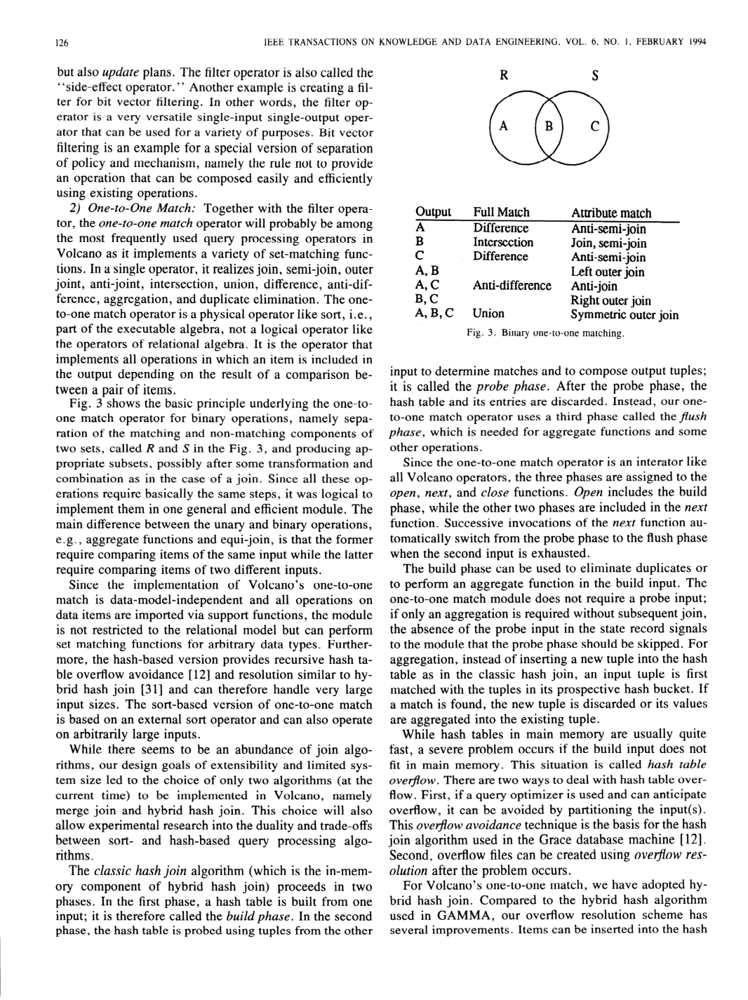
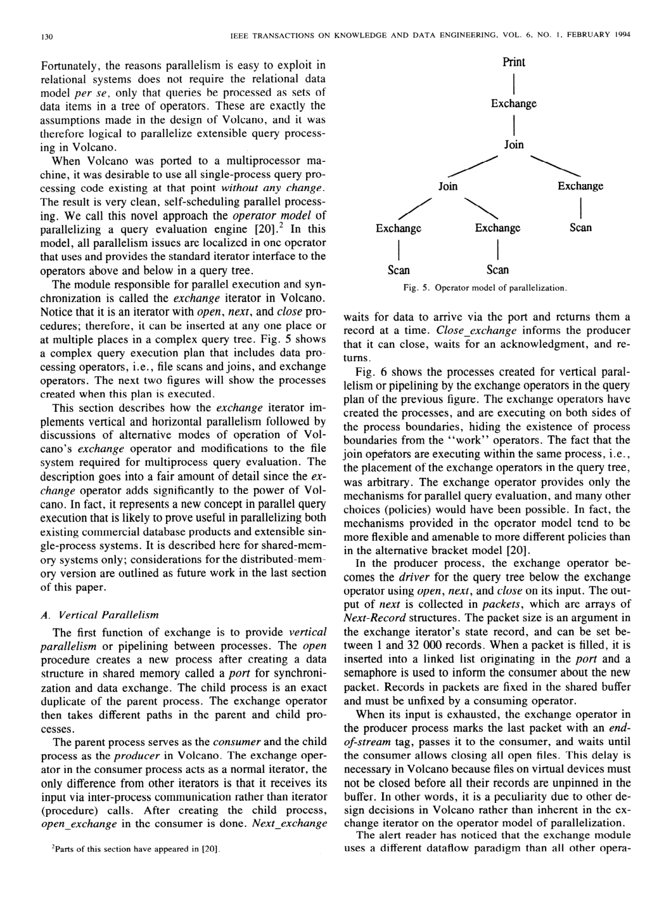

> 本组第 28 篇 · 查询执行引擎 · [全部论文]() · [上一篇]() · [下一篇]()

Volcano把query execution组织为统一open/next/close迭代器、每实例state record和外部support functions；用choose-plan在open选择准备好的等价子计划，用exchange把进程内拉取流转换成共享内存进程间的数据驱动流。它提供机制，计划、分区、类型/谓词语义与选择策略仍由上层保证，不是完整数据库或自动最优并行器。须读懂三个边界：build在open，probe/flush在next；packing不等于已经写盘的spilling；记录/pin责任和广播多次fix不能混为全局唯一物理副本。本文报告过并行排序16CPU加速14.9的历史结果，但并未重述完整基准设置；已实现exchange只在共享内存，分布式、事务恢复、多用户及fail-fast仍属扩展。下面补充原图3术语、阶段示例和已执行的读者小例子，不冒称运行了原Volcano程序。

本文保留论文陈述、读者推断与待验证方案的区别；实验数字只适用于原文条件。原文和翻译来自已有 AI 辅助精读报告，已做来源匹配与编辑复核，不等于人工逐项核验或独立实验复现。所有页码均为 PDF 物理页。

## 论文与阅读范围

Goetz Graefe. Volcano—An Extensible and Parallel Query Evaluation System. IEEE Transactions on Knowledge and Data Engineering,6(1),February1994。本文有16个物理页，是查询执行系统概览，不是另篇Volcano优化器生成器论文；1990收稿/1991修订不替代出版年份。

[论文集中的原始 PDF](https://github.com/lonng/db-papers/blob/4ff1331069c7cf52ac97dd769e5f484c1c35c200/papers/execution-engine/volcano---an-extensible-and-parallel-query-evaluation-system.pdf) · 本地来源：`execution-engine/volcano---an-extensible-and-parallel-query-evaluation-system.pdf`，共 16 页。

本篇保留 18 组原文精读和 55 条证据。截图为原始 PDF 的局部页选，不是重新生成的图表；未将整份 PDF 复制到博客。

## 研究问题与适用边界

**一个执行引擎研究工具，不是完整DBMS**
第1页把Volcano定位为实验与教学基础设施，缺少用户查询语言、记录类型系统、优化器和catalog。它刻意把集合流控制与项目解释分离，使数据模型、算子和策略可以分别实验；“sets of items”是该框架的建模前提，不是任意计算都自动被语义正确地并行化。

**统一单进程与并行路径**
作者希望先用高效单进程调用链开发数据算子，再通过exchange引入并行，避免每个算子都自己处理进程通信。GAMMA在其环境中工作很好，作者指出其每算子控制点/消息流不适合自己希望兼顾的单进程直接调用目标；这不是宣称GAMMA总体设计错误，更不能说1990年代根本没有线程。原文恰好把threads列为可实现多控制点的办法。

**方法范围**
这一篇侧重执行机制，不要与另篇Volcano优化器生成器的搜索算法混同。support functions与传入计划在调用前就应正确；数据模型独立不消除record、地址、pin生命周期及算子代数的接口约束。多用户、恢复和生产故障语义不能从“可扩展并行”几个字自动推出。

依据：论文陈述；PDF 物理页 1, 2, 5, 10, 15。证据：[C001N05](#evidence-c001n05), [C001N06](#evidence-c001n06), [C002N08](#evidence-c002n08), [VEX24](#evidence-vex24), [VEX26](#evidence-vex26), [VEX30](#evidence-vex30), [VEX31](#evidence-vex31)。

## 系统架构与模块划分

**库、存储层与执行层**
本文版本约两打模块、15000行C，包含buffer、file、B+tree、sort及sort/hash两类物理匹配算法，不是今天版本规模。cluster可含一个或多个page，是每文件可配置的IO/缓冲单位；extent是物理空间分配单位，不能混同。buffer提供多pool与替换hint等机制，策略来自上层，而非声称某固定替换算法总最优。

**实例状态与解释回调**
每个iterator有state record保存参数、私有状态与输入指针，不靠静态变量复用单个算法状态。support function入口与无类型参数导入比较、hash、predicate、transform等操作；同一机制容纳编译好的函数及解释器入口，所以不能把Volcano固定成某种逐表达式解释器。匿名输入使算子无需知道孩子是scan还是复杂子树。

**数据与生命周期**
next返回一个Next-Record，含RID和buffer地址，不是CPU列向量。当前实现通常传完整record，join会复制字段组成新record；build可持有输入记录指针不立即复制。文件扫描地址保证到该scan的下一次操作；查询层还需转移fix/unfix责任，不能把低层借用期限与高层保留权混淆。virtual-device页只在buffer中存在，unpin即可消失，故producer不能在consumer仍持有数据时关闭相关文件。

**两个元算子与外层职责**
choose-plan在open依据bindings和外部策略选一个预备分支；exchange提供进程组、port、packet、分区、同步及可选背压。本文实现的是共享内存多进程，distributed/hierarchical机器仍在开发设想中。核心数据算子未因并行而修改，但文件/缓冲模块确实做了多进程改动，不能把“封装”读成所有移植只改唯一一个文件。

依据：论文陈述；PDF 物理页 1, 2, 3, 4, 5, 6, 11, 13。证据：[C001N04](#evidence-c001n04), [C001N08](#evidence-c001n08), [C001N09](#evidence-c001n09), [C001N12](#evidence-c001n12), [C002N01](#evidence-c002n01), [C002N05](#evidence-c002n05), [VEX01](#evidence-vex01), [VEX02](#evidence-vex02), [VEX03](#evidence-vex03), [VEX04](#evidence-vex04), [VEX05](#evidence-vex05), [VEX06](#evidence-vex06), [VEX12](#evidence-vex12), [VEX27](#evidence-vex27), [VEX29](#evidence-vex29)。

*原论文 PDF 物理页 7，版权归原作者或出版方。点击图片可查看原尺寸。页面文本中定位到：Fig. 3 shows the basic principle。这是页面定位信息，不表示本次已复核图内所有数据。*

## 核心算法与执行机制

**1. iterator与参数绑定**
普通open递归初始化输入与状态，next按需拉取，close递归收尾。bindings无类型指针沿open调用链传递查询变量、系统资源等策略信息。阻塞型算法仍可能在open消费大量输入；iterator不保证立刻产生首条输出或完全无物化。

**2. one-to-one是物理比较模式，不是键唯一性**
它按一对项目比较决定输出，经support functions泛化为join、聚合、集合操作等；不是说一行最多匹配一行。读者已运行例子：R有r1/r2同键1，S有s1/s2同键1，成对匹配产生4个不同记录对。one-to-many match则是每个项目与一组项目比较，典型是relational division，并非普通外键1:N连接的别名。

图3的老术语也要按图读：A是R未匹配区、B为匹配区、C为S未匹配区；attribute-match列把A或C称anti-semi-join，把A,C合称anti-join。它不是现代常说仅保留左侧未匹配行的left anti同义词。图是物理匹配/变换示意，不是完整SQL NULL/bag代数证明。

**3. hash三阶段与正确聚合例子**
build在open，probe和flush均在next，close不负责输出flush。读者构造R=[(1,10),(1,20),(2,30)]做分组SUM：open读入全部build输入并形成{1:30,2:30}；没有probe input，next直接依次flush(1,30)、(2,30)，再EOF；close释放资源。原报告把读入与累加放进next的示例与原文映射不一致，已纠正。

**4. 内存不足与排序**
packing threshold让稀疏钉住记录密集放入overflow文件页，但页仍fixed在buffer，尚不发生IO；到spilling threshold才unfix一个分区、写盘并减少驻留项目。阈值可调、必要时递归；两者初始设0可做Grace-like overflow avoidance，不等于默认值。sort的open建runs及必要的中间merge，next只按需执行最后merge，所以流水线不代表没有排序/哈希临时文件。

**5. choose-plan与exchange**
choose-plan的open调用外部策略并只open被选子树，next/close一直代理它；没有描述midstream状态迁移或临时生成新计划。exchange常规模式创建port并fork：parent消费，child驱动下方树生产，按1–32000条Next-Record组成packet。EOS标在末包，consumer发close许可后producer才能关闭依赖的数据文件。进程内pull与进程间push由同一接口衔接。

**6. 拓扑、合并与重分区**
vertical和bushy属于inter-operator并行，分区同算子属于intra-operator。路由回调可round-robin/range/hash。图7两join在同一进程里的布置遇不同join key时不满足重新分区要求；interchange可置于已有进程树中部、open不fork，在next中生产/发送直到找到本地分区项。merge variant保留producer身份与独立流；普通到达队列[1,4,2,3]并非有序，读者用两条有序流[1,4]/[2,3]归并才得[1,2,3,4]。

依据：论文陈述；PDF 物理页 4, 6, 7, 8, 9, 10, 11, 12, 13, 14。证据：[C002N03](#evidence-c002n03), [C002N09](#evidence-c002n09), [C002N10](#evidence-c002n10), [C003N03](#evidence-c003n03), [C003N04](#evidence-c003n04), [C003N11](#evidence-c003n11), [C004N01](#evidence-c004n01), [C004N02](#evidence-c004n02), [C004N04](#evidence-c004n04), [C004N07](#evidence-c004n07), [VEX07](#evidence-vex07), [VEX08](#evidence-vex08), [VEX09](#evidence-vex09), [VEX10](#evidence-vex10), [VEX11](#evidence-vex11), [VEX13](#evidence-vex13), [VEX14](#evidence-vex14), [VEX15](#evidence-vex15), [VEX16](#evidence-vex16), [VEX17](#evidence-vex17), [VEX19](#evidence-vex19), [VEX20](#evidence-vex20), [VEX25](#evidence-vex25), [VEX28](#evidence-vex28)。

## 正确性保证与并发控制

**原文的前提，不是自动证明**
第10页明确假设计划与support functions在调用前已经正确；类型检查不由Volcano提供。比较/hash一致、分区能把需要匹配的项目放在一起、聚合/副作用能否分解等仍是上层义务。加exchange不自动产生正确或最优并行计划。

**pin责任与广播**
常规协议让每份传递的pin责任由确定算子释放；join输出须先fix、输入不用后unfix。物理buffer记录可由broadcast增加多份fix，每consumer独立unpin，无需复制payload，因此不能把“一个owner”解释成同一物理record永不有多个共享引用。virtual-file关闭要等消费方释放引用；任意破坏这些契约仍可能泄漏或悬垂，不是框架无条件内存安全。

**路由与排序的反例**
读者实际运行小例子：R与S先按a连接得到(a=1,b=2)，若结果留在a%2=1的进程，而T按b%2=0分区，后继b连接本地匹配为空；按b重新分布后得到正确记录。不同键需要恰当计划，interchange只是机制。多有序producer的merge也必须保留各流头，不能把异步到达次序当全局排序。

**锁与重试的范围**
pool锁保护查找/桶链，不在IO时持有；descriptor锁可覆盖IO及fixcount更新。try-lock失败会放开pool锁并重新查找，因为原cluster可能已被替换；复用旧descriptor地址直接重试可能错认对象。文中消除hold-and-wait的死锁讨论限于此协议，仍承认理论饥饿，不是wait-free、全局死锁自由或数据库事务OCC证明。port共享链表等也有短期锁，不能叫零同步。

**错误与事务边界**
第7节把fail-fast/all-or-nothing请求、多用户inter-query并行、事务和恢复列为未来工作。本文机制不能据此证明故障原子性、分布式容错或事务隔离。

依据：读者推断；PDF 物理页 4, 6, 10, 13, 14, 15。证据：[C002N10](#evidence-c002n10), [C005N02](#evidence-c005n02), [C005N03](#evidence-c005n03), [VEX03](#evidence-vex03), [VEX05](#evidence-vex05), [VEX18](#evidence-vex18), [VEX19](#evidence-vex19), [VEX21](#evidence-vex21), [VEX22](#evidence-vex22), [VEX24](#evidence-vex24), [VEX26](#evidence-vex26), [VEX29](#evidence-vex29), [VEX30](#evidence-vex30), [VEX31](#evidence-vex31)。

## 实验设计与性能评估

**有报告过量化结果，但不是完整新基准**
原报告以“24条选中笔记未找到”为由称全篇没有量化实验，遗漏了物理第15页：作者报告Volcano并行排序在16CPU上获得14.9加速，并引用[18]。这支持“某个有限并行度排序研究有接近线性结果”，不支持所有算子/查询、无限并行度或当前机器都接近线性。若读者按S/P相除，14.9/16=.93125，仅是算术比值，不是测得CPU利用率93.125%。

该页没有重述CPU型号、内存、数据规模/分布、原始时间、重复次数、方差和详尽基线，需另读被引实验才能复现。第2页也明确把详细性能研究指向其他文章。choose-plan在此概览中主要是机制和潜力，不能补造它的延迟收益数字。

**不要错认其他数字**
约15000行C/两打模块是软件规模；packet1–32000条是参数范围；图中的两三进程/进程组是布局说明，不是新的实验机配置。GAMMA的17台VAX、32节点iPSC等属于related work，不能拿来当Volcano排序的硬件。本篇明确当前exchange是shared-memory，多进程而非已经部署分布式实现；OS/网络等缺口不能靠GAMMA填。

**本次真正运行了什么**
qa/volcano-execution-reader-tests.py仅运行Python中的成对匹配4结果、抽象A/B/C区、不同key的分区错误/修复、两有序流归并、open一次选择和enqueue-before-wait顺序小例子。它们帮助检查读者解释，不是编译原15000行C、测16CPU排序或证明并发协议正确。本文引用的sort/hash性能研究也未在本机重跑。

依据：论文陈述；PDF 物理页 3, 11, 15。证据：[C005N06](#evidence-c005n06), [VEX01](#evidence-vex01), [VEX12](#evidence-vex12), [VEX13](#evidence-vex13), [VEX23](#evidence-vex23)。

*原论文 PDF 物理页 11，版权归原作者或出版方。点击图片可查看原尺寸。页面文本中定位到：Fig. 6 shows the processes created for vertical。这是页面定位信息，不表示本次已复核图内所有数据。*

## 设计权衡与工程代价

**可组合接口与成本不是单向定理**
函数指针与逐record接口可能带来分派/解释成本，但本文不量化所有调用开销，也支持编译回调。不能从接口直接推出所有编译器都不能内联、或把可扩展性写成必然牺牲某固定CPU比例；应在具体编译与负载上测量。

**push、pull和slack**
作者选择进程间data-driven以省请求消息，并认为shared-memory下请求式方案也可能可接受，只是多些控制/延迟；原报告“将摧毁性能”不受来源支持。可选flow-control在enqueue之后请求额外semaphore，消费后释放。初始值控制领先/slack，不是精确字节预算或一条一请求协议；零初值在这个单producer顺序中仍可先放第一包再等待。小slack也不自动等于改成pull。

**内存生命周期与buffer争用**
持有build指针可少拷贝却pin更多cluster，packing与spill分开以权衡密度、IO和扇出。广播节约payload复制但增加引用管理。两级锁重试避免该协议的hold-and-wait，不保证无饥饿或无长尾；没有数据就不能断言仅适合“中等并发”或从理论饥饿推出商业OLTP一定慢。

**interchange不是全部交换的同义词**
其同进程生产/消费调度被作者认为无需额外flow control，是该模式的论述；不要推广为任何拓扑、倾斜和分布式环境都不需要背压。选择partitioning、packet size、关闭协议与内存预算仍是外部策略的重要工作。

依据：读者推断；PDF 物理页 1, 2, 4, 6, 8, 11, 12, 13, 14。证据：[C001N04](#evidence-c001n04), [C002N10](#evidence-c002n10), [C004N04](#evidence-c004n04), [C004N07](#evidence-c004n07), [C005N02](#evidence-c005n02), [C005N03](#evidence-c005n03), [VEX08](#evidence-vex08), [VEX15](#evidence-vex15), [VEX18](#evidence-vex18), [VEX20](#evidence-vex20), [VEX21](#evidence-vex21), [VEX22](#evidence-vex22), [VEX27](#evidence-vex27), [VEX28](#evidence-vex28)。

## 与相关系统及现代引擎的比较

本文比较的是设计目标和机制，不是当前产品排行榜。GAMMA的多控制点/网络模型在其数据库机中表现很好，Volcano需要同时支持高效单进程直接调用与插入式并行，所以选择另一套控制组织；不能把这一点概括成对GAMMA整体的否定。XPRS比Volcano涵盖更多完整数据库部件，Volcano则通过不固定数据模型换取另一种扩展边界。

需区分两篇Volcano工作：本篇1994执行系统提供可执行物理代数、buffer、iterators和元算子；优化器生成器论文讨论的搜索机制不是本篇已经存在的内置CBO。计划和policy可来自更高层，本篇自己明说optimizer等尚缺。

与现代batch/vectorized或异步执行比较只能先列可测问题：逐record与批次接口、编译/解释回调、调度/背压、pin生命周期和重分区在哪里承担成本。未读现代系统源码或跨文献史料，本报告不从这一篇1994来源宣称哪个当代系统直接继承了其代码、或给“至今理论基石”之类的历史影响作事实背书。

依据：待验证的工程设想；PDF 物理页 2, 3, 4, 10, 11, 15。证据：[C001N06](#evidence-c001n06), [C001N08](#evidence-c001n08), [C004N04](#evidence-c004n04), [C005N10](#evidence-c005n10), [VEX12](#evidence-vex12), [VEX24](#evidence-vex24), [VEX26](#evidence-vex26), [VEX27](#evidence-vex27), [VEX30](#evidence-vex30), [VEX31](#evidence-vex31)。

## 复现指南与工程挑战

以下为读者拟议方案，不是原Volcano程序的已完成复现。

1. 实现带每实例状态的open(bindings)/next/close与support-function接口，区分低层scan借用地址和查询层pin责任。用同算法两实例、过滤失败、提前EOF/close及错误路径检查资源生命周期；类型/计划验证在调用前进行。
2. 实现hash build/probe/flush映射：open累计构建，next处理probe与flush，close只收尾。纯聚合无probe时next直接出最终状态。再对sort的blocking open与最终增量merge分别测试，不能假定所有open非阻塞。
3. 分开观测packing与spilling：前者重排密集页但尚无IO，后者释放分区并写盘。测驻留cluster、拷贝次数、IO与递归，按资源/输入特征选择阈值，而非把字面初值0或“按项目数”当通用最优内存界。
4. 先在shared-memory进程模型复现port/packet/EOS/关闭握手、可选flow semaphore、路由回调及producer区分的merge。固定分区key正确性后才测并行度、packet size、倾斜和内存领先量；跨机网络版本属于额外工程，不是本文现成实现。
5. choose-plan只在open对准备好的等价分支调用策略；next/close代理已选分支。测试绑定改变后已有open不迁移、下一次open可重新选，且未选分支不被执行。策略效果和类型正确性仍需上层保证。
6. 本次Python小检查已保存qa/volcano-execution-reader-tests.py，全部assertions通过；它们不替代原始C、并发时序、故障和真实性能测试。对两级锁可另做受控替换/try-lock失败注入，验证释放pool后重新lookup，而不只重试过期descriptor。对14.9/16结果需先获得并核对[18]实验设置，不能自行猜CPU/数据量。

依据：待验证的工程设想；PDF 物理页 3, 4, 6, 7, 8, 10, 11, 12, 13, 14, 15。证据：[C001N09](#evidence-c001n09), [C002N01](#evidence-c002n01), [C002N05](#evidence-c002n05), [C002N10](#evidence-c002n10), [C004N04](#evidence-c004n04), [C004N07](#evidence-c004n07), [C004N09](#evidence-c004n09), [C005N02](#evidence-c005n02), [VEX02](#evidence-vex02), [VEX03](#evidence-vex03), [VEX07](#evidence-vex07), [VEX08](#evidence-vex08), [VEX09](#evidence-vex09), [VEX10](#evidence-vex10), [VEX13](#evidence-vex13), [VEX17](#evidence-vex17), [VEX19](#evidence-vex19), [VEX21](#evidence-vex21), [VEX23](#evidence-vex23), [VEX28](#evidence-vex28)。

## 结论与内核工程启示

Volcano把数据控制、项目解释与并行通信分开，以统一迭代器和state record支撑机制/策略实验。它的贡献比“每次next一行”更丰富：支持编译/解释回调、分阶段hash/外排、choose-plan在open选择，以及exchange的push/pull转换、分区、广播、merge和interchange。

可扩展不代表自动正确/最优：caller必须交付正确计划与support functions，分区键、pin责任、闭合时机和排序流身份都有明确义务。本文已实现共享内存并行，报告过16CPU排序14.9加速，但缺少完整新基准参数；分布式、故障原子性、多用户和事务恢复不能补成已完成功能。

本报告补正了聚合阶段例子、物理页码、遗漏性能数字和图3术语，并增加原文对照与小例子。源码级迁移及现代产品比较仍需独立核查，不能用这一篇旧概览替代。

依据：论文陈述；PDF 物理页 1, 2, 3, 7, 8, 10, 11, 15。证据：[C001N04](#evidence-c001n04), [C001N08](#evidence-c001n08), [C005N10](#evidence-c005n10), [VEX07](#evidence-vex07), [VEX08](#evidence-vex08), [VEX12](#evidence-vex12), [VEX23](#evidence-vex23), [VEX24](#evidence-vex24), [VEX25](#evidence-vex25), [VEX26](#evidence-vex26), [VEX30](#evidence-vex30), [VEX31](#evidence-vex31)。

## 原文精读：从句子回到机制

以下保留原文、忠实翻译、含义与边界；假设示例不作为论文实验结果。

### P001 · PDF 物理页 1

**原文**

<blockquote class="paper-source-quote"><pre><code>The exchange &#10;meta-operator &#10;supports &#10;intra-operator &#10;parallelism &#10;on parti- &#10;tioned &#10;datasets and both &#10;vertical and horizontal &#10;inter-operator &#10;parallelism, &#10;translating &#10;between &#10;demand-driven &#10;dataflow &#10;within &#10;processes and data-driven &#10;dataflow &#10;between &#10;processes. &#10;All operators, &#10;with the exception &#10;of the exchange &#10;operator, &#10;have been designed &#10;and implemented &#10;in a single-process &#10;envi- &#10;ronment, &#10;and parallelized &#10;using the exchange &#10;operator.</code></pre></blockquote>

**忠实翻译**

> exchange 元运算符支持在已分区数据集上的算子内并行（intra-operator parallelism），以及垂直和水平两种算子间并行（inter-operator parallelism），并在进程内的需求驱动数据流（demand-driven dataflow）与进程间的数据驱动数据流（data-driven dataflow）之间进行转换。除 exchange 运算符外，所有运算符都在单进程环境中设计和实现，并通过 exchange 运算符实现并行化。

**技术含义与边界**

> exchange封装跨进程producer/consumer、分区和同步，数据算子保持单进程控制逻辑。此实现范围是shared-memory；共同接口不自动证明任意路由、callback或状态语义都可正确并行。

**常见误读**

> 容易发生的错误解读是认为所有运算符原生支持多进程并行。原文明确指出“除 exchange 运算符外”的其他运算符均在单进程环境中设计与实现，因此不能将 exchange 提供的并行能力泛化为其他运算符自身的属性。

**读者构造的假设示例**

> 读者构造：一台共享内存机器上的两个scan进程按匹配key路由到join进程，exchange传Next-Record引用并管理pin。不是假设本文已经在两节点分布式集群运行。

### P002 · PDF 物理页 15

**原文**

<blockquote class="paper-source-quote"><pre><code>All data manipulation &#10;operators are shielded &#10;from parallelism &#10;issues, and have been designed, &#10;de- &#10;bugged, tuned, and preliminarily &#10;evaluated &#10;in a single- &#10;process environment. &#10;To parallelize &#10;a new operator, &#10;it &#10;only has to be combined &#10;with the exchange operator in a &#10;query evaluation &#10;plan. To port all Volcano operators to a &#10;new parallel &#10;machine, &#10;only the exchange &#10;operator &#10;re- &#10;quires appropriate &#10;modifications.</code></pre></blockquote>

**忠实翻译**

> 所有数据操作运算符都被屏蔽了并行性问题，并且已在单进程环境中完成设计、调试、调优和初步评估。要并行化一个新运算符，只需在查询执行计划中将其与 exchange 运算符组合即可。要将所有 Volcano 运算符移植到一台新的并行机器上，只有 exchange 运算符需要进行适当的修改。

**技术含义与边界**

> 作者陈述核心数据算子复用与portability设计优势；不能把它当“整系统绝对只有exchange需改”的事实，因为第VI-D节实际讨论了file/buffer的多进程修改，distributed实现也仍在未来。

**常见误读**

> 容易发生的错误解读是认为“任何新运算符只要加上 exchange 就能自动获得最优并行性能”。原文仅说明“可以并行化”（only has to be combined），并未保证性能最优或无需针对特定算法调整数据分布策略。

**读者构造的假设示例**

> 读者构造：纯逐记录映射f可在恰当分区上用exchange并行，若新算子是全局count则还需正确汇总计划；不是随便插一个exchange就自动得到全局结果或最优性能。

### P003 · PDF 物理页 10

**原文**

<blockquote class="paper-source-quote"><pre><code>These assumptions &#10;include that &#10;the query can be optimized &#10;realistically &#10;using guessed &#10;“typical’ &#10;’ values for the program &#10;variables and that the &#10;database will not change significantly &#10;between query op- &#10;timization &#10;and query evaluation. &#10;The optimizer &#10;must also &#10;anticipate &#10;the resources that can be committed &#10;to query &#10;evaluation, &#10;e.g., the size of the buffer or the number of &#10;processors. The optimality &#10;of the resulting &#10;query evalua- &#10;tion plan depends on the validity &#10;of these assumptions.</code></pre></blockquote>

**忠实翻译**

> 这些假设包括：可以使用对程序变量的猜测“典型”值来现实地优化查询，并且在查询优化和查询执行之间数据库不会发生显著变化。优化器还必须预估可分配给查询执行的资源，例如缓冲区的大小或处理器的数量。最终查询执行计划的最优性取决于这些假设的有效性。

**技术含义与边界**

> 原文陈述了传统静态查询优化的三个核心前提假设：参数值的典型性、数据库状态的稳定性、以及可用资源的可预测性。作者明确指出计划的最优性依赖于这些假设成立。读者可推断，如果运行时实际情况偏离这些假设（如数据倾斜、并发负载突变），静态生成的计划可能变为次优甚至极差。适用边界为编译时优化（compile-time optimization）场景。

**常见误读**

> 容易发生的错误解读是认为优化器生成的计划在任何情况下都是最优的。原文使用了“depends on the validity of these assumptions”这一限定条件，明确否定了绝对最优的保证，不应将局部假设下的最优泛化为全局保证。

**读者构造的假设示例**

> 读者构造：编译时按4GB规划的hash build在运行时只得500MB可能spill；是否另一种索引或排序方案更便宜仍需成本比较，不能仅由spill推出nested loop必然更快。

### P004 · PDF 物理页 12

**原文**

<blockquote class="paper-source-quote"><pre><code>All file scan &#10;processes can transfer data to all join processes; however, &#10;data transfer between the join operators occurs only within &#10;each of the join processes. Unfortunately, &#10;this restriction &#10;renders this parallelization &#10;infeasible &#10;if the two joins are &#10;on different attributes and partitioning-based &#10;parallel join &#10;methods are used. For this case, a variant of exchange is &#10;supported &#10;in Volcano &#10;exchange &#10;operator &#10;called &#10;inter- &#10;change, which is described in the next section.</code></pre></blockquote>

**忠实翻译**

> 所有文件扫描进程都可以向所有连接（join）进程传输数据；然而，连接运算符之间的数据传输仅在每个连接进程内部发生。不幸的是，如果两个连接基于不同的属性，并且使用了基于分区的并行连接方法，那么这种限制会使这种并行化变得不可行。对于这种情况，Volcano exchange 运算符支持一种称为 interchange 的变体，将在下一节中描述。

**技术含义与边界**

> 限制针对图7里两join共处各自进程、两join之间没重新路由的那种布局。不同key可能要求重新分区；interchange允许在已有进程树中部交换且不额外fork。不是说exchange抽象不能支持任何多join拓扑。

**常见误读**

> 容易发生的错误解读是认为标准 exchange 无法处理任何多 Join 场景。原文给出的限制条件是“两个连接在不同的属性上”且“使用基于分区的并行连接方法”，如果不满足这两个前提（例如连接属性相同或使用广播），标准 exchange 依然可行。

**读者构造的假设示例**

> 读者已运行示例：首join得到(a=1,b=2)且留在a%2=1分区，T的b=2在b%2=0分区；不重路由时本地第二join为空，按b重分区后保留正确一行。这只是逻辑小例子，不是原程序并行实验。

### P005 · PDF 物理页 5

**原文**

<blockquote class="paper-source-quote"><pre><code>. &#10;. &#10;. &#10;Arguments &#10;! &#10;Input &#10;i &#10;State &#10;. &#10;. &#10;. &#10;. &#10;. &#10;. &#10;. &#10;. &#10;. &#10;\ &#10;. &#10;\ &#10;viewed and are implemented &#10;as operations on sets of ob- &#10;jects, and that Volcano does not depend on assumptions &#10;about the internal &#10;structure of such objects. In fact, we &#10;intend to use Volcano &#10;for query processing in an object- &#10;oriented database system [ 151.</code></pre></blockquote>

**忠实翻译**

> ……被视为并实现为对对象集合的操作，并且 Volcano 不依赖于关于此类对象内部结构的假设。事实上，我们打算将 Volcano 用于面向对象数据库系统 [151] 中的查询处理。

**技术含义与边界**

> 作者让迭代控制不固定项目内部类型，通过support functions解释数据；仍有record地址、pin与stream ABI。复杂对象需要装载组件、修正指针和assembler。第9页还说相关assembly原型已构建，但这不等于完整OODBS。

**常见误读**

> 来源标记[151是文本层损坏，不据此当参考文献151。当前流程没有另做OCR，也不能把“不固定字段布局”扩大成整个文件/记录/生命周期都无约束。

**读者构造的假设示例**

> 读者构造的假设示例：在 Volcano 中定义一个表示“图像”的对象类型。Sort 运算符只需要知道如何调用比较函数来判断两个图像对象的大小关系，而不需要知道图像对象内部是存储了像素数组还是压缩编码，从而实现了对复杂类型的排序。

### P006 · PDF 物理页 3

**原文**

<blockquote class="paper-source-quote"><pre><code>III. &#10;VOLCANO SYSTEM DESIGN &#10;In this section, we provide an overview of the design &#10;of Volcano. &#10;At the current time, &#10;Volcano &#10;is a library &#10;of &#10;about two dozen modules &#10;with a total of about 15 000 &#10;lines of C code.</code></pre></blockquote>

**忠实翻译**

> III. VOLCANO 系统设计
> 在本节中，我们提供 Volcano 设计的概述。目前，Volcano 是一个包含大约二十四个模块的库，总共有大约 15000 行 C 代码。

**技术含义与边界**

> 原文陈述了 Volcano 在论文撰写时的工程规模和形态：它是一个用 C 语言编写的库（library），而非独立运行的完整数据库服务器，包含约 24 个模块和约 15000 行代码。读者可推断其设计追求精简和模块化。适用边界为该系统当时的开发阶段。

**常见误读**

> 容易发生的错误解读是将“15000 行 C 代码”视为 Volcano 最终或完整的代码量。原文使用了“At the current time”（目前）这一时间限定词，表明这只是特定时间点的快照，不代表后续演进规模。同时，不应将“库”误解为“完整的数据库产品”。

**读者构造的假设示例**

> 读者构造：研究团队可按这种库式接口组织新join原型；但本次没有获取或编译原版约15000行C，不能让读者以为本机已经安装并可直接链接该历史库。

### P007 · PDF 物理页 2

**原文**

<blockquote class="paper-source-quote"><pre><code>This design, while working ex- &#10;tremely well in GAMMA, &#10;does not lend itself to single- &#10;process query evaluation &#10;since multiple &#10;loci of control, &#10;i.e., multiple &#10;operators, cannot be realized inside a single &#10;process without special pseudo-multiprocess &#10;mechanisms &#10;such as threads. Therefore, &#10;GAMMA’s &#10;operator and data &#10;transfer concepts are not suitable &#10;for an efficient &#10;query &#10;processing engine intended &#10;for both sequential &#10;and par- &#10;allel query execution.</code></pre></blockquote>

**忠实翻译**

> 这种设计虽然在 GAMMA 中运行得极好，但不适用于单进程查询执行，因为在没有诸如线程之类的特殊伪多进程机制的情况下，多个控制点（即多个运算符）无法在单个进程内实现。因此，GAMMA 的运算符和数据传输概念不适用于旨在同时进行顺序和并行查询执行的高效查询处理引擎。

**技术含义与边界**

> 原文陈述了 Volcano 放弃采用 GAMMA 系统数据流模型的原因：GAMMA 的多控制点模型在单进程内无法高效实现（除非引入线程等机制），因此无法同时满足顺序执行和并行执行的需求。读者可推断 Volcano 选择迭代器模型（单控制点）是为了兼顾单机效率与通过 exchange 扩展并行的能力。适用边界为查询执行引擎的控制流架构选型。

**常见误读**

> 容易发生的错误解读是认为 GAMMA 的设计是低效或错误的。原文明确承认其在 GAMMA 系统中“working extremely well”（运行得极好），否定的是它在“单进程查询执行”及“同时支持顺序和并行”这一特定目标下的适用性，而非其整体价值。

**读者构造的假设示例**

> 读者构造的假设示例：在 GAMMA 风格的流水线中，Scan 和 Filter 可能在不同的控制流中并发推送数据。如果在单进程且无多线程的环境下模拟这种行为，需要复杂的上下文切换状态机；而 Volcano 采用的迭代器模型让 Filter 主动调用 Scan 的 next 获取数据，在单进程下避免了这种复杂性。

### P008 · PDF 物理页 7

**原文**

<blockquote class="paper-source-quote"><pre><code>Instead, our one- &#10;to-one match operator uses a third phase called the flush &#10;phase, which is needed for aggregate functions and some &#10;other operations. &#10;Since the one-to-one match operator is an interator like &#10;all Volcano operators, the three phases are assigned to the &#10;open, next, and close functions. &#10;Open includes the build &#10;phase, while the other two phases are included in the next &#10;function.</code></pre></blockquote>

**忠实翻译**

> 相反，我们的一对一匹配（one-to-one match）运算符使用了第三个阶段，称为 flush（刷新）阶段，这对于聚合函数和其他一些操作是必需的。由于一对一匹配运算符像所有 Volcano 运算符一样是一个迭代器（iterator），这三个阶段被分配给 open、next 和 close 函数。Open 包含 build（构建）阶段，而另外两个阶段包含在 next 函数中。

**技术含义与边界**

> 原文陈述了 Volcano 中一对一匹配运算符（如 Hash Join）的生命周期映射：标准的迭代器接口（open, next, close）被扩展以容纳三个阶段。open 对应 build 阶段；next 对应 probe 阶段以及处理剩余数据的 flush 阶段。flush 阶段被明确指出对聚合等操作是必需的。读者可推断 flush 阶段用于在输入耗尽后输出那些尚未匹配或需要最终计算的缓冲数据。适用边界为 Volcano 迭代器模型的三阶段扩展。

**常见误读**

> 容易发生的错误解读是认为 flush 阶段是在 close 函数中执行的。原文明确指出“另外两个阶段（probe 和 flush）包含在 next 函数中”，close 函数并未被提及包含 flush 逻辑。将 flush 误置于 close 会导致迭代器协议理解错误。

**读者构造的假设示例**

> 读者构造的正确阶段例子：R=[(1,10),(1,20),(2,30)]纯聚合时，open完成build得到{1:30,2:30}；无probe输入，两个next分别flush两组，再返回EOF；close仅释放资源。不是build右表后flush未匹配右行却称left outer join。

### P009 · PDF 物理页 4

**原文**

<blockquote class="paper-source-quote"><pre><code>Since file operations &#10;are invoked &#10;very frequently &#10;in any &#10;database system, all design decisions in the file module &#10;have been made to provide &#10;basic functionality &#10;with the &#10;highest attainable &#10;performance. &#10;A cluster, consisting &#10;of &#10;one or more pages, is the unit of I/O and of buffering, &#10;as &#10;discussed above. The cluster size is set for each file in- &#10;dividually. &#10;Thus, different files on the same device can &#10;have different cluster sizes.</code></pre></blockquote>

**忠实翻译**

> 由于文件操作在任何数据库系统中都被非常频繁地调用，文件模块中的所有设计决策都是为了以可达到的最高性能提供基本功能。如上所述，由一个或多个页面组成的簇（cluster）是 I/O 和缓冲的单位。簇大小是针对每个文件单独设置的。因此，同一设备上的不同文件可以具有不同的簇大小。

**技术含义与边界**

> cluster是可为一个或多个page的数据库IO/缓冲单位，按文件配置；不能说最小必大于一页，也不等同extent或OS文件系统块。

**常见误读**

> 容易发生的错误解读是认为同一磁盘设备上的所有文件必须共享相同的 I/O 块大小。原文明确否定了这一点（“different files on the same device can have different cluster sizes”）。此外，不应将“簇”等同于操作系统的文件系统块，它是数据库层面的 I/O 调度单位。

**读者构造的假设示例**

> 读者构造：同设备上堆文件可设8page/cluster、索引文件1page/cluster，配置粒度独立；它们仍共享磁盘资源，不能因此承诺性能互不干扰。

### P010 · PDF 物理页 6

**原文**

<blockquote class="paper-source-quote"><pre><code>GRAEFE: &#10;VOLCANO-QUERY &#10;EVALUATION &#10;SYSTEM &#10;125 &#10;A number of query and environment &#10;parameters &#10;may &#10;influence policy decisions during opening a query evalu- &#10;ation plan, e.g., query predicate constants and system load &#10;information. &#10;Such parameters are passed between all open &#10;procedures in Volcano with a parameter called bindings. &#10;This is a typeless pointer that can be used to pass infor- &#10;mation for policy decisions. Such policy decisions are im- &#10;plemented &#10;using support functions &#10;again.</code></pre></blockquote>

**忠实翻译**

> GRAEFE: VOLCANO-QUERY EVALUATION SYSTEM 125
> 许多查询和环境参数可能会影响打开（opening）查询执行计划期间的策略决策，例如查询谓词常量（query predicate constants）和系统负载信息。此类参数在 Volcano 的所有 open 过程之间通过一个名为 bindings 的参数传递。这是一个无类型指针（typeless pointer），可用于传递用于策略决策的信息。此类策略决策再次使用支持函数（support functions）来实现。

**技术含义与边界**

> 这是物理第6页、印刷页125，不是PDF物理125。bindings沿open链传策略参数；choose-plan可用它在准备好的scan/index+fetch分支中选择，不是叶Scan无需显式机制就变成任意算法。

**常见误读**

> 容易发生的错误解读是认为 bindings 是一个强类型的结构体，或者策略决策是在优化阶段静态完成的。原文明确指出 bindings 是“typeless pointer”（无类型指针），且这些参数影响的是“during opening a query evaluation plan”（打开查询执行计划期间）的决策，属于运行时行为。

**读者构造的假设示例**

> 读者构造：SQL使用运行时变量:region，open收到US及上层估计后由choose-plan policy选index+fetch分支；后续next不因bindings对象变化自动换分支，下一次open可重新决定。

### P011 · PDF 物理页 7

**原文**

<blockquote class="paper-source-quote"><pre><code>Full Match &#10;Attribute match &#10;Difference &#10;Anti-semi-join &#10;Intersection &#10;Join, semi-join &#10;Difference &#10;Anti-semi-join &#10;Left outer join &#10;Anti-difference &#10;Anti-join &#10;Union &#10;Right outer join &#10;Symmetric outer join</code></pre></blockquote>

**忠实翻译**

> 图3列出Full Match与Attribute match的输出类别，含Difference、Anti-semi-join、Anti-join等。

**技术含义与边界**

> 本次依据原图逐格核对：属性匹配下A/C分别是两侧未匹配区，A,C一起标anti-join；A或C单侧标anti-semi-join。需要保留本文命名，而非自动替换成现代left anti。

**常见误读**

> one-to-one不是PK唯一性；图的物理匹配定义也不直接给全部SQL NULL/bag规范。

**读者构造的假设示例**

> 读者已运行抽象区例：R={1,2}、S={2,3}，A={1},B={2},C={3}；本文图的anti-join区为{1,3}，仅左反区为{1}。

### P012 · PDF 物理页 8

**原文**

<blockquote class="paper-source-quote"><pre><code>However, &#10;the clusters &#10;(pages) of these overflow files are not yet unfixed in the &#10;buffer, i.e., no Z/O is performed &#10;as yet.</code></pre></blockquote>

**忠实翻译**

> 密集packing后overflow文件页仍未unfix在buffer中，此时尚无IO。

**技术含义与边界**

> packing解决疏松记录占用cluster的问题，spilling是后续阈值触发释放分区并写盘；原文本层Z/O按已看原图应读I/O，原引文仍保留转写。

**常见误读**

> 不要见overflow file就断言已经物理写盘，也不要说小输入必然零拷贝；阈值和密度决定路径。

**读者构造的假设示例**

> 读者构造：先把散在多页的项目复制到少数固定页，buffer占用可以下降但暂不写盘；再达到spilling阈值才释放指定分区。

### P013 · PDF 物理页 10

**原文**

<blockquote class="paper-source-quote"><pre><code>The next and close operations &#10;simply call the appropriate &#10;operation &#10;for the input chosen &#10;during open.</code></pre></blockquote>

**忠实翻译**

> next和close只调用在open时选定输入的相应操作。

**技术含义与边界**

> 此句明确运行时选择点：open选一次，后续代理该分支；不包括中途迁移hash状态或创建新候选计划。

**常见误读**

> 把dynamic plan读成任意时刻重新优化会扩大来源能力。

**读者构造的假设示例**

> 读者小检查把选择率从.01改.9：已有open仍用原index分支，新open才可按policy改scan；这是接口逻辑示意，不是原C执行。

### P014 · PDF 物理页 11

**原文**

<blockquote class="paper-source-quote"><pre><code>The packet size is an argument in &#10;the exchange iterator’s &#10;state record, and can be set be- &#10;tween 1 and 32 000 records.</code></pre></blockquote>

**忠实翻译**

> exchange的packet size是state record参数，可设1至32000条记录。

**技术含义与边界**

> packet是Next-Record结构数组，用于跨进程通信摊销；算子next仍一条记录，不等于X100列向量/SIMD。

**常见误读**

> 参数范围不是实验最优范围，也不直接给队列字节上限；variable记录和cluster pin会影响内存。

**读者构造的假设示例**

> 读者构造：增大包可减少通知次数但延迟末包交付并保留更多引用，应同时记录排队包、pin页数和消费速度。

### P015 · PDF 物理页 13

**原文**

<blockquote class="paper-source-quote"><pre><code>Notice that it is not nec- &#10;essary to copy the records since they reside in a shared &#10;buffer pool; it is sufficient to pin them such that each con- &#10;sumer can unpin them as if it were the only process using &#10;them.</code></pre></blockquote>

**忠实翻译**

> 共享buffer里的广播记录无需复制，只需为各consumer适当多次pin，使每个consumer独立unpin。

**技术含义与边界**

> 每份引用释放责任与物理存储可共享并不矛盾；这依赖shared-memory地址可用。

**常见误读**

> 不要把广播说成只pin一次却让多个consumer都释放，也不直接推广为跨机传裸指针。

**读者构造的假设示例**

> 读者构造：同一物理record供两consumer读，可赋两份可释放引用；每方各释放自己的责任，而不是任一方先销毁数据。

### P016 · PDF 物理页 15

**原文**

<blockquote class="paper-source-quote"><pre><code>A recent investigation &#10;demon- &#10;strated that shared-memory &#10;architectures can deliver near- &#10;linear speed-up for limited &#10;degrees of parallelism; &#10;we ob- &#10;served a speed-up of 14.9 with 16 CPU’s for parallel sort- &#10;ing in Volcano</code></pre></blockquote>

**忠实翻译**

> 文中报告在Volcano并行排序上16CPU取得14.9加速，并引用详细研究。

**技术含义与边界**

> 这是本文确有的量化历史结果，不能因选中笔记未包含就说全篇没有数字；但overview未重述完整机器、数据和重复运行设置。

**常见误读**

> 不推广到所有查询/无限CPU，也不把14.9/16称实际CPU利用率。

**读者构造的假设示例**

> 读者算术14.9/16=.93125；这只是通常S/P形式下的比值，真正复现需先核对被引实验。

### P017 · PDF 物理页 14

**原文**

<blockquote class="paper-source-quote"><pre><code>If this operation &#10;fails, the pool lock is released, the &#10;operation &#10;delayed and restarted.</code></pre></blockquote>

**忠实翻译**

> descriptor原子try-lock失败时释放pool锁，延迟后重新开始整个操作。

**技术含义与边界**

> 重启包含查hash表，因为原cluster可能被替换；不是一直握pool锁等待旧descriptor。

**常见误读**

> 局部破坏hold-and-wait不证明整个系统无死锁或饥饿，也不是事务OCC算法的同义词。

**读者构造的假设示例**

> 读者拟议故障注入：在lookup和try-lock之间安排替换，检查重试是否重新定位cluster，而不是复用已失效地址；尚未运行此并发实验。

### P018 · PDF 物理页 11

**原文**

<blockquote class="paper-source-quote"><pre><code>It is described here for shared-mem- &#10;ory systems only; considerations &#10;for the distributed-mem- &#10;ory version are outlined &#10;as future work in the last section &#10;of this paper.</code></pre></blockquote>

**忠实翻译**

> 这里仅描述shared-memory系统；distributed-memory版本列为末节未来工作。

**技术含义与边界**

> 即使设计借鉴shared-nothing的数据驱动通信，也不表示本文已经实现网络节点间传输与恢复。

**常见误读**

> 不能用两节点集群例子暗示已实现能力；这种扩展需要额外序列化、生命周期和故障处理。

**读者构造的假设示例**

> 读者建议先在单共享内存机器验证多进程port和pin，再单列跨机扩展目标，不把两种实验混为一谈。

## 尚未解决的问题

1. 如何为callback、分区和聚合分解建立调用前验证，避免把operator接口兼容误当语义正确？
2. 在不同记录密度和倾斜下，packing/spilling阈值、cluster和packet大小怎样共同影响内存与IO？
3. flow semaphore的具体并发实现及多producer领先量如何量化，不能仅从初始值推导字节上界。
4. 如何复现buffer替换时的try-lock失败/relookup与starvation情况，如何区分局部deadlock避免和全查询进展？
5. choose-plan策略在各参数/资源区间是否选对分支，与真正midstream重优化相比成本与能力如何？
6. 被引[18]的16CPU排序实验的确切硬件、输入和基线是什么，哪些结果可在当前环境复现？

## 证据索引

证据编号沿用原报告，便于将上文判断追溯到原句。引文匹配只验证位置，不证明解读正确。

**C001N04 · PDF 物理页 1**

exchange是第二个元算子，负责封装和控制Volcano中的并行查询评估。它在进程和处理器边界之间交换数据，将进程内的demand-driven dataflow转换为进程间的data-driven dataflow。所有并行性问题（如数据分区和流控）都被封装在exchange算子中，使得数据操作与并行性正交。除exchange外，所有算子均在单进程环境中设计和实现。

<blockquote class="paper-source-quote"><pre><code>translating between demand-driven dataflow within processes and data-driven dataflow between processes.</code></pre></blockquote>

**C001N05 · PDF 物理页 1**

Volcano的设计不预设任何特定的数据模型，其唯一前提是查询处理基于使用参数化算子来转换项目集合（transforming sets of items using parameterized operators）。这一假设界定了系统的抽象层级：只要符合集合转换语义的计算，均可映射到Volcano的执行框架中。

<blockquote class="paper-source-quote"><pre><code>the only assumption is that query processing is based on transforming sets of items using parameterized operators.</code></pre></blockquote>

**C001N06 · PDF 物理页 2**

作者认为GAMMA多控制点模型不匹配Volcano希望同时兼顾的单进程直接调用目标，并承认其在GAMMA中工作很好；不是整体否定GAMMA或声称当时无threads。

<blockquote class="paper-source-quote"><pre><code>multiple loci of control, i.e., multiple operators, cannot be realized inside a single process without special pseudo-multiprocess mechanisms such as threads.</code></pre></blockquote>

**C001N08 · PDF 物理页 2**

Volcano遵循操作系统研究中确立的原则，即提供机制（mechanisms）以支持策略（policies）。策略可以由人类实验者或查询优化器设定。缓冲管理器的hint facility就是这一原则的体现：底层只提供pinning等机制，替换策略由上层决定。这种机制与策略的分离被认为是提升系统可扩展性和模块化的关键。

<blockquote class="paper-source-quote"><pre><code>Volcano provides mechanisms to support policies. Policies can be set by a human experimenter or by a query optimizer.</code></pre></blockquote>

**C001N09 · PDF 物理页 3**

在代码规模和模块构成上，Volcano当时是一个包含约二十几个模块、总计约15000行C代码的库。涵盖文件系统、缓冲管理、排序、B+树，以及自然连接、半连接、三种外连接、反连接、聚合、去重、并集、交集、差集、反差集和关系除法的各两种算法（基于排序和基于哈希）。此外还有两个实现动态计划和并行处理的模块。

<blockquote class="paper-source-quote"><pre><code>Volcano is a library of about two dozen modules with a total of about 15 000 lines of C code.</code></pre></blockquote>

**C001N12 · PDF 物理页 3**

缓冲管理器是文件系统中最关键的部分，其设计包含了多种机制以支持不同策略：支持多个缓冲池（multiple buffer pools）、可变长度的缓冲单元（在Volcano中称为clusters），以及来自上一层软件的替换提示（replacement hints）。hint facility被作为Volcano实现机制以支持多策略设计原则的典型示例。

<blockquote class="paper-source-quote"><pre><code>its features include multiple buffer pools, variable-length units of buffering that are called clusters in Volcano, and replacement hints</code></pre></blockquote>

**C002N01 · PDF 物理页 4**

Volcano将I/O和缓冲的基本单位定义为cluster（由一个或多个page组成），且每个文件的cluster size可独立设置，同一设备上不同文件可以有不同的cluster大小。这一设计允许系统根据访问模式为不同文件定制I/O粒度，属于存储层的性能调优机制。

<blockquote class="paper-source-quote"><pre><code>A cluster, consisting of one or more pages, is the unit of I/O and of buffering</code></pre></blockquote>

**C002N03 · PDF 物理页 4**

文件扫描的next过程返回下一条记录的主存地址，并保证该地址在下一次操作调用前被pin住。因此在同一个cluster内获取下一条记录不需要调用buffer manager，从而避免了频繁的缓冲区管理开销。这是一个关键的性能优化前提。

<blockquote class="paper-source-quote"><pre><code>This address is guaranteed (pinned) until the next operation is invoked on the scan.</code></pre></blockquote>

**C002N05 · PDF 物理页 4**

Volcano使用virtual devices处理查询中间结果（streams）。虚拟设备与磁盘设备的区别在于其数据页仅存在于buffer中，一旦unpin即消失且内容丢失。这使得永久数据集和中间数据集可以使用相同的机制和函数调用，显著降低了新算子的实现成本。

<blockquote class="paper-source-quote"><pre><code>The difference between virtual and disk devices is that data pages of virtual devices only exist in the buffer.</code></pre></blockquote>

**C002N08 · PDF 物理页 5**

Volcano不依赖于对象内部结构的假设，算子被视为对对象集合的操作。原文明确提到打算将Volcano用于面向对象数据库系统的查询处理，其关键在于集合处理与数据项解释的分离。这界定了该模型的适用边界：适用于任何可抽象为集合操作的数据模型。

<blockquote class="paper-source-quote"><pre><code>Volcano does not depend on assumptions about the internal structure of such objects.</code></pre></blockquote>

**C002N09 · PDF 物理页 6**

查询执行计划打开时，环境和查询参数通过名为bindings的无类型指针在所有open过程间传递，用于影响策略决策（如动态确定哈希表大小）。这对动态查询执行计划特别有用。

<blockquote class="paper-source-quote"><pre><code>Such parameters are passed between all open procedures in Volcano with a parameter called bindings.</code></pre></blockquote>

**C002N10 · PDF 物理页 6**

Next-Record结构包含RID和buffer pool中的记录地址。缓冲区的固定协议规定：任何时刻buffer中pin住的记录恰好被一个算子拥有。产生新记录的复杂操作（如join）必须在传递输出记录前将其fix在buffer中，并unfix输入记录。为减少buffer调用，接口被重新设计为生产者端每个cluster两次调用，消费者端每个cluster一次调用。

<blockquote class="paper-source-quote"><pre><code>Each record pinned in the buffer is owned by exactly one operator at any point in time.</code></pre></blockquote>

**C003N03 · PDF 物理页 7**

build在open，probe与flush在next；纯聚合可无probe input，open形成状态后next直接flush，而非把build输入留到next才累计。

<blockquote class="paper-source-quote"><pre><code>Since the one-to-one match operator is an interator like all Volcano operators, the three phases are assigned to the open, next, and close functions.</code></pre></blockquote>

**C003N04 · PDF 物理页 7**

Hash 版本的 build phase 中，聚合操作不是插入新元组，而是先将输入元组与其目标 hash bucket 中的元组匹配；若找到匹配则丢弃新元组或将其值聚合到已有元组中。这体现了 one-to-one match 对经典 hash join 的泛化。

<blockquote class="paper-source-quote"><pre><code>For aggregation, instead of inserting a new tuple into the hash table as in the classic hash join, an input tuple is first matched with the tuples in its prospective hash bucket.</code></pre></blockquote>

**C003N11 · PDF 物理页 9**

对于面向对象或可扩展数据库系统中复杂的嵌套对象，Volcano 的方案是在算子间仅传递 root component（record），在 buffer 中加载并 fix 必要的组件记录，并对 inter-record pointers 进行 swizzling。简单对象可用 functional join 组装；更通用的 assembly operator 原型已在 REVELATION 项目中构建。

<blockquote class="paper-source-quote"><pre><code>The solution to be used in Volcano is to pass only the root component (record) between operators after loading and fixing necessary component records in the buffer</code></pre></blockquote>

**C004N01 · PDF 物理页 10**

choose-plan支持在open从准备好的等价计划中按bindings/外部policy选择；不描述中途迁移状态或保证永远不需重优化。

<blockquote class="paper-source-quote"><pre><code>The optimizer must also anticipate the resources that can be committed to query evaluation, e.g., the size of the buffer or the number of processors.</code></pre></blockquote>

**C004N02 · PDF 物理页 10**

choose-plan 的 open 调用 support function 并传入 bindings 参数来决定使用哪个等价输入计划；next 和 close 直接转发给 open 阶段选定的输入。单个 choose-plan 置于计划顶部实现 multiplan access module，多个则构成 dynamic query evaluation plan。机制与策略分离：choose-plan 只提供机制，策略完全由 support function 决定。

<blockquote class="paper-source-quote"><pre><code>Note that the choose-plan operator does not make the policy decision concerning which of several plans to execute; it only provides the mechanism.</code></pre></blockquote>

**C004N04 · PDF 物理页 11**

exchange 算子将并行问题局部化，对上和对下均暴露标准 iterator 接口（open/next/close），使现有单进程代码无需修改即可用于并行。这被称为 operator model of parallelizing a query evaluation engine。exchange 可插入查询树任意位置，支持垂直并行（流水线）和水平并行（分区）。

<blockquote class="paper-source-quote"><pre><code>In this model, all parallelism issues are localized in one operator that uses and provides the standard iterator interface to the operators above and below in a query tree.</code></pre></blockquote>

**C004N07 · PDF 物理页 12**

Flow control（背压）通过额外信号量实现，由运行时开关控制。Producer 插入新 packet 后须获取 flow control semaphore，consumer 移除 packet 后释放它。信号量初始值决定 producer 可领先 consumer 的 packet 数。文中明确区分 flow control 与 demand-driven：前者允许 slack 实现真正重叠执行，后者是刚性的请求-交付结构，consumer 在 producer 工作时必须等待。

<blockquote class="paper-source-quote"><pre><code>The initial value of the flow control semaphore determines how many packets the producers may get ahead of the consumers.</code></pre></blockquote>

**C004N09 · PDF 物理页 12**

当两个 join 在不同属性上且使用基于分区的并行 join 方法时，标准 exchange 的水平并行不可行，因为 join 算子间的数据传输仅限于各自进程内部。为此 Volcano 提供了 exchange 的变体 interchange 来解决此限制。这是一个明确的反例场景。

<blockquote class="paper-source-quote"><pre><code>Unfortunately, this restriction renders this parallelization infeasible if the two joins are on different attributes and partitioning-based parallel join methods are used.</code></pre></blockquote>

**C005N02 · PDF 物理页 14**

为避免单一排他锁导致并发度下降，Volcano缓冲管理器采用两级锁方案：每个buffer pool一把锁，每个descriptor（驻留缓冲区的page或cluster）一把锁。pool锁仅在搜索或更新哈希表及桶链时持有，绝不在I/O期间持有；descriptor/cluster锁在I/O或更新descriptor（如减少fix count）时持有。这保证了pool锁不会被长时间占用。

<blockquote class="paper-source-quote"><pre><code>Therefore, the buffer uses a two-level scheme. There is a lock for each buffer pool and one for each descriptor</code></pre></blockquote>

**C005N03 · PDF 物理页 14**

当进程在缓冲区找到请求的cluster时，使用原子test-and-lock操作锁定descriptor。若失败，则释放pool锁、延迟并重试整个缓冲操作（包括哈希表查找）。必须重试的原因是持有锁的进程可能正在替换该cluster。此restart方案通过破坏死锁四条件中的hold-and-wait条件来避免死锁。文中指出饥饿理论上可能，但在消除缓冲争用的修改后极不可能发生，但未给出量化实验证据。

<blockquote class="paper-source-quote"><pre><code>If this operation fails, the pool lock is released, the operation delayed and restarted.</code></pre></blockquote>

**C005N06 · PDF 物理页 15**

Volcano引入choose-plan元算子置于计划或子计划顶部，在计划被调用时高效决定使用哪个备选计划，以支持带自由变量的动态查询评估计划。正文声称动态计划有潜力显著提升embedded和repetitive queries的性能，但此处未提供具体基准测试数据支撑该性能声明。

<blockquote class="paper-source-quote"><pre><code>The choose-plan meta-operator at the top of a plan or a subplan makes an efficient -decision which alternative plan to use</code></pre></blockquote>

**C005N10 · PDF 物理页 15**

作者以exchange封装并行主张可保持核心数据算子不变；本篇也明确文件/缓冲有改动，当前仅shared-memory，distributed port仍属未来目标，不是所有机器只改唯一模块的实证保证。

<blockquote class="paper-source-quote"><pre><code>To parallelize a new operator, it only has to be combined with the exchange operator in a query evaluation plan.</code></pre></blockquote>

**VEX01 · PDF 物理页 3**

This is Goetz Graefe's TKDE6(1),February1994,pp120–135 execution-system overview, not the separate Volcano optimizer-generator paper. Approx24modules/15000Clines describe that prototype. It lacks query language,type system,optimizer,catalogs and full transaction/recovery/multiuser/fail-fast facilities; higher layers must validate plans/callbacks.

<blockquote class="paper-source-quote"><pre><code>At the current time, &#10;Volcano &#10;is a library &#10;of &#10;about two dozen modules &#10;with a total of about 15 000 &#10;lines of C code.</code></pre></blockquote>

**VEX02 · PDF 物理页 4**

Cluster is per-file unit of IO/buffering, one or more pages; extent is physical space allocation. Multiple pools and replacement hints expose policies, not a universal optimal LRU strategy. Low-level scan address is pinned until the next scan operation.

<blockquote class="paper-source-quote"><pre><code>This &#10;address is guaranteed &#10;(pinned) until the next operation &#10;is invoked &#10;on the scan.</code></pre></blockquote>

**VEX03 · PDF 物理页 4**

Virtual-device pages vanish when unpinned. Producer shutdown waits for consumer acknowledgment so virtual-file data is not destroyed while still referenced. Streaming avoids unnecessary between-operator temporary files, not all sort/hash spill files.

<blockquote class="paper-source-quote"><pre><code>As soon as such data pages are unpinned, &#10;they disappear &#10;and their contents are lost.</code></pre></blockquote>

**VEX04 · PDF 物理页 5**

Support function entrypoint plus typeless argument imports interpretation; compiled and interpreted predicates both fit the mechanism. Per-iterator state records with no static state allow repeated algorithm instances. Do not infer a complete built-in type-safe SQL runtime.

<blockquote class="paper-source-quote"><pre><code>All state information &#10;of an &#10;iterator is kept in its state record and there are no ‘ ‘static’ ’ &#10;variables;</code></pre></blockquote>

**VEX05 · PDF 物理页 6**

next returns one Next-Record(RID,address), not a column vector. Query-layer pin responsibility moves with the record; default join copies fields into complete output records, although build input may be held by pointers. Shared-memory broadcast adds pins for each consumer without copying payload. Distinguish physical storage sharing and each logical pin-release responsibility.

<blockquote class="paper-source-quote"><pre><code>Each record pinned in the buffer &#10;is owned by exactly one operator at any point in time.</code></pre></blockquote>

**VEX06 · PDF 物理页 6**

next returns one Next-Record(RID,address), not a column vector. Query-layer pin responsibility moves with the record; default join copies fields into complete output records, although build input may be held by pointers. Shared-memory broadcast adds pins for each consumer without copying payload. Distinguish physical storage sharing and each logical pin-release responsibility.

<blockquote class="paper-source-quote"><pre><code>A Next-Record &#10;structure can point to one record only.</code></pre></blockquote>

**VEX07 · PDF 物理页 7**

Build is in open; probe and flush both occur in next, switching after probe exhaustion. flush is not close. Aggregation may omit probe input and directly flush accumulated state.

<blockquote class="paper-source-quote"><pre><code>Open includes the build &#10;phase, while the other two phases are included in the next &#10;function.</code></pre></blockquote>

**VEX08 · PDF 物理页 8**

Packing densely reorganizes pinned overflow-file pages without IO yet; spilling unpins a partition and writes to disk. Two item-count thresholds differ; setting both initially0 yields Grace-like avoidance, not the default or same as all packing immediately spilling. Recursive overflow and bit-vector filtering are described.

<blockquote class="paper-source-quote"><pre><code>However, &#10;the clusters &#10;(pages) of these overflow files are not yet unfixed in the &#10;buffer, i.e., no Z/O is performed &#10;as yet.</code></pre></blockquote>

**VEX09 · PDF 物理页 8**

Sort open prepares runs and necessary intermediate merges; next performs final demand-driven merge. Iterator does not mean all operations can produce first output without consuming input or using blocking state.

<blockquote class="paper-source-quote"><pre><code>The final &#10;merge is performed &#10;on demand by the next function.</code></pre></blockquote>

**VEX10 · PDF 物理页 10**

choose-plan selects a prepared equivalent input at open via imported policy and bindings. next/close delegate to that selected input. It is not midstream migration/reoptimization or an internally complete cost-based search/optimality guarantee.

<blockquote class="paper-source-quote"><pre><code>The next and close operations &#10;simply call the appropriate &#10;operation &#10;for the input chosen &#10;during open.</code></pre></blockquote>

**VEX11 · PDF 物理页 10**

choose-plan selects a prepared equivalent input at open via imported policy and bindings. next/close delegate to that selected input. It is not midstream migration/reoptimization or an internally complete cost-based search/optimality guarantee.

<blockquote class="paper-source-quote"><pre><code>The policy is imported &#10;us- &#10;ing a support function.</code></pre></blockquote>

**VEX12 · PDF 物理页 11**

Implemented parallel exchange is shared-memory multiprocess. Within processes demand-driven iterators, across exchange data-driven producer/consumer. Distributed/hierarchical machines are future work, despite a shared-nothing-inspired communication model.

<blockquote class="paper-source-quote"><pre><code>It is described here for shared-mem- &#10;ory systems only; considerations &#10;for the distributed-mem- &#10;ory version are outlined &#10;as future work in the last section &#10;of this paper.</code></pre></blockquote>

**VEX13 · PDF 物理页 11**

Parent is consumer, forked child is producer. Packet arrays contain Next-Record structures, configurable1–32000records; not SIMD vectorization. EOS is last-packet tag; close acknowledgment protects virtual-file lifetimes. Shared port/list and startup groups still require synchronization; not lock-free.

<blockquote class="paper-source-quote"><pre><code>The packet size is an argument in &#10;the exchange iterator’s &#10;state record, and can be set be- &#10;tween 1 and 32 000 records.</code></pre></blockquote>

**VEX14 · PDF 物理页 11**

Virtual-device pages vanish when unpinned. Producer shutdown waits for consumer acknowledgment so virtual-file data is not destroyed while still referenced. Streaming avoids unnecessary between-operator temporary files, not all sort/hash spill files.

<blockquote class="paper-source-quote"><pre><code>files on virtual devices must &#10;not be closed before all their records are unpinned &#10;in the &#10;buffer.</code></pre></blockquote>

**VEX15 · PDF 物理页 12**

Optional backpressure semaphore is separate from data-driven vs demand-driven evaluation. Text enqueues a packet before requesting flow-control semaphore, so do not invent an exact byte bound or claim initial0 prevents any first packet. Initial count tunes lead/slack; variable record/cluster pinning matters.

<blockquote class="paper-source-quote"><pre><code>Notice &#10;that flow control &#10;and demand-driven &#10;dataflow &#10;are not the same.</code></pre></blockquote>

**VEX16 · PDF 物理页 12**

Vertical and bushy parallelism are inter-operator; partitioned intra-operator is distinct. Routing callback supports round-robin/range/hash, not only hash. Two joins on different partition attributes cannot blindly remain in the same process partitions; source specifically introduces interchange for this issue.

<blockquote class="paper-source-quote"><pre><code>Using a support function &#10;allows implementing &#10;round-robin-, &#10;key-range-, &#10;or hash- &#10;partitioning.</code></pre></blockquote>

**VEX17 · PDF 物理页 12**

Vertical and bushy parallelism are inter-operator; partitioned intra-operator is distinct. Routing callback supports round-robin/range/hash, not only hash. Two joins on different partition attributes cannot blindly remain in the same process partitions; source specifically introduces interchange for this issue.

<blockquote class="paper-source-quote"><pre><code>Unfortunately, &#10;this restriction &#10;renders this parallelization &#10;infeasible &#10;if the two joins are &#10;on different attributes</code></pre></blockquote>

**VEX18 · PDF 物理页 13**

Variants include shared-memory broadcast with multiple pinning, producer-separated merge inputs and third next_exchange argument, and interchange in the middle of an existing process tree with no fork. Flow control becoming obsolete is this interchange mode's scheduling claim, not all exchange variants or a universal memory-bound proof.

<blockquote class="paper-source-quote"><pre><code>Notice that it is not nec- &#10;essary to copy the records since they reside in a shared &#10;buffer pool; it is sufficient to pin them such that each con- &#10;sumer can unpin them as if it were the only process using &#10;them.</code></pre></blockquote>

**VEX19 · PDF 物理页 13**

Variants include shared-memory broadcast with multiple pinning, producer-separated merge inputs and third next_exchange argument, and interchange in the middle of an existing process tree with no fork. Flow control becoming obsolete is this interchange mode's scheduling claim, not all exchange variants or a universal memory-bound proof.

<blockquote class="paper-source-quote"><pre><code>For a merge operation, &#10;it is crucial to distinguish &#10;the input records by their pro- &#10;ducer inorder &#10;to merge multiple &#10;sorted streams correctly.</code></pre></blockquote>

**VEX20 · PDF 物理页 14**

Variants include shared-memory broadcast with multiple pinning, producer-separated merge inputs and third next_exchange argument, and interchange in the middle of an existing process tree with no fork. Flow control becoming obsolete is this interchange mode's scheduling claim, not all exchange variants or a universal memory-bound proof.

<blockquote class="paper-source-quote"><pre><code>When the exchange &#10;operator is opened, it does not fork any processes</code></pre></blockquote>

**VEX21 · PDF 物理页 14**

Buffer pool lock protects lookup/update and is not held during IO; descriptor lock can cover IO/fixcount updates. Failed descriptor test-and-lock releases pool lock and restarts lookup because cluster may be replaced. Deadlock discussion is scoped to that protocol; starvation remains theoretically possible, not wait-free/global deadlock-freedom.

<blockquote class="paper-source-quote"><pre><code>If this operation &#10;fails, the pool lock is released, the &#10;operation &#10;delayed and restarted.</code></pre></blockquote>

**VEX22 · PDF 物理页 14**

Buffer pool lock protects lookup/update and is not held during IO; descriptor lock can cover IO/fixcount updates. Failed descriptor test-and-lock releases pool lock and restarts lookup because cluster may be replaced. Deadlock discussion is scoped to that protocol; starvation remains theoretically possible, not wait-free/global deadlock-freedom.

<blockquote class="paper-source-quote"><pre><code>On the other &#10;hand, starvation &#10;is theoretically &#10;possible</code></pre></blockquote>

**VEX23 · PDF 物理页 15**

14.9speedup with16CPUs is reported parallel sorting with reference18, not a full-query universal law or newly specified benchmark hardware in this overview. GAMMA's17VAX/32iPSC hardware in related work must not be mislabeled as Volcano's experiment. 14.9/16=93.125% is reader arithmetic, not reported CPU utilization.

<blockquote class="paper-source-quote"><pre><code>A recent investigation &#10;demon- &#10;strated that shared-memory &#10;architectures can deliver near- &#10;linear speed-up for limited &#10;degrees of parallelism; &#10;we ob- &#10;served a speed-up of 14.9 with 16 CPU’s for parallel sort- &#10;ing in Volcano</code></pre></blockquote>

**VEX24 · PDF 物理页 15**

This is Goetz Graefe's TKDE6(1),February1994,pp120–135 execution-system overview, not the separate Volcano optimizer-generator paper. Approx24modules/15000Clines describe that prototype. It lacks query language,type system,optimizer,catalogs and full transaction/recovery/multiuser/fail-fast facilities; higher layers must validate plans/callbacks.

<blockquote class="paper-source-quote"><pre><code>TRANSACTIONS &#10;ON &#10;KNOWLEDGE &#10;AND &#10;DATA &#10;ENGINEERING, &#10;VOL. &#10;6, &#10;NO. &#10;I, &#10;FEBRUARY &#10;1994 &#10;very flexible, &#10;extensible, &#10;and powerful query processing &#10;engine. &#10;Volcano &#10;introduces &#10;two novel &#10;meta-operators. &#10;Dy- &#10;namic query evaluation &#10;plans are a new concept intro- &#10;duced in [ 171 that allow efficient evaluation &#10;of queries with &#10;free variables. The choose-plan &#10;meta-operator &#10;at the top &#10;of a plan or a subplan makes an efficient -decision which &#10;alternative plan to use when the plan is invoked. &#10;Dynamic &#10;plans have the potential &#10;of increasing the performance &#10;of &#10;embedded and repetitive &#10;queries significantly. &#10;Dataflow techniques are used within processes as well &#10;as between processes. Within &#10;a process, demand-driven &#10;dataflow is implemented &#10;by means of streams and itera- &#10;tors. Streams and iterators represent the most efficient ex- &#10;ecution model in terms of time and space for single-pro- &#10;cess query evaluation. &#10;Between processes, data-driven &#10;dataflow is used to pass data between producers and con- &#10;sumers efficiently. &#10;If necessary, Volcano’s &#10;data-driven &#10;dataflow can be augmented &#10;with flow control &#10;or back &#10;pressure. Horizontal &#10;partitioning &#10;can be used both on &#10;stored and intermediate &#10;datasets to allow intra-operator &#10;parallelism. &#10;The design of the exchange meta-operator &#10;encapsulates the parallel &#10;execution &#10;mechanism &#10;for verti- &#10;cal, bushy, and intra-operator &#10;parallelism, &#10;and it performs &#10;the translations &#10;from demand-driven &#10;to data-driven &#10;data- &#10;flow and back [20]. &#10;Encapsulating &#10;all issues of parallelism &#10;control in one &#10;operator and thus orthogonalizing &#10;data manipulation &#10;and &#10;parallelism &#10;offers important &#10;extensibility &#10;and portability &#10;advantages. All data manipulation &#10;operators are shielded &#10;from parallelism &#10;issues, and have been designed, &#10;de- &#10;bugged, tuned, and preliminarily &#10;evaluated &#10;in a single- &#10;process environment. &#10;To parallelize &#10;a new operator, &#10;it &#10;only has to be combined &#10;with the exchange operator in a &#10;query evaluation &#10;plan. To port all Volcano operators to a &#10;new parallel &#10;machine, &#10;only the exchange &#10;operator &#10;re- &#10;quires appropriate &#10;modifications. &#10;At the current time, the &#10;exchange operator supports parallelism &#10;only on shared- &#10;memory machines. &#10;We are currently &#10;working on extend- &#10;ing this operator to support query processing on distrib- &#10;uted-memory &#10;machines &#10;while maintaining &#10;its encapsula- &#10;tion properties. &#10;However, &#10;we do not want to give up the &#10;advantages of shared memory, &#10;namely &#10;fast communica- &#10;tion and synchronization. &#10;A recent investigation &#10;demon- &#10;strated that shared-memory &#10;architectures can deliver near- &#10;linear speed-up for limited &#10;degrees of parallelism; &#10;we ob- &#10;served a speed-up of 14.9 with 16 CPU’s for parallel sort- &#10;ing in Volcano [ 181. To combine the bets of both worlds, &#10;we are building &#10;our software such that it runs on a closely- &#10;tied group, e.g., &#10;a hypercube &#10;or mesh architecture, &#10;of &#10;shared-memory &#10;parallel &#10;machines. &#10;Once this version of &#10;Volcano’s &#10;exchange operator and therefore all of Volcano &#10;runs on such machines, &#10;we can investigate &#10;query process- &#10;ing on hierarchical &#10;architectures &#10;and heuristics &#10;of how &#10;CPU and Z/O power as well as memory &#10;can best be placed &#10;and exploited &#10;in such machines. &#10;Most of today’s parallel &#10;machines &#10;are built &#10;as one of &#10;the two extreme cases of this hierarchical &#10;design: a dis- &#10;tributed-memory &#10;machine &#10;uses single-CPU &#10;nodes, while &#10;a shared-memory &#10;machine consists of a single node. Soft- &#10;ware designed for this hierarchical &#10;architecture &#10;will run &#10;on either conventional &#10;design as well as a genuinely &#10;hi- &#10;erarchical machine, &#10;and will allow exploring &#10;trade-offs in &#10;the range of alternatives &#10;in between. Thus, the operator &#10;model of parallelization &#10;also offers the advantage of ar- &#10;chitecture- and topology-independent &#10;parallel &#10;query eval- &#10;uation [ 191. &#10;A number of features make Volcano an interesting &#10;ob- &#10;ject for further performance &#10;studies. First, the LRU/MRU &#10;buffer replacement &#10;strategy switched by a keep-or-toss &#10;hint needs to be evaluated. &#10;Second, using clusters of dif- &#10;ferent sizes on a single device and avoiding &#10;buffer shuf- &#10;fling by allocating &#10;buffer space dynamically &#10;instead of &#10;statically require careful evaluation. &#10;Third, the duality and &#10;trade-offs between sort- and hash-based query processing &#10;algorithms &#10;and their implementations &#10;will &#10;be explored &#10;further. &#10;Fourth, &#10;Volcano &#10;allows measuring &#10;the perfor- &#10;mance of parallel &#10;algorithms &#10;and identifying &#10;bottlenecks &#10;on a shared-memory &#10;architecture, &#10;as demonstrated &#10;for in- &#10;stance in [ 181. We intend to perform &#10;similar &#10;studies on &#10;distributed-memory &#10;and, as they become available, &#10;hier- &#10;archical architectures. &#10;Fifth, &#10;the advantages &#10;and disad- &#10;vantages of a separate scheduler process in distributed- &#10;memory &#10;query processing &#10;(as used in GAMMA) &#10;will be &#10;evaluated. &#10;Finally, &#10;after data-driven &#10;dataflow has been &#10;shown to work well on a shared-nothing &#10;database machine &#10;[ 111, the combination &#10;of demand- &#10;and data-driven &#10;data- &#10;flow should be explored on a network on shared-memory &#10;computers. &#10;While Volcano is a working system in its current form, &#10;we are considering &#10;several extensions and improvements. &#10;First, Volcano currently &#10;does very extensive error detec- &#10;tion, but it does not encapsulate &#10;errors in fail-fast &#10;mod- &#10;ules. It would be desirable to modify all modules such that &#10;they have all-or-nothing &#10;semantics for all requests. This &#10;might prove particularly &#10;tricky for the exchange module, &#10;even more so in a distributed-memory &#10;environment. &#10;Sec- &#10;ond, for a more complete &#10;performance &#10;evaluation, &#10;Vol- &#10;cano should be enhanced to a multiuser &#10;system that allows &#10;inter-query &#10;parallelism. &#10;Third, &#10;to make it a complete &#10;data &#10;manager and query processor, transactions &#10;semantics in- &#10;cluding recovery should be added.</code></pre></blockquote>

**VEX25 · PDF 物理页 7**

Figure3 terminology must be preserved: under attribute-match, A/C are anti-semi-join outputs, while A,C together is called anti-join. This is not automatically modern left-anti-join terminology. Do not silently import a different algebra definition.

<blockquote class="paper-source-quote"><pre><code>Full Match &#10;Attribute match &#10;Difference &#10;Anti-semi-join &#10;Intersection &#10;Join, semi-join &#10;Difference &#10;Anti-semi-join &#10;Left outer join &#10;Anti-difference &#10;Anti-join &#10;Union &#10;Right outer join &#10;Symmetric outer join</code></pre></blockquote>

**VEX26 · PDF 物理页 10**

Volcano假设输入计划与support functions已经正确；这不是运行时自动类型/语义验证。

<blockquote class="paper-source-quote"><pre><code>The Volcano routines assume &#10;that query evaluation &#10;plans and their support functions are &#10;correct.</code></pre></blockquote>

**VEX27 · PDF 物理页 4**

同一回调机制容纳compiled和interpreted scans，不把整个引擎等同固定表达式解释器。

<blockquote class="paper-source-quote"><pre><code>Thus, both interpreted &#10;and compiled &#10;scans are sup- &#10;ported with a single simple and efficient mechanism.</code></pre></blockquote>

**VEX28 · PDF 物理页 8**

到spilling threshold才unfix一个分区、写盘并减少驻留项目数；packing本身尚无IO。

<blockquote class="paper-source-quote"><pre><code>Only when the &#10;number of items in the hash table reaches a second thresh- &#10;old called spilling &#10;threshold &#10;is the first of the partition &#10;files unfixed. &#10;The clusters of this file are written to disk &#10;and the count of items in the hash table, accordingly &#10;re- &#10;duced.</code></pre></blockquote>

**VEX29 · PDF 物理页 13**

交换port和共享buffer等仍使用短期锁，不是无锁/零同步并行。

<blockquote class="paper-source-quote"><pre><code>First, when accessing a shared data structure, &#10;e.g., the port to the consumers or a buffer table, short- &#10;term locks must be acquired for the duration of one linked- &#10;list insertion.</code></pre></blockquote>

**VEX30 · PDF 物理页 15**

错误检测已存在，但fail-fast模块和all-or-nothing请求是未来改进，不是已实现故障原子性。

<blockquote class="paper-source-quote"><pre><code>First, Volcano currently &#10;does very extensive error detec- &#10;tion, but it does not encapsulate &#10;errors in fail-fast &#10;mod- &#10;ules. It would be desirable to modify all modules such that &#10;they have all-or-nothing &#10;semantics for all requests.</code></pre></blockquote>

**VEX31 · PDF 物理页 15**

multiuser/inter-query parallelism仍属未来工作，不能把intra-query并行当并发事务系统。

<blockquote class="paper-source-quote"><pre><code>should be enhanced to a multiuser &#10;system that allows &#10;inter-query &#10;parallelism.</code></pre></blockquote>

## 版本与使用边界

- 原 PDF SHA256：`46dd869fc795434f7f85e329faa3d3dc9b6736d088d090b3a0d33e86e89cc180`。
- 报告来源：`qwen3.8-max`；此处按已完成报告整理，没有重新请求模型。
- OCR 记录页：[]；低文本页：[]。
- 本次新增页面截图，未据此自动重写原报告的数值、公式或实验结论；原有“未进行图像识别”限制仍适用于分析生成过程。
- 截图与短引仅服务于论文评论，版权归原作者或出版方；正式发布前复查转载范围和授权。
- 本文保留未核实的书目信息及研究问题，不用现代产品行为替代历史论文的证据。

前序报告保留的书目与阅读过程记录

Goetz Graefe. Volcano—An Extensible and Parallel Query Evaluation System. IEEE Transactions on Knowledge and Data Engineering,6(1),February1994。本文有16个物理页，是查询执行系统概览，不是另篇Volcano优化器生成器论文；1990收稿/1991修订不替代出版年份。API全文读取5块；本次Codex也读完16页，并视觉核对第5、6、7、8、10、11、12、13、14、15页。本文原始C源码、被引详细实验与现代系统均未另行核验，非独立人工认证。

