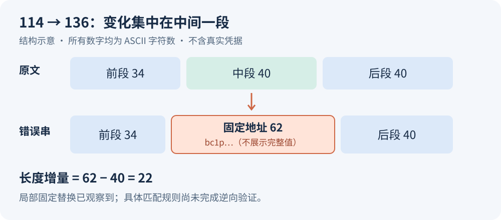
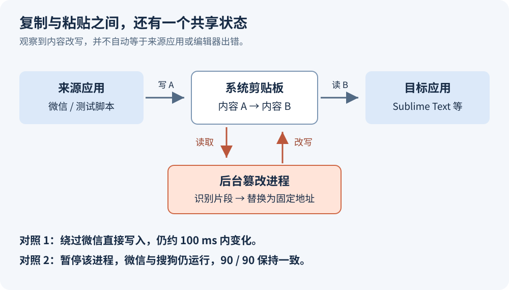

这次问题起于一个很小的动作：从微信（WeChat）Windows 版的文件传输助手里复制 API Key，再粘贴到 Sublime Text。原文看起来正常，粘贴后的内容却变了。这件事消耗了我一晚上的时间，最初的怀疑集中在微信、搜狗输入法（Sogou Input Method）和编辑器之间。

排查最后确认了剪贴板劫持（Clipboard Hijacking）行为，并继续发现了防病毒排除项（Antivirus Exclusions）被写入、伪装系统组件、计划任务（Scheduled Task）和恶意动态链接库（Dynamic-Link Library，DLL）等问题。**剪贴板异常只是这台电脑被感染后暴露出来的一个症状。**

本文按本机日志、文件哈希和实际测试整理，供有开发环境的个人 Windows 用户参考。状态截点为 **2026 年 10 月 22 日 21:22，北京时间（UTC+8）**：剪贴板与本机代理测试通过，但仍有活动威胁、待处理副本和恶意服务，系统修复也没有结束。这是一份阶段复盘，不能作为“已经清干净”的结案报告。文中的 Key 结构图使用抽象块，不包含真实凭据；恶意样本和原始私人日志也不进入博客仓库。

## 114 位变成 136 位，给了排查第一个方向

最初用“乱码”描述问题并不精确。进一步比较后，差异不是随机出现的中文、问号或不可见字符，而是一段可打印的英文字母和数字被替换了。原串的 40 字符中段被固定的 62 字符串替换，前后两段分别为 34 和 40 字符，保持不变。

这里的计数对象都是 ASCII 字符，字符数与字节数一致。相同的前后段、固定的插入内容，以及恰好 22 的长度差，指向了一次局部替换。插入的 62 字符串具有 `bc1p` 前缀，校验结果符合比特币（Bitcoin）Taproot 地址使用的 Bech32m 格式。格式有效不代表已经查明地址归属；本文也不展示完整地址。

结合后面的公共测试地址实验，最合理的解释是：程序扫描剪贴板中像钱包地址的片段，将其改成预置收款地址；API Key 中的一段内容误触发了匹配。**局部替换与固定目标已经观察到，具体使用哪条正则表达式、匹配如何实现，还没有完成反汇编验证。** 不应把推测写成样本源码结论。

如果一直围绕编码切换、字体或输入法设置打转，就很难解释这种稳定的结构变化。这个阶段有用的动作，是把“看起来不同”变成可比较的位置、长度和重复内容。

## 把来源应用、共享剪贴板和粘贴目标拆开测试

“在微信里正常，到了 Sublime 就变化”，并不能直接确定责任在其中一个应用。Windows 剪贴板是共享状态：来源应用写入之后，后台进程仍可能在目标应用读取之前改写它。甚至仅仅切换窗口、不执行粘贴，也可能已经给了后台程序足够的处理时间。

Windows 提供剪贴板变更通知接口，例如 `AddClipboardFormatListener` 可以让窗口接收内容变化消息。这说明后台监视在系统机制上是可行的；它不证明本次样本一定调用了这个接口。MITRE ATT&CK 的 [Clipboard Data（T1115）](https://attack.mitre.org/techniques/T1115/) 也记录了攻击者监视并替换剪贴板的行为。[Windows 接口文档](https://learn.microsoft.com/en-us/windows/win32/api/winuser/nf-winuser-addclipboardformatlistener)解释了通知机制。

排查中真正改变判断的是下面几组实验。测试不再反复使用真实 Key，而使用公开测试地址和构造字符串。

| 实验条件 | 实际观察 | 能支持的判断 |
| --- | --- | --- |
| 通过 PowerShell 直接写入公共测试地址，不经过微信和 Sublime | 约 100 毫秒内变成固定目标地址 | 篡改不依赖微信复制流程，也不依赖 Sublime 粘贴流程 |
| 暂停已定位的可疑进程，微信和搜狗仍在运行 | 90 次采样均保持原文 | 该进程与篡改有直接关联；没有必要先卸载输入法来碰运气 |
| 初步处置后，在 Sublime 用构造的 114 字符串粘贴，再全选复制回验 | 长度和内容均与输入一致 | 这条实际使用路径恢复正常 |
| 当晚重启后，分别测试公共的 34 字符串和构造的 114 字符串 | 每组 40 次采样均一致 | 在这次测试窗口内，没有复现原来的剪贴板改写 |

这些结果足以定位本次篡改的主要执行进程，不能据此宣布所有应用永远没有问题，也不能宣布整台机器安全。最后一行后来尤其重要：它和新的恶意服务同时存在。

已定位的剪贴板篡改程序位于用户目录下的伪系统路径：

路径：`%APPDATA%\Microsoft\Windows\Shell\w8t3rn5vqz.exe`。

SHA-256：<code style="overflow-wrap: anywhere; white-space: normal">4E6AC496262280AE7D683B8F40C5931DD98F8B5DCD87145891CD0EE1343FB3C7</code>。

这个文件没有有效签名，带有隐藏、系统属性，并伪装成 Windows Runtime Broker。启动目录中也找到了同哈希副本；晚间进一步搜索时，Temp 中又发现了相同副本。路径或无签名本身都不足以判恶，行为对照和文件内容一致性才把这些线索接在一起。

保留样本的静态检查还发现了 WinINet 网络接口、动态加载相关接口和 URL 模板字符串。不过，导入某个接口只说明具备相关能力，不能证明它已经外传 Key。当前证据明确支持剪贴板篡改；是否窃取其他内容、是否还有其他控制端，仍没有完整结论。因此凭据应按潜在暴露处理，但报告不能虚构已经查到的外传链路。

## 恢复杀毒能力以后，才知道之前的扫描漏掉了什么

继续检查系统时，发现所有防火墙配置文件都处于关闭状态，Microsoft Defender Antivirus 的相关服务和策略也异常。恢复后还遇到两个问题：病毒定义落后约 213 天，以及扫描排除项包含整个 `C:\`。

整个磁盘被排除，会让“全盘扫描完成”这个提示失去原本期待的覆盖范围。早先的一次扫描即使结束，也不能据此认为 C 盘已经得到有效检查。Microsoft 文档明确区分了不同排除项：**文件、文件夹排除项会影响按需扫描、计划扫描及实时保护；进程排除项主要影响实时保护，不能混为一谈。** 本机的整盘路径排除是直接问题。[Defender 排除项说明](https://learn.microsoft.com/en-us/defender-endpoint/microsoft-defender-antivirus-exclusions-configure)给出了作用范围。

更关键的是，这些配置并非只有静态残留。排查捕获到用户目录中一个伪装为 WSL 组件的 `wslservice.exe` 启动 PowerShell，重新写入 `C:\` 和自身目录的排除项。它位于 `%APPDATA%\WSL`，签名校验异常；系统实际使用的 WSL 位于 `Program Files\WSL`。必须按路径、签名和行为区分，不能因为名称相同就把真正的开发环境一起删掉。

这使处理顺序发生变化：先停止配置回写者并处理其自启动入口，再恢复防护、移除排除项、更新定义，最后重新扫描。否则刚刚恢复的设置可能再次被改回去。

后续完成的工作包括恢复防火墙、Defender 相关服务与保护策略，清理异常排除项，恢复用户账户控制（User Account Control，UAC）和安全通知。病毒定义更新遇到一个下载渠道失败后，改用 Microsoft 官方更新渠道成功；晚间定义版本为 `1.461.145.0`，年龄为 0 天。20:32 重启后，实时保护、行为监控、下载文件检查和篡改防护的状态均为开启。

这些配置项恢复，是继续检查的前提。它们不能反向证明过去没有发生过窃取，也不能替代对残留启动链的验证。

## 一次扫描结束，与重启后的状态是两份证据

在排除项清理、定义更新后，上午重新进行了快速扫描和全盘扫描。全盘扫描从 08:04 持续到约 09:16，后续日志记录了多项威胁处置成功。当时的威胁记录一度均为非活动状态。

到这里很容易得出“问题已经解决”的判断。但当晚重启把这个判断推翻了。

| 时间或阶段 | 新的事实 | 对判断的影响 |
| --- | --- | --- |
| 初步控制剪贴板进程后 | 公共字符串与 Sublime 回验通过 | 证明原症状可以被控制 |
| 10 月 22 日上午 | 防护恢复、定义更新、清理排除项后重新扫描 | 提升了扫描覆盖的有效性 |
| 20:32 重启后 | Defender 检出两个改名的有效签名宿主旁边的恶意 `libcurl.dll` | 登录或启动后的执行路径仍有残留 |
| 约 20:55 起 | 隔离 233 处同哈希副本及两个用于侧载的改名宿主 | 扩大了处置范围，但这只是当批处理结果 |
| 21:00—21:12 | 禁用三项残留任务，调整防火墙后再次快速扫描 | 扫描继续暴露新的 DLL 与服务线索 |
| 21:13 的限定目录哈希搜索 | 又匹配到 245 处已知样本副本，包含一份剪贴板篡改程序 | 之前的隔离没有覆盖所有位置 |
| 21:22 状态截点 | 活动威胁 1 项、两项恶意服务仍运行，新增副本隔离尚未开始 | 不能宣布环境正常或恢复可信 |

这里的 233 和 245 是不同批次记录的文件位置数，不是独立病毒家族数，也不能据此推算攻击次数。副本可以改名、重新释放，或藏在之前没有检查的位置。晚间的哈希搜索限定了五类目录，并优先检查与已知样本长度相符的文件：枚举了 12,890 个 EXE/DLL 路径，对 305 个候选计算哈希，跳过 82 个候选，匹配 245 处。它是追查已知样本的补充手段，不是对整台电脑所有文件的穷尽扫描，更不能识别所有未知变种。

当晚还出现了两类容易误判的现象。

第一类是有效签名宿主旁边的恶意 DLL。两个被改名的宿主本身是签名有效的 Notepad++ 可执行文件，恶意 `libcurl.dll` 位于同目录。这个组合符合 DLL 侧载（DLL Sideloading）的典型路径：合法程序启动后，加载攻击者安排的 DLL。**这不说明官方 Notepad++ 安装包被攻破。** Microsoft 的 [DLL 安全说明](https://learn.microsoft.com/en-us/windows/win32/dlls/dynamic-link-library-security)与 MITRE 的 [T1574.001](https://attack.mitre.org/techniques/T1574/001/)解释了这种机制；本机没有对每一个加载分支完成动态跟踪。

第二类是任务状态变化。一个此前处理过的任务后来以新的目标重新处于可运行状态，另有关闭保护的命令被 Defender 阻止。这说明仍需检查持续写入配置的执行者。不过，没有捕获到完整父子进程链的部分，不能直接归因于某一个样本“自我复活”。日志中的重新出现，需要继续追查写入者。

截至记录截点，`AmberJewelSvc` 与 `NexusRiverSvc` 两项服务仍在运行，并关联新检出的系统目录 DLL。下一批隔离脚本已经准备，尚在等待本机 UAC 确认。聊天中的授权与 Windows 的安全桌面确认是两层机制；状态文件尚未生成，就应记为“未开始”，不能写成“脚本已运行”。另一条系统组件修复任务已经开始，但 `DISM /RestoreHealth` 尚未结束，后续修复也没有验收。

## 来源能追到哪一步，不能追到哪一步

来源调查最想回答的是“我到底从哪里装进来的”。目前有一条值得保留的下载线索，但证据还没有闭合。

Edge 下载记录显示，3 月 3 日 19:39 和 19:41 下载过两个名为 Clash 的 ZIP，其中一条记录的页面来源为 `vpn-clash[.]com`，下载地址位于 `dosfsdzs[.]xyz`。19:48，用户目录出现一个名为 `Clash_setups_Windows_x64_...` 的安装目录，内部存在与代理客户端用途不相称的内容，相关计划任务会执行该目录中的程序。这里保留去活化域名，仅用于记录线索，请勿访问。

时间相邻、下载来源异常、安装内容和任务行为可疑，使这条线索值得调查。但原始 ZIP 已不在下载目录，没有拿到从压缩包、释放文件、子进程直到已确认剪贴板样本的完整链路。对保留安装文件的静态检查也没有找到剪贴板样本的完整原始字节；这既不能排除压缩、加密或后续下载，也不能补上缺失证据。

因此，目前可以说的是“存在可疑代理安装包来源线索”，不能说“这份 ZIP 已经被证明是全部恶意程序的唯一入口”。更不能把这件事扩展成所有 Clash 客户端都有问题。

文件时间也不能直接充当感染时间。有些相关文件日期相隔数月，可能继承打包时间、复制时间，甚至经过修改。公开查询目前也没有得到可靠的攻击组织归属。附近出现过某个软件的下载记录，同样不能证明那个软件参与了感染。此次没有找到微信或搜狗是入侵来源的证据。

## 恢复开发环境时，功能验证与安全验收要分开

这台电脑还运行 Windows Subsystem for Linux（WSL）开发环境。处理过程中，需要同时保留工作数据和缩小不必要的暴露面。

代理需求只有 Windows 本机与 WSL。运行配置和持久化配置都调整为 `allow-lan: false`、绑定 `127.0.0.1`，端口为 7890。原先对外监听的入口收回本机后，分别从 Windows 和 WSL 测得 HTTP 200，局域网地址连接失败；重启后再次验证了监听地址与功能。

这个结果依赖本机的镜像网络（Mirrored Networking）模式。Microsoft 的 [WSL 网络文档](https://learn.microsoft.com/en-us/windows/wsl/networking)说明，镜像模式允许 Windows 与 WSL 通过 `localhost` 互访。使用默认 NAT 模式的机器，不能不检查网络模式就照抄配置。

全机检查也核对了启动项、计划任务、服务、防火墙、远程入口、磁盘空间和系统完整性，没有把“优化”理解成大批删除文件。正在使用的 WSL 缓存、模型文件和虚拟磁盘有实际工作用途；硬链接（Hard Link）指向同一份数据，也不能按多个路径重复计算可回收空间。删除这些内容会造成新的损失，却不能证明恶意启动链已消失。

系统完整性检查同样要看具体对象。`DISM /ScanHealth` 报告组件存储可修复；此前 `SFC /verifyonly` 的结果不能抵消这个结论，因为它们覆盖的对象不同。随后运行 `DISM /RestoreHealth` 并安排 SFC 修复，属于系统文件修复流程，也不等于查杀所有恶意程序。[Microsoft 的修复说明](https://support.microsoft.com/en-us/windows/experience/backup-recovery/use-the-system-file-checker-tool-to-repair-missing-or-corrupted-system-files)给出了两者的使用顺序。

截至截点，当前状态应该这样拆开看：

| 验证对象 | 已获得的结果 | 仍然存在的边界 |
| --- | --- | --- |
| 剪贴板 | 两组公开或构造字符串各 40 次一致 | 只覆盖测试窗口与相应触发条件 |
| Defender 与防火墙 | 防护项开启，定义已更新，排除项复查为空 | 仍检出活动威胁，且存在未完成的处置 |
| 本机与 WSL 代理 | 回环监听，两个环境功能测试通过，重启后配置保持 | 不是对其他进程网络行为的全面审计 |
| 恶意文件与启动入口 | 多批隔离、任务禁用已记录，文件移动后核对哈希 | 245 处新增匹配与两项服务尚未完成处理 |
| Windows 组件修复 | 修复任务运行中 | 尚无完成结果，也尚无后续验收 |
| 凭据与 Linux 文件 | 已明确需要单独处理 | 没有凭据轮换完成记录；Windows 扫描不等于 Linux 虚拟磁盘内部完整扫描 |

## 这次排查给后续工作留下的约束

对个人开发机来说，最耗时的部分往往是建立足够可信的证据，而不仅是找到一个可疑文件。这次有几条经验可以直接落实。

**遇到文本异常，先用公开、可重复的输入隔离路径。** 记录长度、差异区间与变化时间，再分别绕过来源应用、目标应用和后台进程。反复复制真实 Key 会扩大暴露面，也容易把被改写后的内容当成另一份原文。自动化诊断同样会碰剪贴板，应该避免测试工具自行回写，不能只凭一次切窗现象就定位责任。

**评估扫描结果前，先评估扫描条件。** 定义版本、保护状态、排除项、扫描范围和时间截点，是结果的一部分。一次“扫描完成”不能越过整盘排除项，更不能替代下一次登录后的检查。后续复查还要关注配置是否被重新写入。

**把每次处置记录成可核验状态。** 路径、SHA-256、签名、任务目标、服务状态和错误日志，能区分“发现”“准备处理”“隔离成功”“验证通过”。按已确认哈希处理副本，比凭名称删除所有 `wslservice.exe` 或带 Windows 字样的程序更可控。需要管理员确认的步骤要明确停在哪一层，不能把已经生成的脚本当作已经执行的修复。

**软件下载要验证整个分发链。** 优先从项目明确列出的发布入口获取，核对发布者、版本和可用校验信息，不为安装方便关闭杀毒或添加整盘排除。签名能帮助判断某个文件的发布者与完整性，却不能为同目录 DLL、安装器释放的其他内容和后续网络下载担保。

**凭据恢复应在可信设备上完成。** 已经在受感染机器上使用、复制或贴到聊天中的真实 Key，应由对应服务撤销旧值、生成新值，并检查调用与费用记录。更广的登录凭据是否需要轮换，要结合实际使用范围处理。本文没有完成记录，不能把这项写成已办；新的长期凭据也不应立即回填到仍有活动威胁的机器。

当前收尾工作的顺序，是处理剩余服务和已知副本，复核防护设置，等待并检查系统修复结果，然后在有保存与备份的前提下安排重启后的复测。备份要同时考虑 Windows 工作文件和 WSL 中不可重建的数据，不能只看到宿主系统扫描通过，就认为 Linux 环境已被完整检查。

对于这台已经出现多处持久化（Persistence）、防护配置篡改和系统目录恶意文件的开发机，手动清理仍有覆盖边界。**用可信安装介质重装 Windows，是应当认真安排的恢复方案；本次尚未执行。** Microsoft 的 [Windows 恢复选项](https://support.microsoft.com/en-gb/windows/experience/backup-recovery/recovery-options-in-windows)也将感染恶意软件列为使用安装介质重装的适用情形。重装前应备份必要数据、记录开发环境，并在恢复文件时避免把未知安装包和可执行文件原样带回；重装也不能替代撤销已经暴露的凭据。

这份记录保留在“尚未恢复可信”的位置。后续只有拿到剩余处置、系统修复和重启复测的实际结果，才能补上新的状态；如果最终选择重装，也应把它作为另一项有记录的恢复动作，而不是用今天已经恢复的复制功能代替验收。
