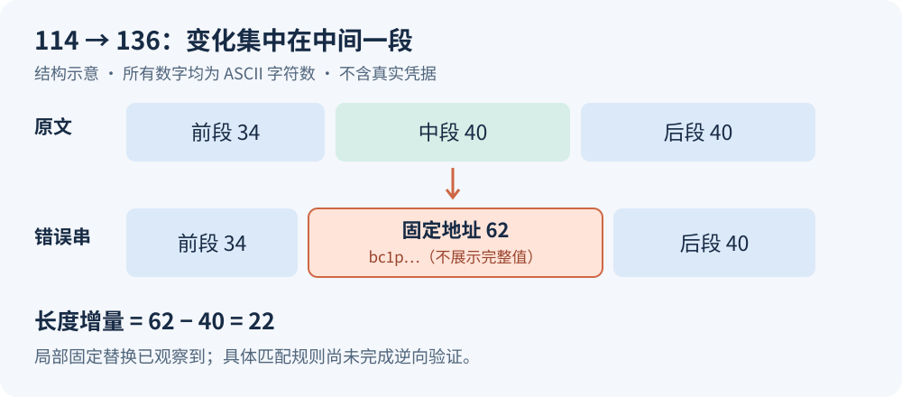
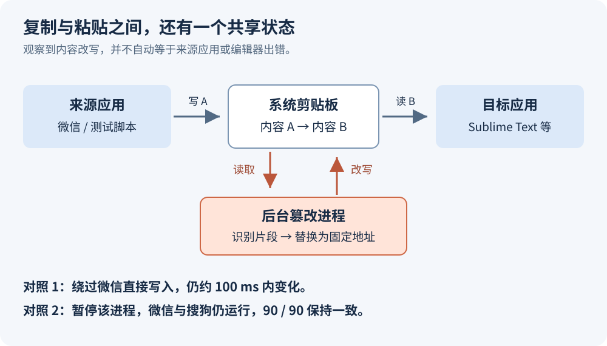

事情的起点小得不能再小：我从微信 Windows 版的文件传输助手里复制了一串 API Key，切到 Sublime Text 按下粘贴，接口却一直报鉴权失败。肉眼扫过去首尾都没错，直到把两串字符逐字对齐，才发现粘贴出来的字符串变长了。

最初的直觉全往日常软件上靠——是不是微信复制带了隐形格式？搜狗输入法开了某种自动纠错？还是编辑器的编码插件抽风？折腾了一圈才意识到方向彻底错了：顺着这串多出来的 22 个字符一路往下挖，背后竟然藏着剪贴板劫持木马（Clipboard Hijacker）、被整盘架空的 Windows Defender、伪装成 WSL 组件的配置回写进程，以及利用正版软件做白加黑侧载（DLL Sideloading）的多重持久化残留。**复制粘贴异常，只是这台开发机早已失守后露出的冰山一角。**

---

## 一、把“乱码”变成精确数字：114 位为什么变成了 136 位？

排障最怕停留在“内容好像变乱了”这种模糊印象上。如果真是编码错乱或输入法误触，变化应当带有随机性，或者夹杂中文字符、不可见控制符。于是我把原串和粘贴后的结果放到一起做字节级比对，立刻看到了一个高度规整的结构：



两边全都是标准 ASCII 可打印字符：

- 开头 **34 个字符**分毫不差；
- 结尾 **40 个字符**也原封不动；
- 唯独中间那段 **40 个字符**，被精准替换成了一段固定不变的 **62 个字符**，总长度刚好从 114 涨到 136（净增 22 个字符）。

再看那段多出来的 62 位字符串：它以 `bc1p` 开头，校验格式完全符合比特币（Bitcoin）Taproot 地址采用的 Bech32m 编码。谜底瞬间清晰了——这是典型的**加密货币剪贴板劫持木马（Crypto Clipper）**。木马在后台盯着剪贴板，一旦发现长得像钱包地址的字母数字片段，就偷梁换柱改成攻击者预设的收款地址；只不过我的 API Key 中间恰好有一段 40 位的字符形态撞上了它的正则规则，被当成钱包地址给“截胡”了。

只要看清“定长切分 + 合法 `bc1p` 地址替换”这个事实，就不用再去怀疑字体、编码或编辑器了——没有任何正常软件的 Bug 会恰好拼出一个通过校验的比特币地址。

---

## 二、共享状态隔离实验：不卸软件，怎么抓出幕后黑手？

即便确认了是恶意篡改，下一个问题依然棘手：“在微信里看是好的，粘到 Sublime 里就变了”，到底是微信写进去时被钩住了，还是 Sublime 读出来时被改了，抑或是第三方后台进程干的？很多人遇到这种情况会开始盲目卸载输入法、重装微信，既破坏现场又碰运气。

从操作系统原理看，Windows 剪贴板是一块**全局共享可变状态（Shared Mutable State）**，并且提供了现成的订阅机制——任何后台窗口只要调用 [Win32 `AddClipboardFormatListener`](https://learn.microsoft.com/en-us/windows/win32/api/winuser/nf-winuser-addclipboardformatlistener)，就能在别人按下 `Ctrl+C` 的几毫秒内收到系统通知，悄悄读出内容、改写后再塞回去（对应 MITRE ATT&CK 中的 [Clipboard Data T1115](https://attack.mitre.org/techniques/T1115/)）。等你在目标窗口按下 `Ctrl+V` 时，拿到的早已是掉包后的脏数据。



既然剪贴板是一条公共总线，最干净的定位办法就是做**控制变量实验**：不再复制真实 API Key（避免反复向恶意程序喂敏感凭据），改用公开测试地址和构造的 114 位假字符串，把“写入方”“总线监听者”和“读取方”拆开测：

| 对照实验 | 观测结果 | 直接推论 |
| --- | --- | --- |
| **绕开微信与 Sublime**：用 PowerShell 直接向系统剪贴板写入公开测试地址并立即回读 | 约 **100 ms** 内内容就被改写成同一个 `bc1p` 地址 | 微信和 Sublime 都是无辜的，篡改发生在系统剪贴板后台监听层 |
| **保持微信与搜狗输入法运行，仅挂起（Suspend）筛选出的可疑后台进程** | 连续采样 **90 次**，剪贴板原文纹丝不动 | 直接锁定篡改执行体，无需卸载输入法或聊天软件 |
| **处置该进程后，在 Sublime 中粘贴 114 位构造串并全选复制回验** | 长度与内容 100% 一致 | 日常开发复制粘贴链路恢复正常 |
| **当晚重启系统后，用 34 位测试串与 114 位构造串再次抽检** | 两组各 **40 次**采样均未发生篡改 | 剪贴板篡改分支在当前窗口内已被压住 |

被当场抓获的进程藏在一个极具迷惑性的用户态伪系统目录里：

- **路径**：`%APPDATA%\Microsoft\Windows\Shell\w8t3rn5vqz.exe`
- **SHA-256**：<code style="overflow-wrap: anywhere; white-space: normal">4E6AC496262280AE7D683B8F40C5931DD98F8B5DCD87145891CD0EE1343FB3C7</code>

这个文件没有数字签名，挂着“隐藏 + 系统”属性，文件描述伪装成系统的 `Windows Runtime Broker`，并在用户启动目录（Startup）和 `Temp` 下留有同哈希副本。静态检查其导入表还能看到 `WinINet` 网络接口、动态加载 API 和 URL 模板字符串——虽然单看导入表还不能断定它当时是否已把我的 API Key 发往远端，但站在安全止损的角度，**凡是在这台机器剪贴板里走过一遍的真实密钥，都必须当作已经泄露去轮换**。

---

## 三、为什么杀毒软件全盘扫描说“没问题”？先查裁判有没有被收买

抓出 `w8t3rn5vqz.exe` 后，一个更让人后背发凉的问题浮了上来：Windows 自带的 Microsoft Defender 一直开着，之前甚至跑过扫描，为什么对这么明显的木马毫无反应？

去查防火墙和 Defender 底层状态时，才发现“裁判”早就被蒙上了眼睛：

1. 系统防火墙的三个配置文件全部处于关闭状态；
2. Defender 病毒库定义停留在 **213 天前**；
3. 最致命的一刀：**Defender 的路径排除列表（Exclusions）里，赫然躺着整个 `C:\`！**

按照 [Microsoft Defender 排除项机制](https://learn.microsoft.com/en-us/defender-endpoint/microsoft-defender-antivirus-exclusions-configure)，一旦文件夹路径被加入排除项，不论是实时监控、计划扫描还是手动点下的“全盘扫描”，都会直接跳过该目录。也就是说，此前界面上显示的“扫描完成，未发现威胁”，实际上等价于“成功跳过了整个 C 盘”。

而且当我尝试手动删掉 `C:\` 排除项时，发现事情还没那么简单——后台有个东西在跟管理员抢配置！顺着进程创建日志抓过去，抓到了第二个伪装者：位于 `%APPDATA%\WSL\wslservice.exe` 的异常程序（签名无效；系统正版 WSL 服务位于 `Program Files\WSL`）。它会定时拉起 PowerShell，把 `C:\` 和它自己的藏身目录重新写回 Defender 排除项。

这一下就把处置顺序彻底理顺了：如果先开扫描、后杀守护进程，排除项随时会被改回去，扫描结果依然作废。正确的动作序列必须是：

```text
先掐断 %APPDATA%\WSL\wslservice.exe 及其自启动项（停止配置回写）
  → 恢复防火墙、UAC 与 Defender 实时保护策略
  → 清空整盘排除项并复查确认不会反弹
  → 强制走微软官方源把病毒库更新至最新（1.461.145.0，延迟 0 天）
  → 重新发起全盘扫描与重启验证
```

---

## 四、“扫描清零”不等于结束：重启才是最好的照妖镜

10 月 22 日上午，在清空排除项并更新病毒库后，我跑完了一次长达一小时的全盘扫描（08:04–09:16），Defender 报出一串威胁处置成功，面板一时恢复了平静。

如果故事停在这里，很容易让人产生“大功告成”的错觉。但持久化木马最喜欢藏在登录触发器、服务注册表和白加黑启动链里——只要不重启，未激活的加载分支就不会露头。当晚 **20:32** 我重启机器做复验，潜伏的第二波残留立刻浮出了水面：

| 时间节点 | 暴露的新现场 | 背后的机制说明 |
| --- | --- | --- |
| **20:32 重启登录后** | Defender 拦截到两个改名可执行文件旁边的恶意 `libcurl.dll` | 典型的 **DLL 侧载（[T1574.001](https://attack.mitre.org/techniques/T1574/001/)）**：攻击者拿带有合法数字签名的正版 Notepad++ 主程序改名当壳，启动时自动加载同目录下的恶意 `libcurl.dll`（并非 Notepad++ 官方被黑） |
| **20:55 左右** | 批量隔离 233 处同哈希样本副本及两个用于侧载的正版宿主壳 | 恶意程序在多处目录做了高密度文件撒播 |
| **21:00–21:12** | 禁用三项残留计划任务；其中一个曾处理过的任务以新目标死灰复燃，另有企图关防护的命令被实时拦截 | 说明仍有未拔除的守护者在尝试重写持久化入口 |
| **21:13 专项哈希搜捕** | 在五类重点目录枚举 12,890 个 EXE/DLL，按文件大小初筛 305 个候选算哈希，又命中 **245 处**已知样本副本 | 常规目录之外的角落仍藏有未触发拷贝 |
| **21:22 记录截点** | `AmberJewelSvc` 与 `NexusRiverSvc` 两项恶意服务仍在运行（关联系统目录恶意 DLL）；新一轮隔离脚本待本机 UAC 安全桌面确认，`DISM /RestoreHealth` 正在后台修复系统组件 | 机器仍处于活跃对抗态，远未达到可信交付标准 |

这次感染最初是从哪儿进来的？翻查 Edge 历史下载记录找到了一条高度可疑的线索：早在 3 月 3 日 19:39 与 19:41，本机曾从非官方页面 `vpn-clash[.]com`（实际下载源 `dosfsdzs[.]xyz`，已做去活化处理，切勿访问）下过两个名为 Clash 的压缩包；7 分钟后（19:48），用户目录下就生成了 `Clash_setups_Windows_x64_...` 文件夹，里面塞满了与代理工具毫不相干的程序，并注册了对应的计划任务。由于半年前的原始 ZIP 包早已删除，目前无法做字节级溯源闭环，但“山寨搜索广告 + 投毒安装包”大概率就是这场漫长潜伏的起点。

把整条潜伏链与排障步骤拼回同一张图里，就能明白为什么处置顺序一步都不能乱：伪装的 `wslservice.exe` 用排除项回写掩护驻留样本，改名正版壳又靠白加黑侧载跨重启复活；只有先掐断回写守护、再恢复扫描能力，并用重启把未激活的侧载链逼出来，清理动作才不会沦为拉锯战。



---

## 五、开发环境止损与收尾纪律

因为这台机器上还跑着日常重度使用的 WSL（Windows Subsystem for Linux）开发环境，在彻底重装系统之前，需要先做两件事：缩小网络暴露面，同时保住不能丢的工作数据。

1. **收紧本地代理监听面**：日常只有 Windows 宿主和 WSL 需要走代理（端口 `7890`）。由于本机开启了 [WSL 镜像网络模式（Mirrored Networking）](https://learn.microsoft.com/en-us/windows/wsl/networking)，Windows 与 WSL 天然共享 `localhost`，根本不需要对局域网暴露端口。我把运行态与配置文件统一锁死为 `allow-lan: false`、仅绑定 `127.0.0.1`，实测宿主与 WSL 内均返回 HTTP 200，局域网 IP 连接直接拒绝，重启后依然生效。
2. **精准按哈希清剿，不乱删工作盘**：清理时严格按已确认的恶意文件 SHA-256 动手，绝不看到名字带 `wsl` 就一刀切误伤 `Program Files\WSL` 或虚拟磁盘（`.vhdx`），也不被硬链接（Hard Link）的重复路径误导去乱清模型缓存。系统文件层面，先用 `DISM /ScanHealth` 与 `DISM /RestoreHealth` 修复受损的组件存储，再衔接 `SFC` 校验系统文件。

回看这一整晚的折腾，有五条带血的实战经验值得记在手边：

- **遇到剪贴板或文本异常，先量长度和字节偏移，再用无害假数据做总线隔离测试**——别拿真密钥反复试，更别上来就乱卸软件破坏现场。
- **看扫描报告前先验扫描器配置**：病毒库年龄、实时保护开关，尤其是**路径排除项（`Get-MpPreference`）**不先看一眼，“零威胁”三个字毫无意义。
- **有守护进程时，先断回写源、再改配置**，并且一定要用**重启**检验登录触发项与白加黑 DLL 侧载。
- **装基础工具只认项目官方 Release 与校验哈希**——搜索引擎排第一的仿冒站点和要求“先关杀毒再安装”的打包器，十有八九藏着后门。
- **受污染机器只做数据抢救，最终信任靠重装建立**：所有曾在这台电脑上复制或明文存放过的密钥，全部换一台干净设备去撤销轮换；等手头不可重建的代码与 WSL 数据备份妥当后，遵照 [Windows 官方介质重装指南](https://support.microsoft.com/en-gb/windows/experience/backup-recovery/recovery-options-in-windows) 用干净 U 盘抹盘重装，才是面对深度持久化木马唯一真正放心的终点。

---

> **排查记录说明**：本文整理自本机实测、文件哈希与系统日志，状态截点为 **2026-10-22 21:22（UTC+8）**。截点时剪贴板篡改已被压制、本机与 WSL 代理已收口，但仍有待隔离的样本副本与两项可疑服务，属于排障中途的阶段复盘；文中涉及的凭据结构均已脱敏。
